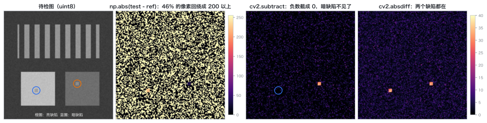
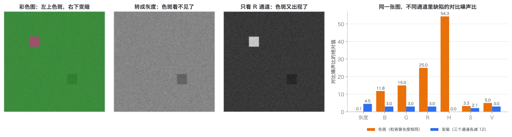
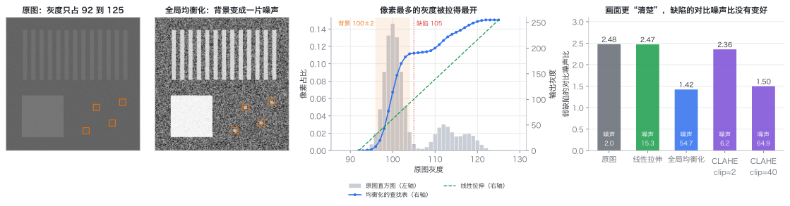
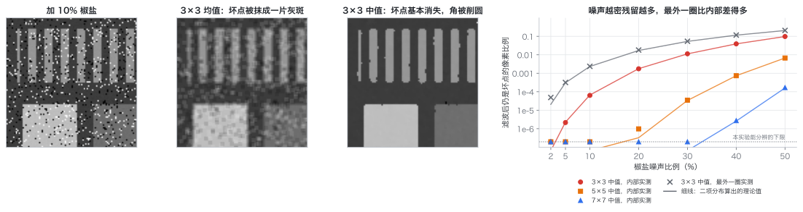
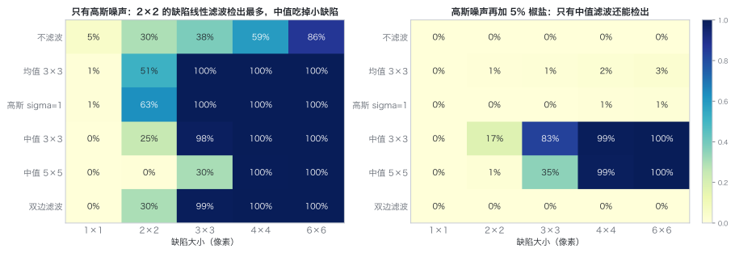
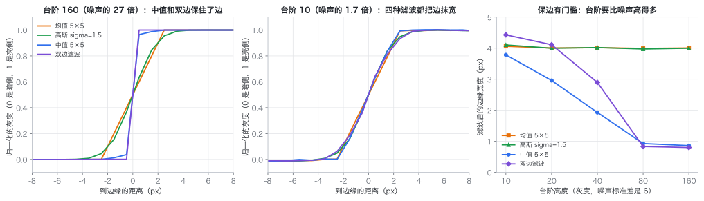

# 第 1 天：像素与色彩 —— 教程

> 配套练习：`1-1_直方图均衡化.py` | `1-2_通道分离与伪彩色.py` | `1-3_椒盐噪声与中值滤波.py`

---

> [!NOTE]
> 本章所有数字都来自合成数据上的实测，记录在 [`figures/实测数字.json`](figures/实测数字.json)，由 `solutions` 分支的 `solutions/figures/ch01.py` 生成，实测环境是 NumPy 2.5.4 和 OpenCV 5.0.0。直方图均衡化、亮度增强、椒盐噪声和中值滤波用的是本章三个作业的参考实现。换成真实图像或别的库版本，数值会变，结论的方向要自己再测一遍。

## 0. 本章怎么学

**应用场景**：所有检测算法的输入预处理：对比度拉伸、去噪、色彩空间转换。后面每一章拿到的图都是 `uint8` 数组，每一条检测流水线的最前面都要决定“要不要增强、要不要滤波、用哪个通道”。这一章用实测回答这三个决定各自的代价。

**优先级**：P0。没有前置章节，会用 NumPy 的切片和广播就能读。第 2 章的卷积、第 3 章的二值化、第 18 章的模板比对都直接用到本章的内容。

| 档位 | 累计用时 | 做什么 | 做到什么算完 |
|---|---:|---|---|
| 速通 | 4 小时 | 读 1.1 节；1.2 到 1.5 节先跳过原理，只读带配图和实测表的小节，看懂图 1 到图 5；做 1.6 节演示的五步；答完 5 道小测 | 能讲清 `uint8` 相减为什么会出一片假缺陷，均衡化为什么没有提高弱缺陷的对比噪声比，中值滤波适合什么噪声、会抹掉多大的东西 |
| 标准 | 7 小时 | 读完全章，跑 Notebook，过一遍“动手前的检查清单”，完成三个作业并验收通过，做 1.9 节前三个破坏实验，填实验记录 | `tests/check_progress.py` 显示“模块通过：3/3”，实验记录里有一个失败案例，自测问题都能答 |
| 深挖 | 8 小时 | 再做 1.9 节剩下的破坏实验和 1.10 节的扩展 | 在一张自己准备的图上，按 1.7 节的格式报告一种预处理对目标对比噪声比的影响 |

> [!TIP]
> 用时超过所选档位的 1.5 倍还没做完，就把卡点写进 `学习进度.md`，先往下一章走。速通档完成后本章就算“见过”，以后用到再升档。本章内容多但都不难，标准档不要在 HSV 的细节上花太久。

---

## 1.1 图像是什么

### 一个让你不再困惑坐标系的开场

打开一张 1920×1080 的照片。在 Python 里，它就是：

```python
img.shape   # → (1080, 1920, 3)  高度在前，宽度在后！
```

这是**第一个坑**：数组索引是 `img[row, col]`，而人类习惯说"宽×高"。在 OpenCV 里，`cv2.resize(img, (width, height))` 的参数顺序又是 `(宽, 高)`——和 NumPy shape 的 `(高, 宽)` 正好相反。这会在你调试 bug 时反复出现，记住它。

| 语境 | 顺序 |
|------|------|
| `img.shape` | `(rows, cols)` 即 `(高, 宽)` |
| `cv2.resize()` | `(width, height)` 即 `(宽, 高)` |
| 像素坐标 `(x, y)` | `x` = 列（宽方向），`y` = 行（高方向） |

实测：`cv2.resize(img, (640, 360))` 之后，`shape` 是 `(360, 640, 3)`。参数写反不会报错，只会得到一张拉变形的图。

### dtype 的秘密

```python
img = np.zeros((100, 100), dtype=np.uint8)   # 0-255
```

为什么是 `uint8`？因为每个像素用 8 位无符号整数存储，范围 [0, 255]。这意味着：

- 两个像素相加：`200 + 100 = 44`（溢出！因为 300 > 255，会绕回 300-256=44）
- 做运算前先转 `float32` 或 `float64`，算完再 `np.clip` 回 [0,255]

这也是为什么很多图像处理代码里会看到：

```python
img_float = img.astype(np.float32) / 255.0   # 归一化到 [0, 1]
# ... 处理 ...
result = np.round(result * 255).clip(0, 255).astype(np.uint8)   # 先四舍五入，再限制范围，最后转类型
```

最后一行的三步顺序有讲究，本节末尾“回写 `uint8` 的顺序”用数字说明。

### 不注意 dtype 会怎样：一次比对的实测

检测里最常见的运算是两张图相减（第 18 章的模板比对）。下面的实验用一张 128×128 的合成检测图，参考图和待检图各带标准差 3 的高斯噪声，并量化成 `uint8`。待检图上放一个 4×4 的亮缺陷（比周围亮 30）和一个 4×4 的暗缺陷（比周围暗 30）。差值大于 20 的像素算超限，缺陷内至少一半像素超限算检出，重复 200 次。



| 写法（两张图都是 `uint8`） | 每张图的误报像素（共 16384 个） | 亮缺陷检出（共 200 次） | 暗缺陷检出（共 200 次） |
|---|---:|---:|---:|
| `np.abs(test - ref)` | 7406.7（占 45.2%） | 200 | 200 |
| `cv2.subtract(test, ref)` | 不到 0.1 | 200 | 0 |
| `cv2.absdiff(test, ref)` | 不到 0.1 | 200 | 200 |
| 先转 `int16` 再相减取绝对值 | 不到 0.1 | 200 | 200 |

三种写法三种结果：

- **直接相减会回绕**。待检图比参考图暗的像素（第一次试验里占 45.9%），差是负数，回绕成 250 左右的大数。`np.abs` 帮不上忙，无符号数取绝对值什么也不做。全图近一半像素报警，表里“两个缺陷都检出”没有任何意义。
- **`cv2.subtract` 是饱和运算**，负数变成 0。不会出一片假缺陷，但所有比参考图暗的缺陷全部漏掉，200 次里一次都没检出。这种错比回绕更难发现，因为差值图看上去很干净。
- **`cv2.absdiff` 才是“差的绝对值”**。实测它和“先转 `int16` 再相减取绝对值”逐像素相同。

<!-- quiz -->
**参考图和待检图都是 `uint8`，图上没有缺陷，只有标准差 3 的噪声。用 `np.abs(test - ref) > 20` 做比对，大约多少像素会报警？**

- A. 几乎没有，噪声才 3 个灰度
- B. 将近一半
- C. 全部

<details markdown="1"><summary>答案与解释</summary>

**B**。实测 45.2%。凡是待检图比参考图暗的像素，差是负数，在 `uint8` 里回绕成 250 左右，`np.abs` 对无符号数不起作用。A 是用 `cv2.absdiff` 或先转 `int16` 时的结果。待检图比参考图亮或相等的那一半像素差值很小，所以不是全部。

</details>
<!-- /quiz -->

### uint8 运算规则速查

下表全部是本机实测，数组 `a`、`b` 都是 `uint8`。

| 写法 | 结果 | 说明 |
|---|---|---|
| `a + b`，200 加 100 | 44 | 回绕，不报错也不警告 |
| `cv2.add(a, b)` | 255 | 饱和 |
| `a - b`，100 减 105 | 251 | 回绕 |
| `cv2.subtract(a, b)` | 0 | 负数截成 0 |
| `cv2.absdiff(a, b)` | 5 | 差的绝对值 |
| `a * 2`，a 是 200 | 144 | 回绕 |
| `a * 1.5` | 300.0，类型变成 `float64` | 乘浮点数会自动变成浮点数组，不回绕 |
| `(a + a) // 2`，两帧取平均的常见错误写法 | 72 | 先回绕再除。`np.mean` 内部用浮点累加，结果是 200.0 |
| `a + 300`，加一个超范围的 Python 整数 | 抛出 `OverflowError` | 这是 NumPy 2 的行为，旧版本的规则不同，以你环境里的实测为准 |
| `np.uint8(200) + np.uint8(100)`，两个标量 | 44，并给出 `RuntimeWarning` | 只有标量运算才有警告，数组运算没有 |

规律：两个 `uint8` 数组做加、减、乘，结果还是 `uint8`，超范围就回绕，而且没有任何提示。OpenCV 的算术函数做的是饱和运算。两者都不等于“数学上正确的结果”，要正确结果就先转成更宽的类型。

### 回写 uint8 的顺序

算完之后转回 `uint8`，三步的顺序是：四舍五入，限制到 [0, 255]，转类型。少一步的后果都能量出来：

| 做法 | 实测 |
|---|---|
| 不四舍五入，直接 `astype(np.uint8)` | `astype` 是截断小数。0 到 255 均匀分布的浮点数，截断后平均偏低 0.501 个灰度，先四舍五入则平均偏差为 0 |
| 同上，看一次往返 | 对 0 到 255 每个灰度开方再平方（伽马变换及其逆变换），直接截断时 256 个灰度里有 69 个回不到原值，先四舍五入则 0 个 |
| 不限制范围，直接 `astype(np.uint8)` | 300.0 变成 44，-5.0 变成 251，256.0 变成 0，没有任何警告 |

很多代码里写的是 `(result * 255).clip(0, 255).astype(np.uint8)`，没有四舍五入。只做“除以 255 再乘 255”时它碰巧没有问题（实测 256 个灰度全部还原），中间只要有真正的运算，结果就会系统性偏暗半个灰度，所以上面的代码先做 `np.round`。越界的浮点数转整数，结果依赖平台，上表第三行只是这台机器上的表现，不要依赖它。

---

## 1.2 色彩空间：BGR、RGB、HSV

### 为什么 OpenCV 默认 BGR 而不是 RGB？

历史原因：OpenCV 诞生于 1999 年，那个时代的相机厂商（尤其是某些品牌）使用 BGR 像素排列。后来 RGB 成了主流，但 OpenCV 为了向后兼容保留了这个设定。所以：

```python
img = cv2.imread("photo.jpg")             # 读进来是 BGR！
plt.imshow(img)                            # 红蓝互换（因为 plt 以为是 RGB）
plt.imshow(cv2.cvtColor(img, cv2.COLOR_BGR2RGB))  # 正确显示
```

把 BGR 图直接交给按 RGB 解释的函数，后果是红色和蓝色互换，不是整体偏蓝。作业 1-2 的测试图里，红色块的像素存的是 BGR=(0, 0, 255)，不转换就显示，它被读成 (R, G, B)=(0, 0, 255)，红块显示成蓝块，蓝块显示成红块。这张图 B、R 两个通道的均值都是 113.0，互换之后整体色调并没有偏向蓝色。只有原图里红色比蓝色多的时候（例如人脸），互换后才显得偏蓝。

通道顺序错了，受影响的不只是显示。同一批随机颜色，把 BGR 图当成 RGB 去转灰度，结果和正确的灰度平均差 15.8 个灰度，最大差 47，而且不会有任何报错。

### 灰度图：从 3 通道到 1 通道

```python
gray = cv2.cvtColor(img, cv2.COLOR_BGR2GRAY)
```

灰度转换的公式（这是标准，不是随便平均）：

```
Gray = 0.299*R + 0.587*G + 0.114*B
```

为什么 G 的权重最高（58.7%）？因为人眼在明亮环境下对黄绿色一带的光最敏感，三个原色里绿色离这个峰值最近，对“看起来有多亮”的贡献最大。这组系数来自电视标准，是按人眼的亮度灵敏度定的，不是按哪一种视锥细胞数量多定的。你在做彩色图转灰度图的时候，如果简单地 `(R+G+B)/3`，人眼会觉得"对比度不对"。

实测 `cv2.cvtColor` 和这个公式四舍五入后的结果最多差 1 个灰度，0.15% 的像素不相等，差别出在取整上。纯红、纯绿、纯蓝转成灰度分别是 76、150、29。同一批随机颜色上，它和 `(R+G+B)/3` 最多能差 64.3 个灰度。

### 灰度不是唯一的选择：缺陷在哪个通道里

上面的系数是为人眼定的，不是为缺陷定的。彩色图转灰度是一次有损的投影，丢掉什么取决于缺陷的颜色。衡量“缺陷相对背景有多显眼”用对比噪声比（CNR，contrast-to-noise ratio），本章后面反复用到它：

$$
\text{CNR} = \frac{\lvert \mu_{\text{缺陷}} - \mu_{\text{背景}} \rvert}{\sigma_{\text{背景}}}
$$

下面的实验是一张 160×160 的合成彩色图，背景是 BGR=(60, 140, 60) 的绿色，每个通道独立加标准差 4 的高斯噪声。图上有两个 16×16 的缺陷：一个色斑 BGR=(107, 80, 160)，颜色是特意挑的，按灰度公式算和背景同为 107.0；一个变暗缺陷，三个通道各减 12。



| 单通道图 | 灰度 | B | G | R | H | S | V |
|---|---:|---:|---:|---:|---:|---:|---:|
| 背景噪声标准差 | 2.68 | 4.0 | 4.0 | 4.0 | 2.03 | 6.8 | 4.0 |
| 色斑的对比噪声比 | 0.1 | 11.8 | 15.0 | 25.0 | 54.3 | 3.3 | 5.0 |
| 变暗缺陷的对比噪声比 | 4.5 | 3.0 | 3.0 | 3.0 | 0.0 | 2.1 | 3.0 |

- **和背景亮度相同、只有颜色不同的缺陷，在灰度图里消失**。色斑的对比噪声比在灰度图里是 0.1，在 R 通道里是 25.0。
- **整体变亮或变暗的缺陷，灰度图反而比任何单个通道好**，4.5 对 3.0。灰度是三个通道的加权和，三份独立的噪声被平均掉一部分，背景噪声从 4.0 降到 2.68（理论倍数是 0.669）。
- **色调 H 只看颜色不看亮度**。色斑在 H 里最显眼（54.3），变暗缺陷在 H 里完全看不见（0.0）。

所以“先转灰度”是一个需要检查的决定。色斑是特意构造的最坏情况，真实缺陷很少刚好和背景同亮度，但会落在两者之间。另外，这个实验假设三个通道的噪声互相独立，真实彩色相机不一定满足，4.5 对 3.0 这个差距要用自己的相机再测。

### HSV：当你要基于颜色做事

RGB 用三个数字表示一个颜色，但"浅红"和"深红"在 RGB 空间里各自的 (R,G,B) 差别很大——没法用一个简单的阈值判断"这是红色家族"。

HSV 把颜色的三个属性拆开：
- **Hue（色调）**：这是什么颜色？—— 红色还是蓝色？[0°-360°]
- **Saturation（饱和度）**：这个颜色有多"纯"？—— 鲜艳还是灰白？[0-100%]
- **Value（亮度）**：有多亮？—— 独立于颜色本身。[0-100%]

这就是为什么图像增强在 HSV 空间做更方便：你只想提亮（改 V），不想改变颜色本身（H 和 S 不动）。

### HSV 在 OpenCV 里的三个实测细节

**取值范围和上面的定义不一样**。`uint8` 图转 HSV 之后，H 存的是角度的一半，取值 0 到 179；S 和 V 的满刻度是 255。纯红、纯绿、纯蓝的 H 分别是 0、60、120。红色正好跨在色调轴的两头：略偏橙的红 BGR=(0, 10, 255) 的 H 是 1，略偏品红的红 BGR=(10, 0, 255) 的 H 是 179。按色调挑红色要取两段再合并，对 H 直接求平均或者设一个阈值都会出错。

**来回转换有损**。同一批随机颜色做 BGR→HSV→BGR，只有 14.3% 的像素完全还原，平均误差 0.55 个灰度，最大 6 个灰度。原因是 H 只有 180 个取值。在 HSV 里什么都不改，转回来的图也已经不是原图。

**“改 V 不改颜色”只在发生截断时才和直接乘 BGR 有区别**。用作业 1-2 的 `enhance_brightness_hsv(img, 1.5)` 和“把 B、G、R 三个通道直接乘 1.5 再限制到 255”做对照，数据是 400×400 的随机颜色。色调误差只统计饱和度和亮度都大于 60 的像素，单位是度。

| 像素 | 比较什么 | HSV 里把 V 乘 1.5 | B、G、R 直接乘 1.5 |
|---|---|---:|---:|
| 乘完不超过 255 的（占 29.7%） | 两种做法结果的差 | 平均 1.22 个灰度，最大 5 | 同左 |
| 乘完会超过 255 的 | 色调误差的均值 | 0.5° | 11.0° |
| 乘完会超过 255 的 | 色调误差的 95% 分位 | 1.4° | 29.5° |

OpenCV 的 V 就是 B、G、R 三个值里最大的那个（实测逐像素相等），H 和 S 由三个值之间的比例决定。V 乘一个系数而 H、S 不动，等价于三个通道乘同一个系数。所以不发生截断时，两种做法的差只有 HSV 量化带来的一两个灰度。

区别在截断的时候。橙色 BGR=(40, 120, 200) 的色调是 30°。在 HSV 里乘 V，V 到 255 就停，三个通道仍按原比例，结果是 (51, 153, 255)，色调还是 30°，代价是没有亮到 1.5 倍。直接乘 BGR，R 通道先顶到 255，另外两个通道继续涨，结果是 (60, 180, 255)，色调变成 36°，颜色往黄偏。

还有一个和 1.1 节相同的坑：V 乘完是 300，忘了限制范围就转 `uint8`，在这台机器上变成 44，画面上最亮的地方出现黑斑。

<!-- quiz -->
**一张图把亮度乘 1.5 之后没有任何像素超过 255。在 HSV 里把 V 乘 1.5，和直接把 B、G、R 三个通道都乘 1.5，两个结果差多少？**

- A. 差别很大，只有 HSV 的做法能保住色调
- B. 平均只差 1 个灰度左右，来自 HSV 的量化误差
- C. 逐像素完全相同

<details markdown="1"><summary>答案与解释</summary>

**B**。实测平均差 1.22 个灰度，最大 5。V 是三个通道的最大值，H、S 不动时乘 V 就等于三个通道同乘一个系数，所以 A 不对。H 只有 180 个取值，来回转换本身有误差，所以也不是 C。两种做法真正的区别出现在截断时：色调误差的均值是 0.5° 对 11.0°。

</details>
<!-- /quiz -->

---

## 1.3 直方图：图像的"心电图"

### 直方图是什么

一张灰度图，统计每个灰度级（0-255）有多少个像素。形式上就是离散概率分布：

```
p(k) = n_k / N

其中 n_k = 灰度级 k 的像素数
     N   = 图像总像素数
```

一张过暗的照片的直方图会"挤"在左边（低灰度区）。一张过曝的照片挤在右边。一张正常的照片分布在中间。

作业提示里的 `np.histogram(img.flatten(), 256, [0, 256])` 返回两个数组：长度 256 的计数，和长度 257 的区间边界。只需要第一个。

### 直方图均衡化的数学

目标：让输出图像的直方图尽可能**均匀分布**。

怎么做？用**累积分布函数（CDF）做映射**。

```
步骤：
1. 统计直方图 hist[k]，k = 0..255
2. 累计：cdf[k] = hist[0] + ... + hist[k]
3. 找最暗像素的累计数：cdf_min = cdf 中第一个非零值
4. 映射：new_pixel = round((cdf[old_pixel] - cdf_min) / (N - cdf_min) * 255)
```

第 4 步减去 `cdf_min`，是为了让最暗的像素映射到 0、最亮的映射到 255，用满整个动态范围。`cv2.equalizeHist` 用的就是这个公式。如果直接用 `cdf / N * 255`，最暗像素会被映射到一个大于 0 的值，白白浪费了暗部的灰度级。

“`cv2.equalizeHist` 用的就是这个公式”是核对过的：按这四步写的参考实现和 `cv2.equalizeHist` 在 300 张图、共 14089600 个像素上逐像素比较，没有一个像素不同。

整个算法的输出是一张 256 项的查找表，每个输入灰度对应一个输出灰度。记住“均衡化就是查表”，下面“局限性”里的三个结论都从这一点来。

**为什么 CDF 能做到？**

如果输入图像偏暗（像素集中在低灰度区），CDF 在低区增长很快，映射后会把暗像素"拉开"到更广的范围。反过来，如果某些灰度范围像素很少，CDF 增长慢，映射后这些范围会被"压缩"。最终效果：输出直方图趋近均匀分布。

这里的数学完全对应你学过的概率论：把一个随机变量通过自己的 CDF 做变换，结果就是均匀分布 U(0,1)。直方图均衡化就是对这个定理的图像化应用。

这个定理说的是连续随机变量。图像的灰度是离散的，“趋近均匀”要打折扣，折扣有多大见“局限性”的第一条。

### 一个具体的例子

假设一张图只有 4 个像素：`[50, 50, 200, 200]`（两个暗，两个亮）

```
hist：50 处 2 个，200 处 2 个，N = 4
cdf[50] = 2，cdf[200] = 4，cdf_min = 2
不减 cdf_min：new = [2/4*255, 2/4*255, 4/4*255, 4/4*255] = [128, 128, 255, 255]
减去 cdf_min：new = [(2-2)/(4-2)*255, ..., (4-2)/(4-2)*255]   = [0, 0, 255, 255]
```

不减 `cdf_min` 时，两类像素的间距从 150 缩小到 127，对比度反而降低了；减去之后间距拉到 255，才是我们想要的“拉伸对比度”。这个小例子也说明：只有两个灰度级的图，均衡化能做的就是把它们推到两端。

### 局限性

CLAHE（Contrast Limited Adaptive Histogram Equalization）是改进版：它把图像分成小块，每个小块单独做均衡化，然后对对比度设上限。这是为了缓解一个问题：全局均衡化会把噪声也放大。

放大多少、对检测有没有帮助，可以量出来。下面的实验是一张 256×256 的低对比度合成检测图：背景灰度 100，线条 112，方块 118，高斯噪声标准差 2，整张图的灰度只占 90 到 128 这一小段。背景上有四个 6×6 的弱缺陷，比背景亮 5。背景噪声和对比噪声比都在缺陷所在的平坦背景区里统计，50 张不同噪声的图取平均。



| 处理 | 背景噪声标准差 | 缺陷与背景的灰度差 | 对比噪声比 | 用到的灰度级个数 |
|---|---:|---:|---:|---:|
| 原图 | 2.02 | 5.0 | 2.48 | 34.8 |
| 线性拉伸到 0 到 255 | 15.25 | 37.7 | 2.47 | 34.8 |
| 全局均衡化 | 54.72 | 77.8 | 1.42 | 29.4 |
| CLAHE，clipLimit=2 | 6.17 | 14.5 | 2.36 | 72.1 |
| CLAHE，clipLimit=4 | 9.82 | 20.7 | 2.11 | 98.1 |
| CLAHE，clipLimit=40 | 64.94 | 97.3 | 1.50 | 256.0 |

**第一，直方图没有变平**。图 3 那张图里，均衡化之前最高的直方图柱有 9575 个像素，均衡化之后还是 9575 个。查表只能把一根柱子整体搬到别的位置，或者把两根并成一根，不能把一根拆开。灰度级的个数也只会减少不会增加，平均从 34.8 个变成 29.4 个。变得接近均匀的是累积分布：它和理想均匀分布的最大偏差从 0.52 降到 0.145。

**第二，弱缺陷的对比噪声比没有提高，反而降了 43%**。缺陷和背景的灰度差从 5.0 变成 77.8，放大了 15.6 倍，画面上确实醒目得多。但背景噪声从 2.02 变成 54.72，放大了 27.1 倍。原因在图 3 左三栏：查找表的斜率正比于直方图的高度，像素最多的灰度被拉得最开。背景是多数派，灰度 98 到 102（背景均值上下各一个标准差）被映射到 43 到 170，跨了 127 个输出灰度。缺陷是少数派，落在直方图的尾部，从背景的 100 到缺陷的 105 只走了 114 到 190，共 76 个输出灰度。均衡化把动态范围分给了背景的噪声。

**第三，线性拉伸不改变对比噪声比**（2.48 对 2.47）。信号和噪声乘了同一个系数。它对人眼看图有用，对后面的算法既没有帮助也没有坏处。

**第四，CLAHE 是限制了噪声放大，没有避免**。clipLimit=2 时背景噪声放大 3.1 倍，对比噪声比 2.36，比原图低 5%。clipLimit 越大越接近不设上限，取到 40 时噪声放大 32.1 倍，比全局均衡化的 27.1 倍还多。表里六行，没有一行的对比噪声比高于原图。

这四条背后是同一个道理：逐像素的灰度映射不产生新信息。均衡化是单调映射，不改变像素之间的大小顺序。用“缺陷像素比背景像素亮的概率”（AUC）来衡量可分性，原图是 0.9591，均衡化之后是 0.9589。对单个像素设一个阈值，均衡化前后能做到的一样好。CLAHE 不是逐像素的映射，同一个灰度在不同分块里会映射成不同的值，所以它的 AUC 会变：clipLimit=2 时是 0.9624，比原图高 0.0033；clipLimit=4 和 40 时是 0.9547 和 0.9567，比原图低。变差的是后面所有带线性运算的步骤（求平均、相减、算标准差），因为背景噪声被放大得比信号多。拿模板比对来说：待检图和参考图直接相减，缺陷处的差值是背景差值标准差的 1.73 倍；两张图各自均衡化再相减，降到 0.99 倍。

均衡化也有一个实在的用处：它能抵消单调的亮度变化。待检图整体比参考图亮 8% 时，直接相减，背景差值的均值偏到 2.8 倍标准差；两张图各自均衡化之后再相减，这个偏移接近 0。只是抵消亮度变化有不放大噪声的办法，第 18 章第 4 节用的是线性拟合。

> [!IMPORTANT]
> 增强是给人看的。判断一种增强对检测有没有帮助，量的是对比噪声比或者固定误报下的检出率，不是画面看起来清不清楚。本章在这张低对比度图上测到的是：全局均衡化和 CLAHE 都没有提高弱缺陷的对比噪声比；按 AUC 看，变化都不到千分之五，有升有降。

<!-- quiz -->
**一张对比度不足的检测图做全局均衡化之后，弱缺陷和背景的灰度差从 5.0 变成 77.8。缺陷的对比噪声比怎么变？**

- A. 提高十几倍，和灰度差一样
- B. 基本不变
- C. 下降四成左右

<details markdown="1"><summary>答案与解释</summary>

**C**。实测从 2.48 降到 1.42。灰度差放大了 15.6 倍，背景噪声却放大了 27.1 倍，因为查找表在像素最多的背景灰度上最陡。B 是线性拉伸的结果（2.47），信号和噪声同乘一个系数。A 只看了分子。

</details>
<!-- /quiz -->

---

## 1.4 噪声：图片为什么总是"脏的"

真实世界的照片没有干净的。噪声来源：

| 类型 | 来源 | 数学模型 | 去噪方法 |
|------|------|---------|---------|
| **椒盐噪声** | 传感器坏点、传输错误 | 随机将像素置为 0 或 255 | **中值滤波** |
| **高斯噪声** | 热噪声、暗光拍摄 | 每个像素加 N(0, σ²) | 高斯滤波/均值滤波 |
| **泊松噪声** | 光子计数的量子特性 | 服从泊松分布 | 与信号强度相关，更难处理 |

对这张表补两点：

- **泊松噪声的方差等于均值**。实测均值为 20、80、180 的泊松随机数（各 20 万个），标准差是 4.48、8.96、13.41，和均值的平方根 4.47、8.94、13.42 一致。亮的地方噪声大，全图用一个阈值就会在亮区误报，这是第 18 章第 3 节按像素建噪声模型的原因，噪声的物理来源在第 22 章第 6 节。“更难处理”有一个常用的缓解办法：先做 Anscombe 变换 $2\sqrt{x + 3/8}$。上面三组数据变换之后的方差是 1.005、1.003、1.000，噪声大小不再随亮度变化，可以接着按高斯噪声处理。
- **位置固定的坏点和随机出现的脉冲噪声是两回事**。相机上固定的坏点，常见做法是记一张坏点表单独修补，不需要为了它们对全图做中值滤波，具体以相机和设备的资料为准。下面讨论的是位置随机的椒盐噪声。

### 为什么中值滤波能去椒盐而均值不行？

椒盐噪声的破坏方式是把像素**完全替换成 0 或 255**——是"离散的极端值"。中值滤波取邻域的**中位数**，中位数对 1-2 个极端值完全免疫。

均值滤波呢？一个窗口里有 8 个正常像素（值约 100）和 1 个盐噪点（255），均值 = (8×100 + 255)/9 ≈ 117——被一个噪点带偏了 17。

这就是为什么概率课学过的"中位数对 outliers 鲁棒"在这里有了直观体现。

“免疫”有多彻底、到什么噪声比例为止，可以量出来。下面先看一张带图形的 96×96 小图，再在 512×512 的平坦图（灰度 120）上扫噪声比例，每个比例 20 张图。椒盐噪声用作业 1-3 的参考实现生成，椒和盐各占一半。参考实现的中值滤波和 `cv2.medianBlur` 在 3、5、7 三种窗口下逐像素相同（包括边界），扫参数时用后者提速。



**均值滤波没有去掉坏点，只是把它摊开**。平坦图上加 10% 椒盐，滤波前有 10% 的像素是错的；3×3 均值之后，偏离真值超过 5 个灰度的像素占 52.4%。平均绝对误差只从 12.78 降到 9.22。图 4 那张带图形的小图上更糟：加噪后的平均绝对误差是 12.53，3×3 均值之后是 15.01，比不处理还大，因为线条的边缘也被抹宽了；3×3 中值之后是 2.22。

**中值滤波的残留可以算出来**。$k \times k$ 的窗口里有 $n = k^2$ 个像素，中位数是排在正中间的那个。平坦图上，一个像素是盐点的概率是 $q = p/2$，是椒点的概率也是 $q$。只有当窗口里盐点达到一半以上，或者椒点达到一半以上，输出才会是坏点：

$$
P_{\text{残留}} = 2 \sum_{j=(n+1)/2}^{n} \binom{n}{j}\, q^{j} (1-q)^{n-j}, \qquad q = \frac{p}{2}
$$

3×3 的窗口有 9 个像素，同一种极性的坏点不超过 4 个，输出就是好的。所以上面说的“对 1-2 个极端值完全免疫”在图像内部是偏保守的说法。

| 椒盐噪声比例 | 5% | 10% | 20% | 30% | 40% |
|---|---:|---:|---:|---:|---:|
| 3×3 中值，内部实测 | 2.15e-6 | 6.35e-5 | 1.75e-3 | 1.14% | 3.92% |
| 3×3 中值，理论 | 2.26e-6 | 6.64e-5 | 1.78e-3 | 1.13% | 3.92% |
| 3×3 中值，最外一圈实测 | 3.18e-4 | 2.37e-3 | 1.81% | 5.41% | 11.7% |
| 5×5 中值，内部实测 | 0 | 0 | 9.76e-7 | 3.5e-5 | 7.38e-4 |
| 5×5 中值，理论 | 1.17e-14 | 7.18e-11 | 3.24e-7 | 3.38e-5 | 7.38e-4 |
| 一张 512×512 的图 3×3 中值后平均残留的坏点数（按内部比例折算） | 0.6 | 16.6 | 459.4 | 2975.6 | 10279.9 |

读这张表：

- 实测和理论一致。本实验能分辨的最小比例是 2e-7，小于它的格子实测为 0。5×5、20% 那一格 20 张图合计只数到 5 个像素，计数太少，不足以判断它和理论值有没有差别。
- **5% 的椒盐，3×3 中值基本够用**（每张 512×512 的图残留不到 1 个）。**到 20% 就不够了**，平均残留 459.4 个坏点，每一个都是一个假缺陷候选。这时要换更大的窗口，代价见下一小节。
- **图像最外一圈比内部差得多**。5% 时是内部的 148 倍，10% 时 37 倍，20% 时 10 倍。原因是边界填充：参考实现和 `cv2.medianBlur` 都把边界像素向外复制，边上的像素窗口里只有 6 个不同的像素，其中 3 个被数了两次。内部要 5 个同极性的坏点才出错，边上 3 个就够，四个角上 2 个就够。第 18 章第 8 节为了别的原因（对齐后边界没有数据）去掉图像最外一圈，这里是又一个这样做的理由。

### 窗口大小的两面性

```
3×3 窗口：去噪能力弱，但细节保留好
5×5 窗口：去噪能力强，但细节（细线、角点）可能被抹掉
```

选择窗口大小的原则：能把噪声吃掉的最小窗口。

“细节保留好”要打一个大折扣。中值滤波分不清“坏点”和“很小的真实结构”，两者在窗口里都是少数派。下面两张表是没有噪声的图，背景 100，细线或方块的灰度是 160（对比度 60），结果是确定的。

| 竖线的宽度 | 3×3 中值后的对比度 | 5×5 中值后 | 7×7 中值后 | 3×3 均值后的峰值对比度 | 5×5 均值后 |
|---|---:|---:|---:|---:|---:|
| 1 px | 0 | 0 | 0 | 20.0 | 12.0 |
| 2 px | 60 | 0 | 0 | 40.0 | 24.0 |
| 3 px | 60 | 60 | 0 | 60.0 | 36.0 |
| 4 px | 60 | 60 | 60 | 60.0 | 48.0 |

| 方块的边长（面积） | 3×3 中值后剩下的像素数 | 5×5 中值后 | 7×7 中值后 |
|---|---:|---:|---:|
| 1（1 px） | 0 | 0 | 0 |
| 2（4 px） | 0 | 0 | 0 |
| 3（9 px） | 5 | 0 | 0 |
| 4（16 px） | 12 | 4 | 0 |
| 5（25 px） | 21 | 13 | 9 |

规律很简单，中值滤波是少数服从多数：

- 一条线要在 $k \times k$ 的中值滤波后留下来，线宽必须超过窗口边长的一半。3×3 抹掉 1 px 的线，5×5 抹掉 2 px 以内的线，7×7 抹掉 3 px 以内的线。留下来的线对比度一点不损失，抹掉的线一点不剩，没有中间状态。
- 一个孤立的小方块，面积不到窗口面积的一半就完全消失。3×3 抹掉 2×2 以内的，5×5 抹掉 3×3 以内的，7×7 抹掉 4×4 以内的。留下来的方块四个角也会被削掉（3×3 的方块过 3×3 中值只剩 5 个像素）。
- 均值滤波不会让细线消失，只是按比例变淡变宽。1 px 的线过 3×3 均值还剩 20.0 的对比度。

对检测来说，这意味着窗口大小的上限由“你关心的最小缺陷”决定：要保住 2×2 的缺陷，中值滤波一步都不能用；要保住 3×3 的缺陷，最多用 3×3。“能把噪声吃掉的最小窗口”和“保得住最小缺陷的最大窗口”是两个约束，两者冲突时说明这一步不该用中值滤波。

**残留的误差集中在图形边缘**。图 4 左三栏里线条的角被削、边上有缺口，这不是个别现象。在 128×128 的合成检测图（图 1 的图形）上加 10% 椒盐，把中值滤波的结果和“无噪声的图做同样滤波”的结果相比，差超过 20 个灰度算出错，统计 20 张图：

| 窗口 | 边缘附近的出错比例 | 平坦区的出错比例 | 出错像素里落在边缘附近的比例 |
|---|---:|---:|---:|
| 3×3 中值 | 1.59% | 4.03e-5 | 99.4% |
| 5×5 中值 | 1.57% | 0（20 张图里没有出现） | 100% |

边缘附近指离图形边缘 2 个像素以内的像素，占统计区域的 31.1%。平坦区里要 5 个同极性的坏点才出错；紧挨边缘的像素，窗口里本来就有三分之一是另一侧的灰度，再有两个坏点帮忙，中位数就翻到另一侧去了。所以中值滤波之后做比对，假缺陷会沿着图形边缘出现。

<!-- quiz -->
**一条 1 像素宽、比背景亮 60 的细线（没有噪声），分别做 3×3 均值滤波和 3×3 中值滤波，线的对比度各剩多少？**

- A. 均值剩 20，中值剩 60，中值滤波保细节
- B. 均值剩 20，中值剩 0
- C. 两者都剩 60

<details markdown="1"><summary>答案与解释</summary>

**B**。3×3 的窗口里这条线只占 3 个像素，不到一半，中位数永远落在背景上，线完全消失。均值滤波把它摊成 3 个像素宽，对比度剩三分之一，实测 20.0。“中值滤波保细节”说的是比窗口一半更宽的结构和足够高的边缘，不包括细线和小点。

</details>
<!-- /quiz -->

---

## 1.5 线性滤波 vs 非线性滤波

### 定义

| 滤波类型 | 公式 | 特性 |
|---------|------|------|
| **线性** | `output = Σ(weight × input)` | 输入和输出的关系是线性的 |
| **非线性** | output = f(neighborhood) | 输出不一定是输入的线性组合 |

线性可以直接检验：取两张随机图 `a`、`b`，看 `f(a + b)` 和 `f(a) + f(b)` 差多少。实测（64×64，去掉边界）3×3 均值的最大偏差是 1.53e-5，高斯滤波是 4.58e-5，都是浮点舍入的量级；3×3 中值是 69.0 个灰度，双边滤波是 35.0 个灰度。线性滤波可以把“信号”和“噪声”分开算再相加，非线性滤波不行，信号经过它之后变成什么样取决于当时的噪声。这是下面图 5 里中值滤波表现复杂的原因。

### 常见滤波器分类

| 滤波器 | 线性？ | 核心操作 | 适合什么噪声 |
|--------|-------|---------|-------------|
| 均值模糊 (Box) | 线性 | 邻域平均 | 轻微高斯噪声 |
| 高斯模糊 | 线性 | 高斯加权平均 | 高斯噪声（信噪比高时） |
| 中值滤波 | 非线性 | 邻域中位数 | 椒盐噪声 |
| 双边滤波 | 非线性 | 空间+像素值双权重 | 保持边缘的去噪 |

“适合”可以量化。512×512 的平坦图加标准差 8 的高斯噪声，滤波后噪声标准差与滤波前之比：

| 滤波器 | 均值 3×3 | 中值 3×3 | 均值 5×5 | 中值 5×5 | 高斯 sigma=1 |
|---|---:|---:|---:|---:|---:|
| 实测 | 0.332 | 0.407 | 0.197 | 0.247 | 0.28 |
| 理论或近似 | 0.333 | 0.418 | 0.2 | 0.251 | |

$k \times k$ 的均值滤波把独立噪声的标准差降到 $1/k$。同样大小的窗口，中值滤波留下的高斯噪声是均值滤波的 1.23 到 1.25 倍（大样本近似是 $\sqrt{\pi/2}$ 倍）。对高斯噪声用中值滤波，既多留了噪声，又多丢了小结构，两头不占。

### 不同噪声下，滤波器对弱缺陷的影响

去噪的目的不是让图好看，是让缺陷更容易和噪声分开。滤波器同时作用在噪声和缺陷上，要看的是两者谁被压得更多。

实验：256×256 的平坦图（灰度 100），高斯噪声标准差 4。缺陷是边长 1 到 6 的方块，比背景亮 10，也就是噪声标准差的 2.5 倍，单个像素看很难和噪声分开。滤波后看输出和 100 的差，阈值取无缺陷图上这个差的 99.99% 分位，也就是让每个像素的误报概率都是 1e-4，这样各滤波器在同样的误报水平下比较。缺陷范围内的最大值超过阈值算检出，每格 4000 个缺陷。右栏在同样的高斯噪声上再加 5% 的椒盐。



只有高斯噪声时（左栏）：

| 缺陷边长 | 1 | 2 | 3 | 4 | 6 | 阈值 |
|---|---:|---:|---:|---:|---:|---:|
| 不滤波 | 5.1% | 29.5% | 38.2% | 58.6% | 86.4% | 15.8 |
| 均值 3×3 | 0.7% | 51.2% | 100% | 100% | 100% | 5.2 |
| 高斯 sigma=1 | 0.8% | 62.7% | 99.9% | 100% | 100% | 4.4 |
| 中值 3×3 | 0.4% | 24.6% | 98.2% | 100% | 100% | 6.0 |
| 中值 5×5 | 0% | 0.5% | 30.4% | 99.5% | 100% | 4.0 |
| 双边滤波 | 0.1% | 30.0% | 98.9% | 100% | 100% | 5.0 |

再加 5% 椒盐时（右栏）：

| 缺陷边长 | 1 | 2 | 3 | 4 | 6 | 阈值 |
|---|---:|---:|---:|---:|---:|---:|
| 不滤波 | 0% | 0% | 0% | 0% | 0% | 155.0 |
| 均值 3×3 | 0.1% | 0.7% | 0.9% | 1.8% | 2.8% | 53.4 |
| 高斯 sigma=1 | 0% | 0.2% | 0.2% | 0.5% | 1.0% | 52.6 |
| 中值 3×3 | 0.3% | 17.3% | 83.5% | 99.1% | 100% | 7.3 |
| 中值 5×5 | 0.1% | 1.2% | 34.8% | 98.8% | 100% | 4.0 |
| 双边滤波 | 0% | 0% | 0% | 0% | 0% | 155.0 |

四个结论：

1. **高斯噪声下，线性滤波对小缺陷最好**。2×2 的缺陷，高斯滤波检出 62.7%，3×3 均值 51.2%，3×3 中值只有 24.6%，比不滤波的 29.5% 还低。中值滤波在这里输在两头：多留了噪声（阈值 6.0 对 4.4），又把小缺陷当成少数派抹掉了。
2. **窗口比缺陷大，缺陷就没了**。5×5 中值的阈值最低（4.0），说明它压噪声最狠，但 3×3 的缺陷只检出 30.4%，2×2 的只有 0.5%。阈值低不等于检出高。
3. **有椒盐时只有中值滤波能用**。5% 的椒盐把不滤波的阈值顶到 155.0，线性滤波把坏点摊开后阈值仍在 50 以上，比背景亮 10 的缺陷完全淹没。3×3 中值把阈值压回 7.3。这时 3×3 和 5×5 的取舍和上一小节一致：5×5 压得更干净，但 3×3 的缺陷检出率从 83.5% 掉到 34.8%。
4. **单像素的缺陷，哪种滤波都帮不上**。边长 1 的缺陷，不滤波检出 5.1%，已经是六行里最高的。滤波是拿空间分辨率换信噪比，缺陷只有一个像素时没有东西可换。

这组数字只在“平坦背景、缺陷比背景亮 2.5 倍噪声标准差、阈值按 1e-4 的误报定”的条件下成立。缺陷更强时各种滤波器的差距会缩小，背景有图形时还要加上边缘的影响。

<!-- quiz -->
**图上只有高斯噪声，要找 2×2 像素的弱缺陷。预处理用 3×3 中值滤波，还是 sigma=1 的高斯滤波？**

- A. 中值滤波，它不模糊边缘，对小缺陷更友好
- B. 高斯滤波
- C. 两者差不多

<details markdown="1"><summary>答案与解释</summary>

**B**。实测高斯滤波检出 62.7%，3×3 中值 24.6%，后者比不滤波（29.5%）还低。2×2 的缺陷在 3×3 的窗口里占不到一半，中值滤波倾向于把它抹掉；同时中值滤波对高斯噪声的抑制也不如同样大小的均值滤波。图上有椒盐时结论反过来：加 5% 椒盐后，中值 17.3%，高斯 0.2%。

</details>
<!-- /quiz -->

### 双边滤波为什么特殊

它在高斯滤波的基础上多了一个维度：不仅考虑**空间距离**（离中心远 → 权重小），还考虑**像素值差异**（颜色差远 → 权重小）。效果：同一个物体的表面被平滑，但物体的边缘被保留——因为边缘两边的像素值差异大，相互之间的权重趋近于零。

这在美颜、HDR、深度图去噪等场景中大量使用。

“边缘被保留”有一个前提：边缘两边的差要比 `sigmaColor` 大得多。差为 $d$ 的两个像素，值域权重是 $\exp(-d^2 / (2\,\sigma_c^2))$。下面的实验是 128×128 的竖直台阶，噪声标准差 6，每个台阶高度 20 张图，双边滤波取 `d=9`、`sigmaColor=30`、`sigmaSpace=2`。边缘宽度是剖面从 10% 升到 90% 走过的像素数，不滤波时是 0.8 px。



| 台阶高度 | 10 | 20 | 40 | 80 | 160 |
|---|---:|---:|---:|---:|---:|
| 台阶与噪声标准差之比 | 1.7 | 3.3 | 6.7 | 13.3 | 26.7 |
| 双边滤波的值域权重（理论） | 0.946 | 0.801 | 0.411 | 0.0286 | 6.66e-7 |
| 均值 5×5 后的边缘宽度（px） | 4.06 | 4.0 | 4.02 | 3.99 | 4.0 |
| 高斯 sigma=1.5 | 4.1 | 4.0 | 4.02 | 3.97 | 4.0 |
| 中值 5×5 | 3.78 | 2.96 | 1.93 | 0.93 | 0.86 |
| 双边滤波 | 4.43 | 4.11 | 2.9 | 0.83 | 0.8 |

- 线性滤波把边抹宽到 4 px 左右，和台阶高度无关。
- 双边滤波在台阶 80 以上（`sigmaColor` 的 2.7 倍）才保得住边，宽度 0.83 px。台阶 40 时已经抹到 2.9 px。台阶 10 时权重是 0.946，边缘两侧几乎被同等对待，宽度 4.43 px，比 5×5 均值的 4.06 px 还宽。
- 中值滤波的保边也有门槛，只是降得平缓一些：台阶是噪声的 13.3 倍时 0.93 px，1.7 倍时 3.78 px。
- 四种滤波在平坦区压噪声的能力接近：噪声标准差从 6 分别降到 1.19（均值）、1.12（高斯）、1.5（中值）、1.07（双边）。

弱缺陷的边界正是低台阶。所以“保边滤波不伤缺陷”只对强缺陷成立，图 5 左栏里双边滤波对 2×2 弱缺陷的检出率（30.0%）和不滤波差不多，不如高斯滤波。

**双边滤波去不掉椒盐**。图 5 右栏里它的阈值是 155.0，和不滤波一模一样。坏点和周围的差是 155，按 `sigmaColor=25` 算，邻居的值域权重只有 4.5e-9，等于只剩坏点自己参与平均，输出还是坏点。它把坏点当成了一条需要保护的“边缘”。

---

## 1.6 交互演示

一张 128×96 的合成检测图，上半部分是 1 到 4 像素宽的四条线和一块亮焊盘，下半部分是 30 个方形缺陷（边长 1、2、3、4、6 像素，每种 6 个）。可以调椒盐比例、高斯噪声、缺陷对比度、滤波器、窗口和阈值，页面实时给出背景噪声、误报像素、每种大小的缺陷检出几个、每条线还剩多少对比度。椒盐噪声和中值滤波的做法与作业 1-3 相同。

按页面下方“按顺序试”的五步操作，每一步先预测，再点“载入”，然后多点几次“换一组噪声”。五步依次对应：均值把坏点摊开而中值能去掉（图 4 左三栏），窗口变大时细线消失、小缺陷检出变少（1.4 节的两张表是没有噪声时的结果，演示里有噪声，小缺陷不会减到一个不剩），噪声变密后 3×3 不够用（图 4 最右一栏），高斯噪声下线性滤波对小缺陷更好（图 5 左栏），双边滤波去不掉坏点（图 5 右栏）。页面上“图形区”的误报对应 1.4 节“残留的误差集中在图形边缘”那张表。

<!-- embed: ../demos/噪声与滤波.html 1027 -->
[打开交互演示：噪声、滤波与小缺陷](../demos/噪声与滤波.html)

---

## 1.7 怎样评估一种预处理

本章每个实验用的都是同一套办法，换成你自己的数据时照着做：

- **量下游指标，不看画面**。最简单的是对比噪声比（1.2 节的定义），更接近实际的是固定误报水平下的检出率（图 5）。图 3 是“画面变清楚、指标变差”的例子。
- **永远带上“不处理”这一行**。图 5 里不滤波对单像素缺陷检出最高，3×3 中值对 2×2 缺陷不如不滤波。没有基线就看不出这些。
- **按缺陷大小分开报**。同一个滤波器对 4×4 的缺陷是 100%，对 2×2 的可能是 0.5%，合成一个数字没有意义。
- **比较时固定误报水平**。不同滤波器输出的噪声大小不同，用同一个灰度阈值比较不公平。图 5 给每种滤波器单独定阈值，让误报概率相同。
- **平坦区和边缘分开统计**，图像最外一圈单独看。中值滤波的残留在这两处和内部差一到两个数量级。
- **写清条件**：图像尺寸、噪声类型和大小、缺陷大小和对比度、滤波器参数、重复次数。本章每张表的上一段都按这个格式写了。

---

## 1.8 常见错误

前七行是做本章三个作业时最容易犯的，后五行是以后每一章都会再遇到的。

| 现象 | 原因 | 怎么查 |
|---|---|---|
| 1-1 验收报“与 OpenCV 基线最大误差”很大 | 映射时没有减 `cdf_min` | 输入 `[50, 50, 200, 200]`，应得 `[0, 0, 255, 255]`，得到 `[128, 128, 255, 255]` 就是这个错 |
| 1-1 把纯色图整张变成 0，并给出除零警告 | 全图只有一个灰度时分母 `N - cdf_min` 是 0。验收不测这种图，这个错不会被拦下 | 用一张常数图测，应原样返回 |
| 1-1 验收报输出不是 `uint8` | 查找表是浮点数，查表后没转类型 | 打印结果的 `dtype` |
| 1-2 提亮之后最亮的地方出现黑斑或杂色 | V 乘完超过 255，没限制范围就转 `uint8`。验收用的像素不会超过 255，这个错不会被拦下 | 找一个 V 大于 170 的像素，乘 1.5 后看它的值 |
| 1-2 的函数把传进来的原图也改了 | 切片得到的是视图，没有先 `copy()` | 调用前留一份副本，调用后用 `np.array_equal` 比较 |
| 1-3 的中值滤波结果外面一圈是 0，或者和 `cv2.medianBlur` 只在最外一圈不同 | 跳过了边界，或者边界填充方式不同。验收只比内部，这个错不会被拦下，但作业自带的全图比较会显示差异 | 把差值图画出来，看不为 0 的像素是不是都在最外一圈。`cv2.medianBlur` 用的是边界复制 |
| 1-3 加噪后改变的像素比例不对，或者只有黑点没有白点 | 两个掩膜的阈值写错，或者后写的覆盖了先写的 | 在一张灰度 120 的常数图上加 10%，统计等于 0 和等于 255 的像素各占多少 |
| 两图相减，差值图一片 250 左右的大数 | `uint8` 直接相减回绕（图 1） | 打印差值的最大值，或者改用 `cv2.absdiff` 对照 |
| 比参考图暗的缺陷一个都检不出 | 用了 `cv2.subtract`，负数被截成 0 | 人为放一个暗缺陷测 |
| 多帧取平均后图像变暗、出现色块 | `uint8` 先相加再除，加的时候已经回绕 | 两张 200 的常数图取平均，应得 200 |
| 显示出来红蓝颠倒，或者转出的灰度不对 | BGR 当成了 RGB | 造一个纯红像素 BGR=(0, 0, 255)，转灰度应得 76 |
| `resize` 之后图像被拉变形，后面的下标越界 | `cv2.resize` 的尺寸是 `(宽, 高)` | 打印输出的 `shape` |

---

## 1.9 破坏实验

每个实验先写下预测，再运行，把结果和原因记到 `实验记录.md`。前三个是标准档必做。

1. 造两张只有噪声的 `uint8` 图（同一个底图，各加标准差 3 的噪声）。分别用 `np.abs(a - b)`、`cv2.subtract(a, b)`、`cv2.absdiff(a, b)` 求差，各有多少像素大于 20？再在其中一张上放一个暗 30 的方块，三种写法谁能看见它？
2. 用你写的 `histogram_equalization` 处理一张“背景 100、噪声标准差 2、有一小块比背景亮 5”的图。预测三件事再验证：均衡化前后最高的直方图柱一样高吗？灰度级的个数变多还是变少？那一小块的对比噪声比升还是降？
3. 平坦图上加 20% 的椒盐，分别做 3×3 和 5×5 中值滤波，数一数还剩多少坏点，内部和最外一圈分开数。对照 1.4 节的表。
4. 画两条竖线，宽 1 px 和 2 px，依次做 3×3、5×5 中值滤波和 3×3 均值滤波，预测每一种情况下线还在不在、对比度剩多少。
5. 对只有高斯噪声的图分别做 3×3 中值和 3×3 均值滤波，比较平坦区剩下的噪声标准差。预测比值，再和 1.5 节的表对照。
6. 把 `enhance_brightness_hsv` 的 `v_scale` 调到 2.0，和“直接把 BGR 乘 2.0 再限制范围”比较一个橙色像素的色调。再把函数里限制范围那一步去掉，看最亮的区域变成什么。

---

## 1.10 扩展（深挖档）

- 扫 CLAHE 的 `clipLimit`（1 到 40）和 `tileGridSize`（4、8、16），画出背景噪声放大倍数和弱缺陷对比噪声比的曲线，找出噪声放大超过全局均衡化的位置。
- 实现一个“只修坏点”的中值滤波：只有当像素等于 0 或 255 时才用邻域中位数替换，其余像素原样保留。先预测它对 1 px 细线和 2×2 缺陷的影响，再照图 5 的办法测一遍，和普通中值滤波比较。想一想它在什么图上会出错。
- 生成亮度不同的几块区域的泊松噪声图，验证方差等于均值；做 Anscombe 变换后再测一次方差。第 22 章的光子转移曲线是同一件事反过来用。
- 按作业 1-3 提示里说的，给 3×3 中值写一个不用排序函数的版本，和 `np.median` 的写法比较速度，并确认结果逐像素相同。
- 按 `data/README.md` 的建议准备一张带细线或文字的真实照片，重复 1.4 节的两张表：多宽的线在多大的窗口下消失。

---

## 1.11 和后续章节的关系

本章是第一章，没有前置章节。往后：

- 第 2 章把本章当成“模糊按钮”用的均值和高斯滤波拆开，讲清卷积核是什么；Canny 的第一步就是高斯平滑。
- 第 3 章的 Otsu 阈值以直方图为输入；本章滤波后残留的坏点，到那里变成候选图上要清理的噪点。
- 第 15 章第 2 节讲同样的溢出问题在 C++ 里怎么处理（`saturate_cast`）。
- 第 18 章的模板比对是“两张图相减”，图 1 是它写错类型时的样子；它第 3 节按像素建噪声模型，第 4 节做亮度归一化，分别接着本章的泊松噪声和均衡化往下讲。
- 第 22 章第 6 节解释噪声从哪里来：散粒噪声、读出噪声和量化。

---

## 动手前的检查清单

在做练习 1-1 之前，确认你能回答：

- [ ] 图像的 `shape[0]` 是高还是宽？
- [ ] OpenCV 读进来的彩色图是 BGR 还是 RGB？
- [ ] 直方图的横轴和纵轴分别是什么？
- [ ] CDF 在 0 处是 0、在 255 处是 1 吗？
- [ ] `np.histogram()` 返回什么？
- [ ] uint8 溢出：`np.array([200], dtype=np.uint8) + np.array([100], dtype=np.uint8)` = ?
- [ ] 中位数为什么对椒盐噪声免疫？

确认完了，打开 `01_像素与色彩/` 开始做题。

---

## 自测问题

上面的检查清单是动手之前的自查。下面七道是学完之后回答的，标准档要求能不看讲义答出来。

1. `np.abs(test - ref)`、`cv2.subtract(test, ref)`、`cv2.absdiff(test, ref)` 作用在两张 `uint8` 图上，各会得到什么？哪一种错最难被发现，为什么？
2. 离散图像做直方图均衡化之后，直方图为什么不会变平？变得接近均匀的是什么？
3. 一张低对比度的检测图均衡化之后看起来清楚多了。你用什么数字判断它对检出弱缺陷有没有帮助？本章测到的结果是什么，原因是什么？
4. 3×3 中值滤波在多大的椒盐比例下开始不够用？图像最外一圈为什么比内部差？
5. 你关心的最小缺陷是 2×2 像素。图上只有高斯噪声时选什么滤波器？如果还有 5% 的随机坏点呢？这时最小缺陷会怎样？
6. 双边滤波“保边”的前提是什么？它为什么去不掉椒盐噪声？
7. 什么样的缺陷在灰度图上看不见、在单个通道上看得见？反过来，灰度图比单个通道更有利的是哪种缺陷，为什么？
