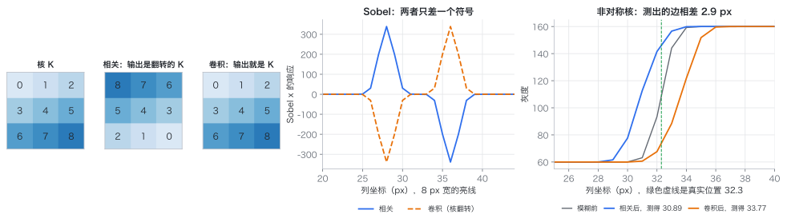
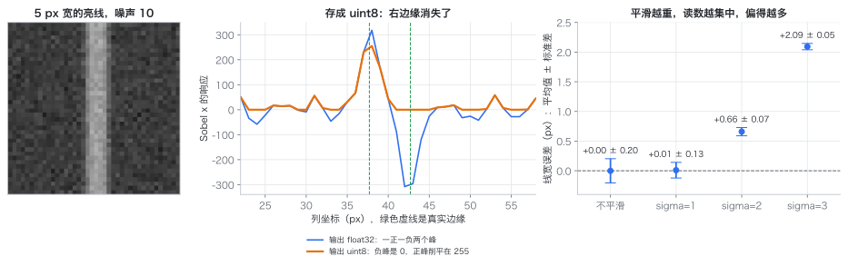
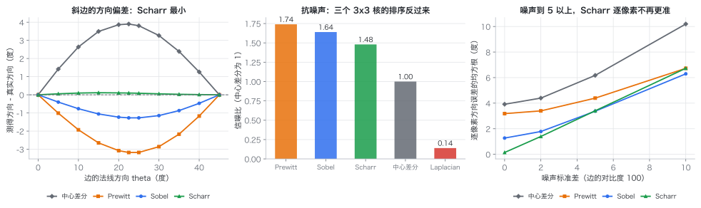
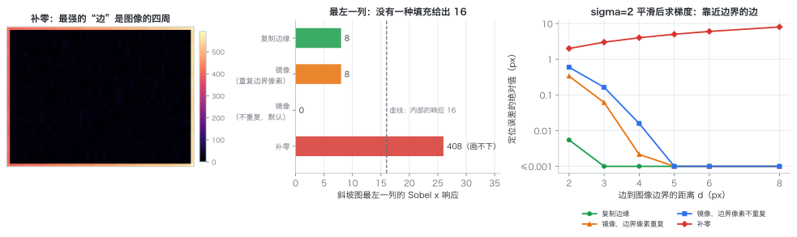
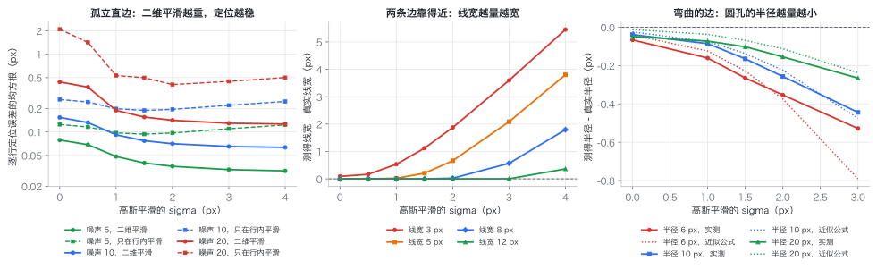
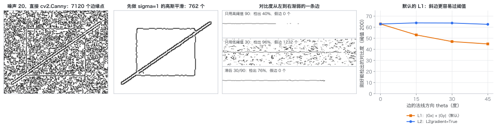

# 第 2 天：卷积、边缘与梯度 —— 教程

> [!NOTE]
> 本章新增小节里的数字都来自合成数据上的实测，记录在 [`figures/实测数字.json`](figures/实测数字.json)，由 `solutions` 分支的 `solutions/figures/ch02.py` 生成。相关运算调用本章作业的参考实现，Sobel、高斯、Canny 等用 OpenCV（本机是 5.0.0）。耗时那两组数字（“Canny 的耗时”“可分离卷积的耗时”）是在一台 Apple 芯片的 Mac 上、机器空闲时测的一次结果，配图脚本默认沿用这一次的值，设置 `CH02_RETIME=1` 才重测。讲义里的耗时只写两位有效数字；同样的测量在机器忙的时候能差几成，所以只看量级和明显的倍数关系。换成真实图像、别的 OpenCV 版本或别的机器，数值会变，结论的方向要自己再测一遍。

> 配套练习：`2-1_手写相关运算.py` 是本章自动验收的作业，原讲义写的 `2-1_手写卷积.py` 指的就是它（对应学习计划的题 2-1）。原讲义列的另外两个练习 `2-2_Sobel方向可视化.py` 和 `2-3_Canny拆解.py` 在章节目录里没有现成的文件，题目在 [`视觉算法学习计划.md`](../视觉算法学习计划.md) 的“第 2 天”一节（题 2-2、题 2-3），需要自己新建文件完成。

---

## 0. 本章怎么学

**应用场景**：边缘定位、尺寸测量，从图像里提取缺陷和图形的边界。半导体检测里量线宽、量缺陷大小、找图形轮廓，第一步几乎都是求梯度、定位边缘。这一章是后面对齐（第 16 章）、形态学清理（第 3 章）和缺陷检测（第 18 章）的共同底座。

**优先级**：P0，入职第一个月就会反复用到。前置是第 1 章（像素、dtype、噪声、线性滤波）。往后看，第 3 章用本章的梯度响应做二值化的输入，第 5 章的 Harris 和 SIFT 建立在梯度之上，第 9 章把这里人工指定的 Sobel 核换成从数据里学出来的卷积核，第 16 章的对齐精度直接受边缘定位精度制约。

| 档位 | 累计用时 | 做什么 | 做到什么算完 |
|---|---:|---|---|
| 速通 | 4 小时 | 读 2.0、2.1、2.2 节和第 2.4 节，看懂图 1、图 2、图 4、图 6，把下面的交互演示按五步试一遍，答完 5 道小测 | 能讲清相关和卷积差在哪、为什么导数要用有符号浮点、梯度方向和边缘走向的关系、Canny 为什么要先平滑再双阈值 |
| 标准 | 8 小时 | 读完全章，跑 Notebook，独立完成作业 `2-1` 并通过验收，做破坏实验前三个，填实验记录 | 验收 PASS，实验记录里有一条“平滑尺度与定位精度”的曲线、你选的工作点和一个 Canny 断边或误检案例 |
| 深挖 | 10 小时 | 再做破坏实验的后三个和扩展一节，在自己的图上复现 | 能报告在自己的数据和噪声条件下，边缘定位精度随平滑尺度怎么变，以及为什么 |

> [!TIP]
> 用时超过所选档位的 1.5 倍还没做完，就把卡点写进 `学习进度.md`，先往下一章走。速通档完成后本章就算“见过”，以后用到再升档。第 2.4 节的 NMS 和滞后连接是作业里最花时间的部分，速通档可以只记结论。

---

## 2.0 这一章要解决什么

第 1 章里，高斯滤波看起来像一个“模糊按钮”。这一章要把按钮拆开：一个小矩阵为什么能平滑图像，也能找出边缘？Sobel、Laplacian 和 Canny 看起来是不同算法，其实都在回答同一件事：**局部像素怎样变化**。

建议把整章记成一条链：

```text
邻域加权（卷积） → 近似求导（梯度） → 找候选边缘 → 细化和连接
```

边缘不是“黑色线条”，而是亮度、颜色或纹理发生明显变化的位置。算法看到的也不是物体概念，只是数值变化；因此阴影会产生边缘，颜色相近的真实物体边界却可能没有强边缘。

**为什么这一章值得较真**。工业检测的落点是“这个东西有多大、在哪里、合不合格”，边缘定位的精度直接决定测量的精度。本章后面会反复出现一个主角：一条真实的边不是从暗到亮瞬间跳变，而是经过零点几到几个像素的过渡（成像的点扩散、离焦、采样都会把它抹宽，见第 22 章）。本章的合成实验把这个过渡用一个标准差 0.7 px 的高斯来模拟。正是这个过渡宽度，让“求导找峰”这件事有了亚像素精度，也带来了平滑尺度、噪声、边界填充之间的一连串取舍。

---

## 2.1 卷积：让一个小模板在图像上巡逻

### 直觉：每到一处，问一个局部问题

卷积核（kernel）是一个很小的权重矩阵。它滑到某个像素上时，把覆盖到的像素与权重逐项相乘，再把结果相加，作为输出像素。

- 均值核问：“周围平均有多亮？”
- Sobel 核问：“左右两侧的亮度差有多大？”
- 锐化核问：“中心像素比邻居突出多少？”

二维离散卷积可写为：

$$
(I*K)(x,y)=\sum_i\sum_j I(x-i,y-j)K(i,j)
$$

严格数学卷积会把核在水平和垂直方向翻转。OpenCV 的 `cv2.filter2D` 实际计算的是**互相关**：

$$
O(x,y)=\sum_i\sum_j I(x+i,y+j)K(i,j)
$$

对高斯核这类中心对称核，翻不翻结果一样；对方向性核，符号或方向可能改变。工程资料常把两者都简称“卷积”，但手写练习时应明确采用哪一种。

### 一个 3×3 的逐步小例子

输入局部区域和一个检测水平变化的核为：

```text
局部像素                 核 K
10  10  50              -1  0  1
10  10  50              -1  0  1
10  10  50              -1  0  1
```

若按互相关计算中心输出：

```text
第一行：10×(-1) + 10×0 + 50×1 = 40
三行相加：40 + 40 + 40 = 120
```

结果为较大的正数，表示从左到右明显变亮。若左右亮度对调，结果为 `-120`；取绝对值只保留“变化有多强”，保留正负号还能知道“朝哪个方向变化”。参考实现在这个小例子上的输出就是左暗右亮 `120`、左右对调 `-120`，把核翻转（当成卷积）再算则是 `-120`。

### “相关”和“卷积”到底差在哪：看冲激响应

要一眼看清两者的区别，最干净的办法是给一个只有中心为 1、其余全 0 的冲激图。相关会把核**原样翻转**地印在输出上，卷积则把核**原样**印出来：



把核 `K = [[0,1,2],[3,4,5],[6,7,8]]` 作用在冲激图上（图 1 左三格）：

| 做法 | 中心 3×3 的输出 |
|---|---|
| 相关（参考实现、`cv2.filter2D`、`torch` 的 `conv2d`） | `[[8,7,6],[5,4,3],[2,1,0]]` |
| 严格卷积（把核翻转再相关） | `[[0,1,2],[3,4,5],[6,7,8]]` |

这里有一个常被忽略的事实：**深度学习里的“卷积层”算的其实是相关**。`cv2.filter2D`、PyTorch 的 `torch.nn.functional.conv2d` 在这个冲激图上给出的都是翻转后的 `K`，也就是不翻核的互相关（实测三者的输出完全一致）。它们之所以仍叫“卷积”，是因为核由训练学出来，翻不翻只是权重排列方式的约定，不影响表达能力。手写作业不是这种情况：你用的是人为指定的 Sobel、运动模糊这类有方向的核，翻不翻会改变结果。

对不同的核，这个差别有大有小（64×64 随机纹理、种子 2）：

| 核 | 相关与卷积的最大差 | 两种输出的关系 |
|---|---:|---|
| 高斯 5×5、均值 3×3、Laplacian（4 邻域） | 0 | 核中心对称，完全相同 |
| Sobel x | 1618.87（约 6.3 个响应标准差） | 只差一个符号（相关加卷积处处为 0） |
| 非对称的 1×5 模糊核 | 184.96（约 4.0 个标准差） | 既不同号也不互为相反数 |

对 Sobel 这类反对称核，翻转等于整体变号，边的“亮到暗”和“暗到亮”对调，但峰的位置不动。真正会把**位置**也挪动的是不对称、又不反对称的核。用核 `[0, 0, 0.2, 0.3, 0.5]` 先把一条真实位置在 32.3 的竖直边模糊一下，再找边：相关测得 30.89（偏 -1.41 px），卷积测得 33.77（偏 +1.47 px），两者相差 2.9 px。注意这个偏差来自“模糊核不对称”，不是求导核；它提醒你，当一串卷积里混进了不对称的核（例如某些运动模糊、非对称的平滑），相关和卷积会把结果整体平移。第 22 章的 PSF 卷积就专门强调过这一点。

<!-- quiz -->
**在只有中心为 1 的冲激图上做 `cv2.filter2D`，输出是把核上下左右翻转后的样子。这说明了什么？**

- A. `cv2.filter2D` 算的是严格卷积
- B. `cv2.filter2D` 算的是互相关（不翻核），冲激响应才会显得像翻转后的核
- C. OpenCV 有 bug

<details markdown="1"><summary>答案与解释</summary>

**B**。严格卷积会把核翻转再相乘，作用在冲激图上得到的恰好是核本身；而 `cv2.filter2D` 得到的是翻转后的核，说明它内部没有翻核，算的是互相关。PyTorch 的 `conv2d` 也一样（实测三者输出完全相同）。对中心对称的核两者没区别，对 Sobel 这类方向核就有符号差。

</details>
<!-- /quiz -->

### 边界和输出尺寸

一个 3×3 核放到左上角时会伸出图像。常见处理方式是：

| 策略 | 直觉 | 可能的问题 |
|---|---|---|
| 不填充（valid） | 只在核完全落入图像时计算 | 输出变小 |
| 常数填充 | 外面都当作 0 | 图像边缘可能出现假边 |
| 复制边缘 | 用最近边界像素补齐 | 边缘较平，但可能形成平台 |
| 镜像填充 | 把图像向外反射 | 通常更自然 |

OpenCV 可通过 `borderType` 选择，例如 `cv2.BORDER_CONSTANT`、`BORDER_REPLICATE`、`BORDER_REFLECT`。边界策略不是装饰参数，它会改变靠近图像四周的结果，这一点第 2.3 节用实测展开。

### 代码层面的卷积

```python
import cv2
import numpy as np

img = cv2.imread("input.png", cv2.IMREAD_GRAYSCALE)
kernel = np.array([[-1, 0, 1],
                   [-1, 0, 1],
                   [-1, 0, 1]], dtype=np.float32)
response = cv2.filter2D(img, ddepth=cv2.CV_32F, kernel=kernel,
                        borderType=cv2.BORDER_REFLECT)
view = cv2.convertScaleAbs(response)
```

这里故意让输出是 `CV_32F`。若直接输出为 `uint8`，负响应会被截断成 0，方向信息悄悄消失。`convertScaleAbs` 是为了显示，不应反过来代替计算中的浮点结果。

**用一条亮线把这件事量出来**。



图 2 中间画的是一条 5 px 宽的亮线（暗处灰度 60、亮处 160，噪声标准差 10），用 Sobel x 求导。输出存成 `float32` 时，左边缘是一个正峰、右边缘是一个负峰，一正一负才构成一条完整的线；一旦 `ddepth=-1` 存成 `uint8`，右边缘的负峰（浮点均值约 -328）被截断成 0，整条线只剩半边，而左边缘的正峰（均值约 331）有 99.5% 的行被削平在 255。更麻烦的是 `cv2.convertScaleAbs`：它取绝对值，示例图里左右两个边缘附近都削到 255，等于把“暗到亮还是亮到暗”的区别也抹掉了。所以显示归显示，计算一定留浮点。图 2 右栏是平滑尺度对线宽读数的影响，留到第 2.4 节细讲。

### 可分离卷积：为什么大核还能很快

Sobel、高斯、均值核都有一个共同点：它们可以拆成一个列向量乘一个行向量，也就是**秩为 1**。秩为 1 的核能先用一行核扫一遍、再用一列核扫一遍，`k×k` 的二维卷积就变成两次 `1×k` 的一维卷积，乘法次数从 `k²` 降到 `2k`。

| 核 | 秩 | 能否拆成一行乘一列 |
|---|---:|---|
| Sobel x、高斯 5×5、均值 3×3 | 1 | 能 |
| Laplacian（4 邻域）、锐化核 | 2 | 不能 |

实测（512×512 的 float32 图，高斯核，sigma 取 `k/6`，参考实现各跑 7 次取最小值。耗时是在一台 Apple 芯片的 Mac 上测的一次结果，写到两位有效数字；机器忙的时候能差几成，只看量级和倍数的趋势）：

| 核的边长 k | 理论上乘法次数之比 `k²/2k` | 参考实现，二维核 | 参考实现，拆成两次一维 | 实际加速 |
|---:|---:|---:|---:|---:|
| 3 | 1.5 | 0.44 ms | 0.32 ms | 1.4 倍 |
| 7 | 3.5 | 2.2 ms | 0.64 ms | 3.4 倍 |
| 15 | 7.5 | 10 ms | 1.3 ms | 7.8 倍 |
| 31 | 15.5 | 43 ms | 2.6 ms | 17 倍 |

加速倍数是用取整之前的耗时算的，和表里两位有效数字的耗时直接相除会差一点。两次一维的结果和直接二维卷积的最大差只有 1e-4 量级（float32 的舍入），可以放心替换。核越大，省得越多：31×31 时加速约 17 倍，和理论比值 15.5 在同一量级。OpenCV 的 `cv2.sepFilter2D`、`cv2.GaussianBlur` 内部就是这样做的，`cv2.getGaussianKernel` 返回的本来也是一维核。

顺带一个和作业有关的对照：同样是参考实现的那种“按核元素循环、整图一次相加”的写法（向量化），和“逐像素取窗口再求和”的双重 Python 循环相比，在 64×64 的小图上就差了约 120 倍（同一次测量里 2.6 ms 对 0.021 ms），是两个数量级的差别。作业的核心循环要按核元素写，不要按像素写。

<!-- quiz -->
**一个 15×15 的高斯核，拆成先做 1×15、再做 15×1 两次一维卷积，相比直接做二维卷积，乘法次数大约省到几分之一？**

- A. 不变，拆开只是写法不同
- B. 约省到 1/7（`k²/2k = 15/2`）
- C. 约省到 1/15

<details markdown="1"><summary>答案与解释</summary>

**B**。二维要 `k²=225` 次乘法，两次一维是 `2k=30` 次，比值 `k²/2k = 7.5`。实测在 512×512 上加速约 7.8 倍（一台 Mac 上的一次测量），和理论值同量级；耗时随机器忙闲波动，倍数只看量级。只有秩为 1 的核能这样拆，Laplacian（秩 2）不行。

</details>
<!-- /quiz -->

---
## 2.2 图像梯度：把微积分变成像素差

连续函数的一阶导数描述变化率。数字图像只在整数坐标上有值，所以用有限差分近似：

$$
\frac{\partial I}{\partial x}\approx I(x+1,y)-I(x-1,y)
$$

得到水平方向导数 `Gx` 和垂直方向导数 `Gy` 后：

$$
|G|=\sqrt{G_x^2+G_y^2},\qquad
\theta=\operatorname{atan2}(G_y,G_x)
$$

`|G|` 是边缘强度，`θ` 是**梯度方向**，即亮度增长最快的方向。它通常与边缘走向垂直：一条竖直边，其左右亮度变化大，所以 `Gx` 大。

> [!WARNING]
> 别把导数核的输出当成“每像素的灰度变化”。中心差分 `[-1,0,1]` 跨了两个像素，Sobel 的中心行权重还放大了一倍。在亮度每列加 1 的斜坡图上，`cv2.Sobel(ksize=3)` 的响应是 8，`cv2.Scharr` 是 32，而真实的每像素变化是 1。要换算成物理梯度，得除以核对应的尺度。这不影响找边（只看峰在哪），但影响你把“幅值 150”解释成多大的灰度跳变。

### Sobel 在算什么

Sobel 核把“求导”和“对垂直方向做一点平滑”合在一起：

```text
Gx = [-1  0  1]     Gy = [-1 -2 -1]
     [-2  0  2]          [ 0  0  0]
     [-1  0  1]          [ 1  2  1]
```

`Gx` 可看成列方向差分 `[-1,0,1]` 与行方向平滑 `[1,2,1]^T` 的外积。它比简单差分对噪声更稳定，但平滑也意味着非常细的变化会被弱化。

```python
gx = cv2.Sobel(gray, cv2.CV_32F, 1, 0, ksize=3)
gy = cv2.Sobel(gray, cv2.CV_32F, 0, 1, ksize=3)
mag, angle = cv2.cartToPolar(gx, gy, angleInDegrees=True)
```

`dx=1, dy=0` 表示对 x 求一阶导，不是“寻找竖线”的参数名。它会对竖直边强响应，但描述的是 x 方向变化。

### 几种 3×3 导数核：定位、方向、抗噪的三方面对比

从中心差分到 Prewitt、Sobel、Scharr，区别只在“中心一行的权重相对两侧放大多少”：中心差分只有中间一行，Prewitt 是 1 倍，Sobel 是 2 倍，Scharr 约 3.33 倍。放大中心行等于沿边方向做更强的平滑，于是抗噪性更好、斜边的方向更准，代价是核的能量更大、对更细的结构更钝。把这三件事分开量出来：



**方向精度（无噪声，对比度 100）**。斜边的方向偏差绝对值的最大值：中心差分 3.90°、Prewitt 3.18°、Sobel 1.27°、Scharr 0.11°。Scharr 就是为“3×3 下的旋转对称性”设计的，斜边方向比 Sobel 准一个数量级。注意这个偏差和边缘有多宽有关：边更锐（模糊 0.5 px）时 Sobel 在 22.5° 处偏 -1.51°，边更糊（模糊 1.5 px）时只偏 -0.46°。

**抗噪（信噪比，定义为单位对比度的边上响应峰值除以噪声经过核之后的标准差）**。以中心差分为 1：Prewitt 1.74、Sobel 1.64、Scharr 1.48、Laplacian 只有 0.14。排序正好和方向精度反过来——Scharr 方向最准，但抗噪最差；Prewitt 抗噪最好，方向却偏得多。原因是放大中心行虽然增强了信号，却也放大了噪声，而 Scharr 的权重最“陡”，噪声放大得最多。Laplacian 是二阶导，把高频噪声放大得最狠，所以信噪比垫底。

**噪声一上来，方向优势就没了**。逐像素的方向误差均方根（22.5° 的边，对比度 100）：

| 噪声标准差 | 0 | 2 | 5 | 10 |
|---|---:|---:|---:|---:|
| 中心差分 | 3.92 | 4.40 | 6.18 | 10.19 |
| Sobel | 1.27 | 1.78 | 3.37 | 6.29 |
| Scharr | 0.14 | 1.39 | 3.41 | 6.73 |

单位是度。无噪声时 Scharr（0.14°）远胜 Sobel（1.27°）；噪声到 5 以上，两者缠在一起，到 10 时 Scharr（6.73°）甚至略差于 Sobel（6.29°），因为 Scharr 把噪声放大得更多，系统性的方向偏差已经被噪声淹没。**结论只在测到的条件下成立**：想要方向准又没多少噪声，用 Scharr；噪声明显时，先把精力放在平滑和多像素平均上（第 2.2 节末尾），而不是纠结选哪个 3×3 核。

**多像素平均能把方向偏差保住**。上面是逐像素看。如果沿着一条边把中心线上约 50 个像素的 `gx`、`gy` 分别求和再算方向，系统性偏差（中心差分 +3.9°、Sobel -1.3°、Scharr +0.1°）几乎不随噪声变化，变的只是它的波动：Sobel 在噪声 10 时这个偏差的标准差约 0.33°。也就是说，真边的方向可以靠“沿边聚合”估得很准，这正是 Harris、Hough、直线拟合在做的事（第 5 章）。

> [!NOTE]
> Scharr 不是“永远更强的边缘检测器”，Roberts 也不是“过时就该忘掉”。Roberts 是一个只含两个非零元素的 2×2 对角差分（算 `I(x+1,y+1) - I(x,y)`），嵌进 3×3 来比：它的信噪比只有中心差分的 0.59 倍、Sobel 的 0.36 倍，而且响应峰的位置落在两个像素中间、带 0.5 px 的偏移。它定位紧凑、算得快，但对噪声敏感、还有半像素偏置，今天主要出现在对速度极敏感的老代码里。

### Scharr 为什么存在

3×3 Sobel 核对不同方向的响应并不完全一致，斜边会有较明显的旋转误差（图 3 左栏量的就是这件事）。Scharr 通过重新选择权重改善 3×3 情况下的旋转对称性：

```python
gx = cv2.Scharr(gray, cv2.CV_32F, 1, 0)
gy = cv2.Scharr(gray, cv2.CV_32F, 0, 1)
```

当你固定使用 3×3 导数核并关心方向精度、噪声又不大时，Scharr 往往比 Sobel 更合适；它不是“永远更强”的边缘检测器（图 3 右栏）。

### Laplacian：不问方向的二阶变化

Laplacian 是两个方向二阶导之和：

$$
\nabla^2 I=\frac{\partial^2 I}{\partial x^2}+\frac{\partial^2 I}{\partial y^2}
$$

一个常见离散核是：

```text
 0  1  0
 1 -4  1
 0  1  0
```

一阶导在边缘处形成峰值，二阶导常在边缘附近发生零交叉。Laplacian 不提供边缘方向，而且二阶导会更猛烈地放大高频噪声（图 3 中栏里它的信噪比只有中心差分的 0.14 倍），所以通常先高斯平滑，再计算：

```python
blur = cv2.GaussianBlur(gray, (5, 5), 1.0)
lap = cv2.Laplacian(blur, cv2.CV_32F, ksize=3)
```

> [!CAUTION]
> `cv2.Laplacian` 的 `ksize` 不只是“窗口大小”，它换的是整个核。`ksize=1`（默认）用的是上面那个 `[[0,1,0],[1,-4,1],[0,1,0]]`；`ksize=3` 用的是 `[[2,0,2],[0,-8,0],[2,0,2]]`，在 `x²+y²` 上的响应从 4 变成 16。两者都能找零交叉，但幅值差 4 倍，阈值不能照搬。

---
## 2.3 边界填充：不只是补几个像素

卷积核伸出图像时，补进来的值是编出来的，它们会污染靠边一圈的输出。这一节把“污染有多大、补哪种值更好”量出来。先把 OpenCV 的 `borderType` 和 numpy `np.pad` 的 `mode` 对上号，因为作业要求用 `np.pad` 的 `reflect`：

| 中文叫法 | `cv2.borderType` | `np.pad` 的 mode | 外推的样子（`abc` → 左边补） |
|---|---|---|---|
| 复制边缘 | `BORDER_REPLICATE` | `edge` | `aaa|abc` |
| 镜像，边界像素重复 | `BORDER_REFLECT` | `symmetric` | `cba|abc` |
| 镜像，边界像素不重复 | `BORDER_REFLECT_101`（即 `BORDER_DEFAULT`） | `reflect` | `dcb|abc` |
| 补零 | `BORDER_CONSTANT` | `constant` | `000|abc` |

实测中 `cv2.filter2D` 用某个 `borderType` 的结果，和用对应 `np.pad` mode 的参考实现逐像素相同（最大差 4e-4，float32 舍入）。注意 `BORDER_DEFAULT` 是 `REFLECT_101`，对应 `np.pad` 的 `reflect`，这正是作业要求的那一种；如果你的实现用了 `symmetric`，靠边一圈会和 `filter2D` 默认结果对不上（约 12% 的像素有差别）。

### 平坦区、斜坡区在边界上的假响应

一张哪里都一样亮的平场图，内部的 Sobel 响应处处为 0，这是对的。到了最左一列：补零会凭空造出一个 400 的巨大响应（图里把它当成“一条边”），而复制边缘、两种镜像都仍然是 0。**补零等于在图像四周放了一条从 0 跳到图像亮度的假边**。



再看一张每列亮 2 的斜坡图，内部的 Sobel x 响应恒为 16。最左一列各填充给出的值很说明问题：复制边缘 8、重复型镜像 8、不重复型镜像 0、补零 408。**没有一种填充能在边界上还原出内部的 16**——因为边界外真实的图像信息根本不存在，填充只是不同的猜测。换个角度：如果你拿靠边一圈的梯度去做测量，无论用哪种填充都在用编出来的数，结论要打折扣。

### 污染有多深，边离边界多近才受影响

受污染的圈数等于“高斯半径加求导核半径”。sigma=2 的高斯（取 3σ，半径 6）配 3×3 Sobel，最外面 7 圈像素都用到了填充值；在 512×512 的图上这约占 5.4% 的面积。

更要命的是靠近边界的真实边。把一条边放在离左边界 d px 的地方，sigma=2 平滑后测它的位置（数值是测得减真值）：

| 边到边界的距离 d | 2 | 3 | 4 | 6 | 8 |
|---|---:|---:|---:|---:|---:|
| 补零 | -2.0 | -3.0 | -4.0 | -6.0 | -8.0 |
| 不重复型镜像（默认） | +0.596 | +0.164 | +0.016 | 0 | 0 |
| 复制边缘 | +0.005 | 0 | 0 | 0 | 0 |

单位是 px。补零造出的四周假边把真边的峰整个拉过去，偏差随 d 线性增大，完全不可用。两种非补零方式在 d≥4 之后基本归零；其中复制边缘在近边界时略优于不重复型镜像（后者把边反射出去，相当于在边界附近放了一条镜像的边）。工程上的通行做法就是两条：**绝不用补零求梯度**；**靠图像最外一圈的测量直接丢弃**（第 18 章“图像边界报警”说的也是这件事）。

<!-- quiz -->
**一张亮度缓慢渐变、没有任何物体的图，用 Sobel 求梯度，结果在图像四周一圈出现了很强的响应。最可能的原因是什么？**

- A. 图像四周真的有边
- B. 卷积用了补零（`BORDER_CONSTANT`）填充，等于在边界外放了一圈灰度 0
- C. Sobel 核算错了

<details markdown="1"><summary>答案与解释</summary>

**B**。补零把图像外一律当成 0，边界像素和这片 0 之间就形成了一条人造的强边。实测平场图最左一列补零给出 400 的响应，而复制边缘、镜像都给 0。换成复制边缘或镜像填充，再把最外一圈的测量丢掉即可。

</details>
<!-- /quiz -->

---
## 2.4 平滑尺度与定位精度：这一章最该记住的取舍

求导会放大噪声，所以求导前要平滑；但平滑会把边抹宽、把弯曲和靠近的边拉偏。平滑尺度 sigma 选多大，是在“抗噪”和“定位准”之间折中。工业量测里这条取舍直接决定测量精度，值得单独一节。

### 孤立的直边：平滑越重越稳，但不是越重越好

一条孤立的竖直边，用 Sobel x 求导、三点抛物线取峰的小数部分，统计定位误差的均方根（逐行统计，真实位置随机取亚像素）：



| 高斯 sigma | 0 | 1 | 2 | 3 | 4 |
|---|---:|---:|---:|---:|---:|
| 噪声 5，逐行均方根 | 0.0787 | 0.0484 | 0.0361 | 0.0328 | 0.0316 |
| 噪声 10，逐行均方根 | 0.1537 | 0.0919 | 0.0706 | 0.0650 | 0.0633 |
| 噪声 20，逐行均方根 | 0.44 | 0.1894 | 0.1414 | 0.1295 | 0.1264 |

单位是 px（48×96 的图，对比度 100，边缘模糊 0.7 px，每个噪声水平 60 张图）。读这张表有三个结论：

1. **平滑确实能把定位做稳**。噪声 10 时，不平滑的逐行误差 0.154 px，sigma=2 降到 0.071 px，降了一半多。
2. **收益递减**。从 sigma=2 到 sigma=4 几乎不再变好（0.071 → 0.063），而代价（把近处的边、弯的边拉偏）一直在涨。对孤立直边，sigma 取 1 到 2 就够。
3. **沿边多像素平均比加大 sigma 更划算**。把这 32 行取平均后，噪声 10、sigma=2 的误差从 0.071 px 掉到 0.030 px。真实边通常有很多行可用，优先靠平均，而不是把 sigma 一味调大。

**二维平滑和“只在行内平滑”不是一回事**。求竖直边时，`Gx` 对噪声的抑制来自两个方向：一维高斯压的是行内噪声，Sobel 核里的 `[1,2,1]` 压的是跨行噪声。如果只沿行方向做一维高斯加中心差分（不碰跨行），噪声 10、sigma=2 的逐行误差是 0.195 px，而二维平滑是 0.071 px——差了近三倍。原因很直接：二维平滑把噪声在两个方向上都平均了。作业的 Sobel 其实天然带了跨行的 `[1,2,1]`，这也是它比裸的中心差分稳的原因。

### 弯曲的边和靠近的边：平滑会把尺寸测偏

孤立直边上平滑几乎不引入偏差（峰的位置不动）。但真实的东西有宽度、有弯曲，这时平滑会系统性地把尺寸测偏，而且偏差有方向：

**两条靠近的边（线宽）**。一条亮线有左右两条边，平滑把它们互相往外推，线被测得偏宽。线越窄、sigma 越大越明显（无噪声下的平均偏差）：

| 高斯 sigma | 0 | 1 | 2 | 3 |
|---|---:|---:|---:|---:|
| 线宽 3 px | +0.09 | +0.53 | +1.87 | +3.60 |
| 线宽 5 px | 0.00 | +0.02 | +0.66 | +2.09 |
| 线宽 8 px | 0.00 | 0.00 | +0.02 | +0.57 |

单位是 px。线宽 3 px、sigma=3 时，测出来偏宽 3.6 px，错了一倍还多。所以量细线的宽度，平滑要很克制。反过来，噪声会让单次读数抖，适度平滑能把标准差压下去（线宽 5、噪声 10：sigma=0 时标准差 0.21 px，sigma=2 时 0.07 px）——于是量窄线时偏差和噪声两头为难，这正是图 2 右栏想说的。

**弯曲的边（圆孔半径）**。一条外凸的边（圆孔的内壁对孔中心是外凸的），平滑会把它往曲率中心推，半径被测得偏小。偏差约等于 `-(sigma² + 边缘模糊²) / (2R)`，R 越小偏得越多：

| 高斯 sigma | 0 | 1 | 2 | 3 |
|---|---:|---:|---:|---:|
| 半径 6 px，实测 | -0.07 | -0.16 | -0.35 | -0.53 |
| 半径 20 px，实测 | -0.05 | -0.07 | -0.16 | -0.27 |

单位是 px，近似公式和实测在半径较大时很接近（这套测法本身约有 0.05 px 的系统误差）。量小孔、小圆缺陷的尺寸，强平滑会让它们系统性偏小。

> [!IMPORTANT]
> 一句话记住这节：**平滑治的是随机误差（抖动），引入的是系统误差（尺寸偏移）**。对孤立、笔直、远离其他边的边，加平滑几乎只有好处；对细、弯、挤在一起的结构，平滑会把尺寸测偏，而且偏差稳定存在、不能靠多拍几张消掉。选 sigma 之前先想清楚你量的是哪种边。

<!-- quiz -->
**量一条 3 px 宽的亮线的宽度，把高斯平滑 sigma 从 0 加到 3，测出来的线宽会怎么变？**

- A. 基本不变，平滑只影响噪声
- B. 系统性地变宽，sigma=3 时能偏到 +3.6 px
- C. 系统性地变窄

<details markdown="1"><summary>答案与解释</summary>

**B**。平滑把左右两条边互相往外推，线被测宽。实测线宽 3 px、sigma=3 时偏 +3.6 px。这是系统误差，多拍几张、取平均也消不掉，只能靠减小 sigma 或事后标定。弯曲的边（圆孔）则相反，会被测得偏小。

</details>
<!-- /quiz -->

---
## 2.5 从 Roberts 到 Canny：改进的不是名字，而是稳定性

早期算子可以按“信息利用量”理解：

- **Roberts**：2×2 对角差分，定位紧凑，但对噪声敏感（信噪比只有中心差分的 0.59 倍，还带 0.5 px 偏移，见第 2.2 节）。
- **Prewitt**：3×3，同时在正交方向做均匀平滑。
- **Sobel**：3×3，中心行或列权重更高，平滑更自然。
- **Canny**：不止算梯度，还系统解决噪声、粗边、阈值和断裂问题。

单独显示 Sobel 幅值时，边缘经常是一条宽亮带。原因是连续几列像素都处在灰度过渡区，梯度都不小。这条带有多宽可以量：一条模糊 0.7 px 的孤立边，不平滑时超过峰值一半的像素有 2 个，sigma=1 时 3 个，sigma=2 时 5 个——平滑越重，带越宽。真正想要的轮廓通常应接近一个像素宽，因此还需要非极大值抑制。

## 2.6 Canny 四步拆解

本节的三件事都画在图 6 里：Canny 不替你做高斯平滑、滞后双阈值怎样救回弱边、默认的 L1 幅值对斜边的偏向。



### 第一步：高斯平滑

求导会放大噪声。高斯标准差 `σ` 越大，抑制的小纹理越多，同时定位会更模糊（第 2.4 节）。应按目标尺度选 `σ`：检测纸张外框可以更平滑，检测头发丝则不能过度平滑。

> [!WARNING]
> `cv2.Canny` 内部**不替你做这一步高斯平滑**，它只在 Sobel 求导时用一个固定的小核。所以噪声大时要自己先 `GaussianBlur`。实测本章的合成场景（128×160，阈值 50/120）在噪声 20 下：直接把带噪图喂给 `cv2.Canny` 得到 7120 个边缘点、碎成 374 段；先做一次 sigma=1 的高斯平滑，降到 762 个点、3 段（和无噪声时的 761 点几乎一样）。这是用 Canny 时最常见的坑。

另外注意 `cv2.GaussianBlur` 传 `ksize=0` 时会按 sigma 自动定核宽，但对 `uint8` 输入会把很小的权重舍入成 0，核比 float 下窄；而 `ksize` 给小了会截断高斯，`(3,3)` 配 sigma=0.8 实际只相当于标准差 0.69 的平滑。要么给足核宽（约 `6σ`），要么用 `ksize=0` 让它自己算。

### 第二步：计算梯度幅值和方向

经典 Canny 使用高斯导数；OpenCV 内部用 Sobel 求导。此时每个像素都有 `(幅值, 方向)`，但响应仍可能很宽。

这里有一个默认参数值得注意：`cv2.Canny` 的 `L2gradient` 默认是 `False`，用的是 `|Gx|+|Gy|`（L1）当幅值，而不是 `sqrt(Gx²+Gy²)`（L2）。L1 对斜边偏大：45° 的边 L1 幅值是 L2 的 1.414 倍，15° 的约 1.21 倍，水平竖直边两者相等。后果是**同一个阈值下，L1 对斜边更灵敏**：

| 边的法线方向 | 0° | 15° | 30° | 45° |
|---|---:|---:|---:|---:|
| L1（默认）刚好能检出的对比度 | 62.9 | 53.0 | 47.0 | 44.9 |
| L2 刚好能检出的对比度 | 62.9 | 63.9 | 63.7 | 62.6 |

（阈值都取 200；对比度越低越难检出。）L2 对各方向几乎一视同仁，L1 让斜边更容易过阈值、也更容易误报。要方向一致就设 `L2gradient=True`。

耗时上两者在同一量级。在一台 Apple 芯片的 Mac 上测的一次结果（1024×1024 的 uint8 图，阈值 60/150，OpenCV 单线程，两种设置交替各跑 40 次取最小值）：随机纹理图上 L1 约 11 ms、L2 约 9.5 ms，只有横边和竖边的方块阵列图上两者都约 0.5 ms。两种设置的差别不到两成，而同样的测量在机器忙的时候本身就能差几成，所以这组数分不出谁更快，不要从里面读出“L2 更快”或“L1 更快”。况且在随机纹理图上，同一组阈值下 L1 检出的边缘像素比 L2 多（242504 对 199997），两种设置输出的边缘本来就不一样多，耗时的差别不能只算在幅值公式头上。能站住的结论只有一条：没有测到 `L2gradient=True` 带来成倍的额外耗时，用 L1 还是 L2 按方向一致性的需要来定，不必为了速度留在默认的 L1。

### 第三步：非极大值抑制（NMS）

对当前像素，沿**梯度方向**查看两侧邻居：只有当前幅值同时大于两侧，才保留；否则置零。

假设同一条法线上的梯度幅值是：

```text
12, 35, 80, 52, 17
```

只有 `80` 是局部最大值，其他都被抑制，于是一条宽亮带缩成细线。真实方向可能是 27°，不一定刚好落在水平、垂直或对角线上；严谨实现会在相邻像素之间插值，简化实现则把方向量化为 0°、45°、90°、135°。这正是练习 `2-3` 中值得观察的误差来源。

### 第四步：双阈值和滞后连接

只用一个阈值很难兼顾：阈值高时边缘断，阈值低时噪声多。Canny 使用两个阈值：

- 幅值 ≥ 高阈值：强边缘，直接保留；
- 低阈值 ≤ 幅值 < 高阈值：弱边缘，只有与强边缘连通才保留；
- 幅值 < 低阈值：丢弃。

“连通”通常在 8 邻域中递归或用栈搜索。它利用了真实轮廓往往连续、随机噪点往往孤立这一先验。高低阈值不是概率，也不要求固定为某个比例；常用比例只是起点，最终要看图像动态范围和任务目标。

**双阈值到底帮了多少，可以量出来**。一条对比度从左到右由 60 渐弱到 6 的边（噪声标准差 12，先 sigma=1 平滑），统计检出的边长占比和边以外的假边像素：

| 阈值设置 | 检出的边长占比 | 每张图边以外的假边像素 |
|---|---:|---:|
| 只用高阈值 90 | 40% | 0 |
| 只用低阈值 30 | 96% | 1232 |
| 滞后 30/90 | 76% | 0 |
| 滞后 60/90 | 57% | 0 |

单阈值取高，弱的那半段边直接丢了（只检出 40%）；单阈值取低，边是连上了（96%），但噪声涌进来，每张图一千多个假边点。滞后 30/90 用“强边带弱边”的规则，检出 76% 的同时假边为 0——这就是双阈值的价值：**用强边缘当锚，把连着它的弱边缘捞回来，又不收留孤立的噪声**。

```python
edges = cv2.Canny(gray, threshold1=60, threshold2=150,
                  apertureSize=3, L2gradient=True)
```

`L2gradient=True` 使用 `sqrt(Gx²+Gy²)`；默认近似为 `|Gx|+|Gy|`，通常的说法是它更快但方向一致性略差。方向一致性的差别上面量过；速度上，本章在一台 Mac 上的一次测量里两者在同一量级，没有测到 L1 明显更快（见第二步）。`apertureSize` 是内部 Sobel 的核大小，默认 3；设成 5 会让响应尺度暴涨（斜坡上 Sobel 的响应从 8 变到 128），相当于悄悄把阈值变松，边缘点会多出很多，一般别动。传给 Canny 的通常是单通道 8 位图，若前面在浮点域处理，应先正确缩放而不是直接强转 `uint8`。

<!-- quiz -->
**一条对比度从左到右慢慢变弱的划痕，想把它尽量连成一条、又不引入满屏噪声点，下面哪种 Canny 阈值设置最合适？**

- A. 只用一个高阈值（90/90）
- B. 只用一个低阈值（30/30）
- C. 双阈值滞后（低 30 / 高 90）

<details markdown="1"><summary>答案与解释</summary>

**C**。实测里只用高阈值只检出 40%（弱的一半丢了）；只用低阈值检出 96% 但每张图带进一千多个假边点；滞后 30/90 检出 76%、假边 0。双阈值用强边缘当锚把连通的弱边缘捞回来，同时丢掉孤立噪点，正是为这种“对比度不均的连续边”设计的。

</details>
<!-- /quiz -->

## 2.7 一个从图像到边缘的逐步例子

设一张灰度图中有浅灰背景和深色矩形，还叠加轻微高斯噪声（这正是本章 Notebook `实验_卷积与边缘.ipynb` 里的场景：128×160，一个亮矩形加一条 2 px 宽的斜线）。

1. **先看原图直方图和局部剖面**：矩形边界不是瞬间跳变，而是经过若干像素过渡。
2. **高斯平滑**：比较 `(3,3), σ=0.8` 与 `(7,7), σ=2.0`。后者噪声少，但相邻细边可能合并。实测平坦区噪声标准差从原图的约 24 降到 σ=0.8 时的 19、σ=2.0 时的 15。
3. **计算 `gx, gy`**：矩形左右边主要出现在 `|gx|`，上下边主要出现在 `|gy|`。
4. **把方向映射到 HSV 的 H 通道**：可直观看到四条边方向不同；亮度可用归一化后的幅值表示。
5. **执行 NMS**：统计非零像素数量应显著下降，但轮廓位置大体不变。
6. **双阈值连接**：提高高阈值会减少确定边，抬高低阈值会更容易造成断裂。
7. **与 `cv2.Canny` 比较**：不要只比较“像不像”，还要比较边缘像素数、连通段数量和边缘位置。

拿 Notebook 的 `show_edges`（默认噪声 10、σ=1、阈值 50/120、`L2gradient=True`）跑几组参数，数字能把上面几条坐实：

| 参数 | 边缘像素数 | 8 连通段数 |
|---|---:|---:|
| 默认 | 756 | 3 |
| σ=3（过度平滑） | 461 | 1 |
| 噪声 40、σ=0.5（平滑不够） | 7799 | 324 |

过度平滑时斜线和矩形边都变弱，整幅只剩 1 段（矩形框连成一圈，斜线并进去了）；平滑不够时噪声没压住，碎成三百多段。还有一个细节值得注意：**σ 从 1.5 加到 2 以上，那条 2 px 宽的斜线在矩形内部的一段会消失**——实测矩形内部的边缘像素数在 σ=1、1.5 时是 255、259，到 σ=2、3 时掉到 0。细结构被过度平滑“吃掉”，这是第 2.4 节“平滑把细结构弄钝”的直接后果。

下面的代码只搭建观察框架，没有替你完成 NMS 和滞后连接：

```python
blur = cv2.GaussianBlur(gray, (5, 5), 1.0)
gx = cv2.Sobel(blur, cv2.CV_32F, 1, 0, ksize=3)
gy = cv2.Sobel(blur, cv2.CV_32F, 0, 1, ksize=3)
mag, ang = cv2.cartToPolar(gx, gy, angleInDegrees=True)
# 下一步：沿 ang 指定的方向比较 mag，并做双阈值连接
```

---
## 2.8 交互演示

这个演示把图像压成一行 96 个像素：一条竖直边或一条竖直亮线的横剖面。计算和本章配图一致——高斯平滑、用一个三元素的核（中心差分、前向差分或二阶差分）做相关、在响应里找峰取小数——但降到一维所以能实时跑。你可以切相关/卷积、float/uint8、换边界填充、在二维平滑和只在行内平滑之间切换，并实时看到本次测得值、200 次重复的平均偏差和标准差。按页面下方“按顺序试”的五步操作，每一步对应讲义里的一个结论。

<!-- embed: ../demos/卷积核与边缘响应.html 1290 -->
[打开交互演示：卷积核与边缘响应](../demos/卷积核与边缘响应.html)

五步分别对应：uint8 截断让半边响应消失（第 2.1 节）、不对称核让相关和卷积测出的边错开（第 2.1 节）、二维平滑比只在行内平滑更能压住抖动而二阶差分对噪声极敏感（第 2.2、2.4 节）、平滑把窄线测宽（第 2.4 节）、补零在近边界处把边测错而镜像和复制边缘不会（第 2.3 节）。

## 2.9 怎样评估边缘定位

边缘检测不像分类有个现成的准确率。要报告它好不好，得分开说“定位准不准”和“该检出的检出了没有”：

- **定位精度用偏差和标准差分开报**。在有真值的合成边上，标准差（随机抖动）和平均偏差（系统偏移）是两码事：平滑能压标准差，却会在弯边、窄线上引入偏差（第 2.4 节）。只报一个“平均误差”会把这两件事混在一起。写清条件：对比度、噪声、边缘本身的模糊宽度、平滑 sigma、用什么取小数。
- **沿边多点聚合再报**。单像素的方向和位置都很抖，真实边有很多点，报告时说清是逐像素还是沿边聚合后的结果——两者能差好几倍（第 2.4 节图 5，第 2.2 节的方向聚合）。
- **检出类指标要带阈值和匹配规则**。Canny 的“检出率”依赖高低阈值、也依赖“测到的边离真值多近算命中”。这些规则不写清，数字没法比（第 18 章第 6 节专门讲了匹配规则能把检出率从 14% 说成 73%）。
- **误报按“每张图多少个”报，不用比例**。一张图几百万像素，按像素算的误报率永远小得没有区分度。

一句合格的汇报像这样：“48×96 的合成边 60 张，对比度 100、噪声标准差 10、边缘模糊 0.7 px，Sobel x 加二维高斯 sigma=2、三点抛物线取小数，逐行定位误差的均方根 0.071 px，无系统偏差；沿 32 行聚合后降到 0.030 px。”

## 2.10 常见误区

1. **把梯度方向当成边缘走向**：二者通常垂直。
2. **在 `uint8` 中保存带符号导数**：负数被截断，半边信息消失（第 2.1 节实测：一条线的右边缘整个没了）。
3. **先 `abs` 再研究方向**：绝对值已经抹掉亮到暗和暗到亮的区别。
4. **认为核越大越准确**：大核提高抗噪性，也降低定位精度并吞掉小结构（第 2.4 节的线宽和圆孔）。
5. **Canny 阈值照抄一组固定数值**：曝光、对比度或预处理一变，合适阈值就会变。
6. **把边缘当作物体**：边缘图只是局部变化集合；闭合轮廓、区域和语义还需后续处理。
7. **忽略边界填充**：图像四周的假响应有时正来自常数补零（第 2.3 节）。

## 2.11 常见错误

做本章作业（手写二维相关）和用 OpenCV 时最容易犯的几个实现错误：

| 现象 | 原因 | 怎么查 |
|---|---|---|
| 输出和 `cv2.filter2D` 默认结果在边界一圈对不上（约 12% 像素有差） | 用了 `symmetric`（`BORDER_REFLECT`）而不是作业要求的 `reflect`（`BORDER_REFLECT_101`） | 拿一个 5×5 随机核在随机图上比，内部应完全一致、只有外圈不同，差超 0.001 就查填充 |
| 一条线用 Sobel 求导后只剩半边 | 输出存成了 `uint8`，负峰被截断成 0 | 把 `ddepth` 改成 `cv2.CV_32F`，看是否出现一正一负两个峰 |
| 手写相关测出的边位置和 `filter2D` 差大约一个像素，还反号 | 把核翻转了，算成了卷积 | 用冲激图测：相关的输出是核翻转后的样子，卷积是核本身 |
| 恒等核（中心为 1）作用后图像变了 | 填充或下标偏移写错，锚点没对准中心 | 用恒等核测，输出应和输入逐像素相同（验收脚本第一项就测这个） |
| 归一化的均值核作用在常量图上，边界一圈不等于常量 | 补零填充把边界拉低 | 用一张常量图加均值核测，`reflect` 填充下应处处等于常量（验收脚本的 FAIL 就是补零触发的） |
| 大核卷积慢得离谱 | 可分离的核没有拆成两次一维，或者核心循环按像素写成了双重 for | 把 `k×k` 拆成 `1×k` 配 `k×1`，核心循环按核元素写（第 2.1 节） |
| Canny 在噪声图上碎成几百段 | 没有先自己做高斯平滑（`cv2.Canny` 不替你平滑） | 先 `GaussianBlur` 再 `Canny`，边缘段数应回到个位数 |
| 换了 `cv2.Laplacian` 的 `ksize`，阈值全部失效 | `ksize` 换的是整个核，幅值尺度变了（1 和 3 差 4 倍） | 在 `x²+y²` 上测，`ksize=1` 给 4、`ksize=3` 给 16 |

> [!NOTE]
> 本章作业的验收脚本（`tests/check_progress.py`）只查三件事：恒等核保持图像、常量图在归一化核下不变、输出是同 shape 的 float32。它能抓出“用了补零”（常量图测试会 FAIL），但**抓不出“把核翻转成了卷积”，也抓不出用 `symmetric`、`edge` 当填充**——这几种写法都能 PASS（实测如此）。所以作业要求的 `reflect` 填充和“不翻核”，得靠自己和 `cv2.filter2D` 对照，容差取 0.001 左右（差异来自 float32 舍入）。

---
## 2.12 OpenCV API 速查

| 目的 | API | 关键参数 |
|---|---|---|
| 任意线性核 | `cv2.filter2D` | `ddepth`、`kernel`、`borderType`（算的是相关，不翻核） |
| 高斯平滑 | `cv2.GaussianBlur` | `ksize`、`sigmaX`、`sigmaY`（`ksize=0` 按 sigma 自动定核宽） |
| 可分离卷积 | `cv2.sepFilter2D` | 一行核、一列核，秩为 1 的核专用 |
| Sobel 导数 | `cv2.Sobel` | `dx`、`dy`、`ksize`、`scale` |
| Scharr 导数 | `cv2.Scharr` | `dx`、`dy`（3×3 下方向比 Sobel 准） |
| Laplacian | `cv2.Laplacian` | `ddepth`、`ksize`（`ksize` 换的是整个核） |
| 幅值与方向 | `cv2.magnitude` / `cv2.cartToPolar` | 输入应为浮点 |
| 完整 Canny | `cv2.Canny` | 两阈值、`apertureSize`、`L2gradient`（默认 L1，自己先平滑） |

## 2.13 破坏实验

每个实验先写下预测，再运行，把结果和原因记到 `实验记录.md`。前三个是标准档必做，都能在 Notebook 里做，答案可以和 `figures/实测数字.json` 对照。

1. 把 Notebook 场景的噪声调到 40、平滑降到 0.5，不平滑直接 Canny 又会怎样？先预测边缘点数和连通段数，再运行，和平滑到 σ=1 比。对照 `实测数字.json` 里“Notebook 场景与 2.5 节”。
2. 把平滑 σ 从 1 提高到 3，那条 2 px 宽的斜线会发生什么？先预测它在矩形内部的一段还在不在，再数矩形内部的边缘像素（对照“矩形内部的边缘像素数，按 sigma”，σ=2 时应为 0）。
3. 一条 3 px 宽的亮线，把平滑 σ 从 0 加到 3，预测测得的线宽怎么变、偏到多少，再用演示页或自己的脚本验证（对照“平滑尺度与定位 / 线宽”）。
4. 同一条边，先用相关、再把求导核翻转当成卷积，测得的位置差多少？换成对称的 Sobel 核呢？换成不对称的模糊核 `[0,0,0.2,0.3,0.5]` 呢？解释为什么只有不对称核会让位置也挪动。
5. 把 `cv2.Canny` 的 `L2gradient` 在 `False` 和 `True` 之间切，固定阈值 200，分别用 0° 和 45° 的边，测刚好能检出的对比度。为什么 45° 的边在默认 L1 下更容易被检出？
6. 把一条边放到离图像左边界 3 px 的地方，分别用补零、镜像、复制边缘求梯度，测它的位置。哪种填充错得最离谱，错多少？把边挪到离边界 8 px 再试一遍。

## 2.14 扩展（深挖档）

- **实现带插值的 NMS**：把方向量化成 0/45/90/135 的简化版和在相邻像素间插值的严谨版都写出来，在一条 27° 的斜边上比较两者保留的边缘位置差多少。
- **亚像素边缘定位**：在梯度幅值的峰上做三点抛物线取小数，复现第 2.4 节“孤立直边”那张表，报告你自己数据上定位误差随 sigma 的变化。
- **把平滑和求导合成一个核**：高斯的导数（DoG、Derivative of Gaussian）可以一步到位，等价于先高斯再差分。自己构造这个核，验证它和“先 `GaussianBlur` 再 `Sobel`”逐像素接近，再比较耗时。
- **Laplacian of Gaussian 的零交叉**：实现 LoG，找零交叉当边缘，和 Canny 比较它在拐角和细线上的表现。
- **真实数据**：按 `data/README.md` 的建议准备一张不含隐私的零件或文字照片，比较 Sobel、Scharr、Canny，并按第 2.9 节的格式报告一次边缘定位的精度（真实图没有真值，可以用一把刻度尺或已知尺寸的特征自标定）。

## 2.15 和后续章节的关系

- 第 1 章的线性滤波、噪声模型和 dtype 是本章的直接前置：高斯平滑、`uint8` 截断的坑都来自那一章。
- 第 3 章的二值化和形态学清理，输入常常就是本章的梯度响应图；那一章的面积过滤删不掉的“成串边缘残差”，根子在本章——边本来就有宽度。
- 第 5 章的 Harris 和 SIFT 全部建立在梯度之上：Harris 用 `Ix、Iy` 的二阶矩判角点，SIFT 用梯度方向直方图做描述子。本章“沿边聚合方向更准”的结论，正是它们可靠的基础。
- 第 9 章把这里人工指定的 Sobel 核换成从数据里学出来的卷积核，操作仍是“局部加权求和”，区别只在权重来自人工先验还是反向传播（那一章会把学到的第一层核和 Sobel 做余弦相似度）。
- 第 16 章的对齐精度受边缘定位精度制约，错位造成的差值近似等于“梯度 × 错位量”，和本章的梯度是同一个量。
- 第 18 章的缺陷检测直接用边缘定位来量尺寸、提取图形边界；第 22 章解释了本章一直在用的“边缘模糊”从何而来（PSF、离焦、采样）。

## 自测问题

1. `cv2.filter2D` 为什么严格说是互相关而不是卷积？什么样的核下这个区别会改变结果，什么样的核下不会？
2. 为什么导数结果要用有符号浮点类型？存成 `uint8` 会丢什么？用一条亮线举例说明。
3. 一个秩为 1 的 `k×k` 核为什么能拆成两次一维卷积？能省多少乘法？哪些常见核拆不了？
4. 求一条竖直边的梯度时，“二维高斯平滑加 Sobel”和“只沿行方向做一维平滑加中心差分”在抗噪上差在哪，为什么？
5. 平滑尺度 sigma 加大，对孤立直边、窄亮线、小圆孔的定位各有什么不同影响？哪些是随机误差、哪些是系统误差？
6. Sobel、Scharr、中心差分在“斜边方向精度”和“抗噪”上怎么排序？为什么噪声大了之后 Scharr 的方向优势会消失？
7. 四种边界填充（补零、复制边缘、两种镜像）在图像边界附近求梯度各有什么表现？为什么求梯度绝不该用补零？
8. 用一句话说明 NMS 为什么让边缘变细；再说明双阈值滞后连接解决了单阈值的什么两难。
9. `cv2.Canny` 的 `L2gradient` 默认值是什么？它对不同方向的边有什么偏向？`cv2.Canny` 会不会替你做高斯平滑？
10. 调 Canny 前，你会先检查输入的 dtype、平滑尺度和图像对比度中的哪些，为什么？

---

## 动手前的检查清单

- [ ] 能解释 `filter2D` 为什么严格说是互相关吗？
- [ ] 能手算一个 3×3 邻域的加权和吗？
- [ ] 知道为什么导数结果应使用有符号浮点类型吗？
- [ ] 能说出 `Gx` 强时更可能对应哪种走向的边缘吗？
- [ ] 能从 Sobel 核中看出“一个方向求导、另一个方向平滑”吗？
- [ ] 知道 Scharr 相对 3×3 Sobel 改进了什么、又在什么时候不再占优吗？
- [ ] 能解释 Laplacian 为什么比一阶梯度更怕噪声吗？
- [ ] 能用一句话说明 NMS 为什么让边缘变细吗？
- [ ] 能区分强边缘、可连接弱边缘和被丢弃响应吗？
- [ ] 调 Canny 前，会先检查输入 dtype、平滑尺度和图像对比度吗？

确认完这些，再打开 `02_卷积与边缘/` 做练习。

## 与配套练习怎么连接

本章有两类练习，编号容易混：自动验收的作业是 `2-1_手写相关运算.py`（原讲义写作 `2-1_手写卷积.py`）；`2-2_Sobel方向可视化.py` 和 `2-3_Canny拆解.py` 是 [`视觉算法学习计划.md`](../视觉算法学习计划.md)“第 2 天”一节的题 2-2 和题 2-3，章节目录里没有现成的文件，也没有自动验收，需要自己新建文件完成。

- **`2-1_手写相关运算.py`**（自动验收，对应学习计划的题 2-1）：先固定一个小矩阵和非对称核，手算中心像素，再决定你的函数实现卷积还是互相关（作业要求的是相关，不翻核）。重点检查 padding（作业要求 `np.pad` 的 `reflect`，对应 `BORDER_REFLECT_101`）、输出尺寸（保持同 shape）和浮点精度（输出 float32），不要直接调用 `filter2D` 代替核心循环；核心循环按核元素写、不要按像素写（第 2.1 节）。验收脚本只查恒等核、常量图和 dtype，翻核和填充方式得自己和 `cv2.filter2D` 对照（第 2.11 节）。
- **`2-2_Sobel方向可视化.py`**（学习计划的题 2-2，自己新建）：分别保留 `gx`、`gy`、幅值和角度。尝试竖线、横线、斜线等合成图，解释颜色与方向的对应关系，而不只是生成一张彩色图。补充：动手前可以先跑 Notebook `实验_卷积与边缘.ipynb`，它保留了带符号的 `gx`、幅值、Canny 的并排显示，可以拖动噪声、平滑尺度和 Canny 阈值。Notebook 里没有方向着色，把方向映射到 HSV 的 H、幅值映射到亮度这一步要在这道题里自己做，做出来可以直观看到矩形的四条边方向不同。
- **`2-3_Canny拆解.py`**（学习计划的题 2-3，自己新建）：把四步中间结果都保存。NMS 可先用四方向量化，再思考插值版本；滞后连接可考虑栈或队列。最后与 OpenCV 输出比较差异原因，而不是追求逐像素完全相同。补充：这道题可以放在 `2-1` 之后，在自己写的相关运算的基础上接着做。
