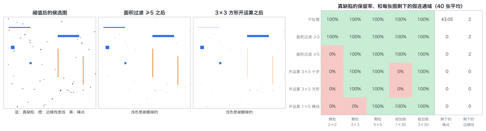
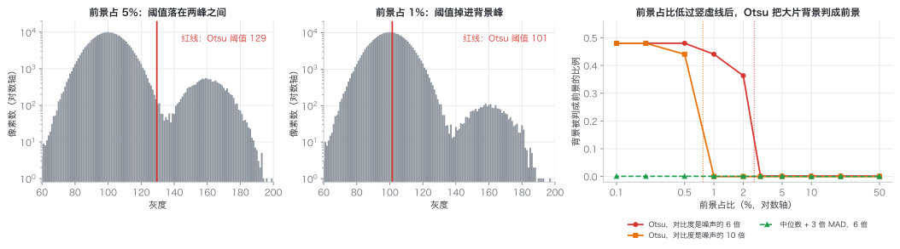
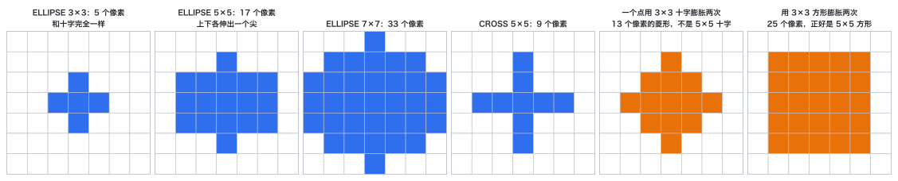
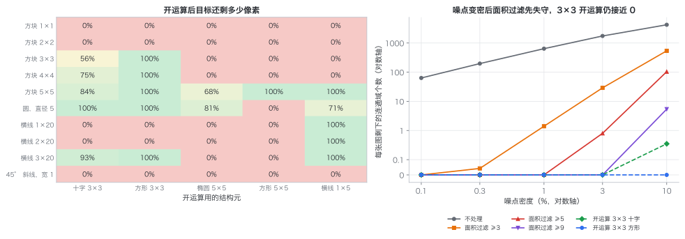
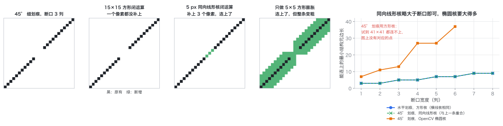
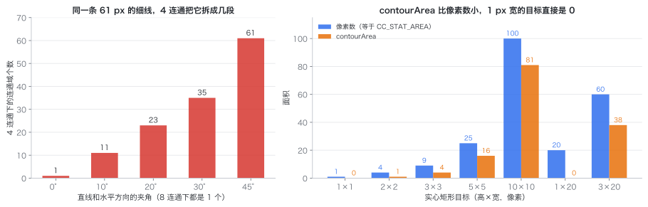

# 第 3 天：形态学与二值图像 —— 教程

> [!NOTE]
> 本章所有数字都来自合成数据上的实测，记录在 [`figures/实测数字.json`](figures/实测数字.json)，由 `solutions` 分支的 `solutions/figures/ch03.py` 生成。腐蚀和膨胀用本章作业的参考实现，连通域、轮廓和各种阈值用 OpenCV（本机是 5.0.0）。换成真实图像或者别的 OpenCV 版本，数值会变，结论的方向要自己再测一遍。

> 配套练习：`3-1_手写二值形态学.py`

---

## 0. 本章怎么学

**应用场景**：缺陷候选的清理和计数。差值图过了阈值之后是一张二值的候选图，里面有真缺陷，也有噪点、断成几段的划痕和沿图形边缘的残差。去噪点、填孔洞、把断开的划痕连起来、数连通域，用的都是这一章的操作。

**优先级**：P0。前置是第 1 章（直方图和噪声）。第 18 章的检测流水线直接用到本章的阈值、开闭运算和连通域，第 12 章用它们做分割结果的后处理。

| 档位 | 累计用时 | 做什么 | 做到什么算完 |
|---|---:|---|---|
| 速通 | 3 小时 | 读 3.0 节、3.1 节里讲 Otsu 的两小节、3.2 节里“实际长什么样”一小节、3.4 节和 3.5 节，看懂图 1 到图 6，把 3.10 节演示的五步都试一遍，答完 5 道小测 | 能讲清开运算按什么标准删东西，闭运算什么时候连不上断口，Otsu 在前景很少时为什么不能用 |
| 标准 | 6 小时 | 读完全章，跑 Notebook，完成作业 `3-1` 并验收通过，做 3.12 节前三个破坏实验，填实验记录 | 验收 PASS，实验记录里有一个目标被误删或者错误粘连的案例，写明结构元的形状和尺寸 |
| 深挖 | 8 小时 | 再做 3.12 节后三个破坏实验和 3.13 节的扩展 | 能在一张自己准备的图上，按 3.11 节的格式报告清理前后真目标的保留率和剩下的假连通域 |

> [!TIP]
> 用时超过所选档位的 1.5 倍还没做完，就把卡点写进 `学习进度.md`，先往下一章走。速通档完成后本章就算“见过”，以后用到再升档。

---

## 3.0 从“像素值”走向“物体形状”

前两章主要关心灰度和梯度。形态学换了一个视角：先把前景看成像素集合，再问它的**形状、连接和尺度**。例如文字识别前，常需要去掉孤立黑点、连接断笔；车牌定位时，常需要把密集字符连接成较大的矩形区域。

一条典型处理链是：

```text
灰度图 → 二值化 → 形态学清理 → 连通域/轮廓 → 几何筛选
```

这里最重要的约定是：通常把非零像素当作前景，0 当作背景。若你要找的是黑色文字，往往先用反向阈值让文字变白。**膨胀和腐蚀针对的是前景集合，不天然等于“让画面变亮或变暗”。**

### 不清理，或者清理错了，会怎样

课程的落点是工业检测，所以先看一张“阈值之后的候选图”。第 18 章的流水线把待检图和模板相减、过阈值，得到的就是这种图。下面的实验在一张 128×128 的图上放三类东西：

- 5 个真缺陷：2×2、3×3、5×5 的颗粒，1×30 的细划痕，3×30 的粗划痕。
- 2 条 1 px 宽、40 px 长的竖线，模拟对齐残差沿图形边缘留下的超限。它们是误报。
- 独立的噪点，每个像素有 0.27% 的概率成为前景。这个概率等于高斯噪声超过 3 倍标准差的概率，也就是第 18 章里 k 取 3 时良品像素的理论超限概率。

共 40 张，连通域按 8 连通数。“保留”指处理之后该缺陷的位置上还有前景像素。



| 处理方式 | 颗粒 2×2 | 颗粒 3×3 | 颗粒 5×5 | 细划痕 1×30 | 粗划痕 3×30 | 每张图剩下的噪点 | 每张图剩下的边缘线 |
|---|---|---|---|---|---|---:|---:|
| 不处理 | 保留 | 保留 | 保留 | 保留 | 保留 | 43.05 | 2 |
| 面积过滤，不小于 3 | 保留 | 保留 | 保留 | 保留 | 保留 | 0 | 2 |
| 面积过滤，不小于 5 | 删掉 | 保留 | 保留 | 保留 | 保留 | 0 | 2 |
| 开运算，3×3 十字 | 删掉 | 保留 | 保留 | 删掉 | 保留 | 0 | 0 |
| 开运算，3×3 方形 | 删掉 | 保留 | 保留 | 删掉 | 保留 | 0 | 0 |
| 开运算，1×5 横线 | 删掉 | 删掉 | 保留 | 保留 | 保留 | 0 | 0 |

表里每一格在 40 张图上的结果都一样，所以只写“保留”或“删掉”。读这张表的三个结论：

1. **不处理没法用**。每张图 5 个真缺陷，却有 43 个噪点和 2 条边缘线一起被报出来。
2. **面积过滤按像素个数删**。它把独立噪点清干净，细划痕也留得住，但成串的误报它管不了，2 条边缘线都还在。把门槛提到 5，边缘线没少，2×2 的颗粒先丢了。
3. **开运算按“结构元放不放得进去”删**。3×3 的开运算把边缘线删掉了，同时把 30 个像素的细划痕整条删掉，9 个像素的 3×3 颗粒反而留着。换成 1×5 的横线结构元，细划痕留下，3×3 颗粒被删。这一行能同时保住划痕、删掉边缘线，是因为实验里划痕是水平的、边缘线是竖直的，方向换一下结论就反过来。

没有哪一行是全对的。每种清理都在表达一个假设：什么形状算缺陷，什么形状算噪声。本章后面各节把这些假设一条条量出来：阈值该怎么定（3.1），结构元的形状和尺寸意味着什么（3.2 到 3.4），连通域和面积怎么数（3.5）。

<!-- quiz -->
**候选图上有一条 1×30 的细划痕（30 个像素）和一个 3×3 的颗粒（9 个像素）。做一次 3×3 方形开运算之后，哪个还在？**

- A. 划痕还在，颗粒没了，因为划痕的像素多
- B. 颗粒还在，划痕没了
- C. 两个都还在，开运算只删孤立的单个像素

<details markdown="1"><summary>答案与解释</summary>

**B**。开运算留下的是“3×3 的结构元能整个放进去”的地方。颗粒正好放得下一个 3×3，划痕只有 1 px 宽，一处都放不下，30 个像素全部被删。40 张图上划痕的保留率是 0，颗粒是 100%。按像素个数删东西的是面积过滤，它的结果正好相反：门槛取 5 时划痕留下，2×2 的颗粒被删。

</details>
<!-- /quiz -->

---

## 3.1 二值化：先决定谁属于前景

### 全局阈值

最简单的规则是：

```math
B(x,y)=
\begin{cases}
255,&I(x,y)>T\\
0,&I(x,y)\le T
\end{cases}
```

```python
_, binary = cv2.threshold(gray, 120, 255, cv2.THRESH_BINARY)
```

当目标和背景的灰度分布分得开、照明较均匀时，全局阈值简单可靠。若目标较暗，可用 `THRESH_BINARY_INV`。很多“形态学没效果”的问题，根源其实是前景极性反了。

### Otsu：用类间可分性选阈值

Otsu 假设直方图大体可分成前景与背景两类。对每个候选阈值 `t`，把像素分为 `C0=[0,t]` 和 `C1=[t+1,L-1]`，计算两类权重 `ω0,ω1` 和均值 `μ0,μ1`。类间方差为：

$$
\sigma_b^2(t)=\omega_0(t)\,\omega_1(t)\,[\mu_0(t)-\mu_1(t)]^2
$$

选择让 `σb²` 最大的阈值。直觉是：两组内部尽量集中、组间尽量分开。总方差满足“类内方差 + 类间方差”，总方差固定时，最大化类间方差等价于尽量减小类内混杂。

把这句话写成式子。记两类各自的方差为 $\sigma_0^2$、$\sigma_1^2$，类内方差是它们按权重的平均，于是

$$
\sigma_T^2=\underbrace{\omega_0\sigma_0^2+\omega_1\sigma_1^2}_{\sigma_w^2(t)}+\underbrace{\omega_0\omega_1(\mu_0-\mu_1)^2}_{\sigma_b^2(t)}
$$

总方差 $\sigma_T^2$ 只和图像有关，和 $t$ 无关，所以让 $\sigma_b^2$ 最大和让 $\sigma_w^2$ 最小是同一件事。算 $\sigma_b^2$ 只需要直方图的累计和，256 个候选阈值扫一遍就够了。

```python
T, binary = cv2.threshold(
    gray, 0, 255, cv2.THRESH_BINARY + cv2.THRESH_OTSU
)
```

返回值 `T` 是自动选择的阈值。Otsu 不是万能自动模式：强阴影、渐变背景、前景占比极小或直方图没有双峰时，它可能给出不符合任务的分割。

### 前景占多少算“极小”（实测）

缺陷在图里通常只占很小的比例，所以“前景占比极小”这一条值得量出来。实验用 512×512 个像素，背景灰度服从均值 100、标准差 10 的高斯分布，前景比背景亮 60（噪声的 6 倍）或者亮 100（噪声的 10 倍），前景占比从 50% 降到 0.1%，每个占比 10 个随机种子。作为对照，再用“中位数加 3 倍的 1.4826×MAD”定阈值，这是第 18 章逐像素 z 阈值的全图版本。



| 前景占比 | 50% | 20% | 5% | 3% | 2% | 1% | 0.5% | 0.1% |
|---|---:|---:|---:|---:|---:|---:|---:|---:|
| 对比度 60：Otsu 阈值 | 129 | 129 | 129 | 129 | 103 | 101 | 100 | 100 |
| 对比度 60：Otsu 把多少背景判成前景 | 0.14% | 0.16% | 0.16% | 0.16% | 36.3% | 44.0% | 48.0% | 48.0% |
| 对比度 100：Otsu 阈值 | 144 | 145 | 145 | 145 | 145 | 145 | 101 | 100 |
| 对比度 100：Otsu 把多少背景判成前景 | 0 | 0 | 0 | 0 | 0 | 0 | 44.0% | 48.0% |
| 对比度 60：中位数加 3 倍 MAD 把多少背景判成前景 | 0 | 0 | 0.06% | 0.08% | 0.08% | 0.08% | 0.08% | 0.08% |
| 对比度 60：中位数加 3 倍 MAD 的前景召回率 | 0% | 95.1% | 99.8% | 99.8% | 99.8% | 99.8% | 99.8% | 99.9% |

四个结论：

1. **“极小”并不小**。对比度是噪声的 6 倍时，前景占 3% 还正常，占 2% 就失效了：阈值从 129 掉到 103，落在背景峰里，36.3% 的背景被判成前景。对比度提高到噪声的 10 倍，能撑到 1%，到 0.5% 同样失效。
2. **失效是突变，不是渐变**。按没有抽样噪声的理论直方图算，对比度 60 时翻转发生在前景占 2.59% 处，对比度 100 时在 0.77% 处，就是图 2 右栏的两条竖虚线。
3. **原因可以粗估**。把背景这个高斯峰从中间切成两半，两半的权重各是一半，均值相距 $2\sigma\sqrt{2/\pi}$，类间方差是 $(2/\pi)\sigma^2\approx 0.637\sigma^2$。正确的切法把占比为 $f$ 的前景分出去，类间方差约为 $f(1-f)\Delta^2$，其中 $\Delta$ 是对比度。$f$ 很小时前者更大，Otsu 就去切背景。令两者相等，得到 $f\approx(2/\pi)(\sigma/\Delta)^2$，两种对比度下分别是 1.77% 和 0.64%，比精确数值 2.59% 和 0.77% 偏低。偏低是因为粗估没算一件事：切背景时前景整体落在亮的那一类里，会把那一类的均值再拉高一些。把这一项补上，估计值变成 2.41% 和 0.76%，和精确数值就接近了。
4. **缺陷检测不要对差值图直接用 Otsu**。候选缺陷一般远少于 1%，Otsu 的“两类”假设不成立。按噪声水平定阈值的做法在前景占 5% 以下时很稳，背景被误判的比例不超过 0.08%。但它也有自己的假设，就是前景必须稀疏：前景占 20% 时召回率降到 95.1%，占 50% 时算出的阈值是 263，超出了灰度范围，一个前景像素都找不到。

<!-- quiz -->
**一张图里前景只占 1%，前景比背景亮 60 个灰度，噪声标准差是 10。Otsu 给出的阈值最可能落在哪里？**

- A. 两个峰之间，130 附近
- B. 背景峰的中间，100 附近
- C. 前景峰的中间，160 附近

<details markdown="1"><summary>答案与解释</summary>

**B**。实测阈值是 101，44.0% 的背景像素被判成前景。前景太少时，把它分出去带来的类间方差，还不如把背景峰一切两半来得大。同样的对比度，前景占到 3% 以上阈值才回到 129。A 是前景够多时的结果，C 在这组实验里没有出现过。

</details>
<!-- /quiz -->

### 自适应阈值：每个位置用自己的局部背景

光照不均时，可用局部邻域均值或高斯加权均值减去常数 `C`：

$$
T(x,y)=\operatorname{localMean}(x,y)-C
$$

```python
binary = cv2.adaptiveThreshold(
    gray, 255,
    cv2.ADAPTIVE_THRESH_GAUSSIAN_C,
    cv2.THRESH_BINARY_INV,
    blockSize=31, C=8
)
```

`blockSize` 必须是大于 1 的奇数，它应大于目标笔画宽度，却小于明显光照变化的尺度。窗口过小会把纹理当目标，过大则退化得接近全局阈值。`C` 增大时，阈值降低或提高所产生的前景变化还取决于使用正向还是反向阈值，调参时应直接观察前景占比。

`C` 的方向最容易弄反，直接量一下。在一张只有噪声的 256×256 图上（灰度 100，噪声标准差 4，均值法，31×31 的窗口），前景占比是：

| | C = -8 | C = 0 | C = 8 |
|---|---:|---:|---:|
| `THRESH_BINARY`（找比局部背景亮的） | 1.7% | 44.9% | 97.0% |
| `THRESH_BINARY_INV`（找比局部背景暗的） | 98.3% | 55.1% | 3.0% |

阈值是“局部均值减 C”。找暗目标配反向阈值时用正的 `C`，上面的代码就是这种情况。找亮目标配正向阈值时要用负的 `C`，写成正数会让 97.0% 的纯噪声变成前景。换成上面代码里的高斯加权法再测一遍，六个数和这张表相差都不超过 0.1 个百分点。

背景有渐变时各种方法差多少，也量一下。256×256 的图，背景 100 加一个从左到右的线性渐变，噪声标准差 4，放 60 个比背景亮 40 的 5×5 目标（前景约占 2.3%），每个渐变幅度 5 个随机种子。表里是背景被判成前景的比例：

| 渐变的总幅度（灰度级） | 0 | 20 | 40 | 80 |
|---|---:|---:|---:|---:|
| 全局 Otsu | 0 | 37.7% | 46.2% | 48.8% |
| 自适应阈值（均值，31×31，C = -20） | 0 | 0 | 0 | 0 |
| 先做 15×15 的顶帽，再 Otsu | 0 | 0 | 0 | 0 |

三种方法的前景召回率都在 98.7% 以上。没有渐变时，这组数据的对比度是噪声的 10 倍、前景占 2.3%，按上一小节的结论 Otsu 是能用的，实测也确实没有误判。渐变幅度只有 20 个灰度级（目标对比度的一半）时，Otsu 就把 37.7% 的背景判成了前景。顶帽在 3.4 节介绍，它相当于先把缓慢变化的背景减掉。

### 怎么选

| 场景 | 首选起点 | 原因 |
|---|---|---|
| 棚拍、扫描件、光照均匀 | 固定阈值或 Otsu | 简单、结果稳定 |
| 明暗分布双峰明显 | Otsu | 数据驱动选一个全局阈值 |
| 文档有阴影、背景渐变 | 自适应阈值 | 局部估计背景 |
| 目标颜色明确 | 先在 HSV 等空间分割 | 灰度可能丢掉可分信息 |
| 缺陷检测，前景远少于 1% | 按噪声水平定阈值（第 18 章） | Otsu 的两类假设不成立，见上面的实测 |

---

## 3.2 结构元素：一把带形状和尺度的尺子

结构元素 `B` 是一个小的二值模板，常见为矩形、椭圆和十字形。它同时表达两个先验：

1. **形状先验**：你关心各向同性小斑点、水平笔画，还是十字连接？
2. **尺度先验**：小于多大算噪声，大于多大应保留？

```python
rect = cv2.getStructuringElement(cv2.MORPH_RECT, (7, 3))
ellipse = cv2.getStructuringElement(cv2.MORPH_ELLIPSE, (5, 5))
cross = cv2.getStructuringElement(cv2.MORPH_CROSS, (3, 3))
```

注意尺寸参数是 `(width, height)`。`(15, 3)` 是横向长条，适合连接水平方向邻近结构；反过来的 `(3, 15)` 会产生完全不同的结果。默认锚点在中心，也可通过 `anchor` 改变，但日常任务通常不需要。

参数顺序可以这样核对：`getStructuringElement(cv2.MORPH_RECT, (7, 3))` 返回的数组形状是 `(3, 7)`，3 行 7 列。NumPy 的形状是先行后列，OpenCV 的尺寸是先宽后高，两者正好相反。

### OpenCV 生成的结构元实际长什么样

“椭圆”听起来是各向同性的圆盘，实际打印出来不是这样。



下表是本机 OpenCV 5.0.0 上 `getStructuringElement` 生成的结构元里非零像素的个数：

| 形状 | 3×3 | 5×5 | 7×7 | 9×9 |
|---|---:|---:|---:|---:|
| `MORPH_RECT` | 9 | 25 | 49 | 81 |
| `MORPH_ELLIPSE` | 5 | 17 | 33 | 57 |
| `MORPH_CROSS` | 5 | 9 | 13 | 17 |

两件事要记住：

- 3×3 的 `MORPH_ELLIPSE` 和 3×3 的 `MORPH_CROSS` 逐像素相同，都是 5 个像素的十字。想要 3×3 的“小圆”，拿到的其实是十字。
- 小尺寸的椭圆不是各向同性的。5×5 的椭圆中间三行是满的，最上和最下各只有一个像素的尖。它在水平和竖直两个方向上表现不同，3.4 节会看到后果。

<!-- quiz -->
**`cv2.getStructuringElement(cv2.MORPH_ELLIPSE, (3, 3))` 返回的结构元里有几个非零像素？**

- A. 9 个，3×3 太小，画不出椭圆，退化成方形
- B. 7 个，去掉两个对角
- C. 5 个，和 3×3 的十字完全一样

<details markdown="1"><summary>答案与解释</summary>

**C**。实测是 5 个，并且和 `MORPH_CROSS` 的 3×3 逐像素相同。用它做开运算，3×3 的方块只会剩下 56% 的像素（见 3.4 节的表），四个角被削掉。以为自己用的是“接近方形的小圆”，结果会和预期差很多。

</details>
<!-- /quiz -->

---

## 3.3 腐蚀与膨胀：集合论里的包含与触碰

设前景像素集合为 `A`，结构元素为 `B`。

### 腐蚀：模板完全放得下才保留

$$
A\ominus B=\{z\mid B_z\subseteq A\}
$$

把结构元素中心放在位置 `z`，只有 `B` 覆盖到的位置全部属于前景，输出才是前景。因此腐蚀会：

- 收缩白色前景；
- 去掉比结构元素小的白色噪点；
- 断开狭窄连接；
- 扩大前景内部的黑孔。

对平坦结构元素和二值图，代码层面可理解为邻域取最小值：只要窗口里出现 0，中心就变 0。

### 膨胀：模板碰到前景就保留

集合写法之一是：

$$
A\oplus B=\{a+b\mid a\in A,b\in B\}
$$

直觉上，只要结构元素覆盖范围内存在前景，输出中心就成为前景。因此膨胀会：

- 扩张白色前景；
- 连接小间隙；
- 填掉较小黑孔；
- 让相邻物体粘在一起。

代码层面可理解为邻域取最大值。OpenCV 也允许对灰度图执行腐蚀和膨胀，此时确实分别是局部最小值和最大值操作；但本章先用二值集合直觉理解最清楚。

```python
eroded = cv2.erode(binary, kernel, iterations=1)
dilated = cv2.dilate(binary, kernel, iterations=1)
```

上面的集合写法和“直觉上”那句话，其实是两个略有不同的定义。集合写法是把 `B` 盖到每个前景点上，可以叫“盖章”。“覆盖范围内存在前景”是把 `B` 的中心放在输出位置上，看它有没有碰到前景，可以叫“命中”。命中等于用转了 180° 的 `B` 去盖章。

结构元关于中心对称时两者相同，方形、十字、椭圆和过中心的线都是对称的。不对称时就不同了：在一张 40×40 的稀疏点图上，用只有“中心、中心右边、中心上边”三个点的结构元，两种做法有 248 个像素不一样；把结构元转 180° 再盖章，一个像素都不差。作业的契约和 `cv2.dilate` 用的都是“命中”这种定义。

### 一个 5×5 的逐步小例子

把 `1` 看作白色前景，用 3×3 全 1 结构元素：

```text
输入 A
0 0 0 0 0
0 1 1 1 0
0 1 1 1 0
0 1 1 1 0
0 0 0 0 0
```

腐蚀时，只有正中心的 3×3 邻域全部为 1，所以输出只剩中心一个像素。膨胀时，原来每个 1 会把周围 3×3 区域覆盖为 1，若图像边界内计算，前景会扩展成更大的方块。在这张 5×5 的图上，就是 25 个像素全部变成前景。

再在原方块中心挖一个 0：腐蚀会让这个孔的影响向外扩大；膨胀则可能把孔补上。实测腐蚀之后一个前景像素都不剩，膨胀之后仍是 25 个，孔被补上了。这组手算非常适合验证 `3-1_手写二值形态学.py` 中前景约定、锚点和边界处理是否正确。

### 迭代两次是否等于更大的核

对规则矩形结构元素，重复膨胀会形成与更大矩形核相同的效果；但对十字、椭圆或离散边界，形状未必完全等价。更重要的是，“两次小操作”和“一次大操作”的计算边界及几何含义应通过实验确认，不要机械替换。

实验是这样做的：200×200 的图，膨胀用 2% 密度的随机点图，腐蚀用一个带 1% 小孔、半径 60 的圆，把“3×3 做两次”和“5×5 做一次”逐像素比较。

| 结构元 | 一个点用 3×3 膨胀两次得到的像素数 | 同一形状 5×5 结构元的像素数 | 膨胀结果不同的像素数 | 腐蚀结果不同的像素数 |
|---|---:|---:|---:|---:|
| 方形 | 25 | 25 | 0 | 0 |
| 十字 | 13 | 9 | 2762 | 347 |
| 椭圆（OpenCV 生成） | 和十字相同 | 17 | 2464 | 427 |

方形核做两次 3×3 和做一次 5×5 逐像素相同（在作业的边界约定下）。十字和椭圆不行：3×3 的十字做两次，得到的是 13 个像素的菱形（图 3 第五栏），既不是 5×5 的十字，也不是 5×5 的椭圆。所以“多迭代几次”和“换个大核”只有方形核可以互换。

### 边界：图像外面算前景还是背景

腐蚀和膨胀都要看邻域，邻域伸出图像之外时必须有个约定。本章作业的约定是图像外面一律算背景。OpenCV 的默认行为不是这样：实测 `cv2.erode` 的默认参数相当于把图像外面当成前景，`cv2.dilate` 的默认参数相当于当成背景。

| 实验 | 作业约定（图像外是背景） | OpenCV 默认参数 |
|---|---:|---:|
| 左上角一个 10×10 的方块，做 3×3 腐蚀后剩下的像素 | 64 | 81 |
| 同一个方块，直接“先膨胀再腐蚀”（5×5）后剩下的像素（原来 100） | 64 | 100 |
| 20×20 的整幅前景，直接“先膨胀再腐蚀”（3×3）后丢掉的像素 | 76 | 0 |

由此有两条实用的规则：

1. **和 OpenCV 对照时显式指定边界**：`cv2.erode(img, kernel, borderType=cv2.BORDER_CONSTANT, borderValue=0)`。这样写之后，参考实现和 OpenCV 在 80×80 的随机图上逐像素相同（方形 3×3、十字 5×5 和一个不对称核，腐蚀和膨胀都比过）。
2. **用作业函数拼闭运算时，先在四周补一圈背景，算完再裁回来**。不补的话，贴着边界的前景会在腐蚀那一步被吃掉，上表后两行就是这种情况。闭运算本来不应该让前景变小。

边界附近的目标要格外小心。一个离上边界隔 2 行背景的 3×3 颗粒，做 7×7 的闭运算，三种写法给出三个结果：先补一圈背景再算，是 9 个像素，没有变；`cv2.morphologyEx` 用默认参数，是 15 个像素，颗粒和边界之间的两行被补上了；`cv2.morphologyEx` 指定 `borderValue=0`，是 6 个像素，反而少了一行。第 18 章的误报表里有一条“图像边界报警，去掉边界一圈”，那里给的原因是对齐后边界没有数据；形态学在边界上的这些差别，是少在边界一圈下结论的另一个理由。

---

## 3.4 开运算与闭运算：顺序决定用途

### 开运算：先腐蚀，再膨胀

$$
A\circ B=(A\ominus B)\oplus B
$$

先腐蚀消除放不下结构元素的小前景，再膨胀恢复剩余主体的大致尺寸。典型用途：去白色孤立点、断开细连接、平滑外轮廓。

### 闭运算：先膨胀，再腐蚀

$$
A\bullet B=(A\oplus B)\ominus B
$$

先膨胀连接小缝并填小孔，再腐蚀恢复主体尺寸。典型用途：连接断裂笔画、填小黑孔、平滑内轮廓。

“开运算一定不改面积、闭运算一定恢复原状”是误解。恢复只是近似；任何小于结构元素尺度的结构都可能永久消失或被填平。

```python
opened = cv2.morphologyEx(binary, cv2.MORPH_OPEN, kernel)
closed = cv2.morphologyEx(binary, cv2.MORPH_CLOSE, kernel)
```

### 开运算到底删掉什么（实测）

对称的结构元，开运算的结果可以换一种说法：找出所有“结构元能整个放进前景里”的位置，把结构元盖在这些位置上，取并集。一个目标能不能留下，只看结构元放不放得进去，和它有多少个像素无关。



单个目标放在 41×41 的空白图中央，保留率是开运算后剩下的像素数除以原来的像素数：

| 目标（像素数） | 十字 3×3 | 方形 3×3 | 椭圆 5×5 | 方形 5×5 | 横线 1×5 |
|---|---:|---:|---:|---:|---:|
| 方块 2×2（4） | 0% | 0% | 0% | 0% | 0% |
| 方块 3×3（9） | 56% | 100% | 0% | 0% | 0% |
| 方块 5×5（25） | 84% | 100% | 68% | 100% | 100% |
| 圆，直径 5（21） | 100% | 100% | 81% | 0% | 71% |
| 横线 1×20（20） | 0% | 0% | 0% | 0% | 100% |
| 横线 2×20（40） | 0% | 0% | 0% | 0% | 100% |
| 横线 3×20（60） | 93% | 100% | 0% | 0% | 100% |
| 45° 斜线，宽 1（21） | 0% | 0% | 0% | 0% | 0% |

从表里能直接读出三条：

- **k×k 的方形开运算删掉所有宽或高小于 k 的东西，不管它多长**。2×2 的颗粒、1 px 和 2 px 宽的划痕在 3×3 方形下都是 0%。这回答了“开运算去噪点时会丢掉多小的真缺陷”：窄于结构元的全部丢掉。
- **形状不匹配时，“恢复”并不完整**。3×3 的方块用 3×3 十字开运算只剩 56%，四个角没了。直径 5 的圆用 5×5 方形开运算会整个消失，用 5×5 椭圆能留下 81%。
- **线形结构元只保留同方向的线**。1×5 的横线把三条横线全部留下，把 3×3 的方块和 45° 的斜线全部删掉。

### 开运算和面积过滤怎么分工

第 18 章说面积过滤是最常用的误报过滤器。它和开运算各管什么，看图 4 右栏。256×256 的纯噪点图，每个像素独立地以给定概率成为前景，每个密度 20 个随机种子，表里是每张图剩下的连通域个数：

| 噪点密度 | 0.1% | 0.3% | 1% | 3% | 10% |
|---|---:|---:|---:|---:|---:|
| 不处理 | 63.35 | 197.3 | 641.05 | 1746.9 | 4234.0 |
| 面积过滤，不小于 3 | 0 | 0.05 | 1.4 | 29.05 | 540.5 |
| 面积过滤，不小于 5 | 0 | 0 | 0 | 0.8 | 103.95 |
| 面积过滤，不小于 9 | 0 | 0 | 0 | 0 | 5.4 |
| 开运算，3×3 十字 | 0 | 0 | 0 | 0 | 0.35 |
| 开运算，3×3 方形 | 0 | 0 | 0 | 0 | 0 |

噪点稀的时候（密度 0.3% 以下；作为参照，高斯噪声超过 3 倍标准差的概率是 0.27%），面积过滤取 3 基本够了，而且它不看形状，细划痕留得住（图 1）。噪点变密之后，偶然连在一起的噪点越来越多，面积过滤先失守：密度 3% 时门槛取 3 还剩 29.05 个，密度 10% 时门槛取 9 还剩 5.4 个。3×3 方形开运算在测过的密度下都是 0，因为它要留下东西，必须有一个 3×3 的实心块，9 个像素同时是噪点。

分工可以这样记：独立噪点用面积过滤，成串的或者很密的误报才上开运算，并且要先确认窄于结构元的真缺陷可以不要。

### 闭运算能把多宽的断口连上（实测）

闭运算也有一个对应的说法：结构元在背景里滑动，凡是它“怎么放都会碰到前景”的背景位置，就被补成前景。断口能不能连上，要看结构元能不能伸进断口里而不碰到两边。

实验画一条 61 列长的划痕，中间去掉若干列作为断口，然后找出让两段变成一个连通域的最小奇数边长，从 3 试到 41。



下表是 1 px 宽的细划痕，“连不上”表示试到 41 仍然是两段：

| 划痕方向 | 结构元 | 断口 1 列 | 2 列 | 3 列 | 4 列 | 5 列 | 6 列 | 7 列 | 8 列 |
|---|---|---:|---:|---:|---:|---:|---:|---:|---:|
| 水平 | 方形，或 1×k 横线 | 3 | 3 | 5 | 5 | 7 | 7 | 9 | 9 |
| 水平 | OpenCV 椭圆 | 连不上 | 连不上 | 连不上 | 连不上 | 连不上 | 连不上 | 连不上 | 连不上 |
| 竖直 | OpenCV 椭圆 | 5 | 5 | 11 | 11 | 21 | 21 | 35 | 35 |
| 20° | 方形 | 3 | 连不上 | 连不上 | 连不上 | 连不上 | 连不上 | 连不上 | 连不上 |
| 45° | 方形 | 连不上 | 连不上 | 连不上 | 连不上 | 连不上 | 连不上 | 连不上 | 连不上 |
| 45° | OpenCV 椭圆 | 7 | 11 | 13 | 27 | 27 | 37 | 连不上 | 连不上 |
| 45° | 同向的线形核 | 3 | 3 | 5 | 5 | 7 | 7 | 9 | 9 |
| 水平、20°、45° | 不做闭运算，只用方形膨胀 | 3 | 3 | 5 | 5 | 7 | 7 | 9 | 9 |

五个结论：

1. **方向对上时，结构元只要比断口宽就行**。水平划痕配方形核或横线核，3 列的断口用 5×5 连上，补上的正好是断口那 3 个像素。
2. **方向没对上时，方形核再大也没用**。45° 的细划痕，方形核试到 41×41 都连不上。图 5 第二栏里 15×15 的闭运算一个像素都没补。原因是方形的一个角可以从侧面伸进断口，而不碰到斜着走开的两段划痕。只偏 20° 也一样，只有 1 列的断口能连上。
3. **OpenCV 的椭圆核救不了，而且水平和竖直不一样**。45° 的划痕要 13×13 才能连上 3 列的断口，7 列以上连不上。水平的细划痕完全连不上，竖直的却可以。原因能从图 3 看出来：OpenCV 的椭圆上下各有一个 1 px 宽的尖，这个尖可以伸进水平划痕的断口而不碰到两边。
4. **划痕粗一些会宽容得多**。3 px 宽的划痕，水平时和上表第一行一样；偏 20° 时断口 7 列以内也一样，8 列连不上；45° 时方形核仍然只能连上 1 列的断口。
5. **只做膨胀总能连上，代价是变粗**。5×5 的方形膨胀把图 5 那条划痕连上了，像素数从 58 变成 553。

落到做法上：知道划痕方向时用同向的线形结构元。不知道方向时，一种替代办法是先膨胀、在膨胀后的图上数连通域做分组，面积和长宽这些特征回到原来的掩膜上量，这样变粗不会影响量出来的尺寸，但相邻缺陷被并到一组的问题还在（见下一小节）。另一种是几个方向的线形核各做一次闭运算再合并，本章没有测，留作 3.13 节的扩展题。

<!-- quiz -->
**一条 45° 的细划痕（1 px 宽）中间断了 3 列。想用方形结构元的闭运算把它连起来，至少要多大？**

- A. 5×5，比断口大一点就行
- B. 15×15，斜着的断口要更大的核
- C. 试到 41×41 都连不上

<details markdown="1"><summary>答案与解释</summary>

**C**。方形的角可以从侧面伸进断口，闭运算一个像素都不补，15×15 时新增像素是 0。A 是水平划痕的答案。真正能连上的是和划痕同向的 5 px 线形核，只补 3 个像素；或者直接用 5×5 的方形膨胀，代价是像素数从 58 变成 553。

</details>
<!-- /quiz -->

### 闭运算的副作用：把相邻的目标粘在一起

能连上断口的结构元，同样能把两个本来分开的缺陷连成一个。两个 5×5 的颗粒相距 d 个像素，方形闭运算把它们并成一个连通域的最小奇数边长是：

| 间距 d（px） | 1 | 2 | 3 | 4 | 5 | 6 | 7 | 8 |
|---|---:|---:|---:|---:|---:|---:|---:|---:|
| 左右并排 | 3 | 3 | 5 | 5 | 7 | 7 | 9 | 9 |
| 沿对角线错开 | 试到 41 都不粘 | 同左 | 同左 | 同左 | 同左 | 同左 | 同左 | 同左 |

规则和连断口完全一样：边长超过间距就粘上，对角方向方形核够不着。再看一个随机场景：256×256 的图上随机放 40 个 3×3 的颗粒，20 个随机种子，原图平均有 39.3 个连通域（少数颗粒本来就重叠）。

| 方形边长 | 3 | 5 | 7 | 9 | 11 | 15 |
|---|---:|---:|---:|---:|---:|---:|
| 闭运算后的连通域个数 | 38.35 | 37.65 | 37.3 | 36.85 | 36.45 | 35.0 |
| 只膨胀后的连通域个数 | 37.75 | 36.5 | 35.4 | 33.45 | 31.35 | 27.05 |

所以闭运算的结构元有上下两个界：下界是要连的断口宽度，上界是相邻真缺陷的最小间距。两者冲突时没有一个尺寸能两头兼顾，只能换成有方向的结构元，或者干脆不闭。

### 开和闭的性质，以及先后顺序

下面几条性质在一张 80×80、前景占一半的随机图上用 5×5 十字逐像素验证过：

- 开运算做两次和做一次相同，闭运算也是。再做一遍不会更“干净”。
- 开运算的结果是原图的子集，闭运算的结果包含原图。
- 把前景和背景对调，做开运算，再对调回来，等于对原图做闭运算。对调时图像外面也要跟着从背景变成前景。这就是 3.8 节第 6 条“前景极性变化时视觉结论也会反过来”的准确含义。

第一条有一个容易踩的坑。`cv2.morphologyEx` 的 `iterations=2` 并不是把开运算做两遍，而是腐蚀两次再膨胀两次。在一张 100×100、前景占 60% 的随机图上：3×3 开运算一次剩 588 个前景像素，把结果再开一遍还是 588 个，写成 `iterations=2` 则剩 0 个，和 5×5 开运算一次逐像素相同。

先开后闭，还是先闭后开？在纯噪点图上量一下（256×256，没有任何真目标，方形结构元，每个密度 20 个随机种子），表里是每张图剩下的连通域个数：

| 噪点密度 | 0.3% | 1% | 3% |
|---|---:|---:|---:|
| 先 3×3 开运算，再 5×5 闭运算 | 0 | 0 | 0 |
| 先 5×5 闭运算，再 3×3 开运算 | 0 | 2.1 | 67.95 |

先闭会把离得近的噪点粘成块，块一旦放得下 3×3，后面的开运算就删不掉了。所以有噪点时先开后闭。但要记得开运算放在哪一步都会删掉窄于结构元的东西，1 px 宽的划痕经不起 3×3 的开运算（图 4），想保它就不能靠开运算去噪。

### 其他常见组合

- **形态学梯度**：`dilate(A) - erode(A)`，得到前景边界带。
- **顶帽（top-hat）**：`A - open(A)`，突出比结构元素小的亮结构。
- **黑帽（black-hat）**：`close(A) - A`，突出暗小结构或暗缝。

```python
grad = cv2.morphologyEx(binary, cv2.MORPH_GRADIENT, kernel)
tophat = cv2.morphologyEx(gray, cv2.MORPH_TOPHAT, kernel)
blackhat = cv2.morphologyEx(gray, cv2.MORPH_BLACKHAT, kernel)
```

顶帽和黑帽也常用于灰度图。例如光照缓慢变化但字符尺度较小时，用较大的结构元素估计背景，再做差，可先增强字符再二值化。3.1 节背景渐变的那张表里，“先做 15×15 的顶帽再 Otsu”就是这个用法：结构元（15×15）比目标（5×5）大，开运算把目标抹掉、只留下背景，相减之后渐变就没有了。

---

## 3.5 从像素集合到物体：连通域与轮廓

形态学输出仍是一堆像素。要说“这里有 17 个候选物体”，需要把相邻前景分组。

### 连通域

4 连通只允许上下左右相邻，8 连通还允许对角相邻。两个只在角上接触的像素，在 4 连通下是两个区域，在 8 连通下是一个区域。

```python
num, labels, stats, centroids = cv2.connectedComponentsWithStats(
    binary, connectivity=8
)
```

- `labels` 与原图同尺寸，每个像素存所属区域编号；
- `stats[i]` 包含左上角、宽、高和面积；
- `centroids[i]` 是质心；
- 编号 0 通常是背景，遍历前景应从 1 开始。

连通域适合做计数、面积过滤和区域标记。它直接覆盖整个前景区域，不强调边界层级。

关于编号 0 补充一个实测：一张 12×12、全部是前景的图，`connectedComponentsWithStats` 返回 2 个标签，标签 0 的面积是 0。也就是说编号 0 始终留给背景，哪怕图里一个背景像素都没有，前景个数始终是 `num - 1`。

4 连通和 8 连通的差别在细的斜线上最明显。把图 5 用的那种 1 px 宽、61 列长的直线按不同角度画出来数连通域：



| 直线和水平方向的夹角 | 0° | 10° | 20° | 30° | 45° |
|---|---:|---:|---:|---:|---:|
| 8 连通下的连通域个数 | 1 | 1 | 1 | 1 | 1 |
| 4 连通下的连通域个数 | 1 | 11 | 23 | 35 | 61 |

45° 的细线在 4 连通下每个像素自成一个连通域，后面再接一个面积过滤，整条划痕就没了。噪点图上的差别小得多：256×256、密度 1% 的噪点图，8 连通数出 641.0 个，4 连通数出 654.5 个；密度 10% 时是 4234.0 对 5279.9。所以数细长的缺陷时用 8 连通更稳妥。第 18 章也提到 8 连通更符合缺陷形状，代价是两个挨得很近的缺陷可能被合成一个。

### 轮廓

轮廓是区域边界的有序点集：

```python
contours, hierarchy = cv2.findContours(
    binary, cv2.RETR_EXTERNAL, cv2.CHAIN_APPROX_SIMPLE
)
```

`RETR_EXTERNAL` 只找最外层轮廓；`RETR_TREE` 保留外轮廓与孔洞的层级。`CHAIN_APPROX_SIMPLE` 会压缩水平、垂直和斜直线上的冗余点。常用几何量包括：

```python
area = cv2.contourArea(cnt)
perimeter = cv2.arcLength(cnt, True)
x, y, w, h = cv2.boundingRect(cnt)
rotated = cv2.minAreaRect(cnt)
```

`contourArea` 是根据边界积分得到的几何面积，和前景像素计数不是一回事；不要假设它等于连通域 `CC_STAT_AREA`。对小目标，两者的差别很大。图 6 右栏的数字：

| 实心矩形（高×宽） | 1×1 | 2×2 | 3×3 | 5×5 | 10×10 | 1×20 | 3×20 |
|---|---:|---:|---:|---:|---:|---:|---:|
| 像素数，也就是 `CC_STAT_AREA` | 1 | 4 | 9 | 25 | 100 | 20 | 60 |
| `contourArea` | 0 | 1 | 4 | 16 | 81 | 0 | 38 |
| `boundingRect` 的宽乘高 | 1 | 4 | 9 | 25 | 100 | 20 | 60 |

轮廓点取在边界像素的中心，围出来的多边形每条边都比像素块短 1，所以 h×w 的实心矩形的 `contourArea` 是 (h-1)(w-1)。1 px 宽的目标面积是 0，3×3 的颗粒只有 4。它也可能偏大：一个 20×20 的方块中间挖掉 10×10，像素数是 300，外轮廓的 `contourArea` 是 361，因为孔没有被扣掉。

对缺陷做面积过滤和尺寸分级时，用像素数（`CC_STAT_AREA`）。用 `contourArea` 加一个“不小于 3”的门槛，会把所有 1 px 宽的划痕和 2×2 的颗粒一起删掉。

<!-- quiz -->
**一条 1 px 宽、20 px 长的水平划痕，`cv2.contourArea` 算出的面积是多少？**

- A. 20，和像素数一样
- B. 19，少一个像素
- C. 0

<details markdown="1"><summary>答案与解释</summary>

**C**。轮廓点落在像素中心，1 px 宽的目标围出来的多边形没有面积。实心矩形的规律是 (h-1)(w-1)：1×20 得 0，3×20 得 38，10×10 得 81。同一条划痕的 `CC_STAT_AREA` 是 20。

</details>
<!-- /quiz -->

---

## 3.6 一个车牌候选区域的逐步思路

以下例子讲决策过程，不给完整参数和成品答案。本章的作业是手写腐蚀和膨胀，仓库里没有车牌题，这一节当作“怎样一步步定参数”的范例来读。想自己动手的话，按 `data/README.md` 的要求用合成图或者不含隐私的图片，不要收集真实车牌。

1. **观察目标结构**：车牌通常是横向矩形，内部字符产生密集的竖向边缘；但具体颜色、角度和清晰度会变化。
2. **构造响应图**：可从灰度梯度、黑帽结果或颜色掩膜出发。先显示中间图，确认字符区域确实比背景突出。
3. **二值化**：光照均匀时尝试 Otsu；阴影明显时比较自适应阈值。记录前景占比，避免整图几乎全白。
4. **横向闭运算**：使用宽大于高的结构元素，把字符之间的小间隙连接成块。核太宽会把保险杠、栅栏等粘进来。
5. **开运算或腐蚀清理**：去掉孤立小点，但要保护细字符形成的区域。
6. **找连通域或轮廓**：对每个候选计算面积、长宽比、矩形填充率等，而不是只取最大区域。
7. **回到原图验证**：把候选框画回原图，检查误检来自纹理、阴影还是形态学过度连接，再针对原因调尺度。

可以用这样的“中间结果优先”骨架开始：

```python
gray = cv2.cvtColor(img, cv2.COLOR_BGR2GRAY)
# response = ...  # 选择梯度、黑帽或颜色响应
# binary = ...    # 比较阈值策略
kernel = cv2.getStructuringElement(cv2.MORPH_RECT, (15, 3))
connected = cv2.morphologyEx(binary, cv2.MORPH_CLOSE, kernel)
# 下一步：连通域/轮廓 + 几何筛选，并解释每个条件的依据
```

参数 `15×3` 只是理解横向连接的示意，不是适用于任意分辨率的标准答案。更稳妥的做法是把核尺寸与图像宽度或预期字符尺寸关联，并在多张图上验证。

### 同一套思路用在缺陷候选图上

把上面七步换成检测的说法，每一步都能对上本章量过的一个结论：

| 步骤 | 车牌例子里做什么 | 缺陷候选图上对应什么 | 依据 |
|---|---|---|---|
| 观察目标 | 横向矩形，字符密集 | 最小的缺陷多大、最细多宽、什么方向，相邻缺陷最近隔多远 | 这四个数决定后面所有尺寸 |
| 响应图 | 梯度、黑帽或颜色 | 和模板的差值图或 z 图（第 18 章） | |
| 二值化 | Otsu 或自适应阈值 | 按噪声水平定阈值，不用 Otsu | 3.1 节，图 2 |
| 闭运算 | 横向核把字符连成块 | 只在需要连断口时做，边长大于断口、小于缺陷间距，方向和划痕一致 | 3.4 节，图 5 |
| 清理 | 开运算或腐蚀 | 先用面积过滤，误报成串或很密时才用开运算 | 3.4 节，图 4 |
| 分组 | 连通域或轮廓 | 8 连通，面积用像素数 | 3.5 节，图 6 |
| 验证 | 候选框画回原图 | 逐类统计保留率和剩下的假连通域 | 3.11 节 |

---

## 3.7 OpenCV API 速查

| 目的 | API | 关键点 |
|---|---|---|
| 固定阈值 | `cv2.threshold` | 返回阈值与输出图 |
| Otsu | `cv2.threshold` + `THRESH_OTSU` | 输入通常为单通道 8 位图 |
| 自适应阈值 | `cv2.adaptiveThreshold` | 奇数 `blockSize`、常数 `C` |
| 构造结构元素 | `cv2.getStructuringElement` | 形状和 `(宽, 高)` |
| 腐蚀/膨胀 | `cv2.erode` / `cv2.dilate` | `iterations`、边界、锚点 |
| 组合形态学 | `cv2.morphologyEx` | OPEN/CLOSE/GRADIENT/TOPHAT/BLACKHAT |
| 连通域统计 | `cv2.connectedComponentsWithStats` | 连通性、背景标签 0 |
| 轮廓提取 | `cv2.findContours` | 检索模式、近似方式 |
| 轮廓几何 | `contourArea`、`boundingRect`、`minAreaRect` | 普通框与旋转框不同 |
| 边界约定 | `borderType`、`borderValue` 参数 | 默认值下腐蚀把图像外当前景、膨胀当背景，见 3.3 节 |

---

## 3.8 常见误区与常见错误

1. **忘了前景极性**：算法膨胀的是非零区域，不知道你心里把谁当目标。
2. **把形态学当固定滤镜**：核的形状和尺度本身就是任务假设，必须与目标结构对应。
3. **一味增加 `iterations`**：结果更“干净”不代表信息更正确，物体可能已经合并或消失。
4. **认为 Otsu 总能自动分好**：它依赖灰度可分性和较合理的双类假设。
5. **核尺寸不随分辨率变化**：同一个 15 像素宽的核，在 320 像素图和 4K 图上代表完全不同的物理尺度。
6. **混淆开和闭**：记操作顺序比背“去噪/填孔”更可靠；前景极性变化时视觉结论也会反过来。
7. **只看最终框**：应保存二值图、形态学结果和候选统计，才能知道误差从哪一步引入。
8. **默认对角接触一定连通**：结果取决于 4 邻域还是 8 邻域。

其中第 3 条和第 4 条在本章有具体数字：`iterations=2` 的 3×3 开运算等于一次 5×5 开运算（3.4 节），Otsu 在前景占 2%、对比度是噪声 6 倍时把 36.3% 的背景判成了前景（3.1 节）。

### 常见错误：现象、原因、怎么查

前七行是做本章作业时最容易犯的实现错误。验收脚本只用 3×3 的全 1 核测，而且没有测贴边的腐蚀，所以第 2、3、4、5 行的错误它查不出来（第 1 行和第 6 行能查出来），要自己加测试。

| 现象 | 原因 | 怎么查 |
|---|---|---|
| 一个前景点膨胀之后变成一大片 | 在输入数组上原地修改，后面的像素读到了刚写进去的值 | 9×9 的图中央放一个点，用 3×3 全 1 核膨胀，应得到 9 个像素；原地修改会得到 48 个 |
| 十字核和方形核的结果一样 | 只用了 `kernel` 的尺寸，没看哪些位置非零 | 一个点用 3×3 十字膨胀，应得到 5 个像素，不是 9 个 |
| 横向的核出来是竖向的效果 | 把 `(宽, 高)` 和数组的 `(行, 列)` 弄反了 | 打印 `kernel.shape`，`(7, 3)` 的横向核应是 `(3, 7)` |
| 不对称的核，结果和 OpenCV 差一个翻转 | 膨胀写成了“把核盖到每个前景点上” | 用只有中心和右边两个点的核测一个前景点，再和 `cv2.dilate` 比 |
| 和 `cv2.erode` 对照时，贴边的地方对不上 | OpenCV 默认把图像外当前景，作业约定是背景；或者自己补边时用了复制边缘 | 左上角 10×10 的方块做 3×3 腐蚀，应剩 64 个像素，不是 81 个 |
| 验收报“输出契约”失败 | 返回了 `bool` 或者 0/1，没有转回 0/255 的 `uint8` | 打印 `dtype` 和 `np.unique` |
| 用自己的函数拼出的闭运算把贴边的目标吃掉了 | 图像外是背景，腐蚀那一步从边界往里吃 | 20×20 的整幅前景做 3×3 闭运算应该不变，直接拼会丢 76 个像素；先补一圈背景 |
| 开运算或闭运算之后目标整体偏了 1 px | 用了偶数尺寸的核 | 10×15 的矩形用 `cv2.morphologyEx` 和 2×2 的核处理，结果向右下各偏 1 px，24 个像素跑到了原目标外面；改用奇数 |
| 形态学“没效果”，或者效果正好相反 | 前景极性反了 | 打印前景占比，目标应该是非零的那一方 |
| 自适应阈值出来几乎全白 | `THRESH_BINARY` 配了正的 `C` | 在纯噪声图上试，前景占比应该只有百分之几 |
| Otsu 的结果是一片雪花 | 前景太少，阈值掉进了背景峰 | 打印阈值和前景占比，和背景的中位数比 |
| 做了面积过滤之后细划痕全没了 | 面积用的是 `contourArea`，或者连通域用的是 4 连通 | 1×20 的划痕 `contourArea` 是 0；45° 的细线在 4 连通下每个像素是一个连通域 |
| 闭运算之后靠近边界的目标变大了 | `cv2.morphologyEx` 默认参数下，目标和边界之间的缝被补上 | 离边界 2 行的 3×3 颗粒做 7×7 闭运算，9 个像素变成 15 个 |

---

## 3.9 与配套练习怎么连接

- **`3-1_手写二值形态学.py`**：从 0/1 小矩阵开始，明确锚点、边界填充值和一次迭代定义。先实现矩形全 1 核，再考虑任意结构元素；用 OpenCV 只做对照测试，不直接替代核心实现。对照时记得显式指定边界（3.3 节）。验收通过之后，再用 3.8 节表里前五行的小例子自测一遍。
- **3.6 节的车牌例子**没有对应的作业文件。想自己练的话按这几条要求来：先对三种响应来源至少比较两种，再选择阈值策略；形态学核需要写出“为何横向、为何这个尺度”。筛选候选时不要只凭单一面积阈值，且不要把某一张图调通当作完成。

练习的重点不是复刻 API，而是建立两个可解释的判断：**当前前景是谁？这个结构元素在表达什么几何先验？**

---

## 3.10 交互演示

一张小的方格图，左边是原图，可以用鼠标点或拖动来改；右边是结果，保留、删掉和新增的像素分三种颜色显示。可以换场景、操作、结构元的形状和边长，以及连通域按 4 连通还是 8 连通数。约定和作业一致：图像外算背景，闭运算先补一圈背景。页面下方“按顺序试”有五步，每步对应本章的一个结论：

1. 候选图上做 3×3 方形开运算：噪点和竖线没了，2×2 的颗粒和细划痕也没了（图 1）。
2. 换成横线结构元：细划痕回来了，3×3 的颗粒没了（图 4）。
3. 水平断口：结构元比断口宽才连得上（图 5）。
4. 45° 断口：方形闭运算怎么调都连不上，同向的线形核可以，膨胀也可以但会变粗（图 5）。
5. 相邻颗粒：闭运算把并排的一对粘成一个，对角的一对粘不上（3.4 节的粘连表）。

<!-- embed: ../demos/结构元与开闭运算.html 1017 -->
[打开交互演示：结构元与开闭运算](../demos/结构元与开闭运算.html)

做完五步之后，在第 4 步的场景里把连通域切到 4 连通，看原图的连通域个数变成多少（图 6）。

---

## 3.11 怎样评估一次清理

形态学清理没有“准确率”这种单一指标。它是流水线中间的一步，评估的办法是在有真值的合成图上，把它保住了什么、删掉了什么分开数出来。

- **真目标按类型和尺寸分别报保留率**。3.0 节的表就是这种格式。只报一个总的保留率会把“细划痕全丢”这种事盖住：3×3 开运算在那个实验里保住了 5 种缺陷中的 3 种，但丢的两种都是整类丢。
- **假连通域按来源分别报每张图多少个**。独立噪点和成串的边缘残差要分开，因为对付它们的手段不同。
- **写清条件**：图像尺寸、噪点密度或者阈值、结构元的形状和边长、连通性（4 还是 8）、面积用的是像素数还是 `contourArea`、图像边界怎么处理。本章每张表的上一句都是这些内容。
- **结构元尺寸和分辨率绑定**。换了相机或者倍率，同一个像素尺寸对应的物理尺度就变了，表要重做。
- **“保留”的判据要说明**。3.0 节用的是“该位置上还有前景像素”，比较宽松。图 4 用的是像素保留率，更严。3×3 的方块用十字开运算，前一种判据算保留，后一种只有 56%。

一句合格的汇报是这样的：“128×128 的候选图 40 张，噪点密度 0.27%，3×3 方形开运算，8 连通，保留指该位置仍有前景像素。每张图剩下的假连通域是 0 个；3×3 和 5×5 的颗粒、3 px 宽的划痕全部保留，2×2 的颗粒和 1 px 宽的划痕全部丢失。”

---

## 3.12 破坏实验

每个实验先写下预测，再运行，把结果和原因记到 `实验记录.md`。前三个是标准档必做。前两个在 `实验_形态学.ipynb` 里做，答案可以和 `figures/实测数字.json` 里“Notebook 场景”一项对照。

1. 操作选开运算，宽和高都是 3。原图标题里显示 27 个区域，先预测开运算之后剩几个，再运行。然后把高保持 3、宽慢慢加大，预测左边带孔的矩形哪一部分最先消失、宽度到多少时消失。
2. 操作选闭运算，高保持 3。右边两个矩形之间的缝是 5 px，先按 3.4 节的规则预测把它们粘在一起的最小宽度，再验证。然后把宽固定为 3、只调高度，预测能不能粘上，并解释原因。
3. 作业通过之后，用自己的两个函数直接拼一个闭运算，在一张 20×20 的整幅前景图上运行。预测会丢多少个像素、丢在哪里，再按 3.3 节的办法修好。
4. 按 3.1 节的条件生成两张图（背景均值 100、标准差 10，前景亮 60，前景分别占 5% 和 1%），打印 Otsu 阈值和判出来的前景占比。然后把对比度提高到 100，预测 1% 的那张会不会恢复正常。
5. 画一条 45° 的细线，中间断开 3 个像素。先用方形闭运算，边长从 3 加到 15，再换成和细线同向的 5 px 线形核（`np.eye(5)` 或者把它上下翻转，看你的线朝哪边斜）。然后把线的方向转 90°、核不变，预测还能不能连上。
6. 生成一张密度 3% 的纯噪点图，分别做“先 3×3 开再 5×5 闭”和“先 5×5 闭再 3×3 开”，数剩下的连通域。再把闭运算的核加大到 7×7，预测后一种顺序剩下的连通域是变多还是变少。结果可以和 `实测数字.json` 里“开和闭的先后顺序”一项对照。

---

## 3.13 扩展（深挖档）

- **灰度形态学**：把作业的两个函数推广到灰度图（窗口内取最小值和最大值），自己拼出顶帽，复现 3.1 节背景渐变的那张表。再试一下顶帽的结构元比目标小的时候会发生什么。
- **多方向线形核**：用 0°、45°、90°、135° 四个方向的线形结构元各做一次闭运算，把结果取并集。测它对 20° 和 30° 细划痕的断口能连上多宽，以及把相邻颗粒粘在一起的副作用，和“只膨胀做分组”比较。
- **按面积的开运算**：面积过滤可以看成另一种开运算，它删掉的是面积小于门槛的连通域。自己实现一个，复现图 1 最右栏的前三行，再想一想它为什么对成串的误报无能为力。
- **拆成两次一维操作**：k×k 方形核的膨胀可以拆成先 1×k 再 k×1。先用自己的实现验证两种做法是否逐像素相同，再比较 k 从 3 到 31 时的耗时。十字核能这样拆吗？
- **真实数据**：按 `data/README.md` 的建议准备一张不含隐私的扫描文字或者工业零件照片，自己二值化，再按 3.11 节的格式报告一次清理的结果。真实图没有真值，需要先手工标出要保留的目标。

---

## 3.14 和后续章节的关系

- 第 1 章的直方图是 Otsu 的输入，那一章讲的噪声是候选图上噪点的来源。
- 第 2 章的梯度和边缘是 3.6 节“响应图”的来源之一。
- 第 4 章的文档矫正流程里，用形态学把断开的边缘连起来，再找轮廓。
- 第 12 章把连通域删小噪点、闭运算填小孔作为分割结果的后处理。
- 第 15 章用 C++ 实现连通域计数，并解释为什么不能用递归。
- 第 18 章直接用到本章的三样东西：按噪声定阈值、面积过滤和形态学清理、连通域标记（那一章的作业要求手写连通域）。本章图 1 里面积过滤删不掉的边缘线，就是第 18 章说的“对齐残差造成的超限沿边缘连成一串”。
- 第 24 章把这些步骤串成一条完整的流水线。

---

## 动手前的检查清单与自测问题

- [ ] 能解释固定阈值、Otsu 和自适应阈值各自依赖什么假设吗？
- [ ] 能写出 Otsu 类间方差，并说明为什么要最大化它吗？
- [ ] 知道 `THRESH_BINARY_INV` 会怎样改变前景吗？
- [ ] 能用“完全包含”和“发生触碰”解释腐蚀与膨胀吗？
- [ ] 能手算 3×3 核作用于一个 5×5 二值图的中心结果吗？
- [ ] 能从操作顺序推导开运算和闭运算的用途吗？
- [ ] 会根据目标方向选择 `(宽, 高)` 不同的结构元素吗？
- [ ] 知道 4 连通和 8 连通何时会给出不同物体数吗？
- [ ] 能区分连通域面积、轮廓面积和矩形面积吗？
- [ ] 调参时会保存并解释每一步中间图吗？

确认完这些，再打开 `03_形态学/` 做练习。

上面十条是动手之前的自查。下面七道自测问题是学完之后回答的，标准档要求能不看讲义答出来：

1. 3×3 方形开运算会删掉 1×30 的划痕，却留下 3×3 的颗粒；面积过滤取 5 正好相反。两者各按什么标准删东西，各适合对付哪种误报？
2. 前景只占 1%、对比度是噪声的 6 倍时，Otsu 的阈值会落在哪里？为什么？缺陷检测里用什么办法代替，它又在什么情况下失效？
3. 45° 细划痕上的断口，方形闭运算为什么再大也连不上？说出两种能连上的办法和各自的代价。
4. 闭运算的结构元尺寸有上下两个界，分别由什么决定？两者冲突时怎么办？
5. `cv2.erode` 的默认参数和作业的约定在图像边界上差在哪里？对照测试该怎么写？用作业函数拼闭运算时要多做哪一步？
6. 一条 1×20 的划痕，`CC_STAT_AREA` 和 `contourArea` 各是多少？做面积过滤该用哪个，连通域该用 4 连通还是 8 连通？
7. `cv2.morphologyEx` 做 3×3 开运算时写 `iterations=2`，等价于什么？把开运算连做两遍又等价于什么？
