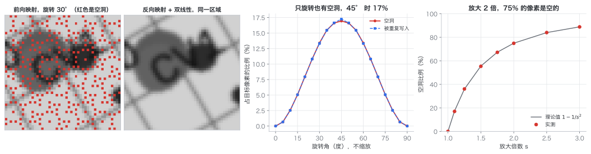
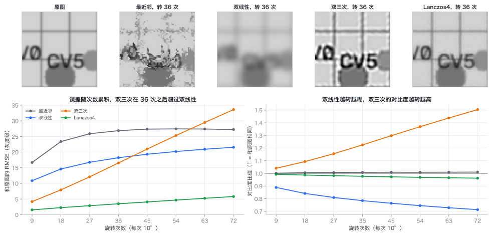
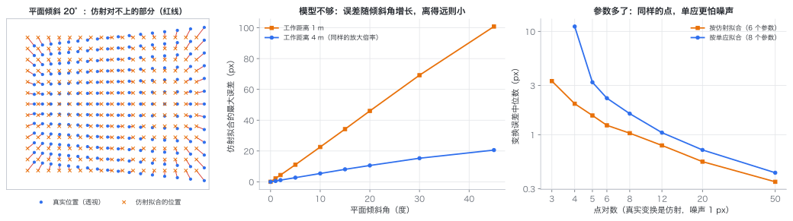
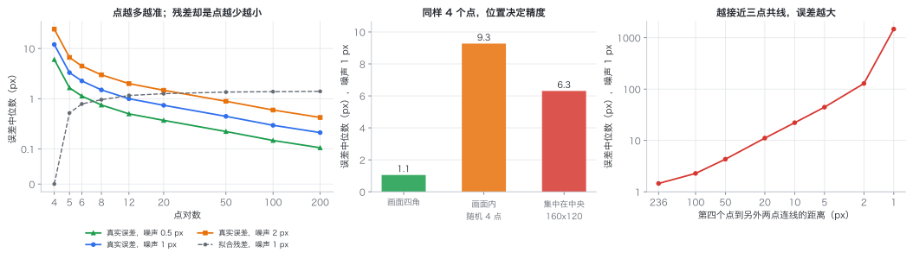
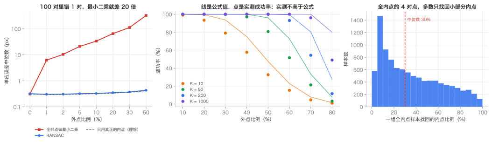
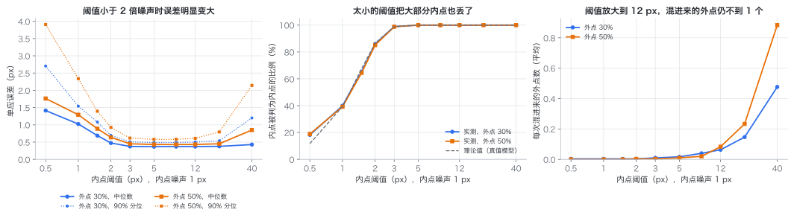

# 第 4 天：几何变换与图像对齐 —— 教程

> [!NOTE]
> 本章所有数字都来自合成数据上的实测，记录在 [`figures/实测数字.json`](figures/实测数字.json)，由 `solutions` 分支的 `solutions/figures/ch04.py` 生成。点的投影用本章作业的参考实现，图像重采样和 `findHomography` 的对照用 OpenCV 5.0.0。换成真实图像或别的 OpenCV 版本，数值会变，结论的方向要自己再测一遍。

自动验收的作业是 [`4-1_齐次点变换.py`](./4-1_齐次点变换.py)。扩展练习 4-1（文档扫描器）和 4-2（图像拼接）的题目在 [`视觉算法学习计划.md`](../视觉算法学习计划.md) 的“第 4 天”一节，需要自己新建 `4-1_文档扫描器.py`、`4-2_图像拼接.py` 完成。

---

## 0. 本章怎么学

**应用场景**：图像校正、拼接，把不同视角的图变到同一坐标系。把斜拍的文档拉正、把相邻视场拼成大图、把模板对到待测图上、数据增强里的旋转和缩放，做法都是先算一个变换矩阵，再按它重新采样。

**优先级**：P1，主线能力。前置是第 1 章（图像是数组，`(x, y)` 和 `shape` 的顺序相反）。后面第 5 章的特征匹配给本章提供点对，第 16 章的对齐从本章的变换层次里选模型，第 17 章的标定直接用本章的单应和 DLT。

| 档位 | 累计用时 | 做什么 | 做到什么算完 |
|---|---:|---|---|
| 速通 | 3 小时 | 读 4.1、4.2、4.4、4.5 节，看懂图 1 到图 6，做 4.5 节末尾演示的前 3 步，答完 5 道小测 | 能讲清为什么用反向映射，仿射和单应差在哪，4 对点为什么不够用，RANSAC 的迭代次数和阈值怎么定 |
| 标准 | 10 小时 | 读完全章，跑 Notebook，完成 `4-1_齐次点变换.py` 并验收通过，做 4.11 节前三个破坏实验，填实验记录 | 验收 PASS，实验记录里有一次点序错误或退化点集的表现，自测问题都能答 |
| 深挖 | 12 小时 | 再做 4.11 节其余的破坏实验和 4.12 节的扩展（文档扫描器和图像拼接选一个） | 在自己拍的照片上跑通，并报告内点数、内点比例和留出点上的误差 |

> [!TIP]
> 用时超过所选档位的 1.5 倍还没做完，就把卡点写进 `学习进度.md`，先往下一章走。本章的作业很短，时间主要花在 4.4 和 4.5 节。速通档可以只记这两节的结论，第 16、17 章用到时再回来。

---

## 4.1 几何变换到底在变什么

前面几章主要修改像素值：让图像更亮、去掉噪声、提取边缘。几何变换不关心“这个像素有多亮”，而关心“这个像素应该搬到哪里”。旋转照片、把斜拍文档拉正、将两张风景照拼成全景，本质都是建立旧坐标与新坐标之间的映射。

最容易混淆的是映射方向。设原图坐标为 `(x, y)`，目标图坐标为 `(x', y')`：

- **前向映射**：把每个原像素投到目标位置，直觉直接，但目标图可能出现没有像素落入的“洞”。
- **反向映射**：遍历每个目标像素，反推它应从原图哪里取值。OpenCV 的 `warpAffine`、`warpPerspective` 内部主要采用这种思路。

反推得到的坐标往往是小数，例如 `(12.4, 8.7)`，而图像只在整数格点有值，因此还需要**插值**：

| 插值 | OpenCV 标志 | 特点 |
|---|---|---|
| 最近邻 | `cv2.INTER_NEAREST` | 最快、边缘呈锯齿，适合标签图和掩码 |
| 双线性 | `cv2.INTER_LINEAR` | 速度与质量平衡，默认常用 |
| 双三次 | `cv2.INTER_CUBIC` | 放大较平滑，但更慢 |
| 区域插值 | `cv2.INTER_AREA` | 缩小图像通常最好，但只在 `cv2.resize` 里起作用（见本节末尾的实测） |

语义分割掩码不能用双线性插值，因为类别编号 `1` 和 `2` 插值出 `1.5` 没有语义；普通照片则通常不选最近邻。

### 前向映射的空洞有多少

“可能出现洞”可以直接数出来。取一张 256×256 的图，把每个源像素按变换算出目标位置，四舍五入后写进去，再数目标图里有多少像素本该有值却没有被写到。



| 只旋转、不缩放（256×256） | 5° | 10° | 20° | 30° | 45° | 90° |
|---|---:|---:|---:|---:|---:|---:|
| 空洞占目标像素的比例 | 0.7% | 2.6% | 7.9% | 13.4% | 16.9% | 0% |
| 被写了两次以上的比例 | 0.7% | 2.5% | 7.9% | 13.3% | 17.2% | 0% |

| 只放大（256×256） | 1.1 倍 | 1.5 倍 | 2 倍 | 3 倍 |
|---|---:|---:|---:|---:|
| 空洞比例，实测 | 17.0% | 55.3% | 74.9% | 88.8% |
| 理论值 $1 - 1/s^2$ | 17.4% | 55.6% | 75.0% | 88.9% |

1. **放大 $s$ 倍，空洞比例是 $1 - 1/s^2$**。源像素只有那么多，目标面积变成 $s^2$ 倍，放大 2 倍就有四分之三的像素没有被写到。
2. **只旋转、面积不变，也有空洞**。旋转 45° 时 16.9% 的目标像素是空的，另有 17.2% 的目标像素被两个源像素先后写入，后写的把先写的盖掉。旋转后的网格和原网格错开，四舍五入之后有的格子落进两个点，有的一个也没有。只有 90° 的整数倍没有这个问题。

反向映射对每个目标像素都去源图取一次值，既没有空洞也没有覆盖。代价是取值的位置是小数，需要插值。

<!-- quiz -->
**一张图只旋转 45°、不缩放，用前向映射（算出目标位置后四舍五入写入）。目标图里大约有多少像素是空的？**

- A. 没有，因为面积没有变
- B. 大约 17%
- C. 大约一半

<details markdown="1"><summary>答案与解释</summary>

**B**。实测 16.9%，同时还有 17.2% 的目标像素被写了两次。面积不变只说明源像素和目标像素一样多，四舍五入之后它们并不是一一对应的。放大 2 倍时才会到 74.9%。

</details>
<!-- /quiz -->

### 插值误差会累积

反向映射每做一次就插值一次，每次都有损失。下面把一张 256×256 的 8 位合成图（网格线、实心圆、文字）绕中心每次转 10°，连续转 72 次，每转满 90° 用 `np.rot90` 无损转回去和原图比较。误差只统计中央的圆形区域，单位是灰度级（0 到 255），原图在这个区域里的标准差是 40.8。



| 旋转次数（每次 10°，256×256） | 9 | 18 | 36 | 54 | 72 |
|---|---:|---:|---:|---:|---:|
| 最近邻：RMSE | 16.7 | 23.4 | 26.8 | 27.4 | 27.2 |
| 双线性：RMSE | 10.9 | 14.6 | 18.2 | 20.2 | 21.5 |
| 双三次：RMSE | 4.2 | 7.9 | 16.5 | 25.3 | 33.6 |
| Lanczos4：RMSE | 1.5 | 2.2 | 3.5 | 4.7 | 5.8 |
| 双线性：对比度比值 | 0.89 | 0.84 | 0.78 | 0.74 | 0.71 |
| 双三次：对比度比值 | 1.04 | 1.09 | 1.23 | 1.37 | 1.50 |

1. **双线性越转越糊**。转 36 次后对比度只剩原来的 0.78。把一个脉冲平移半个像素可以读出它的权重是 (0.5, 0.5)，相当于一次两点平均。在正好错开半个像素这种最不利的位置上，周期 4 px 的细节每次只剩 0.707，连乘 36 次只剩 3.8e-06。
2. **双三次单次误差小，但对比度越转越高**。转 9 次时它的误差（4.2）不到双线性（10.9）的一半。可是它的对比度比值一路上升，36 次时 1.23，72 次时 1.50，图 2 上排能看到文字和网格线旁边出现了亮边。从第 45 次起它的误差（21.0）超过双线性（19.3），72 次时（33.6）比最近邻（27.2）还大。同样用半像素平移读出的权重是 (-0.0938, 0.5938, 0.5938, -0.0938)，和三次卷积公式取 $a = -0.75$ 时一致。平移半个像素时，这个带负权重的核在周期 6.4 px 附近的增益是 1.029，略大于 1，连乘 36 次是 2.79 倍，和对比度上升的方向一致。
3. **最近邻不模糊，但像素被搬错位置**。对比度比值始终在 1.00 到 1.01 之间，误差却最大（36 次时 26.8），图 2 里文字已经碎掉。
4. **只转一个来回也有损失**。先转 +17° 再转 -17°，最近邻、双线性、双三次、Lanczos4 的误差分别是 4.95、4.27、1.40、0.73 个灰度级。
5. **哪种插值损失最小，和图像内容有关**。上面这张合成图先做过轻微的模糊，接近相机拍到的图。本章 Notebook 里的网格图线宽只有 1 px，没有任何模糊。把它做一次透视变换再变回来（`tilt=35`，Notebook 的实验 1 就是这一组），平均绝对误差是最近邻 3.62、双三次 9.17、双线性 11.24 个灰度级，最近邻反而最小；`tilt=90` 时是 10.72、15.3、15.41，顺序相同。所以不要把一张图上的排序当成一般规律，换了图像要重新测。

所以“双三次比双线性好”只在变换次数少的时候成立。更重要的是工程上的做法：**先把矩阵乘起来，只插值一次**。把上面 36 个 10° 的矩阵乘在一起，和单位矩阵的最大差是 2.9e-13，用它变换一次，误差是 0。4.3 节讲的齐次坐标正是为了让变换能这样合并。

<!-- quiz -->
**把一张图每次旋转 10°，连续转 72 次（两圈），再和原图比。最近邻、双线性、双三次三种插值里，哪一种的结果离原图最远？**

- A. 最近邻
- B. 双线性
- C. 双三次

<details markdown="1"><summary>答案与解释</summary>

**C**。72 次后的 RMSE：双三次 33.6，最近邻 27.2，双线性 21.5。双三次单次误差最小（转 9 次时 4.2，双线性 10.9），但它的核带负权重，对比度每转一次高一点，72 次后到了原图的 1.50 倍。正确的做法是把矩阵合并后只插值一次，而不是换一种插值。

</details>
<!-- /quiz -->

### 缩小和掩码：两个要单独处理的情况

**缩小**。上面的表说 `INTER_AREA` 缩小最好。用一张 480×480 的竖条纹来测：周期 3 px（1 px 亮 255，2 px 暗 0，平均值 85.0），缩小到四分之一。缩小后条纹的周期不到 1 px，已经无法表示，理想的结果是一片均匀的灰色，标准差为 0。

| 做法（480×480 缩到 120×120） | 平均值 | 标准差 | 最小 | 最大 |
|---|---:|---:|---:|---:|
| `resize`，最近邻 | 85.0 | 120.2 | 0 | 255 |
| `resize`，双线性 | 85.3 | 60.3 | 0 | 128 |
| `resize`，双三次 | 100.7 | 71.2 | 0 | 151 |
| `resize`，`INTER_AREA` | 85.3 | 30.2 | 64 | 128 |
| `warpAffine`，双线性 | 85.0 | 120.2 | 0 | 255 |
| `warpAffine`，传 `INTER_AREA` | 85.0 | 120.2 | 0 | 255 |

- 在 `resize` 里，`INTER_AREA` 的条纹残留最少（标准差 30.2）。最近邻的输出仍然是纯黑白的条纹，只是周期变了，这就是混叠。双三次还把平均亮度从 85.0 抬到了 100.7。
- **`warpAffine` 和 `warpPerspective` 传 `INTER_AREA` 不起作用**。在 OpenCV 5.0.0 上，它们传 `INTER_AREA` 和传 `INTER_LINEAR` 的结果逐像素相同（最大差 0）。这个例子里缩小 4 倍的采样点正好落在整数位置，双线性等于直接取那一个像素，所以和最近邻一样差。为了排除这是整数倍缩小的巧合，又测了一组一般的变换：256×256 的合成图缩小到 0.3 倍并旋转 17°（`warpPerspective` 另加一点透视），两个函数传 `INTER_AREA` 和传 `INTER_LINEAR` 的最大差仍然是 0，而同一组里双线性和最近邻的最大差是 104 个灰度级。

要在一次 warp 里做大比例缩小，先用 `resize(..., interpolation=cv2.INTER_AREA)` 缩到接近目标的尺寸（或者先做一次模糊），再做 warp。

**掩码**。上面说掩码不能用双线性。取一张 200×200 的标签图，类别编号是 0（背景）、1、3、5，8 位整数，绕中心旋转 17°。类别边界上的目标像素一共 883 个。

| 插值（200×200 标签图，旋转 17°） | 输出里出现的编号 | 编号不在原有类别里的像素 | 编号合法、但周围 4 个源像素里没有这一类的像素 |
|---|---|---:|---:|
| 最近邻 | 0、1、3、5 | 0 | 0 |
| 双线性 | 0 到 5 | 197 | 184 |
| 双三次 | 0 到 6 | 215 | 160 |

双线性造出了原来没有的编号 2 和 4，共 197 个像素，这一类错误用 `np.unique` 一查就能发现。更隐蔽的是另外 184 个像素：编号是合法的，周围 4 个源像素里却没有这一类。例如背景 0 和类别 5 的边界上可以插出 1 和 3，那里既没有类别 1 也没有类别 3。如果类别编号是连续的 0、1、2、3，双线性造成的错误全都属于这一种，检查编号集合发现不了。双三次还会过冲，造出比最大编号更大的 6。第 12 章 12.7 节在训练分割模型时会再次遇到这个问题。

---

## 4.2 变换的层次：自由度越多，能力越强

二维变换可以按“允许发生什么变化”分层理解：

| 模型 | 可保持的性质 | 自由度 | 最少点对 |
|---|---|---:|---:|
| 欧几里得变换 | 长度、角度、平行性 | 3 | 2 |
| 相似变换 | 角度、平行性、长度比例 | 4 | 2 |
| 仿射变换 | 平行性、直线性、同一直线上的比例 | 6 | 3 |
| 投影变换（单应） | 直线性 | 8 | 4 |

每对点给出 x、y 两个方程，所以最少点对数是自由度除以 2 再向上取整。

### 欧几里得与相似变换

欧几里得变换只允许旋转和平移：

```text
[x']   [ cosθ  -sinθ ] [x]   [tx]
[y'] = [ sinθ   cosθ ] [y] + [ty]
```

加入统一缩放 `s` 就得到相似变换。它能把图像整体放大，但不能把正方形拉成平行四边形。

OpenCV 常用：

```python
M = cv2.getRotationMatrix2D(center=(cx, cy), angle=30, scale=1.0)
rotated = cv2.warpAffine(img, M, (width, height))
```

注意正角度在图像坐标中表现为逆时针旋转；同时图像的 y 轴向下，所以手算时不要直接套用笛卡尔坐标的视觉印象。

这两句话放在一起容易弄反，实测一下。取中心 (100, 100)、角度 +90°，测试点 (150, 100) 在中心的正右方：

- `getRotationMatrix2D` 把它映射到 (100, 50)，屏幕上在中心的正上方，是逆时针。它返回的左上 2×2 是 `[[0, 1], [-1, 0]]`，也就是 `[[cosθ, sinθ], [-sinθ, cosθ]]`。
- 按上面的公式 `[[cosθ, -sinθ], [sinθ, cosθ]]` 绕同一个中心算，它到了 (100, 150)，屏幕上在中心的正下方，是顺时针。

两者的 `sinθ` 符号相反。上面的公式在 y 轴向上的数学坐标系里是逆时针；图像的 y 轴向下，同一个公式在屏幕上看就成了顺时针。OpenCV 为了让“正角度等于屏幕上逆时针”，把符号反了过来。自己写旋转矩阵时，用一个测试点确认方向。

### 仿射变换

仿射变换允许旋转、平移、缩放、错切，公式为：

```text
x' = a11*x + a12*y + tx
y' = a21*x + a22*y + ty
```

共有 6 个未知数。一个点对提供 x、y 两个方程，因此 3 组不共线点恰好能求解。仿射变换仍会保持平行线平行：铁轨不会在远处汇聚，所以它无法真实描述透视。

```python
src = np.float32([[50, 50], [250, 50], [50, 200]])
dst = np.float32([[30, 80], [270, 40], [80, 230]])
M = cv2.getAffineTransform(src, dst)
out = cv2.warpAffine(img, M, (300, 260))
```

点的顺序必须一一对应。`src[0]` 要变到 `dst[0]`，顺序错了通常不会报错，只会得到一张“扭曲得很合理”的错误结果。

三点共线时也不会报错：在 OpenCV 5.0.0 上，`getAffineTransform` 对三个共线的点返回一个全零的矩阵，要自己检查。

### 投影变换

斜拍一张纸时，纸面上的平行边在照片中可能汇聚，矩形也会变成任意四边形。此时需要单应矩阵 `H`：

```text
          [h11 h12 h13] [x]
λ [x'] =  [h21 h22 h23] [y]
  [y']    [h31 h32 h33] [1]
  [ 1 ]
```

展开并除以第三个分量：

```text
x' = (h11*x + h12*y + h13) / (h31*x + h32*y + h33)
y' = (h21*x + h22*y + h23) / (h31*x + h32*y + h33)
```

分母随位置变化，正是它让“近处大、远处小”成为可能。`H` 有 9 个元素，但整体乘任意非零常数表示同一变换，所以只有 8 个自由度。4 个点对提供 8 个独立方程，刚好可解；四点中任意三点不能共线，接近共线也不行（4.4 节有实测）。

### 选哪个模型：参数不够和参数太多都有代价

标题说“自由度越多，能力越强”，这只是一半。另一半是自由度越多，同样的点数下越怕噪声。两头各测一次。



**参数不够：用仿射去对付透视**。一块 800×600 mm 的平面，正对相机时刚好铺满 640×480 的画面。让它绕竖直轴倾斜，用仿射去拟合 17×13 个网格点从正对到倾斜的对应关系，不加噪声。两台相机的放大倍率相同，一台焦距 800 px、工作距离 1 m，另一台焦距 3200 px、工作距离 4 m。

| 平面倾斜角（无噪声，17×13 个网格点） | 1° | 2° | 5° | 10° | 20° | 30° |
|---|---:|---:|---:|---:|---:|---:|
| 工作距离 1 m：仿射拟合的最大误差（px） | 2.2 | 4.4 | 11.1 | 22.6 | 46.0 | 69.2 |
| 工作距离 4 m：仿射拟合的最大误差（px） | 0.5 | 1.1 | 2.7 | 5.4 | 10.6 | 15.3 |
| 工作距离 1 m：只用三个角求仿射，第四个角的误差（px） | 6.7 | 13.4 | 33.5 | 67.0 | 133.8 | 200.0 |

同样的数据用单应拟合，最大误差在 1e-13 px 的量级，也就是只剩浮点舍入。

- 工作距离 1 m 时，平面只倾斜 5°，仿射的最大误差就有 11.1 px。如果像 `getAffineTransform` 那样只取三个角，第四个角差 33.5 px。
- 放大倍率不变、工作距离拉到 4 倍，误差降到四分之一左右（5° 时 2.7 px）。物体离得远、视场角小的时候透视弱，仿射才够用。第 16 章第 2 节把仿射的适用场景写成“轻微斜视”，量化出来就是这张表。

**参数太多：用单应去拟合本来是仿射的数据**。真实变换就是仿射，点在 640×480 内均匀随机，噪声 1 px，各 300 次。误差是估出的变换把全画面 17×13 个网格点映射后和真值的均方根距离，取中位数。

| 点对数（真实变换是仿射，噪声 1 px） | 3 | 4 | 5 | 6 | 8 | 12 | 20 | 50 |
|---|---:|---:|---:|---:|---:|---:|---:|---:|
| 按仿射拟合（px） | 3.30 | 1.99 | 1.54 | 1.23 | 1.03 | 0.79 | 0.55 | 0.35 |
| 按单应拟合（px） | 不够解 | 11.15 | 3.22 | 2.26 | 1.60 | 1.05 | 0.71 | 0.43 |

同样 4 对点，按单应拟合的误差是按仿射拟合的 5.6 倍。点数加到 50 对，单应仍然差一些（0.43 对 0.35）。多出来的两个参数没有东西可拟合，只能去拟合噪声。

结论和第 16 章第 2 节一致：**用能解释数据的最简单模型**。先判断场景里有没有透视，再决定用仿射还是单应，不要默认用自由度最多的。

---

## 4.3 齐次坐标：为什么平移也能乘矩阵

普通二维线性变换写成 `p' = A p` 时，原点永远映射到原点，因此不能表达平移。齐次坐标给二维点补一个分量：

```text
(x, y)  →  (x, y, 1)
```

于是平移可以写成：

```text
[x']   [1 0 tx] [x]
[y'] = [0 1 ty] [y]
[ 1]   [0 0  1] [1]
```

这样旋转、缩放、平移都变成矩阵乘法，而且多个操作可以直接相乘组合。若先旋转 `R`，再平移 `T`，列向量约定下总矩阵是 `T @ R`。矩阵乘法不交换，`T @ R` 与 `R @ T` 通常完全不同。

差多少可以用一个点算出来：点 (50, 20)，`R` 是绕原点转 30°，`T` 是沿 x 平移 100 px。`T @ R`（先转后移）把它映射到 (133.3, 42.3)，`R @ T`（先移后转）把它映射到 (119.9, 92.3)，两个结果相距 51.8 px。

齐次坐标中的 `(x, y, w)` 与 `(kx, ky, kw)` 表示同一点，最后要除以 `w` 回到二维。这也解释了单应矩阵为什么只有 8 个自由度。

OpenCV 中仿射矩阵通常是 `2×3`，必要时可补成 `3×3`：

```python
M3 = np.vstack([M, [0, 0, 1]])
```

补成 3×3 之后，仿射和单应就能用同一套代码相乘、求逆、作用到点上。4.1 节“先把矩阵乘起来，只插值一次”靠的就是这一点。

### 第三个分量过零时会发生什么

仿射矩阵的第三行是 `(0, 0, 1)`，`w` 恒等于 1。单应的第三行不是，`w = h31*x + h32*y + h33` 会随位置变化，也会变成 0 或负数。用作业文件里演示用的矩阵 `[[1, 0.2, 3], [0.1, 1, 2], [0.01, 0.02, 1]]`，看直线 y = 0 上相邻的三个点（下面是参考实现的输出）：

| 输入点 | 第三个分量 `w` | 输出 |
|---|---:|---|
| (-99, 0) | +0.01 | (-9600, -790) |
| (-100, 0) | 0 | (NaN, NaN) |
| (-101, 0) | -0.01 | (9800, 810) |

相邻 1 px 的两个点被甩到了相反方向的远处，中间那个点被映射到无穷远。满足 `h31*x + h32*y + h33 = 0` 的点组成一条直线，它的像在无穷远。这条线如果穿过你要变换的区域，`warpPerspective` 的结果会在那里撕开并翻到另一侧。

作业要求 `|w| <= 1e-12` 时返回 NaN，就是为了不让一个除零结果悄悄混进后面的计算。排查单应时，先把图像四个角代进去看 `w` 的符号是否一致。

---

## 4.4 单应矩阵怎样从点对中求出

把一组对应点 `(x, y) ↔ (u, v)` 代入单应公式并移项，可以得到两条关于 `h11...h33` 的线性方程。多组点堆叠后写成：

```text
A h = 0
```

用 SVD 找到使 `||Ah||` 最小、且 `||h||=1` 的向量，再重排成 `3×3` 矩阵。这种方法称为 DLT（Direct Linear Transform）。实际计算前通常还会对坐标做归一化（Hartley 归一化）。它在什么条件下起作用、原因是什么，见本节后面的实测和第 17 章第 5 节，并不只是“数值过大”这一个原因。

把两条方程写出来。记 $H$ 的元素为 $H_{ij}$，把单应公式两边乘以分母再移项：

```math
\begin{aligned}
-x H_{11} - y H_{12} - H_{13} + u x H_{31} + u y H_{32} + u H_{33} &= 0 \\
-x H_{21} - y H_{22} - H_{23} + v x H_{31} + v y H_{32} + v H_{33} &= 0
\end{aligned}
```

$N$ 对点叠成 $2N \times 9$ 的矩阵 $A$。9 个未知数差一个尺度，是 8 个自由度，所以至少 4 对点。这里的记号和第 17 章 3.2 节相同，那一章的作业要自己实现 DLT。

OpenCV 提供两条常用路径：

```python
# 恰好 4 组可靠点
H = cv2.getPerspectiveTransform(src4, dst4)

# 多于 4 组，允许噪声和误匹配
H, mask = cv2.findHomography(src_pts, dst_pts, cv2.RANSAC, 3.0)
```

`getPerspectiveTransform` 直接使用四对点；`findHomography` 可以使用更多点，并通过最小二乘或 RANSAC 提高鲁棒性。返回的 `mask` 标记哪些匹配被判定为内点，不要丢掉它——内点比例是判断匹配是否可信的重要信号。

单应有一个关键前提：对应点位于**同一平面**，或者相机只绕光心旋转。若场景有明显前后层次且相机发生平移，一张单应矩阵不能同时对齐近处人物和远处建筑，这种错位叫视差。

### 点数、噪声和点的位置

“4 对点刚好可解”只说明方程够数，不说明解得准。下面的实验都用随机单应（把 640×480 画面的四个角各自随机挪动最多 60 px），点在画面内均匀随机，用归一化 DLT 求解。**真实误差**是估出的单应把全画面 17×13 个网格点映射后，和真值位置的均方根距离。**拟合残差**是估出的单应在参与拟合的那些点上的均方根重投影误差。



| 点对数（噪声 1 px，各 300 次） | 4 | 5 | 6 | 8 | 12 | 20 | 50 | 100 | 200 |
|---|---:|---:|---:|---:|---:|---:|---:|---:|---:|
| 真实误差中位数（px） | 11.985 | 3.303 | 2.255 | 1.495 | 0.998 | 0.739 | 0.445 | 0.295 | 0.211 |
| 真实误差 90% 分位（px） | 123.18 | 12.38 | 6.52 | 3.11 | 1.61 | 1.08 | 0.60 | 0.40 | 0.29 |
| 拟合残差中位数（px） | 0 | 0.519 | 0.786 | 0.955 | 1.159 | 1.258 | 1.355 | 1.380 | 1.401 |

1. **恰好 4 对点时最不准**。残差是 0，真实误差的中位数却是 12 px，有十分之一的情况超过 123 px。加到 5 对降到 3.3 px，8 对 1.5 px，20 对 0.74 px。
2. **误差和噪声成正比**。20 对点时，噪声 0.5、1、2 px 对应的误差是 0.370、0.739、1.471 px。
3. **点数多了以后按 $1/\sqrt{N}$ 下降**。噪声 1 px 时，误差乘以 $\sqrt{N}$ 在 20 对以上稳定在 3 左右（3.30、3.15、2.95、2.99）。想把误差减半，点数要变成 4 倍。
4. **拟合残差不能当精度用**。点越少残差越小，4 对点时是 0；点很多时它趋向 1.4 px，反映的是噪声的大小。残差只说明模型在参与拟合的点上自洽，第 17 章第 6 节的重投影误差是同一个道理。

**同样 4 对点，放在哪里差别很大**（噪声 1 px，各 500 次）：

| 4 个点的位置 | 画面四角 | 画面内随机 | 集中在中央 160×120 |
|---|---:|---:|---:|
| 真实误差中位数（px） | 1.05 | 9.27 | 6.31 |
| 真实误差 90% 分位（px） | 1.6 | 84.6 | 11.7 |

“画面内随机”和上表 4 对点那一格是同一种情况，只是换了一组随机数，中位数在 9 到 12 px 之间，分布的尾巴很长。四个点放在画面四角时误差只有 1.05 px，是随机放的九分之一左右。文档矫正用纸的四个角，正好是最有利的摆法。点挤在中央一小块时误差是 6.31 px：小块里的一点偏差外推到全画面就被放大了。

**三点接近共线**（噪声 1 px，各 300 次）。三个点固定在 (100, 100)、(540, 100)、(540, 380)，第四个点从 (100, 380) 沿对角线移向第一、三个点的连线：

| 第四个点到连线的距离（px） | 236 | 100 | 50 | 20 | 10 | 5 | 2 | 1 |
|---|---:|---:|---:|---:|---:|---:|---:|---:|
| 真实误差中位数（px） | 1.45 | 2.28 | 4.31 | 11.1 | 22.15 | 44.42 | 128.45 | 1473.76 |

距离从 100 px 减到 5 px 的过程中，每减一半误差大约翻一倍；减到 1 px 时误差已经上千像素。完全共线时 OpenCV 并不报错：把第四个点正好放在连线的中点，目标点由真实单应算出、不加噪声，100 个随机单应里 `getPerspectiveTransform` 没有一次抛出异常。返回的矩阵把这 4 个点自己映射回去，误差最大 0.012 px；在全画面网格点上的误差中位数是 260.8 px，只有 2 次小于 1 px。也就是说它返回了一个只在这 4 个点上成立的矩阵。

所以“任意三点不能共线”要当成硬性条件，而且要留出足够的距离。拿到 4 个点之后，先检查它们围成的四边形是不是凸的、面积是不是够大。

### 归一化在这里有没有用

第 17 章第 5 节测过：用 SVD 解 DLT 时，常规坐标下归一化与否没有差别；角点集中在小范围时不归一化会差一些；数值很大又用法方程求解时不归一化会彻底失效。那里的源点是标定板上的毫米坐标。本章的源点和目标点都是像素坐标，再测一次，比较三种预处理：Hartley 归一化、只把两组点各自平移到质心、不处理。

点铺满 640×480 的画面，各 300 次，全画面网格点上的误差中位数（px）：

| 条件 | 归一化 | 只平移到质心 | 不处理 | `cv2.findHomography` |
|---|---:|---:|---:|---:|
| 50 对点，噪声 0.5 px | 0.217 | 0.231 | 0.223 | 0.215 |
| 50 对点，噪声 2 px | 0.864 | 1.633 | 1.143 | 0.859 |
| 200 对点，噪声 0.5 px | 0.106 | 0.139 | 0.117 | 0.106 |
| 200 对点，噪声 2 px | 0.427 | 1.399 | 0.832 | 0.426 |

20 对点、噪声 0.5 px、各 300 次，点只分布在画面中央的一块区域里，误差也只在这块区域里统计（px）：

| 点的分布范围 | 归一化 | 只平移到质心 | 不处理 | `cv2.findHomography` |
|---|---:|---:|---:|---:|
| 639×479（整个画面） | 0.381 | 0.404 | 0.394 | 0.382 |
| 320×240 | 0.378 | 0.428 | 0.445 | 0.379 |
| 160×120 | 0.377 | 0.410 | 1.226 | 0.379 |
| 64×48 | 0.375 | 0.396 | 10.92 | 0.379 |

前三列是自己写的 DLT，用 float64；换成 float32，每一格到三位小数都相同。最后一列是把同样的点交给 `cv2.findHomography(src, dst, 0)`（全部点做最小二乘）。

1. **点铺满画面、噪声 0.5 px 时，归一化与否只差 3%**（0.217 对 0.223）。这和第 17 章“常规坐标下没有差别”的结论一致，那里用的也是 0.5 px 噪声。
2. **差别随噪声和点数增大**。噪声 2 px、200 对点时，不处理的误差接近归一化的 2 倍（0.832 对 0.427）。200 对点时，噪声从 0.5 px 加到 2 px，归一化的误差跟着变成 4 倍（0.106 到 0.427），不处理的变成了 7 倍（0.117 到 0.832）。噪声 2 px 时，点数从 50 对加到 200 对，归一化的误差减半（0.864 到 0.427），不处理的只从 1.143 降到 0.832。第 17 章只测了 0.5 px 这一档噪声，这一条是对它的补充。
3. **点集中在小区域时，不归一化基本不可用**。点只占 64×48 px 时，不处理的误差是 10.92 px，归一化是 0.375 px。这时只把两组点各自平移到质心就恢复到了 0.396 px，起主要作用的是平移这一步。但在第一张表里，只平移比不处理还差（1.633 对 1.143），所以平移和缩放两步都要做。第 17 章对应的那一行只差 13%，比这里小得多。区别在于那里的源点是从 0 开始的标定板坐标：把这里的源点也换成从 0 开始、宽 120 的坐标，目标点仍用像素坐标，不做归一化的误差就只有 0.395 px。差别有多大取决于两组坐标各自怎么取，所以不要去记哪种情况可以省掉归一化。
4. **float32 和 float64 的结果相同，差别不是舍入误差造成的**。DLT 最小化的是代数误差，各个方程占多大权重取决于坐标怎么取，归一化之后代数误差更接近几何误差。这是第 17 章第 5 节的分析，这里的实测与它相符。“数值过大造成病态”只在第 17 章测到的那种情况下才是主因：坐标数值很大，并且用法方程求解。

实用的结论和第 17 章相同：归一化成本很低，作为默认步骤。`cv2.findHomography` 在两张表的每一行都和归一化那一列相差不到 0.01 px，点只占 64×48 px 时也是 0.379 px，直接用它不需要自己再处理坐标。

<!-- quiz -->
**用 4 对点求出一个单应，把这 4 个点代回去，重投影误差是 0。这说明什么？**

- A. 这个单应很准
- B. 说明不了精度，8 个未知数配 8 个方程，残差必然是 0
- C. 说明这 4 个点没有噪声

<details markdown="1"><summary>答案与解释</summary>

**B**。噪声 1 px 时，4 对随机点求出的单应残差是 0，在全画面上的真实误差中位数却是 12 px，有十分之一的情况超过 123 px。精度要用没有参与拟合的点来检验。把点数加到 20 对，真实误差降到 0.74 px，残差反而升到 1.26 px。

</details>
<!-- /quiz -->

---

## 4.5 RANSAC：让错误匹配失去投票权

假设两张图中有 100 对特征匹配，其中 30 对是错的。直接用全部点做最小二乘，少量离群点就可能把模型拉偏。RANSAC 的核心不是“精确计算”，而是反复进行**假设 + 验证**：

1. 随机抽取估计模型所需的最小样本，例如单应矩阵抽 4 对点。
2. 用这 4 对点求一个候选 `H`。
3. 用 `H` 投影全部源点，计算与目标点的重投影误差。
4. 误差小于阈值的点记为内点。
5. 重复多次，保留内点最多、误差最小的模型。
6. 最后用所有内点重新估计模型。

重投影误差可写为：

```text
e_i = || p'_i - normalize(H p_i) ||₂
```

阈值不是越小越好。阈值过小会把真实但有定位噪声的匹配排除；过大会让错误匹配混入。对普通分辨率图像，`3~5` 像素常是起点，但应结合分辨率、关键点精度和应用容忍度调整。

RANSAC 也不是万能的：如果错误匹配本身形成另一套一致结构，或者真实内点比例太低，它可能选错模型。应同时检查内点数量、内点比例、变换后四角位置和最终视觉效果。

下面把这几段里的“可能”“太低”“过小”“过大”逐个量出来。实验数据都是 100 对匹配，内点服从一个随机单应并加 1 px 的噪声，外点的目标位置在画面内均匀随机。RANSAC 是配图脚本里按上面六步写的一个朴素版本，第 6 步用内点重新拟合两轮。

### 最小二乘有多怕外点

各 200 次，RANSAC 用阈值 3 px、迭代 500 次，误差是全画面网格点上的均方根，取中位数（px）：

| 外点比例（100 对匹配，噪声 1 px） | 0% | 1% | 2% | 5% | 10% | 30% | 50% |
|---|---:|---:|---:|---:|---:|---:|---:|
| 全部点做最小二乘 | 0.31 | 6.23 | 10.37 | 21.01 | 33.65 | 112.13 | 325.66 |
| RANSAC | 0.32 | 0.302 | 0.305 | 0.32 | 0.326 | 0.372 | 0.433 |
| 只用真正的内点做最小二乘（理想情况） | 0.31 | 0.294 | 0.295 | 0.307 | 0.318 | 0.356 | 0.411 |

100 对里只错 1 对，最小二乘的误差就从 0.31 px 变成 6.23 px，是原来的 20 倍。RANSAC 在外点 50% 时仍然贴着理想情况。

### 要迭代多少次

设内点比例是 $w$，最小样本是 $s$ 对点。一次抽样抽到的全是内点的概率是 $w^s$，抽 $K$ 次至少有一次全是内点的概率是 $1 - (1 - w^s)^K$。让它不小于置信度 $p$，解出

$$
K = \frac{\log(1 - p)}{\log(1 - w^s)}
$$

取 $p = 0.99$，由脚本算出的 $K$：

| 外点比例 | 10% | 30% | 50% | 60% | 70% | 80% | 90% |
|---|---:|---:|---:|---:|---:|---:|---:|
| 相似变换，$s = 2$ | 3 | 7 | 17 | 27 | 49 | 113 | 459 |
| 仿射，$s = 3$ | 4 | 11 | 35 | 70 | 169 | 574 | 4603 |
| 单应，$s = 4$ | 5 | 17 | 72 | 178 | 567 | 2876 | 46050 |

外点比例越高、模型的最小样本越大，需要的次数涨得越快。外点 80% 时，单应需要的次数是相似变换的 25 倍。这是“用最简单模型”的又一个理由。

公式说的是“至少抽到一组全内点”。抽到了是不是就等于成功，要测。成功的定义是最终单应在全画面网格点上的均方根误差小于 3 px，阈值 3 px，各 300 次。



迭代 50 次时（%）：

| 外点比例（K = 50，各 300 次） | 30% | 40% | 50% | 60% | 70% | 80% |
|---|---:|---:|---:|---:|---:|---:|
| 公式值 | 100.0 | 99.9 | 96.0 | 72.7 | 33.4 | 7.7 |
| 实测：至少抽到一组全内点 | 100.0 | 99.7 | 95.7 | 70.7 | 31.3 | 6.0 |
| 实测：成功率 | 99.7 | 97.0 | 80.7 | 51.7 | 21.3 | 3.3 |

迭代次数按公式取（$p = 0.99$，$s = 4$），以及取它的 2 倍、3 倍时的实测成功率（%，各 300 次）：

| 外点比例 | 10% | 30% | 50% | 70% |
|---|---:|---:|---:|---:|
| 公式给的 $K$ | 5 | 17 | 72 | 567 |
| 迭代 $K$ 次 | 95.3 | 95.0 | 91.7 | 85.7 |
| 迭代 $2K$ 次 | 100.0 | 99.3 | 100.0 | 96.0 |
| 迭代 $3K$ 次 | 100.0 | 100.0 | 100.0 | 99.3 |

1. **公式对“至少抽到一组全内点”算得基本准**。外点 50%、迭代 50 次时公式值 96.0%，实测 95.7%。外点很多时公式略偏乐观，因为从 100 对里不放回地抽 4 对，全是内点的概率比 $w^4$ 小。迭代 1000 次、外点 80% 时，公式值是 79.8%，按不放回抽样算的精确值是 71.0%，实测 70.3%。
2. **成功率比公式值低一截**。外点 50%、迭代 50 次时成功率只有 80.7%。按公式取迭代次数，名义上是 99%，实测只有 85.7% 到 95.3%。
3. **原因是抽到全内点不等于得到好模型**。把迭代次数实验的全部结果合在一起：抽到过全内点样本的 7551 次里成功了 93.0%，一次都没抽到的 2049 次里成功率是 0。抽到全内点是必要条件，但不充分。图 5 右给出了原因：噪声 1 px、阈值 3 px 时，一组全内点的 4 对点求出的单应，找回的内点比例中位数只有 30%，69.1% 的样本找回不到一半，只有 3.4% 的样本能找回九成以上。这正是 4.4 节的结论，4 对随机点求出的单应本身就不准。
4. **实用的做法是取公式值的 2 到 3 倍**。取 3 倍时，表里四种外点比例的成功率都不低于 99.3%。

<!-- quiz -->
**外点比例 50%，按公式（置信度 0.99，单应 s = 4）算出要迭代 72 次。照这个次数跑，实测的成功率最接近哪个？**

- A. 99%
- B. 92%
- C. 50%

<details markdown="1"><summary>答案与解释</summary>

**B**。实测 91.7%。公式保证的是“至少抽到一组全内点”，而一组全内点的 4 对点在 3 px 阈值下找回的内点比例中位数只有 30%，不一定能胜出。迭代次数加到 2 倍（144 次）后，300 次实验全部成功。

</details>
<!-- /quiz -->

### 阈值怎么定

同一批假设换不同的阈值打分，迭代 1000 次，各 300 次。内点噪声是 x、y 方向各 1 px。



| 阈值（px），外点 30% | 0.5 | 1 | 2 | 3 | 5 | 12 | 20 | 40 |
|---|---:|---:|---:|---:|---:|---:|---:|---:|
| 单应误差中位数（px） | 1.414 | 1.025 | 0.474 | 0.375 | 0.368 | 0.371 | 0.377 | 0.43 |
| 内点被判为内点的比例（%） | 18.26 | 39.96 | 85.95 | 98.92 | 100.0 | 100.0 | 100.0 | 100.0 |
| 理论值（%） | 11.8 | 39.3 | 86.5 | 98.9 | 100.0 | 100.0 | 100.0 | 100.0 |
| 平均每次混进来的外点数 | 0.0 | 0.0 | 0.0 | 0.01 | 0.02 | 0.06 | 0.15 | 0.48 |

1. **阈值要按定位噪声来定，3 倍噪声是合适的起点**。阈值 3 px 时 98.92% 的内点被留下。理论值是用真值模型算的：内点的误差小于阈值的概率只和“阈值除以噪声”有关。实测在阈值 1 px 以上和它基本重合，阈值 0.5 px 时偏高（18.26% 对 11.8%）。一个可能的原因是最后一步只用被留下的点重新拟合，模型会向这些点靠拢，这一点没有单独验证。
2. **阈值太小，伤害来得快**。阈值 0.5 px 时只有 18.26% 的内点被留下，误差是 1.414 px，为阈值 3 px 时的 3.8 倍。“更严格”并没有换来更准。
3. **阈值太大，在这组实验里影响很小**。阈值 12 px 时误差是 0.371 px，平均每次只混进 0.06 个外点；到 40 px 才升到 0.43 px。原因是这里的外点是均匀随机的，碰巧落在正确位置附近的机会很小。如果外点就在正确位置旁边（例如重复纹理上错开一个周期的匹配），大阈值会把它们收进来。这种情况本章没有测，不能把“阈值大一点无所谓”当成一般结论。
4. 上面原文说的“3~5 像素常是起点”，对应的是 1 px 到 2 px 左右的定位噪声。如果特征点定位到 0.1 px 的精度，阈值也应该跟着减小。

<!-- quiz -->
**内点的定位噪声是 1 px。把 RANSAC 的阈值从 3 px 收紧到 0.5 px，最终单应的误差会怎样？**

- A. 变小，因为只留下最准的点
- B. 基本不变
- C. 变大，接近原来的 4 倍

<details markdown="1"><summary>答案与解释</summary>

**C**。外点 30% 时，误差从 0.375 px 升到 1.414 px。阈值 0.5 px 只留下 18.26% 的内点，参与最后拟合的点少了，4.4 节已经看到点少误差就大。反过来把阈值放宽到 12 px，误差是 0.371 px，几乎没有变化（前提是外点均匀随机）。

</details>
<!-- /quiz -->

### OpenCV 的 findHomography 实测

实际工作中用的是 `cv2.findHomography(src, dst, cv2.RANSAC, 3.0)`。其余参数用默认值，在 OpenCV 5.0.0 上测，100 对匹配，噪声 1 px，各 200 次：

| 外点比例 | 50% | 70% | 80% | 85% | 90% |
|---|---:|---:|---:|---:|---:|
| 真正的内点数 | 50 | 30 | 20 | 15 | 10 |
| 成功率（%） | 100.0 | 100.0 | 96.0 | 66.5 | 11.0 |
| 返回的内点数中位数 | 49 | 30 | 20 | 14 | 5 |

- **默认参数在外点 80% 以内基本可靠**，到 85% 只剩 66.5%，到 90% 只剩 11.0%。
- **返回了矩阵不等于成功**。把 100 对匹配全部换成随机的，200 次调用每一次都返回了矩阵，报告的内点数中位数是 5，最大是 6。4 对点恰好确定一个单应，这 4 对自己必然是“内点”，再碰巧凑上一两对。内点数只有个位数时，返回的矩阵没有意义。
- **同一组输入调用两次，结果逐位相同**（20 组里 20 组如此）。把点对的顺序打乱再算，结果和原来相差 0.417 px（中位数），最大 0.937 px。所以在这个版本上，随机性表现为结果依赖输入的顺序。复现问题时要把点对的顺序也固定下来。
- **OpenCV 的一次迭代不等于一次普通抽样**。把 `maxIters` 设成和图 5 一样的 $K$ 再测（各 200 次），它的成功率比上面的朴素实现高，还高过公式值：$K = 50$、外点 60% 时是 85.0%，公式值是 72.7%；$K = 10$、外点 50% 时是 59.5%，公式值是 47.6%。公式值是“$K$ 次普通抽样里至少一组全内点”的概率，朴素实现不可能超过它。OpenCV 能超过，说明它在抽样或打分上做了额外的处理。具体做了什么本章没有查证，以 OpenCV 的源码和文档为准。所以公式和图 5 用来理解规律，实际调用时以上面这张默认参数的表为准。
- **另一套一致的结构会把模型抢走**。100 对匹配里 40 对服从单应 A、45 对服从单应 B、15 对随机，用本章的朴素 RANSAC（阈值 3 px，迭代 2000 次）跑 200 组，结果更接近 A 的只有 2.5%，其余都跟了点数更多的 B。RANSAC 选的是内点最多的模型，它不知道哪一套才是你要的。

### 交互演示：亲手跑一遍 RANSAC

演示页里是同样的设置：100 对匹配，可以调外点比例、噪声、阈值和迭代次数，看每次迭代后最好的内点数怎么变，以及重复 200 次的成功率和公式值差多少。页面下方有五步引导，第 1 步对应“最小二乘有多怕外点”，第 2、3、4 步对应“要迭代多少次”，第 5 步对应“阈值怎么定”。演示页里求单应用的是固定 $H_{33} = 1$ 的线性最小二乘，数据和随机数也和配图脚本不同，所以数值和上面的表不会完全相同，现象相同。

<!-- embed: ../demos/RANSAC单应估计.html 1160 -->
[打开交互演示：RANSAC 估计单应](../demos/RANSAC单应估计.html)

---

## 4.6 逐步例子：把斜拍文档拉正

目标：检测纸张四角，将任意四边形映射为正视矩形。

### 第一步：准备四个角点

练习中可以通过轮廓近似自动寻找；先用手工点理解变换：

```python
src = np.float32([
    [180, 120],   # 左上
    [620, 80],    # 右上
    [680, 520],   # 右下
    [120, 560],   # 左下
])
```

角点必须按环形顺序排列。常见排序策略：坐标和 `x+y` 最小的是左上、最大的是右下；差值 `y-x` 最小的是右上、最大的是左下。纸在画面内转到接近 45° 时，或者四边形是凹的，简单和差法会失效，应结合轮廓方向检查。

失效的范围可以量出来。取一张 A4 纸（210×297 mm），相机焦距 800 px、距离 700 mm。纸先在自己的平面内旋转一个角度，再朝随机方向倾斜（倾斜角在 0 到上限之间均匀取），各 2000 次。“出错”指得到的四个角不是四个互不相同、按环形顺序排列的点。

| 纸面内旋转角 | 0° | 10° | 20° | 30° | 35° | 40° | 45° |
|---|---:|---:|---:|---:|---:|---:|---:|
| 和差法出错，倾斜上限 30° | 0% | 0% | 0% | 0% | 0% | 17.3% | 100% |
| 和差法出错，倾斜上限 50° | 0% | 0% | 0% | 5.5% | 18.5% | 47.5% | 100% |
| 按绕中心的角度排序出错，倾斜上限 50° | 0% | 0% | 0% | 0% | 0% | 0% | 0% |

纸面内旋转不超过 20° 时，和差法在这组实验里没有出错。倾斜大的时候 30° 就开始出错，正好 45° 时每次都错：这时有两个角的 `x+y` 几乎相等，谁最小由透视的细微差别决定，同一个角可能被选中两次，或者选出来的顺序不再是环形。所以失效并不需要多么极端的旋转。

另一种排序是算出四个点的中心，按每个点相对中心的方向角排序。对凸四边形，这样得到的一定是环形顺序，表里所有条件下都没有出错。它只保证环形顺序，不知道哪个角是“左上”。纸转过 45° 以后，哪条边算“上边”本来就要靠内容（文字方向）来定。

### 第二步：决定输出尺寸

取上下边宽度、左右边高度的较大值，减少裁切：

```python
width_a = np.linalg.norm(src[2] - src[3])
width_b = np.linalg.norm(src[1] - src[0])
height_a = np.linalg.norm(src[1] - src[2])
height_b = np.linalg.norm(src[0] - src[3])
W = int(max(width_a, width_b))
H = int(max(height_a, height_b))
```

这里的 `H` 是高度变量，不要与单应矩阵也命名为 `H`，实际代码可把矩阵命名为 `M` 或 `homography`。

这样定出来的尺寸，宽高比并不等于纸的真实宽高比。同一张 A4 纸和相机，让纸的上边向靠近相机的方向倾斜：

| 倾斜角 | 0° | 10° | 20° | 30° | 45° |
|---|---:|---:|---:|---:|---:|
| 上边、下边、左右边的长度（px） | 240、240、339 | 249、231、335 | 259、224、321 | 268、217、298 | 282、209、248 |
| 按较大值算出的宽高比（真实值 0.707） | 0.707 | 0.744 | 0.806 | 0.9 | 1.137 |
| 相对真实宽高比的偏差 | 0% | +5.2% | +14.0% | +27.2% | +60.8% |

倾斜 30° 时，矫正出来的“A4 纸”比真实的宽了 27.2%。倾斜让高度方向被压短，离相机近的那条横边又被放大，两个效应叠在一起。知道纸的规格时，直接按规格定输出的宽高比（A4 是 210:297）。不知道规格时，要清楚输出有拉伸，不能在上面量尺寸。

### 第三步：建立目标矩形并变换

```python
dst = np.float32([
    [0, 0],
    [W - 1, 0],
    [W - 1, H - 1],
    [0, H - 1],
])

M = cv2.getPerspectiveTransform(src, dst)
scan = cv2.warpPerspective(img, M, (W, H), flags=cv2.INTER_LINEAR)
```

输出边界使用 `W-1`、`H-1`，因为最后一个合法像素坐标不是 `W`、`H`。如果文档是文字，可继续灰度化、轻微去噪，再用 Otsu 或自适应阈值增强，正好连接第 1～3 天的知识。

---

## 4.7 图像拼接 pipeline：每一步都可能失败

全景拼接不是一个 API，而是一条流水线：

1. **检测关键点**：在两张图中找稳定角点或斑点。
2. **计算描述子**：把关键点邻域编码成可比较向量。
3. **描述子匹配**：寻找两图中可能对应的位置。
4. **过滤匹配**：比值测试、交叉验证，去掉明显歧义。
5. **RANSAC 求单应**：只让几何一致的匹配参与对齐。
6. **图像扭正**：`warpPerspective` 将一张图变到另一张坐标系。
7. **融合接缝**：处理重叠区亮度差和明显边界。

最小骨架如下，特征细节会在第 5 天展开：

```python
sift = cv2.SIFT_create()
kp1, des1 = sift.detectAndCompute(gray1, None)
kp2, des2 = sift.detectAndCompute(gray2, None)

matcher = cv2.BFMatcher(cv2.NORM_L2)
knn = matcher.knnMatch(des1, des2, k=2)
good = [m for m, n in knn if m.distance < 0.75 * n.distance]

src_pts = np.float32([kp1[m.queryIdx].pt for m in good]).reshape(-1, 1, 2)
dst_pts = np.float32([kp2[m.trainIdx].pt for m in good]).reshape(-1, 1, 2)
M, inlier_mask = cv2.findHomography(src_pts, dst_pts, cv2.RANSAC, 4.0)
```

仅仅覆盖粘贴会产生硬接缝。简单融合可在重叠区做线性加权，更成熟的方法包括多频段融合、曝光补偿和最佳缝合线。练习 `4-2` 的重点先放在“匹配是否可靠、几何是否正确”，不要一开始就被融合细节淹没。

对照本章的实测，第 5、6 两步各有一个要检查的数：

- 第 5 步之后先看 `inlier_mask.sum()`。4.5 节测到全是随机匹配时也能凑出 5 到 6 个内点，内点数和这个水平差不多时不要往下走。
- 第 6 步只做一次 `warpPerspective`。如果还要缩放或平移画布，先把这些矩阵和单应乘在一起（4.1 节），不要对图像连做几次变换。

---

## 4.8 OpenCV API 速查

```python
cv2.resize(src, dsize, fx=..., fy=..., interpolation=...)
cv2.getRotationMatrix2D(center, angle, scale)          # 返回 2×3
cv2.getAffineTransform(src3, dst3)                    # 三对点
cv2.warpAffine(src, M, dsize, flags=..., borderMode=...)
cv2.getPerspectiveTransform(src4, dst4)               # 四对点
cv2.findHomography(src, dst, method, ransacThreshold) # 多点鲁棒估计
cv2.warpPerspective(src, H, dsize, flags=..., borderMode=...)
cv2.perspectiveTransform(points, H)                    # 只变换点，不扭图
```

`dsize` 一律是 `(width, height)`，而 NumPy 图像 shape 是 `(height, width, channels)`。边界外区域可用 `borderMode=cv2.BORDER_CONSTANT` 指定固定颜色，或选 `BORDER_REFLECT` 等策略。

三个实测过的细节（OpenCV 5.0.0）：

- `flags=cv2.INTER_AREA` 只在 `resize` 里起作用。`warpAffine` 和 `warpPerspective` 传它，结果和 `INTER_LINEAR` 逐像素相同（4.1 节）。
- `resize` 和 `warpAffine` 对“像素在哪里”的约定差半个像素。把一张 256×256 的图放大 2 倍，`warpAffine` 的矩阵只写缩放 `[[2, 0, 0], [0, 2, 0]]` 时，和 `resize` 的结果最大相差 31.5 个灰度级（均方根 4.92）。把矩阵写成 `[[2, 0, 0.5], [0, 2, 0.5]]` 之后两者一致。`resize` 把像素看成有面积的小方块，按方块的中心对齐，按这个约定放大 $s$ 倍时会多出一个 $(s - 1)/2$ 的平移（本章只实测了 2 倍）。第 16 章做亚像素对齐时，半个像素是很大的误差。
- `getRotationMatrix2D` 的正角度在屏幕上是逆时针，和教科书公式的符号相反（4.2 节）。旋转后画布大小不变，四角会被裁掉：640×480 的图绕中心转 30°，只有 83.2% 的像素还留在原来的画布里，不裁切需要 794×736 的画布。

---

## 4.9 常见坑与排查顺序（常见错误）

1. **宽高写反**：输出形状异常，先打印 `img.shape` 和 `dsize`。
2. **点顺序不一致**：四点必须源、目标一一对应，最好画编号检查。
3. **整数截断过早**：特征点和矩阵计算保留 `float32/float64`，最后再转整数。
4. **旋转后被裁切**：原画布大小不一定容纳旋转图，应计算变换后四角包围盒并修正平移。
5. **误把仿射当透视**：斜拍平面通常需要 `warpPerspective`。
6. **匹配数够但分布很差**：所有内点挤在一个小区域，估计出的单应对全图不稳定。
7. **只看 RANSAC 是否返回矩阵**：还要看内点比例、重投影误差和变换后角点。
8. **有视差仍强行单应对齐**：近景与远景无法同时重合，应改变拍摄方式或使用更复杂模型。
9. **掩码使用线性插值**：类别边界会出现非法值，改用最近邻。
10. **矩阵组合顺序反了**：用一个测试点逐步计算，比盯着矩阵更容易发现问题。

把上面的条目和本章实测到的情况合起来，按现象查。前九行是做作业 `4-1_齐次点变换.py` 时最容易遇到的。

| 现象 | 原因 | 怎么查 |
|---|---|---|
| 作业验收报“输出必须是 (N,2) float64” | 输入是 float32 或整数，没有先转成 float64；或者返回了 (N,3) | 打印返回值的 `dtype` 和 `shape` |
| 单位矩阵能过，换一个矩阵结果就不对 | 点按行向量排成 (N,3) 时乘的方向不对，相当于用了矩阵的转置 | 用一个纯平移的矩阵测试，平移量应该原样出现在结果里 |
| 把矩阵整体乘 7，结果变了 | 没有除以第三个分量，或者除错了分量 | 对同一个点分别用 `H` 和 `7*H` 计算，两个结果应相同 |
| 出现 `inf` 或除零警告，而不是 NaN | 先做了除法再判断 | 先找出 `abs(w) <= 1e-12` 的点，只对其余的点做除法 |
| 所有点都变成 NaN | 传进来的矩阵数值极小，所有点的 `w` 都落在 1e-12 以内 | 打印 `w`；把矩阵除以 `H[2, 2]` 之后再用 |
| 第三个分量是负数的点被返回成 NaN | 判断无效时没有取绝对值，把 `w` 是负数也当成了无效 | 把矩阵整体乘 -1 再算一次，结果应和原来相同 |
| 输入是整数数组时，结果的小数部分没了 | 把结果写回了和输入同类型的数组 | 用整数数组和内容相同的浮点数组各算一次，两个结果应相同 |
| 一批点里有一个无效，整批都成了 NaN；或者右下角为 0 的矩阵算不出来 | 发现无效点就整体返回；或者在函数里先把矩阵除以 `H[2, 2]` | 把一个无效点和几个正常点放在一起算，正常点的结果应不受影响 |
| 验收的“不改输入”一项不通过 | `np.asarray` 在类型相同时不复制，之后的原地运算改的是调用者的数组 | 调用前后各打印一次传进去的矩阵 |
| 变换后的图全黑或只剩一个角 | `dsize` 写成了 (高, 宽)；或者矩阵方向反了，把“目标到源”的矩阵当成“源到目标” | 把图像四个角代进矩阵，看落点是否在输出画布内 |
| 旋转方向和预想的相反 | 自己写的矩阵和 `getRotationMatrix2D` 的符号约定不同 | 用中心正右方的一个点测试（4.2 节） |
| 旋转后四角缺失 | 画布没有放大。转 30° 时只有 83.2% 的像素留在原画布 | 算出四角变换后的包围盒，把平移加进矩阵，再放大 `dsize` |
| 多次变换后图像发糊，或者边缘出现亮边 | 每次变换都插值一次。双线性越来越糊，双三次的对比度越来越高（4.1 节） | 把矩阵乘起来，只变换一次 |
| 缩小后出现原图没有的条纹 | 混叠。`warpAffine` 里 `INTER_AREA` 不起作用 | 先用 `resize` 加 `INTER_AREA` 缩小，再做 warp |
| 掩码的类别边界上多出一圈别的类别 | 用了双线性或双三次。一部分是不存在的编号，一部分是合法但错误的编号 | 掩码一律用 `INTER_NEAREST`；比较变换前后各类别的像素数 |
| 4 个点求出的单应在这 4 个点上完美，别处差很多 | 4 对点残差必然为 0；点挤在一起或接近共线时误差被放大（4.4 节） | 检查四边形是否为凸、面积是否够大；用第 5 个已知点验证 |
| 透视变换的结果被撕开，一部分翻到另一侧 | 点序错了；或者 `w = 0` 的那条线穿过了图像 | 把四个角代进去，看 `w` 的符号是否一致，四边形是否仍是凸的 |
| `findHomography` 返回了矩阵，结果却是乱的 | 内点太少。全是随机匹配时也能凑出 5 到 6 个内点 | 看 `mask.sum()` 和内点在画面里的分布 |
| RANSAC 时好时坏 | 迭代次数只按公式取，或者外点比例超过 80% | 迭代次数取公式值的 2 到 3 倍；回头改进匹配，降低外点比例 |
| RANSAC 留下的内点很少，结果抖动 | 阈值比定位噪声还小 | 阈值取定位噪声的 3 倍左右（4.5 节） |
| 文档矫正后被拉宽或拉长 | 输出尺寸按边长的较大值定，宽高比不对。倾斜 30° 时偏 27.2% | 已知纸张规格时按规格定宽高比 |
| 用 `warpAffine` 缩放的结果和 `resize` 对不上 | 两者的像素中心约定差半个像素（4.8 节） | 在矩阵里补上 $(s - 1)/2$ 的平移 |

---

## 4.10 怎样评估一次几何估计

前面每个实验都在回答同一个问题：估出来的变换有多准。合成数据有真值，真实数据没有，评估方法要分开说。

**有真值时（合成数据，或者有标定板）**。不直接比较矩阵的元素，9 个数的量纲不同，也不直观。本章的做法是把一组覆盖全画面的网格点分别用估计值和真值映射，报告两组落点的均方根距离。网格要覆盖你关心的区域：4.4 节点集中在中央时，中央准不代表全画面准。

**没有真值时**。

- **留出点**：把点对分成两份，一份用来估计，另一份只用来算重投影误差。参与拟合的点上的残差不能用，4 对点时它恒为 0。
- **报告内点数和内点比例，同时说明阈值**。只说“内点 40 个”没有意义，阈值 3 px 和阈值 12 px 下的 40 个不是一回事。
- **看分布，不只看一个数**。4 对点时误差的中位数是 12 px，90% 分位是 123 px，分布的尾巴很长。报告中位数和一个高分位，或者直接报告成功率（误差小于某个值的比例）。
- **重复多次**。RANSAC 是随机算法，一次成功说明不了什么。按 4.5 节的做法，换多组数据或多种点序，统计成功率。
- **检查几何是否合理**：四个角变换后是否仍是凸四边形，面积变化是否在预期范围内，`w` 的符号是否一致。

**图像层面的检查**。把图变换过去再变换回来，和原图的差只反映插值损失（Notebook 里的 MAE 就是这个量），几何错了它也可能很小。要检查几何，把变换后的图和目标图叠在一起，或者相减后看边缘处有没有成对的亮暗条纹，第 16 章第 1 节专门讲这个现象。

---

## 4.11 破坏实验

每个实验先写下预测，再运行，把结果和原因记到 `实验记录.md`。前三个是标准档必做。

1. Notebook 的互动单元里把 `tilt` 从 35 提高到 90，预测反变换后的 MAE 会怎样变化。再做 Notebook 的实验 1：它把两处 `flags` 换成 `cv2.INTER_NEAREST`、`cv2.INTER_LINEAR` 和 `cv2.INTER_CUBIC` 各跑一次，先预测三种插值的排序，再和 4.1 节的两组往返结果对照。
2. Notebook 的实验 3 交换了 `dst` 的两个点。先预测图像会翻折还是自交，四个角的 `w` 是否还同号；实验里用你的 `transform_points` 把边框上的点代进这个矩阵。再换一种对调方式做一次。
3. Notebook 的实验 2：用作业文件里演示的矩阵，把 (-99, 0)、(-100, 0)、(-101, 0) 三个点交给你的 `transform_points`，先预测三个输出。再把矩阵乘以 -1 和乘以 7，结果变不变？
4. 自己用两层循环写一个前向映射，把一张图旋转 45°，数一数空洞占多少，和 4.1 节的 16.9% 对照。再换成放大 1.5 倍。
5. 用 `warpAffine` 把一张图每次旋转 10°，连转 36 次，分别用双线性和双三次，和原图相减。然后把 36 个矩阵先乘起来，只变换一次，再比较。
6. 生成 100 对匹配（用一个已知的单应，加 1 px 噪声），把其中一部分换成随机点，调用 `cv2.findHomography(..., cv2.RANSAC, 3.0)`。外点比例从 50% 加到 90%，记录返回的内点数和结果是否正确。最后把 100 对全部换成随机点，看它返回什么。

---

## 4.12 扩展（深挖档）

- **文档扫描器**（题目在 `视觉算法学习计划.md` 的题 4-1）。完成基本流程之后做两处改进：角点排序换成按绕中心的方向角排序，再用轮廓的方向确定起点；输出尺寸按 A4 的比例定。把纸在画面里转到 40° 左右拍一张，对比改进前后的结果。
- **图像拼接**（题 4-2）。记录关键点数、通过比值测试的匹配数、RANSAC 内点数这三个数。把 RANSAC 阈值从 1 px 改到 10 px，看内点数和拼接结果怎么变，和图 6 对照。真实匹配里的外点不是均匀随机的，结论可能和 4.5 节不同，这正是值得自己测的地方。
- **自己实现 RANSAC**。用第 17 章 3.2 节的 DLT 求单应，按 4.5 节的六步写一个 RANSAC，复现图 5 中间那幅图里的一条曲线。再加上“内点数刷新时按公式重新估计还需要的迭代次数”的提前终止，看平均迭代次数能省多少。
- **LMedS**。`cv2.findHomography(src, dst, cv2.LMEDS)` 不需要阈值，它最小化误差的中位数。在本章的数据上实测，外点 30% 和 45% 时成功率是 100.0% 和 99.5%，外点 55% 和 70% 时是 0。解释为什么分界正好在 50%。
- **真实相机下的宽高比**。4.6 节说按边长定的宽高比有偏差。已知相机内参时可以从四个角恢复平面的真实宽高比，查一下做法并用第 17 章标定出的内参试一次。

---

## 4.13 和后续章节的关系

- **第 1 章**是前置：`(x, y)` 和 `shape` 的顺序、图像的 `dtype`，本章每个 API 都会碰到。
- **第 5 章**提供点对。特征匹配给出的匹配里有外点，比值测试之后还要用本章的 RANSAC 做几何验证。
- **第 7 章**的针孔模型说明单应从哪里来：针孔投影加上“点都在同一个平面上”就得到单应（推导在第 17 章 3.1 节）。第 7 章估计本质矩阵时用的也是 RANSAC。
- **第 12 章** 12.7 节处理分割掩码时，用的是本章 4.1 节的结论：掩码只能用最近邻。
- **第 16 章**做亚像素对齐。它第 2 节的变换模型表就是本章 4.2 节的层次，结论同样是用最简单的模型。本章的插值误差（4.1 节）和半像素约定（4.8 节）在亚像素精度下都不能忽略。
- **第 17 章**用 DLT 求标定板到图像的单应，再从多个单应里解出相机内参。DLT 的推导和归一化的实测在那一章的 3.2 节和第 5 节。

---

## 练习连接

本章有两类练习，编号容易混：自动验收的作业是 `4-1_齐次点变换.py`；下面两个是 `视觉算法学习计划.md` 里的扩展练习，目录里没有现成的文件，需要自己新建。

### 作业 4-1：齐次点变换（自动验收）

实现 `transform_points`：给点补上齐次分量，乘单应矩阵，再除以第三个分量。要点都在函数的文档字符串里，容易错的地方见 4.9 节表格的前九行，第三个分量为 0 的含义见 4.3 节。完成后运行 `python tests/check_progress.py`。验收分五项：形状与类型、已知结果、尺度不变、无效点、不改输入，哪一项不通过会说明该查什么。全部通过后回到 Notebook，把实验 2、3 里用到 `transform_points` 的部分跑出来。

### 练习 4-1：文档扫描器

这道题把前三天串起来：灰度与滤波 → Canny 边缘 → 形态学连接断边 → 轮廓筛选 → 四边形近似 → 透视矫正 → 二值增强。建议每一步都保存中间图，不要只看最终输出。若找不到纸张，优先检查边缘和轮廓，而不是怀疑单应矩阵。

### 练习 4-2：图像拼接

它会提前用到第 5 天的特征检测与匹配。当前先把关键点与描述子当成“自动提供的对应点”，重点观察：比值阈值改变后匹配数量如何变化；RANSAC 前后匹配线有什么区别；内点少于 4 个时为什么无法估计单应。

---

## 动手前的检查清单

- [ ] 我能区分前向映射与反向映射，并解释为什么需要插值。
- [ ] 我知道 `img.shape` 与 OpenCV `dsize` 的宽高顺序相反。
- [ ] 我能说出欧几里得、相似、仿射、投影变换各自允许什么变化。
- [ ] 我知道仿射至少需要 3 对不共线点，单应至少需要 4 对点。
- [ ] 我能解释齐次坐标如何把平移写成矩阵乘法。
- [ ] 我知道单应矩阵为何有 8 个自由度，以及它适用的平面假设。
- [ ] 我能用“随机采样—建模—统计内点”解释 RANSAC。
- [ ] 我会检查 `findHomography` 返回的内点掩码，而不只检查矩阵。
- [ ] 我能按固定顺序排列文档四角，并正确设置目标矩形。
- [ ] 我知道图像拼接是检测、匹配、过滤、对齐、融合组成的 pipeline。

确认完了，打开 `04_几何变换/`，先完成自动验收的 `4-1_齐次点变换.py`，再从文档扫描器开始把“坐标搬运”变成可见结果。

---

## 自测问题

速通档答小测，标准档把下面的问题答一遍。

1. OpenCV 的 `warpAffine` 为什么用反向映射？只旋转、不缩放时，前向映射有没有空洞？
2. 一条流程里要先旋转、再缩放、再做透视矫正。应该调用几次 warp？为什么？
3. 掩码用双线性插值做了旋转，`np.unique` 没有发现新的类别编号。能说明结果没问题吗？
4. 什么情况下仿射够用，什么情况下必须用单应？反过来，一律用单应有什么代价？
5. 4 对点求出的单应在这 4 个点上误差为 0。怎样才能知道它准不准？4 个点应该怎么选？
6. 外点比例 60% 时，公式给出要迭代 178 次。你会设多少次？为什么？
7. RANSAC 的内点阈值该怎么定？设得太小和太大，哪一个更危险，各在什么条件下？
