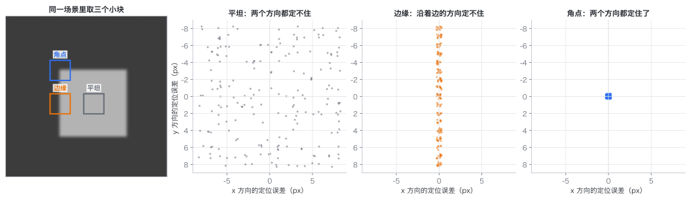
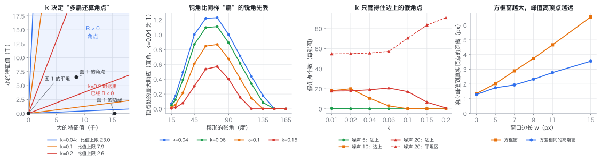
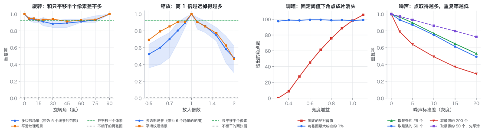
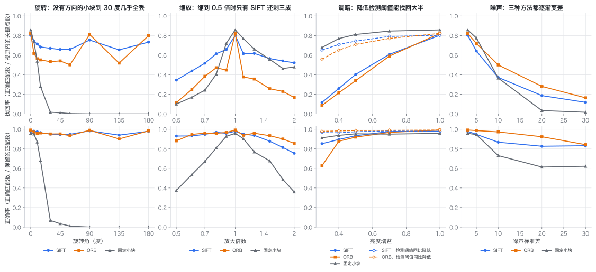
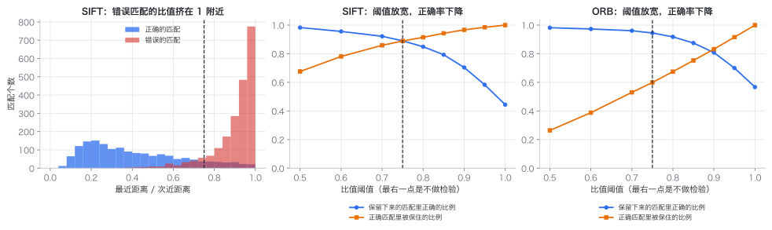
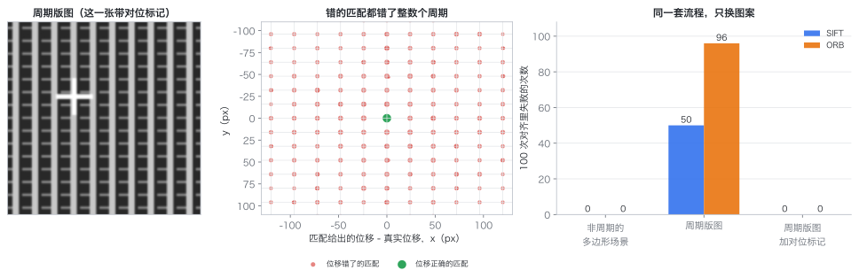

# 第 5 天：特征点与描述子 —— 教程

> [!NOTE]
> 本章所有数字都来自合成图像上的实测，记录在 [`figures/实测数字.json`](figures/实测数字.json)，由 `solutions` 分支的 `solutions/figures/ch05.py` 生成。Harris 响应用本章作业的参考实现，SIFT、ORB、匹配和 RANSAC 用 OpenCV 5.0。耗时是在一台 Apple 芯片的 Mac 上测的，只能看量级和相对快慢。换成真实图像或别的机器，数值会变，结论的方向要自己再测一遍。

> 配套练习：`5-1_Harris响应.py` 是本章自动验收的作业。原讲义提到的“练习 5-1 手写 Harris”就是它；“练习 5-2 SIFT 匹配”的题目在 [`视觉算法学习计划.md`](../视觉算法学习计划.md) 的“第 5 天”一节，需要自己新建文件完成。

---

## 0. 本章怎么学

**应用场景**：大位移或带旋转缩放的对齐，重复图案上要慎用。典型用法是两张图之间的位移、角度、倍率都不知道，先用特征点给出一个粗的变换，再交给第 16 章的方法精修。图像拼接、换倍率之后的定位、手持拍摄的照片对齐都属于这一类。

**优先级**：P1。前置是第 2 章（梯度、Sobel）和第 4 章（单应和 RANSAC）。后面第 6 章的光流用角点决定“跟踪谁”，第 7 章的位姿估计和第 16 章的对齐都把本章当作“提供对应点”的一步。

| 档位 | 累计用时 | 做什么 | 做到什么算完 |
|---|---:|---|---|
| 速通 | 3 小时 | 读第 0 节和 5.1、5.2、5.5、5.8 节，看懂图 1、图 2、图 5、图 6，把第 5.9 节演示的五步都试一遍，答完 5 道小测 | 能讲清角点为什么好定位、k 在管什么、比值检验在过滤什么，以及特征点在周期图案上为什么会对错整数个周期 |
| 标准 | 10 小时 | 读完全章，跑 Notebook，完成作业并验收通过，做第 5.11 节前三个破坏实验，填实验记录 | 验收 PASS，实验记录里有一次旋转或阈值导致的失效，以及一条自己测的比值阈值曲线 |
| 深挖 | 12 小时 | 再做第 5.11 节后三个破坏实验和第 5.12 节的扩展 | 能在自己拍的一对照片上报告匹配正确率、内点比例和耗时，并写清条件 |

> [!TIP]
> 用时超过所选档位的 1.5 倍还没做完，就把卡点写进 `学习进度.md`，先往下一章走。SIFT 的五步只要求能按顺序讲出每一步在解决什么问题，不要求推导。

---

## 5.1 从“整张图”变成“少数可靠地标”

两张照片可能尺寸不同、亮度不同，还可能发生旋转和局部遮挡。如果逐像素比较，它们几乎处处不同；但窗户角、书本标题的笔画交点、建筑纹理等局部结构仍可能被重复找到。特征方法的目标，就是把百万像素压缩成几百到几千个可靠地标。

一套局部特征通常包含两部分：

- **关键点（keypoint）**：回答“哪里值得看”，包含位置，有时还包含尺度、方向、响应强度。
- **描述子（descriptor）**：回答“这个局部长什么样”，把关键点周围的纹理编码成向量或二进制串。

一个“好特征”至少具备：

1. **可重复性**：视角、尺度或亮度稍变后还能在相近物理位置检测到。
2. **独特性**：描述子不应与大量无关位置都很像。
3. **局部性**：只依赖邻域，局部遮挡不会毁掉全局匹配。
4. **定位准确**：点的位置要稳定，否则几何估计的重投影误差会变大。
5. **数量与分布合适**：不是越多越好；一千个挤在树叶上的点不如均匀覆盖画面的几百个点。

平坦区域不是好特征，因为向任何方向移动都看不出变化；直线边缘也不够好，因为沿边缘移动几乎不变，这叫**孔径问题**。角点在两个方向都变化，位置最容易被唯一确定。

### 实测：小块能不能在第二张图里找回来

上面这段话可以直接量。同一个场景拍两次，各加标准差 10 的噪声，从第一张图上取一个 15×15 的小块，在第二张图的 ±8 px 范围内找平方差最小的位置。真实位移是 0，三种位置各做 200 次。



| 小块位置 | x 方向均方根误差（px） | y 方向均方根误差（px） | 两个方向都找对的比例 | 结构张量的两个特征值 |
|---|---:|---:|---:|---|
| 平坦 | 5.18 | 5.06 | 0% | 0 和 0 |
| 边缘（竖直边） | 0 | 4.94 | 8.5% | 15415 和 0 |
| 角点 | 0 | 0 | 100% | 8554 和 6506 |

在 ±8 px 里完全瞎猜，均方根误差是 4.9 px。平坦小块两个方向都和瞎猜一样；边缘小块垂直于边的方向 200 次全对，沿着边的方向和瞎猜一样；角点两个方向都对。最右一列是下一节要讲的结构张量特征值：哪个方向的特征值是 0，哪个方向就定不住。

---

## 5.2 Harris 角点：看小窗口往哪里移动都会变

### 直觉

以像素为中心取一个小窗口，将它移动一点 `(u, v)`，比较移动前后亮度差：

```text
E(u,v) = Σ_w [I(x+u, y+v) - I(x,y)]²
```

- 平坦区域：向任何方向移动，`E` 都小。
- 边缘区域：垂直边缘移动时 `E` 大，沿边缘移动时 `E` 小。
- 角点区域：向任何方向移动，`E` 都大。

对 `I(x+u,y+v)` 做一阶泰勒展开：

```text
I(x+u,y+v) ≈ I(x,y) + Ix*u + Iy*v
```

代回可得：

```text
E(u,v) ≈ [u v] M [u v]ᵀ

M = Σ_w [ Ix²   IxIy ]
        [ IxIy  Iy²  ]
```

`M` 称为二阶矩矩阵或结构张量。它的两个特征值 `λ1、λ2` 分别表示两个主方向上的亮度变化：

| `λ1、λ2` | 区域类型 |
|---|---|
| 都小 | 平坦 |
| 一个大、一个小 | 边缘 |
| 都大 | 角点 |

直接计算特征值较贵，Harris 使用响应函数：

```text
R = det(M) - k * trace(M)²
  = λ1λ2 - k(λ1+λ2)²
```

通常 `k=0.04~0.06`。角点的 `R` 较大且为正，边缘常为负，平坦区接近 0。这里的 `k` 不是窗口大小，而是抑制边缘响应的经验系数。

图 1 的三个小块正好对应这三种情况：平坦块的响应是 0，边缘块是 $-9.51\times10^{6}$，角点块是 $4.66\times10^{7}$。

### k 到底在管什么

把 $\lambda_1 = r\,\lambda_2$（$r \ge 1$）代进响应函数：

$$
R = \lambda_2^2\left[r - k\,(1+r)^2\right]
$$

$R > 0$ 等价于 $r + 1/r + 2 < 1/k$。所以 **k 只决定一件事：两个特征值之比 $r$ 在多大以内还算角点**。和特征值的绝对大小无关。

| k | 0.02 | 0.04 | 0.06 | 0.1 | 0.15 | 0.2 | 0.24 |
|---|---:|---:|---:|---:|---:|---:|---:|
| 特征值之比的上限 | 48.0 | 23.0 | 14.6 | 7.9 | 4.4 | 2.6 | 1.5 |
| 理想模型下能得到正响应的最小张角（度） | 16.4 | 23.6 | 29.3 | 39.2 | 50.8 | 63.4 | 78.5 |

第二行用的理想模型是：窗口里只有两条等长的直边，夹角为 $\varphi$，这时两个特征值正比于 $1 \pm \lvert\cos\varphi\rvert$，$R > 0$ 等价于 $\sin\varphi > 2\sqrt{k}$。k 趋于 0.25 时上限趋于 1，只有两个特征值完全相等才算角点，所以 k 必须小于 0.25。

这个式子还说明了一件原讲义没提的事：$\sin\varphi$ 对 $\varphi$ 和 $180° - \varphi$ 是一样的，所以在理想模型里，**30 度的锐角和 150 度的钝角对 k 来说同样“扁”**。实测并不对称：



以 k=0.04 为例（数值是相对直角的比例，16 种摆放的平均）：

| 张角（度） | 15 | 30 | 45 | 60 | 90 | 120 | 135 | 150 | 165 |
|---|---:|---:|---:|---:|---:|---:|---:|---:|---:|
| 顶点处的最大响应 | 0.072 | 0.494 | 1.002 | 1.222 | 1.0 | 0.437 | 0.179 | 0.001 | 0 |
| 有正响应的摆放比例 | 100% | 100% | 100% | 100% | 100% | 100% | 100% | 62% | 0% |

15 度的尖角仍然 100% 有正响应，150 度的钝角只剩 62%，165 度一个都没有。k 加大到 0.1 时，135 度就只剩 44% 有正响应。原因是锐角顶点附近的窗口里两条边的梯度都很强，而钝角的两条边方向接近，窗口里几乎只看到一条“弯了一点的边”。实际含义是：**提高 k 去压边缘误检时，最先丢掉的是钝角**，比如多边形版图上 135 度的拐角。

<!-- quiz -->
**把 k 从 0.04 提高到 0.1，哪类顶点最先失去正响应？**

- A. 15 度的尖角，因为它最“细”
- B. 135 度左右的钝角
- C. 90 度直角

<details markdown="1"><summary>答案与解释</summary>

**B**。理想模型里 30 度和 150 度一样扁，但实测锐角顶点附近两条边的梯度都很强，15 度的尖角在 k=0.04 时仍然 100% 有正响应。k=0.1 时 135 度的钝角只有 44% 的摆放还有正响应，150 度只剩 12%。直角的特征值之比最小，最不受 k 影响。

</details>
<!-- /quiz -->

### k 和噪声：k 只管得住“边上的”假角点

k 的设计目标是让边缘的响应为负。直边加了噪声之后，小的特征值不再是 0，比值从无穷大降下来，一旦低于上限就会冒出假角点。实测一个转了 20 度的方块（边长 70，灰度 60 和 200），取响应大于最大值 1% 的局部极大，每格 20 张图平均：

| k | 0.01 | 0.02 | 0.04 | 0.06 | 0.1 | 0.15 | 0.2 |
|---|---:|---:|---:|---:|---:|---:|---:|
| 噪声 10：边上的假角点（每张图） | 18.2 | 20.1 | 10.6 | 3.0 | 0.1 | 0 | 0 |
| 噪声 20：边上的假角点 | 17.8 | 18.0 | 19.1 | 20.9 | 17.2 | 6.7 | 0.9 |
| 噪声 20：平坦区的假角点 | 54.8 | 55.1 | 55.7 | 57.4 | 70.6 | 83.5 | 90.9 |

四个真实顶点在所有格子里几乎都找到了（只有噪声 20、k=0.2 时平均 3.95 个）。三点读法：

1. 噪声 10 时，k 从 0.04 提到 0.1，边上的假角点从 10.6 降到 0.1。这是 k 的本职工作。
2. 噪声 20 时，平坦区的假角点是主体，而且 **k 越大越多**（54.8 到 90.9）。平坦区的噪声没有方向性，两个特征值本来就接近，k 管不着它。至于为什么 k 越大反而越多，一个可能的解释是：k 加大后真实角点的响应变小，“最大值的 1%”这个门槛跟着降低，噪声点更容易过线。这个解释本章没有单独验证。
3. 所以噪声大的时候，该做的是先平滑或者提高阈值，而不是继续加大 k。

### 窗口大小：方框窗越大，峰值离顶点越远

窗口有两个作用：把一个像素的梯度扩展成一片邻域的统计，以及决定“局部”有多大。窗口大了统计更稳，但会带来一个原讲义没提的副作用。

| 窗口边长 w | 3 | 5 | 7 | 9 | 11 | 15 |
|---|---:|---:|---:|---:|---:|---:|
| 方框窗：响应峰值到真实顶点的平均距离（px） | 1.35 | 2.03 | 2.89 | 3.74 | 4.66 | 6.55 |
| 方差相同的高斯窗 | 1.29 | 1.75 | 1.94 | 2.32 | 2.78 | 3.55 |

实验是 96×96 的直角楔形，16 种随机朝向和亚像素顶点位置。方框窗的峰值在所有摆放下都落在直角内部。一个直观的解释：窗口中心往角里面挪一点，两条边都还在窗口里，而且离窗口边界更远，两个方向的梯度都能完整计入；窗口越大能挪得越远，所以偏移大约随 w 线性增长。高斯窗中心权重大，偏移大约只有一半。

偏移是可以修的。用 `cv2.cornerSubPix`（11×11 搜索窗）从方框窗的峰值出发迭代，w=5 和 w=9 两种情况修正后的误差都是平均 0.18 px、最大 0.23 px。它用的不是 Harris 响应，而是“角点附近的梯度都和指向角点的向量垂直”这个几何条件。它只在搜索窗内找，所以初始点要离真实角点足够近；本章只测了 w=5 和 w=9 两种初始点。

窗口大小对噪声下的重复率影响反而不大。6 个合成场景，同一场景各加标准差 10 的噪声拍两次，每个场景 4 组，共 24 对图：

| 做法 | 方框窗 3 | 方框窗 5 | 方框窗 7 | 方框窗 9 | 方框窗 11 | 先做标准差 1.5 的高斯平滑，再用方框窗 5 |
|---|---:|---:|---:|---:|---:|---:|
| 重复率（取最强的 50 个） | 0.615 | 0.738 | 0.763 | 0.763 | 0.758 | 0.876 |
| 重复率（取最强的 100 个） | 0.530 | 0.655 | 0.658 | 0.633 | 0.611 | 0.846 |

各格平均值的标准误差在 0.007 到 0.017 之间。窗口从 3 加到 5 有明显好处，再往上不再提高，取 100 个点时 11×11 还比 5×5 略低。先对图像做一次高斯平滑再求梯度，比加大窗口有效得多：取 50 个点时从 0.738 提到 0.876。

所以加大方框窗的主要后果是定位变差，而不是更稳。要提高噪声下的稳定性先做平滑，要精确定位用 `cornerSubPix` 修正。

### OpenCV API

```python
gray = cv2.cvtColor(img, cv2.COLOR_BGR2GRAY)
gray = np.float32(gray)
response = cv2.cornerHarris(
    gray,
    blockSize=2,   # 统计结构张量的邻域大小
    ksize=3,       # Sobel 求梯度的孔径
    k=0.04
)

marked = img.copy()
marked[response > 0.01 * response.max()] = (0, 0, 255)
```

`cornerHarris` 返回每个像素的响应图，不是关键点列表。实际使用还应做阈值筛选和非极大值抑制，否则一个真实角点周围会亮起一片红点。可用膨胀比较局部最大值，也可调用：

```python
corners = cv2.goodFeaturesToTrack(
    gray_uint8,
    maxCorners=300,
    qualityLevel=0.01,
    minDistance=10,
    useHarrisDetector=True,
    k=0.04
)
```

`goodFeaturesToTrack` 默认使用 Shi-Tomasi 分数 `min(λ1, λ2)`，它直接要求较小的特征值也足够大；设置 `useHarrisDetector=True` 才切换为 Harris。

同一张图、同样的 `qualityLevel` 和 `minDistance`，默认版返回 141 个点，Harris 版返回 71 个。两种分数的量纲不同（一个是特征值，一个是特征值的平方），“最大值的 1%”切出来的门槛不一样。

“亮起一片红点”有多严重：在本章 400×400 的合成场景上，前面那段 `cornerHarris` 代码标红了 1027 个像素；对同一张响应图做邻域半径 4 的非极大值抑制，只剩 105 个点。

**自己写的响应和 OpenCV 的差多少**。本章作业的参考实现和 `cornerHarris`（float32 输入）的响应图相关系数是 1.0，但数值上差一个固定的 256 倍，换窗口大小也一样。按 OpenCV 的源码推算，它把 Sobel 的结果乘以 $1/(4\cdot\text{blockSize})$，窗口内求和而不是求平均，合起来结构张量是参考实现的 1/16，响应差 $16^2 = 256$ 倍，和实测一致。所以比较两者时要看相对值，不要看绝对值。还有一个更容易踩的坑：同一张图用 uint8 和 float32 传给 `cornerHarris`，最大响应差了 $4.23\times10^{9}$ 倍，正好是 255 的四次方，相当于 uint8 输入时灰度被缩放到了 0 到 1。

### Harris 的能力边界

Harris 对旋转较稳定：窗口旋转后，`M` 的特征值不因坐标轴旋转而改变。但它没有主动搜索尺度；同一个窗角在原图占 9×9 像素，在缩小图里只占 2×2 像素，固定窗口可能无法重复检测。因此 Harris 不是天然尺度不变。

下面把这几句话量出来。重复率的定义：两张图各自只保留公共区域里的角点，再各取响应最强的 50 个，按真实变换配对，2 px 以内算重复，除以两边点数里较少的一方。实验用 6 个 400×400 的多边形场景（矩形、多边形、圆和文字），另有 3 个平滑随机纹理场景做对照。



| 旋转角（度） | 0 | 5 | 15 | 30 | 45 | 60 | 90 |
|---|---:|---:|---:|---:|---:|---:|---:|
| 多边形场景平均 | 1.0 | 0.94 | 0.923 | 0.883 | 0.893 | 0.91 | 1.0 |
| 6 个场景里的最低 | 1.0 | 0.92 | 0.90 | 0.84 | 0.84 | 0.90 | 1.0 |

| 放大倍数 | 0.5 | 0.7 | 0.9 | 1.1 | 1.5 | 2.0 |
|---|---:|---:|---:|---:|---:|---:|
| 多边形场景平均 | 0.523 | 0.703 | 0.893 | 0.907 | 0.747 | 0.48 |
| 平滑纹理场景平均 | 0.693 | 0.853 | 0.907 | 0.907 | 0.773 | 0.467 |

两点结论：

1. **旋转确实基本不变，掉的那一点和重采样的影响在同一水平**。只平移半个像素、不做任何旋转（只有插值重采样），重复率就是 0.92（多边形场景）和 0.947（平滑纹理）；旋转 5 到 90 度的平均都在 0.883 以上。90 度是像素网格的对称操作，没有插值，所以回到 1.0。
2. **缩放才是 Harris 的软肋**，而且两个方向都掉：缩小到 0.5 倍时剩 0.523，放大到 2 倍时剩 0.48。

> [!WARNING]
> 重复率的统计口径会改变结论。如果每张图先在整幅图里取最强的 50 个，再裁到公共区域去配对，同样的检测结果在缩小到 0.5 倍时会报出 0.755，放大到 2 倍时报出 0.861，看起来 Harris 对缩放也挺稳。原因是缩放之后两张图的视野不一样大，视野宽的那张留在公共区域里的只剩最强的少数几个点，最强的点本来就最容易重复。比较检测器的时候，一定要先裁到公共区域再取点，并写清取了多少个。

**亮度**。图像整体乘一个增益 $a$，梯度变成 $a$ 倍，结构张量变成 $a^2$ 倍，响应变成 $a^4$ 倍。实测增益 0.5 时最大响应正好变成 0.0625 倍。所以固定的绝对阈值在调暗时会让角点成片消失：

| 亮度增益 | 0.3 | 0.5 | 0.7 | 0.9 | 1.0 | 1.1 |
|---|---:|---:|---:|---:|---:|---:|
| 固定阈值（原图最大响应的 1%）检出的角点数 | 0 | 27.3 | 61.3 | 88.5 | 98.3 | 105.5 |
| 每张图用自己最大响应的 1% | 97.5 | 98.5 | 99.3 | 98.8 | 98.3 | 99.0 |

相对阈值不受整体增益影响，取最强的 50 个时，增益 0.3 到 1.1 的重复率都在 0.977 以上。但相对阈值有自己的弱点：响应按对比度的四次方增长，“最大值的 1%”相当于只保留对比度不低于最强角点 0.316 倍的角点。实测在场景左上角贴一个黑白棋盘格交点之后，相对阈值检出的角点数从 85 个掉到 29 个。图里出现一个特别强的角，其他角点就被挤掉了。按个数取前 N 个（再加非极大值抑制）通常比按比例取阈值更稳。

**噪声**。两张图各自加噪声，取的点越多，重复率越低：

| 噪声标准差 | 2 | 5 | 10 | 20 |
|---|---:|---:|---:|---:|
| 取最强的 25 个 | 0.963 | 0.897 | 0.77 | 0.53 |
| 取最强的 50 个 | 0.93 | 0.872 | 0.752 | 0.492 |
| 取最强的 200 个 | 0.79 | 0.639 | 0.493 | 0.289 |
| 取最强的 50 个，先做标准差 1.5 的高斯平滑 | 0.972 | 0.932 | 0.862 | 0.728 |

一个解释是：强角点的响应远高于噪声，排名靠后的弱角点和噪声在同一个量级。不管原因如何，实测说明“检出很多点”本身不是好事，后面匹配时这些靠后的点多半配不上。

<!-- quiz -->
**同一个检测器，你把“每张图先取最强的 50 个，再裁到两图的公共区域去配对”改成“先裁到公共区域，再各取最强的 50 个”。缩小到 0.5 倍时的重复率会怎样？**

- A. 基本不变，统计口径不影响检测器本身
- B. 从 0.755 降到 0.523
- C. 从 0.523 升到 0.755

<details markdown="1"><summary>答案与解释</summary>

**B**。缩小之后第二张图的视野比第一张宽，先取点再裁剪时，第二张图留在公共区域里的只有最强的少数点，最容易重复，于是重复率被抬高到 0.755。先裁剪再取点，两边都在同一块区域里各取 50 个，才是公平的比较，结果是 0.523。检测结果没变，变的只是统计口径。

</details>
<!-- /quiz -->

---

## 5.3 SIFT：在位置、尺度、方向上建立统一坐标系

SIFT（Scale-Invariant Feature Transform）不只是一个角点检测器，而是一套“检测 + 定位 + 方向 + 描述”的完整系统。它的经典流程可拆成五步。

### 第一步：建立尺度空间

真实物体在不同拍摄距离下会有不同像素尺寸。SIFT 不猜一个固定窗口，而是用不同标准差的高斯核生成多尺度图像：

```text
L(x,y,σ) = G(x,y,σ) * I(x,y)
```

多个尺度构成一组 octave；每进入下一组，图像宽高通常减半，但继续在新的 `σ` 范围搜索。这样同一个结构总有机会在某个合适尺度被看到。

### 第二步：DoG 找候选极值

相邻高斯图相减：

```text
D(x,y,σ) = L(x,y,kσ) - L(x,y,σ)
```

DoG 是尺度归一化 Laplacian of Gaussian 的高效近似。对每个像素，与当前层的 8 个邻居、上一层 9 个、下一层 9 个比较，共 26 个邻居；若它是局部极大或极小，就成为候选点。

为什么既找极大也找极小？亮斑和暗斑只是符号相反，都可能是稳定结构。

### 第三步：精确定位并剔除坏点

候选极值只落在离散像素和离散尺度上。SIFT 对 DoG 局部做二次函数拟合，得到亚像素、亚尺度位置，并剔除：

- 对比度太低的点：容易受噪声影响。
- 强边缘上的点：沿边缘方向定位不稳定。

边缘抑制仍依赖 Hessian 矩阵两个特征值的比例。若一个曲率远大于另一个，说明它更像边缘而不是二维稳定结构。这和 Harris 里 k 的作用是同一个思路：限制两个特征值之比。

### 第四步：分配主方向

在关键点对应尺度的邻域内统计梯度方向直方图，主峰作为关键点方向。之后描述邻域时先旋转到主方向，图像旋转 30°，局部坐标系也跟着转 30°，描述子就能保持相近。

若方向直方图存在多个明显峰值，SIFT 可以在同一位置、尺度生成多个不同方向的关键点。这不是重复错误，而是在分叉结构上保留多种合理方向。

### 第五步：构造 128 维描述子

经典 SIFT 将关键点附近区域分成 `4×4` 个小块，每块统计 `8` 个方向的梯度直方图：

```text
4 × 4 × 8 = 128 维
```

梯度幅值表示边缘强度，方向直方图保留局部结构，同时又不过分依赖单个像素。向量归一化后，大致抵消整体亮度和对比度变化；还会截断过大的分量再归一化，降低局部强光的影响。

SIFT 三种关键不变性的来源可以一句话记住：

- **尺度不变**：在高斯尺度空间中寻找极值。
- **旋转不变**：按局部主方向对齐。
- **一定的光照鲁棒性**：使用梯度并归一化描述子。

它并非对任意视角、严重模糊或非线性光照完全不变，“不变性”都有适用范围。第 5.4 节之后的实测会给出这些范围在合成图上大概是多少，也会看到“描述子对亮度不变”不等于“整套 SIFT 对亮度不变”。

### OpenCV 使用

```python
gray = cv2.cvtColor(img, cv2.COLOR_BGR2GRAY)
sift = cv2.SIFT_create(
    nfeatures=0,
    contrastThreshold=0.04,
    edgeThreshold=10,
    sigma=1.6
)
keypoints, descriptors = sift.detectAndCompute(gray, None)

print(len(keypoints))
print(descriptors.shape)  # 通常为 (N, 128)，dtype=float32
vis = cv2.drawKeypoints(
    img, keypoints, None,
    flags=cv2.DRAW_MATCHES_FLAGS_DRAW_RICH_KEYPOINTS
)
```

上面四个参数就是 OpenCV 5.0 的默认值。`nfeatures=0` 表示不硬性限制最终数量。提高 `contrastThreshold` 会减少低对比度点；`edgeThreshold` 的含义容易误解，增大它会保留更多边缘附近候选点，而不是更严格地删除边缘。

在本章的合成场景上实测：

| `edgeThreshold` | 2 | 5 | 10 | 20 | 50 |
|---|---:|---:|---:|---:|---:|
| 关键点数 | 88 | 228 | 268 | 295 | 326 |

| `contrastThreshold` | 0.02 | 0.04 | 0.08 |
|---|---:|---:|---:|
| 关键点数 | 385 | 268 | 164 |

`edgeThreshold` 是允许的主曲率之比的上限，和 Harris 的特征值比上限是同一类东西，越大越宽松。

---

## 5.4 ORB：用二进制比较换取速度

SIFT 稳健，但描述子是 128 维浮点向量，计算和存储成本较高。ORB（Oriented FAST and Rotated BRIEF）组合了三个思想：

1. **FAST 检测角点**：比较中心像素与圆周上的 16 个像素；若有足够长的连续像素都明显更亮或更暗，就判为角点。
2. **图像金字塔**：在多尺度图上检测，弥补 FAST 不具尺度不变性的问题。
3. **带方向的 BRIEF**：根据局部灰度质心估计方向，旋转像素对后做亮暗二值比较。

BRIEF 的一个二进制位来自一次比较：

```text
τ(p; a,b) = 1,  I(a) < I(b)
           0,  其他
```

重复若干对采样点，就得到 256 位等二进制描述子。两个描述子的差异用 XOR 后统计 1 的个数，即 **Hamming 距离**，CPU 可以非常快地完成。

```python
orb = cv2.ORB_create(nfeatures=1000)
kp, des = orb.detectAndCompute(gray, None)
print(des.shape, des.dtype)  # 常见 (N, 32), uint8；32 字节 = 256 位
```

ORB 适合实时跟踪、移动端、SLAM 前端等速度敏感场景。它通常不如 SIFT 应对大尺度变化、强模糊和复杂纹理，但“更快、内存更小、效果够用”常比理论上更强更重要。

### 实测：SIFT、ORB 和一个没有尺度和方向的对照

下面把三种做法放在同样的条件下比：SIFT、ORB（`nfeatures=1000`），以及一个故意做得很朴素的对照，叫“固定小块”：参考实现的 Harris 角点，加上角点周围 15×15 的灰度小块（减均值再归一化）当描述子。它没有尺度，也没有方向，用来看 SIFT 和 ORB 的那些设计到底换来了什么。

4 个多边形场景，每个场景拍两张，各加标准差 3 的噪声，第二张再做变换。暴力匹配取两个最近邻，比值阈值 0.75，按真实变换投影误差不超过 3 px 记为正确。



三种做法检出的点数不同（第一张图平均 SIFT 272 个、ORB 664 个、固定小块 107 个），所以找回率的高低不能直接比，要看的是**每条曲线随变换下降的形状**。

| 变换 | SIFT 找回率 | ORB 找回率 | 固定小块找回率 |
|---|---:|---:|---:|
| 无变换 | 0.803 | 0.822 | 0.858 |
| 旋转 15 度 | 0.683 | 0.551 | 0.28 |
| 旋转 30 度 | 0.67 | 0.533 | 0.017 |
| 旋转 90 度 | 0.754 | 0.811 | 0 |
| 缩小到 0.5 倍 | 0.345 | 0.114 | 0.1 |
| 放大到 2 倍 | 0.521 | 0.167 | 0.479 |
| 整体调暗到 0.3 | 0.117 | 0.087 | 0.678 |
| 噪声标准差 20 | 0.187 | 0.281 | 0.034 |

逐条看：

1. **方向**。固定小块旋转 15 度找回率就掉到 0.28，30 度几乎全丢（0.017），正确率也跌到 0.068，配上的大多是错的。SIFT 和 ORB 在 30 度时还有 0.67 和 0.533。主方向这一步就是这个差别的来源。
2. **尺度**。缩小到 0.5 倍时 SIFT 还剩 0.345，ORB 和固定小块都在 0.1 左右。ORB 的金字塔默认每层缩小 1.2 倍、共 8 层，在这组合成图上缩小时的表现明显不如 SIFT。放大 2 倍时，SIFT 的找回率是 0.521，但正确率从 0.979 降到 0.755，ORB 的正确率是 0.855。固定小块的找回率有 0.479，看起来不差，但它的正确率只剩 0.359，配上的大多是错的。“SIFT 尺度不变”在缩小方向上表现好，在放大方向上要打折扣。
3. **亮度**。最反直觉的一条：**整体调暗到 0.3 倍时，最朴素的固定小块找回率是 0.678，SIFT 和 ORB 只有 0.117 和 0.087**。原因不在描述子，而在检测：SIFT 的 `contrastThreshold` 和 ORB 的 FAST 阈值都是绝对的灰度门槛，调暗之后大部分点直接没检出来（默认参数下第二张图平均只检出 SIFT 35 个、ORB 54 个，原来是 268 和 671 个）。固定小块用的是“最大响应的 1%”这个相对阈值，不受整体增益影响。把两者的检测阈值按增益同比降低，增益 0.3 时找回率回到 0.652 和 0.56。
4. **噪声**。三者都随噪声下降，固定小块下降最快（噪声 20 时 0.034）。

调暗那一条还剩一点差距（0.652 对无变换的 0.803）。把第二张图的噪声也按增益同比缩小、保持信噪比不变，SIFT 的找回率回到 0.798，ORB 回到 0.695。所以剩下的差距主要来自信噪比：同样的噪声，图像暗了，信号相对就弱了。只加偏置不改增益时，两者的结果完全不变，因为偏置在求梯度时就被减掉了。

<!-- quiz -->
**图像整体调暗到原来的 0.3 倍（噪声不变）。SIFT 用默认参数时找回率从 0.803 掉到 0.117。主要原因是什么？**

- A. SIFT 描述子对亮度敏感，暗了就配不上
- B. 检测阶段的对比度阈值是绝对值，大部分关键点直接没检出来
- C. 比值检验在暗图上失效

<details markdown="1"><summary>答案与解释</summary>

**B**。描述子做了归一化，对整体增益不敏感。实测默认参数下第二张图平均只检出 35 个关键点（原来 268 个）；把 `contrastThreshold` 按增益同比降到 0.012 之后，找回率回到 0.652，正确率仍在 0.966。剩下的差距来自信噪比变低，噪声同比缩小后回到 0.798。

</details>
<!-- /quiz -->

**耗时**。在一台 Apple 芯片（M5 Pro）的 Mac 上实测，OpenCV 5.0，取多次运行的中位数：

| 操作 | OpenCV 默认线程设置（ms） | 限制为单线程（ms） |
|---|---:|---:|
| 400×400 图，SIFT 检测加描述（292 个点） | 8.5 | 12 |
| 400×400 图，ORB 检测加描述（649 个点） | 1.6 | 1.6 |
| 1024×1024 图，SIFT 检测加描述（1000 个点） | 25 | 80 |
| 1024×1024 图，ORB 检测加描述（1000 个点） | 7.6 | 9.4 |
| 400×400 图，参考实现的 Harris 响应图 | 0.61 | 0.62 |
| 2000 对 2000 暴力匹配取两个最近邻：SIFT 描述子（128 维浮点，L2） | 2.7 | 28 |
| 2000 对 2000 暴力匹配取两个最近邻：ORB 描述子（32 字节，Hamming） | 1.5 | 16 |

单线程时，1024×1024 的图上 SIFT 比 ORB 慢约 8.5 倍；多线程时差距缩小到约 3.3 倍，因为 SIFT 能更充分地用上多核。每个描述子 SIFT 占 512 字节，ORB 占 32 字节，差 16 倍。计时每次运行都有 10% 到 25% 的波动，表里只有量级和相对快慢有意义，换一台机器要重测。

---

## 5.5 描述子匹配：距离必须与数据类型配套

匹配就是为图 A 的描述子寻找图 B 中距离最近的描述子。

| 描述子 | 数据形式 | 距离 |
|---|---|---|
| SIFT、SURF 类 | 浮点向量 | `cv2.NORM_L2` |
| ORB、BRIEF、BRISK 类 | 二进制串 | `cv2.NORM_HAMMING` |
| ORB 的 `WTA_K=3/4` | 特殊二进制编码 | `cv2.NORM_HAMMING2` |

对 SIFT 使用 Hamming，或对 ORB 使用 L2，度量的含义就错了。原讲义说“代码未必立刻报错”，在 OpenCV 5.0 上实测两个方向不一样：

- SIFT 描述子配 `NORM_HAMMING`：`knnMatch` **直接报错**（断言要求 8 位输入）。
- ORB 描述子配 `NORM_L2`：**不报错，正常返回结果**。它把 32 个字节当成 32 维的 0 到 255 的数去算欧氏距离，同一个字节里不同的位被混在一起。12 对图上比值阈值 0.75 时，Hamming 得到 2794 个正确匹配，L2 只有 1440 个，少了将近一半，程序却一声不吭。

所以真正危险的是第二种。

### BFMatcher 与 FLANN

`BFMatcher` 对每个查询描述子与所有候选逐一比较，简单、确定，数据量不大时很好用：

```python
bf = cv2.BFMatcher(cv2.NORM_L2, crossCheck=False)
knn = bf.knnMatch(des1, des2, k=2)
```

FLANN 用近似最近邻索引加速大规模搜索。SIFT 常用 KD-tree；二进制描述子需配置 LSH，不能照搬 SIFT 的 FLANN 参数。实测在 OpenCV 5.0 上，把 KD 树索引用在 ORB 描述子上会直接报错，换成 LSH 索引（`algorithm=6`）才能用。

### Lowe 比值测试

只取最近邻有个问题：重复窗格、砖墙、键盘按键会产生很多相似候选。Lowe 比值比较第一近邻 `d1` 和第二近邻 `d2`：

```text
接受条件：d1 < ratio * d2
```

如果第一名明显优于第二名，匹配更独特；若两者差不多，就说明歧义大。

```python
good = []
for pair in knn:
    if len(pair) == 2:
        m, n = pair
        if m.distance < 0.75 * n.distance:
            good.append(m)
```

`0.75` 是常见起点，不是定律。阈值变小更严格，匹配更少但通常更纯；阈值变大召回更多，也引入更多误匹配。

这条曲线可以量出来。4 个场景各做三组变换（转 30 度；缩小到 0.7 倍；转 45 度并放大 1.3 倍），两张图各加标准差 5 的噪声，共 12 对图：



| 比值阈值 | 0.5 | 0.6 | 0.7 | 0.75 | 0.8 | 0.9 | 不做检验 |
|---|---:|---:|---:|---:|---:|---:|---:|
| SIFT：保留的匹配里正确的比例 | 98.3% | 95.6% | 92.2% | 89.0% | 84.9% | 70.4% | 44.4% |
| SIFT：正确匹配里被保住的比例 | 67.6% | 78.1% | 85.9% | 88.9% | 91.5% | 96.7% | 100% |
| ORB：保留的匹配里正确的比例 | 98.2% | 97.3% | 96.1% | 94.5% | 91.8% | 80.8% | 56.7% |
| ORB：正确匹配里被保住的比例 | 26.4% | 38.8% | 53.0% | 59.9% | 67.5% | 83.2% | 100% |

图 5 左栏是比值检验为什么有效：错误匹配的比值挤在 1 附近，最近邻和次近邻差不多远，说明“哪个都像”。SIFT 的 2100 个错误匹配里有 1420 个（67.6%）比值不小于 0.9，ORB 是 74.2%；正确匹配的比值分布很宽。

两种描述子的曲线形状不一样：在 0.75 这个常用值上，SIFT 保住了 88.9% 的正确匹配，ORB 只保住 59.9%。可能的原因是 Hamming 距离只取整数，而 ORB 正确匹配的最近距离本身不小，比值天然偏大，这一点本章没有单独验证。**照搬 SIFT 的 0.75 给 ORB，会扔掉四成的正确匹配**。ORB 想保住八成以上的正确匹配，阈值要放到 0.9（保住 83.2%），代价是正确率从 94.5% 降到 80.8%。

`crossCheck=True` 要求 A 的最佳匹配是 B，且 B 的最佳匹配也是 A，属于互选策略；它与 `knnMatch + ratio test` 是不同过滤思路，通常不要机械地同时开启。实测在 OpenCV 5.0 上 `crossCheck=True` 时调 `knnMatch(k=2)` 会直接报错，只能用 `match`。同样 12 对图上，互选得到的正确率 SIFT 是 78.6%、ORB 是 87.6%，都低于比值阈值 0.75 的 89.0% 和 94.5%。

<!-- quiz -->
**同样的 12 对图、比值阈值都取 0.75。SIFT 保住了 88.9% 的正确匹配，ORB 保住了多少？**

- A. 也在 90% 左右，比值检验和描述子类型无关
- B. 约 60%
- C. 约 99%，因为二进制描述子更有区分度

<details markdown="1"><summary>答案与解释</summary>

**B**。实测 59.9%。ORB 的 Hamming 距离是整数，正确匹配的最近距离本身不小，最近和次近之比天然偏大，0.75 对它来说太严。想保住八成以上的正确匹配要放到 0.9 左右，代价是正确率从 94.5% 降到 80.8%。阈值要按描述子分别标定。

</details>
<!-- /quiz -->

### 几何验证

描述子相似只说明局部纹理像，不能保证整幅图的几何关系一致。用于拼接时，还要把匹配点交给上一章的 RANSAC：

```python
src = np.float32([kp1[m.queryIdx].pt for m in good]).reshape(-1, 1, 2)
dst = np.float32([kp2[m.trainIdx].pt for m in good]).reshape(-1, 1, 2)
H, mask = cv2.findHomography(src, dst, cv2.RANSAC, 4.0)
inliers = mask.ravel().astype(bool)
```

“比值测试”过滤描述空间歧义，“RANSAC”过滤几何空间不一致，它们解决的是两类不同问题。

---

## 5.6 逐步例子：判断书封面是否出现在场景中

### 第一步：检测与描述

```python
query_gray = cv2.cvtColor(query, cv2.COLOR_BGR2GRAY)
scene_gray = cv2.cvtColor(scene, cv2.COLOR_BGR2GRAY)

sift = cv2.SIFT_create()
kp1, des1 = sift.detectAndCompute(query_gray, None)
kp2, des2 = sift.detectAndCompute(scene_gray, None)
```

先检查 `des1`、`des2` 是否为 `None`。纯白图、严重模糊图可能没有关键点。实测纯白图上 SIFT 和 ORB 的 `detectAndCompute` 返回的描述子都是 `None`，直接传给 `knnMatch` 会报错。

### 第二步：KNN 匹配与过滤

```python
matcher = cv2.BFMatcher(cv2.NORM_L2)
knn = matcher.knnMatch(des1, des2, k=2)
good = [m for m, n in knn if m.distance < 0.75 * n.distance]

if len(good) < 4:
    raise RuntimeError("可靠匹配不足，无法估计单应矩阵")
```

“四个”只是单应矩阵的理论下限，实际要更严格。4 个点若集中在一条边或一个小角落，模型仍非常脆弱。另外，第二张图的描述子少于两个时，`knnMatch` 返回的某些元素只有一个匹配，这里的列表推导式会在解包时报错，第 5.5 节先判断 `len(pair) == 2` 的写法更稳。

### 第三步：RANSAC 与定位

```python
src_pts = np.float32([kp1[m.queryIdx].pt for m in good]).reshape(-1, 1, 2)
dst_pts = np.float32([kp2[m.trainIdx].pt for m in good]).reshape(-1, 1, 2)
H, mask = cv2.findHomography(src_pts, dst_pts, cv2.RANSAC, 4.0)

h, w = query_gray.shape
corners = np.float32([[0, 0], [w-1, 0], [w-1, h-1], [0, h-1]]).reshape(-1, 1, 2)
projected = cv2.perspectiveTransform(corners, H)
cv2.polylines(scene, [np.int32(projected)], True, (0, 255, 0), 3)
```

最后不要只看绿色四边形“画出来了”。检查四边形是否自交、面积是否离谱、角点是否跑到图像极远处，以及内点比例是否足够。可靠系统常把这些几何条件作为最终判定的一部分。

把这段代码原样跑在合成图上，可以看到这些检查为什么必要：

| 目标图 | 通过比值检验的匹配 | RANSAC 内点 | 内点比例 | 返回了单应矩阵 | 四边形是凸的 | 四边形面积 / 模板面积 |
|---|---:|---:|---:|---|---|---:|
| 模板转 25 度、缩小到 0.8 倍、加噪声 | 201 | 197 | 0.98 | 是 | 是 | 0.641 |
| 另一个不相干的场景，比值阈值 0.75 | 18 | 6 | 0.333 | 是 | 否 | 0.0 |
| 同上，比值阈值放宽到 0.95 | 137 | 13 | 0.095 | 是 | 否 | 0.0 |

第一行的真实面积比是 0.8 的平方 0.64，四个角的投影误差最大 0.35 px。后两行模板根本不在场景里，`findHomography` 照样返回了矩阵。**“返回了矩阵”不能作为“找到了”的判据**。内点比例、凸性、面积这几项一查就能分出来。

---

## 5.7 常见坑与排查顺序（含常见错误表）

1. **彩色图直接计算导致类型或效果异常**：特征检测通常先转灰度。
2. **描述子为 `None` 仍继续匹配**：先检查关键点数量和图像质量。
3. **SIFT 与 ORB 距离度量混用**：浮点用 L2，二进制用 Hamming。ORB 配 L2 在 OpenCV 5.0 上不报错，正确匹配少一半。
4. **只按距离排序取前 N 个**：重复纹理中会保留大量歧义匹配，应加入比值测试。
5. **把匹配多当成匹配好**：内点比例和空间分布比原始数量更关键。
6. **关键点全挤在纹理区**：几何估计对远处区域会外推不稳。
7. **Harris 阈值写死**：不同图像响应尺度不同，常用 `response.max()` 的比例起步。但整体亮度乘 $a$，响应乘 $a^4$；比例阈值又会被一个特别强的角挤掉其他点（第 5.2 节）。按个数取前 N 个通常更稳。
8. **Harris 没做非极大值抑制**：一个角点变成一团点，影响计数和后续处理。
9. **比值阈值盲目固定为 0.75**：应在误匹配与漏匹配之间根据数据调节。对 ORB，0.75 会扔掉约四成正确匹配。
10. **用单应验证非平面场景**：描述子可能匹配正确，但一个平面模型解释不了多层深度。
11. **缩放可视化图后仍使用原关键点坐标**：坐标必须按同一比例缩放。
12. **忽略随机性**：RANSAC 结果可能轻微变化，评估应看统计和几何约束。
13. **在周期图案上直接用特征点对齐**：误匹配恰好错整数个周期，RANSAC 也救不回来（第 5.8 节）。

下面这张表补充做本章作业和匹配实验时最常见的实现错误。前八行的写法都过不了本章的验收，表里写了会在哪一项报出来、怎样自己查。

| 现象 | 原因 | 怎么查 |
|---|---|---|
| 斜的直边上也有正响应，验收的“直边”一项不通过 | 行列式漏了 $I_xI_y$ 那一项，只算了 $S_{xx}S_{yy}$。只看轴向的方块发现不了，轴向的边上交叉项本来就是 0 | 测一条 45 度的直边，正确实现在边的中段响应不大于 0。实测漏掉交叉项时，边中段的最大响应是方块顶点响应的 0.204 倍，为正 |
| 边上的响应几乎为 0，而不是明显的负数，验收的“亮度缩放”一项不通过 | 迹没有平方，写成了 $\det - k\,\mathrm{tr}$。这样两项的次数不同，灰度减半时边上的响应不再按四次方缩小 | 看方块一条边中段的响应：正确实现约为顶点响应的 -0.18 倍，没平方时只有 $-2.6\times10^{-7}$ 倍 |
| 方块四个角里只有左上角有响应 | Sobel 的输出深度用了 `-1`（和输入相同的 uint8），负的梯度被截成 0。验收的“方块顶点”一项会报四个顶点的响应不相等 | 打印四个角的响应，应该一样大；再把图像灰度减半，最大响应应变成 0.0625 倍，截断时实测是 0.839 倍 |
| 改了 `k` 或 `window_size`，输出完全不变，验收的“参数 k”“参数 window_size”两项不通过 | 函数里写死了 0.04 和 3，没用参数 | 用两个不同的 `k` 调用，比较输出是否不同 |
| 方块的四个角响应都不是正的，验收的“方块顶点”一项不通过 | 没做窗口求和，直接用单个像素的 $I_x^2$、$I_y^2$、$I_xI_y$。单个像素上行列式恒为 0 | 打印某个角点处的 $\det$，应明显大于 0 |
| 灰度减半之后最大响应没有变成 0.0625 倍，验收的“亮度缩放”一项不通过 | 把输入或者响应除以了最大值做归一化，响应不再随亮度变化 | 同一张图乘 0.5 再算一次，比较两次的最大响应 |
| 直边上的响应是 0，不是负数，验收的“直边”一项不通过 | 把负的响应截成了 0；或者返回的是较小的特征值（Shi-Tomasi 分数），不是 Harris 响应 | 看方块一条边中段的响应，应明显为负 |
| 常数图上最外一圈像素有响应，验收的“输出契约与平坦区”一项不通过 | 求梯度时图像边界补了零，边界上凭空多出一圈梯度 | 用一张常数图测试，全图的响应都应为 0 |
| 和 `cornerHarris` 的结果差 256 倍或者差几十亿倍 | 前者是 OpenCV 对 Sobel 和窗口的缩放方式不同，后者是给 `cornerHarris` 传了 uint8 | 比较相对值；传 float32 |
| 角点检出一大团 | 只做了阈值，没做非极大值抑制 | 数一数阈值后的像素数和局部极大的个数 |
| 一张暗图上角点几乎全没了 | 固定的绝对阈值，响应随亮度增益的四次方变化 | 改成按个数或者按比例取点 |
| ORB 匹配质量差，但程序没报错 | 用了 `NORM_L2` | 检查描述子的 dtype，uint8 就该用 Hamming |
| `knnMatch` 报 `K == 1` 之类的断言错误 | 同时开了 `crossCheck=True` 和 `k=2` | 二选一 |
| 匹配很多、RANSAC 也返回了矩阵，但结果是错的 | 周期图案上对错了整数个周期，或者模板根本不在图里 | 看误差是不是整数个周期；查内点比例和四边形的凸性、面积 |

---

## 5.8 重复纹理：特征点在周期图案上会对错整数个周期

第 16 章第 8 节讲过，周期为 $P$ 的图案平移 $P$ 之后和原图一模一样，相位相关和普通互相关在这种图上都会对错整数个周期。特征点方法有同样的问题，而且原因更直接：一个周期里的角点和下一个周期里对应的角点，描述子几乎一样。

实验条件和第 16 章图 6 的周期相同：x 方向周期 24 px，y 方向周期 16 px。从 420×420 的底图上裁两个 240×240 的视场，真实平移在 ±5 px 内取整数，各加标准差 3 的噪声，每种组合 100 次。匹配用比值阈值 0.75，然后有两种估计方式：只估平移（每个匹配给出一个位移，取支持者最多的那个），或者用 RANSAC 估相似变换（平移、旋转、缩放）。



| 图案 | 检测器 | 每对图保留的匹配 | 其中位移正确的 | 只估平移失败（共 100） | 估相似变换失败（共 100） |
|---|---|---:|---:|---:|---:|
| 非周期的多边形场景 | SIFT | 62.0 | 51.2 | 0 | 0 |
| 非周期的多边形场景 | ORB | 93.5 | 90.4 | 0 | 0 |
| 周期版图 | SIFT | 49.0 | 3.0 | 50 | 88 |
| 周期版图 | ORB | 259.5 | 6.8 | 96 | 97 |
| 周期版图加一个对位标记 | SIFT | 96.0 | 51.5 | 0 | 6 |
| 周期版图加一个对位标记 | ORB | 326.8 | 122.0 | 0 | 8 |

三点读法：

1. **错的匹配全部错在整数个周期上**。周期版图上 SIFT 通过比值检验但位移错了的匹配共 4596 个，100% 落在整数个周期的 2 px 以内（图 6 中栏的网格点）。只估平移的 50 次失败，每一次的误差都是整数个周期。
2. **比值检验在这里帮不上忙，甚至帮倒忙**。比值检验的前提是“正确的匹配独一无二”，周期图案上正确的匹配和错一个周期的匹配一样好，比值接近 1，正确匹配也被扔掉了。SIFT 不做比值检验时只估平移的失败反而从 50 次降到 17 次，因为保留下来的正确匹配多了（每对图 13.7 个对 3.0 个）。但这不是对策，正确匹配只占 3.2%。
3. **RANSAC 救不回来**。错误的匹配彼此一致（都错同一个周期），在 RANSAC 看来它们就是一组好的内点。

两种有效的对策和第 16 章完全对应：

- **加对位标记**：非周期的十字标记让 SIFT 和 ORB 只估平移都是 0 次失败。估相似变换时还有 6 到 8 次失败，可能是标记上的正确匹配只有几十个，混在大量周期误匹配里，RANSAC 偶尔选中了错的那一组。
- **限制匹配范围**：机台定位误差已知时，每个关键点只和第二张图里坐标差在范围内的点比较。范围取 ±7 px（小于 y 方向半个周期 8 px）时，SIFT 和 ORB 都是 0 次失败，匹配里位移正确的比例 81.5% 和 83%。范围放到 ±13 px，相邻周期的假位置会落进范围，ORB 有 23 次失败，全部是整数个周期的误差。

这就是 `course.json` 里本章场景写“重复图案上要慎用”的原因。半导体版图大量是周期结构，特征点方法适合在有非周期结构（对位标记、芯片边缘、版图的不规则区域）的地方做粗对齐，周期区域内的精对齐交给第 16 章的方法并限制搜索范围。

<!-- quiz -->
**周期版图上，SIFT 加比值检验加 RANSAC 估相似变换，100 次失败了 88 次。下面哪种改法最可能把失败降到接近 0？**

- A. 把比值阈值从 0.75 收紧到 0.5
- B. RANSAC 的阈值从 2 px 收紧到 0.5 px
- C. 只在已知位移范围（小于半个周期）内找最近邻

<details markdown="1"><summary>答案与解释</summary>

**C**。实测只在 ±7 px 内找最近邻，SIFT 和 ORB 都是 0 次失败。A 和 B 都不对：错误的匹配全部错在整数个周期上，描述子和正确匹配一样好，彼此几何上又一致，收紧比值阈值只会把正确匹配也扔掉，收紧 RANSAC 阈值也分不开它们。

</details>
<!-- /quiz -->

---

## 5.9 交互演示

一张 48×48 的图里放一个楔形，张角拖到 180 度就是一条直边。算法和作业一致：Sobel 求梯度，窗口内汇总成结构张量，算 $R = \det - k\,\mathrm{tr}^2$。左图可以点击或拖动来移动窗口，中图是窗口内每个像素的梯度和对应的椭圆，右图是特征值平面上 $R > 0$ 的区域。按页面下方“按顺序试”的五步操作，每一步先预测再拖动。

<!-- embed: ../demos/Harris响应.html 951 -->
[打开交互演示：Harris 响应、两个特征值与 k](../demos/Harris响应.html)

五步对应本章的五个结论：直角、边和平坦处的特征值（第 5.1 节）；k 下调到比值上限超过当前比值时，带噪声的直边被当成角点（第 5.2 节）；钝角在张角拖大的过程中穿出 $R > 0$ 的区域，k 越大穿出得越早；对比度减半时两个特征值变成四分之一、响应变成 0.0625 倍、比值不变（和第 5.2 节测的增益 0.5 一致）；方框窗越大峰值离顶点越远，换成高斯窗回来大半。页面里的具体数字在页面上读，本节不重复。

---

## 5.10 怎样评估和报告

特征方法的评估分三层，每层回答不同的问题，不要混在一起报：

- **检测器的重复率**：同一个物理点在变换后还能被检测到的比例。必须先裁到两张图的公共区域，再各取同样个数的点（第 5.2 节的警告框），写清取了多少个、容差多少像素。
- **匹配的正确率和找回率**：用已知变换（合成数据）或者人工标注的对应点判断每个匹配是否正确。正确率是“保留的匹配里有多少是对的”，找回率是“能配上的点里配上了多少”。两个数要一起报，配一条随比值阈值变化的曲线（图 5）。
- **几何估计的结果**：最终变换的误差（例如四个角的投影误差）、内点比例、失败次数。这是下游真正关心的。

报告时写清：图像尺寸、变换的种类和范围、噪声水平、检测器和参数、比值阈值、容差、重复次数。耗时要写机器、线程数和 OpenCV 版本。本章每张表的表头或上一段都按这个格式写了条件。

---

## 练习连接

### 练习 5-1：手写 Harris

对应本章的自动验收作业 `5-1_Harris响应.py`。不要直接调用 `cornerHarris` 完成主体。按“灰度与浮点化 → Sobel 求 `Ix、Iy` → 计算 `Ix²、Iy²、IxIy` → 窗口求和 → `det-trace` 响应 → 阈值 → 非极大值抑制”实现。把自己的响应图与 OpenCV 结果并排看，重点解释窗口大小、`k` 和阈值变化带来的差异。比较时注意第 5.2 节说的 256 倍和 255 的四次方倍。

作业函数只要求返回响应图，阈值和非极大值抑制留给你在 Notebook 和实验记录里做。

验收分六项：输出契约与平坦区、方块顶点、直边、亮度缩放、参数 k、参数 window_size。它们检查的是响应公式本身的性质，不和某一份实现逐像素比较，所以方框窗还是高斯窗、窗口归一化与否、梯度算子带不带缩放系数都不影响结果。函数的文档字符串里写明了几条约定（梯度用对称的算子、边界不补零、不按图像内容做归一化），动手前先读一遍。全部通过后回到 Notebook，三个实验都要用到你的 `harris_response`。

### 练习 5-2：SIFT 匹配

依次可视化原始最近邻、比值测试后匹配、RANSAC 内点。记录三个数量：关键点数、通过比值测试的匹配数、RANSAC 内点数。尝试旋转、缩放、调暗其中一张图，验证 SIFT 的三种鲁棒性来源，而不是只记结论。调暗时记得同时看关键点数，第 5.4 节的实测说明掉的主要是检测。

这一章也直接连接上一章的图像拼接练习（题目在 `视觉算法学习计划.md` 的“题 4-2”）：特征点负责提出对应关系，RANSAC 与单应矩阵负责判断这些关系能否被统一几何模型解释。

---

## 5.11 破坏实验

每个实验先写下预测，再运行，把结果和原因记到 `实验记录.md`。前三个是标准档必做。

1. 在你的 Harris 实现里把行列式的交叉项删掉，跑一次验收。先预测哪几项会不通过，再在一条 45 度的直边上看响应（Notebook 的实验 3 里有现成的直边图）。解释为什么只用轴向的方块测不出这个错，`window_size=1` 的那项检查又为什么也会报错。
2. Notebook 的实验 2：把同一张图分别以原图和整体乘 0.5 送进你的 Harris，最大响应之比是多少？用固定阈值和“最大值的 1%”各检一次角点，点数怎么变？
3. 用 SIFT 匹配一对图，比值阈值从 0.5 扫到 0.95，画出正确率和保住的正确匹配比例两条曲线（用已知变换生成第二张图判断对错）。在你的图上，0.75 是不是一个好的工作点？
4. 把 ORB 的匹配距离从 `NORM_HAMMING` 换成 `NORM_L2`，正确匹配少了多少？程序有没有报错？
5. 在一张周期图案（例如方格纸、键盘照片）上做特征对齐，看失败时的误差是不是整数个周期。再试试只在小范围内匹配。
6. 把方框窗从 5 加到 15，用 `cornerSubPix` 修正前后，测角点到真实位置的距离。

---

## 5.12 扩展（深挖档）

- 用自己拍的一对照片（带旋转和缩放）复现图 4 的一列：用手动标出的 4 对以上的点算一个参考单应，再按投影误差判断每个匹配是否正确。
- 实现一个最简单的多尺度 Harris：在 3 到 4 个高斯平滑尺度上各算一次响应，取跨尺度的极大值。复现图 3 的缩放一栏，看能补回多少。
- 比较 `cv2.goodFeaturesToTrack` 的 Shi-Tomasi 和 Harris 两种分数在噪声下的重复率，按第 5.10 节的格式报告。
- 用 FLANN（SIFT 用 KD 树，ORB 用 LSH）替换暴力匹配，在 2000 对 2000 以上的规模上比较耗时和正确率的变化。
- 在周期版图上加上不同大小的对位标记，找出“标记多大以后只估平移不再失败”。

---

## 5.13 和后续章节的关系

- 第 4 章的单应和 RANSAC 是本章第 5.5、5.6 节几何验证的基础，图像拼接练习直接用到本章的匹配。
- 第 6 章的稀疏光流用 `goodFeaturesToTrack` 选“跟踪谁”，第 6.2 节的孔径问题就是本章第 5.1 节的边缘小块。
- 第 7 章的 PnP 和对极几何需要本章提供的 2D 对应点，离群匹配同样要用 RANSAC 过滤。
- 第 16 章第 3 节把特征点列为对齐的三类方法之一，第 8 节讲周期图案上的失败。本章第 5.8 节是同一个现象在特征点方法上的表现，对策（对位标记、限制搜索范围）也相同。

---

## 自测问题

1. 平坦、边缘、角点三种小块，结构张量的两个特征值分别是什么样？哪个方向定不住？
2. k 从 0.04 提到 0.1，“算角点”的特征值之比上限从多少变成多少？最先丢掉的是哪类顶点？
3. 为什么 Harris 对整体亮度变化敏感？响应和亮度增益是什么关系，阈值该怎么取？
4. 统计重复率时，为什么一定要先裁到公共区域再取点？
5. SIFT 默认参数下，图像调暗之后匹配变差，主要是检测还是描述的问题？怎么补救？
6. ORB 用比值阈值 0.75 合适吗？用 L2 距离会怎样？
7. 周期图案上，比值检验和 RANSAC 为什么都救不了特征点对齐？有哪些对策？

---

## 动手前的检查清单

- [ ] 我能区分关键点与描述子各自回答的问题。
- [ ] 我能用平坦、边缘、角点解释 Harris 的两个特征值。
- [ ] 我知道 Harris 响应 `det(M)-k·trace(M)²` 的意义。
- [ ] 我知道 Harris 对旋转较稳定，但不天然具备尺度不变性。
- [ ] 我能按顺序说出 SIFT 的尺度空间、DoG、定位、方向、描述步骤。
- [ ] 我能解释 SIFT 的尺度、旋转和光照鲁棒性分别来自哪里。
- [ ] 我知道 128 维来自 `4×4×8`，而不是神秘固定数字。
- [ ] 我能说明 ORB 为什么快，以及 FAST、方向补偿、BRIEF 各自负责什么。
- [ ] 我会为 SIFT 选择 L2，为 ORB 选择 Hamming。
- [ ] 我能解释 Lowe 比值测试为什么能排除歧义匹配。
- [ ] 我知道描述子过滤之后仍需要 RANSAC 做几何验证。
- [ ] 我会同时检查匹配数量、内点比例和点的空间分布。

确认完了，打开 `05_特征点/`：先亲手算出“角点为什么是角点”，再让 SIFT 把两张图连接起来。
