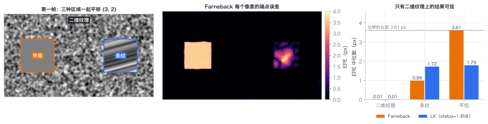
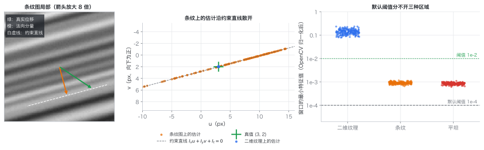
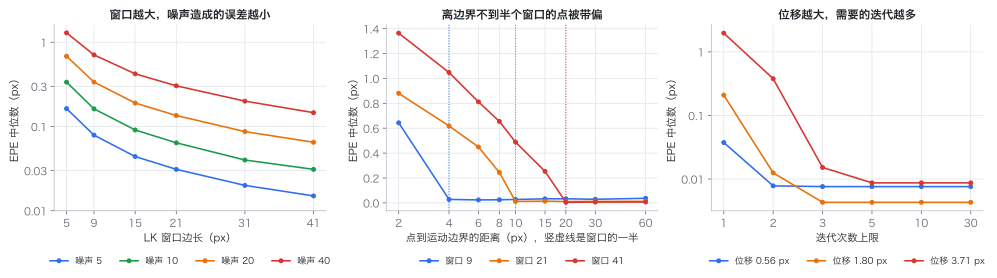
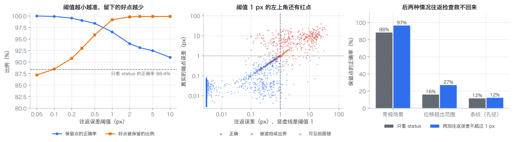
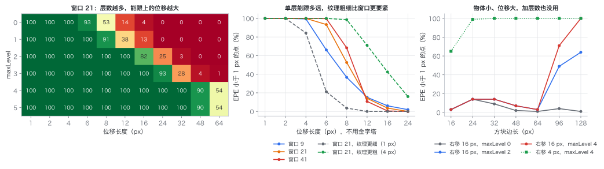
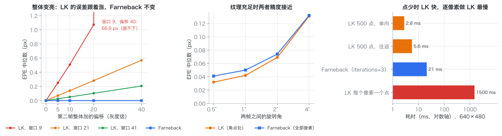

# 第 6 天：光流与运动 —— 教程

> [!NOTE]
> 本章所有数字都来自合成图像上的实测，记录在 [`figures/实测数字.json`](figures/实测数字.json)，由 `solutions` 分支的 `solutions/figures/ch06.py` 生成。前向-反向筛选用本章作业的参考实现，LK、Farneback、ECC 用 OpenCV 5.0.0，相位相关用第 16 章作业的参考实现。合成图像的真实位移是已知的，所以误差可以直接算出来。耗时是在一台 Apple 芯片的 Mac 上测的一次结果，只能看量级。换成真实视频或别的 OpenCV 版本，数值会变，结论的方向要自己再测一遍。

> 自动验收的作业是 [`6-1_前向反向筛选.py`](./6-1_前向反向筛选.py)。扩展练习 6-1（稀疏光流追踪）和 6-2（稠密光流可视化）的题目在 [`视觉算法学习计划.md`](../视觉算法学习计划.md) 的“第 6 天”一节，需要自己新建文件完成。

---

## 0. 本章怎么学

**应用场景**：运动估计、视频稳像，也是迭代对齐方法的思想来源。需要知道画面里每个位置各自移动了多少的时候用光流：在视频里跟踪一批特征点、估计相机的抖动再把它补偿掉、把运动的区域和静止的背景分开。检测类的工作里更常见的需求是把两幅图整体对齐，那是第 16 章的内容，逐点的光流用得少。但第 16 章提到的迭代对齐方法（Lucas-Kanade、ECC）和本章的 LK 是同一套做法，6.4 节末尾把两者放在一起测了一次。

**优先级**：P3，选修，遇到再回看。前置是第 2 章（图像梯度 `Ix`、`Iy` 怎么算）。第 5 章不是硬性前置，但本章反复用到它的结构张量。

| 档位 | 累计用时 | 做什么 | 做到什么算完 |
|---|---:|---|---|
| 速通 | 3 小时 | 只读 6.1 节、6.2 节的“为什么一个像素还不够”和实测、6.4 节末尾的“LK 和第 16 章图像对齐的关系”，看懂图 1、图 2、图 5，做演示的前 3 步，答完 5 道小测 | 能讲清光流在什么时候会用到，什么样的区域算不出来，迭代法和第 16 章的相位相关各自适合哪一步 |
| 标准 | 6 小时 | 读完全章，跑 Notebook，完成 `6-1_前向反向筛选.py` 并验收通过，做 6.11 节前三个破坏实验，填实验记录 | 验收 PASS，实验记录里有一个假设失效的案例，自测问题都能答 |
| 深挖 | 7 小时 | 再做 6.11 节其余的破坏实验和 6.12 节的扩展（稀疏追踪和稠密可视化选一个） | 在自己录的视频上跑通，报告筛选前后的点数，并说明用什么判断结果可信 |

> [!TIP]
> 用时超过所选档位的 1.5 倍还没做完，就把卡点写进 `学习进度.md`，先往下一章走。本章是选修，速通档的 3 小时是上限：只要求读上面点到的几个小节，读完能回答“什么时候会用到、和第 16 章是什么关系”就可以走，其余内容等真的要处理视频时再回来读。

---

## 6.1 光流是什么

视频不是一组互不相关的图片。相邻两帧之间，物体通常只移动了一小段距离。**光流（Optical Flow）**就是估计每个图像位置从上一帧到下一帧的二维位移：

```text
p = (x, y)  →  p' = (x + u, y + v)
```

其中 `(u, v)` 是光流向量。它描述的是三维运动、相机运动和投影共同造成的**图像表观运动**，不一定等于物体真实的三维速度。例如，一个人迎面走来，在图像中主要表现为轮廓向外扩张；相机向右转时，静止背景也会整体向左流动。

光流分两类：

| 类型 | 输出 | 特点 | 常见用途 |
|------|------|------|----------|
| **稀疏光流** | 只计算角点等少量位置 | 快、容易跟踪身份 | 特征点追踪、稳像、轨迹分析 |
| **稠密光流** | 几乎每个像素一个向量 | 信息完整、计算量更大 | 运动分割、动作分析、流场可视化 |

注意：光流不是目标检测。它告诉你“哪里在怎样移动”，却不知道移动的是人、车还是阴影。

### 有真值时怎么量：端点误差

本章的实验都用合成图像：先生成一张随机纹理，再按已知的位移生成第二帧，所以每个位置的真实位移 $(u^*, v^*)$ 是知道的。估计值和真值之差的长度叫**端点误差**（endpoint error，下文写作 EPE），单位是像素：

$$
\mathrm{EPE} = \sqrt{(u - u^*)^2 + (v - v^*)^2}
$$

先看最理想的情况能准到什么程度。256×256 的随机纹理整体平移，5 个随机种子。LK 用 6.6 节速查里的参数（`winSize=21`、`maxLevel=3`），每个种子跟踪 121 个网格点；Farneback 也用速查里的参数，统计离边界 40 px 以内的全部像素。表里是 EPE 的中位数（px），噪声的单位是灰度级，纹理自身的标准差是 40 个灰度级。

| 真实位移 | (0.3, 0.2) | (1.0, 0.5) | (3.0, 2.0) | (6.5, -4.25) |
|---|---:|---:|---:|---:|
| LK，无噪声 | 0.0092 | 0.0043 | 0.0002 | 0.0077 |
| Farneback，无噪声 | 0.01 | 0.0057 | 0.0001 | 0.009 |
| LK，噪声 5 | 0.0297 | 0.0287 | 0.0311 | 0.0285 |
| Farneback，噪声 5 | 0.038 | 0.038 | 0.0394 | 0.0362 |

纹理充足、位移不大、亮度不变的时候，两种方法都能准到百分之几个像素。位移正好是整数像素时误差最小（两帧的像素一一对应），小数位移时略大。这张表是后面所有实验的参照：下面每一节都是破坏其中一个条件，看误差涨到多少。

### 实测：哪些地方的光流可信

上面的纹理处处都有丰富的细节。真实图像里有大片的纯色区域，也有只沿一个方向变化的直边和条纹。把这三种区域放进同一张图：360×200 的纹理背景里嵌一个 80×80 的平坦方块和一个 80×80 的条纹方块，全部内容一起平移 (3, 2)，位移的长度是 3.606 px，噪声 2 个灰度级，6 个随机种子。每个区域只统计离区域边界至少 20 px 的中间部分。



| 区域（内容都平移 (3, 2)，噪声 2） | 二维纹理 | 条纹 | 平坦 |
|---|---:|---:|---:|
| Farneback：EPE 中位数（px） | 0.015 | 0.986 | 3.606 |
| Farneback：输出向量长度的中位数（px） | 3.61 | 3.07 | 0.01 |
| LK：`status=1` 的比例 | 100% | 100% | 100% |
| LK：EPE 中位数（px） | 0.012 | 1.717 | 1.787 |
| LK：EPE 超过 1 px 的点 | 0% | 68.7% | 80.7% |

1. **稠密光流每个像素都有输出，但平坦方块里的输出接近 0**。那里输出向量长度的中位数只有 0.01 px，误差 3.606 px 正好等于位移的长度。算法在那里看不到任何变化，给出的是“没有动”。
2. **LK 在平坦方块和条纹方块里照样返回 `status=1`**，其中 80.7% 和 68.7% 的点误差超过 1 px。`status` 没有把这些点挡住，原因在 6.2 节和 6.3 节。
3. **条纹方块介于两者之间**。它不是全错，而是只有一个方向对，6.2 节单独测。

所以拿到一张光流图，第一件事是分清哪些位置有二维纹理，其余位置的数值不能当真。

<!-- quiz -->
**纹理背景里嵌着一个没有任何纹理的平坦方块，方块跟着背景一起平移了 (3, 2)。Farneback 在方块中间输出的光流最接近哪个？**

- A. (3, 2)，周围的运动会传播进来
- B. 0，算法在那里看不到变化
- C. NaN，表示无法计算

<details markdown="1"><summary>答案与解释</summary>

**B**。方块中间输出向量长度的中位数是 0.01 px，端点误差 3.606 px 正好等于位移的长度。Farneback 不会用 NaN 或别的标记告诉你“这里不可信”，稠密光流的每个像素都有一个看起来正常的数。同一区域里 LK 的 `status` 也全是 1，其中 80.7% 的点误差超过 1 px。

</details>
<!-- /quiz -->

---

## 6.2 从亮度恒定到光流约束方程

### 三个基本假设

经典光流从三个近似出发：

1. **亮度恒定**：同一个点移动前后亮度基本不变；
2. **小运动**：相邻帧位移足够小，可以用一阶泰勒展开；
3. **空间一致**：一个小邻域内的点具有近似相同的运动。

设灰度视频为 `I(x, y, t)`。某点经过很短时间后移动 `(u, v)`，亮度恒定写成：

```text
I(x, y, t) = I(x + u, y + v, t + 1)
```

对右侧在 `(x, y, t)` 处做一阶泰勒展开：

```text
I(x+u, y+v, t+1) ≈ I(x,y,t) + Ix·u + Iy·v + It
```

两边相减，得到最核心的**光流约束方程**：

```text
Ix·u + Iy·v + It = 0
```

`Ix、Iy` 是图像在水平和垂直方向的梯度，`It` 是两帧之间的时间变化。直觉上，它说：如果某处亮度随时间变了，就尝试用“沿空间梯度方向移动了一段距离”来解释这个变化。

三个假设各自被破坏时误差有多大，本章都测了，对应关系如下：

| 假设 | 被什么破坏 | 实测在哪里 |
|---|---|---|
| 亮度恒定 | 曝光变化、闪灯、反光 | 6.5 节，图 6 左 |
| 小运动 | 位移超过算法能跟上的范围 | 6.3 节的迭代次数，6.4 节，图 5 |
| 空间一致 | 窗口跨过运动边界 | 6.3 节，图 3 中 |

### 为什么一个像素还不够

方程里有两个未知数 `u、v`，但每个像素只给一个方程，所以无法唯一求解。更深一层看，`Ix·u + Iy·v` 只是光流在梯度方向上的投影：我们能看到垂直于边缘的运动，却看不清沿边缘的运动。这就是**孔径问题（Aperture Problem）**。

想象透过一个很小的圆孔观察一条斜线。斜线向右平移和沿自身方向滑动，在孔内可能产生完全相同的变化。只有看到拐角、纹理或更大的上下文，才能确定真实方向。因此：

- 平坦区域：`Ix≈Iy≈0`，任何运动都难以判断；
- 单一边缘：只能确定法线方向的运动；
- 角点或丰富纹理：两个方向都有明显变化，最适合追踪。

这也解释了为什么稀疏 LK 常先用 `cv2.goodFeaturesToTrack()` 找角点，而不是随便选点。

把约束方程写成向量的形式更容易看出“只能确定法线方向”是什么意思。记梯度为 $\nabla I = (I_x, I_y)$，方程是

$$
\nabla I \cdot (u, v) = -I_t
$$

它只规定了 $(u, v)$ 在梯度方向上的投影等于 $-I_t / \lVert \nabla I \rVert$。在 $(u, v)$ 平面上，满足这个方程的点是一条直线，下文叫它约束直线。真实位移在这条线上，但线上的每个点都同样满足方程。梯度方向叫法向，垂直于它、沿着边的方向叫切向。

### 实测：条纹上只有法向分量是准的

做一张只在一个方向上有梯度的图：256×256 的条纹，梯度方向和 x 轴成 75 度，内容平移 (3, 2)。真实位移在法向上的分量是 2.708 px，在切向上的分量是 -2.38 px。用默认参数的 LK 跟踪网格点，每个种子 196 个点，5 个随机种子。



| 条纹图，平移 (3, 2) | 无噪声 | 噪声 1 | 噪声 2 | 噪声 5 |
|---|---:|---:|---:|---:|
| `status=1` 的比例 | 0% | 100% | 99.3% | 98.9% |
| 法向误差绝对值的中位数（px） | | 0.005 | 0.008 | 0.017 |
| 切向误差绝对值的中位数（px） | | 5.212 | 6.293 | 5.732 |
| EPE 小于 1 px 的点 | | 11.4% | 11.5% | 12.0% |

作为对照，同样的噪声 2 下，二维纹理上法向和切向的误差是 0.007 px 和 0.009 px。

1. **法向分量和二维纹理上一样准，切向分量是乱的**。噪声 2 时法向误差 0.008 px，切向误差的中位数 6.293 px，比真实位移本身还大。图 2 中间那幅图里，橙点沿约束直线散开，蓝点都挤在真值上。
2. **完全没有噪声时 `status` 全是 0，加上 1 个灰度级的噪声就全是 1**。`status` 靠的是窗口的最小特征值（6.3 节），无噪声的条纹在切向上的特征值正好是 0，被挡住了。只要有一点噪声，这个特征值就不再是 0，默认阈值挡不住。真实图像总有噪声，所以不要指望默认参数的 `status` 替你排除边缘上的点。
3. **平坦区域是同一个问题的两个方向版本**。两帧都是灰度 128 加独立噪声的纯平坦图（256×256，196 个点），没有任何真实运动。噪声 0.5 时 `status` 全是 0；噪声 1、2、5 时 `status` 全是 1，输出位移长度的中位数是 1.36、2.5、4.23 px，全是噪声算出来的。

第 5 章 5.1 节用小块匹配测过同一件事：边缘小块在垂直于边的方向全对，沿着边的方向和瞎猜一样。这里换成光流，结论相同。

<!-- quiz -->
**一张只有条纹的图（只在一个方向上有梯度），加了标准差 2 个灰度级的噪声，内容平移 (3, 2)。用默认参数的 `calcOpticalFlowPyrLK` 跟踪条纹上的点，会得到什么？**

- A. `status` 几乎全是 0，因为条纹上解不出来
- B. `status` 几乎全是 1，法向分量很准，切向分量是乱的
- C. `status` 几乎全是 1，两个分量都准

<details markdown="1"><summary>答案与解释</summary>

**B**。99.3% 的点 `status=1`，法向误差的中位数 0.008 px，切向误差的中位数 6.293 px，只有 11.5% 的点 EPE 小于 1 px。A 只在完全没有噪声时成立（那时 `status` 全是 0）。默认的 `minEigThreshold` 是 1e-4，条纹加噪声 2 之后的最小特征值在 0.00066 到 0.0012 之间，比它大，所以挡不住。

</details>
<!-- /quiz -->

---

## 6.3 Lucas-Kanade：把邻域变成最小二乘

Lucas-Kanade（LK）假设一个 `w×w` 小窗口内的像素共享同一个 `(u, v)`。窗口中每个像素都贡献一个方程：

```text
Ix1·u + Iy1·v = -It1
Ix2·u + Iy2·v = -It2
...
Ixn·u + Iyn·v = -Itn
```

写成矩阵：

```text
A = [[Ix1, Iy1],       b = [-It1,
     [Ix2, Iy2],            -It2,
     ...]                    ... ]

A [u, v]ᵀ ≈ b
```

像素数通常大于未知数个数，噪声又使方程不可能全部精确成立，于是求使总误差最小的解：

```text
min ||A [u,v]ᵀ - b||²

[u,v]ᵀ = (AᵀA)⁻¹ Aᵀb
```

其中：

```text
AᵀA = [[ΣIx²,  ΣIxIy],
       [ΣIxIy, ΣIy² ]]
```

这个矩阵就是 Harris 角点中出现过的二阶矩矩阵。它的两个特征值直接决定可追踪性：两个都小是平坦区；一大一小是边缘；两个都大才是角点。**Harris 回答“这个点适不适合跟”，LK 回答“它跟到哪里去了”。**

把上面的法方程用求和号写出来，后面几节会反复用到：

```math
\underbrace{\begin{bmatrix} \sum I_x^2 & \sum I_x I_y \\ \sum I_x I_y & \sum I_y^2 \end{bmatrix}}_{G}
\begin{bmatrix} u \\ v \end{bmatrix}
= -\begin{bmatrix} \sum I_x I_t \\ \sum I_y I_t \end{bmatrix}
```

$G$ 就是第 5 章 5.2 节的结构张量，只和第一帧的梯度有关。$G$ 的较小特征值接近 0 时，这个方向上的解等于“噪声除以一个很小的数”，6.2 节条纹图上乱掉的切向分量就是这么来的。

窗口大小是一种取舍：窗口大，方程多、抗噪更好，但更容易跨越运动边界，违背“邻域同运动”；窗口小，定位更细，却可能没有足够纹理。

### 实测：窗口、运动边界和迭代次数

这一段话里的两头都可以量出来。



**窗口越大越抗噪**。256×256 的纹理平移 (3, 2)，`maxLevel=3`，每个种子 121 个点，5 个随机种子，EPE 的中位数（px）：

| 噪声（灰度级） | 窗口 5 | 窗口 9 | 窗口 15 | 窗口 21 | 窗口 31 | 窗口 41 |
|---|---:|---:|---:|---:|---:|---:|
| 5 | 0.163 | 0.079 | 0.044 | 0.031 | 0.02 | 0.015 |
| 10 | 0.336 | 0.162 | 0.091 | 0.064 | 0.04 | 0.031 |
| 20 | 0.682 | 0.337 | 0.19 | 0.135 | 0.087 | 0.065 |
| 40 | 1.293 | 0.708 | 0.422 | 0.304 | 0.2 | 0.146 |

误差和噪声成正比，和窗口边长大致成反比：窗口从 5 加到 41，噪声 5 时误差从 0.163 px 降到 0.015 px。噪声 40 时，窗口 5 有 61.9% 的点误差超过 1 px，窗口 21 只有 0.3%。

**窗口跨过运动边界时被带偏**。256×256 的静止纹理背景上有一个 120×120 的前景方块，方块右移 4 px，噪声 2，6 个随机种子。跟踪方块内部的点，按点到方块边界的距离分组，每组 60 个点，EPE 的中位数（px）：

| 点到边界的距离（px） | 2 | 4 | 6 | 8 | 10 | 15 | 20 |
|---|---:|---:|---:|---:|---:|---:|---:|
| 窗口 9（一半是 4） | 0.64 | 0.03 | 0.02 | 0.02 | 0.03 | 0.03 | 0.03 |
| 窗口 21（一半是 10） | 0.88 | 0.62 | 0.45 | 0.24 | 0.01 | 0.01 | 0.01 |
| 窗口 41（一半是 20） | 1.36 | 1.05 | 0.81 | 0.65 | 0.49 | 0.25 | 0.0 |

点到边界的距离小于窗口的一半时，窗口里有一部分像素属于静止的背景，两种运动混在一个窗口里，误差明显变大。距离达到半个窗口，误差就回到正常水平。所以窗口大小的取舍可以说得更具体：**窗口边长的一半，就是运动边界两侧不可信的宽度**。Farneback 的 `winsize` 是同样的规律，`winsize=15` 时距离 8 px 以内受影响，`winsize=31` 时距离 15 px 以内受影响。

### 加权、可解性与迭代

实际 LK 常给窗口中心更大的权重，边缘像素较小的权重。此时目标变成：

```text
min Σ wi·(Ixi·u + Iyi·v + Iti)²

解为：(AᵀWA)⁻¹AᵀWb
```

这不是改变原理，而是在说“离被跟踪点越近的像素越可信”。如果 `AᵀWA` 接近奇异矩阵，直接求逆会极不稳定：图像中的一点噪声就可能造成很大的位移变化。工程实现通常检查最小特征值，低于阈值就把该点标记为跟踪失败。这正是 `calcOpticalFlowPyrLK()` 中 `minEigThreshold` 参数的意义。

这个阈值的默认值是 1e-4。按 OpenCV 的文档，比较的量是 $G$ 的最小特征值除以窗口内的像素数。把 `flags` 设成 `cv2.OPTFLOW_LK_GET_MIN_EIGENVALS`，返回的 `err` 就是这个量，可以直接看它的分布。图 2 右边那幅图画的就是它（噪声 2，各 196 个点）：

| | 二维纹理 | 条纹 | 平坦 |
|---|---:|---:|---:|
| 最小特征值的范围 | 0.079 到 0.24 | 0.00066 到 0.0012 | 0.00061 到 0.0011 |
| `minEigThreshold=1e-4`（默认）时 `status=1` 的比例 | 100% | 99.5% | 100% |
| `minEigThreshold=1e-3` | 100% | 13.3% | 3.1% |
| `minEigThreshold=1e-2` | 100% | 0% | 0% |

默认阈值比条纹和平坦区域的值低了将近一个量级，三种区域全部放行。在这组数据上把阈值提到 1e-2，条纹和平坦区域的点全部被拒绝，二维纹理上的点一个不少。这个数不能照抄：最小特征值和图像的对比度、噪声都有关（第 5 章 5.2 节测过，亮度乘一个增益，结构张量按增益的平方变）。做法可以照搬：先在自己的图上把这个量打印出来，看好点和坏点各落在哪里，再定阈值。

公式看起来一次就能算出位移，实际算法却常需要迭代。原因是 `Ix、Iy、It` 只在当前对齐位置附近有效。算法先根据当前估计扭曲图像，再求一个小的位移增量 `Δu、Δv`，不断更新，直到增量足够小或达到最大次数。因此终止条件中的 `COUNT` 控制最多迭代多少次，`EPS` 控制“变化多小时可以停”。

用公式写，第 $k$ 次迭代在当前估计 $\mathbf{d}_k$ 的位置上取第二帧的窗口，和第一帧的窗口相减得到残差，再解一次同样的方程：

$$
\mathbf{d}_{k+1} = \mathbf{d}_k - G^{-1} \sum \nabla I(\mathbf{x}) \, \bigl[ J(\mathbf{x} + \mathbf{d}_k) - I(\mathbf{x}) \bigr]
$$

其中 $I$ 是第一帧，$J$ 是第二帧，求和在窗口内进行。这是对“两个窗口之差的平方和”做高斯-牛顿迭代。一步够不够，取决于位移有多大。256×256 的纹理，无噪声，不用金字塔，只设迭代次数上限，121 个网格点，EPE 的中位数（px）：

| 迭代次数上限 | 1 | 2 | 3 | 5 | 10 | 30 |
|---|---:|---:|---:|---:|---:|---:|
| 位移 0.56 px | 0.0375 | 0.0078 | 0.0076 | 0.0076 | 0.0076 | 0.0076 |
| 位移 1.80 px | 0.2086 | 0.0125 | 0.0043 | 0.0043 | 0.0043 | 0.0043 |
| 位移 3.71 px | 1.971 | 0.3784 | 0.0152 | 0.0087 | 0.0087 | 0.0087 |

位移 3.71 px 时只走一步，误差还有 1.971 px，超过位移的一半。走 3 步降到 0.0152 px，5 步以后不再变化。位移只有半个像素时一步就到了 0.0375 px。这就是“小运动”假设的定量版本：位移越大，一阶展开越不准，要靠多走几步来补。位移再大，多走几步也补不回来，那是 6.4 节的内容。

LK 还有一个实用的质量检查：**前向—反向误差**。把点从第 `t` 帧跟到第 `t+1` 帧，再从第 `t+1` 帧跟回去。若返回点与原点距离很大，说明匹配不可信：

```text
fb_error = ||p - backward(forward(p))||
```

这对遮挡、出界和错误匹配比只看 `status` 更严格。

### 前向-反向误差的阈值怎么定

本章的作业就是实现这一步筛选，阈值 `max_fb_error` 的默认值是 1 px。它该取多大，取决于你更怕留下错点还是更怕丢掉好点。

实验场景：384×384 的纹理整体平移 (6, 4)，噪声 4 个灰度级。第二帧里有一块 120×120 的区域被另一张纹理盖住，模拟遮挡；落进这块区域或者移出画面的点没有正确答案。每帧用 `goodFeaturesToTrack` 取 400 个角点，10 个随机种子共 4000 个点，其中 89.2% 的点真值可见。LK 用 `winSize=21`、`maxLevel=3`。“正确”指真值可见并且 EPE 小于 1 px。筛选调用作业的参考实现，传进去的 `status` 是前向和反向两次 `status` 的与。



| 筛选方式（4000 个点） | 保留点数 | 保留点的正确率 | 留下的错点数 | 好点被保留的比例 |
|---|---:|---:|---:|---:|
| 只看前向 `status` | 3992 | 88.4% | 462 | |
| 往返误差不超过 10 px | 3876 | 91.02% | 348 | 99.9% |
| 往返误差不超过 2 px | 3747 | 94.0% | 225 | 99.8% |
| 往返误差不超过 1 px | 3627 | 96.53% | 126 | 99.2% |
| 往返误差不超过 0.5 px | 3439 | 98.4% | 55 | 95.9% |
| 往返误差不超过 0.1 px | 3126 | 99.9% | 3 | 88.5% |
| 往返误差不超过 0.05 px | 3077 | 100.0% | 0 | 87.2% |

1. **只看 `status` 几乎什么都没挡住**。4000 个点里 3992 个 `status=1`，其中 462 个是错的。被遮挡的点照样在第二帧里“找到”了一个位置。
2. **阈值越小越准，丢的好点越多**。阈值 1 px 时正确率 96.53%，好点保留 99.2%；收紧到 0.1 px，正确率 99.9%，好点只剩 88.5%。后面要用 RANSAC 的话（第 4 章），留下少量错点问题不大，阈值可以松一些；要把轨迹直接拿去用，就收紧。
3. **默认的 1 px 还会漏掉 126 个错点**，其中 121 个是被遮挡或出界的点，它们的 EPE 中位数是 2.26 px。图 4 中间那幅图里，竖虚线左边、横点线上方的那些红点就是它们。它们往返一致，位置却不对。一个可能的原因是这些点落在遮挡区域的边缘附近，窗口里还留着一部分原来的内容；这一点没有单独验证。

**往返一致不等于正确**。图 4 右边那幅图是另外两种情况，往返检查都救不回来：

| 情况 | 只看 `status` 的正确率 | 再加往返误差不超过 1 px | 再加 `err` 不超过 12 |
|---|---:|---:|---:|
| 常规场景：平移 (6, 4)，`maxLevel=3` | 88.4% | 96.53% | 100.0% |
| 位移超出范围：平移 (12, 8)，`maxLevel=1` | 16.0% | 27.03% | 100.0% |
| 条纹图（6.2 节，噪声 2） | 11.5% | 12.2% | 没有测 |

- **位移超出算法能跟上的范围时**（长度 14.42 px，只用两层金字塔），只有 16.0% 的点跟对。按 1 px 筛选后留下 1032 个点，其中 753 个是错的，正确率 27.03%。这 753 个点前向位移长度的中位数只有 6.25 px：前向没有走到真值就停下了，反向又从停下的地方走回出发点附近，往返误差很小。
- **条纹上的点**，往返误差不超过 1 px 的占 20.9%，其中只有 12.2% 是对的。沿着条纹滑到哪里，两帧的窗口看起来都一样，往返检查分不出来。

表的最后一列是另一个现成的量：LK 默认返回的 `err`，它是两个窗口之间平均每个像素的绝对灰度差（6.6 节有核对）。位移超出范围的那些错点，窗口里的内容根本对不上，`err` 很大。按“`err` 不超过 12 个灰度级”（噪声标准差的 3 倍）筛选，两种场景的正确率都是 100.0%，好点分别保留 92.7% 和 92.4%。这个结果只在本章的合成数据上成立：两帧亮度完全一致，遮挡物是一张不相关的纹理。亮度一变，所有点的 `err` 都会变大（6.5 节），阈值就得重定。能带走的结论是：**`status`、往返误差、`err`、最小特征值查的是四件不同的事**，没有哪一个能单独用。

| 检查 | 它在查什么 | 查不出什么 |
|---|---|---|
| `status` | 窗口的最小特征值过了阈值，点没有跑出图像 | 位置对不对 |
| 往返误差 | 前向和反向的结果是否一致 | 两次都停在同一个错位置；沿条纹的滑动 |
| `err`（默认含义） | 两个窗口的内容像不像 | 沿条纹的滑动；亮度变化造成的假报警 |
| 最小特征值 | 窗口里有没有两个方向的纹理 | 位置对不对 |

<!-- quiz -->
**位移 14.42 px，金字塔只有两层（`maxLevel=1`），大部分点跟不上。用“往返误差不超过 1 px”筛选之后，留下的点里正确的占多少？**

- A. 95% 以上，往返检查就是用来挡这种错点的
- B. 一半左右
- C. 不到三成

<details markdown="1"><summary>答案与解释</summary>

**C**。留下 1032 个点，正确率 27.03%，其中 753 个是错的。这些错点前向停在半路的局部极小点上（前向位移长度的中位数 6.25 px，真值是 14.42 px），反向又走回出发点附近，往返是一致的。同样的筛选在常规场景里能把正确率从 88.4% 提到 96.53%，所以 A 说的是往返检查管用的那种情况。这里要先解决“跟不上”本身（加金字塔层数），或者加看 `err`。

</details>
<!-- /quiz -->

---

## 6.4 金字塔 LK：先在小图上追大运动

普通 LK 依赖小运动。若物体一帧移动 30 像素，一阶展开会很不准确。图像金字塔的做法是反复下采样：

```text
原图 L0：位移约 32 px
1/2  L1：位移约 16 px
1/4  L2：位移约  8 px
1/8  L3：位移约  4 px
```

在最粗层，大位移变成了小位移，先求一个粗略结果；放大到下一层后，用它作为初值，先把后一帧反向扭到接近前一帧，再估计剩余位移。如此从粗到细迭代，最终回到原图分辨率。

金字塔不是免费午餐：层数太少追不上快速运动；层数太多会让小物体和细纹理在粗层消失。实际应让最高层中的预期位移落到 LK 窗口能处理的范围内。

“窗口能处理的范围”到底是多少像素，“层数太少”“小物体消失”各在什么条件下出现，下面逐个量出来。

### 实测：层数、窗口和纹理粗细

384×384 的纹理整体平移，无噪声。位移长度从 1 px 到 64 px，每个长度取 3 个方向，跟踪 363 个网格点。表里是 EPE 小于 1 px 的点所占的百分比，`winSize=21`。



| 位移长度（px） | 4 | 6 | 8 | 12 | 16 | 24 | 32 | 48 | 64 |
|---|---:|---:|---:|---:|---:|---:|---:|---:|---:|
| `maxLevel=0`（不用金字塔） | 100 | 93 | 53 | 14 | 4 | 0 | 0 | 0 | 0 |
| `maxLevel=1` | 100 | 100 | 91 | 38 | 13 | 0 | 0 | 0 | 0 |
| `maxLevel=2` | 100 | 100 | 100 | 100 | 82 | 25 | 3 | 0 | 0 |
| `maxLevel=3` | 100 | 100 | 100 | 100 | 100 | 93 | 28 | 4 | 1 |
| `maxLevel=4` | 100 | 100 | 100 | 100 | 100 | 100 | 100 | 90 | 54 |
| `maxLevel=5` | 100 | 100 | 100 | 100 | 100 | 100 | 100 | 90 | 54 |

1. **不用金字塔，这种纹理上只能可靠地跟到 4 px 左右**。6 px 时还有 93%，8 px 只剩 53%，12 px 只剩 14%。
2. **层数越多，能跟上的位移越大**。从 `maxLevel=0` 到 `maxLevel=4`，全对的最大位移依次是 4、6、12、16、32 px。
3. **上面那个 32 px 的例子，用 `maxLevel=3` 是不够的**。到 L3 位移确实缩成了 4 px。但每一层都是先模糊再缩小，粗层上留下来的纹理和像素差不多粗细，按下面纹理粗细的实验，这样的纹理上单层只能可靠地跟 2 px 左右，4 px 已经不算小位移。实测 `maxLevel=3` 时 32 px 只有 28% 的点跟对，`maxLevel=4` 才是 100%。速查里的常用设置 `winSize=21`、`maxLevel=3`，在这种纹理上可靠的范围是 16 px，24 px 时 93%。
4. **跟丢的点 `status` 仍然是 1**。`maxLevel=0` 那一行，从 1 px 到 64 px 每一种位移下 `status=1` 的比例都是 100%，包括一个点都没跟对的那几格。整个实验的所有组合里，这个比例最低也有 98.3%。`status` 不告诉你位移是不是超出了范围。

**加大窗口基本没有用**。同样的实验，不用金字塔，比较三种窗口和三种纹理（图 5 中）。纹理的粗细用生成纹理时高斯模糊的标准差表示，上面用的是 2 px：

| 位移长度（px），`maxLevel=0` | 2 | 4 | 6 | 8 | 12 | 16 |
|---|---:|---:|---:|---:|---:|---:|
| 窗口 9，纹理 2 px | 100 | 99 | 66 | 37 | 15 | 6 |
| 窗口 21，纹理 2 px | 100 | 100 | 93 | 53 | 14 | 4 |
| 窗口 41，纹理 2 px | 100 | 100 | 100 | 68 | 11 | 1 |
| 窗口 21，纹理更细（1 px） | 100 | 84 | 21 | 4 | 0 | 0 |
| 窗口 21，纹理更粗（4 px） | 100 | 100 | 100 | 99 | 71 | 42 |

窗口边长从 9 加到 41，是原来的四倍多，8 px 时的成功率只从 37% 升到 68%，12 px 时三种窗口都只有一成多。纹理粗一倍，能跟上的位移跟着大一倍左右：纹理 1 px 时 4 px 就开始丢点（84%），纹理 4 px 时 8 px 还有 99%。所以单层 LK 能跟多远，主要由图像内容的粗细决定，窗口只起次要作用。`winSize` 在 OpenCV 文档里叫“搜索窗口”，容易让人以为它是搜索范围，实测不是：它是求和的范围，不是能找多远。金字塔管用的原因也可以这样理解：每缩小一次，位移减半，而留下来的纹理最细也就是一个像素左右。这是按上面的数字做的解释，没有逐层单独验证。

大窗口还有一个副作用：**它会限制实际能建的层数**。图像缩小到比窗口还小的时候，OpenCV 不再往上建。用 `cv2.buildOpticalFlowPyramid` 的返回值可以看到实际建到第几层，在 384×384 的图上：

| 要求的 `maxLevel` | 3 | 4 | 5 |
|---|---:|---:|---:|
| 窗口 9：实际建到 | 3 | 4 | 5 |
| 窗口 21：实际建到 | 3 | 4 | 4 |
| 窗口 41：实际建到 | 3 | 3 | 3 |

窗口 41 时把 `maxLevel` 设成 4 或 5，结果和设成 3 完全一样：32 px 的位移只有 20% 的点跟对，而窗口 21 配 `maxLevel=4` 是 100%。上面第一张表里 `maxLevel=5` 和 `maxLevel=4` 两行相同，也是这个原因。反过来，窗口 9 能建满 5 层，64 px 的位移跟对了 98%。

### 小物体的大位移，加层数也没用

原文说“层数太多会让小物体和细纹理在粗层消失”。在上面整幅图一起平移的实验里，多设几层没有造成任何损失，`maxLevel=5` 的每一格都不比 `maxLevel=3` 差。测到的问题是另一面：物体小的时候，粗层帮不上忙。

384×384 的静止纹理背景上，一个方块向右平移，噪声 2，6 个随机种子，跟踪方块中间的 150 个点，`winSize=21`。表里是跟对的百分比（图 5 右）：

| 方块边长（px） | 16 | 24 | 32 | 48 | 64 | 96 | 128 |
|---|---:|---:|---:|---:|---:|---:|---:|
| 右移 4 px，`maxLevel=4` | 65 | 99 | 100 | 100 | 100 | 100 | 100 |
| 右移 16 px，`maxLevel=0` | 3 | 14 | 9 | 2 | 1 | 4 | 1 |
| 右移 16 px，`maxLevel=2` | 3 | 14 | 14 | 7 | 3 | 49 | 64 |
| 右移 16 px，`maxLevel=4` | 3 | 14 | 14 | 7 | 3 | 71 | 100 |

- 右移 4 px 本来就在单层能跟上的范围里，边长 24 px 以上的方块基本全对。边长 16 px 的方块比窗口还小，只有 65%。
- 右移 16 px 需要金字塔。可是边长 64 px 以下的方块，不管设几层都不到两成。一个合理的解释是：在粗层里，一个窗口对应原图上很大的一片，方块只占其中一小部分，粗层估出来的更接近背景的运动；回到细层，16 px 又超出了单层的范围。这个解释没有单独验证。
- 方块要大到 128 px（位移的 8 倍），`maxLevel=4` 才全对。

所以金字塔解决的是“大片区域一起做大位移”。小而快的物体要靠提高帧率，或者换成先检测、再按外观匹配的办法（第 5 章）。

<!-- quiz -->
**位移 32 px，`winSize=21`、`maxLevel=3` 只有 28% 的点跟对。下面哪个改法能让它恢复到 100%？**

- A. 把窗口加大到 41，窗口大了才能覆盖 32 px 的位移
- B. 把 `maxLevel` 加到 4，窗口不变
- C. 两个都可以

<details markdown="1"><summary>答案与解释</summary>

**B**。窗口 21 配 `maxLevel=4` 是 100%。窗口加大到 41 之后只有 20%，比原来还低一点：窗口不是搜索范围，不用金字塔时窗口从 9 加到 41，8 px 位移的成功率只从 37% 升到 68%。而且在 384×384 的图上窗口 41 最多只能建到第 3 层，`maxLevel` 再往上设也不起作用。

</details>
<!-- /quiz -->

### 把整幅图当成一个窗口：LK 和第 16 章图像对齐的关系

LK 的窗口是 21×21 的一小块，未知数是这一小块的位移。把窗口放大到整幅图，未知数就是两幅图之间的整体平移，这正是第 16 章要解决的问题。第 16 章第 3 节把对齐方法分成三类，其中“基于强度、迭代优化”一类点名的就是 Lucas-Kanade 和 ECC，并且说它们“精度高，但需要好的初值，常用在全局方法之后做精修”。这句话可以用本章的工具量出来。

256×256 的纹理整体平移，噪声 2，每个位移长度取 6 个方向。四种方法：配图脚本里写的整图 LK（把图像中间 60% 当成一个窗口，只估平移，6.3 节的迭代公式），加 4 层金字塔的整图 LK，第 16 章作业的参考实现（相位相关，加 Hanning 窗，三点抛物线），以及 `cv2.findTransformECC`（只估平移，从单位变换出发）。表里是误差的中位数（px），括号里是 6 次里误差小于 0.5 px 的次数。ECC 的“失败”指抛出不收敛的异常，或者返回了错误的结果。

| 位移长度（px） | 0.3 | 1 | 4 | 8 | 12 | 24 | 32 | 48 |
|---|---:|---:|---:|---:|---:|---:|---:|---:|
| 整图 LK，不用金字塔 | 0.0061（6） | 0.0057（6） | 0.0051（6） | 0.0058（6） | 12.4136（0） | 25.4348（0） | 34.6162（0） | 48.4891（0） |
| 整图 LK，4 层金字塔 | 0.0061（6） | 0.0057（6） | 0.0051（6） | 0.0058（6） | 0.0051（6） | 0.0052（6） | 36.8267（1） | 48.4192（0） |
| 相位相关（第 16 章参考实现） | 0.0494（6） | 0.0418（6） | 0.058（6） | 0.0703（6） | 0.0774（6） | 0.0537（6） | 0.0748（6） | 0.1267（6） |
| ECC | 0.0055（6） | 0.0047（6） | 0.0042（6） | 0.0074（5） | 失败（0） | 失败（0） | 失败（0） | 失败（0） |

1. **迭代法在收敛的时候更准**。整图 LK 和 ECC 的误差在 0.004 到 0.007 px，相位相关在 0.04 到 0.13 px，差一个量级。这里的相位相关是第 16 章作业要求的不加权版本，第 16 章 6.3 节的几种改进没有放进来比。
2. **迭代法有收敛范围，相位相关没有**。不用金字塔的整图 LK 到 8 px 为止 6 次全对，12 px 起一次都不对。ECC 在 8 px 时 6 次里对了 5 次，12 px 起全部失败。加 4 层金字塔把范围推到 24 px，32 px 时 6 次只对 1 次。相位相关从 0.3 px 到 48 px 每一次都对。
3. **两者正好互补**，这就是第 16 章说的“粗对齐 → 精对齐”：先用相位相关或模板匹配这类全局方法把位移估到一两个像素以内，再交给迭代法精修。迭代法的收敛范围由图像内容的粗细决定，和上一小节单层 LK 能跟多远是同一个道理。

把未知数从平移换成仿射或单应的参数，迭代公式的形式不变，只是每个像素的梯度要再乘上“位置对参数的导数”，$G$ 从 2×2 变成 6×6 或 8×8。这就是“迭代对齐方法的思想来源”的意思。稀疏光流和整图对齐是同一个算法在两种窗口大小上的用法：窗口小，得到一批各自独立的局部位移；窗口是整幅图，得到一个整体变换。

### 交互演示：一维的 LK 迭代

演示页把二维图像换成一行 256 个像素，跟踪中间的一个点。可以调信号的粗细、真实位移、窗口半宽、金字塔层数、迭代上限、第二帧的亮度偏移和噪声。三张图分别是两帧信号、代价曲线（窗口内两帧之差的平方和随候选位移的变化，上面的圆点是每次迭代后的位置）和估计位移随迭代的变化。指标栏里有往返误差，按作业默认的 1 px 阈值判断保留还是剔除。页面下方有五步引导：

- 第 1 步对应 6.3 节的迭代次数：只走一步有明显的误差，多走几步才收敛。
- 第 2 步对应本节“纹理粗细比窗口更要紧”：同样的位移，细纹理上失败，粗纹理上成功。
- 第 3 步对应本节的金字塔和 6.3 节的往返检查：位移超出范围时估计值停在代价曲线的另一个谷里，往返误差却很小，这个错点通过了筛选；层数加够之后才回到真值。
- 第 4 步对应 6.5 节的亮度变化：第二帧整体变亮，估计值出现偏差，窗口加大后偏差变小。
- 第 5 步对应 6.2 节：窗口里没有梯度时，有噪声就得到一个由噪声决定的位移，没有噪声就解不出来。

演示页是一维的，信号和随机数也和配图脚本不同，数值和上面的表不会相同，现象相同。

<!-- embed: ../demos/LK迭代.html 1223 -->
[打开交互演示：Lucas-Kanade 迭代（一维）](../demos/LK迭代.html)

---

## 6.5 稠密光流：Farneback 在做什么

稀疏 LK 只追踪选中的点。稠密光流则输出形状为 `(H, W, 2)` 的数组，每个像素都有 `(u, v)`。

OpenCV 常用的 Farneback 方法在局部邻域内用二次多项式近似图像：

```text
f(x) ≈ xᵀAx + bᵀx + c
```

如果后一帧只是前一帧平移了 `d`，两帧局部多项式的系数变化就与 `d` 存在可解关系。算法再结合邻域加权、迭代和金字塔，从局部估计得到平滑的稠密流场。你不必手算多项式，但要记住它仍依赖：局部外观可近似、位移可由金字塔逐级缩小、邻域运动较一致。

稠密光流常用 HSV 可视化：方向映射为色调 `H`，速度大小映射为亮度 `V`。颜色表示“往哪走”，明暗表示“走多快”。这种图适合观察，不应当反过来当作精确数值使用。

那个“可解关系”写出来只有一行。把 $f_1(\mathbf{x}) = \mathbf{x}^\top A \mathbf{x} + \mathbf{b}_1^\top \mathbf{x} + c_1$ 平移 $\mathbf{d}$，展开 $f_1(\mathbf{x} - \mathbf{d})$，二次项系数不变，一次项系数变成

$$
\mathbf{b}_2 = \mathbf{b}_1 - 2 A \mathbf{d}
$$

所以 $\mathbf{d} = -\tfrac{1}{2} A^{-1} (\mathbf{b}_2 - \mathbf{b}_1)$。位移是从一次项系数的变化里解出来的，常数项 $c$ 没有参与。这一点下面的亮度实验会用到。$A$ 不可逆的地方（平坦区域、直边）同样解不出来，6.1 节图 1 里平坦方块中的输出接近 0 就是这种情况。

### 实测：稀疏和稠密的精度、亮度变化和耗时



**亮度恒定被破坏时，两种方法的表现不一样**。256×256 的纹理（平均灰度 110，标准差 30 个灰度级）平移 (3, 2)，无噪声，只改第二帧的亮度，5 个随机种子，EPE 的中位数（px）：

| 第二帧的变化 | LK 窗口 9 | LK 窗口 21 | LK 窗口 41 | Farneback |
|---|---:|---:|---:|---:|
| 整体加 5 个灰度级 | 0.252 | 0.07 | 0.026 | 0.0 |
| 整体加 10 | 0.508 | 0.14 | 0.051 | 0.0 |
| 整体加 20 | 1.072 | 0.282 | 0.103 | 0.0 |
| 整体加 40 | 66.88 | 0.569 | 0.206 | 0.0 |
| 整体乘 1.1 | 0.497 | 0.145 | 0.051 | 0.018 |
| 整体乘 1.2 | 0.936 | 0.267 | 0.096 | 0.035 |
| 整体乘 1.4 | 11.622 | 0.459 | 0.164 | 0.064 |
| 左暗右亮的斜坡（左边乘 0.6，右边乘 1.4） | 0.758 | 0.203 | 0.076 | 0.026 |

1. **LK 的误差和偏移成正比**。窗口 21 时，每加 10 个灰度级误差增加 0.14 px 左右；加 40 时有 14.6% 的点误差超过 1 px。
2. **窗口越大受影响越小**。加 20 时窗口 9、21、41 的误差是 1.072、0.282、0.103 px。从 6.3 节的迭代公式可以看出原因：第二帧整体多出一个常数 $c$，解里就多出一项 $-c\,G^{-1}\sum \nabla I$。窗口内梯度的和并不等于 0，但它随窗口增大涨得比 $G$ 慢，实测的方向和这个分析一致。窗口 9 在加 40 时完全跟丢（66.88 px）。
3. **Farneback 对整体加一个偏移没有反应**，表里四行都是 0.0。偏移只改变多项式的常数项，而位移是从一次项里解出来的。乘增益和亮度斜坡会影响它，但比 LK 小得多（乘 1.4 时 0.064 px 对 0.459 px）。这里只测了结果，没有去读 OpenCV 的实现。
4. **补救办法要看亮度是怎么变的**。整体加 40 之后，把第二帧线性拉伸到和第一帧相同的均值和标准差，LK 和 Farneback 的误差都回到 0.0 px。亮度斜坡用这个办法没有用（LK 窗口 21 仍是 0.223 px），因为每个位置变化的量不一样；两帧都做局部归一化（减去标准差 8 px 的高斯局部均值，再除以局部标准差）之后降到 0.004 px。原文说“可先做轻微平滑或亮度归一化，但无法彻底修复假设失效”，在这两种简单的变化上归一化是能修好的；反光、阴影这类只改变局部内容的情况没有测。

本章 Notebook 的破坏实验第 2 条是“将后一帧整体变亮后重新计算，观察亮度恒定假设失效”。Notebook 用的是 Farneback，按它的代码生成两帧（160×120，位移 (5, 3)），把第二帧整体加 20，它显示的 EPE 是 0.573，和不加时的 0.573 相同；加 40 时有 6.5% 的像素饱和到 255，EPE 是 0.578。也就是说照着做看不到预期的现象。要看到亮度变化的影响，把方法换成 LK，或者把变亮换成乘一个增益。顺带一提，0.573 这个数本身主要来自图里那个圆和矩形的平坦内部：平坦内部的 EPE 平均值是 3.682，其余纹理区只有 0.004。Notebook 的第 1 条破坏实验“把位移调到最大，比较小窗口和大窗口”，在滑块的最大位移 (18, 12) 下，`winsize` 取 5、15、31 的 EPE 是 22.563、22.337、22.481，三种窗口都失败，和 6.4 节“加大窗口没有用”一致。

**纹理充足时，稀疏和稠密的精度接近**。384×384 的纹理绕中心旋转，噪声 5，4 个随机种子。这时每个位置的位移都不一样，真值按旋转公式逐点算。LK 跟踪 `goodFeaturesToTrack` 取的角点，Farneback 统计全部像素，EPE 的中位数（px）：

| 两帧之间的旋转角 | 0.5° | 1° | 2° | 4° |
|---|---:|---:|---:|---:|
| 统计范围内的最大位移（px） | 2.0 | 4.0 | 8.0 | 15.9 |
| LK（角点处） | 0.032 | 0.042 | 0.069 | 0.131 |
| Farneback（全部像素） | 0.041 | 0.05 | 0.074 | 0.132 |
| Farneback（同一批角点处） | 0.036 | 0.046 | 0.065 | 0.117 |

两种方法的误差几乎一样，都随旋转角增大：窗口内的位移不再是同一个值，“空间一致”的假设被破坏得越来越多。稀疏和稠密的差别不在精度上，而在“输出了哪些位置”：LK 只算你挑的点，Farneback 连平坦区域也给一个数（图 1）。

**Farneback 的参数**。256×256 的纹理平移 (6, 4)，噪声 5，4 个随机种子，每次只改一个参数：

| `winsize` | 5 | 9 | 15 | 25 | 35 |
|---|---:|---:|---:|---:|---:|
| EPE 中位数（px） | 0.095 | 0.06 | 0.038 | 0.025 | 0.017 |

`iterations` 取 1、3、10 时 EPE 的中位数都是 0.038 px；`poly_n=7` 也是 0.038 px。`levels` 管的是能跟上的位移，无噪声时：

| 位移长度（px） | 7.2 | 14.4 | 28.8 | 43.3 |
|---|---:|---:|---:|---:|
| `levels=1`：EPE 小于 1 px 的像素 | 99.2% | 0% | 0% | 0% |
| `levels=4`：EPE 小于 1 px 的像素 | 100% | 100% | 10.1% | 0% |

`levels=6` 的结果和 `levels=4` 相同。位移 14.4 px、`levels=1` 时把 `iterations` 从 1 加到 30，EPE 小于 1 px 的像素始终是 0%。在这些实验里，`iterations` 既没有提高精度，也没有扩大能跟上的位移。

**耗时**。640×480 的图，在一台 Apple 芯片的 Mac 上、OpenCV 限制为单线程时测的一次结果，机器忙的时候会更慢，只看量级：

| 做法 | 耗时 |
|---|---:|
| `goodFeaturesToTrack` 取 500 个角点 | 1.8 ms |
| LK 跟踪 500 个点，单向 | 2.8 ms |
| LK 跟踪 500 个点，往返 | 5.6 ms |
| Farneback，`iterations=1` | 15 ms |
| Farneback，`iterations=3` | 21 ms |
| Farneback，`iterations=10` | 44 ms |
| LK 每个像素一个点（307200 个点） | 1500 ms |

跟踪几百个点的 LK 加上往返检查，仍然比算一次稠密流快几倍。往返检查让 LK 的耗时翻倍。`iterations` 从 3 加到 10，Farneback 的耗时翻了一倍，上面已经看到精度没有变化。想用 LK 得到稠密流是不划算的，逐像素做一遍比 Farneback 慢几十倍。

<!-- quiz -->
**两帧之间画面内容平移了 (3, 2)，同时第二帧整体变亮了 20 个灰度级（纹理自身的标准差是 30 个灰度级）。LK（窗口 21）和 Farneback 的误差会怎样？**

- A. 两个都明显变大，因为亮度恒定假设被破坏了
- B. LK 的误差升到 0.28 px 左右，Farneback 不变
- C. 两个都基本不变，20 个灰度级太小

<details markdown="1"><summary>答案与解释</summary>

**B**。LK 窗口 21 的 EPE 中位数从 0.0 升到 0.282 px，窗口 9 是 1.072 px。Farneback 仍是 0.0：整体加一个常数只改变局部多项式的常数项，位移是从一次项里解出来的。所以 Notebook 里“整体变亮”那个破坏实验用 Farneback 做，EPE 没有变化（0.573 对 0.573）。乘增益时 Farneback 才受影响，乘 1.2 时是 0.035 px，同时 LK 是 0.267 px。

</details>
<!-- /quiz -->

---

## 6.6 OpenCV API 速查

### 稀疏金字塔 LK

```python
next_pts, status, err = cv2.calcOpticalFlowPyrLK(
    prev_gray, next_gray, prev_pts, None,
    winSize=(21, 21),
    maxLevel=3,
    criteria=(cv2.TERM_CRITERIA_EPS | cv2.TERM_CRITERIA_COUNT, 30, 0.01)
)
```

- `prev_gray、next_gray`：前后两帧单通道图；
- `prev_pts`：通常为 `float32`，形状 `(N,1,2)`；
- `next_pts`：估计的新位置；
- `status[i]==1`：第 `i` 个点算出了一个结果（窗口的最小特征值过了阈值，点没有跑出图像）。它不表示匹配是对的，见下面的实测；
- `err`：跟踪误差，含义会受 flags 影响；
- `winSize`：每层的求和窗口（OpenCV 文档叫搜索窗口，但它不是搜索范围，见 6.4 节）；`maxLevel=3` 表示使用第 0 到 3 层。

几个在 OpenCV 5.0.0 上实测过的细节：

- **`status` 不是“找到了有效匹配”**。平坦加噪声、条纹加噪声、位移超出范围、被遮挡，这四种情况下 `status` 都几乎全是 1（6.1、6.2、6.3、6.4 节）。本章测到它变成 0 的情况是窗口的最小特征值低于 `minEigThreshold`（无噪声的平坦和条纹）。跟到图像外面的点也会是 0，这一条是按 OpenCV 的行为说的，本章没有单独统计。
- **`err` 默认是两个窗口之间平均每个像素的绝对灰度差**。384×384、噪声 5、`winSize=21`：跟对的时候（EPE 中位数 0.03 px）`err` 的中位数是 5.5，自己按定义算出来也是 5.5，逐点相差不超过 0.04；跟丢的时候（平移 (30, 20)、不用金字塔，EPE 中位数 36.66 px）`err` 是 37.4，而 `status` 仍然 100% 是 1。`flags` 加上 `cv2.OPTFLOW_LK_GET_MIN_EIGENVALS` 之后，`err` 变成窗口的最小特征值（这组数据上的中位数是 0.137），和跟得对不对没有关系。
- **点集的类型**。`float32` 的 `(N,1,2)` 和 `(N,2)` 都能用，传 `(N,2)` 时返回的 `next_pts` 也是 `(N,2)`；`float64` 和整数类型会触发断言错误。从 `goodFeaturesToTrack` 拿到的点直接能用，自己用 NumPy 造的点记得 `astype(np.float32)`。
- **图像的类型**。LK 接受 8 位的单通道或三通道图，`float32` 和 `uint16` 的图会报错。Farneback 相反：接受 8 位、`uint16`、`float32` 的单通道图，三通道图会报错。
- **实际的金字塔层数可能比 `maxLevel` 少**，窗口越大越容易发生（6.4 节）。

### Farneback 稠密光流

```python
flow = cv2.calcOpticalFlowFarneback(
    prev_gray, next_gray, None,
    pyr_scale=0.5, levels=4, winsize=15,
    iterations=3, poly_n=5, poly_sigma=1.2, flags=0
)
u, v = flow[..., 0], flow[..., 1]
mag, ang = cv2.cartToPolar(u, v, angleInDegrees=True)
```

`levels` 控制金字塔层数，`winsize` 越大越平滑但会模糊运动边界，`iterations` 越大越慢；`poly_n` 是局部多项式邻域大小，常用 5 或 7。

对照 6.5 节和 6.3 节的实测：`winsize` 从 5 加到 35，噪声造成的误差从 0.095 px 降到 0.017 px，代价是运动边界两侧各有半个 `winsize` 宽的区域不可信。原文说 `iterations`“越大通常更稳定也更慢”，更慢是测到了的（从 3 加到 10 耗时翻倍），更稳定在本章的平移实验里没有测到，1、3、10 三种取值的误差相同。`levels` 设得比图像能支持的多不会报错，也不会有效果。

---

## 6.7 实例：追踪视频中的角点

下面是一个最小但完整的稀疏追踪循环：

```python
import cv2
import numpy as np

cap = cv2.VideoCapture("input.mp4")
ok, prev = cap.read()
if not ok:
    raise RuntimeError("无法读取视频")

prev_gray = cv2.cvtColor(prev, cv2.COLOR_BGR2GRAY)
pts = cv2.goodFeaturesToTrack(
    prev_gray, maxCorners=200, qualityLevel=0.01,
    minDistance=10, blockSize=7
)
mask = np.zeros_like(prev)

while True:
    ok, frame = cap.read()
    if not ok or pts is None:
        break
    gray = cv2.cvtColor(frame, cv2.COLOR_BGR2GRAY)
    new_pts, status, _ = cv2.calcOpticalFlowPyrLK(
        prev_gray, gray, pts, None,
        winSize=(21, 21), maxLevel=3,
        criteria=(cv2.TERM_CRITERIA_EPS | cv2.TERM_CRITERIA_COUNT, 30, 0.01)
    )

    good_new = new_pts[status.ravel() == 1]
    good_old = pts[status.ravel() == 1]
    for new, old in zip(good_new, good_old):
        x, y = new.ravel().astype(int)
        ox, oy = old.ravel().astype(int)
        cv2.line(mask, (ox, oy), (x, y), (0, 255, 0), 2)
        cv2.circle(frame, (x, y), 3, (0, 0, 255), -1)

    cv2.imshow("tracks", cv2.add(frame, mask))
    if cv2.waitKey(1) & 0xFF == 27:
        break
    prev_gray = gray
    pts = good_new.reshape(-1, 1, 2).astype(np.float32)

cap.release()
cv2.destroyAllWindows()
```

这里最重要的不是画线，而是状态更新：下一轮的 `prev_gray` 必须是当前灰度帧，`pts` 必须是筛选后的当前点。工程中还应定期重新检测角点，否则点会因遮挡、出界和纹理变化越来越少。

对照本章的实测，这个循环有三处要补：

- 它只用 `status` 筛选。6.3 节的常规场景里，这样会把 462 个错点（占 4000 个点的一成多）留在轨迹里，而且错点会被当成下一帧的起点继续跟下去。在 `calcOpticalFlowPyrLK` 之后再反向跟一次，用作业里的 `filter_tracks` 得到掩码，代替 `status.ravel() == 1`。
- 把 `_` 换成 `err` 留下来，画一次它的直方图。跟对的点和跟丢的点在 6.6 节的数据上差了好几倍。
- 物体一帧移动 16 px 以内才在这组参数的可靠范围里（6.4 节，本章的合成纹理上）。运动更快时先加 `maxLevel`，不要先加窗口。

---

## 6.8 常见坑与排查顺序（常见错误）

1. **前后帧传反**：交换输入后，光流方向会整体取反。
2. **忘记过滤 `status`**：失败点也拿去画，会出现飞线或异常坐标。
3. **点的 dtype/shape 错误**：LK 点集用 `float32` 的 `(N,1,2)` 最稳妥。
4. **把位移当速度**：光流单位通常是“像素/帧”；要比较真实速度，必须考虑帧率、尺度和透视。
5. **亮度恒定被破坏**：闪灯、曝光变化、反光和阴影会被误认为运动。可先做轻微平滑或亮度归一化，但无法彻底修复假设失效。
6. **运动太大或模糊**：增加金字塔层数，或提高视频帧率。原文还建议“增大窗口”，6.4 节实测增大窗口基本没有用，还会减少实际能建的层数；窗口过大又会跨越物体边界。
7. **遮挡没有正确答案**：一个点在下一帧消失时，不存在可靠对应。可做前向—反向检查：先从 A 跟到 B，再从 B 跟回 A，回不到原位的点应剔除。
8. **角点越跟越少**：这是正常现象，应每隔若干帧补充新角点，并避免在已有点附近重复检测。
9. **相机运动污染目标运动**：手持相机下背景也在动。先用背景特征估计全局仿射或单应变换，再从光流中减去全局运动。
10. **可视化归一化抖动**：若每帧都按本帧最大速度归一化，颜色亮度无法跨帧比较。固定速度上限更适合视频展示。

第 1 条在合成数据上核对过：256×256 的纹理平移 (3, 2)，LK 和 Farneback 的位移中位数都是 (3.0, 2.0)，两帧交换后都是 (-3.0, -2.0)。

把上面的条目和本章实测到的情况合起来，按现象查。前五行是做作业 `6-1_前向反向筛选.py` 时最容易遇到的。

| 现象 | 原因 | 怎么查 |
|---|---|---|
| 作业验收报“输出必须是 (N,) bool 掩码” | 点集是 `(N,1,2)` 时算出的误差是 `(N,1)`；或者 `(N,)` 的误差和 `(N,1)` 的 `status` 做运算，广播成了 `(N,N)` | 打印返回值的 `shape` 和 `dtype`；三个点集先统一成 `(N,2)`，`status` 先展平 |
| 误差正好等于阈值的点被剔除 | 比较时写成了小于。函数的契约是“不超过” | 造一个往返误差正好是 1 的点，阈值也取 1，它应该被保留 |
| 往返误差全都很大，所有点被剔除 | 把距离算成了前向点和反向点之间的距离。往返误差是起点和反向点之间的距离 | 用一个纯平移的例子手算：反向点回到起点时误差应为 0 |
| 前向点是 NaN 的轨迹被保留了 | 只检查了反向点。NaN 参与比较的结果是 False，反向点是 NaN 时会自动被拒绝，前向点是 NaN 时不会 | 把一个前向点改成 NaN，反向点保持正常，看掩码 |
| `status=0` 的点被保留 | 没有把 `status` 并进条件里；或者 `status` 是 uint8，直接按位与出来的不是布尔数组 | 把一个点的 `status` 改成 0，其余条件都满足，看掩码 |
| `calcOpticalFlowPyrLK` 报断言错误 | 点集是 `float64` 或整数；或者图像是 `float32`、`uint16` | 点集转 `float32`，图像转 8 位（6.6 节） |
| `calcOpticalFlowFarneback` 报断言错误 | 传了三通道图 | 先转灰度 |
| 光流方向整体相反 | 前后帧传反 | 用一对已知平移的合成帧测一次，位移的符号应和你造的一致 |
| `status` 全是 1，轨迹却明显是错的 | `status` 不检查位置对不对。位移超出范围、遮挡、平坦和条纹区域都会这样 | 做往返检查；看 `err` 的分布；看最小特征值 |
| 运动快的时候跟不上，加大窗口也没用 | 窗口不是搜索范围；大窗口还限制了金字塔层数 | 加 `maxLevel`；用 `buildOpticalFlowPyramid` 的返回值看实际建到第几层 |
| 往返误差很小，结果却是错的 | 前向和反向停在了同一个错位置（位移超出范围），或者点在条纹上 | 同时看 `err` 和最小特征值，四种检查各管一件事（6.3 节） |
| 墙面、直边上的点乱漂 | 平坦或孔径问题。默认的 `minEigThreshold` 在有噪声时挡不住 | `flags` 加 `OPTFLOW_LK_GET_MIN_EIGENVALS` 看分布，再提高阈值；选点用 `goodFeaturesToTrack` |
| 物体边缘上的点被带偏 | 窗口跨过了运动边界，离边界不到半个窗口的点都受影响 | 缩小窗口，或者丢掉离边界半个窗口以内的点 |
| 小而快的物体跟不上，加层数也没用 | 粗层里物体只占窗口的一小部分，估出来的是背景的运动 | 提高帧率；或者换成检测加匹配 |
| 开灯、曝光变化之后 LK 的点整体偏移 | 亮度恒定被破坏。加 20 个灰度级，窗口 21 的误差是 0.282 px | 比较两帧的均值和标准差；先做归一化；加大窗口 |
| 稠密光流在大片纯色区域接近 0 | 没有纹理，算法在那里看不到变化 | 用梯度或最小特征值做一张掩码，掩码外的流不要用 |
| 稠密光流在物体边缘发虚 | `winsize` 跨过运动边界，两侧各半个 `winsize` 不可信 | 减小 `winsize`，代价是更怕噪声 |
| 轨迹越来越少 | 遮挡、出界、被筛掉，属于正常现象 | 每隔若干帧补点，补之前用掩码避开已有的点 |
| HSV 可视化的亮度一闪一闪 | 每帧按本帧最大速度归一化 | 固定速度上限 |

---

## 6.9 与配套练习的连接

本章有两类练习，编号容易混：自动验收的作业是 `6-1_前向反向筛选.py`；下面两个扩展练习的题目在 `视觉算法学习计划.md` 里，目录里没有现成的文件，需要自己新建。

### 作业 6-1：前向反向筛选（自动验收）

实现 `filter_tracks`：给定起点、前向跟踪到的点、反向跟踪回来的点和 `status`，返回一个布尔掩码。条件都写在函数的文档字符串里，容易错的地方见 6.8 节表格的前五行，阈值取多大见 6.3 节。完成后运行 `python tests/check_progress.py`。这个函数只做筛选，前向和反向两次 `calcOpticalFlowPyrLK` 要在调用它之前自己做。

### 扩展练习 6-1：稀疏光流追踪

对应本章 6.2～6.4 和 6.7。先用角点回答“追谁”，再用 LK 回答“去了哪里”。完成后建议加入前向—反向误差，并尝试修改 `winSize、maxLevel、minDistance`，观察快速运动、边缘点和遮挡时的差异。

### 扩展练习 6-2：稠密光流可视化

对应本章 6.5～6.6。把 `flow[...,0:2]` 转成幅值和方向，再映射到 HSV。进一步可用速度阈值生成运动区域掩码，并比较固定相机与手持相机下的结果。

---

## 6.10 怎样评估光流

**有真值时（合成数据）**。报告端点误差，并且至少给三个数：中位数、一个高分位、超过某个门限的比例。只报平均值会被少数跟丢的点带偏：本章 Notebook 显示的 EPE 是 0.573，而它的中位数只有 0.004，差别全在平坦区域。同时写清条件：图像尺寸、纹理、位移、噪声、参数、统计了哪些位置。平坦区域和边缘要不要算进去，结论会差很多，图 1 就是例子。

**没有真值时（真实视频）**。下面几个量都能算，但没有一个等于精度：

- **往返误差**：衡量一致性。6.3 节看到它在两种情况下会放过错点。
- **`err`**：衡量两个窗口像不像。亮度变化会让它整体变大。
- **最小特征值**：衡量这个位置能不能算，和算得对不对无关。
- **把第二帧按估计的流变形回去，和第一帧相减**：稠密光流常用的检查。残差大的地方一定有问题，残差小不代表流是对的，平坦区域里怎么变形残差都小。
- **已知应该不动的地方**：固定相机下的静止背景，光流应该是 0。统计背景上的流有多大，是一个现成的误差下界。

**半合成**。拿一帧真实图像，自己用已知的平移或仿射生成第二帧，再加一点噪声。纹理是真实的，真值是已知的，可以直接算 EPE。它测不到真实的亮度变化和遮挡，但能告诉你在这种纹理上参数够不够、哪些区域算不出来。

**报告格式**。写清方法和全部参数、用了哪些筛选和阈值、筛选前后各有多少个点、误差的中位数和高分位。只说“跟踪了 200 个点”没有意义，要说“200 个点里往返误差不超过 1 px 的有多少个”。

---

## 6.11 破坏实验

每个实验先写下预测，再运行，把结果和原因记到 `实验记录.md`。前三个是标准档必做。

1. Notebook 里把位移滑块拉到最大，`winsize` 分别取最小、中间和最大。先预测哪一种窗口能把 EPE 救回来，再和 6.5 节的数字对照。然后把 Farneback 调用里的 `levels` 从 4 改大，看有没有变化，想一想 160×120 的图能建几层。
2. Notebook 里生成 `frame1` 之后加一行 `frame1 = cv2.add(frame1, 20)`，先预测 EPE 会变成多少。再改成 `cv2.convertScaleAbs(frame1, alpha=1.3)`，哪一种变化的影响大？对照 6.5 节解释原因。
3. 用 Notebook 的两帧做稀疏跟踪：`goodFeaturesToTrack` 取角点，前向、反向各跟一次，用你写的 `filter_tracks` 按阈值 0.1、1、5 筛选。数一数各留下多少个点，留下的点里 EPE 超过 1 px 的有几个。圆和矩形内部有没有点？为什么？
4. 自己生成一张只有竖条纹的图（每一行都相同），把它平移 (3, 2) 得到第二帧，两帧各加一点噪声。预测 LK 估出的 `u` 和 `v` 哪个准。再把噪声去掉，`status` 会变成什么？
5. 生成一对整体平移 32 px 的帧，`winSize=21`，把 `maxLevel` 从 0 加到 5，记录跟对的比例。再把窗口改成 41，用 `cv2.buildOpticalFlowPyramid` 看实际建了几层。
6. 在纹理背景上贴一个 40×40 的纯色方块，让方块和背景一起平移。看 Farneback 在方块里的输出和 LK 在方块里的 `status`。再加上往返检查，方块里的点被筛掉了多少？

---

## 6.12 扩展（深挖档）

- **稀疏光流追踪**（题目在 `视觉算法学习计划.md` 的题 6-1）。在 6.7 节的循环上加三样东西：往返检查、每隔若干帧补点、把每帧的 `err` 和往返误差存下来。录一段有遮挡的视频，画出“存活的点数随帧号的变化”，对比只用 `status` 和加了往返检查两种情况。
- **稠密光流可视化**（题 6-2）。用固定的速度上限做 HSV 映射。再用梯度幅值做一张“有纹理”的掩码，把掩码外的流置零，比较前后两张图，看哪些区域原来的颜色是不可信的。
- **用光流做稳像**。对手持拍摄的视频，用通过了筛选的轨迹配合 `cv2.estimateAffinePartial2D`（内部有 RANSAC，第 4 章 4.5 节）估计相邻帧的全局运动，再反向补偿。对比筛选前后内点比例的变化。
- **自己写单层 LK**。用 NumPy 按 6.3 节的迭代公式实现一个只估平移的版本，窗口取整幅图。用第 16 章 Notebook 里的图和你的相位相关比较：位移 0.3 px 和 30 px 各是谁准？然后把两者串起来，先相位相关再 LK。
- **周期图案**。第 16 章第 8 节讲了周期图案上相关类方法会错开整数个周期。迭代法在周期图案上的收敛范围本章没有测，自己生成一张周期 16 px 的图，看单层 LK 在位移多大时开始收敛到错的位置。
- **别的稠密方法**。OpenCV 里还有 `cv2.DISOpticalFlow_create`，基于学习的方法有 RAFT 等。它们的精度和速度本章没有测，要用的时候按 6.10 节的办法在自己的数据上量。

---

## 6.13 和后续章节的关系

- **第 2 章**是前置：`Ix`、`Iy` 就是那一章的图像梯度。那一章 2.4 节讲平滑尺度和定位精度的取舍；本章里图像内容的粗细决定迭代法能跟多远，也是一个和尺度有关的取舍。
- **第 5 章** 5.2 节的结构张量就是 LK 的矩阵 $G$。`goodFeaturesToTrack` 用它的较小特征值选点，本章用同一个量判断这个点解不解得出来。第 5 章 5.1 节的边缘小块实验和本章 6.2 节是同一个现象。
- **第 4 章**的 RANSAC（4.5 节）是轨迹筛选之后的下一道关：往返检查留下的少量错点，在估计整体变换时由 RANSAC 排除。
- **第 16 章**解决的是“整幅图差多少”。它第 3 节里的迭代优化一类（Lucas-Kanade、ECC）就是本章的算法把窗口放大到整幅图，本章 6.4 节量出了它和相位相关在精度和收敛范围上的互补。第 16 章第 13 节的扩展里有 `cv2.findTransformECC` 的练习，做之前可以先回来看 6.4 节那张表。
- **第 18 章**的金模板比对假设两幅图已经对齐。对齐由第 16 章的方法完成；如果遇到的不是整体平移而是局部的小形变，才需要回到本章的逐点位移。

---

## 动手前的检查清单

- [ ] 能解释光流是二维表观位移，而不是真实三维速度。
- [ ] 能从亮度恒定写出 `Ix·u + Iy·v + It = 0`。
- [ ] 知道单像素为什么无法解出两个未知量。
- [ ] 能用孔径问题解释“边缘难跟、角点好跟”。
- [ ] 能说出 LK 如何把邻域方程组成最小二乘问题。
- [ ] 知道 `AᵀA` 的两个特征值与可追踪性的关系。
- [ ] 能解释金字塔为什么可以处理更大的位移。
- [ ] 分得清稀疏 LK 与 Farneback 稠密光流的输出和用途。
- [ ] 记得用 `status` 过滤失败点，并正确更新前一帧和点集。
- [ ] 知道亮度变化、遮挡、运动模糊和相机运动会让光流失效。

确认完了，打开 `06_光流/` 开始做题。

---

## 自测问题

速通档答小测，标准档把下面的问题答一遍。

1. `status=1` 表示什么？举出两种 `status` 几乎全是 1、结果却大面积错误的情况。
2. 一条直边上的点，光流的哪个分量能算准，哪个不能？对应的结构张量特征值是什么样？在 OpenCV 里怎样把这些点找出来？
3. 把 LK 的窗口加大，有哪两个好处，哪两个坏处？
4. 两帧之间的位移大约 32 px，`winSize=21`。`maxLevel` 该设多少？为什么加大窗口解决不了？金字塔在什么情况下也帮不上忙？
5. 往返误差的阈值取 0.1 px 和取 5 px，各自的代价是什么？哪两类错点是往返检查查不出来的，要补上什么检查？
6. 要把两幅位移未知的图对齐到 0.01 px 的量级，相位相关和迭代法（整图 LK 或 ECC）应该怎么配合？各自单独用会在哪里出问题？
7. 第二帧比第一帧整体亮了 20 个灰度级。LK 和 Farneback 哪个受影响？各举一种能修好和修不好的亮度变化。
