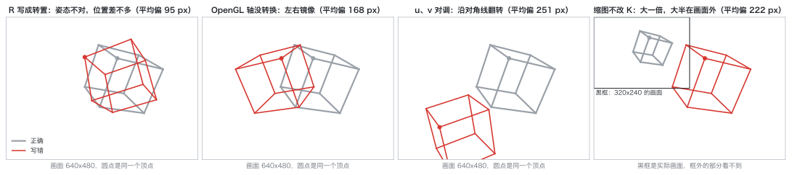
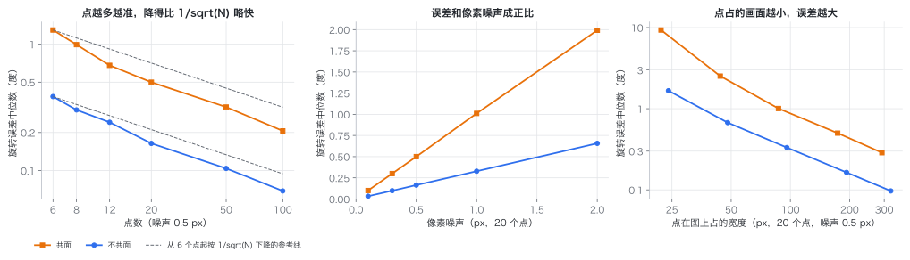
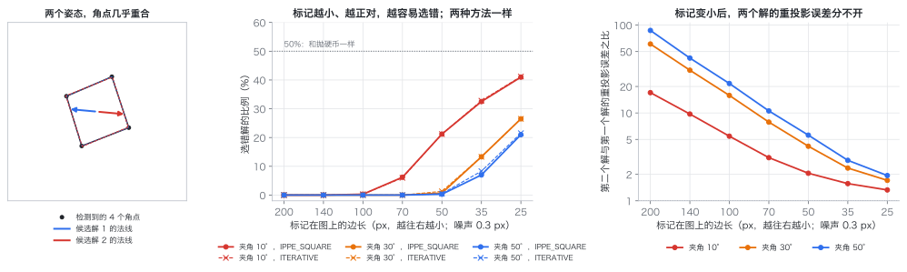
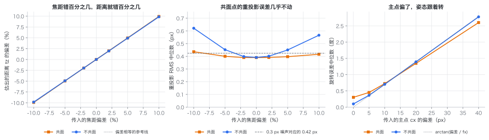
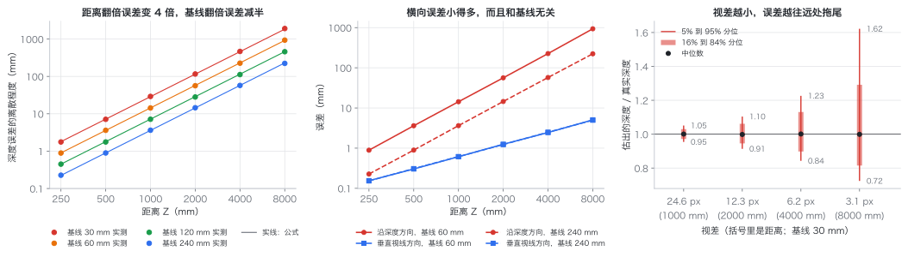
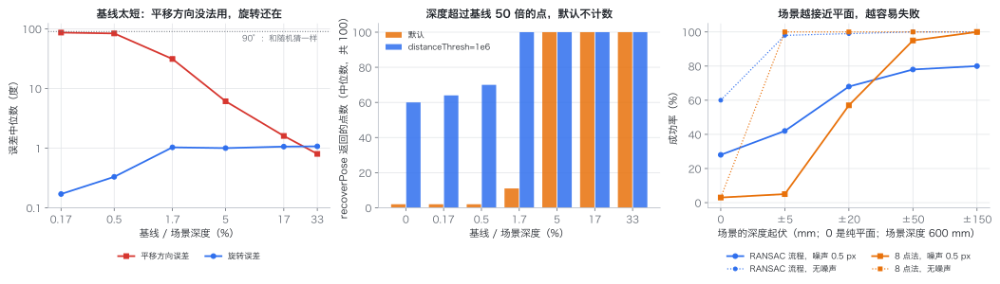

# 第 7 天：传统 CV 综合 —— 相机与三维视觉

> 配套练习：[题 7-1：AR 标记检测与叠加（最终关卡）](../视觉算法学习计划.md#题-7-1ar-标记检测与叠加最终关卡)
>
> 本章目标：把前面学过的特征、匹配、RANSAC 和几何变换串成一条三维视觉链路。读完后，你应该能解释“一个三维点怎样落到像素上”，并能用 OpenCV 完成位姿估计与虚拟物体叠加。

---

> [!NOTE]
> 本章所有数字都来自合成相机上的实测，记录在 [`figures/实测数字.json`](figures/实测数字.json)，由 `solutions` 分支的 `solutions/figures/ch07.py` 生成。无畸变的投影用本章作业的参考实现，PnP、三角化和本质矩阵用 OpenCV（实测时的版本是 5.0.0）。合成相机和第 17 章是同一台：640×480，$f_x = 820$，$f_y = 790$，主点 (318, 247)，长度单位是毫米。换成真实相机或别的 OpenCV 版本，数值会变，结论的方向要自己再测一遍。

## 0. 本章怎么学

**应用场景**：标定、位姿估计、渲染共用的相机模型。第 17 章标定要估的就是这里的 $K$、$R$、$t$ 和畸变系数；第 21 章的渲染相机用同一套投影，只是坐标轴的朝向不同。凡是要回答“这个三维点落在图上哪里”“这个物体相对相机在哪里、朝哪边”的问题，都从本章的投影链路出发。

**优先级**：P1，主线能力。前置是第 4 章（齐次坐标、单应、RANSAC）。后面第 17 章（相机标定）直接接在本章之后，第 21 章（3D 数学与渲染管线）用同一套相机模型。

| 档位 | 累计用时 | 做什么 | 做到什么算完 |
|---|---:|---|---|
| 速通 | 3 小时 | 读 7.1 节全部、7.2 节的三个“实测”小节、7.3 节的“三角化的深度误差”，看懂图 1 到图 5，按 7.5 节的五步玩一遍演示，答完 5 道小测 | 能讲清一个三维点经过哪几步落到像素上，$t$ 为什么不是相机位置，PnP 的误差由什么决定，为什么重投影误差小不代表位姿准 |
| 标准 | 6 小时 | 读完全章，跑 Notebook，完成作业 `7-1_针孔投影.py` 并验收通过，做前三个破坏实验，填实验记录 | 验收 PASS，实验记录里有一个投影失效的案例（点在相机后方、内参不匹配或约定弄反），能回答自测问题 |
| 深挖 | 7 小时 | 再做后三个破坏实验，从“扩展”一节里选一项 | 能用自己跑出来的数字报告 PnP 或三角化的误差随条件怎么变 |

> [!TIP]
> 用时超过所选档位的 1.5 倍还没做完，就把卡点写进 `学习进度.md`，先往下一章走。工业视觉主线路线里本章只要求速通档。7.3 节的对极几何，第二部分现有的讲义里没有再用到，卡住了可以先跳过。原讲义配套的 AR 标记练习需要摄像头和标定结果，不计入三档用时，建议学完第 17 章再做。

---

## 7.1 针孔相机：把三维世界压到二维平面

### 先建立直觉

相机最核心的动作不是“拍照”，而是**投影**：从三维点发出的光线穿过一个小孔，在成像平面上留下二维位置。真实镜头很复杂，但只要暂时忽略畸变，就能用针孔模型描述大部分几何关系。

设三维点在相机坐标系中为 `P_c=(X_c,Y_c,Z_c)`，其归一化图像坐标为 `(x,y)`。相似三角形给出：

```text
x = X_c / Z_c
y = Y_c / Z_c
```

这两式很重要：同一个物体离相机越远，`Z_c` 越大，投影越小；当 `Z_c<=0` 时，点在相机后方，通常不应显示。透视近大远小，不是额外特效，而是除以深度 `Z_c` 的自然结果。

归一化坐标还不是像素。相机要用焦距和主点把它换成 `(u,v)`：

```text
u = f_x * x + c_x
v = f_y * y + c_y
```

写成齐次矩阵：

```text
s [u v 1]^T = K [X_c Y_c Z_c]^T

K = [f_x  0   c_x
      0   f_y c_y
      0   0    1 ]
```

`K` 是**内参矩阵**。`f_x、f_y` 是以像素计的焦距，可能不同；`(c_x,c_y)` 是主点，通常接近图像中心，但不能想当然地固定为中心；`s` 在这里等于深度 `Z_c`。内参描述“相机自身怎样成像”，换了分辨率或缩放图像后也要相应调整。

用本章的合成相机算一下（参考实现，$f_x = 820$）：一段正对相机、长 100 mm 的线段，放在 250、500、1000、2000 mm 处，投影长度依次是 328、164、82、41 px。距离翻倍，长度减半，这就是除以 $Z_c$ 的全部效果。

### 必须分清的四个坐标系

一条完整链路是：

```text
世界坐标 P_w --[R|t]--> 相机坐标 P_c --除以 Z--> 归一化图像坐标
               --K--> 像素坐标 (u,v)
```

1. **世界坐标系**：人为选择的三维参考系，例如令 AR 标记左上角为原点。
2. **相机坐标系**：原点在光心，OpenCV 常用 `x` 向右、`y` 向下、`z` 向前。
3. **图像坐标系**：成像平面上的连续坐标，单位不是像素。
4. **像素坐标系**：数组中的离散位置 `(u,v)`；读取数组仍写 `img[v, u]`，即先行后列。

外参满足：

```text
P_c = R P_w + t
s p = K [R|t] P_w_h
```

其中 `R` 是 `3×3` 旋转矩阵，`t` 是 `3×1` 平移向量，`P_w_h=[X,Y,Z,1]^T`。一个常见误解是“`t` 就是相机在世界中的位置”。并不直接是：上式描述的是**世界点变到相机坐标系**，相机中心在世界坐标系中的位置为 `C_w=-R^T t`。

用和第 17 章相同的记号，把整条链路写成一个式子：

```math
s \begin{bmatrix} u \\ v \\ 1 \end{bmatrix} = K\,[R \mid t] \begin{bmatrix} X \\ Y \\ Z \\ 1 \end{bmatrix},
\qquad
K = \begin{bmatrix} f_x & \gamma & c_x \\ 0 & f_y & c_y \\ 0 & 0 & 1 \end{bmatrix}
```

$\gamma$ 是倾斜系数，现代相机约等于 0，本章和作业都取 0。$K$ 怎么从标定图里估出来是第 17 章的内容，本章把它当已知量。

“$t$ 不是相机位置”可以用一组数看清楚。图 1 用的位姿是 $t = (40, -25, 500)$ mm，长度 502.2 mm；按 $C_w = -R^\top t$ 算出的相机中心是 $(-243.1, -120.3, -422.7)$ mm。两个向量相差 970 mm，只有长度相同。$t$ 的含义是“世界原点在相机坐标系里的位置”，所以 $t_z$ 可以直接读成“世界原点在相机前方多远”，$t$ 整体却不能读成相机在哪里。

### 实测：约定弄反时是什么样

投影链路上的每个约定都可能弄反，而且大多数时候程序不报错。把一个边长 100 mm 的立方体放在相机前 450 到 550 mm 处，随机取 300 个位姿（倾斜不超过 30°），用正确的写法和几种常见的错误写法各投影一次，比较 8 个顶点的位置。



| 写错的地方 | 画面上的症状 | 顶点偏差的中位数 |
|---|---|---:|
| 旋转矩阵写成了转置 | 立方体还在原来的位置附近，姿态不对 | 75.5 px |
| 先加 $t$ 再乘 $R$ | 位置差得最远 | 363.0 px |
| 把 $t$ 当成相机位置，写成 $R(P_w - t)$ | 300 个位姿里，8 个顶点全部落到相机后方 | 画不出来 |
| 位姿来自 OpenGL 约定的相机（看向 -Z、y 向上），没有转换，投影时检查了深度 | 同上，全部在相机后方 | 画不出来 |
| 同上，但用 `cv2.projectPoints` 投影 | 绕主点左右镜像 | 157.1 px |
| 把 $(u, v)$ 当成（行，列） | 沿画面对角线翻转 | 157.6 px |
| 图像缩小了一半，$K$ 没改 | 尺寸大一倍，大半落在画面外 | 205.8 px（在缩小后的图上量） |

读表的结论：

1. 只有“点落到相机后方”这一类错误会被深度检查拦住，其余的错误都会给出一组看上去正常的像素坐标。
2. OpenGL 约定和 OpenCV 约定之间差一个绕 x 轴 180° 的旋转（第 21 章有对照表）。不转换的话所有点的 $Z_c$ 都是负的。`cv2.projectPoints` 不检查深度，照样做除法，$X_c / Z_c$ 变号、$Y_c / Z_c$ 不变，结果正好是左右镜像。
3. 排查时先打印相机坐标，看 $Z_c$ 是不是正的。再把世界原点投影出来：它的相机坐标就是 $t$，应该落在 $(f_x t_x / t_z + c_x,\; f_y t_y / t_z + c_y)$。这个点不对，问题在 $t$ 或 $K$；这个点对了其他点不对，再查 $R$。

还有一个和约定有关的坑：`cv2.projectPoints` 不检查点在不在相机前方。相机放在原点不旋转，同一个点 $(30, 20, Z)$ 放在前方 500 mm 处，参考实现和 OpenCV 都投到 (367.2, 278.6)；放到后方 500 mm 处，参考实现按作业的约定返回 NaN，OpenCV 返回 (268.8, 215.4)，正好是前一个结果关于主点的对称位置，数值上看不出任何异常。在相机前方的点上两者是一致的，200 个随机点的最大差是 1.1e-13 px。画虚拟物体时，只要有顶点可能转到相机后面，就要自己按 $Z_c$ 过滤。

<!-- quiz -->
**一个点在相机后方 500 mm 处。把它交给 `cv2.projectPoints`，会得到什么？**

- A. NaN
- B. 一个看上去完全正常的像素坐标
- C. 抛出异常

<details markdown="1"><summary>答案与解释</summary>

**B**。实测同一个点放在前方投到 (367.2, 278.6)，放到后方投到 (268.8, 215.4)，是前者关于主点的对称位置。OpenCV 只做除法，不检查 $Z_c$ 的正负。返回 NaN 是本章作业要求的行为，要自己实现；函数也不会因此抛异常。

</details>
<!-- /quiz -->

### 畸变：为什么直线到了图像边缘会弯

针孔模型假设理想镜头，真实镜头还会产生：

- **径向畸变**：桶形或枕形，离中心越远越明显，常用 `k1,k2,k3` 描述；
- **切向畸变**：镜头与传感器不完全平行，常用 `p1,p2` 描述。

OpenCV 常见畸变向量 shape 为 `(5,)` 或 `(1,5)`：

```text
dist = [k1, k2, p1, p2, k3]
```

标定的本质，是用多张已知尺寸的棋盘格图像，同时估计 `K`、畸变系数以及每张图的外参。拍标定图时要覆盖画面四角、改变角度和距离；只在中央正对着拍很多张，数量虽多，约束却很弱。

```python
rms, K, dist, rvecs, tvecs = cv2.calibrateCamera(
    object_points, image_points, image_size, None, None
)
# object_points: 每张图一个 (N, 3) float32
# image_points:  每张图一个 (N, 1, 2) float32
# image_size: (width, height)，不是 image.shape[:2]
```

判断标定好坏不能只看函数是否返回。应把三维角点重新投影，计算**重投影误差**：预测像素与检测像素之间的平均距离。误差小意味着当前数据被模型解释得好，但若标定姿态单一，参数仍可能泛化很差。

畸变模型的公式和第 17 章第 2 节相同，作用在归一化坐标 $(x, y) = (X_c / Z_c,\; Y_c / Z_c)$ 上，记 $r^2 = x^2 + y^2$：

```math
\begin{aligned}
x_d &= x\,(1 + k_1 r^2 + k_2 r^4 + k_3 r^6) + 2 p_1 x y + p_2 (r^2 + 2x^2) \\
y_d &= y\,(1 + k_1 r^2 + k_2 r^4 + k_3 r^6) + p_1 (r^2 + 2y^2) + 2 p_2 x y
\end{aligned}
```

然后 $u = f_x\,x_d + c_x$，$v = f_y\,y_d + c_y$。$k_1 < 0$ 是桶形，$k_1 > 0$ 是枕形。畸变加在透视除法之后、乘 $K$ 之前，这个顺序不能换。

标定本身（Zhang 方法的推导、标定图该怎么拍、怎样判断标定结果可不可信）留给第 17 章，那里有“姿态单一时焦距不可信”“只拍中央时四角误差放大”的实测。本章的作业不含畸变；本章后面的实验，除了专门说明的，也都不加畸变。

上面那段代码有两处要留意。`calibrateCamera` 的第一个返回值是重投影误差的均方根（RMS，单位像素），不是成功标志，所以这里把原来的变量名 `ok` 改成了 `rms`。`image_size` 的顺序是（宽，高），写反会怎样见“常见坑速查”一节的实测。

---

## 7.2 PnP：从 3D—2D 对应关系反推相机位姿

PnP（Perspective-n-Point）的问题是：已知若干世界点 `P_w`、对应像素 `p`、内参 `K` 和畸变，求 `R,t`，使重投影误差最小：

```text
min Σ || p_i - project(K, R, t, P_i) ||²
```

直觉上，你拿着一张已知尺寸的标记在镜头前转动；程序知道标记四角在标记坐标系中的三维位置，也检测到了四个像素位置，于是倒推出标记相对相机的姿态。

### 一个逐步例子：平面标记上画立方体

假设标记边长为 `L=0.05m`，把标记平面设为 `Z=0`：

```python
import cv2
import numpy as np

L = 0.05
object_pts = np.array([
    [0, 0, 0], [L, 0, 0], [L, L, 0], [0, L, 0]
], dtype=np.float32)                         # (4, 3)

image_pts = np.array([
    [312, 211], [441, 220], [430, 349], [301, 338]
], dtype=np.float32)                         # (4, 2)

ok, rvec, tvec = cv2.solvePnP(
    object_pts, image_pts, K, dist,
    flags=cv2.SOLVEPNP_IPPE
)
# rvec: (3,1)，Rodrigues 旋转向量；tvec: (3,1)
R, _ = cv2.Rodrigues(rvec)                  # (3,3)
```

> [!WARNING]
> 这里原来写的是 `cv2.SOLVEPNP_IPPE_SQUARE`，和上面的 `object_pts` 配不上，已改成 `cv2.SOLVEPNP_IPPE`。`IPPE_SQUARE` 要求物体点按固定的顺序和位置给出：原点在标记中心，依次是 `[-L/2, L/2, 0]`、`[L/2, L/2, 0]`、`[L/2, -L/2, 0]`、`[-L/2, -L/2, 0]`（OpenCV 文档的规定）。把“角点在原点”的写法传给它，函数照样返回成功，结果却完全是错的。用上面这组像素点和本章的合成相机实测（长度换成毫米）：`IPPE_SQUARE` 返回的 $t_z$ 是 -14.1 mm，标记被算到了相机后方，重投影误差 4590 px；换成 `IPPE` 之后 $t_z$ 是 316.9 mm，重投影误差 1.15 px。在 300 个随机位姿上，错误写法的旋转误差中位数是 177.9°，重投影误差中位数 2460 px。想用 `IPPE_SQUARE`，就把物体点改成文档规定的顺序；这时标记坐标系的 y 轴朝上、z 轴朝向相机，下面的立方体要改成朝 `+Z` 画。

`rvec` 不是欧拉角。它的方向表示旋转轴，模长表示旋转角（弧度）。不要把三个分量当作绕 x、y、z 的角度直接解释。

用数字看一下。先绕 x 轴转 20°、再绕 y 轴转 40°、再绕 z 轴转 30°，换成旋转向量是 (8.3°, 43.4°, 21.5°)（三个分量换算成度），总转角 49.2°，和三个欧拉角对不上。旋转向量也不能直接相加：把“绕 x 轴 20°”和“绕 y 轴 40°”两个旋转向量加起来，和真正先后做这两个旋转相差 6.9°。要合成旋转，先用 `cv2.Rodrigues` 换成矩阵再相乘。

接着定义立方体 8 个顶点。若希望立方体“朝标记上方”而不是钻进标记，要注意 OpenCV 相机坐标的方向以及你选择的标记坐标约定；这里用负 `Z` 表示从标记平面向外：

```python
cube = np.float32([
    [0,0,0], [L,0,0], [L,L,0], [0,L,0],
    [0,0,-L], [L,0,-L], [L,L,-L], [0,L,-L]
])                                           # (8, 3)

pixels, _ = cv2.projectPoints(cube, rvec, tvec, K, dist)
pixels = np.round(pixels.reshape(-1, 2)).astype(int)  # (8,2)
```

最后连接底面、顶面和四条竖边。此处 `projectPoints` 会自动完成外参变换、透视除法、内参映射和畸变，因此比自己拼公式更不易漏项。

它唯一不替你做的是深度检查：7.1 节实测过，相机后方的点会被投到一个看上去正常的位置。立方体的某个顶点转到相机后面时，要自己按相机坐标的 $Z_c$ 过滤。

### PnP 的几个现实问题

- 四点共面时可能存在多个几何上合理的姿态；方形标记优先考虑 `IPPE_SQUARE`，并保证点顺序符合 API 约定。
- 检测点顺序必须和三维点顺序一一对应。左上、右上、右下、左下一旦错位，函数可能仍返回结果，但立方体会翻转或乱跳。
- 有离群匹配时，用 `cv2.solvePnPRansac()`；它反复抽样位姿，再用重投影误差判断内点。
- 单目只能从已知尺度恢复绝对尺度。若把标记边长从 `0.05` 错写成 `5`，旋转近似不变，平移尺度会放大约 100 倍。

这四条都可以量出来。点顺序和单位两条用边长 50 mm 的方形标记，300 个随机位姿，角点噪声 0.3 px；离群点一条用 50 个不共面的点，噪声 0.5 px，各 200 次。

- 共面多解和 `IPPE_SQUARE`。实测 `IPPE_SQUARE` 选错解的比例和默认方法几乎一样，它并不能避免多解。它的用处是配合 `cv2.solvePnPGeneric` 把两个候选解都拿出来，见下面“方形标记的两个解”。
- 点顺序。图像点整体错开一位时，重投影 RMS 的中位数和顺序正确时一样，都是 0.17 px，估出的旋转却差了 90.0°；整体反向时同样是 0.17 px，旋转差 179.6°。只有“交换相邻两个”这种打乱了环绕方向的错法，才会让重投影误差涨到 770 px，并且有 60% 的情况估出的 $t_z$ 是负的。正方形错开一位之后仍然是同一个正方形，所以重投影误差查不出这类点序错误，只能在原图上给角点编号来查。
- 离群点。50 个点里只要混进 1 个错误对应，`solvePnP` 的旋转误差中位数就从 0.11° 变成 5.14°，混进 5 个是 22.14°。`solvePnPRansac`（重投影阈值 2 px，200 次迭代）在一半的点是错的时仍然是 0.15°；错点占到 70% 时，200 次里有 157 次返回失败。
- 单位。物体点坐标乘 100 之后，平移在 300 个位姿上都正好是 100 倍，两次的旋转之差不超过 0.002°。尺度只进入平移，不影响旋转。

再补一条原来没提的：最少点数。OpenCV 5.0.0 里默认的 `SOLVEPNP_ITERATIVE`，点共面时 4 个就够；点不共面时，4 个点 200 次里失败 188 次，5 个点失败 199 次，报错信息是“DLT algorithm needs at least 6 points”，6 个点才全部成功。不共面的点少于 6 个时可以换 `SOLVEPNP_SQPNP`，下一小节的表里有它的结果。

### 实测：位姿误差由什么决定

物体点在边长 120 mm 的正方形（共面）或立方体（不共面）里随机取，物体在相机前 450 到 550 mm 处，倾斜不超过 30°。20 个点时它们在图上大约占 174 px（共面）和 193 px（不共面）宽。像素噪声是每个坐标独立的高斯噪声，用 `cv2.solvePnP` 的默认方法，每种条件 300 次，看旋转误差（估出的 $R$ 和真值之间的夹角）的中位数。



| 点数（噪声 0.5 px） | 6 | 8 | 12 | 20 | 50 | 100 |
|---|---:|---:|---:|---:|---:|---:|
| 共面：旋转误差中位数 | 1.295° | 0.992° | 0.680° | 0.500° | 0.318° | 0.206° |
| 不共面：旋转误差中位数 | 0.385° | 0.302° | 0.241° | 0.164° | 0.104° | 0.069° |

| 像素噪声（20 个点） | 0.1 px | 0.3 px | 0.5 px | 1.0 px | 2.0 px |
|---|---:|---:|---:|---:|---:|
| 共面：旋转误差中位数 | 0.100° | 0.300° | 0.500° | 1.011° | 1.993° |
| 不共面：旋转误差中位数 | 0.033° | 0.098° | 0.164° | 0.328° | 0.657° |

| 点在图上占的宽度（共面，20 个点，噪声 0.5 px） | 22 px | 44 px | 87 px | 174 px | 292 px |
|---|---:|---:|---:|---:|---:|
| 旋转误差中位数 | 9.336° | 2.523° | 1.006° | 0.500° | 0.287° |
| 旋转误差 90% 分位 | 55.02° | 35.29° | 2.63° | 1.20° | 0.62° |

五个结论：

1. 误差和像素噪声成正比。噪声从 0.1 px 到 2.0 px 放大 20 倍，共面点的旋转误差从 0.100° 到 1.993°，也是 20 倍左右。角点或特征点定位有多准，位姿就有多准。
2. 点越多越准。从 6 个点到 100 个点，旋转误差缩小到原来的 6.3 分之一（共面）和 5.6 分之一（不共面），比按 $1/\sqrt{N}$ 估的 4.1 倍还多。一个可能的原因是随机取的点多了以后占的范围也更大（共面时图上的宽度从 143 px 涨到 201 px），第 4 条说明范围本身就影响误差。从 20 个点到 100 个点是 2.4 倍，和 $1/\sqrt{N}$ 的 2.2 倍接近。
3. 同样的范围，共面的点比不共面的差。20 个点、0.5 px 噪声时旋转误差是 0.500° 对 0.164°，3.0 倍。平面上的点只能靠透视缩短来判断倾斜，约束比有深度起伏的点弱。
4. 点在图上占得越小，误差涨得越快。宽度从 174 px 减到 87 px，误差从 0.500° 到 1.006°，翻倍；减到 22 px 时中位数 9.336°，90% 分位 55.02°，位姿已经不可用。
5. 平移误差集中在深度方向。20 个点、0.5 px 噪声时，共面点的深度方向误差中位数是 0.603 mm，横向只有 0.096 mm，差 6.3 倍；不共面是 0.460 mm 对 0.090 mm，差 5.1 倍。物体离相机多远，是单目位姿里最不准的一个量。

不同求解方法在同一组条件下的旋转误差中位数（噪声 0.5 px，各 300 次）：

| 点数和分布 | ITERATIVE（默认） | SQPNP | EPNP | IPPE |
|---|---:|---:|---:|---:|
| 4 个，共面 | 2.370° | 2.263° | 24.656° | 7.001° |
| 6 个，共面 | 1.295° | 1.268° | 5.914° | 1.749° |
| 20 个，共面 | 0.500° | 0.493° | 1.603° | 0.518° |
| 4 个，不共面 | 300 次里 288 次失败 | 0.596° | 1.936° | 只支持共面 |
| 6 个，不共面 | 0.385° | 0.377° | 0.401° | 只支持共面 |
| 20 个，不共面 | 0.164° | 0.166° | 0.178° | 只支持共面 |

在这组实验里，EPNP 在共面点上明显差于其他方法（20 个点时是默认方法的 3 倍多），不共面时各方法差别很小。4 个共面点时所有方法的 90% 分位都在 24° 以上（默认方法是 37.38°），这和下一小节要讲的多解有关。这只是这一组条件、这个 OpenCV 版本下的结果，换条件要重测。

### 实测：方形标记的两个解

一个平面物体离相机比较远、或者接近正对相机时，透视效应很弱，这时存在两个姿态，它们投出来的角点几乎一样。噪声稍大，求解就可能落到错的那个上，表现为视频里的立方体在两个姿态之间来回跳。`cv2.solvePnPGeneric` 配合 `SOLVEPNP_IPPE_SQUARE` 会把两个候选解和各自的重投影误差都返回，下面用它来统计。

边长 50 mm 的方形标记，4 个角点，噪声 0.3 px，每种条件 400 次。改变距离让标记在图上的边长从 200 px 减到 25 px，改变标记法线和视线的夹角。“选错”指函数返回的解离真值比另一个候选解更远。



| 标记在图上的边长（px） | 200 | 140 | 100 | 70 | 50 | 35 | 25 |
|---|---:|---:|---:|---:|---:|---:|---:|
| 夹角 10°：选错的比例 | 0% | 0% | 0.3% | 6.2% | 21.2% | 32.5% | 41.0% |
| 夹角 30°：选错的比例 | 0% | 0% | 0% | 0% | 0.7% | 13.3% | 26.5% |
| 夹角 50°：选错的比例 | 0% | 0% | 0% | 0% | 0.3% | 7.0% | 21.0% |
| 夹角 10°：两个解的重投影误差之比 | 17.03 | 9.72 | 5.44 | 3.10 | 2.06 | 1.57 | 1.33 |

表里是 `IPPE_SQUARE` 的结果，比值是每种条件下的中位数。

1. 标记越小、越接近正对相机，越容易选错。夹角 10°、边长 50 px 时五次里错一次（21.2%），25 px 时是 41.0%，离抛硬币的 50% 不远。
2. 换求解方法没有用。同样在夹角 10°、边长 50 px 的条件下，默认的 ITERATIVE 选错的比例也是 21.2%，图 3 中间两种线型几乎重合。原文“方形标记优先考虑 `IPPE_SQUARE`”的建议解决不了多解。
3. 噪声大了门槛会提前。噪声 1.0 px 时，边长 100 px、夹角 10° 就有 20.3% 选错。
4. 能用的判据是两个解的重投影误差之比。把两种噪声下的全部条件放在一起看，比值的中位数在 4 以上的条件，选错的比例都不到 1%；在 2 上下（1.9 到 2.3）时是五分之一左右；低于 1.6 的条件都在 30% 以上。图 3 左边那个例子里，两个候选解的重投影误差是 0.13 px 和 0.35 px，都在噪声的量级，旋转误差却是 2.9° 和 61.0°。

实用的做法：每帧把两个解都取出来，比值接近 1 时不要相信单帧结果，用上一帧的姿态挑更接近的那个；或者让参与求解的点在图上占得更大（更大的标记、多个标记一起解）。

<!-- quiz -->
**方形标记的 4 个图像角点整体错开了一位（第 1 个当成第 2 个，依此类推）。`solvePnP` 的结果会怎样？**

- A. 重投影误差变成几百像素，一眼能看出来
- B. 重投影误差不变，旋转差 90°
- C. 函数返回失败

<details markdown="1"><summary>答案与解释</summary>

**B**。实测重投影 RMS 的中位数和顺序正确时一样，都是 0.17 px，旋转差 90.0°。错开一位之后四个点仍然围成同一个正方形，只是“哪个角是起点”变了。A 是交换相邻两个角点时的现象（770 px）。函数在这两种情况下都正常返回。

</details>
<!-- /quiz -->

<!-- quiz -->
**标记在图上只有 50 px 宽，接近正对相机（法线和视线夹角 10°），角点噪声 0.3 px。把求解方法从默认的 ITERATIVE 换成专门为方形标记设计的 IPPE_SQUARE，选错解的比例会怎样？**

- A. 降到接近 0
- B. 基本不变，两种方法都是五分之一左右
- C. 升高很多

<details markdown="1"><summary>答案与解释</summary>

**B**。实测两种方法都是 21.2%。这个条件下两个候选解的重投影误差之比只有 2.06，数据本身分不清哪个是对的，换算法帮不上忙。同样的夹角，标记在图上有 100 px 宽时才降到 0.3%。

</details>
<!-- /quiz -->

### 实测：内参不准时位姿被带偏多少

PnP 把 $K$ 当成已知量。$K$ 有误差时它不会报错，只会把误差转嫁到位姿上。下面的图像点用真内参生成（20 个点，噪声 0.3 px，300 次），求位姿时故意传入有偏差的内参。重投影 RMS 用传入的那组内参和估出的位姿来算，也就是程序自己能看到的那个数。



| 传入的焦距偏差 | -10% | -5% | -2% | 0 | +2% | +5% | +10% |
|---|---:|---:|---:|---:|---:|---:|---:|
| 共面：距离 $t_z$ 的偏差 | -9.91% | -4.95% | -1.97% | 0.01% | 1.99% | 4.96% | 9.93% |
| 共面：重投影 RMS（px） | 0.436 | 0.400 | 0.390 | 0.390 | 0.391 | 0.397 | 0.416 |
| 不共面：距离 $t_z$ 的偏差 | -9.83% | -4.92% | -1.97% | 0.00% | 1.96% | 4.92% | 9.85% |
| 不共面：重投影 RMS（px） | 0.621 | 0.452 | 0.398 | 0.391 | 0.401 | 0.450 | 0.566 |

| 传入的主点 $c_x$ 的偏差（共面） | 0 | 5 px | 10 px | 20 px | 40 px |
|---|---:|---:|---:|---:|---:|
| 旋转误差中位数 | 0.302° | 0.452° | 0.724° | 1.347° | 2.602° |
| 横向 $t_x$ 的偏差（mm） | 0.00 | -3.04 | -6.09 | -12.17 | -24.36 |
| 重投影 RMS（px） | 0.390 | 0.389 | 0.392 | 0.399 | 0.439 |

1. 焦距错百分之几，估出的距离就错百分之几。旋转几乎不受影响：焦距偏大 5% 时，共面点的旋转误差中位数从 0.302° 变成 0.334°。
2. 共面的点上，重投影误差几乎看不出焦距错了：偏大 5% 时 RMS 只从 0.390 px 变成 0.397 px。不共面的点稍微明显一些（0.391 到 0.450 px）。这和第 17 章 6.1 节是同一件事：物体接近一个平面时，焦距和距离可以互相补偿。
3. 主点偏 20 px，旋转偏 1.347°，接近按 $\arctan(20 / f_x)$ 估的 1.4°；横向平移偏 12.17 mm，接近按“平均距离 500 mm 乘以 20 再除以 $f_x$”估的 12.2 mm；重投影 RMS 只从 0.390 涨到 0.399 px。主点的误差被一个小转角和一段横向平移吸收掉了。
4. 所以位姿的重投影误差小，不能证明内参是对的。要验证距离，就拿一个已知距离或已知尺寸的东西来量。

图像缩放是内参出错最常见的来源。把图像缩小一半后用三种内参求位姿（共面，其余条件同上）：

| | $K$ 不改 | 四个参数都乘 0.5 | 焦距乘 0.5，主点按 $(c + 0.5)/2 - 0.5$ 换算 |
|---|---:|---:|---:|
| 估出的距离是真值的几倍 | 2.015 | 1.000 | 1.000 |
| 旋转误差中位数 | 13.22° | 0.31° | 0.32° |
| 重投影 RMS（px） | 0.55 | 0.19 | 0.19 |
| 横向 $t_x$ 误差中位数（mm） | 197.68 | 0.30 | 0.03 |

不改 $K$ 时距离翻倍、旋转偏 13.22°，重投影 RMS 却只有 0.55 px（换成不共面的点是 1.31 px），又是一个靠重投影误差发现不了的错误。四个参数同比例缩放基本正确，但主点还差 0.25 px：实测 `cv2.resize` 用 `INTER_AREA`、`INTER_LINEAR`、`INTER_CUBIC` 缩小一半时，图上的点落在 $(u + 0.5)/2 - 0.5$，比 $u/2$ 偏 0.25 px；`INTER_NEAREST` 则落在 $u/2$。这 0.25 px 让横向平移的误差从 0.03 mm 变成 0.30 mm。画虚拟物体时无所谓，做亚像素测量时要算进去。

畸变也是内参的一部分。相机带 $k_1 = -0.1$ 的畸变而求位姿时畸变系数传零，共面点的旋转误差中位数从 0.31° 变成 0.81°，距离误差从 0.08% 变成 0.60%，重投影 RMS 是 0.43 px。

<!-- quiz -->
**传给 `solvePnP` 的焦距比真值大 5%，物体点共面。程序算出的重投影 RMS 和估出的距离各会怎样？**

- A. RMS 明显变大，距离基本不变
- B. RMS 几乎不变，距离偏大约 5%
- C. RMS 和距离都基本不变，旋转偏 5° 左右

<details markdown="1"><summary>答案与解释</summary>

**B**。实测 RMS 从 0.390 px 变成 0.397 px，距离偏大 4.96%，旋转误差只从 0.302° 变成 0.334°。焦距偏大，把物体推远同样的比例，投影几乎不变，优化器就是这么做的。所以重投影误差小不能说明内参对，也不能说明距离对。

</details>
<!-- /quiz -->

---

## 7.3 对极几何：两台相机怎样互相约束

如果同一个三维点分别出现在左右图像中，那么左图一个点并不会告诉你右图的唯一对应点，却能把搜索范围从整个二维图像缩小到一条**对极线**。这就是双目匹配能从二维搜索降成一维搜索的原因。

对归一化坐标 `x1,x2`，有：

```text
x2^T E x1 = 0
E = [t]_x R
```

`E` 是**本质矩阵**，只和两台已标定相机之间的相对旋转、平移方向有关；`[t]_x` 是由 `t` 构造的反对称矩阵，使 `[t]_x a = t × a`。因为整体乘任意非零尺度仍满足约束，所以仅由两幅图通常只能恢复平移方向，不能恢复真实长度。

若使用像素坐标 `p1,p2`，内参也要被吸收进去：

```text
p2^T F p1 = 0
F = K2^{-T} E K1^{-1}
```

`F` 是**基础矩阵**。一句话区分：`E` 服务于去除内参后的归一化坐标，`F` 服务于原始像素坐标。

OpenCV 的典型流程如下：

```python
E, mask = cv2.findEssentialMat(
    pts1, pts2, K, method=cv2.RANSAC,
    prob=0.999, threshold=1.0
)
inliers, R, t, pose_mask = cv2.recoverPose(E, pts1, pts2, K)
```

shape 通常为 `pts1, pts2: (N,2)`，`R: (3,3)`，`t: (3,1)`。`recoverPose` 会利用“正确三维点应位于两台相机前方”的正深度条件，从多组候选位姿中选择一组。之后可用 `cv2.triangulatePoints()` 三角化，但要先准备两台相机的 `3×4` 投影矩阵，并把齐次结果除以最后一行。

要注意：相机几乎只旋转而没有平移、场景点近似共面、基线太短或匹配点集中在很小区域时，三维恢复会退化。公式没有报错，不等于几何条件足够好。

先把符号约定说清楚，后面的实测都按这个约定：以第一台相机的坐标系为参考，同一个点在第二台相机坐标系里是 $X_2 = R X_1 + t$。`recoverPose` 返回的 $R$、$t$ 就是这一组，其中 $t$ 是单位向量。按这个约定 $E = [t]_\times R$，约束写成 $x_2^\top E\, x_1 = 0$；把 $x_1$ 和 $x_2$ 的位置对调，约束就不成立了（要换成 $E^\top$）。

### 实测：三角化的深度误差

先看最简单的情形：两台内参相同、平行放置的相机，基线长 $B$。同一个点在两幅图上的横坐标之差叫视差 $d = u_1 - u_2$，深度是

$$
Z = \frac{f_x B}{d}
$$

对 $d$ 求导，视差上 $\sigma_d$ 的误差传到深度上是

$$
\sigma_Z \approx \frac{Z^2}{f_x B}\,\sigma_d
$$

深度误差和距离的平方成正比，和基线成反比。两幅图各有 $\sigma$ 的像素噪声时，$\sigma_d = \sqrt{2}\,\sigma$。

实测：每幅图加 0.5 px 噪声（视差噪声 0.707 px），用真实的投影矩阵和 `cv2.triangulatePoints` 恢复 4000 个点。深度误差的“离散程度”取误差的 16% 到 84% 分位之间宽度的一半，对高斯分布它就是标准差，好处是不受少数极端值影响。



| 距离（mm，基线 60 mm） | 250 | 500 | 1000 | 2000 | 4000 | 8000 |
|---|---:|---:|---:|---:|---:|---:|
| 视差（px） | 196.8 | 98.4 | 49.2 | 24.6 | 12.3 | 6.2 |
| 实测的深度误差（mm） | 0.89 | 3.61 | 14.3 | 56.3 | 226 | 935 |
| 公式算的深度误差（mm） | 0.898 | 3.59 | 14.4 | 57.5 | 230 | 920 |
| 垂直于视线方向的误差（mm） | 0.155 | 0.303 | 0.613 | 1.25 | 2.45 | 5.06 |

1. 公式和实测吻合。4 个基线、6 个距离共 24 种组合里，实测与公式之比在 0.97 到 1.04 之间。基线 60 mm 时，距离从 500 mm 到 1000 mm，深度误差变成 4.0 倍；到 4000 mm（8 倍距离）变成 63 倍。距离 1000 mm 时，基线从 60 mm 加到 240 mm，误差降到 3.9 分之一。
2. 垂直于视线方向的误差小得多，只和距离成正比，和基线无关。基线 60 mm、距离 1000 mm 时是 0.613 mm（基线 240 mm 时是 0.615 mm），按 $Z\sigma/f$ 估（x、y 两个方向各用自己的焦距）是 0.621 mm；同一位置的深度误差是它的 23 倍。三角化出来的点云，误差是沿视线方向拉长的。
3. 视差小到几个像素时，深度的分布不再对称。基线 30 mm、距离 8000 mm（视差 3.1 px）时，估出的深度与真值之比的中位数仍是 0.999，但 5% 到 95% 分位是 0.724 到 1.622，往远处拖得长得多：7.6% 的点被估到真值的 1.5 倍以外，没有一个点被估到 0.5 倍以内。这时均值和 RMS 已经不能用了：4000 个点里有 1 个算出了负的深度，RMS 是 25200 mm，而离散程度只有 1910 mm；去掉误差最大的 1% 的点之后 RMS 是 2100 mm。
4. 报告远距离的深度精度时用中位数和分位数。视差 24.6 px 时（基线 30 mm、距离 1000 mm），5% 到 95% 分位是 0.954 到 1.051，大约 ±5%；想更准，就要更长的基线、更长的焦距或更近的距离。

<!-- quiz -->
**双目相机基线 60 mm，目标从 500 mm 移到 1000 mm，像素噪声不变。深度误差变成原来的几倍？**

- A. 2 倍
- B. 4 倍
- C. 不变

<details markdown="1"><summary>答案与解释</summary>

**B**。实测从 3.61 mm 变成 14.3 mm，4.0 倍。视差和距离成反比，同样的视差噪声换算成深度时要乘 $Z^2 / (f_x B)$。2 倍是垂直于视线方向的误差的规律（0.303 mm 到 0.613 mm）。

</details>
<!-- /quiz -->

### 实测：两视图相对位姿什么时候不可信

原文最后一段列了几种退化。用合成数据把它们量出来：100 对匹配点，噪声 0.5 px，场景在 600 mm 深度附近，第二台相机相对第一台绕各轴转动不超过 4°，每种条件 200 次。流程就是上面那两行代码：`findEssentialMat`（RANSAC，阈值 1.0）加 `recoverPose`。平移方向误差是估出的单位向量和真实方向的夹角。



改变基线，场景的深度起伏是 ±150 mm：

| 基线（mm） | 0 | 1 | 3 | 10 | 30 | 100 | 200 |
|---|---:|---:|---:|---:|---:|---:|---:|
| 基线与深度之比 | 0 | 0.17% | 0.5% | 1.67% | 5% | 16.67% | 33.33% |
| 平移方向误差中位数 | 89.7° | 86.4° | 83.6° | 31.2° | 6.1° | 1.6° | 0.8° |
| 旋转误差中位数 | 0.11° | 0.17° | 0.33° | 1.03° | 1.00° | 1.06° | 1.07° |
| 旋转误差超过 90° 的比例 | 16.5% | 16.5% | 19.5% | 17.0% | 0.5% | 0% | 0% |
| `recoverPose` 返回的点数（共 100） | 2 | 2 | 2 | 11 | 100 | 100 | 100 |

1. 基线太短时，平移方向不可信。基线不超过深度的 0.5% 时误差在 83.6° 以上，和随机猜差不多；到 5% 时是 6.1°，到 16.67% 时是 1.6°。
2. 旋转的中位误差一直在 1.07° 以内。相机几乎只有旋转时，旋转本身还是估得出来的，估不出来的是平移方向，以及依赖它的三角化。
3. 但短基线时有 16.5% 到 19.5% 的结果旋转差了 90° 以上，同时 `recoverPose` 返回的点数只有 2 个。原因是 `recoverPose` 做正深度检查时，默认把深度超过基线 50 倍的点当成无穷远点，不计数。用无噪声的数据单独验证：所有点的深度是基线的 49 倍时，200 个点全部通过；51 倍时一个也不通过。能数的点太少，它在几组候选位姿里就可能选错。把 `distanceThresh` 调到 1e6 之后，表里各个基线下旋转差 90° 以上的比例都变成 0。所以 `recoverPose` 返回的点数接近 0，不一定是匹配错了，也可能只是基线相对场景太短。

改变场景的深度起伏，基线 100 mm。成功指旋转误差小于 2° 并且平移方向误差小于 10°：

| 场景的深度起伏（mm） | 0（纯平面） | ±5 | ±20 | ±50 | ±150 |
|---|---:|---:|---:|---:|---:|
| RANSAC 流程，噪声 0.5 px | 28% | 42% | 68% | 78% | 80% |
| 8 点法，噪声 0.5 px | 3% | 5% | 57% | 95% | 100% |
| RANSAC 流程，无噪声 | 60% | 98% | 99% | 100% | 100% |
| 8 点法，无噪声 | 3% | 100% | 100% | 100% | 100% |

“8 点法”指 `cv2.findFundamentalMat` 加 `FM_8POINT`，用全部点做线性求解，再按 $E = K^\top F K$ 换成本质矩阵。

4. 场景是一个平面时，即使完全没有噪声，8 点法的成功率也只有 3%，RANSAC 流程是 60%。共面的点之间是一个单应关系（第 4 章 4.4 节），只靠这些点，对极约束的解不唯一。平面场景应该直接估单应。
5. 有噪声时需要的深度起伏更大。±20 mm（深度的 3% 左右）时两种方法的成功率是 68% 和 57%。
6. 深度起伏足够（±150 mm）时，8 点法是 100%，RANSAC 流程反而只有 80%。下一张表说明原因。

基线 100 mm、深度起伏 ±150 mm，把一部分匹配换成错误匹配，看旋转误差的中位数：

| 误匹配比例 | 0 | 5% | 20% | 40% |
|---|---:|---:|---:|---:|
| 8 点法，用全部点 | 0.34° | 10.33° | 32.38° | 60.10° |
| RANSAC 流程（上面那两行代码） | 1.06° | 1.04° | 1.12° | 1.14° |
| RANSAC 的内点再用 8 点法重估 | 0.48° | 0.51° | 0.58° | 0.59° |
| `cv2.USAC_MAGSAC` | 0.21° | 0.22° | 0.28° | 0.30° |

7. 有误匹配时必须用鲁棒估计：5% 的误匹配就让 8 点法的旋转误差到了 10.33°。但 RANSAC 流程自己的精度（1.06°）不如没有误匹配时的 8 点法（0.34°）。0.5 px 的噪声配 1.0 px 的阈值，没有误匹配时它也只判了 87 个内点。用它的内点再重估一次降到 0.48°，把方法换成 `cv2.USAC_MAGSAC` 是 0.21°。这是这一组条件下的结果，换阈值和噪声要重测。

---

## 7.4 一条完整的传统三维视觉 pipeline

以 AR 标记为例，把前六天知识串起来：

1. **标定**：得到 `K` 和 `dist`，保存为 `npz/yaml`，不要每帧重算。
2. **检测**：找 ArUco 角点，或用阈值、轮廓、特征匹配找到平面标记。
3. **过滤**：检查角点顺序、面积、凸性；特征匹配场景可用 RANSAC 去离群点。
4. **位姿估计**：`solvePnP` 得到 `rvec,tvec`。
5. **重投影验证**：计算误差；误差过大就拒绝本帧，避免虚拟物体乱飞。
6. **渲染**：`projectPoints` 把虚拟三维点变为像素，调用 `line/fillPoly` 绘制。
7. **时序平滑**：视频中可对位姿做低通滤波，但不要用平滑掩盖检测错误。

传统 CV 的优势是几何关系清楚、数据需求小、结果可解释；只要场景满足假设，它可以非常精确。边界也同样清楚：纹理太少、重复纹理、强反光、遮挡、光照巨变都会破坏人工特征与匹配；标定误差会沿整条链路传播；面对开放世界语义，“这是什么东西”通常不是纯几何擅长的问题。深度学习不是把几何作废，而是补上鲁棒特征和语义理解；现代系统常见组合仍是“网络找点/找物体，几何求位姿”。

### 怎样评估位姿和三维点的精度

- 旋转和平移分开报。旋转误差用两个旋转之间的夹角 $\arccos\big((\operatorname{tr}(R_{\text{est}} R_{\text{true}}^\top) - 1)/2\big)$，不要逐分量比较 `rvec`。平移再分成深度方向和横向，7.2 节实测两者差 5 到 6 倍。
- 报中位数和高分位，不只报平均值。4 个共面点时旋转误差的中位数是 2.370°，90% 分位是 37.38°，平均值会被少数翻到另一个解的结果主导。
- 重投影误差只是必要条件。本章有三个反例：方形标记的角点整体错开一位，重投影 RMS 还是 0.17 px，旋转差 90.0°；焦距偏大 5%，RMS 从 0.390 px 变成 0.397 px，距离偏大 4.96%；图像缩小一半不改 $K$，RMS 是 0.55 px，距离是真值的 2.015 倍。
- 用没有参与估计的量来验证：摆一个已知距离或已知尺寸的物体，或者留一部分点不参与求解，再看它们的误差。第 17 章 6.3 节的留出验证是同一个思路。
- 三角化的精度按距离分段报，用中位数和分位数，同时写明基线、焦距和对应的视差。
- 写清条件：点数、点在图上占多大、是否共面、像素噪声的估计、内参从哪里来。

---

## 7.5 交互演示

拖动内参、外参和畸变系数，看一块棋盘的投影怎么变。这个页面是第 7、17 两章共用的，页面上没有“载入”按钮，按下面的顺序手动拖滑块。页面默认 fx = fy = 800，主点 (320, 240)，绕 x 轴 20°、绕 y 轴 -15°，tz = 420 mm。

<!-- embed: ../demos/相机投影与畸变.html 920 -->
[打开交互演示：相机投影与镜头畸变](../demos/相机投影与畸变.html)

按顺序试：

1. 把“绕 x 轴旋转”和“绕 y 轴旋转”都拖到 0，再把“距离 tz”从 420 拖到 840。棋盘宽度从 428.6 px 变成 214.3 px，正好一半。这就是 7.1 节的除以 $Z_c$。
2. 回到默认值，只把 cx 从 320 拖到 380。所有角点一起向右移 60 px，形状不变。主点只决定图像整体放在哪里。
3. 两个旋转保持 0，把 fx、fy 都拖到 1200，再把 tz 拖到 630（都是 1.5 倍）。画面和 fx = fy = 800、tz = 420 时完全一样，角点位移是 0。再把两个旋转拖回 20 和 -15 做同样的对比，角点最多差 12.5 px。只有物体有了前后深度差，焦距和距离才分得开；这对应图 4 左边“焦距的误差被距离吸收”，也是第 17 章 6.1 节要求标定板倾斜的原因。
4. 回到默认值，勾选“显示无畸变的位置（灰色）”，把 k1 拖到 -0.3。蓝色的线向内弯。离主点最远的角点（距主点 257.5 px）移动了 8.0 px，离主点最近的角点（距主点 8.0 px）基本不动。畸变随半径增长，真实镜头上画面边缘的点受影响最大，求位姿时要把畸变系数一起传给 `solvePnP`。
5. 把 k1 拖回 0，绕 x 轴设 0，绕 y 轴设 40。棋盘右边一列转向相机，这一列角点的高度从 285.7 px 变成 435.8 px；左边一列在转轴上，高度不变。同一块板上离相机近的一侧更大，PnP 就是靠这种差别判断倾斜方向的；板子很小或很远时差别小于噪声，就会出现图 3 的两个解。

---

## 常见坑速查（常见错误）

| 现象 | 常见原因 | 排查方法 |
|---|---|---|
| 投影点整体偏移，大小也不对 | `K` 与当前分辨率不匹配 | 图像缩放多少，`f_x,f_y,c_x,c_y` 同比例缩放；主点还有一个和像素中心约定有关的小修正，见 7.2 节 |
| 立方体翻转或扭曲 | 2D/3D 点顺序不一致 | 在原图逐点编号后再传入；方形标记整体错位时重投影误差不变，不能靠它查 |
| 位姿突然跳变 | 平面 PnP 多解、角点抖动 | 用 `solvePnPGeneric` 取出两个候选解，检查重投影误差之比与连续性；实测换 flag 不改变选错的比例 |
| 距离差 100 倍 | 世界点单位混用 | 全程统一米或毫米，记录单位 |
| 去畸变后反而更弯 | 标定覆盖不足；或者用了 `CALIB_FIX_PRINCIPAL_POINT` 这类依赖图像尺寸的标志而 `image_size` 写反（见表后的实测） | OpenCV 尺寸参数用 `(width,height)`；按第 17 章 6.3 节做留出验证 |
| `recoverPose` 的 `t` 不是真实米数 | 双目相对位姿缺少尺度 | 引入已知基线或已知尺寸 |
| 验收的“单位位姿”一项能过，“旋转与平移”一项不通过 | 实现里没有真正用上 `R`、`t`，把 `R` 写成了转置，或者先加 $t$ 再乘 $R$。单位旋转、零平移时这几种写法的结果都是对的 | 拿验收提示里的那个点手算一遍；再随机取一组 `R`、`t`，和 `cv2.projectPoints`（畸变传零）逐点比较 |
| 相机前方的点被返回成 NaN，或者相机后方的点有了坐标，验收的“深度判断”一项不通过 | 判断深度时用的是世界坐标的 $Z$，不是相机坐标的 $Z_c$ | 找一个旋转之后深度符号会变的位姿，把两种 $Z$ 都打印出来 |
| 输入是整数数组时，结果的小数部分没了 | 把结果写回了和输入同类型的数组 | 用整数数组和内容相同的浮点数组各算一次，两个结果应相同 |
| 恰好 3 个点时结果离谱，别的点数报广播错误 | `translation` 是 (3,1)，没有展平就和 (N,3) 相加 | 打印相机坐标的 shape，应该是 (N,3) |
| 相机后方的点画到了画面里 | 没有按 $Z_c$ 过滤，或者直接用了 `cv2.projectPoints` | 打印相机坐标的 $Z_c$，小于等于 0 的点不画 |
| 验收提示输出必须是 (N,2) float64 | 中间用了 float32，或者输入是整数、列表时没有先转成 float64 | 入口处统一转换，检查输出的 shape 和 dtype |
| 虚拟物体左右镜像 | 位姿来自 OpenGL 约定的系统，没有把 y、z 取反 | 对照第 21 章的约定表转换后再投影 |
| 旋转差 90° 或 180°，重投影误差却很小 | 方形标记的角点整体错位或反向 | 重投影误差查不出来，在原图上给角点编号 |
| 距离整体偏百分之几，重投影误差正常 | 焦距不准，或图像缩放、裁剪后没有改 `K` | 拿已知距离或已知尺寸的物体验证 |
| `solvePnP` 报错说 DLT 至少要 6 个点 | 不共面的点少于 6 个 | 补点，或者换 `SOLVEPNP_SQPNP` |
| 远处的点深度忽大忽小 | 视差只有几个像素 | 算一下 $f_x B / Z$，看视差有多少像素 |
| `recoverPose` 返回的点数接近 0 | 基线相对场景太短，深度超过基线 50 倍的点默认不计数 | 调大 `distanceThresh`；检查两幅图之间是否几乎只有旋转 |

关于 `image_size` 写反，实测结果和这一行原来的写法不完全一样，所以上面改了原因一栏。12 张覆盖全画面的视图、相机带 $k_1 = -0.1$ 的畸变、默认参数下，把 (640, 480) 传成 (480, 640)，标定结果没有变化：两种写法都是 $f_x$ = 819.6、$c_x$ = 318.3、$k_1$ = -0.101，20 次标定里两者的 $f_x$ 相差都小于 0.001。加上 `CALIB_FIX_PRINCIPAL_POINT` 之后，主点被固定在按尺寸算出的画面中心，写反就真的错了：主点变成 (239.5, 319.5)，$f_x$ 从 817.8 变成 868.0，$k_1$ 从 -0.099 变成 -0.186，重投影 RMS 从 0.28 px 涨到 0.43 px。这是一组合成数据上的结果；尺寸参数仍然应该按（宽，高）写对。

---

## 配套练习连接：7-1 AR 标记检测与叠加

> [!IMPORTANT]
> 本章有两个练习，不要混淆。标准档要完成并通过自动验收的是作业 `7-1_针孔投影.py`：从零实现无畸变的针孔投影，在本章目录运行 `python tests/check_progress.py` 验收。下面的 AR 标记练习是学习计划里的“题 7-1”，需要摄像头和标定结果，没有自动验收，不计入三档用时，建议学完第 17 章再做。

作业只有一个函数，照 7.1 节的链路走四步：世界点变到相机坐标，判断深度，做透视除法，乘内参。容易出错的地方都在函数说明的契约里：

- 输入可能是整数数组或列表，先转成 float64；输出必须是 (N, 2) 的 float64。
- `translation` 可能是 (3,) 也可能是 (3, 1)，先统一形状再相加。不统一的话，点数恰好是 3 时不会报错，结果却是错的。
- 深度 $Z_c \le 10^{-12}$ 的点输出 `[nan, nan]`，其余的点照常计算，不能因为有一个无效点就让整个数组变成 NaN。
- 验收分五项：单位位姿、旋转与平移、深度判断、对照 OpenCV、不改输入。除了单位旋转和零平移，它还用一个手算过的旋转加平移、一个旋转之后深度符号改变的位姿，以及几组随机位姿和 `cv2.projectPoints`（畸变传零）对照。参考实现和它在 200 个随机点上的最大差是 1.1e-13 px，你的实现也应该在这个量级。对照不通过时，照 Notebook 的实验 1 自己再比一次，把相机坐标、归一化坐标、像素坐标逐步打印出来。

AR 标记练习的原说明如下。

练习入口：[视觉算法学习计划中的题 7-1](../视觉算法学习计划.md#题-7-1ar-标记检测与叠加最终关卡)。建议按以下里程碑完成，而不是一次写到底：

1. 用标定参数去畸变，并确认直线在画面边缘恢复正常；
2. 只画检测到的四个角点和编号，确认顺序稳定；
3. `solvePnP` 后打印 `tvec`，移动标记时观察三个轴是否符合预期；
4. 先投影并绘制三根坐标轴，再升级为 8 点立方体；
5. 记录每帧重投影误差，给异常帧设置拒绝阈值。

---

## 破坏实验

每个实验先写下预测，再运行，把结果和原因记到 `实验记录.md`。前三个是标准档必做，后三个是深挖档的内容。

1. Notebook 的实验 1：把一个点放到相机后方（$Z_c < 0$），分别交给自己实现的 `project_points` 和 `cv2.projectPoints`。预测两边各返回什么。再临时去掉自己代码里的深度检查，结果和 OpenCV 的是什么关系？
2. 把自己代码里的旋转换成它的转置（或者把“先旋转后平移”改成“先平移后旋转”），运行 `tests/check_progress.py`。先预测哪几项会不通过，“单位位姿”那一项为什么还能过。再运行 Notebook 的实验 2，看这两种写错在画面上各是什么样。
3. Notebook 的实验 3：把 `K` 的焦距乘 2，同时把立方体的距离也乘 2（在互动单元里也可以试，比如把深度滑块从 7 拖到 14）。预测立方体的投影和原来是否完全一样。前后两个面的大小比例变了吗？为什么？
4. 用 `cv2.solvePnP` 估一个方形标记的位姿（图像点用自己的 `project_points` 生成，再加 0.3 px 噪声），然后把图像点整体错开一位再估一次。预测重投影误差和旋转各差多少。
5. 把上一个实验的标记放远到图上只有 25 px 左右、接近正对相机，重复 100 次，统计姿态落到另一个解上的比例。用 `cv2.solvePnPGeneric` 加 `SOLVEPNP_IPPE_SQUARE`（物体点按文档规定的顺序）把两个解都取出来，看它们的重投影误差差多少。
6. 用两台平行放置的相机做三角化（`cv2.triangulatePoints`），基线 60 mm，每幅图加 0.5 px 噪声，把点的距离从 500 mm 加到 4000 mm。预测深度误差涨多少倍，再比较误差的平均值和中位数。

## 扩展（深挖档）

深挖档只比标准档多 1 小时，做完后三个破坏实验，再从下面选一项就够。

- 复现图 2 右边那条曲线：固定 20 个点和 0.5 px 噪声，改变点在图上占的宽度，画出旋转误差的中位数和 90% 分位。
- 复现图 4 的左、中两栏：故意把焦距传错 ±5%，看 $t_z$ 和重投影 RMS 各变多少，共面和不共面的点各做一次。
- 在自己的投影函数上加第 17 章第 2 节的径向畸变 $k_1$（只做正向投影），和 `cv2.projectPoints` 对照。
- 把 OpenCV 约定的 $R$、$t$ 换成 OpenGL 约定的视图矩阵（第 21 章“和视觉的相机约定对照”），验证图 1 第二栏的镜像消失。
- 时间另算的大练习：原讲义配套的 AR 标记叠加（见“配套练习连接”一节），需要摄像头和第 17 章的标定结果。真实数据上重点观察图 3 的现象：标记放远、接近正对镜头时，姿态会不会来回跳。

## 和后续章节的关系

- 第 4 章的齐次坐标、单应和 RANSAC 是本章的前置。平面标记到图像就是一个单应；`solvePnPRansac` 和 `findEssentialMat` 里的 RANSAC 和 4.5 节是同一个思路。
- 第 5 章的特征匹配给 7.3 节提供对应点，那里的错误匹配就是图 6 实验里的误匹配。
- 第 17 章（相机标定）直接接在本章后面。本章把 $K$ 和畸变当已知量，第 17 章讲怎么估、怎么判断估得准不准。图 4 的“焦距和距离互相补偿”，在那里以“姿态单一时焦距不可信”的形式再出现一次。
- 第 21 章（3D 数学与渲染管线）的渲染相机是同一套内外参，换成了 OpenGL 的坐标轴约定和投影矩阵。图 1 的镜像症状就是两种约定混用的结果。

---

## 动手前的检查清单

- [ ] 能从 `X_c/Z_c` 解释近大远小，而不是只背投影公式。
- [ ] 能写出 `s p = K[R|t]P_w`，并说清每个矩阵的 shape。
- [ ] 知道 `(u,v)` 对应数组索引 `img[v,u]`。
- [ ] 能区分内参、外参和畸变参数；知道缩放图像后应修改内参。
- [ ] 知道 `rvec` 是轴角向量，不是三个欧拉角。
- [ ] 能解释 PnP 的输入、输出和重投影误差。
- [ ] 能区分本质矩阵 `E` 与基础矩阵 `F`。
- [ ] 知道两幅单目图恢复的平移通常只有方向、没有绝对尺度。
- [ ] 能列出至少三种退化情况：纯旋转、短基线、共面或低纹理。
- [ ] 已准备好相机标定参数，再开始练习 7-1。

---

## 自测问题

1. 写出世界点到像素的完整链路，并说明畸变加在哪一步。
2. $t$ 和相机中心 $C_w$ 是什么关系？为什么 $t_z$ 可以读成“世界原点在相机前方多远”，$t$ 却不能读成相机的位置？
3. `cv2.projectPoints` 对相机后方的点返回什么？作业为什么要求返回 NaN？
4. 方形标记的角点整体错开一位，重投影误差会不会变大？怎样发现这种错误？
5. 传给 `solvePnP` 的焦距偏大 5%，位姿的哪个分量受影响最大？重投影误差能看出来吗？共面和不共面的点有什么区别？
6. 双目的基线不变，目标距离变成原来的 2 倍，深度误差变成几倍？垂直于视线方向的误差呢？
7. 两幅图之间相机几乎只有旋转，`findEssentialMat` 加 `recoverPose` 还能给出什么、给不出什么？`recoverPose` 返回的点数接近 0 可能是什么原因？
