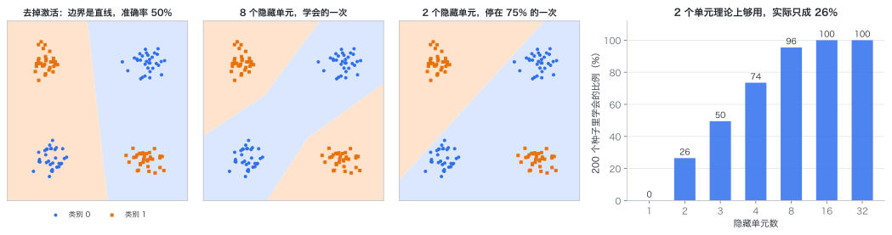
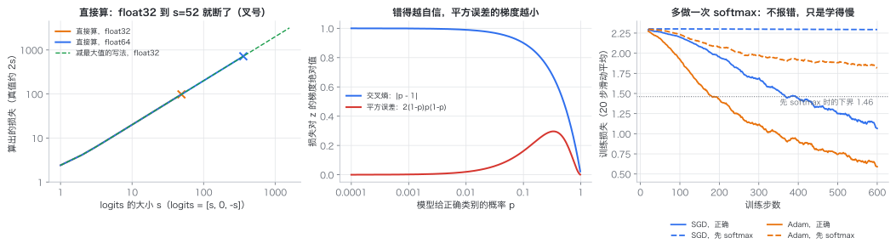
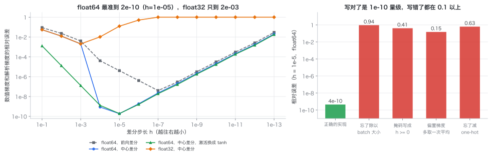
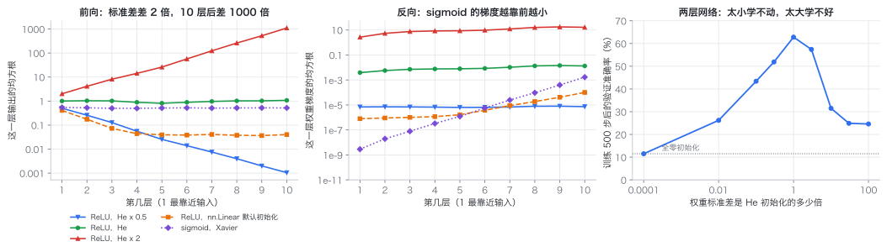
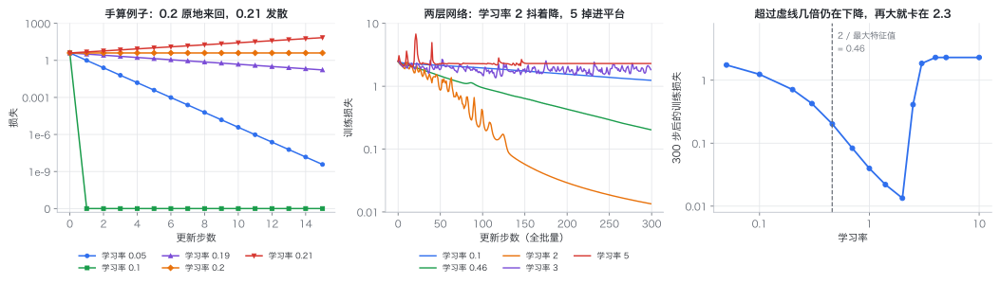
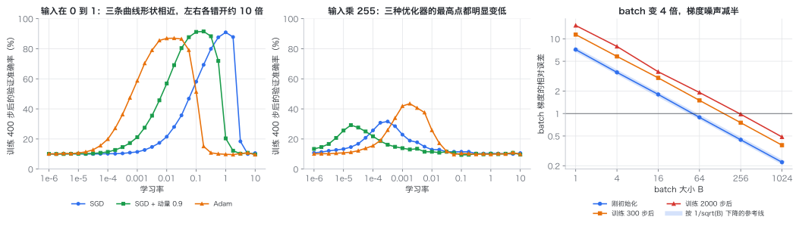
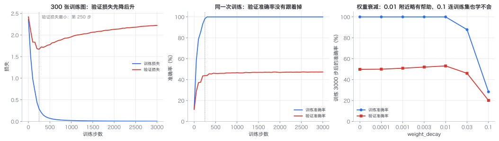

# 第 8 天：神经网络基础 —— 教程

> [!NOTE]
> 本章所有数字都来自代码生成的数据上的实测，记录在 [`figures/实测数字.json`](figures/实测数字.json)，由 `solutions` 分支的 `solutions/figures/ch08.py` 生成。数据有两份：和 Notebook 相同的 XOR 点集，以及一份 12×12 的合成数字（训练 4000 张、验证 2000 张、10 类，生成方式见 8.2 节）。两层网络的前向和交叉熵调用本章作业的参考实现，反向传播和优化器是配图脚本里用 NumPy 手写的；只和 PyTorch 接口有关的实验用 PyTorch 2.15.0 在一台 Mac 的 CPU 上做。换成 MNIST 或你自己的数据，数值会变，结论的方向要自己再测一遍。

自动验收的作业是 [`作业_手写两层网络.py`](./作业_手写两层网络.py)。配套练习 DL-1（全连接网络加 MNIST）和 DL-2（手动验证反向传播）的题目在 [`视觉算法学习计划.md`](../视觉算法学习计划.md) 的“第 1 天：从零理解神经网络”一节，目录里没有现成的文件，需要自己新建 `DL-1_FC+MNIST.py`、`DL-2_手动验证反向传播.py` 完成。

---

## 0. 本章怎么学

**应用场景**：读懂和调试任何训练代码的前提。后面每一章的深度学习方法，训练时做的都是这一章的四件事：前向、损失、反向、更新。训练不收敛、损失变成 `nan`、验证指标对不上，排查时回到的也是这一章。

**优先级**：P3，已有基础或用得少，遇到再回看。没有前置章节。如果你已经用 PyTorch 训练过模型，走速通档，只看图表和小测里与直觉不一样的地方。后面第 9 章在本章的基础上讲卷积、BatchNorm 和残差连接，第 10 章的微调直接用本章的学习率和权重衰减。

| 档位 | 累计用时 | 做什么 | 做到什么算完 |
|---|---:|---|---|
| 速通 | 2 小时 | 只看图 1、图 3、图 5、图 6 和它们下面的表，读 8.8 节的实测表和“按现象查”的表，做 8.9 节演示的前 3 步，答完 5 道小测 | 能讲清梯度检查的步长怎么取，学习率过大在分类网络上是什么表现，三种优化器的学习率为什么各差约 10 倍 |
| 标准 | 8 小时 | 读完全章，跑 Notebook，完成 `作业_手写两层网络.py` 并验收通过，做 8.11 节前三个破坏实验，填实验记录 | 验收 5 项全部 PASS，实验记录里有一个失败案例（去掉激活、学习率过大或标签错位），自测问题都能答 |
| 深挖 | 10 小时 | 再做 8.11 节其余的破坏实验和 8.12 节的扩展（DL-1 和 DL-2 至少做一个） | 自己写的反向传播通过梯度检查并能报出相对误差；或者在 MNIST 上训练一个两层网络，报告训练和验证曲线在哪里分开 |

> [!TIP]
> 用时超过所选档位的 1.5 倍还没做完，就把卡点写进 `学习进度.md`，先往下一章走。本章是全书最长的一章，速通档不要从头读到尾，按上表只看图表和小测；后面哪一章训练出了问题，再回来查 8.8 节的表。

---

## 8.1 从感知机到多层网络

### 一个神经元到底在做什么

感知机并不神秘：它先对输入做加权求和，再通过一个函数决定输出。

```
z = w₁x₁ + w₂x₂ + b = wᵀx + b
y = f(z)
```

`w` 决定每个输入有多重要，`b` 决定整体向哪边偏移，`f` 是激活函数。若 `f(z)` 在 `z > 0` 时输出 1，否则输出 0，那么感知机就是一个二分类器。

把等式 `wᵀx+b=0` 画出来，二维中是一条直线，三维中是一个平面，更高维中叫超平面。感知机学习的本质，就是移动这条分界线，把两类样本分开。

AND 和 OR 都能被一条直线分开。例如 AND 只有 `(1,1)` 为 1，取 `w=[1,1]，b=-1.5` 即可：

| x₁ | x₂ | z=x₁+x₂-1.5 | 输出 |
|----|----|---------------|------|
| 0 | 0 | -1.5 | 0 |
| 0 | 1 | -0.5 | 0 |
| 1 | 0 | -0.5 | 0 |
| 1 | 1 | 0.5 | 1 |

### 为什么单层感知机解决不了 XOR

XOR 的规则是“两个输入不同则为 1”：

```
(0,0) → 0    (0,1) → 1
(1,0) → 1    (1,1) → 0
```

如果把四个点画在平面上，两个正样本位于对角线两端，两个负样本位于另一条对角线两端。无论怎样画一条直线，都不可能把它们完全分开。问题不在于训练不够久，而在于**模型只能表达线性边界**。

解决办法是增加一层。隐藏层可以先构造两个新特征：

```
h₁ = OR(x₁, x₂)
h₂ = NAND(x₁, x₂)
y  = AND(h₁, h₂)
```

原空间中不可分的数据，经过隐藏层映射后变得可分。这是多层网络最核心的能力：**逐层改变数据的表示，而不只是寻找一条更好的直线**。

实际网络不用阶跃函数，因为它几乎处处导数为 0，无法靠梯度学习。常见激活函数是：

| 激活 | 形式 | 特点 |
|------|------|------|
| ReLU | `max(0,z)` | 简单、快，隐藏层默认选择 |
| Sigmoid | `1/(1+e^-z)` | 输出在 0 到 1，深层中易梯度变小 |
| Tanh | 输出在 -1 到 1 | 零中心，但仍可能饱和 |

一个两层全连接网络可写成：

```
Z₁ = XW₁ᵀ + b₁
H  = ReLU(Z₁)
Z₂ = HW₂ᵀ + b₂
```

最后的 `Z₂` 叫 **logits**，是尚未转成概率的原始分数。

### 实测：XOR 到底要几个隐藏单元

上面的构造说明 2 个隐藏单元就能表示 XOR。能表示，不等于训练得出来。按本章 Notebook 的设置重做：128 个点（四个角各 32 个，抖动的标准差 0.08），Adam，学习率 0.05，全批量训练 250 步，权重按 `nn.Linear` 的默认方式初始化。每种隐藏单元数换 200 个随机种子，“学会”指训练准确率到 100%。



| 隐藏单元数（各 200 个种子，Adam，250 步） | 1 | 2 | 3 | 4 | 8 | 16 | 32 |
|---|---:|---:|---:|---:|---:|---:|---:|
| 学会的次数 | 0 | 53 | 99 | 147 | 191 | 200 | 200 |
| 学会的比例 | 0% | 26.5% | 49.5% | 73.5% | 95.5% | 100% | 100% |
| 停在 75% 附近的次数 | 87 | 92 | 67 | 41 | 8 | 0 | 0 |
| 停在 50% 附近的次数 | 113 | 55 | 34 | 12 | 1 | 0 | 0 |
| 训练结束时对所有点都输出 0 的隐藏单元数（平均） | 0.35 | 0.69 | 0.95 | 1.28 | 2.62 | 4.96 | 9.39 |

1. **2 个隐藏单元理论上够，200 次里只学会 53 次**。把步数从 250 加到 1000，学会的是 54 次，所以原因不是训练不够久。
2. **Notebook 默认的 8 个隐藏单元，200 个种子里有 9 个没学会**，其中 1 个停在 50%。Notebook 换随机种子之后偶尔不收敛属于这种情况，不是代码写错了。到 16 个单元才 200 次全部学会。
3. **失败的样子是停在 75% 或 50%，损失不再下降**。表的最后一行给出了线索：训练结束时总有一部分隐藏单元对所有点都输出 0。ReLU 单元一旦对所有样本都输出 0，它的梯度也是 0，基本没有机会再活过来。隐藏单元给得比理论最小值多，是在给这种损耗留余量。
4. **去掉激活函数**（图 1 左一），8 个隐藏单元、200 个种子的训练准确率全部是 50%，损失停在 0.693，也就是 ln 2：两类各猜一半。把两层线性变换合并成一层，和分两层算的输出最大只差 2.2e-16，只剩浮点舍入。8.2 节会在另一份数据上再看一次。

<!-- quiz -->
**理论上 2 个 ReLU 隐藏单元就能表示 XOR。按 Notebook 的设置训练，换 200 个随机种子，大约有多少次能学会？**

- A. 几乎每次都能
- B. 大约四分之一
- C. 一次也不能

<details markdown="1"><summary>答案与解释</summary>

**B**。200 次里学会 53 次，26.5%；把训练步数加到 4 倍也只有 54 次。其余的停在 75% 或 50%。Notebook 默认的 8 个单元是 95.5%，16 个单元才到 100%。“网络能表示这个函数”和“梯度下降找得到它”是两件事。

</details>
<!-- /quiz -->

---

## 8.2 前向传播：数据如何穿过网络

假设一个 batch 有 32 张展平后的 MNIST 图片，每张图片 `28×28=784` 个数，隐藏层有 128 个神经元，类别数为 10：

| 张量 | shape | 含义 |
|------|-------|------|
| `X` | `(32, 784)` | 32 个样本，每个 784 维 |
| `W1` | `(128, 784)` | 128 个神经元各有 784 个权重 |
| `b1` | `(128,)` | 每个隐藏神经元一个偏置 |
| `H` | `(32, 128)` | 每个样本的新表示 |
| `W2` | `(10, 128)` | 从 128 维映射到 10 类 |
| `logits` | `(32, 10)` | 每个样本对 10 类的分数 |

PyTorch 的 `nn.Linear(784,128)` 内部权重 shape 是 `(128,784)`，但调用时会自动完成 `X @ W.T + b`。这是常见的 shape 困惑：数学推导常把样本写成列向量，代码通常把 batch 放在第 0 维、特征放在最后一维。

```python
x = x.view(x.size(0), -1)  # (B, 1, 28, 28) → (B, 784)
h = torch.relu(fc1(x))     # (B, 128)
logits = fc2(h)            # (B, 10)
```

前向传播只做三类事情：线性变换、非线性激活、逐层重复。若没有激活函数，两层线性层仍等价于一层：

```
W₂(W₁x+b₁)+b₂ = (W₂W₁)x + (W₂b₁+b₂)
```

所以“层数多”本身不产生能力，**线性层之间的非线性**才让网络能表示弯曲、分段乃至非常复杂的决策边界。

> [!WARNING]
> 本章作业的权重形状和 `nn.Linear` 相反。作业文件里 `w1` 的形状是 `(D, H)`，`w2` 是 `(H, C)`，前向直接写 `x @ w1`，不转置。上表和 PyTorch 的 `(H, D)`、`(C, H)` 要配 `x @ W.T`。两种约定都常见，动手前先看函数文档里写的形状。

这个网络一共 101770 个参数，其中第一层 100480 个，占 98.7%，第二层只有 1290 个。全连接层的参数量几乎全花在“输入维度乘隐藏单元数”上，输入换成大图时这个数会大到无法接受，第 9 章 9.1 节从这里出发讲为什么图像要用卷积。

### 实测：去掉激活，层数和参数都白加

本章后面的实验都用同一份**合成数字**：用 OpenCV 的 `putText` 在 48×48 的画布上画 0 到 9，字号和笔画粗细随机，位置偏移最多 6 px，旋转最多 12 度，缩小到 12×12，再加标准差 0.15 的高斯噪声，展平成 144 维。训练集 4000 张，验证集 2000 张。它比 MNIST 小，但同样是“像素进、10 类出”，在 CPU 上几秒就能训练一次。

| 模型（合成数字，SGD，学习率 0.3，batch 64，训练 2000 步） | 参数量 | 训练准确率 | 验证准确率 |
|---|---:|---:|---:|
| 一层线性（softmax 回归） | 1450 | 60.4% | 52.1% |
| 两层，64 个隐藏单元，去掉激活 | 9930 | 60.9% | 53.7% |
| 两层，64 个隐藏单元，ReLU | 9930 | 99.9% | 93.3% |

去掉激活的两层网络参数量是一层线性的 6.8 倍，验证准确率只从 52.1% 到 53.7%。加上 ReLU，同样的参数量到了 93.3%。

---

## 8.3 损失函数：把“错得多远”变成一个数

模型需要一个可优化的标尺。损失越小，说明预测越接近目标；训练就是不断调整参数，让平均损失下降。

### MSE：适合回归

均方误差为：

```
MSE = (1/N) Σ(ŷᵢ-yᵢ)²
```

预测房价、温度、坐标等连续值时，误差的方向通常不重要，距离越远惩罚越大，MSE 很自然。平方也使函数平滑、容易求导。

### 交叉熵：适合分类

分类不是问“类别编号差了多少”。把猫预测成狗，并不比预测成汽车只少错一点。我们真正关心的是：模型给正确类别分配了多大概率。

Softmax 把 logits 转为概率：

```
p_k = exp(z_k) / Σ_j exp(z_j)
CE  = -log(p_y)
```

若正确类别概率为 0.9，损失约为 0.105；若只有 0.01，损失约为 4.605。交叉熵会强烈惩罚“自信但错误”的预测。

PyTorch 中：

```python
loss_fn = nn.CrossEntropyLoss()
loss = loss_fn(logits, labels)
```

这里有一个高频错误：**不要先手动 Softmax**。`CrossEntropyLoss` 内部已经使用数值稳定的 `log_softmax + NLLLoss`。它需要：

- `logits.shape == (B, C)`，类型通常为 `float32`；
- `labels.shape == (B,)`，内容是 `0...C-1` 的类别索引；
- `labels.dtype == torch.long`，不是 float。原讲义这里还写了“不是 one-hot”，在现在的 PyTorch 上这句话不完全对，见下面的实测。

二分类可用一个 logit 配合 `BCEWithLogitsLoss`。同样不要先 Sigmoid，因为该损失已把 Sigmoid 和二元交叉熵合并，能避免 `log(0)` 和指数溢出。

### 实测：CrossEntropyLoss 接受什么样的标签

在 PyTorch 2.15.0 上，给同一组 `(4, 3)` 的 float32 logits 配六种标签：

| 标签的形式 | 结果 |
|---|---|
| `(B,)` 的 long | 接受，损失 1.1304 |
| `(B,)` 的 float | 报错：expected target dtype to be Long or Byte, but got Float |
| `(B,)` 的 int32 | 报错：expected target dtype to be Long or Byte, but got Int |
| `(B,1)` 的 long | 报错：0D or 1D target tensor expected, multi-target not supported |
| `(B,C)` 的 one-hot，float | 接受，损失 1.1304 |
| `(B,C)` 的 one-hot，long | 报错：Expected floating point type for target with class probabilities, got Long |

形状是 `(B, C)` 的浮点标签会被当成“每一类的目标概率”，one-hot 是它的特例，算出来的损失和类别索引相同，不报错。会报错的是另外四种：`(B,)` 的 float 或 int32，多出一维的 `(B,1)`，以及整数类型的 one-hot。所以排查标签问题时不能只等报错，先打印 `labels.shape` 和 `labels.dtype`。别的版本行为可能不同，以你机器上的输出为准。

### 实测：多做一次 softmax 会怎样

先 softmax 再交给 `CrossEntropyLoss`，不会报错。softmax 的输出在 0 到 1 之间，再做一次 softmax，各类的概率差被压得很小：10 类时，就算第一次 softmax 给正确类别的概率已经是 1，损失也只能降到 1.461，而全部猜一样的损失是 2.303。能下降的空间变小，梯度也跟着变小。



| 写法（合成数字，144→128→10，batch 64，训练 600 步） | SGD，学习率 0.1 | Adam，学习率 0.001 |
|---|---:|---:|
| 正确写法：最后 50 步的平均损失 | 1.117 | 0.632 |
| 正确写法：验证准确率 | 62.4% | 75.6% |
| 先 softmax：最后 50 步的平均损失 | 2.295 | 1.843 |
| 先 softmax：验证准确率 | 15.1% | 59.8% |

用 SGD 时这个错误很显眼，损失几乎不动。用 Adam 时它还能训到 59.8%，看上去只是“效果差一点”，这才是它危险的地方。一个可以直接用的判据：10 类分类的训练损失长时间降不到 1.46 以下，先查有没有多做一次 softmax。

### 实测：直接算交叉熵，多大的 logits 会出问题

作业要求交叉熵用“减去每行最大值”的写法。原因是

$$
\log \sum_j e^{z_j} = m + \log \sum_j e^{z_j - m}, \qquad m = \max_j z_j
$$

右边每个指数的自变量都不大于 0，最大的那一项正好是 $e^0 = 1$，既不会上溢，求和也不会是 0。直接照公式先算 `exp(z)` 则有两个界，图 2 左栏是它断掉的位置：

| | float32 | float64 |
|---|---:|---:|
| `exp` 上溢的界 | 88.72 | 709.78 |
| `exp` 的结果变成 0 的界 | -103.28 | -744.44 |
| 预测错时，直接算第一次得到 `inf` 的 s | 52 | 373 |
| 预测对时，直接算第一次得到 `nan` 的 s | 89 | 710 |
| s = 50（真值约 100）时直接算的结果 | 99.983 | 100.0 |

表里的 logits 是 `[s, 0, -s]`。“预测错”指正确类别是 logit 最小的那个，它的概率下溢成 0，取对数得到 `inf`。“预测对”指正确类别是 logit 最大的那个，`exp(s)` 上溢，`inf / inf` 得到 `nan`，也就是说连预测正确的样本都会让整个 batch 的损失变成 `nan`。float32 在 s = 50 时还没有断，但结果已经从 100.0 偏到 99.983。

验收脚本用的例子是 `[[1000, 1001], [-1000, -999]]`：直接算得到 `nan`，参考实现得到 0.8133，和理论值一致。验收里还有一个更难的例子 `[[0, 800], [-300, 300]]`，两个样本的正确类别都是第 0 类，比各自那一行的最大值小 800 和 600，正确结果是两者的平均 700.0。这时“减掉每行最大值、算出概率、再取对数”的写法也不行：正确类别的概率已经下溢成 0，取对数得到 `inf`；给概率加上 1e-12 再取对数能避开 `inf`，但得到的是 27.631，把 700 的损失压成了二十几。只有不经过概率、直接算对数概率的 log-sum-exp 写法能得到 700.0。

这么大的 logits 并不罕见。同一个网络刚初始化时，输入在 0 到 1 之间，logits 的最大绝对值是 2.6；把输入乘 255（忘了归一化），是 656，已经远超 float32 的 88.72。

`BCEWithLogitsLoss` 是同一个道理。float32 下 logit 取 -800、-200、-100、-50，标签为 1：

| logit | -800 | -200 | -100 | -50 |
|---|---:|---:|---:|---:|
| 直接算 `-log(sigmoid(x))` | inf | inf | inf | 50.0 |
| `BCEWithLogitsLoss` | 800.0 | 200.0 | 100.0 | 50.0 |
| `BCELoss(sigmoid(x))` | 100.0 | 100.0 | 100.0 | 50.0 |

注意最后一行：`BCELoss` 不会给出 `inf`，它把结果截在 100.0。不报错，但 -800 和 -200 两格的数值是错的，梯度也跟着错。

### 实测：分类为什么不用 MSE

上面说交叉熵“强烈惩罚自信但错误的预测”。从梯度看更直接。二分类，输出 $p = \sigma(z)$，真实标签是 1，$p$ 就是模型给正确类别的概率：

| 模型给正确类别的概率 p | 0.5 | 0.1 | 0.01 | 0.001 |
|---|---:|---:|---:|---:|
| 交叉熵对 z 的梯度大小，$1 - p$ | 0.5 | 0.9 | 0.99 | 0.999 |
| 平方误差对 z 的梯度大小，$2(1-p)\,p\,(1-p)$ | 0.25 | 0.162 | 0.0196 | 0.002 |

错得越离谱，交叉熵的梯度越接近 1；平方误差的梯度反而趋于 0（图 2 中栏），p = 0.01 时只有交叉熵的 51 分之一。用平方误差训练分类器，最需要纠正的样本得到的更新最小。

<!-- quiz -->
**把 logits 先过一遍 softmax 再交给 `CrossEntropyLoss`，用 Adam（学习率 0.001）在合成数字上训练 600 步。会发生什么？**

- A. 直接报错
- B. 损失变成 `nan`
- C. 不报错，验证准确率 59.8%，正确写法是 75.6%

<details markdown="1"><summary>答案与解释</summary>

**C**。不报错也没有 `nan`，只是损失的下降空间被压在 2.303 和 1.461 之间，梯度变小。换成 SGD（学习率 0.1）才显眼：验证准确率 15.1%，正确写法是 62.4%。训练损失长时间降不到 1.46 以下是这个错误的特征。

</details>
<!-- /quiz -->

---

## 8.4 链式法则与反向传播

### 手算一个最小例子

设只有一个输入和一个神经元：

```
x = 2, y = 1
z = wx + b
ŷ = z
L = (ŷ-y)²
```

取 `w=0.5，b=0`，前向计算：

```
z = 0.5×2+0 = 1
ŷ = 1
L = (1-1)² = 0
```

这个例子已经预测正确，梯度为 0。为看见参数如何更新，把目标改为 `y=3`：

```
z = 1
L = (1-3)² = 4
```

现在求 `L` 对 `w` 的导数。`w` 并不直接出现在损失最后一步里，它经过 `w → z → L` 影响结果，因此使用链式法则：

```
dL/dw = dL/dz · dz/dw
      = 2(z-y) · x
      = 2(1-3)×2
      = -8

dL/db = dL/dz · dz/db = -4×1 = -4
```

若学习率 `lr=0.1`：

```
w_new = w - lr·dL/dw = 0.5 - 0.1×(-8) = 1.3
b_new = b - lr·dL/db = 0   - 0.1×(-4) = 0.4
```

负梯度意味着增加参数可使损失下降，所以更新后 `w` 和 `b` 都变大。梯度下降中的减号不是死记规则：梯度指向函数上升最快的方向，朝相反方向走才会下降。

这个例子里更新一步之后 `z = 1.3×2 + 0.4 = 3`，损失正好是 0。一步到位不是普遍现象，是学习率 0.1 在这个例子里取得巧，8.5 节用同一个例子讲学习率的边界时会解释。

### 多层网络如何反向

设：

```
a = wx+b
h = ReLU(a)
ŷ = vh+c
L = (ŷ-y)²
```

要算 `dL/dw`，路径更长：

```
dL/dw = dL/dŷ · dŷ/dh · dh/da · da/dw
```

每一项只描述一个局部操作：平方损失知道如何把梯度传给预测值，线性层知道如何传给输入和权重，ReLU 知道正区间导数为 1、负区间为 0。反向传播不是另一种神秘算法，而是：

1. 前向时记录计算图和必要的中间值；
2. 从标量损失的梯度 1 出发；
3. 按计算图的反方向逐节点应用局部导数；
4. 同一参数若通过多条路径影响损失，各路径梯度相加。

PyTorch 的 `loss.backward()` 正是在做这件事。执行后，叶子参数的梯度累积在 `parameter.grad` 中。注意是“累积”而不是“覆盖”，所以每轮必须清梯度。

“累积”可以直接看到：不清梯度连续调用两次 `backward()`，`.grad` 正好是调用一次的 2.0 倍。

### 两层网络的反向传播（矩阵形式）

作业只要求前向和损失。把反向也写出来，才能自己做梯度检查。沿用作业的形状约定：$X$ 是 $(B, D)$，$W_1$ 是 $(D, H)$，$W_2$ 是 $(H, C)$，隐藏层输出 $H$ 是 $(B, H)$，$P$ 是 softmax 之后的概率，$Y$ 是 one-hot 标签，损失是 batch 上的平均交叉熵。

```math
\begin{aligned}
\delta_2 &= \tfrac{1}{B}\,(P - Y) \\
\nabla_{W_2} &= H^\top \delta_2, \qquad \nabla_{b_2} = \textstyle\sum_i \delta_{2,i} \\
\delta_1 &= \left(\delta_2 W_2^\top\right) \odot \mathbb{1}[H > 0] \\
\nabla_{W_1} &= X^\top \delta_1, \qquad \nabla_{b_1} = \textstyle\sum_i \delta_{1,i}
\end{aligned}
```

三处最容易写错：$\tfrac{1}{B}$ 只除一次，除在 $\delta_2$ 上；偏置的梯度是对 batch 求和，不是再取一次平均；ReLU 的掩码是“前向时这个单元的输出是否大于 0”。配图脚本里的手写实现和 PyTorch 的自动求导对过：同一组参数，损失相差 4.4e-16，梯度最大相差 2.8e-17。

### 梯度检查：步长怎么取

数值梯度有两种写法。前向差分是 $\dfrac{L(w + h) - L(w)}{h}$，中心差分是 $\dfrac{L(w + h) - L(w - h)}{2h}$。

步长 $h$ 太大，差分不等于导数；太小，两个几乎相等的损失相减，有效数字被吃掉。下面在一个 144→16→10 的两层网络上实测，32 个样本，随机抽 160 个参数。相对误差按 $\lVert g_n - g_a \rVert / (\lVert g_n \rVert + \lVert g_a \rVert)$ 算，$g_n$ 是数值梯度，$g_a$ 是手写反向传播给出的解析梯度。



| 步长 h（144→16→10，32 个样本，160 个参数） | 1e-1 | 1e-3 | 1e-5 | 1e-7 | 1e-9 | 1e-11 | 1e-13 |
|---|---:|---:|---:|---:|---:|---:|---:|
| float64，前向差分 | 0.09 | 0.004 | 4.1e-06 | 4e-08 | 3.1e-06 | 0.0003 | 0.029 |
| float64，中心差分 | 0.055 | 0.002 | 1.9e-10 | 2.3e-08 | 2.1e-06 | 0.00021 | 0.02 |
| float64，中心差分，激活换成 tanh | 0.0013 | 1.3e-07 | 1.9e-10 | 1.9e-08 | 1.8e-06 | 0.00018 | 0.018 |
| float32，中心差分 | 0.055 | 0.002 | 0.12 | 1.0 | 1.0 | 1.0 | 1.0 |

1. **float64 的中心差分在 h = 1e-5 最准，相对误差 1.9e-10**。从这里往右，步长每小 10 倍误差就大 10 倍，这是舍入误差：损失只有十六位左右的有效数字，相减之后再除以一个很小的 $h$。
2. **往左，光滑的网络是截断误差，ReLU 网络主要是折点**。把激活换成 tanh，步长每大 10 倍误差大 100 倍（1.3e-07 到 1.3e-05 再到 0.0013），和中心差分的截断误差正比于 $h^2$ 一致。ReLU 网络在 h = 1e-3 时误差就到了 0.002，比 tanh 网络大四个数量级。原因是扰动跨过了 ReLU 的折点：h = 1e-3 时，被抽中的参数里有 5.0% 在加减 $h$ 之间让至少一个 ReLU 换了开关，h = 1e-2 时是 21.2%，h 不超过 1e-4 时是 0%。
3. **前向差分最好只到 4e-08**（h = 1e-7），误差正比于 $h$。梯度检查用中心差分。
4. **float32 做不了梯度检查**。最好的一档是 0.002，步长取“教科书上常见的” 1e-5 时误差是 0.12，再小就是 1.0，数值梯度全成了 0。检查时把参数和输入都转成 float64。

判断标准用图 3 右栏：

| 写法（h = 1e-5，float64，全部 2490 个参数） | 全部参数 | w1 | b1 | w2 | b2 |
|---|---:|---:|---:|---:|---:|
| 正确的实现 | 4.4e-10 | 4.7e-10 | 2.2e-10 | 3.6e-10 | 9e-11 |
| 忘了除以 batch 大小 | 0.94 | 0.94 | 0.94 | 0.94 | 0.94 |
| ReLU 的掩码写成 `h >= 0` | 0.41 | 0.43 | 0.43 | 3.6e-10 | 9e-11 |
| 偏置的梯度对 batch 又取了一次平均 | 0.15 | 4.7e-10 | 0.94 | 3.6e-10 | 0.94 |
| softmax 之后忘了减 one-hot | 0.63 | 0.62 | 0.6 | 0.67 | 0.69 |

- 写对了是 1e-10 量级，四种错误都在 0.1 以上，中间隔着八九个数量级，不存在“差不多对”。
- 忘了除以 batch 大小 $B$ 时，梯度整体大了 $B$ 倍，相对误差是 $(B-1)/(B+1)$，$B = 32$ 时正好是 0.9394。
- 掩码写成 `h >= 0` 等于没有掩码。`h` 是 ReLU 之后的值，本来就全都不小于 0；这次前向里有 50.6% 的隐藏输出正好等于 0，它们都被错误地放行了。
- **按参数组分开看**。偏置多取一次平均时，合在一起的误差只有 0.15，分开看是 `w1`、`w2` 完全正确、`b1`、`b2` 各错 0.94，一眼就知道错在哪一行。

<!-- quiz -->
**一份写对了的反向传播，参数和输入都是 float32，用中心差分、步长 1e-5 做梯度检查。相对误差最接近哪个？**

- A. 1e-10
- B. 1e-5
- C. 0.1

<details markdown="1"><summary>答案与解释</summary>

**C**。实测 0.12，和“忘了什么东西”的错误写法（0.15 到 0.94）在同一个量级，会把正确的实现判成错的。float32 的损失只有七位左右的有效数字，步长 1e-5 时两个损失的差已经淹没在舍入里。同样的代码转成 float64，误差是 1.9e-10。

</details>
<!-- /quiz -->

### 梯度消失与梯度爆炸

深层网络的梯度包含许多导数的连乘。若多数因子小于 1，越传越小，前层几乎学不到；若多数因子大于 1，梯度会急剧放大，出现震荡、`inf` 或 `nan`。ReLU、合理初始化、归一化、残差连接和梯度裁剪，都是在改善梯度传播。下一章的 ResNet，本质上也和“让梯度有一条更顺畅的路”有关。

### 实测：初始化尺度和各层信号的大小

“连乘”可以直接量。搭一个 10 层的全连接网络，每层 128 个单元，输入是 256 个标准正态样本，接 10 类交叉熵，只做一次前向和反向，不训练。He 初始化指权重的标准差取 $\sqrt{2/n}$，Xavier 指 $\sqrt{1/n}$，$n$ 是这一层的输入维度。



| 10 层，每层 128 个单元 | 第 1 层输出 | 第 10 层输出 | 第 1 层梯度 | 第 10 层梯度 | 第 1 层梯度 / 第 10 层梯度 |
|---|---:|---:|---:|---:|---:|
| ReLU，He × 0.5 | 0.504 | 0.00105 | 6.97e-06 | 7.33e-06 | 0.95 |
| ReLU，He | 1.01 | 1.07 | 0.0039 | 0.0133 | 0.29 |
| ReLU，He × 2 | 2.01 | 1100 | 2.71 | 16.6 | 0.16 |
| tanh，Xavier | 0.63 | 0.23 | 0.00157 | 0.00125 | 1.3 |
| sigmoid，Xavier | 0.541 | 0.52 | 2.86e-09 | 0.00169 | 1.7e-06 |
| ReLU，`nn.Linear` 默认初始化 | 0.41 | 0.0404 | 7.95e-07 | 0.000101 | 0.0079 |

表里的“输出”和“梯度”都是均方根。

1. **ReLU 网络里，标准差差 2 倍，10 层之后差 1000 倍**。标准差减半，每层输出跟着减半，第 10 层只剩 0.00105（$0.5^{10}$ 是 0.00098）；标准差加倍，第 10 层是 1100（$2^{10}$ 是 1024）。He 初始化正好让每层输出保持在 1 左右。
2. **这时各层的梯度是一起变小或一起变大的**。He × 0.5 那一行，第 1 层和第 10 层的梯度几乎一样大（比值 0.95），都在 7e-06 左右，比 He 初始化小约三个数量级。所以初始化太小的表现是整个网络都学不动，不只是前面几层。
3. **“越靠前越小”出现在 sigmoid 上**。sigmoid 网络各层的输出一直在 0.5 附近，看不出问题，第 1 层的梯度却只有第 10 层的 1.7e-06。sigmoid 的导数最大只有 0.25，每往前传一层就至少打一次折扣。原文那段话描述的就是这种情况。
4. **`nn.Linear` 的默认初始化不是 He 初始化**。实测它的权重标准差是 He 的 0.409 倍（理论上是 $1/\sqrt{6}$，0.408）。两三层的网络看不出差别；堆到 10 层又没有归一化层时，第 10 层输出只剩 0.0404，第 1 层的梯度是第 10 层的 0.0079 倍。

第 4 条对训练的影响（10 层 ReLU 网络，每层 64 个单元，合成数字，batch 64，训练 500 步，3 个种子取平均）：

| 初始化 | SGD，学习率 0.1 | Adam，学习率 0.001 |
|---|---:|---:|
| `nn.Linear` 默认 | 11.5% | 51.5% |
| He | 69.1% | 80.6% |

默认初始化配 SGD，三个种子的验证准确率都是 11.5%，损失停在 2.302，500 步里完全没有学。Adam 按每个参数自己的梯度大小调步长，能把被压小的梯度补回来一部分，但三个种子分别是 61.8%、48.3%、44.3%，仍然比 He 初始化差。这组实验只说明“不带归一化的深层全连接网络”，第 9 章的 BatchNorm 和残差连接正是为了不再这么依赖初始化。

**两层网络**（作业的结构）没有那么敏感，但两头同样会出问题（图 4 右栏，合成数字，144→64→10，SGD，学习率 0.1，batch 64，训练 500 步，3 个种子取平均）：

| 权重标准差是 He 的多少倍 | 0 | 0.0001 | 0.01 | 0.1 | 1 | 3 | 10 | 100 |
|---|---:|---:|---:|---:|---:|---:|---:|---:|
| 初始损失 | 2.303 | 2.303 | 2.303 | 2.303 | 2.446 | 8.338 | 89.789 | 8976.782 |
| 训练 500 步后的验证准确率 | 11.5% | 11.5% | 26.2% | 43.4% | 62.8% | 57.4% | 31.5% | 24.6% |

- **全零初始化学不了**。隐藏层输出全是 0，两层权重的梯度都是 0，只有输出层的偏置在动，准确率停在 11.5%。
- **所有权重设成同一个常数也不行**。全部设成 0.01，训练后 64 个隐藏单元仍然一模一样（互不相同的只有 1 个），验证准确率 21.6%。每个单元收到的梯度相同，永远分不开，随机初始化的作用就是打破这种对称。
- **初始损失是一个免费的检查**。10 类分类刚初始化时应该接近 ln 10，也就是 2.303。初始损失是 89.789，说明权重或输入的尺度大了一个数量级以上。

---

## 8.5 优化器：SGD、Momentum 与 Adam

有了梯度，还需要决定怎样走下一步。

### SGD：沿当前坡度走

严格地说，SGD 每次用一个样本估计梯度；工程里通常说的 SGD 多为 mini-batch SGD：

```
θ ← θ - η∇L_batch(θ)
```

batch 梯度有噪声，但计算高效，噪声还可能帮助跳出狭窄区域。`η` 是学习率：太小，训练缓慢；太大，会越过谷底甚至发散。

### Momentum：给更新加惯性

SGD 在狭长山谷里常左右摇摆。动量累计过去的方向：

```
v_t = βv_{t-1} + g_t
θ_t = θ_{t-1} - ηv_t
```

若连续多个 batch 的梯度方向一致，速度会积累；若某个方向来回变化，会互相抵消。直觉上像小球带着惯性下坡。常用 `β=0.9`。

### Adam：每个参数都有自己的步幅

Adam 同时维护梯度的一阶矩和二阶矩：

```
m_t = β₁m_{t-1} + (1-β₁)g_t
v_t = β₂v_{t-1} + (1-β₂)g_t²
θ_t = θ_{t-1} - η·m̂_t/(sqrt(v̂_t)+ε)
```

一阶矩类似动量，二阶矩衡量近期梯度规模。梯度长期较大的参数会自动缩小有效步长，稀疏或较小的梯度可获得相对更大的步长。Adam 往往更快得到可用结果，默认参数也比较稳；SGD+Momentum 有时在视觉分类任务上能得到更好的最终泛化。

不要把“换优化器”当成万能修复。若 loss 完全不降，优先检查数据、标签、shape、前向和学习率，而不是依次试遍所有优化器。

上面三组公式和 `torch.optim` 里的 `SGD`、`SGD(momentum=0.9)`、`Adam` 是同一套。配图脚本按这三组公式用 NumPy 各写了一遍，和 `torch.optim` 从同一组参数出发连走 20 步，参数的最大差是 1.1e-16（Adam 是 2.2e-16）。下面的实验用的就是这三份实现。

### 实测：学习率的边界在哪里

“太大会发散”有一个可以算出来的边界。先看 8.4 节的手算例子：`x=2，y=3`，损失是 $(wx + b - y)^2$。它对 $(w, b)$ 的二阶导数矩阵只有一个非零特征值 $\lambda = 2(x^2 + 1) = 10$。沿这个方向，每走一步，离最优点的距离乘以 $(1 - \eta\lambda)$，损失乘以它的平方：

$$
L_{t+1} = (1 - \eta\lambda)^2\, L_t
$$

要让损失下降，需要 $|1 - \eta\lambda| < 1$，也就是 $\eta < 2/\lambda$。



| 学习率（手算例子，初始损失 4） | 0.01 | 0.05 | 0.1 | 0.15 | 0.19 | 0.2 | 0.21 | 0.25 |
|---|---:|---:|---:|---:|---:|---:|---:|---:|
| 每一步损失乘的倍数 | 0.81 | 0.25 | 0 | 0.25 | 0.81 | 1 | 1.21 | 2.25 |
| 第 10 步之后的损失 | 0.486 | 3.81e-06 | 0 | 3.81e-06 | 0.486 | 4 | 26.9 | 13300 |

- 学习率 0.1 正好等于 $1/\lambda$，一步就到最优点，这就是 8.4 节更新一步后损失为 0 的原因。
- 0.05 和 0.15、0.01 和 0.19 两两对称，收敛得一样快，区别只是后者每一步都越过最优点再折回来。
- 0.2 正好是 $2/\lambda$，损失永远停在 4，在最优点两侧原地来回。0.21 开始每步放大 1.21 倍。学习率 0.25 时，损失在 874 步之后变成 `inf`。平方损失一旦越过边界就是指数增长，`nan` 来得很快。

**分类网络不是这样发散的。** 对合成数字的前 1000 张训练图，144→64→10 的网络做全批量梯度下降 300 步。初始化处损失的最大特征值是 4.36，按上面的规则，边界是 0.46。

| 学习率（1000 张图，全批量 300 步） | 0.1 | 0.46 | 1 | 2 | 2.5 | 3 | 5 | 10 |
|---|---:|---:|---:|---:|---:|---:|---:|---:|
| 300 步后的训练损失 | 1.2396 | 0.2017 | 0.0398 | 0.0134 | 0.4098 | 1.8505 | 2.2984 | 2.2984 |
| 损失比上一步变大的步数占比 | 0% | 1.7% | 15.4% | 17.1% | 43.5% | 44.8% | 14.0% | 22.7% |
| 结束时对所有样本都输出 0 的隐藏单元占比 | 0% | 0% | 0% | 12.5% | 79.7% | 95.3% | 100% | 100% |

1. **$2/\lambda$ 在这里不是硬边界**。学习率 2 是它的 4.4 倍，300 步后的损失 0.0134 反而是所有学习率里最低的，代价是 17.1% 的步数损失在回升（图 5 中栏那条抖动的线）。这个网络的损失不是二次函数，曲率会随着参数移动而改变，初始化处量到的特征值只管得了开头几步。曲率具体怎么变，本章没有单独测。
2. **再大也不是 `nan`，而是掉进一个平台**。学习率 5 和 10，结束时 100% 的隐藏单元对所有样本都输出 0，损失停在 2.2984。只按训练集的类别比例去猜，损失是 2.298，也就是说网络只剩输出层的偏置在起作用。这份 NumPy 实现在 float64 下把学习率加到一百万也没有出现 `nan`。用 PyTorch 的 float32 做同样的事（mini-batch，200 步）：学习率 10 时损失 2.423，1000 时 545.493，都不是 `nan`，到一百万才是。
3. **所以别等 `nan`**。原因在于交叉熵对 logits 的梯度是“概率减 one-hot”，大小有界，不像平方损失那样越错梯度越大。分类网络学习率过大的常见表现是：损失先跳几下，然后停在 ln(类别数) 附近一动不动，隐藏层输出全是 0。看到这个现象，先把学习率降 10 倍。

<!-- quiz -->
**一个两层 ReLU 分类网络（10 类，输入已归一化），用 PyTorch 的 SGD，把学习率设成 10，比合适的值大一两个数量级。训练 200 步后最可能看到什么？**

- A. 损失是 `nan`
- B. 损失停在 2.3 到 2.4 附近不再下降
- C. 损失剧烈震荡，但最后收敛到接近 0

<details markdown="1"><summary>答案与解释</summary>

**B**。实测第 200 步的损失是 2.423，没有 `nan`；学习率 1000 时是 545.493，仍然不是 `nan`。全批量的实验里，学习率 5 和 10 都让 100% 的隐藏单元输出恒为 0，损失停在 2.2984，等于只按类别比例猜。A 是平方损失的表现：8.4 节的手算例子学习率 0.25 时，874 步后变成 `inf`。

</details>
<!-- /quiz -->

### 实测：三种优化器对学习率有多敏感

同一个网络（144→64→10，He 初始化，batch 64，训练 400 步），学习率从 0.000001 到 10 每个数量级取 4 个点，每个点 3 个种子，看验证准确率。



| 输入在 0 到 1（400 步，3 个种子） | SGD | SGD + 动量 0.9 | Adam |
|---|---:|---:|---:|
| 最好的学习率 | 1.0 | 0.178 | 0.0178 |
| 最好的验证准确率 | 90.9% | 91.5% | 87.0% |
| 离最好不超过 5 个百分点的学习率范围 | 0.562 到 1.78 | 0.0562 到 0.316 | 0.00562 到 0.0316 |
| 这个范围的宽度（最大 / 最小） | 3.2 倍 | 5.6 倍 | 5.6 倍 |

1. **三条曲线形状相近，左右各错开约 10 倍**。SGD 用 0.1、动量用 0.01、Adam 用 0.001，验证准确率分别是 58.1%、56.9%、58.7%，几乎一样。动量 0.9 在梯度方向稳定时，等效步长是 $1/(1 - 0.9)$，也就是 10.0 倍，所以它的学习率要比 SGD 小一个数量级。只比较“同一个学习率下哪个优化器好”没有意义，要比各自调好之后的结果。
2. **在这个问题上，Adam 并不比动量更耐调**。能用的学习率范围都是 5.6 倍宽，SGD 是 3.2 倍。Adam 的最高点（87.0%）还比另外两个低几个点。它的默认学习率 0.001 比这里最好的 0.0178 小了十几倍，400 步只到 58.7%。“Adam 用默认参数就行”在这组实验里不成立，学习率仍然要扫。
3. **Adam 真正不同的地方是更新量和梯度大小无关**。第一步里，梯度绝对值从 1.1e-06 到 0.2 的参数，更新量都在 0.000991 到 0.001 之间，就是学习率本身。梯度正好为 0 的参数（占 3.1%）不动。

**输入不归一化时**（把同样的数据乘 255，图 6 中栏）：

| 输入乘 255（400 步，3 个种子） | SGD | SGD + 动量 0.9 | Adam |
|---|---:|---:|---:|
| 最好的学习率 | 0.000316 | 1.78e-05 | 0.00178 |
| 最好的验证准确率 | 31.6% | 29.2% | 43.5% |

三种优化器的最高点都明显变低，最好的 Adam 也只有 43.5%。照常用的 SGD 学习率 0.1 去训，验证准确率是 11.5%。

Adam 能不能把没归一化的输入“兜住”，要看别的条件。8.8 节用 `nn.Linear` 默认初始化的 PyTorch 网络做了同样的事（输入乘 255，Adam，学习率 0.001，600 步）：验证准确率 76.3%，和归一化时的 75.6% 相当；SGD 则停在 2.303，11.5%。两组实验的差别在初始化和隐藏单元数，哪一个起主要作用本章没有拆开测。可以确定的只有：归一化之后三种优化器都好用，不归一化时结果取决于运气。

### 实测：批大小与梯度噪声

原文说“batch 梯度有噪声”。在同一组参数上，随机抽 batch 算梯度，和 4000 张图的全量梯度比（每种 batch 大小抽 200 次）。相对误差是两者之差的长度除以全量梯度的长度。

| batch 大小（4000 张训练图，各抽 200 次） | 1 | 4 | 16 | 64 | 256 | 1024 |
|---|---:|---:|---:|---:|---:|---:|
| 刚初始化：相对误差 | 7.163 | 3.552 | 1.801 | 0.889 | 0.445 | 0.223 |
| 刚初始化：和全量梯度夹角的余弦（中位数） | 0.157 | 0.278 | 0.491 | 0.742 | 0.919 | 0.978 |
| 训练 300 步后：方向和全量梯度相反的比例 | 36.5% | 31.0% | 10.5% | 1.0% | 0% | 0% |
| 训练 2000 步后：相对误差 | 15.065 | 7.893 | 3.62 | 1.911 | 0.978 | 0.486 |

1. **batch 变成 4 倍，噪声减半**。相对误差乘以 batch 大小的平方根，刚初始化时六种 batch 都在 7.1 到 7.2 之间（7.16、7.1、7.2、7.11、7.13、7.14），是标准的 $1/\sqrt{B}$ 规律。
2. **常用的 batch 64，噪声和信号一样大**。相对误差 0.889，也就是单个 batch 的梯度里有将近一半是噪声。它仍然能训练，是因为许多步平均下来方向是对的。
3. **越训练，相对噪声越大**。batch 为 1 时从 7.163 涨到 15.065。训练 300 步后，单个样本的梯度有 36.5% 和全量梯度方向相反。全量梯度随着训练变小，各个样本之间的分歧却没有按同样的比例减小。

原文“噪声还可能帮助跳出狭窄区域”这半句，本章没有做实验验证。

**换批大小要不要改学习率。** 同样只看 5 遍训练集，SGD，3 个种子取平均：

| batch 大小（5 个 epoch） | 8 | 32 | 128 | 512 | 2000 |
|---|---:|---:|---:|---:|---:|
| 更新步数 | 2500 | 625 | 156 | 39 | 10 |
| 学习率固定 0.1 时的验证准确率 | 88.8% | 66.9% | 39.7% | 21.5% | 14.0% |
| 学习率按 batch/32 缩放 | 0.025 | 0.1 | 0.4 | 1.6 | 6.25 |
| 缩放后的验证准确率 | 67.2% | 66.9% | 64.8% | 41.4% | 10.7% |

- epoch 数相同时，batch 越大更新步数越少。学习率不变，batch 从 32 加到 512，验证准确率从 66.9% 掉到 21.5%。
- 学习率跟着 batch 按比例放大，8 到 128 之间基本拉平（67.2%、66.9%、64.8%）。到 512 需要 1.6，已经接近上一小节 SGD 能用的上限，只有 41.4%；到 2000 需要 6.25，超过了上限，10.7%。
- 反过来也一样：显存不够、把 batch 减小时，学习率要按比例减小，否则相当于把学习率调大了。

---

## 8.6 过拟合与正则化

训练集 loss 持续下降，而验证集 loss 先降后升，称为过拟合：模型不仅学会规律，也记住了训练数据的偶然噪声。判断过拟合必须比较训练集和验证集；只看训练准确率高，无法说明泛化好。

### L1 与 L2

在原损失后增加参数惩罚：

```
L1: L_total = L_data + λΣ|w|
L2: L_total = L_data + λΣw²
```

L1 的尖点容易把部分权重推到精确的 0，产生稀疏性；L2 平滑地压小所有权重，避免模型过度依赖少数巨大参数。PyTorch 优化器中的 `weight_decay` 通常用于权重衰减。Adam 场景更常使用 `AdamW`，它把权重衰减与梯度更新解耦。

两处要对上号。第一，`torch.optim.SGD` 的 `weight_decay=wd` 是把 `wd·w` 加到梯度上，对应损失里加 $\tfrac{wd}{2}\sum w^2$，所以上面公式里的 $\lambda$ 等于 `wd` 的一半。第二，“L1 把权重推到精确的 0”有前提，见本节后面的实测。

### Dropout

训练时以概率 `p` 随机将部分激活置零，其余激活按比例放大。网络每次都面对略有不同的子网络，不能依赖某几个固定神经元，被迫学习更稳健、分散的表示。

```python
self.dropout = nn.Dropout(p=0.5)
```

Dropout 只应在训练模式启用；`model.eval()` 会关闭它。忘记切换模式会导致验证结果随机波动。

### Early Stopping

保存验证集指标最好的模型；若若干轮没有改善，就停止训练。它不是简单地“少训练”，而是在模型开始记忆训练噪声前截住。注意早停监控的是验证集，不是测试集。测试集应尽量只用于最后一次客观评估。

正则化不是越多越好。若训练集都拟合不好，说明更可能是欠拟合、学习率不合适或代码错误，此时再加 Dropout 和大权重衰减只会更差。

### 实测：小数据上的过拟合

网络换成 144→128→10，SGD，学习率 0.2，batch 64，训练 3000 步，不加任何正则。训练集的大小从 100 张到 4000 张，验证集始终是同一份 2000 张。



| 训练集大小（3000 步，不加正则） | 100 | 300 | 1000 | 4000 |
|---|---:|---:|---:|---:|
| 最终训练准确率 | 100% | 100% | 100% | 100% |
| 最终验证准确率 | 35.1% | 47.3% | 77.8% | 92.8% |
| 最终验证损失 | 3.108 | 2.223 | 0.731 | 0.213 |
| 验证损失的最小值 | 2.119 | 1.672 | 0.722 | 0.213 |
| 验证损失最小是在第几步 | 100 | 250 | 1850 | 2950 |

1. **训练准确率四种情况都是 100%**，只看它分不出好坏，验证准确率从 35.1% 到 92.8%。
2. **数据越少，验证损失越早开始回升**。100 张时第 100 步就到了最低点，4000 张时 3000 步还在下降。
3. **验证损失回升，不代表验证准确率下降**。这是图 7 左、中两栏放在一起的原因。300 张训练图、3 个种子取平均：验证损失在第 233 步最小（1.635），之后一路涨到 2.161；验证准确率在第 233 步是 46.0%，训练到 3000 步是 49.8%，也是全程最高。损失上涨来自模型在本来就判错的样本上越来越自信，判对的样本数并没有减少。
4. 所以**早停监控哪个指标，要和你最终关心的指标一致**。这组实验里按验证损失早停，验证准确率少了三四个点。如果关心的是概率准不准（例如后面要拿分数定阈值），按验证损失停是对的；如果只关心分类对不对，就监控验证准确率。

### 实测：权重衰减能帮多少

300 张训练图，其余设置同上，3 个种子取平均：

| `weight_decay`（300 张训练图，3000 步） | 0 | 0.0001 | 0.001 | 0.003 | 0.01 | 0.03 | 0.1 |
|---|---:|---:|---:|---:|---:|---:|---:|
| 训练准确率 | 100% | 100% | 100% | 100% | 100% | 87.8% | 28.3% |
| 验证准确率 | 49.8% | 50.0% | 50.9% | 52.0% | 53.1% | 46.0% | 20.1% |
| 验证损失 | 2.161 | 2.076 | 1.721 | 1.538 | 1.436 | 1.593 | 2.156 |
| 权重的范数 | 24.5 | 23.5 | 18.1 | 14.1 | 11.0 | 7.1 | 1.9 |

- 最好的一档是 0.01，验证准确率从 49.8% 到 53.1%，验证损失从 2.161 降到 1.436。它对损失的帮助比对准确率的帮助大。
- 再大就反过来：0.03 时训练准确率掉到 87.8%，0.1 时只有 28.3%，连训练集都学不会。这就是原文说的“正则化不是越多越好”。
- 和上一张表比：最好的权重衰减带来 3 个点左右，训练图从 300 张加到 1000 张，验证准确率从 47.3% 到 77.8%。数据不够时，先想办法加数据。

**L1 会不会把权重推到精确的 0。** 300 张训练图，种子 0，比较四种做法训练后的权重：

| 做法 | 正好等于 0 的权重 | 绝对值小于 0.001 的权重 | 验证准确率 |
|---|---:|---:|---:|
| 不加正则 | 0.0% | 0.6% | 47.3% |
| L2，`weight_decay=0.01` | 0.0% | 3.0% | 50.0% |
| L1，系数 0.001，把惩罚项的梯度直接加上去 | 0.0% | 84.6% | 46.6% |
| L1，系数 0.001，每步之后再做一次软阈值 | 69.9% | 85.5% | 46.6% |

把 $\lambda\sum|w|$ 加进损失、照常做梯度下降，84.6% 的权重被压到了 0.001 以下，但没有一个正好等于 0：权重在 0 的两侧来回跳，每次跳过去一点。要得到真正的 0，需要在每步之后把绝对值小于“学习率乘系数”的权重直接置 0，其余的向 0 收缩同样的量（软阈值），这样有 69.9% 的权重是精确的 0。原文“推到精确的 0”说的是后一种做法；只在 PyTorch 的损失上加一项 L1，得到的是“很多很小的数”，要稀疏还得自己设阈值裁掉。

**Dropout 忘了切 eval。** 原文说会“随机波动”。实测（合成数字，144→128→10 中间加 Dropout，训练 1500 步，同一个模型在 2000 张验证图上评估 30 次）：

| | Dropout(0.2) | Dropout(0.5) |
|---|---:|---:|
| `model.eval()` 之后的验证准确率 | 84.6% | 84.5% |
| 忘了切 eval，30 次的平均 | 79.3% | 71.5% |
| 30 次的最小值到最大值 | 77.6% 到 80.9% | 70.1% 到 72.8% |
| 30 次的标准差（百分点） | 0.77 | 0.76 |

波动确实有，但只有不到 1 个百分点。更大的影响是整体偏低：p = 0.2 时平均低 5.3 个点，p = 0.5 时低 13.0 个点。所以这个错误的表现是“验证指标比预期差一截，而且每次评估的数字略有不同”，只盯着波动会漏掉它。

**Adam 加 L2 和 AdamW 不是一回事。** 300 张训练图，学习率 0.001，训练 3000 步，种子 0：

| `weight_decay` | 0 | 0.01 | 0.1 | 1 |
|---|---:|---:|---:|---:|
| `Adam`：权重的范数 | 26.2 | 11.0 | 1.7 | 0.0 |
| `Adam`：训练准确率 | 100% | 100% | 27.0% | 12.7% |
| `Adam`：验证准确率 | 39.8% | 49.4% | 18.5% | 9.4% |
| `AdamW`：权重的范数 | 26.2 | 26.0 | 24.1 | 18.7 |
| `AdamW`：训练准确率 | 100% | 100% | 100% | 100% |
| `AdamW`：验证准确率 | 39.8% | 39.7% | 40.2% | 38.9% |

同一个 `weight_decay` 数值，在两个优化器里的强度差了两个数量级以上：`Adam` 取 0.01 就把权重范数从 26.2 压到 11.0，取 0.1 网络已经学不动；`AdamW` 取到 1 才压到 18.7。`Adam` 把衰减项混进梯度，再被它自己的归一化放大；`AdamW` 的衰减每步只乘“学习率乘 `weight_decay`”。换优化器时，`weight_decay` 要重新调，不能照搬。这组实验只有一个种子，也没有扫 `AdamW` 更大的取值，不能据此说哪个更好。

<!-- quiz -->
**300 张训练图，不加正则。验证损失在第 233 步降到最低，之后一路上涨，到 3000 步时比最低点高了三成。验证准确率在这两个时刻哪个更高？**

- A. 第 233 步更高，因为之后过拟合了
- B. 3000 步更高
- C. 一样

<details markdown="1"><summary>答案与解释</summary>

**B**。3 个种子平均，第 233 步是 46.0%，3000 步是 49.8%，验证损失却从 1.635 涨到 2.161。交叉熵衡量的是给正确类别的概率，模型在判错的样本上越来越自信，损失就涨，判对的样本数并没有少。按验证损失早停在这里会少三四个点的准确率。

</details>
<!-- /quiz -->

---

## 8.7 PyTorch 训练循环与 shape

一个最小但完整的 MNIST 全连接网络：

```python
import torch
from torch import nn

class MLP(nn.Module):
    def __init__(self):
        super().__init__()
        self.net = nn.Sequential(
            nn.Flatten(),             # (B, 1, 28, 28) → (B, 784)
            nn.Linear(28 * 28, 128),  # (B, 784) → (B, 128)
            nn.ReLU(),
            nn.Dropout(0.2),
            nn.Linear(128, 10),       # (B, 128) → (B, 10)
        )

    def forward(self, x):
        return self.net(x)

model = MLP().to(device)
loss_fn = nn.CrossEntropyLoss()
optimizer = torch.optim.AdamW(model.parameters(), lr=1e-3,
                              weight_decay=1e-4)
```

训练循环中，顺序不能乱：

```python
model.train()
for images, labels in train_loader:
    images = images.to(device)  # (B, 1, 28, 28), float32
    labels = labels.to(device)  # (B,), long

    optimizer.zero_grad()       # 1. 清除上一轮累积梯度
    logits = model(images)      # 2. 前向，(B, 10)
    loss = loss_fn(logits, labels)  # 3. 得到标量损失
    loss.backward()             # 4. 反向，写入 parameter.grad
    optimizer.step()            # 5. 更新参数
```

验证时不更新参数，也不需要构建反向图：

```python
model.eval()
correct = total = 0
with torch.no_grad():
    for images, labels in val_loader:
        images, labels = images.to(device), labels.to(device)
        logits = model(images)
        pred = logits.argmax(dim=1)  # 沿类别维取最大值，shape (B,)
        correct += (pred == labels).sum().item()
        total += labels.size(0)
accuracy = correct / total
```

建议在第一次运行时主动打印并断言：

```python
print(images.shape, images.dtype, images.min(), images.max())
print(labels.shape, labels.dtype, labels.min(), labels.max())
assert logits.shape == (images.size(0), 10)
```

shape 是神经网络代码的“类型系统”。每经过一层，都能回答“batch 维在哪、特征维在哪、类别维在哪”，大部分 bug 会在产生错误的位置被发现，而不是等到 loss 异常后猜。

### 设备：确认 PyTorch 用上了显卡

上面的代码用到了 `device`，却没有定义它。通用的写法：

```python
import torch

print(torch.__version__, torch.cuda.is_available())
device = torch.device("cuda" if torch.cuda.is_available() else "cpu")
if device.type == "cuda":
    print(torch.cuda.get_device_name(0))
```

在你自己的带独立显卡的机器上，按下面的顺序确认：

1. **`torch.cuda.is_available()` 应该是 `True`**。是 `False` 时，常见原因是装成了只支持 CPU 的 PyTorch，或者显卡驱动没装好。在命令行运行 `nvidia-smi`，能列出显卡和驱动版本说明驱动没问题，这时到 PyTorch 官网的安装页按系统和 CUDA 版本重新生成安装命令。
2. **模型和数据都要搬过去**。`model.to(device)` 一次，每个 batch 的 `images`、`labels` 各 `.to(device)` 一次。用 `next(model.parameters()).device` 和 `images.device` 确认两边一致，不一致会报设备不匹配的错误。
3. **确认训练时真的在用**。训练过程中另开一个终端运行 `nvidia-smi`，能看到 Python 进程和它占用的显存。代码里可以在一个 epoch 开头调用 `torch.cuda.reset_peak_memory_stats()`，结尾打印 `torch.cuda.max_memory_allocated()`（单位是字节），得到这一个 epoch 的显存峰值。
4. **显存不够时**（报 `CUDA out of memory`）：先把 batch 减小，学习率按 8.5 节的结论同比例减小；验证阶段确认包在 `torch.no_grad()` 里；记录损失用 `loss.item()`，不要把带计算图的张量存进列表；还不够再考虑缩小输入或换小一点的模型。

本章的实验规模很小，CPU 就够。配图脚本是在一台没有 CUDA 的 Mac 上跑的（`torch.cuda.is_available()` 为 `False`），上面第 1 到 4 条里和显卡有关的输出本章没有实际运行过，以你机器上的结果为准。

---

## 8.8 常见坑：loss 不降时先查什么（常见错误）

| 现象 | 常见原因 | 快速检查 |
|------|---------|---------|
| shape 报错 | 忘记展平、维度顺序错 | 打印每层输入输出 shape |
| CE 类型报错 | 标签是 float 或 one-hot | 标签改为 `(B,)` 的 `long` |
| loss 不降 | 忘记 `step()`、学习率不合适、标签错位 | 先尝试过拟合一个小 batch |
| 梯度一直累积 | 忘记 `zero_grad()` | 每次反向前清梯度 |
| 梯度全为 0 | 错用 `detach()`、在 `no_grad` 中训练、激活饱和 | 检查 `param.grad` 和计算图 |
| 出现 `nan` | 学习率过大、输入未归一化、数值溢出 | 降学习率，检查数据范围与 loss |
| 验证结果漂移 | 忘记 `model.eval()` | 验证前切换 eval 模式 |
| GPU 报设备不一致 | 模型和数据不在同一设备 | 全部 `.to(device)` |
| 显存持续增长 | 保存了带计算图的 loss/tensor | 记录 `loss.item()`，不要长期保存图 |
| 准确率看似异常高 | 数据泄漏或切分重复 | 检查 train/val 是否共享样本 |

对照本章的实测，这张表有两行要补充：“CE 类型报错”一行，`(B, C)` 的浮点 one-hot 在 PyTorch 2.15.0 上不报错（8.3 节）；“出现 `nan`”一行，在本章的分类网络上，学习率过大和输入未归一化都没有产生 `nan`，表现是损失停在 2.3 附近（8.5 节和下面的表）。

最有效的调试动作是**过拟合一个小 batch**：固定 16 或 32 个样本，关闭强正则化，反复训练直到接近 100% 准确率。若连这点数据都记不住，问题通常在实现、数据或优化设置，而不是模型泛化能力。

还要区分“loss 下降”和“accuracy 上升”。logits 的相对大小未改变时，预测类别可能不变，但模型给正确类的概率正在提高，因此 loss 会先下降而准确率暂时不动。这不一定是 bug。

实测一次：固定 32 张合成数字，Adam，学习率 0.001，全批量。训练准确率在第 43 步第一次到 100%，这时损失还有 0.897；之后准确率不再变化，损失继续降，第 500 步是 0.0019。8.6 节的验证曲线是反方向的例子：损失在涨，准确率没有掉。

### 实测：这些错误实际长什么样

上表里的错误，每次只引入一个，在同一个 PyTorch 网络上训练（合成数字，144→128→10，`nn.Linear` 默认初始化，float32，batch 64，训练 600 步，种子 0）。每格是“最后 50 步的平均损失 / 验证准确率”。

| 引入的错误 | SGD，学习率 0.1 | Adam，学习率 0.001 |
|---|---:|---:|
| 没有错误 | 1.117 / 62.4% | 0.632 / 75.6% |
| 忘了 `zero_grad()` | 3.02 / 19.7% | 1.227 / 58.4% |
| 忘了 `step()` | 2.31 / 10.2% | 2.31 / 10.2% |
| 先 softmax 再交叉熵 | 2.295 / 15.1% | 1.843 / 59.8% |
| 标签和图片错位（batch 内打乱标签） | 2.303 / 11.9% | 2.302 / 11.4% |
| 输入乘 255，不归一化 | 2.303 / 11.5% | 0.027 / 76.3% |

1. **没有一格报错，也没有一格是 `nan`**。这些错误全是“能跑，结果不对”。
2. **三种错误都停在 2.3**：忘了 `step()`、标签错位、SGD 加未归一化的输入。10 类时 ln 10 是 2.303，默认初始化的初始损失是 2.31。损失停在这个数，说明网络什么都没学到，先查这三样，再查学习率是不是太大（8.5 节）。
3. **Adam 会把错误藏起来**。忘了 `zero_grad()` 和多做一次 softmax，用 SGD 时一眼就能看出不对（19.7%、15.1%），用 Adam 时还有 58.4% 和 59.8%，很容易被当成“模型能力不够”。忘了 `zero_grad()` 时 SGD 的损失是 3.02，比初始值还高：梯度越积越多，相当于学习率不断变大。
4. 最后一行右边那一格看着反常：输入没归一化，Adam 的验证准确率（76.3%）和正常情况一样，训练损失还更低（0.027）。8.5 节换一种初始化就不是这样。不要把它当成“Adam 不需要归一化”的证据。

按现象查。前九行是做本章作业时最容易犯的实现错误，验收脚本对每一行都有对应的检查。

| 现象 | 原因 | 怎么查 |
|---|---|---|
| 作业前向报矩阵形状对不上 | 按 `nn.Linear` 的习惯写了 `x @ w1.T`。作业里 `w1` 是 `(D, H)` | 打印 `x.shape`、`w1.shape`，前向直接写 `x @ w1` |
| 前向验收报隐藏层有负数 | 返回的 `hidden` 是 ReLU 之前的值 | 打印 `hidden.min()`，应不小于 0 |
| 前向验收报 logits 数值不对 | 在 logits 上多做了 softmax，或者输出层也加了 ReLU | logits 应该有正有负，每行的和不必是 1 |
| 交叉熵验收得到 `nan` | 直接 `exp` 再归一化，大 logits 上溢 | 用 `[[1000, 1001], [-1000, -999]]` 单独调用，应得到 0.8133 |
| 交叉熵验收在 `[[0, 800], [-300, 300]]` 上得到 `inf`，或者得到 27.631 | 减了最大值，但先算概率再取对数，正确类别的概率下溢成 0；27.631 是给概率加了 1e-12 | 标签取 `[0, 0]` 单独调用，应得到 700.0。改成直接算对数概率（8.3 节） |
| 交叉熵验收得到 `inf` | 减的是整个 batch 的最大值而不是每行的最大值；或者取每行最大值时漏了 `keepdims=True` | 打印减完之后每一行的最大值，应全为 0 |
| 交叉熵是正确答案的 2 倍（1.6265） | 对 batch 求和，没有取平均 | 把同一个样本重复两遍，损失应不变 |
| 交叉熵验收的手算例子应得 1.2291，却得到 1.4083 | 取正确类别时写成了 `log_probs[:, labels]`，取出来的是一个 B×B 的矩阵。在两行对数概率正好相同的例子上（上面的 0.8133）这样写碰巧也对，要用各行不同、样本数不等于类别数的例子才看得出来 | 用各行不同的 logits，和 `torch.nn.functional.cross_entropy` 对一下 |
| 验收报原地修改了输入 | 减最大值时写成了 `logits -= ...`，或者前向里用了带 `out=` 的原地运算 | 调用前先 `logits.copy()` 存一份，调用后比较 |
| 梯度检查的相对误差在 0.1 以上 | 反向传播写错（8.4 节的表），或者在用 float32 | 转成 float64，步长 1e-5，按参数组分开看 |
| 梯度检查的相对误差在 0.001 量级 | 步长太大，扰动跨过了 ReLU 的折点 | 步长降到 1e-5 |
| 损失从第一步起停在 ln(类别数) | 忘了 `step()`；标签和图片错位；全零初始化；学习率大到隐藏单元全部输出 0 | 先过拟合 32 张图；打印隐藏层输出里非零的比例 |
| 10 类的损失降不到 1.46 以下 | 多做了一次 softmax | 确认交给 `CrossEntropyLoss` 的是没过 softmax 的 logits |
| 初始损失远大于 ln(类别数) | 输入没归一化，或者初始化的尺度过大 | 打印输入的最小值和最大值、logits 的最大绝对值 |
| SGD 下损失比初始值还高；Adam 下只是比预期差 | 忘了 `zero_grad()` | 不调用 `backward()`，只看 `param.grad` 是否已经有值 |
| 验证准确率比预期低几个点，每次评估略有不同 | 评估前没有 `model.eval()`，Dropout 还开着 | 同一批数据连续评估两次，结果应完全相同 |
| 训练准确率 100%，验证损失一直涨 | 过拟合。验证损失涨不代表验证准确率在掉（8.6 节） | 把验证准确率也画出来，再决定按哪个指标早停 |
| 加了 `weight_decay` 之后连训练集都学不会 | 衰减过强。SGD 取 0.1、`Adam` 取 0.1 都会这样 | 先设成 0 确认能过拟合，再从小往大加 |
| 换成大 batch 后同样的 epoch 数效果变差 | 更新步数变少，学习率没有跟着放大 | 学习率按 batch 的比例调整（8.5 节） |
| 很深的全连接网络配 SGD 完全不学 | `nn.Linear` 默认初始化加上没有归一化层，信号逐层变小（8.4 节） | 打印每一层输出的均方根 |

---

## 8.9 交互演示：两层网络的决策边界

演示页里是一个“2 维输入、一个隐藏层、2 个 logits”的网络，前向和损失与本章作业一致，训练用全批量梯度下降 500 步。可以调隐藏单元数、学习率、初始化倍数，看决策边界和损失曲线；“用当前设置换 50 组初始化各训练一次”会统计学会的比例。页面下方有五步引导：第 1 步对应 8.2 节“去掉激活等价于一层”，第 2 步对应图 1，第 3 步对应图 5 中栏和右栏，第 4 步对应图 4 右栏，第 5 步换一份数据再看隐藏单元数的作用。

<!-- embed: ../demos/两层网络决策边界.html 1205 -->
[打开交互演示：两层网络的决策边界](../demos/两层网络决策边界.html)

演示页和配图脚本有三处不同，数值不会一样：演示用的是普通梯度下降而不是 Adam；随机数不同；演示只有训练集，没有验证集。所以第 4 步里把初始化倍数调得很大，XOR 仍然多半能学会，这和图 4 右栏不矛盾，那里看的是验证准确率。

---

## 8.10 怎样评估一次训练

前面每个实验都在回答“这样训练好不好”。把用到的做法收在一起：

- **训练集和验证集分开报**，损失和准确率都报。只报训练准确率没有信息量（8.6 节四种数据量都是 100%）；只报损失或只报准确率也会误判（8.6 节两者方向相反）。
- **写清条件**：数据量、网络结构、优化器、学习率、batch 大小、训练步数或 epoch 数、初始化方式、随机种子的个数。本章每张表的表头都是这么写的。
- **换几个随机种子**。8.4 节 10 层网络配 Adam，三个种子是 61.8%、48.3%、44.3%，只跑一次可能得出相反的结论。XOR 上 8 个隐藏单元有 95.5% 的种子能学会，剩下的那些会让你怀疑代码。
- **学习率要扫过再比**。比较两个优化器、两种初始化、两种正则时，每一边都要用各自调好的学习率，至少每个数量级取两个点。8.5 节 SGD 用 0.1 和 Adam 用 0.001 的结果几乎一样，各自调好之后是 90.9% 和 87.0%。
- **先看初始损失和小 batch 过拟合**，再看最终指标。初始损失应接近 ln(类别数)，32 张图应该几十步内记住。这两项不过关，后面的数字都不可信。
- **验证集用来选超参数，测试集只在最后用一次**。本章的合成数据没有单独留测试集，表里的“验证准确率”是用来比较设置的，不能当成最终的泛化指标。数据划分的细节在第 14 章 14.3 节。

---

## 8.11 破坏实验

每个实验先写下预测，再运行，把结果和原因记到 `实验记录.md`。前三个是标准档必做。

1. Notebook 里把 `hidden_dim` 从 8 改成 2，把 `seed` 从 0 换到 9 各跑一次，数一数几次学会。先预测次数，再和图 1 对照。没学会的那几次，最终准确率是多少？
2. Notebook 里把 `learning_rate` 从 0.05 改成 5，再改成 0.0005，各预测一下损失曲线的样子和最终准确率。Notebook 用的是 Adam，学习率过大时它的表现和图 5 里的普通梯度下降一样吗？
3. 作业通过后，用你的 `cross_entropy_from_logits` 和一份“直接 `exp` 再归一化”的写法，对 `[[s, 0, -s]]`（标签取 2）分别算 s = 10、50、100、1000，输入先转成 float32。先预测哪几格是 `inf`，再和 8.3 节的表对照。
4. 照 8.4 节的矩阵公式写出两层网络的反向传播，用中心差分做梯度检查。把步长从 1e-1 扫到 1e-13 画出图 3 左栏那样的曲线；再把参数换成 float32 重画一次；最后故意引入图 3 右栏里的一种错误，看相对误差变成多少。
5. 用 PyTorch 把 8.7 节的训练循环在 XOR 或自己生成的数据上跑通，然后每次只做一处破坏：删掉 `zero_grad()`、在损失前加一次 softmax、把标签在 batch 内打乱。优化器用 SGD 和 Adam 各跑一遍，和 8.8 节的实测表对照，哪种错误在 Adam 下最难发现？
6. 用 `nn.Sequential` 搭一个 10 层、不带归一化的全连接 ReLU 网络，打印每一层输出的均方根。再用 `nn.init.kaiming_normal_` 重新初始化所有权重，对比两次的结果和训练 500 步后的损失。

---

## 8.12 扩展（深挖档）

- **DL-1：全连接网络加 MNIST**（题目在 `视觉算法学习计划.md`）。需要自己下载 MNIST，本章没有在 MNIST 上跑过，不给准确率的参考数字。做完之后在自己的结果上重复 8.6 节的两件事：只用 300 张、1000 张训练图各训练一次，看训练和验证曲线在哪里分开；看验证损失最低的那一步，验证准确率是不是最高。
- **DL-2：手动验证反向传播**。在题目要求的单层网络之外，把 8.4 节的两层网络也验证一遍，报告和 `autograd` 的最大差，以及梯度检查的相对误差和所用的步长。
- **自己实现 Adam**。按 8.5 节的公式写，和 `torch.optim.Adam` 从同一组参数出发走 20 步，逐个参数比较。先预测第一步每个参数的更新量是多少，再打印出来看。
- **学习率扫描**。在你自己的任务上，学习率每个数量级取 2 到 4 个点，各训练几百步，画出图 6 左栏那样的曲线。记下“离最好不超过 5 个百分点”的范围有多宽，以后调参就从这个范围里取。
- **损失的曲率**。8.5 节用幂迭代估计了初始化处的最大特征值。在训练过程中每隔几十步估计一次，看它在学习率 0.1 和学习率 2 两种情况下各自怎么变化。这是本章没有测的部分。
- **换成真实的显卡**。把 8.7 节的 MLP 分别在 CPU 和显卡上训练同样的步数，记录耗时和显存峰值。网络这么小，显卡不一定更快，自己量一下。

---

## 8.13 和后续章节的关系

- **第 2 章**的手写相关运算和本章的全连接层是同一类计算：加权求和。第 9 章把两者合起来就是卷积层。
- **第 9 章**直接接着本章：9.1 节从全连接层的参数量太大（本章 8.2 节）出发讲卷积；9.5 节的 BatchNorm 和 9.7 节的残差连接解决的是 8.4 节量到的问题，深层网络的信号和梯度逐层变小。
- **第 10 章**的微调（10.3 节）用的是本章的学习率和权重衰减，只是不同的层用不同的学习率。8.5 节“学习率要扫过再比”在那里同样适用。
- **第 12 章** 12.5 节讲分割为什么不只用交叉熵，出发点是本章 8.3 节的交叉熵；12.8 节“先做小样本过拟合”就是 8.8 节的调试动作。
- **第 14 章** 14.3 节讲训练、验证、测试三份数据的分工，是 8.10 节最后一条的展开。
- **第 19 章**的 PatchCore 训练阶段没有反向传播，可以对照本章理解“训练”在那里指的是什么。

---

## 与练习 DL-1 / DL-2 的连接

本章有两类练习：自动验收的作业是 `作业_手写两层网络.py`；DL-1 和 DL-2 是 `视觉算法学习计划.md` 里的练习，目录里没有现成的文件，需要自己新建。

### 作业：手写两层网络（自动验收）

实现两个函数：`two_layer_forward` 做一次仿射变换、ReLU、再一次仿射变换，返回隐藏层输出和 logits；`cross_entropy_from_logits` 用减去每行最大值的写法算平均交叉熵。两个函数都不能原地修改输入。形状约定见 8.2 节的提示框，为什么要减最大值见 8.3 节，容易写错的地方见 8.8 节“按现象查”那张表的前九行。完成后运行 `python tests/check_progress.py`。

验收一共 5 项。前向 2 项：一个 5 个样本的手算例子（期望值是纸笔算出来的）；几条性质，包括同一个样本单独算和放在一批里算结果相同、权重或输入取成全 0 时输出应该是什么、偏置为 0 时输入放大几倍输出也放大几倍。交叉熵 3 项：一个 4 个样本 3 个类别的手算例子；几条性质，包括每行各加一个常数损失不变、同一批样本重复一遍损失不变、只打乱标签损失要变；大 logits 的数值稳定性。验收脚本里没有这两个函数的实现，读它得不到答案，但失败时的提示会告诉你是哪个数对不上、该查哪里。

### DL-1：FC + MNIST

这份练习把本章串成一条完整链路：图片从 `(B,1,28,28)` 展平为 `(B,784)`，经过线性层和 ReLU 得到隐藏表示，再输出 `(B,10)` logits；交叉熵衡量分类错误；优化器根据反向传播得到的梯度更新参数。

做练习时不要只追求最终准确率。至少记录训练 loss、验证 loss 和验证 accuracy，并回答：加入隐藏层后为什么比单层线性分类器强？把 ReLU 去掉会发生什么？训练和验证曲线何时开始分叉？

### DL-2：手动验证反向传播

这份练习的重点不是重复造自动微分，而是建立信任：先用纸笔或 NumPy 按链式法则算出某个权重的梯度，再与 `autograd` 的 `parameter.grad` 比较。还可以用有限差分检查：

```
dL/dw ≈ [L(w+ε)-L(w-ε)] / (2ε)
```

当 `ε` 适中时，手算、自动微分和有限差分应接近。若不一致，逐节点检查局部导数、转置方向、batch 求和还是求平均。理解这一点后，PyTorch 就不再是黑盒：它只是替你高效执行同一套链式法则。

“适中”和“接近”的具体数值在 8.4 节：float64 下步长取 1e-5 左右，相对误差应在 1e-10 量级。

---

## 动手前的检查清单

在做 DL-1 和 DL-2 之前，确认你能回答：

- [ ] 感知机的决策边界为什么是线性的？
- [ ] XOR 为什么不能被单层感知机解决？隐藏层改变了什么？
- [ ] 如果线性层之间没有激活函数，多层网络为什么仍等价于一层？
- [ ] MNIST 输入从 `(B,1,28,28)` 到 logits 的每一步 shape 是什么？
- [ ] MSE 与交叉熵分别适合回归还是分类？为什么？
- [ ] `CrossEntropyLoss` 前为什么不要手动 Softmax？
- [ ] `labels` 为什么必须是 `(B,)` 的 `long` 类型？
- [ ] 能否从 `w → z → L` 写出完整链式法则并判断梯度符号？
- [ ] `loss.backward()`、`optimizer.step()`、`zero_grad()` 各自做什么？
- [ ] SGD、Momentum、Adam 分别解决了什么问题？
- [ ] L1、L2、Dropout、Early Stopping 如何抑制过拟合？
- [ ] `model.train()`、`model.eval()` 和 `torch.no_grad()` 的区别是什么？
- [ ] loss 不降时，能否先让模型过拟合一个小 batch？
- [ ] 手算梯度、autograd 梯度和有限差分梯度是否一致？

确认完了，打开 `08_神经网络基础/`，先完成自动验收的 `作业_手写两层网络.py`，再完成 DL-1 的训练闭环，最后用 DL-2 把反向传播彻底拆开。

---

## 自测问题

速通档答小测，标准档把下面的问题答一遍。

1. 2 个隐藏单元能表示 XOR，为什么实际训练时多数随机种子学不会？多给隐藏单元起了什么作用？
2. 交叉熵为什么要写成“先减去每行最大值”？直接算时，预测错的样本和预测对的样本分别会得到什么？
3. 做梯度检查，步长取 1e-2 和取 1e-12 各有什么问题？为什么要用 float64？相对误差多大算通过？
4. 10 类分类的损失停在 2.3 附近不动，列出至少四种可能的原因，以及各自怎么区分。
5. SGD 用学习率 0.1 的结果和 Adam 用 0.001 的结果差不多，能说明两个优化器一样好吗？应该怎么比？
6. 验证损失开始上涨，是不是就该停止训练？按验证损失早停和按验证准确率早停，分别适合什么情况？
7. 同一个 `weight_decay=0.01`，从 `Adam` 换到 `AdamW`，正则的强度会怎么变？L1 正则什么时候才会得到精确的 0？
