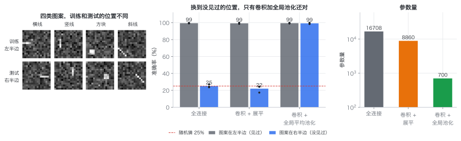
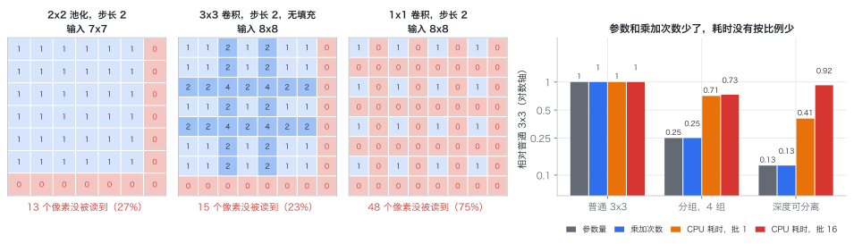
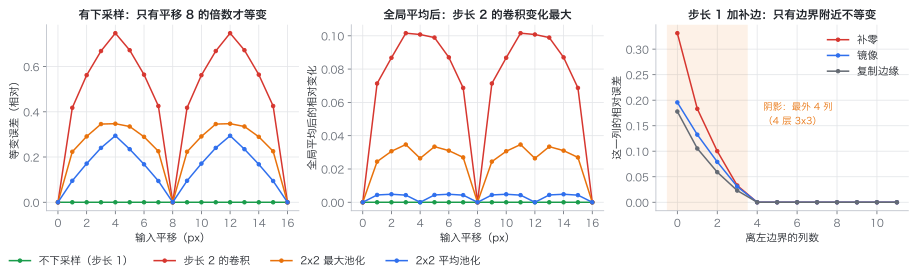
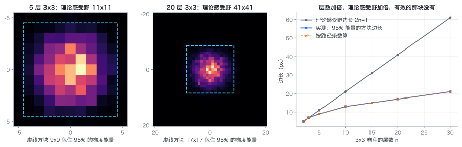
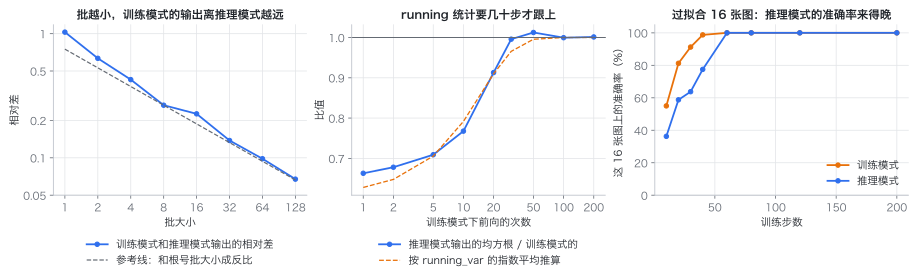
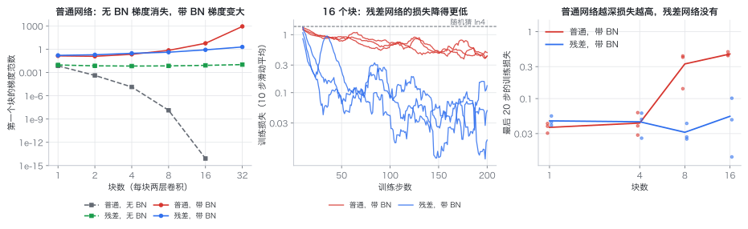

# 第 9 天：CNN 核心 —— 教程

> [!NOTE]
> 本章新增小节里的数字都来自代码生成的合成数据和随机初始化的小网络，在一台 Apple 芯片的 Mac 上用 CPU 实测，记录在 [`figures/实测数字.json`](figures/实测数字.json)，由 `solutions` 分支的 `solutions/figures/ch09.py` 生成。输出尺寸和残差块调用本章作业的参考实现。本机没有 CIFAR-10，讲义里没有任何 CIFAR-10 或 ImageNet 上的精度数字，原讲义里关于 CIFAR-10 训练的内容是留给你在自己机器上做的。耗时只有 9.2 节的一组，是机器上还有别的任务在跑时测的一次结果，只写两位有效数字，配图脚本默认沿用这一次的值，设置 `CH09_RETIME=1` 才重测。任何“在某块显卡上要多久、占多少显存”的数字本章都没有，9.9 节只讲怎样在自己机器上量。换成真实图像、训练过的网络或别的 PyTorch 版本（本机是 2.15.0），数值会变，结论的方向要自己再测一遍。

> 配套练习：`DL-3 卷积核可视化` | `DL-4 CIFAR-10 从零训练`  
> 本章目标：不把 CNN 当成一串层名。你将能手算每层张量 shape、参数量和感受野，理解池化、BatchNorm 与残差连接的作用，并在自己的显卡上（NVIDIA 显卡用 CUDA，Apple Silicon 用 MPS，都没有就用 CPU）跑通一套可检查的训练流程。

自动验收的作业是 [`作业_卷积shape与残差块.py`](./作业_卷积shape与残差块.py)（输出尺寸公式和一个残差块的 `forward`）。上面写的 DL-3 和 DL-4 是扩展练习，章节目录里没有现成的文件，题目在 [`视觉算法学习计划.md`](../视觉算法学习计划.md) 的“第 2 天：CNN 核心理解”一节（题 DL-3、题 DL-4），需要自己新建文件完成。设备怎么选、显存怎么看在 9.9 节：先讲 NVIDIA 显卡的 CUDA，Apple Silicon 的 MPS 作为另一种情况放在后面。

---

## 0. 本章怎么学

**应用场景**：分类、检测、分割骨干网络的共同基础。第 10 章的迁移学习、第 11 章的检测、第 12 章的分割、第 19 章的 PatchCore，用的都是卷积骨干网络。看懂一个骨干每层输出多大、一个位置能看多大范围、BN 在训练和推理时差在哪、网络加深后为什么要有捷径，是用好它们的前提。

**优先级**：P3，已有基础或用得少。前置是第 2 章（手写相关运算，卷积层算的其实是相关）和第 8 章（反向传播、训练循环）。如果你已经训练过 CNN，走速通档，把 6 张图和 5 道小测过一遍，确认没有盲区就往下走；后面哪一章用到再回来升档。

| 档位 | 累计用时 | 做什么 | 做到什么算完 |
|---|---:|---|---|
| 速通 | 2 小时 | 不跑代码。看图 1 到图 6 和每张图下面的表，读 9.2 节的三个公式（输出尺寸、参数量、乘加次数）和 9.4 节的感受野递推，把 9.4 节末尾演示的前 3 步试一遍，答完 5 道小测 | 能手算一层卷积的输出尺寸和三层网络的感受野；能讲清展平为什么把位置绑死、BN 两种模式差在哪、残差连接解决的是什么 |
| 标准 | 10 小时 | 读完全章，跑 Notebook，完成 `作业_卷积shape与残差块.py` 并验收通过，把 9.10 节的两项检查自己动手复现一遍，做 9.13 节前三个破坏实验，填实验记录；按 9.9 节在自己机器上确认显卡可用，量一次训练时的显存峰值 | 验收 8 项全部 PASS，9.10 节的两项检查自己复现过；实验记录里有一组手算和实际输出尺寸的对照、一个边界失败案例；自测问题都能答 |
| 深挖 | 12 小时 | 再做 9.13 节其余的破坏实验，从 9.14 节的扩展里选一个（题 DL-3，或题 DL-4 的一组对照） | 在自己机器上跑出结果，报告里写清参数量、批大小、种子数，以及训练损失和验证指标各自的变化 |

> [!TIP]
> 用时超过所选档位的 1.5 倍还没做完，就把卡点写进 `学习进度.md`，先往下一章走。本章的作业很短（一个公式、一个 `forward`），时间主要花在 9.5 和 9.7 节。题 DL-4 的 CIFAR-10 训练不在标准档里，放到深挖档，或者留到第 10 章之后和迁移学习一起做。

---

## 9.1 为什么图像更适合卷积，而不是全连接

一张 `224×224×3` 的 RGB 图像有 150528 个数。若第一层全连接到 4096 个神经元，仅权重就有：

```
150528 × 4096 ≈ 6.17 亿个参数
```

它不仅昂贵，还忽略了图像的两个事实：相邻像素通常相关；同一种边缘可能出现在任意位置。卷积用两个约束解决问题：

1. **局部连接**：一个输出只看输入的一小块区域，例如 `3×3`；
2. **参数共享**：同一个卷积核滑过整张图，左上角和右下角共用权重。

因此，一个从 3 通道到 64 通道的 `3×3` 卷积只有 `64×3×3×3=1728` 个权重。卷积核在不同位置寻找同一种局部模式，使卷积具有**平移等变性**：输入平移，特征图也相应平移。注意它不是天然的“平移不变”；分类末端的池化、数据增强等才让最终预测对小位移更稳定。

PyTorch 使用 `NCHW` 排列：

```
输入 X: [N, C_in, H, W]
权重 K: [C_out, C_in/groups, K_h, K_w]
输出 Y: [N, C_out, H_out, W_out]
```

`N` 是 batch，`C` 是通道。不要把 OpenCV/NumPy 常见的 `HWC` 直接当成模型输入。

### 实测：换个位置还认不认得

上面说卷积有平移等变性，又说它不是天然的平移不变。差别可以用一个小实验量出来：16×16 的噪声图上放一个 5 px 大小的图案（横线、竖线、3×3 方块、斜线四类）。训练时图案只出现在左半边，测试时分两组，一组仍在左半边，一组挪到右半边。三种网络各训练 400 步（Adam，学习率 0.01，批 32），3 个种子，每组测试 1000 张，随机猜是 25%。



| 网络（16×16 输入，训练 400 步，3 个种子的平均） | 参数量 | 图案在左半边（见过） | 图案在右半边（没见过） | 把输入换成 24×24 |
|---|---:|---:|---:|---|
| 全连接，256-64-4 | 16708 | 99.4% | 25.0% | 报错 |
| 两层 3×3 卷积，展平后接全连接 | 8860 | 99.2% | 22.0% | 报错 |
| 两层 3×3 卷积，全局平均池化后接全连接 | 700 | 99.4% | 99.2% | 能跑 |

1. **全连接网络换个位置就退回随机水平**（25.0%）。它给每个像素位置一套独立的权重，右半边的权重在训练里从来没有被图案激活过。
2. **有卷积层也不够**。卷积后展平再接全连接，没见过的位置上只有 22.0%（3 个种子是 17.3%、24.3%、24.3%），和全连接一样。卷积层的输出确实跟着图案一起移到了右边，但展平之后的全连接层仍然是每个位置一套权重，把位置重新绑死了。
3. **卷积加全局平均池化才换了位置还认得**：99.2%，参数只有 700 个，是全连接的 23.9 分之一。全局平均把“在哪里”丢掉，只留下“有没有”。
4. 只有全局池化的网络能直接接受 24×24 的输入，另外两种在全连接层报矩阵形状对不上。这就是 9.3 节说的“允许可变输入尺寸”。

所以原文那句“分类末端的池化、数据增强等才让最终预测对小位移更稳定”，池化这一半在这里量出来了。数据增强那一半（让训练集里各个位置都出现）本章没有测。全局池化的代价是位置信息没了，分类可以这样做，检测和分割不行，它们靠的是保留空间分辨率的特征图（第 11、12 章）。

<!-- quiz -->
**一个网络是“两层 3×3 卷积，展平，全连接”。训练时图案只出现在图像左半边，训练准确率 99%。把图案挪到右半边测试，准确率最接近哪个？**

- A. 仍在 99% 左右，因为卷积是平移等变的
- B. 60% 左右，卷积层能帮上一部分
- C. 和随机猜差不多

<details markdown="1"><summary>答案与解释</summary>

**C**。实测 22.0%，随机猜是 25%，和纯全连接网络的 25.0% 一样。卷积层的输出确实随图案平移了，但展平后的全连接层对每个位置用不同的权重，没见过的位置上权重没有学过。把展平换成全局平均池化，同样的卷积层在没见过的位置上是 99.2%，参数还从 8860 个降到 700 个。

</details>
<!-- /quiz -->

---

## 9.2 三项基本功：shape、参数量、计算量

### 输出 shape 怎么算

对二维卷积，若 dilation 为 `D`，padding 为 `P`，stride 为 `S`，核大小为 `K`：

```
H_out = floor((H + 2P - D(K-1) - 1) / S + 1)
W_out 同理
```

例：输入 `[32, 3, 32, 32]`，`Conv2d(3, 16, kernel_size=3, stride=1, padding=1)`：

```
H_out = (32 + 2 - 2 - 1) / 1 + 1 = 32
输出 = [32, 16, 32, 32]
```

接着使用 `Conv2d(16, 32, 3, stride=2, padding=1)`，空间尺寸变成 `16×16`，输出为 `[32, 32, 16, 16]`。最稳妥的习惯是：设计时手算一次，运行时用假输入打印一次。

### 参数量怎么算

普通卷积的可训练参数量为：

```
权重 = C_out × C_in × K_h × K_w
偏置 = C_out（bias=True 时）
总计 = C_out × (C_in × K_h × K_w + 1)
```

上面的第一层参数量是 `16×(3×3×3+1)=448`。参数量与输入的高、宽无关，所以同一卷积可以接收不同分辨率；但后面若接固定大小的全连接层，整个网络仍可能被锁定尺寸。

分组卷积把输入通道分组，权重变为 `C_out×(C_in/groups)×K×K`。当 `groups=C_in=C_out` 时就是 depthwise convolution，每个通道各做一次空间卷积；再接 `1×1` pointwise convolution 混合通道，构成移动端常见的深度可分离卷积。

### 参数少不等于计算少

忽略偏置时，一层卷积的乘加量近似为：

```
MACs ≈ H_out × W_out × C_out × C_in/groups × K_h × K_w
```

同一个卷积核虽然只保存一份参数，却要在所有位置重复计算。因此高分辨率前几层可能参数不多但耗时很大。比较模型时要同时看参数量、MACs、激活张量大小和真实设备延迟。

### 实测一：公式和 PyTorch 逐个比

把输入边长 1 到 40、核 1 到 7、步长 1 到 4、填充 0 到 3、膨胀 1 到 3 组合起来，共 11520 种，逐个比较本章作业的参考实现和 `torch.nn.functional.conv2d` 的实际输出：11520 种全部一致。其中 948 种是核的覆盖范围 $D(K-1)+1$ 比补边后的输入还大，PyTorch 报错（`Kernel size can't be greater than actual input size`），参考实现也拒绝。

两个和作业直接有关的细节：

- **向下取整要对负数也成立**。输入 2、核 3、步长 2、无填充时，分子是 -1，正确的做法是拒绝。如果写成先做浮点除法再 `int()`，`int(-0.5)` 是 0，加 1 之后返回 1，一个放不下的卷积被算成了“输出 1 个像素”。上面的组合里，这种写法在 223 种本该拒绝的情况下返回了正数。
- **能整除的算例分不出取整方式**。32 到 32、31 到 16、15 到 15 这三个算例都能整除，向上取整、四舍五入、向零取整的写法在这三个算例上和正确写法结果相同（实测如此）。要用除不尽的算例才分得开：输入 32、核 3、步长 2、无填充应得 15（向上取整会得 16）；输入 32、核 3、步长 3、无填充应得 10（四舍五入会得 11）。验收脚本里这两类算例都有，另外把 1890 种参数组合和 PyTorch 卷积的实际输出逐个比，这三种取整写法分别有 659、330、75 种对不上。

### 实测二：向下取整丢掉了什么

公式里除以步长有余数时，多出来的那几行几列放不下一个完整的窗口，直接被丢掉。把核换成全 1，对输出的总和求梯度，梯度为 0 的输入像素就是没有被任何窗口读到的像素。



| 层和输入（正方形输入，单层） | 输出边长 | 除以步长的余数 | 没被读到的像素 | 占全部像素 |
|---|---:|---:|---:|---:|
| 2×2 池化，步长 2，输入 7×7 | 3 | 1 | 13 | 26.5% |
| 2×2 池化，步长 2，输入 33×33 | 16 | 1 | 65 | 6.0% |
| 3×3 卷积，步长 2，无填充，输入 8×8 | 3 | 1 | 15 | 23.4% |
| 3×3 卷积，步长 2，无填充，输入 32×32 | 15 | 1 | 63 | 6.2% |
| 3×3 卷积，步长 2，填充 1，输入 32×32 | 16 | 1 | 0 | 0% |
| 3×3 卷积，步长 2，填充 1，输入 31×31 | 16 | 0 | 0 | 0% |
| 3×3 卷积，步长 3，无填充，输入 32×32 | 10 | 2 | 124 | 12.1% |
| 1×1 卷积，步长 2，输入 32×32 | 16 | 1 | 768 | 75.0% |

1. **余数是几，最下面和最右边就丢几行几列**。7×7 的图过一次 2×2 池化，最后一行和最后一列共 13 个像素完全不起作用。图越小，丢掉的比例越大。
2. **有填充时丢的可能是补边**。输入 32、3×3、步长 2、填充 1，余数也是 1，但没有真实像素被丢：被丢掉的是右边和下边补的那一圈零。也就是说偶数输入配步长 2 时，实际只有左边和上边补了边。输入 31 和 32 的输出都是 16。
3. **步长比核大时，中间的像素被跳过**。1×1 卷积配步长 2 只读四分之一的位置，75.0% 的输入位置不参与计算。9.7 节的投影捷径 `1×1, stride=2` 正是这种情况。

第 12 章 12.3 节的 U-Net“尺寸差 1 个像素”，根源就是这里的向下取整。

### 实测三：参数量、乘加次数和耗时

同一个位置换成不同的卷积（输入和输出都是 64 通道、56×56，不带偏置）。参数量和乘加次数由脚本按上面的公式数出来；耗时是在一台 Mac 的 CPU 上（2 线程）测的一次结果，每个数是 3 轮、每轮 30 次前向的中位数里最小的一轮，测的时候机器上还有别的任务，只能看量级和明显的倍数关系。

| 卷积（64 到 64 通道，56×56） | 参数量 | 乘加次数（百万） | CPU 耗时，批 1（ms） | CPU 耗时，批 16（ms） |
|---|---:|---:|---:|---:|
| 普通 3×3 | 36864 | 115.61 | 0.79 | 26 |
| 分组 3×3，4 组 | 9216 | 28.9 | 0.56 | 19 |
| 逐通道 3×3（组数等于通道数） | 576 | 1.81 | 0.22 | 3.1 |
| 深度可分离（逐通道 3×3 加 1×1） | 4672 | 14.65 | 0.32 | 24 |
| 1×1 | 4096 | 12.85 | 0.066 | 26 |
| 两层 3×3 | 73728 | 231.21 | 1.7 | 53 |
| 一层 5×5 | 102400 | 321.13 | 2.1 | 38 |

和普通 3×3 相比，各项少到了几分之一：

| 卷积 | 参数量 | 乘加次数 | 耗时，批 1 | 耗时，批 16 |
|---|---:|---:|---:|---:|
| 分组 3×3，4 组 | 4.0 | 4.0 | 1.4 | 1.4 |
| 逐通道 3×3 | 64.0 | 63.9 | 3.6 | 8.4 |
| 深度可分离 | 7.9 | 7.9 | 2.5 | 1.1 |
| 1×1 | 9.0 | 9.0 | 12.0 | 1.0 |

1. **同一个位置上，参数量和乘加次数按同一个比例变**，因为输出的高宽没有变。两层 3×3 的参数是 73728，一层 5×5 是 102400，就是 9.4 节会用到的 $18C^2$ 对 $25C^2$。
2. **耗时没有跟着乘加次数按比例少**。分组卷积的乘加次数少到 4.0 分之一，耗时只少到 1.4 分之一。深度可分离卷积的乘加次数少到 7.9 分之一，批 1 时耗时少到 2.5 分之一，批 16 时只有 1.1 分之一。
3. **批大小不同，结论可能不同**。1×1 卷积在批 1 时比普通 3×3 快一个数量级（12 倍），批 16 时这一次测到两者用时相同（都是 26 ms）。原因没有查证，可能和这个 PyTorch 版本在 CPU 上对不同形状的输入走了不同的计算路径有关。这一条只能说明一件事：耗时要在目标设备、目标批大小上实测，不能从乘加次数推。

**参数少的层可以更慢**。把网络开头和靠后的两层单独拿出来（批 1）：

| 层 | 参数量 | 乘加次数（百万） | 输出元素个数 | CPU 耗时（ms） |
|---|---:|---:|---:|---:|
| 3 到 64 通道的 3×3，输入 224×224 | 1728 | 86.7 | 3211264 | 1.1 |
| 256 到 256 通道的 3×3，输入 14×14 | 589824 | 115.6 | 50176 | 0.56 |

后一层的参数是前一层的 341 倍，乘加次数也更多，耗时却只有前一层的一半左右。前一层要写出 64 倍的输出元素。这就是上面“高分辨率前几层可能参数不多但耗时很大”的一个实例，也说明乘加次数之外还要看激活张量的大小。

---

## 9.3 padding、stride 与 pooling：如何改变空间信息

### Padding：边界也值得被看见

不补边时，`3×3` 卷积每经过一层，高、宽各减少 2；边缘像素参与卷积的次数也少。`padding=1` 可让奇数大小的 `3×3`、stride 1 卷积保持尺寸，常称为 same padding。

补零不是无代价的：图像边缘会突然连接到黑色，可能产生人工边界。大多数分类网络影响不大；对分割、去噪等像素级任务，可以比较 reflection padding。无论哪种 padding，都应明确“尺寸保持”与“边界假设”是两件事。

### Stride：跳着看

`stride=2` 意味着卷积窗口每次移动两格，输出高宽约减半，面积约变成四分之一。它同时完成特征提取和下采样，但会丢失细位置。小目标任务若过早连续下采样，目标可能在进入高层前就只剩一两个点。

### Pooling：固定规则的局部汇总

- **MaxPool** 保留窗口内最强响应，像是在说“这个模式出现过即可”；对边缘、纹理响应突出，但会丢失弱响应和精确位置。
- **AvgPool** 保留平均强度，更平滑，也更容易冲淡稀疏的强特征。
- **Global Average Pooling** 把每个通道的整张特征图平均成一个数，输出 `[N,C,1,1]`，常替代大规模全连接层，减少参数并允许可变输入尺寸。

池化层通常没有可训练参数，但仍改变信息。现代网络常用 stride 2 卷积代替部分池化，让下采样规则也能学习。选择时不要问“谁一定更好”，而要问任务是否需要保留位置、弱信号和小目标。

### 实测：边上的像素被读到几次

8×8 的输入过一层 3×3、步长 1 的卷积，数一数每个输入像素被多少个窗口读到：

| 3×3 卷积，步长 1，输入 8×8 | 角上的像素 | 边上的像素 | 内部的像素 |
|---|---:|---:|---:|
| 无填充 | 1 | 3 | 9 |
| 填充 1 | 4 | 6 | 9 |

不补边时角上的像素只参与 1 个窗口，内部是 9 个。补一圈之后是 4 个和 9 个，差距变小，但没有消失。上面说的“边缘像素参与卷积的次数也少”就是这张表。

### 实测：步长和补边怎样破坏平移等变

9.1 节说“输入平移，特征图也相应平移”。这句话只在步长为 1、并且离边界足够远时精确成立。

**步长**。取 8 张 64×64 的首尾相接的随机纹理，沿 x 方向循环平移 t 个像素，网络是三层 3×3 卷积加 ReLU（8 通道，随机初始化，没有训练，循环填充所以没有边界问题），5 组随机权重取平均。比较四种做法：不下采样；每层用步长 2 的卷积；每层卷积后接 2×2 最大池化；每层卷积后接 2×2 平均池化。后三种的总步长都是 8。“等变误差”是把平移前的输出循环平移整数格去对平移后的输出，取对得最好的那一格，算差的范数除以输出的范数。



| 输入平移（px） | 1 | 2 | 4 | 7 | 8 | 16 |
|---|---:|---:|---:|---:|---:|---:|
| 步长 2 的卷积：等变误差 | 0.418 | 0.562 | 0.747 | 0.426 | 0 | 0 |
| 2×2 最大池化：等变误差 | 0.223 | 0.291 | 0.347 | 0.225 | 0 | 0 |
| 2×2 平均池化：等变误差 | 0.095 | 0.171 | 0.294 | 0.094 | 0 | 0 |
| 步长 2 的卷积：全局平均后的相对变化 | 7.13% | 8.68% | 10.08% | 6.87% | 0 | 0 |
| 2×2 最大池化：全局平均后的相对变化 | 2.44% | 3.06% | 2.64% | 2.69% | 0 | 0 |
| 2×2 平均池化：全局平均后的相对变化 | 0.44% | 0.48% | 0 | 0.43% | 0 | 0 |

不下采样的网络，等变误差在所有平移量下都不超过 2e-07，全局平均后的变化也只有浮点舍入的量级。表里写 0 的格子，实测值都在 1e-07 的量级以下。

1. **有下采样时，只有平移量是总步长的整数倍，输出才是精确的平移**。平移 8 px 和 16 px 时误差为 0，其余都不是：步长 2 的卷积平移 1 px，误差就有 0.418。输出特征图每一格对应输入的 8 px，输入挪 1 px，输出没有“挪八分之一格”这种操作，只能变成另一组数。
2. **全局平均之后，三种下采样差一个数量级**。平移 1 到 7 px 的平均变化：步长 2 的卷积 8.79%，最大池化 2.96%，平均池化 0.39%。平均池化先做了一次平滑再抽样，最稳。平均池化在平移 4 px 时变化也是 0，可以这样解释：最后一次平均池化和全局平均合在一起仍然是求平均，真正起作用的只有前两次，等效的总步长是 4。
3. 上面说“现代网络常用 stride 2 卷积代替部分池化”。在这组随机权重的实验里，步长 2 的卷积恰好是对平移最敏感的一种。这是没有训练的网络，训练会不会缩小这个差距，本章没有测，9.13 节的破坏实验让你在自己的网络上测一次。

**补边**。循环平移是理想情况。真实的平移是相机或工件动了，边上进来的是新内容。从一张大纹理上裁两块 48×48，第二块比第一块向右错开 3 px，过一个 4 层 3×3、步长 1 的网络（5 组随机权重），把两个输出按 3 列对齐后逐列比较：

| 离左边界的列数（4 层 3×3，步长 1） | 0 | 1 | 2 | 3 | 4 | 5 |
|---|---:|---:|---:|---:|---:|---:|
| 补零 | 0.331 | 0.183 | 0.1 | 0.033 | 0 | 0 |
| 镜像 | 0.196 | 0.132 | 0.079 | 0.031 | 0 | 0 |
| 复制边缘 | 0.178 | 0.105 | 0.059 | 0.023 | 0 | 0 |

三种补法受影响的都是最外 4 列，再往里误差是 0（镜像和复制边缘是 2e-07，浮点舍入）。4 层 3×3 的理论感受野是 9，一个位置往左看 4 列，所以离边界不到 4 列的位置都看到了补出来的内容。补零的误差最大。这和上面“尺寸保持与边界假设是两件事”是同一个意思：补边保住了尺寸，换来的是边界附近一圈不等变的输出，圈的宽度随层数增加。

<!-- quiz -->
**一个网络由三层步长 2 的 3×3 卷积组成（循环填充，不考虑边界）。把输入向右平移 1 px，输出特征图会怎样？**

- A. 整体向右平移八分之一格，数值基本不变
- B. 变成另一组数，和原输出怎么对齐都有 0.4 左右的相对误差
- C. 完全不变，因为下采样把 1 px 的位移吃掉了

<details markdown="1"><summary>答案与解释</summary>

**B**。实测等变误差 0.418，对每个通道做全局平均之后特征向量也变了 7.13%。要平移 8 px（总步长的整数倍），输出才是精确的平移，误差为 0。C 是常见的想当然：下采样没有把位移吃掉，反而让输出对亚格位移敏感。同样的三层换成“卷积后接 2×2 平均池化”，全局平均后的变化只有 0.44%。

</details>
<!-- /quiz -->

---

## 9.4 感受野：一个高层神经元到底看了多大范围

**理论感受野**是某层一个位置在原图上可能依赖的区域。逐层计算时维护两个量：

- `r`：当前感受野大小，输入层从 `r=1` 开始；
- `j`：当前相邻位置在原图上的间隔，也叫 jump，输入层从 `j=1` 开始。

经过核大小 `k`、stride `s`、dilation `d` 的一层：

```
r_new = r_old + (k - 1) × d × j_old
j_new = j_old × s
```

例：`3×3,s=1 → 2×2,s=2 → 3×3,s=1`：

```
开始       r=1,  j=1
卷积后     r=3,  j=1
池化后     r=4,  j=2
再卷积后   r=8,  j=2
```

最后一个特征点理论上看原图 `8×8` 的区域。连续两个 `3×3` 卷积得到 `5×5` 感受野，却比一个 `5×5` 卷积参数更少，并多一次非线性：若通道数均为 `C`，前者权重约 `18C²`，后者为 `25C²`。这是 VGG 喜欢堆小卷积核的重要原因。

理论感受野不等于**有效感受野**。虽然路径上能连接到较远像素，实际梯度贡献通常集中在中心附近。网络太浅、下采样设计不当，都会让模型缺少全局上下文；而过快扩大感受野，又会损害局部细节。

### 实测：公式和梯度对得上吗

理论感受野可以直接量：把每层的核换成全 1、去掉非线性，对中心位置的输出求输入的梯度，梯度非零的区域就是它实际依赖的输入范围。7 种结构（上面的例子、两层 3×3、一层 5×5、三层步长 2 的 3×3、膨胀 2 再膨胀 4 的两层 3×3、“7×7 步长 2 接 3×3 步长 2 再接两层 3×3”、十层 3×3），梯度非零区域的边长和递推公式的结果 7 种全部一致。上面的例子逐层是 r=3、j=1，r=4、j=2，r=8、j=2，和手算相同。

### 实测：有效感受野有多大

把 n 层 3×3 卷积叠起来（8 通道，步长 1，PyTorch 默认初始化，层间加 ReLU，没有训练），对最后一层中心位置的输出求输入的梯度，把梯度的平方在 40 组随机权重和随机输入上取平均再归一化，当作“每个输入像素对这个输出的影响有多大”。



| 3×3 卷积的层数 n（步长 1，40 组随机权重） | 2 | 3 | 5 | 10 | 15 | 20 | 30 |
|---|---:|---:|---:|---:|---:|---:|---:|
| 理论感受野边长 | 5 | 7 | 11 | 21 | 31 | 41 | 61 |
| 包住 95% 梯度能量的中心方块边长 | 5 | 7 | 9 | 13 | 15 | 17 | 21 |
| 这个方块占理论感受野面积的比例 | 100% | 100% | 67% | 38% | 23% | 17% | 12% |
| 梯度能量沿一个方向的标准差（px） | 1.22 | 1.38 | 1.86 | 2.63 | 3.29 | 3.73 | 4.6 |
| 按路径条数算的标准差（px） | 1.15 | 1.41 | 1.83 | 2.58 | 3.16 | 3.65 | 4.47 |

1. **层数越多，真正起作用的那一块占理论感受野的比例越小**。20 层时理论感受野是 41×41，95% 的梯度能量集中在中间 17×17，只占面积的 17%；30 层时只占 12%。10 层时，理论感受野最外面一圈像素合起来只占梯度能量的 0.0071%。
2. **理论感受野随层数线性增长，有效的那一块按根号增长**。从 5 层到 20 层，理论感受野变成 3.73 倍，梯度能量的标准差只变成 2.01 倍。
3. **原因是路径条数**。中心的像素可以经过很多条路径到达输出，角上的像素只有一条。各条路径的权重独立时，梯度平方的期望正比于路径条数，等于把 3×3 的全 1 核自己和自己卷积 n 次，结果接近高斯分布，标准差是 $\sqrt{2n/3}$ 个像素。表里最后一行是脚本按这个自卷积直接算的，和实测对得上，图 4 右栏里橙色叉和蓝线重合。
4. **下采样比加层有效得多**。同样十层 3×3，把第 4 层和第 7 层改成步长 2，理论感受野从 21 变成 45，95% 能量的方块从 13×13 变成 29×29。

这是随机初始化的网络。训练会改变有效感受野，变成什么样本章没有测。能确定的是：理论感受野只是上限，“理论上看得到”不等于“用到了”。上面原文说的“实际梯度贡献通常集中在中心附近”，量出来就是这张表。

### 一个真实的骨干：ResNet-18

按 torchvision 的 ResNet-18 主干逐层套递推公式（7×7 步长 2，3×3 池化步长 2，然后四个阶段各四层 3×3，后三个阶段的第一层步长 2），再用梯度法核对一遍，五行都一致：

| 阶段的输出 | 输出边长（输入 224） | 间隔 j | 理论感受野 r |
|---|---:|---:|---:|
| 第一层卷积加池化 | 56 | 4 | 11 |
| layer1 | 56 | 4 | 43 |
| layer2 | 28 | 8 | 99 |
| layer3 | 14 | 16 | 211 |
| layer4 | 7 | 32 | 435 |

layer4 的理论感受野是 435，比 224 的输入还大，每个位置理论上都能看到整幅图。第 19 章 3.1 节说“layer3 的一个位置对应输入的 16×16 像素”，说的是间隔 j=16；它理论上能看到的范围是 211。这两个数不要混：间隔决定定位能有多细，感受野决定能用到多大范围的上下文。第 10 章 10.5 节的 Grad-CAM 取的是 layer4 最后一个卷积的特征图，按这张表它在 224 的输入下是 7×7，一格对应输入的 32 px，也是这里的 j。

### 交互演示：卷积尺寸与感受野计算器

演示页把这一节和 9.2 节的公式做成了计算器：逐层加卷积和池化，改核、步长、填充、膨胀、输出通道和分组，每层的输出尺寸、理论感受野 r、间隔 j、参数量和乘加次数会跟着变；向下取整丢掉的行列、没有用到的补边、尺寸放不下的层会在表格下面的提示里列出来。页面下方有五步引导，每步带“载入”按钮：

- 第 1 步是上面的例子，逐层的 r 和 j 是 3 和 1、4 和 2、8 和 2；把池化的步长改成 1，最后的 r 变成 6。
- 第 2 步比较两层 3×3 和一层 5×5（64 通道）：感受野都是 5，参数量是 73728 对 102400。
- 第 3 步比较普通 3×3 和深度可分离卷积：参数量 36864 对 4672，乘加次数 115.61 M 对 14.65 M；把深度可分离的第一层分组改成 4，是 13312 个参数、41.75 M。
- 第 4 步对应 9.2 节的向下取整：输入 32、3×3、步长 2、无填充，输出 15，提示里写着最下面一行和最右一列共 63 个像素没被读到；换成填充 1，输出 16，提示变成右边和下边的补边没有用到；把输入拖到 31，两种情况的输出还是 15 和 16，提示消失。
- 第 5 步是 ResNet-18 的主干：224 的输入最后剩 7×7，最后一层 r=435、j=32。演示页只有主路上的卷积和池化，没有捷径、BN 和全连接，所以参数量是 10.99 百万、乘加次数是 1.79 G，比完整的 ResNet-18（9.9 节，11689512 个参数、1.81 G）略少。右下的条形图里，最后四层（layer4）占了参数量的 75.1%，只占乘加次数的 22.6%；到 layer1 为止的前 6 层只占参数量的 1.4%，却占乘加次数的 32.3%。把输入边长拖到 64，最后的输出只剩 2×2，拖到 32 只剩 1×1。

<!-- embed: ../demos/卷积尺寸与感受野.html 1334 -->
[打开交互演示：卷积尺寸与感受野计算器](../demos/卷积尺寸与感受野.html)

<!-- quiz -->
**20 层 3×3 卷积叠在一起（步长 1，随机初始化），最后一层一个位置的理论感受野是 41×41。按梯度量，95% 的影响来自多大的一块？**

- A. 接近整个 41×41
- B. 中间 29×29 左右，约一半面积
- C. 中间 17×17，只占面积的 17%

<details markdown="1"><summary>答案与解释</summary>

**C**。实测 95% 的梯度能量集中在中间 17×17，占 41×41 面积的 17%。中心像素到输出的路径条数远多于边上的像素，影响大小近似高斯分布，宽度按层数的平方根增长：从 5 层到 20 层，理论感受野变成 3.73 倍，梯度能量的标准差只变成 2.01 倍。想让有效的范围变大，下采样比加层有效：十层里把两层改成步长 2，95% 方块从 13×13 变成 29×29。

</details>
<!-- /quiz -->

---

## 9.5 BatchNorm：稳定的尺度，而不是魔法加速器

对一个 mini-batch 中某通道的激活，BatchNorm 先统计均值和方差，再标准化并用可学习参数恢复表达能力：

```
μ = mean(x)
σ² = var(x)
x_hat = (x - μ) / sqrt(σ² + ε)
y = γ × x_hat + β
```

对卷积输出 `[N,C,H,W]`，`BatchNorm2d(C)` 为每个通道统计 `N、H、W` 维度上的值，`γ、β` 各有 `C` 个。BN 让各层输入尺度更可控，通常允许更大学习率，缓解深层网络的优化困难。早期常用“减少 Internal Covariate Shift”解释它；现在更稳妥的理解是：BN 改善了优化地形和梯度尺度，并带来由 batch 统计噪声产生的轻微正则化。

训练与推理行为不同：

- `model.train()`：使用当前 batch 的均值、方差，并更新 running statistics；
- `model.eval()`：使用训练期间累积的 running mean/var，不再依赖当前 batch。

这解释了两个常见现象：忘记 `eval()` 会让同一图片的预测受同批其他图片影响；batch 太小时，统计量抖动，BN 可能不稳定。显存只够 batch 1～4 时，可考虑冻结 BN 统计，或使用 GroupNorm。还要注意 `Conv → BN` 后卷积的 bias 通常可以关闭，因为 BN 的 `β` 已能完成平移。

### 实测：同一张图，换一批同伴

一层 3×3 卷积后面接 `BatchNorm2d`。数据是 16×16 的噪声图，每张图有自己的亮度和对比度（真实图像也是这样）。先用批 256 跑 300 步让 running 统计收敛，把推理模式的输出当基准；再把同一张图和随机抽的 B-1 张图拼成一批，用训练模式前向 100 次。



| 批大小（同一张图，换 100 批同伴） | 1 | 2 | 4 | 8 | 16 | 32 | 64 | 128 |
|---|---:|---:|---:|---:|---:|---:|---:|---:|
| 训练模式输出和推理模式输出的相对差 | 1.029 | 0.633 | 0.426 | 0.265 | 0.226 | 0.138 | 0.098 | 0.067 |
| 相对差乘以根号批大小 | 1.03 | 0.9 | 0.85 | 0.75 | 0.9 | 0.78 | 0.79 | 0.76 |

1. **训练模式下，同一张图的输出取决于同批的其他图**。批 8 时和推理模式差 0.265，批 2 时差 0.633，批 128 时仍差 0.067。推理模式下换同伴，输出的波动是 0；换成 GroupNorm，波动也是 0。
2. **差距大致和根号批大小成反比**（第二行在 0.75 到 1.03 之间）。这里每张图有 256 个像素，但抖动并没有因为像素多而变小：一批的均值和方差主要取决于抽到了哪几张图，起作用的是图的张数。
3. **批 1 时，训练模式的 BN 等于按单张图归一化**。相对差是 1.029，输出和推理模式完全是两回事。把输入整体乘以 3，训练模式的输出最大只变了 5e-05，推理模式的输出变成 3.0 倍。也就是说这张图的对比度信息在训练模式下被抹掉了。
4. **特征只剩一个值时更极端**。`BatchNorm1d` 在批 2 时，每个特征只有两个值，减均值除标准差之后只能是 +1 和 -1，实测输出就是 1.0 和 -1.0，原来的数值大小全部丢失。批 1 时直接报错：`ValueError: Expected more than 1 value per channel when training`。全局池化后面接 BN、最后一个批又只剩 1 张图时会碰到它。
5. 训练时标准化用的是有偏方差，记进 `running_var` 的是无偏方差。一个通道只有 2 个值时，后者是前者的 2.0 倍。值多了以后这个差别可以忽略。

### 实测：running 统计要多少步才跟上

`running_mean` 和 `running_var` 是指数滑动平均，PyTorch 默认 `momentum=0.1`：

$$
\text{running} \leftarrow 0.9 \times \text{running} + 0.1 \times \text{batch}
$$

新建的 BN 层 `running_var` 初值是 1，前向 k 次之后初值还占 $0.9^k$ 的权重。同一层卷积和数据（收敛后各通道 `running_var` 的平均是 0.41），用批 64 在训练模式下前向 k 次，再比较同一批数据在两种模式下的输出：

| 训练模式下前向的次数 k（批 64） | 1 | 2 | 5 | 10 | 20 | 30 | 50 | 100 |
|---|---:|---:|---:|---:|---:|---:|---:|---:|
| 初值还占的权重 | 90.0% | 81.0% | 59.0% | 34.9% | 12.2% | 4.2% | 0.5% | 0% |
| `running_var` 除以收敛后的值 | 2.55 | 2.39 | 2.01 | 1.6 | 1.19 | 1.07 | 1.01 | 1.01 |
| 推理模式输出的均方根除以训练模式的 | 0.66 | 0.68 | 0.71 | 0.77 | 0.91 | 1.0 | 1.01 | 1.0 |

前向 10 次之后，`running_var` 还是收敛值的 1.6 倍，推理模式的输出只有训练模式的 0.77 倍，要 30 到 50 次才跟上。这里偏小是因为真实方差（0.41）比初值 1 小，真实方差比 1 大时就会偏大。

### 实测：小样本过拟合时，推理模式来得晚

9.9 节建议正式训练前先做“小样本过拟合测试”。带 BN 的网络做这个测试时，用哪种模式算准确率，结果不一样。固定 16 张 12×12 的四类图案图，网络是一层卷积加 BN、2 个作业里的残差块、全局平均池化、全连接，SGD（学习率 0.05，动量 0.9）每步都用这 16 张，5 个种子取平均：

| 训练步数（固定 16 张图，5 个种子） | 10 | 20 | 30 | 40 | 60 | 80 |
|---|---:|---:|---:|---:|---:|---:|
| 训练模式下这 16 张图的准确率 | 55.0% | 81.2% | 91.2% | 98.8% | 100% | 100% |
| 推理模式下这 16 张图的准确率 | 36.2% | 58.8% | 63.7% | 77.5% | 100% | 100% |
| 5 个种子里推理模式更低的个数 | 4 | 4 | 4 | 3 | 0 | 0 |

训练 40 步时，训练模式已经是 98.8%，同样这 16 张图切到推理模式只有 77.5%。权重在快速变化，running 统计按 0.9 的速度跟在后面。9.7 节那组 200 步的训练里也有同样的现象：24 次带 BN 的训练里，推理模式的测试准确率和训练模式的差，中位数只有 1.0 个百分点，但有 2 次低了 10 个百分点以上，最多的一次低 43.9 个百分点。

所以做小样本过拟合测试时，用训练模式的准确率（或者训练损失）判断“网络能不能拟合”。推理模式的数字要等 running 统计跟上再看；按上一张表，权重不再变化之后还需要几十次训练模式的前向。

### 实测：卷积的偏置接 BN 是多余的

上面说 `Conv → BN` 后卷积的 bias 通常可以关闭。带偏置的卷积接训练模式的 BN，实测偏置的梯度范数是权重梯度范数的 3e-07 倍；把偏置整体加 5，输出的最大变化是 2e-06。BN 减掉了每个通道的均值，偏置加多少都被减掉。`BatchNorm2d(8)` 的可训练参数是 16 个（γ、β 各 8 个），另有 17 个不参与训练的状态量（`running_mean`、`running_var` 各 8 个，加 1 个计数），保存和加载模型时它们跟着 `state_dict` 走。

<!-- quiz -->
**批大小是 1，模型在训练模式。把输入图像的所有像素乘以 3，`Conv → BatchNorm2d` 的输出会怎样？**

- A. 也变成 3 倍
- B. 几乎不变
- C. 报错

<details markdown="1"><summary>答案与解释</summary>

**B**。实测输出的最大变化只有 5e-05。批 1 时 BN 用的均值和方差就是这一张图自己的，输入放大 3 倍，均值和标准差也放大 3 倍，除完和原来一样。换到推理模式，用的是 running 统计，输出才变成 3.0 倍。C 说的报错发生在每个通道只有一个值的时候，例如 `BatchNorm1d` 的批 1。这道题想说明的是：批很小时训练模式和推理模式算的不是同一个函数，批 1 时两者输出的相对差是 1.029。

</details>
<!-- /quiz -->

---

## 9.6 从 LeNet 到 EfficientNet：架构是在解决什么问题

| 架构 | 关键变化 | 解决的核心问题 |
|---|---|---|
| LeNet-5 | 卷积、池化、全连接 | 证明局部连接适合图像 |
| AlexNet | ReLU、GPU、Dropout、数据增强 | 让更大 CNN 真正可训练 |
| VGG | 统一堆叠 `3×3` 小卷积 | 用简单规则增加深度与感受野 |
| ResNet | 残差连接 | 深层网络的优化与退化问题 |
| EfficientNet | 复合缩放深度、宽度、分辨率 | 在精度与算力之间更系统地扩展 |

LeNet 适合手写数字的小图；AlexNet 借助 GPU 和 ReLU 在 ImageNet 上显示深度学习的规模优势；VGG 结构规整、特征通用，但参数和计算量大；ResNet 让几十到上百层网络可靠训练，成为大量视觉任务的 backbone；EfficientNet 不再只盲目加层，而是协调网络深度 `d`、宽度 `w` 和输入分辨率 `r`。

架构演进不是“新版完全淘汰旧版”。教学或小数据基线中，小型 VGG 风格 CNN 很容易读懂；迁移学习里 ResNet 仍是稳健起点；端侧部署则更关心深度可分离卷积、内存访问和实际延迟。

### 数一数：这些结构的参数和计算量在哪

表里的结构（LeNet-5 除外，它不在 torchvision 里）都可以直接从 torchvision 拿到定义，数参数量和一次前向的乘加次数。下面是随机初始化的模型，只数个数，输入 3×224×224、批 1，乘加次数只算卷积和全连接；不涉及精度。MobileNetV2 不在上面的表里，加上它是因为它是深度可分离卷积的代表。

| 结构（torchvision 定义，输入 224×224） | 参数量（百万） | 全连接层占参数的比例 | 乘加次数（十亿） |
|---|---:|---:|---:|
| AlexNet | 61.1 | 96.0% | 0.71 |
| VGG-16 | 138.4 | 89.4% | 15.47 |
| ResNet-18 | 11.7 | 4.4% | 1.81 |
| ResNet-50 | 25.6 | 8.0% | 4.09 |
| MobileNetV2 | 3.5 | 36.5% | 0.3 |
| EfficientNet-B0 | 5.3 | 24.2% | 0.39 |

- **AlexNet 和 VGG 的参数九成在全连接层**（96.0% 和 89.4%）。它们把最后的特征图展平后接大的全连接层，这正是 9.1 节图 1 里“卷积加展平”的做法。表里从 ResNet 开始的四个结构都用全局平均池化，全连接层只剩最后的分类层。
- **参数量和计算量不是一回事**。AlexNet 的参数是 ResNet-50 的 2.4 倍，ResNet-50 的乘加次数却是 AlexNet 的 5.8 倍。VGG-16 的乘加次数是 ResNet-18 的 8.5 倍。
- 这张表只说明“大小”，不说明“好坏”。各结构在 ImageNet 上的精度请查 torchvision 文档，本章没有测。

---

## 9.7 ResNet：让网络至少学会“什么也不改”

普通层直接学习目标映射 `H(x)`。残差块改为学习：

```
F(x) = H(x) - x
y = ReLU(F(x) + x)
```

若额外层暂时没有帮助，只需让 `F(x)≈0`，整个块就退化为恒等映射 `y≈x`。这比要求若干卷积层共同拟合一个精确恒等函数容易。反向传播时，加法还提供一条直接路径：

```
∂y/∂x = ∂F/∂x + 1
```

即使残差分支的梯度很小，恒等分支仍能传递梯度。ResNet 解决的是深层网络的**退化问题**：层数增加后，连训练误差都反而升高；这不同于验证误差变差的过拟合。

加法要求两条分支 shape 完全一致。当空间尺寸或通道数改变时，需要投影捷径，例如 `1×1, stride=2`：

```python
class BasicBlock(nn.Module):
    def __init__(self, c_in, c_out, stride=1):
        super().__init__()
        self.conv1 = nn.Conv2d(c_in, c_out, 3, stride, 1, bias=False)
        self.bn1 = nn.BatchNorm2d(c_out)
        self.conv2 = nn.Conv2d(c_out, c_out, 3, 1, 1, bias=False)
        self.bn2 = nn.BatchNorm2d(c_out)
        self.skip = (nn.Identity() if c_in == c_out and stride == 1 else
                     nn.Sequential(nn.Conv2d(c_in, c_out, 1, stride, bias=False),
                                   nn.BatchNorm2d(c_out)))

    def forward(self, x):
        # 自己写。步骤见下面的文字说明，这也是本章作业要你完成的部分。
        raise NotImplementedError
```

`forward` 这里不给代码。它和本章作业 `BasicResidualBlock.forward` 做的是同一件事，只多了一个 `self.skip`，照下面四步自己写一遍：

1. **残差分支的前半段**：`x` 依次经过 `conv1`、`bn1`，再过一次 ReLU，得到中间结果，下面叫它 `z`。
2. **残差分支的后半段**：`z` 依次经过 `conv2`、`bn2`。这里先不过 ReLU。
3. **捷径**：`x` 经过 `self.skip`。尺寸和通道都没变时它是恒等映射，变了时它是 1×1 卷积加 BN 的投影，作用是把 `x` 变成和 `z` 一样的 shape。
4. **相加**：把第 2 步的 `z` 和第 3 步的结果加起来，相加之后再过一次 ReLU，作为这个块的输出。

容易写错的地方有三处：第 2 步之后多加一次 ReLU；第 4 步忘了加捷径，或者忘了最后的 ReLU；把某一层写成了另一层的名字。作业的验收脚本对这三处都有检查。

> [!NOTE]
> 原讲义在这里给了 `forward` 的完整代码，它等于本章作业的答案，所以换成了上面的文字步骤。完整实现在你完成作业并通过验收之后，可以对照参考答案分支（`solutions` 分支）里 `solutions/09_CNN核心/作业_卷积shape与残差块.py` 的 `forward`；torchvision 的 `torchvision.models.resnet.BasicBlock` 源码也是同样的结构，多一个下采样的捷径。

调试残差块时，先分别打印 `z.shape` 与 `self.skip(x).shape`；报错常常不是残差思想有问题，而是 stride 或通道没对齐。

### 更正：外层的 ReLU 也在恒等路径上

上面写 `y = ReLU(F(x) + x)`，接着写 `∂y/∂x = ∂F/∂x + 1`。后一个式子漏了外层 ReLU 的导数，按前一个式子应该是

$$
\frac{\partial y}{\partial x} = \mathbb{1}[F(x) + x > 0] \cdot \left( \frac{\partial F}{\partial x} + 1 \right)
$$

相加之后的 ReLU 没有打开的位置，恒等路径上的梯度同样是 0。作业里的残差块随机初始化时（输入非负，5 组平均），输出为 0 的位置占 37.5%，这些位置上“+1”那一项并不存在。结论的方向不变（下面的实测支持“恒等路径能把梯度带过去”），但恒等路径不是一条完全畅通的直路。把 ReLU 挪到残差分支里面、让恒等路径上什么都不经过的做法，见 9.14 节。

### 实测：初始化时，梯度随深度怎么变

网络是一层 3×3 卷积、若干个块（每块两层 3×3 卷积，8 通道）、全局平均池化、全连接。带 BN 的两种网络层和参数完全相同，普通网络用的是把作业里残差块的“加上输入”去掉之后的块。输入 64 张 12×12 的四类图案图，只做一次反向传播，记第一个块第一层卷积的权重梯度范数，3 组随机初始化取几何平均。



| 块数（卷积层数） | 1（3） | 2（5） | 4（9） | 8（17） | 16（33） | 32（65） |
|---|---:|---:|---:|---:|---:|---:|
| 普通，无 BN，默认初始化 | 0.0072 | 0.00042 | 1.4e-05 | 1.3e-08 | 8.1e-15 | 0 |
| 普通，无 BN，He 初始化 | 0.052 | 0.04 | 0.014 | 0.0042 | 0.0021 | 0.00057 |
| 残差，无 BN，默认初始化 | 0.0094 | 0.0073 | 0.0068 | 0.0071 | 0.0083 | 0.01 |
| 普通，带 BN | 0.14 | 0.12 | 0.22 | 0.72 | 5.8 | 880 |
| 残差，带 BN | 0.16 | 0.19 | 0.3 | 0.41 | 0.84 | 2.0 |
| 普通，带 BN：第一个块除以最后一个块 | 1.1 | 1.0 | 1.8 | 3.1 | 23 | 2300 |
| 残差，带 BN：第一个块除以最后一个块 | 1.1 | 1.1 | 1.8 | 1.2 | 2.1 | 4.3 |

1. **没有 BN、用默认初始化的普通网络，梯度随深度指数消失**。16 个块时第一个块的梯度范数是 8.1e-15，32 个块时在 float32 下直接下溢成 0。`Conv2d` 的默认初始化不是 He 初始化，实测权重标准差是 He 的 0.407 倍（理论值 $1/\sqrt{6}$，0.408），每过一层信号就缩小一截。第 8 章 8.4 节在全连接网络上测到的是同一件事。换成 He 初始化，梯度从 0.052 降到 0.00057，下降慢得多。
2. **加上捷径，不用 BN 也不消失**。残差网络无 BN 时，第一个块的梯度从 1 个块到 32 个块都在 0.0068 到 0.01 之间。这是“恒等分支能传递梯度”最直接的证据。
3. **带 BN 的普通网络，梯度不是消失，而是越往前越大**。32 个块时第一个块的梯度范数是 880，是最后一个块的 2300 倍。一种解释是 BN 把每层的输出拉回同样的尺度，前向不再衰减，反向却每过一层放大一点；本章只量了结果，没有验证这个解释。同样深度的残差网络是 2.0，前后只差 4.3 倍。
4. 所以“网络深了梯度就消失”只适用于没有归一化层的情况。带 BN 的普通深网络在这组实验里的现象是各层梯度大小相差上千倍。这可能是它难训练的原因之一，本章没有单独验证。

### 实测：能不能训练起来

同样的两种带 BN 的网络，在四类图案的小任务上训练 200 步（每步新生成 32 张 12×12 的图，SGD 学习率 0.05、动量 0.9，3 个种子，测试用另外 512 张）。训练损失取最后 20 步的平均，随机猜的损失是 ln 4，即 1.386。

| 块数（训练 200 步，3 个种子的平均） | 1 | 4 | 8 | 16 |
|---|---:|---:|---:|---:|
| 普通，带 BN：训练损失 | 0.037 | 0.043 | 0.329 | 0.463 |
| 残差，带 BN：训练损失 | 0.047 | 0.045 | 0.031 | 0.054 |
| 普通，带 BN：测试准确率（推理模式） | 98.3% | 97.4% | 67.3% | 75.1% |
| 残差，带 BN：测试准确率（推理模式） | 97.9% | 88.2% | 98.2% | 98.1% |

1. **普通网络越深，训练损失越高**：1 个块 0.037，16 个块 0.463，3 个种子分别是 0.453、0.5、0.438，都没有降下去。残差网络 16 个块是 0.054（0.048、0.013、0.101），普通网络是它的 8.6 倍。注意变差的是训练损失，这就是上面说的退化问题，不是过拟合。
2. **1 个块和 4 个块时两者没有差别**。捷径的好处要到网络深了才显出来。
3. 残差网络 4 个块那一格是 88.2%，是被一个种子拉低的：它的推理模式准确率只有 67.0%，同一个模型在训练模式下是 97.5%，训练损失 0.061 也正常。这是 9.5 节说的 running 统计没跟上，不是没训练好。普通网络 8 个块里也有一个种子是这样（训练模式 96.5%，推理模式 52.5%）。所以这张表里先看训练损失那两行。
4. **去掉 BN，1 个块也训练不动**。同样的设置下把 BN 去掉（1 个块，默认初始化），3 个种子的训练损失是 1.393、1.388、1.15，两个还停在随机猜的水平；换成 He 初始化是 0.499、1.119、0.264，好一些但很不稳定。

这组实验只训练了 200 步，网络只有 8 个通道，任务也很简单。训练更久普通网络能追上多少，没有测。它能说明的是：在同样的步数和学习率下，深的普通网络训练损失明显更高，加上捷径之后这个差别消失。

### 投影捷径丢掉了多少输入

上面的代码在通道或步长变化时用 `nn.Conv2d(c_in, c_out, 1, stride, bias=False)` 做投影捷径。按 9.2 节图 2 第三栏的数法，1×1 卷积配步长 2 只读四分之一的位置，75.0% 的输入位置不经过捷径。torchvision 的 ResNet 用的也是这种捷径。主路上的 3×3 步长 2 卷积读到了所有位置，所以信息没有全丢，但捷径这一支确实是隔一个取一个。9.14 节有一个改法可以试。

<!-- quiz -->
**一个带 BN 的普通网络（不加捷径），堆到 32 个块、65 层卷积。刚初始化时，第一个块的权重梯度和最后一个块的比，是什么关系？**

- A. 小很多，梯度传到前面已经消失了
- B. 差不多大，BN 把各层的尺度都拉平了
- C. 大很多，在 2000 倍以上

<details markdown="1"><summary>答案与解释</summary>

**C**。实测第一个块的梯度范数是最后一个块的 2300 倍。A 描述的是没有 BN 的情况：默认初始化的普通网络 16 个块时第一个块的梯度只有 8.1e-15。BN 让前向的尺度不再衰减，但反向传播时梯度逐层放大，所以带 BN 的普通深网络是前面层的梯度过大。同样深度的残差网络前后只差 4.3 倍，训练 16 个块时它的训练损失是 0.054，普通网络是 0.463。

</details>
<!-- /quiz -->

---

## 9.8 卷积核与特征图可视化：网络学到了什么

第一层卷积核通常形如 `[C_out,3,k,k]`。把每个核按自身最小、最大值归一化到 `[0,1]` 后画出，常会看到方向边缘、颜色对比和频率不同的纹理。这与第 2 天的 Sobel 核相呼应：Sobel 是人工指定的方向梯度，CNN 则从任务损失中学出一组更丰富的滤波器。

```python
w = model.features[0].weight.detach().cpu()  # [C_out, 3, k, k]
w = (w - w.amin((1,2,3), keepdim=True)) / \
    (w.amax((1,2,3), keepdim=True) - w.amin((1,2,3), keepdim=True) + 1e-8)
grid = torchvision.utils.make_grid(w, nrow=8)
plt.imshow(grid.permute(1, 2, 0))
```

更高层的核无法直接当 RGB 小图理解，因为其输入通道已经是抽象特征。此时更适合用 forward hook 保存特征图，观察某张输入激活了哪些通道；或者寻找能最大激活某通道的样本。通常低层偏边缘和纹理，中层组合成角、重复部件，高层更接近类别相关语义。

可视化要避免三种误读：随机初始化的漂亮纹理没有语义；逐张图各自归一化会夸大微弱噪声；“某通道像眼睛”只是线索，不是严格因果解释。DL-3 应同时对比训练前后、正确与错误样本，并记录层名、张量 shape 和归一化方法。

### 实测：像不像 Sobel，要先有基线

下面的数字是题 DL-3 的一部分结果。建议先自己把 ResNet-18 第一层的 64 个核画出来，再回来对照。

9.10 节建议把学到的第一层核和 Sobel 做余弦相似度。做之前要知道随机的核能得多少分。做法：把核减去均值，和 Sobel x、Sobel y 分别算余弦的绝对值，取较大的一个。

| 3×3 的随机核（128000 个标准正态随机核） | 和 Sobel 的余弦绝对值 |
|---|---:|
| 中位数 | 0.4 |
| 95% 分位 | 0.73 |
| 超过 0.7 的比例 | 7.2% |
| 64 个随机核里最大的那一个（中位数） | 0.83 |

3×3 的核减去均值后只有 8 个自由度，随便一个随机核和 Sobel 的余弦就有 0.4；一层 64 个随机核里，最像的那个通常能到 0.83。所以在 3×3 的核上看到“某个核和 Sobel 的余弦是 0.8”，说明不了它学到了 Sobel。

核大一些才有区分度。ResNet-18 第一层是 64 个 7×7×3 的核，先对 RGB 三个通道取平均，再和 7×7 的 Sobel 比；对照是同样形状的随机初始化（3 个种子）：

| 64 个 7×7×3 的核 | ImageNet 预训练 | 随机初始化（3 个种子） |
|---|---:|---:|
| 和 7×7 Sobel 的余弦绝对值：中位数 | 0.37 | 0.1 到 0.15 |
| 余弦绝对值超过 0.5 的核数 | 16 | 0、0、0 |
| 余弦绝对值超过 0.3 的核数 | 41 | 3、5、5 |
| 亮度分量占能量的比例：中位数 | 0.82 | 0.32 |
| 亮度分量占 90% 以上的核数（接近灰度核） | 21 | 0 |
| 亮度分量不到 10% 的核数（接近纯颜色对比） | 12 | 0 |
| 范数不到最大核 5% 的核数 | 8 | 0 |

“亮度分量”指三个通道的平均，它占的能量在三个通道完全相同时是 1，随机核的期望是三分之一。

1. **预训练的第一层确实有一批方向边缘核**：64 个里有 16 个和 Sobel 的余弦超过 0.5，随机初始化一个都没有（最大 0.38 到 0.44）。但不是全部，余弦的中位数只有 0.37，其余的核是别的方向、别的频率，或者是颜色核。
2. **核明显分成两类**：21 个几乎是灰度的（亮度分量占 90% 以上），12 个几乎没有亮度分量、只有颜色对比。随机初始化时这两类都是 0 个。上面说的“方向边缘、颜色对比”可以这样数出来。
3. **有 8 个核几乎是 0**，范数不到最大核的 5%，最小的只有最大核的 2e-08。上面那段可视化代码是按每个核各自的最小、最大值归一化的，这 8 个核会被拉到和别的核一样的对比度，画出来像有内容的纹理。这正是上面说的“各自归一化会夸大微弱噪声”。画的时候加一张整层统一归一化的图，或者把每个核的范数一起打印出来。

---

## 9.9 在自己的显卡上训练 CIFAR-10（先 CUDA，再 MPS）

这门课默认你用的是 Windows 加 NVIDIA 显卡的机器，所以这一节先按 CUDA 讲：设备怎么选、怎样确认显卡真的在用、显存怎么看、批大小怎么定。Apple Silicon 的 MPS 是另一种情况，原讲义针对它写的内容保留在本节最后的小节里。训练循环本身和设备无关，下面的代码在三种机器上都能跑，有 NVIDIA 显卡时用 CUDA，Apple Silicon 上用 MPS，都没有就用 CPU。

先建立一个能在 CUDA、MPS 与 CPU 间切换的最小闭环：

```python
import torch
from torch import nn

if torch.cuda.is_available():                  # NVIDIA 显卡
    device = torch.device("cuda")
elif torch.backends.mps.is_available():        # Apple Silicon
    device = torch.device("mps")
else:
    device = torch.device("cpu")
print(device, torch.cuda.get_device_name(0) if device.type == "cuda" else "")

model = SmallCNN().to(device)
criterion = nn.CrossEntropyLoss()
optimizer = torch.optim.AdamW(model.parameters(), lr=3e-4, weight_decay=1e-4)

for x, y in train_loader:
    x, y = x.to(device), y.to(device)
    optimizer.zero_grad(set_to_none=True)
    logits = model(x)
    loss = criterion(logits, y)
    loss.backward()
    optimizer.step()
```

CIFAR-10 输入应为 `[B,3,32,32]`，标签为 `[B]` 的 `torch.long`，模型输出 `[B,10]`。`CrossEntropyLoss` 直接接 logits，不要先手动 softmax。训练集可做随机裁剪、水平翻转和归一化；验证集只能做确定性变换与同样的归一化。

`train_loader` 在 Windows 上先用 `DataLoader(..., num_workers=0)`，并且把训练脚本的入口写在 `if __name__ == "__main__":` 里。Windows 启动数据加载的子进程时会重新导入一遍脚本，入口不这样写、`num_workers` 又大于 0 时会报错。跑通之后再考虑加大 `num_workers`。

正式训练前一定做“小样本过拟合测试”：固定 16～32 张图，关闭强增强，让模型把训练准确率推到接近 100%。如果做不到，优先检查标签、输出 shape、参数是否更新、学习率和 loss，而不是先换更大的网络。

### 用 NVIDIA 显卡时：确认可用、看显存、定批大小

上面的代码已经是三选一的写法，有 NVIDIA 显卡时第一行打印出来的应该是 `cuda` 和显卡的名字。打印的是 `cpu` 就先按下面的第一步排查，不要急着训练。

本章的实验都是在没有 CUDA 的机器上用 CPU 跑的，下面只写通用的做法，没有任何显卡上的数字，表格留给你自己填。

**第一步：确认显卡可用**。`torch.cuda.is_available()` 返回 `False` 时先不要训练，否则会不知不觉在 CPU 上跑。常见原因是装的是不带 CUDA 的 PyTorch，或者显卡驱动有问题。在终端运行 `nvidia-smi`，能看到显卡型号和驱动版本说明驱动正常；再按 PyTorch 官网的安装选择器重装带 CUDA 的版本。

**第二步：知道显存花在哪**。训练时的显存大致分三块：

- **参数、梯度和优化器状态**，和批大小无关。参数量这样数：`sum(p.numel() for p in model.parameters())`，float32 每个参数 4 字节。
- **激活**，也就是每一层的输出。反向传播要用到它们，所以训练时都得留着。它和批大小成正比，也和输入的像素数成正比。
- **框架自己的开销**，包括显存分配器预留的缓存。

前两块可以不用显卡就数出来。以 ResNet-18 的结构为例（随机初始化，float32，激活只数卷积、BN、池化、全连接的输出）：

| ResNet-18，输入 224×224 | 批 1 | 批 2 | 批 8 | 批 32 | 批 64 |
|---|---:|---:|---:|---:|---:|
| 各层输出的元素个数（百万） | 5.2 | 10.3 | 41.4 | 165.4 | 330.9 |
| 折合 MiB | 19.7 | 39.4 | 157.8 | 631.1 | 1262.1 |

| ResNet-18，批 1 | 输入 112×112 | 输入 224×224 | 输入 448×448 |
|---|---:|---:|---:|
| 各层输出的元素个数（百万） | 1.3 | 5.2 | 20.7 |
| 折合 MiB | 5.0 | 19.7 | 78.9 |

参数是 11689512 个，折合 44.6 MiB，不随批大小变。激活随批大小成正比（批 2 正好是批 1 的 2.0 倍），批 3 起就超过了参数；输入边长加倍，激活变成 4.0 倍。这些是数出来的张量大小，不是在任何显卡上量到的显存，实际占用还要加上梯度、优化器状态和框架的开销，只会更多。它说明的是规律：**显存不够时，起作用的是批大小和输入分辨率，不是参数量**。

**第三步：在自己的机器上量**。

```python
torch.cuda.reset_peak_memory_stats()
# 这里跑一个完整的训练步：前向、loss.backward()、optimizer.step()
peak = torch.cuda.max_memory_allocated() / 2**20      # 这个进程里张量占用的峰值，MiB
reserved = torch.cuda.memory_reserved() / 2**20       # 分配器向显卡要走的总量，MiB
free, total = torch.cuda.mem_get_info()               # 整块显卡当前空闲和总量，字节
```

`nvidia-smi`（或者 Windows 任务管理器里的 GPU 页）看到的是整块显卡上所有进程的占用，通常比 `max_memory_allocated` 大，因为它包含分配器预留的缓存和别的程序。定批大小时按下面的顺序做，把结果填进实验记录：

1. 用一个小的批（例如 8）跑一步，记下峰值；批加倍再跑一步，再记一次。
2. 两次的差除以批的差，是每多一张图要多少显存；用它外推能放下的最大批，留出余量，不要顶满。
3. 换了模型、输入分辨率或者打开了混合精度，都要重新量。

**批不够大时怎么办**，各有代价：

| 办法 | 原理 | 代价 |
|---|---|---|
| 减小批 | 激活和批大小成正比 | 带 BN 的网络批太小时统计量抖动（9.5 节），必要时冻结 BN 或换 GroupNorm |
| 降低输入分辨率，或者切成小块训练 | 激活和像素数成正比 | 小目标更小，第 11 章会遇到 |
| 验证时用 `torch.no_grad()` | 不保留反向传播要用的中间结果 | 没有代价，验证时本来就该这样 |
| 梯度累积：几个小批各自 `backward()`，累积之后再 `optimizer.step()` | 用小批的显存得到大批的梯度 | BN 看到的仍然是小批 |
| 混合精度：`torch.autocast` 配合梯度缩放 | 一部分张量用 16 位浮点 | 多一层数值问题要排查，原文建议教学阶段先用 float32 |

显存不够时 PyTorch 抛出的是 `torch.cuda.OutOfMemoryError`。出现之后先减小批再重跑；如果在交互环境里，删掉不用的张量再调用 `torch.cuda.empty_cache()`，否则已经占住的显存不会还回去。

### 另一种情况：Apple Silicon 的 MPS

原讲义是按 Apple Silicon 写的，设备那一行只在 MPS 和 CPU 之间选：

```python
device = torch.device("mps" if torch.backends.mps.is_available() else "cpu")
```

本节开头三选一的写法已经包含了它，用 Mac 学的时候不用改代码。上面“看显存”那几步用的是 `torch.cuda` 的接口，只对 NVIDIA 显卡有效，在 MPS 上不适用。

MPS 实践建议按以下顺序（除了第 4 条只和 MPS 有关，其余几条用 CUDA 时同样适用）：

1. 先用 `num_workers=0`、小 batch 跑通一个 batch，再逐步增大；
2. 模型、输入、标签必须在同一设备，调试时打印它们的 `.device`；
3. 教学阶段先用 `float32`，不要一开始就混合精度；
4. 遇到 MPS 不支持的算子，先定位具体算子和 PyTorch 版本，不要让整套实验静默切回 CPU；
5. 每轮验证前调用 `model.eval()`，配合 `torch.no_grad()`，下一轮训练再 `model.train()`；
6. 保存验证集最佳 `state_dict`，同时记录随机种子、学习率、batch size 和数据变换。

---

## 9.10 与 DL-3、DL-4 的连接

### DL-3：从“看图”升级为可比较实验

至少完成三组比较：随机初始化第一层卷积核、训练后第一层卷积核、同一输入在浅层与深层的特征图。每张图旁标注层名和 shape，并回答：训练后是否出现方向性滤波器？哪些通道几乎不激活？错误分类时，模型是否在背景上产生更强响应？

可进一步把学到的第一层核与 Sobel 核做余弦相似度，连接第 2 天“人工卷积”和本章“可学习卷积”：操作都是局部加权求和，区别在于权重来自人工先验还是反向传播。

### DL-4：每次改动都要能解释

先做一个小型基线：两到三个 `Conv-BN-ReLU` 模块，逐步下采样，最后全局平均池化加线性分类器。然后一次只改一个因素：有无 BN、MaxPool 与 stride 卷积、普通块与残差块。记录参数量、最好验证准确率、训练/验证 loss 曲线和单轮耗时。

实验结论不能只写“ResNet 更好”。应回答：训练误差是否更低，说明优化更容易？验证提升是否只是参数更多？加入 BN 后是否允许更大学习率？若训练准确率上升而验证下降，那是过拟合，不是架构一定更强。

### 作业：卷积输出尺寸与残差块（自动验收）

`作业_卷积shape与残差块.py` 里有两个 TODO：`conv_output_size` 按 9.2 节的公式算单个方向的输出长度，要带膨胀、向下取整、拒绝非正的输出（抛出 `ValueError`）；`BasicResidualBlock.forward` 按文档字符串的顺序把已经定义好的四层接起来，加上输入，再过 ReLU，并且不能原地修改输入。完成后运行 `python tests/check_progress.py`。

验收一共 8 项。前 4 项查尺寸函数：能整除的算例和输出正好是 1 的边界、除不尽时的取整、放不下时抛出 `ValueError`、和 PyTorch 卷积的实际输出逐个比。后 4 项查残差块：shape、输出非负、梯度和不改输入；关掉残差分支后只剩捷径；`bn1` 之后的激活；和 torchvision 自带的 `BasicBlock` 用同一组权重逐元素对照。某一项 FAIL 时，提示里会写是哪组参数、差多少、该查哪里。

这份验收最早只有两项：尺寸只查三个都能整除的算例，残差块只查输出的 shape、数值有限、梯度能传回输入。那时向上取整或四舍五入的尺寸函数、去掉了捷径和最后的 ReLU 的块，都能全部 PASS。现在把参考实现改成这些写法再运行验收，每一种都至少有 2 项 FAIL（实测：向上取整 3 项，不拒绝非正输出 2 项，去掉捷径 3 项，去掉捷径和最后的 ReLU 4 项）。

下面两项检查就是验收里做的事。通过验收之后自己在交互环境里各复现一遍，以后调别的网络结构时用的是同样的办法：

1. **尺寸**：输入 32、核 3、步长 2、无填充应得 15；输入 32、核 3、步长 3、无填充应得 10；输入 2、核 3、步长 2、无填充应该拒绝（参考实现抛出 `ValueError`）。有空的话像 9.2 节那样，用一批随机的参数组合和 `torch.nn.functional.conv2d` 的实际输出逐个比。
2. **残差块**：把第二个 BN 的 γ 置 0（`nn.init.zeros_(block.bn2.weight)`），切到推理模式，这时残差分支的输出是 0，整个块的输出应该和 `torch.relu(x)` 完全相同。参考实现的最大差是 0；去掉捷径的块差 3.35。再看一眼输出里有没有负数：正确的块没有，漏了最后的 ReLU 的块有 41.3% 是负数。验收里还把 BN 的偏移设成了逐通道的常数，这样相加之前多做一次 ReLU 的写法也分得出来。

### 给题 DL-4 的两个数

`视觉算法学习计划.md` 里题 DL-4 推荐的起点结构是三个 Conv-BN-ReLU-MaxPool 块，展平后接两层全连接（上面的基线用的是全局平均池化加线性分类器，两种都可以当起点）。只数个数：推荐结构的总参数是 620810 个，其中第一个全连接层 524544 个，占 84.5%；乘加次数里卷积占 95.1%（10.32 百万对 0.53 百万）。把展平加两层全连接换成全局平均池化加一层 128 到 10 的全连接，总参数降到 94986 个。“展平还是全局池化”值得作为 DL-4 的一个对照因素，9.1 节图 1 说明了它们在位置泛化上的差别，在 CIFAR-10 上差多少要你自己测。

---

## 9.11 常见坑与排查顺序（常见错误）

1. **NCHW/HWC 混淆**：进入模型前检查 `x.shape`，彩色图通道应在第 1 维。
2. **shape 手算错误**：尤其是 stride 2 和无 padding；用一个假 batch 逐层打印验证。
3. **Flatten 尺寸写死**：前面改一层就报矩阵乘法错误；优先使用全局平均池化，或动态确认展平维度。
4. **CrossEntropy 前做 softmax**：会重复归一化并影响数值稳定性；直接传 logits。
5. **忘记切换 train/eval**：BN 和 Dropout 会导致验证结果漂移。
6. **batch 太小却强依赖 BN**：观察 running statistics，必要时冻结 BN 或换 GroupNorm。
7. **残差两支 shape 不同**：检查通道数、stride，并用 `1×1` 投影对齐。
8. **只看参数量判断速度**：高分辨率激活与内存访问也可能是瓶颈，应实测延迟。
9. **MPS device mismatch**：模型、输入、标签和临时新建张量都要在同一设备。用 CUDA 时是同一个问题，报错信息里写的是 `cuda:0` 和 `cpu`。
10. **一开始就跑完整数据**：先过拟合极小样本；这个测试失败时，长时间训练没有意义。

推荐排查顺序：先确认一个 batch 的输入、标签和输出 shape；再确认 loss 有限且参数梯度非零；然后做小样本过拟合；最后才扩大数据、加增强和比较架构。

把上面的条目和本章实测到的情况合起来，按现象查。前七行是做作业时最容易遇到的，验收脚本对每一行都有对应的检查。

| 现象 | 原因 | 怎么查 |
|---|---|---|
| 验收的“除不尽时的取整”一项 FAIL，结果和 PyTorch 差 1 | 用了向上取整或四舍五入。能整除的算例上看不出来 | 输入 32、核 3、步长 2、无填充应得 15；步长 3 应得 10 |
| 验收的“放不下时抛出 ValueError”一项 FAIL，本该报错的组合返回了 1 或 0 | 写成 `int(x / stride) + 1`，负数向零取整；或者没有拒绝非正的输出 | 输入 2、核 3、步长 2、无填充，应该抛出 `ValueError` |
| 带膨胀时算出来偏大 | 公式里漏了膨胀，核的覆盖范围是 $D(K-1)+1$ 而不是 $K$ | 输入 15、核 3、填充 2、膨胀 2 应得 15 |
| 验收的“关掉残差分支后只剩捷径”一项 FAIL；不改的话堆深之后训练损失降不下去 | `forward` 里没有加上输入。只查 shape 和梯度是查不出来的 | 9.10 节的检查：γ 置 0 后输出应等于 `torch.relu(x)` |
| 残差块的输出里有负数 | 相加之后漏了 ReLU | `(y < 0).any()` 应为 `False` |
| 验收报 forward 原地修改了输入，或者反向传播时报 in-place 的错 | 相加时写成了 `x += ...`，或者把原地的 ReLU 作用在了 `x` 上 | 前向之前先 `x.clone()` 存一份，前向之后比较两者是否相同 |
| 相加时报 shape 不一致 | 通道数或步长变了，捷径没有用投影对齐 | 分别打印残差分支和捷径的 shape |
| `Kernel size can't be greater than actual input size` | 下采样次数太多，特征图已经比核小 | 用假输入逐层打印 shape，或者在演示页里把结构搭一遍 |
| 换一个输入尺寸就报矩阵形状错误 | 展平后的全连接层把输入维度写死了 | 换成全局平均池化，或者用假输入算出展平后的维度 |
| 图案换个位置就认不出来 | 展平后接全连接，每个位置一套权重（图 1） | 把验证图平移之后再测一次 |
| 输入平移 1 px，预测就变 | 步长 2 的下采样只对总步长整数倍的平移等变（图 3） | 把验证图循环平移 1 px，比较输出 |
| 训练时准确率高，切到 `eval()` 掉很多 | 训练步数少，running 统计还没跟上；或者训练时批太小 | 看训练了多少步；对比训练模式和推理模式的输出 |
| 同一张图单独推理和放进一批里推理结果不同 | 忘了 `eval()`，BN 还在用当前批的统计 | 推理前打印 `model.training` |
| 批 1 训练时报 `Expected more than 1 value per channel` | 训练模式的 BN 在每个通道只拿到一个值 | `DataLoader` 设 `drop_last=True`，或者换 GroupNorm |
| 10 类分类，损失降到 1.46 左右就不动 | `CrossEntropyLoss` 前多做了一次 softmax，这时损失的下限是 1.461，不是 0 | 初始损失应接近 2.303；检查模型最后一层有没有 softmax |
| 分组卷积一创建就报错 | 分组数必须同时整除输入通道和输出通道 | 打印两个通道数 |
| 参数少的模型反而慢 | 耗时还取决于输出元素的个数、具体实现和批大小（9.2 节） | 在目标设备上用目标批大小实测 |
| 显存不够 | 激活和批大小、输入像素数成正比（9.9 节） | 按 9.9 节量峰值，先减批或降分辨率 |

损失停在 1.46 那一行可以这样理解：多做一次 softmax 之后，网络最理想的输出是一个 one-hot 概率向量，`CrossEntropyLoss` 再对它做一次 log-softmax，10 类时得到 1.461。一个本来很有把握的输出（logits 是 8 和九个 0），正确用法的损失是 0.003，多做一次 softmax 是 1.464。上面第 4 条说它“影响数值稳定性”，更直接的后果是损失只能在 2.303 和 1.461 之间变化，梯度也被压小。

---

## 9.12 怎样评估一个网络结构

本章的实验反复在回答两个问题：这个结构有多大、多慢；它训练得起来吗。两个问题要分开评估。

**结构本身（不用训练）**

- 用一个假输入逐层打印 shape，和手算或者演示页对一遍。
- 报告参数量、一次前向的乘加次数、激活元素个数（9.9 节），三个数说的是三件事。
- 延迟要在目标设备上、用目标批大小实测：先预热几次，取多次的中位数，写明设备、批大小和线程数。9.2 节里同一个层在批 1 和批 16 下的结论就不一样。

**训练**

- 先做小样本过拟合，用训练损失或训练模式的准确率判断能不能拟合（9.5 节）。
- 训练损失和验证指标分开看。训练损失更低说明优化更容易（9.7 节的残差对普通），训练损失差不多而验证更好才是泛化的差别。
- 一次只改一个因素，并且让参数量可比。9.7 节的两种网络层和参数完全相同，只差一个加法。
- 至少跑 3 个种子，报告每个种子的数，不只报平均。9.7 节里普通网络 8 个块时 3 个种子的训练损失是 0.141、0.414、0.433，只跑一个种子可能得出相反的结论。
- 带 BN 的模型，评估前确认 running 统计已经跟上，并且写明评估用的是哪种模式。
- 需要位置稳定的任务，加一项平移测试：把验证图平移 1 px，看预测变不变（图 3）。
- 报告里写清条件：输入尺寸、批大小、优化器和学习率、步数或轮数、种子数。没有跑过的精度不写。

---

## 9.13 破坏实验

每个实验先写下预测，再运行，把结果和原因记到 `实验记录.md`。前三个是标准档必做。

1. Notebook 里把 `stride` 改成 2、`padding` 改成 0，先用公式预测输出尺寸，以及有几行几列没有被读到，再运行。然后把参数格里的图像边长 `size` 从 32 改成 31，输出尺寸变不变？
2. 把自己的作业文件先备份一份，再把 `BasicResidualBlock.forward` 里“加上输入”去掉，运行验收。先预测残差块的 4 项里哪几项变成 FAIL，“shape、输出非负、梯度、不改输入”那一项为什么查不出来。再做 9.10 节的 γ 置 0 检查，看差多少。做完把备份恢复回去。
3. 用你的残差块搭一个小网络，固定 16 张图训练 30 步，分别在 `model.train()` 和 `model.eval()` 下算这 16 张图的准确率，先预测哪个高。再训练到 100 步重复一次，和图 5 右栏对照。
4. 在 `CrossEntropyLoss` 前面多加一个 softmax，训练一个 10 类的小网络，预测损失会停在多少。和 9.11 节的 1.461 对照。
5. 搭一个三层步长 2 的小 CNN（随机初始化即可），把输入循环平移 1 px，比较全局平均之后的特征变化了百分之几。把步长 2 的卷积换成步长 1 的卷积加 2×2 平均池化，再测一次，和图 3 对照。
6. 叠 10 层 3×3 卷积，对最后一层中心位置的输出求输入的梯度，把梯度的平方画成图，量一量 95% 的能量在多大的方块里。再把其中两层改成步长 2，预测方块会变大多少。

---

## 9.14 扩展（深挖档）

这一节的内容本章都没有测过，结论要你自己得出。

- **题 DL-3**（题目在 `视觉算法学习计划.md`）。画出 ResNet-18 第一层的 64 个核，分别用整层统一归一化和逐核归一化各画一张，找出 9.8 节说的那 8 个范数极小的核，看它们在两张图里各是什么样子。再数一数灰度核和颜色核各有多少，和 9.8 节的表对照。
- **题 DL-4**。在自己的机器上训练 CIFAR-10，记录参数量、显存峰值（9.9 节）、每轮耗时和训练、验证曲线。然后一次改一个因素：有无 BN、MaxPool 换成步长 2 的卷积、展平加全连接换成全局平均池化、普通块换成残差块。每一组回答 9.12 节的问题：训练损失变了还是只有验证指标变了。
- **恒等路径上不放 ReLU**。查一下 pre-activation ResNet（He 等人 2016 年的论文 Identity Mappings in Deep Residual Networks）怎样调整 BN、ReLU 和卷积的顺序，按它改写作业里的块，重做图 6 左栏的梯度实验，看 9.7 节那 37.5% 被关掉的位置还在不在。
- **残差分支从零开始**。torchvision 的 ResNet 构造函数有一个 `zero_init_residual` 参数，作用是把每个块最后一个 BN 的 γ 初始化为 0，这样刚初始化时每个块都是恒等映射。在 16 个块的残差网络上试一次，看初始梯度和前 50 步的损失曲线怎么变。
- **抗混叠下采样**。图 3 里平均池化比步长 2 的卷积稳。查一下 anti-aliased CNN（常被叫作 BlurPool，Zhang 2019 年的论文 Making Convolutional Networks Shift-Invariant Again）的做法：下采样之前先做一次固定的小模糊。在破坏实验 5 的网络上实现并重测。
- **捷径先平均再投影**。把 9.7 节的投影捷径从“1×1 步长 2”改成“2×2 平均池化后接 1×1 步长 1”，这样捷径不再丢掉四分之三的位置。在 DL-4 的残差网络上比较两种捷径。
- **小批换 GroupNorm**。把残差块里的 BN 换成 GroupNorm，用批 2 训练，和 BN 批 2、BN 批 32 比较训练损失和推理模式的准确率。
- **训练之后的有效感受野**。在 DL-4 训练好的网络上重做 9.4 节的梯度实验，看 95% 能量的方块比随机初始化时大了还是小了。这方面的原始论文是 Luo 等人 2016 年的 Understanding the Effective Receptive Field in Deep Convolutional Neural Networks。

---

## 9.15 和后续章节的关系

- **第 2 章**是前置。它的 2.1 节讲了手写相关运算，并且实测了 PyTorch 的 `conv2d` 算的是不翻核的相关。本章的卷积核由训练得到，翻不翻只是权重怎么排，所以不再区分；9.8 节把学到的第一层核和那一章的 Sobel 核做了比较。
- **第 8 章**是前置。8.4 节讲梯度消失和梯度爆炸，并在全连接网络上测了初始化尺度；本章 9.7 节是同一件事在卷积网络上的版本，多了 BN 和捷径两个变量。8.7 节的训练循环本章原样沿用。
- **第 10 章**直接用预训练的 ResNet-18。10.3 节提醒冻结参数不等于冻结 BatchNorm 的运行均值和方差，原因就是本章 9.5 节的两种模式。10.5 节的 Grad-CAM 用最后一层卷积的特征图，它的分辨率和每一格对应多少像素见 9.4 节 ResNet-18 那张表。
- **第 11 章**的小目标漏检和本章的步长、间隔直接有关：目标比最后一层的间隔还小时，在特征图上不到一格。
- **第 12 章** 12.3 节 U-Net 拼接时“尺寸差 1 个像素”，来自 9.2 节的向下取整；12.4 节的转置卷积是本章步长卷积的反方向。
- **第 19 章**的 PatchCore 取 ResNet 中间层的特征。它 3.1 节关于各层分辨率的讨论，用的就是 9.4 节的间隔；它 4.1 节测到的“记忆库也怕半个像素”，和本章图 3 的平移敏感是同一类现象。

---

## 动手前的检查清单

- [ ] 我能说出 PyTorch 卷积输入、权重和输出各维度的含义。
- [ ] 给定 `K、S、P、D`，我能手算输出高宽。
- [ ] 我能分别计算普通卷积、分组卷积的参数量与 MACs。
- [ ] 我知道 stride、padding、MaxPool、AvgPool 各自改变了什么信息。
- [ ] 我能用 `r、j` 递推至少三层网络的理论感受野。
- [ ] 我能解释 BN 在 train/eval 模式下为何不同，以及小 batch 的风险。
- [ ] 我能解释残差连接为什么缓解退化，并判断何时需要投影捷径。
- [ ] 我不会把高层卷积核直接当 RGB 图解释，也会标注可视化归一化方式。
- [ ] 我能在自己的设备上（CUDA、MPS 或 CPU）跑通一个 batch，并确认所有张量位于同一设备。
- [ ] 我会先做 16～32 张图的小样本过拟合测试。
- [ ] DL-3 会比较训练前后和不同层，而不是只保存一张“好看的图”。
- [ ] DL-4 会固定数据划分，一次只改变一个因素，并保存验证集最佳权重。

确认完了，打开 `09_CNN核心/`，先完成 DL-3 的可视化，再用 DL-4 把 shape、BN、残差与训练曲线串成一个完整实验。

动手的顺序：先完成自动验收的 `作业_卷积shape与残差块.py`，并把 9.10 节的两项检查自己复现一遍；DL-3 和 DL-4 是扩展练习，题目在 `视觉算法学习计划.md`。

---

## 自测问题

速通档答小测，标准档把下面的问题答一遍。

1. 输入边长 31 和 32，各自经过一层 3×3、步长 2、填充 1 的卷积，输出边长是多少？哪一个的补边没有全部用到？
2. 一个“卷积、展平、全连接”的网络在训练集上 99%，把图案挪到没见过的位置就只有随机水平。卷积不是平移等变的吗，问题出在哪一层？
3. 深度可分离卷积的乘加次数是普通 3×3 的 7.9 分之一。为什么不能据此说它快 7.9 倍？怎样才能得到可信的结论？
4. 理论感受野和有效感受野差在哪？想让一个位置真正用到更大范围的信息，加层数和加下采样哪个更有效，为什么？
5. 训练 30 步之后切到 `eval()`，准确率比训练模式低很多。可能的原因有哪些，各自怎么验证？
6. “网络太深梯度就消失”在什么条件下成立？带 BN 的普通深网络在本章的实验里出了什么问题？加上捷径之后变了什么？
7. 怎样在自己的机器上估计一个模型能用多大的批？批不够大时有哪些办法，各自的代价是什么？
