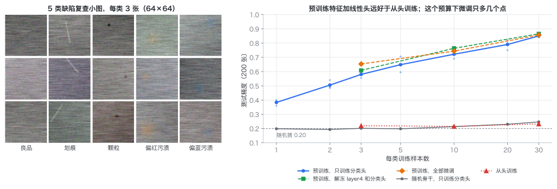
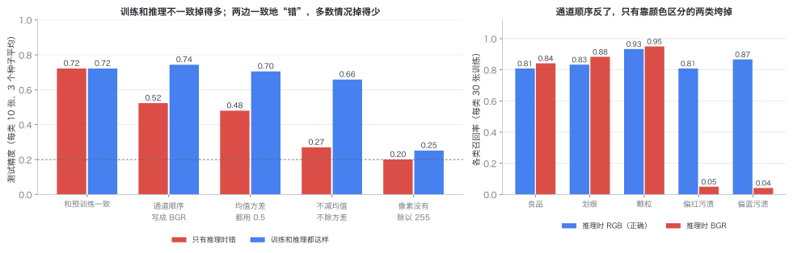
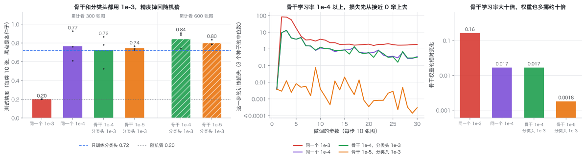
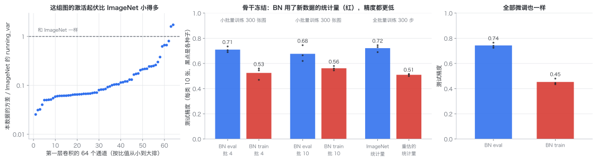
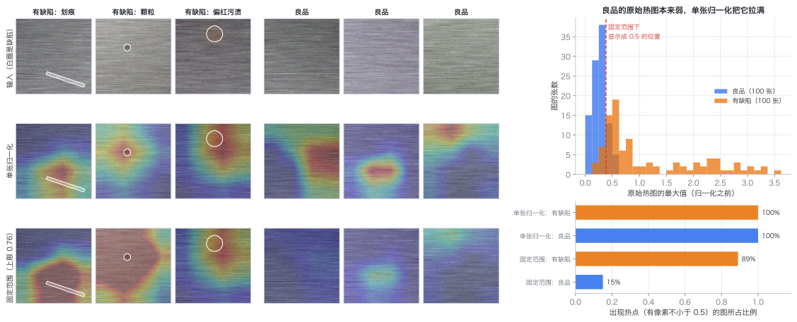
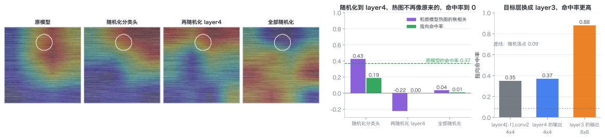

# 第 10 天：迁移学习与模型分析 —— 教程

> [!NOTE]
> 本章所有数字都来自代码生成的缺陷复查小图上的实测，记录在 [`figures/实测数字.json`](figures/实测数字.json)，由 `solutions` 分支的 `solutions/figures/ch10.py` 生成。模型是 torchvision 的 ResNet-18 加 ImageNet 权重，参数冻结和单张热图归一化用的是本章作业的参考实现。脚本在一台 Mac 的 CPU 上几分钟跑完，重复运行结果相同。合成图和真实的工业图像差别很大，换成真实数据，数值会变，结论的方向要自己再测一遍。讲到 Flowers102 等公开数据集时，本章不引用任何没有跑过的精度。

> 配套练习：`DL-5 迁移学习` | `DL-6 Grad-CAM`  
> 本章目标：不用从零训练大模型，也不把预训练网络当黑盒。你将学会选择微调策略、正确做数据增强，并用 Grad-CAM 检查模型到底学了什么。

自动验收的作业是 [`作业_冻结策略与热图归一化.py`](./作业_冻结策略与热图归一化.py)。DL-5 和 DL-6 是 [`视觉算法学习计划.md`](../视觉算法学习计划.md) 里的扩展练习，目录里没有现成的文件，需要自己新建，见 10.10 节。

---

## 0. 本章怎么学

**应用场景**：小样本场景的默认做法，第 19 章的 PatchCore 用的就是预训练特征。工业检测里缺陷样本总是不够：一种缺陷可能只攒得出几张到几十张图，从头训练一个网络不现实。常见的做法是拿一个在大数据集上训练好的骨干网络，冻结它或者用很小的学习率微调，只为自己的类别训练一个分类头。缺陷复查（把候选缺陷的小图分成划痕、颗粒、污渍等类别）就是这样做的。本章的实验都围绕“每类只有几张到几十张图的缺陷分类”展开。

**优先级**：P3，选修，已有基础或用得少，遇到再回看。前置是第 9 章（卷积、BatchNorm、残差块）。这一章的优先级不高，是因为训练流程本身你多半已经会了。但它和工业检测的关系很近：第 19 章的异常检测直接建立在冻结的预训练特征上，第 14 章的部署要求预处理和训练时完全一致，这两件事的依据都在本章。时间紧的话，至少把速通档做完。

| 档位 | 累计用时 | 做什么 | 做到什么算完 |
|---|---:|---|---|
| 速通 | 2 小时 | 读 10.1 节的实测、10.2 节的预处理实测、10.3 节、10.5 节后三个小节，看懂图 1 到图 6，做 10.5 节末尾演示的前 3 步，答完 5 道小测 | 能讲清样本少时为什么先只训练分类头，微调时骨干学习率和 BatchNorm 模式各会出什么事，为什么良品的 Grad-CAM 也有热点 |
| 标准 | 7 小时 | 读完全章，跑 Notebook，完成 `作业_冻结策略与热图归一化.py` 并验收通过，做 10.11 节前三个破坏实验，填实验记录 | 验收两项 PASS，实验记录里有可训练参数的清单、一张按固定范围显示的热图和一个失败案例，自测问题都能答 |
| 深挖 | 9 小时 | 再做 10.11 节其余的破坏实验和 10.12 节的扩展（DL-5 和 DL-6 至少做一个） | 在自己的数据上报告只训练分类头和微调的精度各是多少、每类多少张、几个种子，并给出一次随机化检查的结果 |

> [!TIP]
> 用时超过所选档位的 1.5 倍还没做完，就把卡点写进 `学习进度.md`，先往下一章走。本章的作业很短，时间主要花在 10.3 节和 10.5 节。深挖档要下载权重和准备数据，环境问题卡超过一小时就先回到 Notebook 的合成数据把结论做完。

---

## 10.1 为什么预训练有效

### 先把预训练模型想成一个“视觉词典”

假设你只有几百张杯子、书本和手机的照片。若从随机参数开始训练 ResNet-18，网络既要学“边缘是什么”，又要学“杯口是什么”，数据通常不够。ImageNet 预训练模型已经看过上百万张自然图像：前几层能识别水平边缘、颜色对比和纹理，中间层会组合出圆弧、重复花纹和局部形状，靠后的层才更接近具体类别。

因此迁移学习不是“把别人的答案抄过来”，而是复用一套已经学会的视觉表示，再把最后的决策规则改成你的任务。第 9 天可视化的 ResNet 第一层卷积核，就是这种可迁移性的直接证据：Sobel 式边缘对猫、花朵和水杯都有效。

把网络写成两段：

```
z = f_θ(x)       # backbone：图像 → 特征
ŷ = g_φ(z)       # head：特征 → 当前任务类别
```

预训练提供参数 `θ_pre`。小数据任务通常先固定 `θ_pre`，只学习随机初始化的 `φ`；若验证集表明任务与 ImageNet 差异较大，再用较小学习率更新部分或全部 `θ`。

### 什么时候迁移最有效

| 目标数据 | 与预训练数据的相似度 | 推荐起点 |
|---|---|---|
| 少且相似，如花卉、宠物 | 高 | 冻结 backbone，只训分类头 |
| 较多且相似 | 高 | 全部微调，backbone 用小学习率 |
| 少且差异大，如 X 光片 | 低 | 先冻大部分层，再逐块解冻 |
| 很多且差异大 | 低 | 预训练仍可作初始化，但要充分微调 |

“数据多不多”必须相对模型规模判断。五千张图对小 CNN 可能很多，对数千万参数的网络仍然少。也不要迷信 ImageNet：灰度医学影像、遥感多光谱或显微图像与自然图像差异明显，预训练主要提供优化上的好起点，不保证语义直接通用。

### 实测：每类只有几张到几十张缺陷图时

上面的表是经验。下面把“少且差异大”这一格量一遍。数据是代码生成的缺陷复查小图：64×64 的 RGB 图，灰色拉丝纹理背景，亮度、色偏和明暗渐变都随机，一共 5 类，各占五分之一：良品、划痕（亮细线）、颗粒（暗圆点）、偏红污渍、偏蓝污渍。两种污渍只有颜色不同，这是后面检查预处理时要用的。这样的图和 ImageNet 里的自然照片差得很远。

模型是 ResNet-18，换成 5 类的分类头之后一共 11179077 个参数（约 11.18 百万）。比较四种做法，测试集固定 200 张（每类 40 张），训练集每类 $k$ 张，换 3 个种子（3 套不同的训练集）取平均：

- **只训练分类头**：骨干用 ImageNet 权重并冻结，只训练最后的线性层。可训练的参数是 2565 个，占全部参数的 0.023%。
- **解冻 layer4 和分类头**：可训练的参数是 8396293 个，占 75.1%。ResNet-18 四分之三的参数都在最后一个阶段。
- **全部微调**：所有参数都训练，骨干学习率 1e-5，分类头 1e-3。
- **从头训练**：同样的网络，随机初始化，全部参数学习率 1e-3。

后三种做法的训练预算相同：累计看 300 张训练图（批大小 10，共 30 步）。微调的两种做法都先把分类头训练好再解冻，并让 BatchNorm 保持 eval 模式，原因见 10.3 节。



| 每类训练样本数（64×64，5 类，测试 200 张，3 个种子平均） | 1 | 2 | 3 | 5 | 10 | 20 | 30 |
|---|---:|---:|---:|---:|---:|---:|---:|
| 预训练骨干，只训练分类头 | 0.383 | 0.505 | 0.580 | 0.648 | 0.722 | 0.790 | 0.850 |
| 预训练，解冻 layer4 和分类头 | | | 0.608 | | 0.763 | | 0.865 |
| 预训练，全部微调（累计看 300 张图） | | | 0.653 | | 0.743 | | 0.857 |
| 随机骨干，只训练分类头 | 0.198 | 0.193 | 0.202 | 0.198 | 0.213 | 0.230 | 0.247 |
| 从头训练（累计看 300 张图，2 个种子） | | | 0.220 | | 0.215 | | 0.232 |

读这张表的四点：

1. **预训练特征加一个线性头，每类 10 张就到 0.722，每类 30 张到 0.850**。同样的线性头接在随机初始化的骨干后面，每类 30 张也只有 0.247，和随机猜的 0.20 差不多。这组图和 ImageNet 一点都不像，线性头能用，靠的是预训练骨干学到的边缘、纹理和颜色这些低层特征。
2. **从头训练在这个预算下完全不行**，三种样本数都在 0.22 上下。这不是“再多训练一会儿就好”：每类 30 张时把预算加倍到 600 张图，它在训练集上的精度升到了 0.733，测试精度仍是 0.238（两个种子是 0.275 和 0.200）。网络开始记住训练集，但没有学到能泛化的东西。本章没有测更长的训练和更多的数据，结论只对“几十到一百多张图、几十步”这个范围成立。
3. **在这个预算下，微调只比只训练分类头高几个点**。全部微调在每类 3、10、30 张时分别高 0.073、0.022、0.007，解冻 layer4 高 0.028、0.042、0.015。把预算加倍后差距会拉大，每类 10 张时全部微调到 0.802（10.3 节）。微调的收益要花训练时间去换，而只训练分类头几乎不花时间：冻结的骨干只需要对每张图做一次前向。
4. **样本少的时候，换一批训练图结果就不一样**。只训练分类头、每类 5 张时，3 个种子是 0.595、0.705、0.645，相差 0.11。全部微调、每类 3 张时相差 0.115。只跑一次就下结论是不可靠的，本章的每张表都给了种子数。

所以策略表里“少且差异大”那一格，在这组数据上的实测建议是：**先只训练分类头，把它当基线；微调放在后面，并且要当心下面两节讲的学习率和 BatchNorm**。

---

## 10.2 在 PyTorch/MPS 上跑通第一个迁移学习模型

### 第一步：设备和数据变换

Apple Silicon 上优先使用 MPS；不支持时回退 CPU。分类模型通常接收 RGB、固定尺寸、浮点张量，并按预训练权重要求归一化。

```python
import torch
from torchvision import datasets
from torchvision.models import resnet18, ResNet18_Weights

if torch.backends.mps.is_available():
    device = torch.device("mps")
else:
    device = torch.device("cpu")

weights = ResNet18_Weights.DEFAULT
train_tf = weights.transforms()   # 含 resize/crop/to-tensor/normalize
train_set = datasets.Flowers102(
    root="data", split="train", download=True, transform=train_tf
)
val_set = datasets.Flowers102(
    root="data", split="val", download=True, transform=weights.transforms()
)
```

如果你的机器是带 NVIDIA 显卡的 Windows 或 Linux，把选设备那几行换成下面的写法，先 CUDA、再 MPS、最后 CPU。本节其余代码不用改。怎样确认显卡真的在用、怎样看显存，见本节最后一个小节。

```python
device = torch.device("cuda" if torch.cuda.is_available()
                      else "mps" if torch.backends.mps.is_available() else "cpu")
```

练习时可先用官方 `weights.transforms()` 保证输入契约正确，再替换为自己的增强。预训练 ResNet 的归一化不是可选装饰；训练与推理若使用不同均值、方差，输入分布会错位。

### 实测：预处理和预训练时不一致会掉多少

“输入分布会错位”可以量出来。正确的预处理有四个环节：像素除以 255 变成 0 到 1，通道顺序是 RGB，减去 ImageNet 的均值，除以 ImageNet 的标准差。下面每次只弄错一个环节，分两种情况：一种是训练时用对了、只有推理时用错（部署时重写预处理最容易出这种事）；另一种是训练和推理用同一种错的预处理。骨干冻结，只训练分类头，3 个种子平均。



| 预处理（64×64，5 类，3 个种子平均） | 只有推理时错，每类 10 张 | 只有推理时错，每类 30 张 | 训练和推理都这样，每类 10 张 |
|---|---:|---:|---:|
| 和预训练一致 | 0.722 | 0.850 | 0.722 |
| 通道顺序写成 BGR | 0.523 | 0.553 | 0.743 |
| 均值和标准差都用 0.5 | 0.480 | 0.567 | 0.705 |
| 不减均值、不除标准差 | 0.270 | 0.315 | 0.658 |
| 像素没有除以 255 | 0.200 | 0.200 | 0.252 |

1. **训练和推理不一致，每一种都掉得很多**。每类 30 张时，BGR 掉 0.297，均值方差用 0.5 掉 0.283，不归一化掉 0.535，没除以 255 直接掉到随机猜。
2. **通道顺序反了，垮掉的只有靠颜色区分的类别**。图 2 右栏：偏红污渍的召回率从 0.808 掉到 0.050，偏蓝污渍从 0.867 掉到 0.042。它们被互相认错了：85.8% 的偏红污渍被判成偏蓝，89.2% 的偏蓝污渍被判成偏红；良品、划痕、颗粒三类几乎没有变化（0.842、0.883、0.950）。如果你的验证集里碰巧没有靠颜色区分的类别，这个错就看不出来。灰度的工业图像复制成 3 通道之后三个通道相同，通道顺序这一项不会出错，另外三项照样会。
3. **两边一致地“错”，多数情况掉得不多**。训练和推理都用 BGR 是 0.743，和正确的 0.722 没有可分辨的差别（3 个种子之间本来就差零点零几）；都用 0.5 的均值方差是 0.705；都不归一化是 0.658。只有不除以 255 是例外（0.252）：输入比预训练时大了两百多倍，冻结的骨干算出来的特征已经没有用了。
4. 第 3 点正是这个问题危险的地方：**一致的错误在训练和验证阶段是看不见的**，精度正常，曲线正常。等部署时有人按文档重写了一遍“正确”的预处理，精度才掉下来。所以要把预处理的四个环节写进模型的交付说明，第 14 章 14.8 节把预处理参数列为部署包的必备内容。

排查时最快的办法是打印送进模型的张量的统计量。这组数据在正确预处理之后，输入张量的均值是 0.201、标准差是 0.379。忘了除以 255 时数值会大两个数量级，一眼就能看出来。

<!-- quiz -->
**训练和验证时图像都是用 OpenCV 读的，忘了把 BGR 转成 RGB，就这样训练了分类头。和通道顺序正确的做法相比，验证精度会怎样？**

- A. 明显下降，因为预训练权重是按 RGB 训练的
- B. 几乎不变，问题要等到部署时有人按 RGB 重写预处理才暴露
- C. 掉到随机猜

<details markdown="1"><summary>答案与解释</summary>

**B**。实测每类 10 张时，训练和推理都用 BGR 是 0.743，正确的做法是 0.722，差别在种子之间的波动以内。分类头会去适应它看到的特征。但如果训练用对了、只有推理时写成 BGR，精度是 0.523，而且每类 30 张时偏红和偏蓝两类的召回率只剩 0.050 和 0.042。A 描述的是“训练和推理不一致”的情况。C 是像素没有除以 255 时的结果。

</details>
<!-- /quiz -->

### 第二步：替换分类头并冻结主干

```python
from torch import nn
from torch.utils.data import DataLoader

model = resnet18(weights=weights)
for p in model.parameters():
    p.requires_grad = False

in_features = model.fc.in_features
model.fc = nn.Linear(in_features, 102)  # 新层默认 requires_grad=True
model = model.to(device)

train_loader = DataLoader(train_set, batch_size=32, shuffle=True)
val_loader = DataLoader(val_set, batch_size=64, shuffle=False)
optimizer = torch.optim.AdamW(model.fc.parameters(), lr=1e-3)
criterion = nn.CrossEntropyLoss()
```

这里的顺序很重要：先冻结旧参数，再换新头。若反过来把整个模型统一冻结，新建的 `fc` 也可能被冻住。创建优化器时只传可训练参数，能让“究竟训练了什么”更明确。

原讲义在这里还说“只传可训练参数能减少状态内存”。在本章用的 PyTorch 版本上实测，这一条不成立：把 62 个参数张量全部传给 AdamW、其中只有分类头可训练，训练 3 步之后优化器里有状态的只有 2 个张量，冻结的参数既不占状态，也没有被改动（相对变化是 0）。真正要小心的是另外两件事，都和“改了 `requires_grad` 之后没有重建优化器”有关（ResNet-18，AdamW，学习率 1e-4，同一个批连续训练 3 步）：

| 做了什么 | 结果 |
|---|---|
| 优化器里只有分类头，之后解冻 layer4，没有重建优化器 | layer4 的参数有梯度，但 3 步之后相对变化是 0，它根本没有被训练，也不报错 |
| 全部参数训练 3 步之后冻结骨干，没有重建优化器，用默认的 `zero_grad()` | 骨干的相对变化是 0 |
| 同上，但清梯度写的是 `zero_grad(set_to_none=False)` | 骨干仍然在动，3 步的相对变化是 0.0041 |

第三行的原因：梯度被清成 0 而不是 `None` 时，优化器认为这些参数还在训练，动量和权重衰减会继续推着它们走。旧版本的 PyTorch 默认就是清成 0，网上的老代码里也常见这种写法。所以规矩只有一条：**每次改变 `requires_grad` 之后重建优化器**，并打印一遍可训练参数的名字。本章的作业 `configure_trainable_parameters` 做的就是“按名字前缀决定哪些参数可训练，并把名字列出来”这件事。

### 第三步：写完整训练闭环

```python
def run_epoch(model, loader, training):
    model.train(training)
    if training:
        freeze_bn(model)   # 骨干冻结时让 BatchNorm 留在 eval；这个函数的定义和原因见代码后面的说明
    total_loss, correct, total = 0.0, 0, 0

    context = torch.enable_grad() if training else torch.no_grad()
    with context:
        for x, y in loader:
            x, y = x.to(device), y.to(device)
            logits = model(x)
            loss = criterion(logits, y)

            if training:
                optimizer.zero_grad()
                loss.backward()
                optimizer.step()

            total_loss += loss.item() * x.size(0)
            correct += (logits.argmax(1) == y).sum().item()
            total += x.size(0)
    return total_loss / total, correct / total

for epoch in range(5):
    tr_loss, tr_acc = run_epoch(model, train_loader, True)
    va_loss, va_acc = run_epoch(model, val_loader, False)
    print(epoch, tr_loss, tr_acc, va_loss, va_acc)
```

这段代码与 DL-1 的训练循环完全同源：清梯度、反向传播、更新参数；验证时切到 `eval` 并关闭梯度。迁移学习只是改变了参数初值和“哪些参数允许更新”，没有改变训练本质。

和原讲义相比，上面的 `run_epoch` 多了 `freeze_bn(model)` 一行。原来的写法在骨干冻结时直接 `model.train()`，BatchNorm 会改用当前批的统计量。在本章的合成数据上，这一行之差让只训练分类头的精度从 0.710 掉到 0.525（10.3 节的图 4）。`freeze_bn` 很短：

```python
def freeze_bn(model):
    for m in model.modules():
        if isinstance(m, nn.BatchNorm2d):
            m.eval()
```

它必须放在 `model.train()` 之后，而且每个 epoch 都要调用：`model.train()` 会把所有子模块重新设回训练模式，实测调用一次之后全部 BatchNorm 层的 `training` 又变回了 `True`。在和 ImageNet 更接近的数据上（例如 Flowers102），两种写法差多少本章没有测，按 10.3 节的建议自己比较一次。

### MPS 的实际注意事项

- 张量和模型必须在同一设备；报 device mismatch 时先打印 `x.device` 与首个参数的 `device`。
- 某些算子或数据类型在特定 PyTorch 版本上不支持 MPS。先升级稳定版 PyTorch；教学代码优先保持 `float32`，不要一上来混合精度。
- `DataLoader(num_workers=0)` 最容易排查问题，确认跑通后再增加 worker。
- 训练速度慢不一定是 GPU 问题。小数据集上，图片解码与增强可能才是瓶颈。

### 在自己的显卡上微调：确认可用、看显存、批大小不够怎么办

本章的实验是在一台没有 CUDA 的 Mac 上用 CPU 跑的，所以这里只写通用的做法，不给任何显卡上的耗时和显存数字。下面的代码片段里，凡是带 `torch.cuda` 的都没有在本机运行过，以 PyTorch 文档为准。

**确认显卡可用**。在命令行运行 `nvidia-smi`，能看到显卡型号、驱动版本和当前的显存占用，说明驱动没有问题。再在 Python 里确认 PyTorch 装的是带 CUDA 的版本：

```python
print(torch.__version__, torch.cuda.is_available())
if torch.cuda.is_available():
    print(torch.cuda.get_device_name(0))
print(next(model.parameters()).device)   # 模型确实在显卡上吗
```

`is_available()` 返回 `False` 时，最常见的原因是装成了只有 CPU 的 PyTorch，按 PyTorch 官网的安装命令重装。

**看显存占用**。两个办法配合用：

- 训练时另开一个终端运行 `nvidia-smi -l 1`，每秒刷新一次。它显示的是整个进程占住的显存，包含 PyTorch 预留但暂时没用的部分，所以会比实际需要的多。
- 在代码里量峰值，这个数更有用：

```python
torch.cuda.reset_peak_memory_stats()
run_epoch(model, train_loader, True)          # 或者只跑几个批
print(torch.cuda.max_memory_allocated() / 2**20, "MiB")   # 张量实际用到的峰值
print(torch.cuda.memory_reserved() / 2**20, "MiB")        # PyTorch 向系统要走的总量
```

改批大小、输入尺寸、解冻的层数之前和之后各量一次，就知道每一项要花多少显存。显存主要花在反向传播要保存的中间激活上，它大致和“批大小 × 特征图的像素数 × 通道数”成正比，和参数量的关系反而小。

**只训练分类头几乎不占显存，也不占时间**。冻结的骨干不需要保存中间激活，可以在 `torch.no_grad()` 里提特征，甚至把特征缓存下来（10.4 节）。在本章的 Mac 上用 CPU（2 个线程）测的一次结果：输入 64×64、批大小 10 时，只做前向每张图约 1.5 ms，前向加反向再加参数更新约 4.5 ms，大约是 3 倍。机器忙的时候两个数都会变大，只看它们的比例。显卡上的比例要自己量。

**批大小不够时**，报错信息里会有 `CUDA out of memory`。按下面的顺序试，每一步都重新量一次峰值显存：

1. **减小批大小**。这是最直接的办法。批太小时梯度的噪声大，可以用梯度累积补回来：连续算几个小批的梯度再更新一次，等效的批大小是两者的乘积。

```python
accum = 4                                   # 等效批大小 = 4 × loader 的批大小
optimizer.zero_grad()
for step, (x, y) in enumerate(train_loader, start=1):
    loss = criterion(model(x.to(device)), y.to(device)) / accum
    loss.backward()
    if step % accum == 0:
        optimizer.step()
        optimizer.zero_grad()
```

   梯度累积对 BatchNorm 不起作用：每个小批仍然各算各的统计量。这是微调时让 BatchNorm 保持 eval 的又一个理由（10.3 节）。
2. **减少要反向传播的层**。只解冻 layer4 时，前面几个阶段不用保存激活，可以放进 `torch.no_grad()`。
3. **混合精度**。用 `torch.autocast` 让前向在半精度下算，激活占的显存大约减半：

```python
scaler = torch.amp.GradScaler("cuda")       # 较老的版本写作 torch.cuda.amp.GradScaler()
with torch.autocast(device_type="cuda", dtype=torch.float16):
    loss = criterion(model(x), y)
optimizer.zero_grad()
scaler.scale(loss).backward()
scaler.step(optimizer)
scaler.update()
```

4. **减小输入尺寸，或者把大图切成小块**。显存和像素数成正比，边长减半，激活占的显存降到四分之一左右。代价是小缺陷可能看不见了，第 19 章 4.3 节讲这个取舍。
5. **验证时一定要 `torch.no_grad()`**。验证的批大小常常设得比训练大，忘了关梯度是验证阶段爆显存的常见原因。

`torch.cuda.empty_cache()` 只是把 PyTorch 预留但没在用的显存还给系统，让 `nvidia-smi` 的数字变小，它不会让你的模型能用更大的批。

---

## 10.3 微调多少层：从保守到激进

### 策略 A：只训练分类头

优点是快、稳定、不容易过拟合；缺点是特征无法适应新领域。它应当成为你的基线，而不是最终信仰。若这个简单基线已经很好，复杂微调未必值得。

### 策略 B：逐块解冻

ResNet-18 可粗略分成 `conv1 → layer1 → layer2 → layer3 → layer4 → fc`。先训练 `fc`，再解冻 `layer4`，最后视情况解冻全部层：

```python
for p in model.layer4.parameters():
    p.requires_grad = True

optimizer = torch.optim.AdamW([
    {"params": model.layer4.parameters(), "lr": 1e-4},
    {"params": model.fc.parameters(), "lr": 1e-3},
], weight_decay=1e-4)
```

为什么越靠前学习率越小？前层已经学到通用边缘，剧烈更新会破坏它们；新分类头从随机参数开始，需要更大步子。参数更新近似为：

```
θ ← θ - η ∇L(θ)
```

同样的梯度下，学习率 `η` 小十倍，预训练知识被改写得更慢。这就是“分层学习率”的数学本质。

### 实测：骨干和分类头的学习率

上面的公式是普通梯度下降的。代码里用的是 AdamW，它每一步挪多远的规律不一样，下面的实验正好撞上了这一点。

设置：每类 10 张，3 个种子。分类头先按“只训练分类头”训练好，这时训练损失已经接近 0（微调第 1 步的损失是 0.004）。然后解冻全部参数，用 AdamW 微调，累计看 300 张图（30 步，批大小 10），BatchNorm 保持 eval。只改两个学习率。



| 学习率（每类 10 张，累计看 300 张图，3 个种子） | 测试精度（各种子） | 前 10 步里训练损失的最大值 | 骨干权重的相对变化 | 测试集特征的相对变化 |
|---|---|---:|---:|---:|
| 只训练分类头（对照） | 0.722 | | 0 | 0 |
| 骨干和分类头都用 1e-3 | 0.200（0.200、0.200、0.200） | 95.657 | 0.164 | 0.996 |
| 骨干和分类头都用 1e-4 | 0.765（0.760、0.925、0.610） | 19.902 | 0.017 | 0.784 |
| 骨干 1e-4，分类头 1e-3 | 0.723（0.780、0.865、0.525） | 19.522 | 0.017 | 0.801 |
| 骨干 1e-5，分类头 1e-3 | 0.743（0.725、0.765、0.740） | 0.098 | 0.002 | 0.258 |

1. **骨干和分类头用同一个 1e-3，3 个种子全部掉到随机猜的 0.200**。训练损失在前 10 步里从 0.004 窜到九十多，最后 5 步的平均值还有 1.719，和 5 类随机猜时的损失差不多。骨干权重的相对变化是 0.164，测试集特征的相对变化是 0.996，预训练的特征已经被冲掉了。这就是下一小节说的灾难性遗忘。
2. **起作用的是骨干学习率的绝对值，不是“分开设”这个动作**。“都用 1e-4”和“骨干 1e-4、分类头 1e-3”两行几乎一样：损失的最大值是 19.902 和 19.522，权重变化都是 0.017，图 3 中间那幅图里两条曲线叠在一起。分类头已经训练好了，它的学习率大一点小一点没有多少影响。分开设的意义在于：分类头是随机初始化的、需要 1e-3 这样的步子时，不必让骨干也跟着用 1e-3。
3. **骨干 1e-4 在这个预算下不稳**。两行 1e-4 的种子之间差到 0.3 以上（0.525 到 0.925），因为损失先窜上去再往回落，30 步之后落到哪里要看运气。骨干 1e-5 时损失最大只到 0.098，3 个种子在 0.725 到 0.765 之间。
4. **训练得够久，1e-4 的均值更高，但仍然更散**。把预算加倍到 600 张图：骨干 1e-4 是 0.843（0.885、0.905、0.740），骨干 1e-5 是 0.802（0.835、0.785、0.785），分别比只训练分类头高 0.122 和 0.080。大一点的学习率让骨干改得更多，学到的也更多，代价是开头那一段不稳。

为什么损失已经接近 0，一步之后还会窜上去？AdamW 用梯度的滑动平均除以梯度平方的滑动平均的平方根。第一步时两个平均都只有当前这一个梯度 $g_1$，偏差校正之后：

$$
\Delta\theta_1 = -\eta\,\frac{\hat m_1}{\sqrt{\hat v_1}+\epsilon} = -\eta\,\frac{g_1}{|g_1|+\epsilon} \approx -\eta\,\mathrm{sign}(g_1)
$$

也就是说，**不管梯度多小，每个参数第一步都挪动大约一个学习率那么远**。损失接近 0 时梯度很小，普通梯度下降的这一步几乎不动，AdamW 照样迈出整步。（带动量的 SGD 走上若干步之后会怎样，本章没有放进实验，10.11 节第 6 个破坏实验可以自己试。）一千多万个参数同时各挪 1e-3，而预训练的卷积权重绝对值的中位数只有 0.011，一步就是它的将近十分之一，网络就被推离了原来的位置。图 3 右栏印证了“步长跟着学习率走”：学习率每大十倍，30 步后骨干权重的相对变化也大约十倍（实测 9.3 倍和 9.8 倍）。

只解冻 layer4 时规律相同。上面代码块里的配置（layer4 用 1e-4，分类头 1e-3）在这组数据上实测是 0.700（3 个种子 0.570、0.720、0.810），不如 layer4 用 1e-5 的 0.763（0.770、0.750、0.770）稳；layer4 也用 1e-3 时掉到 0.237。“骨干比分类头小十倍”是个合理的起点，但不保证够小，要看头几步的损失。

实用的做法：

- 解冻之后打印前十几步每一步的训练损失。损失从接近 0 突然变大一两个数量级，就是骨干学习率太大。
- 不想把学习率降得太低，就加预热：前几十步让学习率从接近 0 线性升到设定值。本章没有把预热放进配图脚本，10.12 节把它留作扩展。
- 报告微调结果时写清楚两个学习率、优化器、步数和种子数。

<!-- quiz -->
**分类头已经训练好，训练损失是 0.004。现在解冻整个 ResNet-18，骨干和分类头都用 AdamW、学习率 1e-3，再训练 30 步。测试精度（5 类，只训练分类头时是 0.722）会怎样？**

- A. 基本不变，损失已经接近 0，梯度很小，参数几乎不动
- B. 小幅提高，骨干开始适应新数据
- C. 掉到 0.200，也就是随机猜

<details markdown="1"><summary>答案与解释</summary>

**C**。3 个种子都是 0.200。A 的推理对普通梯度下降的头一步成立，对 AdamW 不成立：AdamW 的第一步每个参数都挪动大约一个学习率，和梯度大小无关，训练损失在前 10 步里从 0.004 窜到九十多。骨干学习率降到 1e-5 之后才稳，同样 30 步是 0.743。B 要等训练预算加倍才看得到（0.802）。

</details>
<!-- /quiz -->

### 灾难性遗忘与 BatchNorm

全量微调时，过大的学习率可能让预训练表示迅速失效，称为灾难性遗忘。一个可操作顺序是：

1. 只训 head，得到可比较基线；
2. 解冻最后一块，学习率降为 head 的十分之一；
3. 只有当验证集仍提升且不过拟合，才继续向前解冻；
4. 保存验证指标最好的权重，而不是最后一个 epoch。

冻结参数不等于冻结 BatchNorm 的运行均值和方差。调用 `model.train()` 后，BN 仍可能更新统计量。小 batch 下统计很抖，可在训练时让冻结主干中的 BN 保持 `eval()`，或者至少比较两种设置。不要只看 `requires_grad` 就认为模型完全不变。

### 实测：冻结骨干时 BatchNorm 留在训练模式

上一段说“至少比较两种设置”，下面就比较。ResNet-18 有 20 个 BatchNorm 层，它们的 `running_mean` 和 `running_var` 一共 9600 个数。这些数不是参数，`requires_grad` 管不到它们。BatchNorm 在训练模式下做两件事：前向时用当前这一批的均值和方差做归一化；同时把这一批的统计量按 0.1 的比例混进 `running_mean` 和 `running_var`。

设置：每类 10 张，3 个种子，骨干的全部参数 `requires_grad=False`，分类头从随机初始化开始训练，累计看 300 张图。唯一的区别是训练时骨干的 BatchNorm 在 eval 还是 train。测试时都是 `model.eval()`。



| 做法（每类 10 张，3 个种子平均） | BN 在 eval | BN 在 train | 掉了多少 |
|---|---:|---:|---:|
| 冻结骨干只训练分类头，批大小 4 | 0.710 | 0.525 | 0.185 |
| 冻结骨干只训练分类头，批大小 10 | 0.677 | 0.562 | 0.115 |
| 全部微调（骨干 1e-5，分类头 1e-3） | 0.743 | 0.453 | 0.290 |

BN 留在 train、批大小 10、训练 30 步之后，逐项检查这个“冻结”的骨干：

- 骨干的参数逐位没有变，3 个种子都是。只看 `requires_grad` 和权重的话，它确实冻住了。
- `running_mean` 和 `running_var` 的相对变化是 0.702。按 0.1 的混入比例，30 步之后它们已经有 95.8% 换成了新数据的统计量。
- 同一批测试图在 eval 模式下算出来的 512 维特征，相对变化是 1.500。变化量比特征本身还大，这已经是另一个特征提取器了。
- 训练过程中分类头看到的特征也不是推理时的特征：同一批训练图，train 模式和 eval 模式算出的特征相差 1.423（相对范数）。

原讲义把原因归结为“小 batch 下统计很抖”。实测下来，抖动只是一部分。做一个不带抖动的对照：用全部训练图把 BatchNorm 的统计量从头重估一遍，然后冻结，再像 10.1 节那样训练分类头。精度从 0.722 掉到 0.510，掉了 0.212，和 BN 留在 train 的两组差不多。**主要原因是统计量换成了新数据的，而不是它在抖。**

为什么换了统计量就变差？图 4 左栏给了一个线索：这组图在第一层卷积输出上的方差，中位数只有 ImageNet 统计量的 0.083 倍，64 个通道里有 58 个不到 0.5 倍。合成的缺陷图对比度低、纹理单一，激活的起伏比自然照片小得多。用它自己的统计量归一化，等于把这些微弱的起伏按方差放大十倍以上再往后传，后面每一层的权重都是在 ImageNet 的数值范围上训练出来的，没有见过这样的输入。这是一个说得通的解释，本章没有逐层验证它。

两点提醒：

1. 这个结论只对这组数据成立。目标数据和预训练数据的统计量差得越远，换统计量的影响越大。在别的数据上，让 BatchNorm 适应新数据也可能有好处，所以原讲义说的“至少比较两种设置”仍然是对的做法。
2. 让 BatchNorm 保持 eval 的写法见 10.2 节的 `freeze_bn`，记住它要在每次 `model.train()` 之后调用。

<!-- quiz -->
**把 ResNet-18 骨干的全部参数设成 `requires_grad=False`，只训练分类头，训练循环里照常写了 `model.train()`。训练结束后检查，骨干的参数逐位没有变。和训练时让 BatchNorm 保持 eval 相比，测试精度（批大小 4，每类 10 张）会怎样？**

- A. 完全一样，因为骨干的参数没有变
- B. 从 0.710 掉到 0.525
- C. 更高，因为 BatchNorm 适应了新数据

<details markdown="1"><summary>答案与解释</summary>

**B**。参数没变，但 BatchNorm 的 `running_mean` 和 `running_var` 不是参数，它们的相对变化是 0.702（批大小 10 时测的），同一批测试图的特征相对变化是 1.500。C 的直觉在这组数据上不成立：把统计量不带噪声地整体换成新数据的，精度同样从 0.722 掉到 0.510。

</details>
<!-- /quiz -->

---

## 10.4 数据增强：告诉模型什么“不应该影响答案”

增强不是为了把文件数量变多，而是把你的先验写进训练过程。若左右翻转后仍是同一种花，翻转就是合理不变性；若任务是识别左转和右转交通标志，水平翻转会制造错误标签。

```python
from torchvision import transforms

train_tf = transforms.Compose([
    transforms.RandomResizedCrop(224, scale=(0.7, 1.0)),
    transforms.RandomHorizontalFlip(),
    transforms.ColorJitter(0.2, 0.2, 0.2, 0.05),
    transforms.ToTensor(),
    transforms.Normalize(mean=weights.meta["mean"],
                         std=weights.meta["std"]),
])
```

可把增强理解为从变换分布 `T` 中采样：

```
min E_(x,y) E_(t~T) [ L(f(t(x)), y) ]
```

它要求模型在一组允许的变化下维持预测。增强太弱，模型会记背景；增强太强，可能破坏类别信息。最好的调试办法不是猜参数，而是把一个 batch 的增强结果画出来，逐张问：“人还能无歧义地判断标签吗？”

验证集和测试集只能做确定性预处理，不应随机裁剪、颜色抖动。否则同一模型每次评估结果都会变，比较实验失去意义。

### 实测：合理的增强和制造错误标签的增强

把“翻转是不是合理的不变性”放到缺陷分类上量一次。这组合成数据里，缺陷的位置和方向都是随机的，翻转之后类别不变；偏红和偏蓝两类污渍只靠颜色区分，交换红蓝通道之后类别就变了。骨干冻结，只训练分类头，3 个种子平均。“加三种翻转”是把每张训练图的左右翻转、上下翻转和旋转 180° 都加进训练集，“加红蓝通道互换”是把每张训练图交换 R、B 通道后按原来的标签加进去，当作一种过头的颜色增强。

| 训练集（64×64，5 类，3 个种子平均） | 每类 3 张：测试精度 | 每类 10 张：测试精度 | 每类 10 张：两类污渍的召回率 |
|---|---:|---:|---:|
| 不增强 | 0.580 | 0.722 | 0.667 |
| 加三种翻转（4 倍数据） | 0.638 | 0.808 | 0.825 |
| 加红蓝通道互换（2 倍数据） | 0.505 | 0.645 | 0.471 |

- 合理的增强是实打实的收益。每类 10 张时翻转把精度从 0.722 提到 0.808，这个幅度和把微调的训练预算加倍差不多（0.802，10.3 节），而它只需要多提几次特征。
- 破坏类别信息的增强比不增强还差。红蓝互换让两类污渍的召回率从 0.667 掉到 0.471，因为一半的污渍样本带着错的标签。
- 哪些变换合理取决于任务。真实产线上划痕的方向可能和工艺有关，这时旋转就未必合理；颜色抖动对靠颜色区分的缺陷同样危险。判断的办法还是上面那一句：把增强后的图画出来，看人还能不能判断标签。

### 用学习曲线决定下一步，而不是凭感觉调参

迁移学习常见的四种曲线各有不同含义。训练和验证 loss 都很高，说明欠拟合：先确认分类头确实在更新，再考虑训练更久、提高 head 学习率或解冻更多层。训练 loss 持续下降而验证 loss 上升，是过拟合：应增强数据、增加权重衰减、减少解冻层数或提前停止。两者都剧烈震荡，往往是学习率过高或 batch 太小。训练指标很好但验证从第一轮就很差，还应优先怀疑数据划分、标签映射和预处理不一致。

本章的实测可以给这一段补两条。解冻之后训练损失先突然变大再慢慢回落，是骨干学习率太大（10.3 节图 3）。冻结骨干时训练精度正常、验证精度明显偏低，先查 BatchNorm 是不是留在了训练模式（10.3 节图 4）。

学习率调度器不是必需品，但在全量微调中常有帮助。余弦退火让前期较快适配、后期小步收敛：

```python
scheduler = torch.optim.lr_scheduler.CosineAnnealingLR(
    optimizer, T_max=10
)
# 每个 epoch 完成后
scheduler.step()
```

调度器不能修复错误的数据或过大的初始学习率。每次实验只改变一两个因素，并保存曲线；若同时换增强、优化器、解冻层和学习率，即使结果变好，你也不知道原因。

### 特征缓存：快速验证“预训练表示够不够”

当 backbone 完全冻结时，同一张图经过确定性预处理得到的特征不会改变。可以用 `model.fc = nn.Identity()` 抽取每张图的 512 维向量并缓存，再训练一个线性分类器。这相当于“线性探测”：如果线性头已表现很好，说明预训练特征中已经包含任务信息；如果线性头很差而微调后明显提升，说明目标领域需要改造表示。

这里要补一个前提：**“特征不会改变”只在 BatchNorm 处于 eval 时成立**。提特征之前必须 `model.eval()`。在训练模式下，一张图的特征取决于和它同批的其他图（第 9 章 9.5 节量过这件事），10.3 节测到同一批图在两种模式下的特征相差 1.423（相对范数），缓存下来的东西和推理时用的对不上。

注意：训练增强每轮随机变化时不能简单缓存一次，否则增强不再变化；缓存更适合快速基线或确定性特征分析。还要保留样本 ID 与标签，避免特征和标签因 DataLoader 顺序错位。这个小实验把迁移学习拆成“表示质量”和“分类器能力”两部分，是理解模型而非只跑分的重要方法。

本章“只训练分类头”的所有实验都是这样做的：每张图只过一次骨干，之后的训练全在 512 维特征上进行。上一小节的翻转增强也可以缓存，因为它只有固定的几种变换，把每种变换后的特征各存一份就行。第 19 章的 PatchCore 把这个思路用到了底：骨干始终冻结，连分类头都不训练，只把良品的特征存进记忆库。

---

## 10.5 Grad-CAM：模型究竟在看哪里

分类准确率只告诉你“答对多少”，不告诉你“为什么答对”。一张“草地上的牛”被正确识别，模型可能看的是牛，也可能只是看绿色背景。后者在测试集换成沙滩背景就会崩溃。

### 数学直觉

取最后卷积层第 `k` 个特征图 `A^k`，以及目标类别得分 `y^c`。Grad-CAM 先计算该类别对特征图每个位置的梯度，再做全局平均池化：

```
α_k^c = (1 / Z) Σ_i Σ_j ∂y^c / ∂A_ij^k
L_GradCAM^c = ReLU(Σ_k α_k^c A^k)
```

`α_k^c` 表示“第 k 张特征图对类别 c 有多重要”。加权求和后用 ReLU，只保留对目标类别有正贡献的区域。最后将低分辨率热图上采样到原图大小。

写成公式，$Z$ 是特征图的位置数：

$$
\alpha_k^c = \frac{1}{Z}\sum_{i}\sum_{j}\frac{\partial y^c}{\partial A_{ij}^k},\qquad L^c = \mathrm{ReLU}\Big(\sum_k \alpha_k^c A^k\Big)
$$

对 ResNet 这种“最后一个卷积阶段、全局平均池化、一个线性层”的结构，可以把 $\alpha_k^c$ 直接算出来。类别得分是 $y^c = \sum_k w_k^c \cdot \frac{1}{Z}\sum_{i,j} A_{ij}^k + b^c$，对 $A_{ij}^k$ 求导得到 $w_k^c / Z$，每个位置都一样，所以

$$
\alpha_k^c = \frac{w_k^c}{Z}
$$

也就是说，目标层取 layer4 的输出时，Grad-CAM 的权重就是分类头的权重除以位置数，根本不需要反向传播。实测两种算法得到的热图最大相差 2.4e-07。这件事有两个用处：一是可以拿它核对自己的 Grad-CAM 实现；二是它说明热图由两样东西决定，骨干给出的特征图 $A^k$ 和分类头的权重 $w_k^c$。只训练分类头时，你训练的只有后一样。

### 逐步实现核心

```python
acts, grads = {}, {}

def forward_hook(module, inputs, output):
    acts["value"] = output

def backward_hook(module, grad_input, grad_output):
    grads["value"] = grad_output[0]

layer = model.layer4[-1].conv2
h1 = layer.register_forward_hook(forward_hook)
h2 = layer.register_full_backward_hook(backward_hook)

model.eval()
logits = model(x)                       # x: [1, 3, 224, 224]
class_id = logits.argmax(dim=1).item()
model.zero_grad()
logits[0, class_id].backward()

w = grads["value"].mean(dim=(2, 3), keepdim=True)
cam = (w * acts["value"]).sum(dim=1, keepdim=True).relu()
cam -= cam.amin(dim=(2, 3), keepdim=True)
cam /= cam.amax(dim=(2, 3), keepdim=True).clamp_min(1e-8)
cam = torch.nn.functional.interpolate(
    cam, size=x.shape[-2:], mode="bilinear", align_corners=False
)

h1.remove(); h2.remove()
```

用 `logits` 而不是 softmax 概率反传，通常梯度更直接。每次分析前清梯度；hook 用完要移除，否则在 notebook 里重复运行会注册多份。热图只是相关性解释，不是精确分割 mask，也不能证明因果关系。

这段代码在本章的环境里原样可以运行。有三处实测到的细节要补充。

**hook 挂在哪一层**。上面挂的是 `layer4[-1].conv2`，也就是最后一个残差块里第二个卷积的输出，它后面还有 BatchNorm、和旁路相加、ReLU。上一小节说的“等于分类头权重”的那一层是整个 `layer4` 的输出（相加和 ReLU 之后）。两种选法在 100 张有缺陷的图上的指向命中率是 0.35 和 0.37（定义见后面“合理性检查”小节），相差 2 张图，分不出好坏。但换层的时候有一个坑，下表是把 `register_full_backward_hook` 挂在三个位置各做一次前向和反向的结果：

| hook 挂的位置 | 结果 |
|---|---|
| `layer4[-1].conv2`（上面的代码） | 正常 |
| `layer4[-1]`（整个残差块） | 正常 |
| `layer4[-1].bn2` | `RuntimeError`：Output 0 of BackwardHookFunction is a view and is being modified inplace |

`bn2` 的输出紧接着被原地修改（和旁路相加用的是 `+=`，后面的 ReLU 也是原地的），而 full backward hook 不允许它的输出被原地改。想换目标层时，挂在整个残差块或整个阶段（`model.layer4[-1]`、`model.layer3`）上最省事。Notebook 用的是另一种写法：只用 forward hook，在里面对输出调用 `retain_grad()`，反向之后从 `.grad` 里取梯度。

**用 logit 还是用概率反传**。把反传的起点从目标类别的 logit 换成 softmax 之后的概率，热图的形状变化不大（指向命中率 0.33 对 0.37），但数值小了很多：原始热图最大值的中位数从 0.751 变成 0.018，差了约 42 倍。这些图上分类器的置信度中位数是 0.974，softmax 已经饱和，梯度被压得很小，而且每张图被压的程度不同。只看单张归一化之后的图发现不了这个区别；一旦要比较不同图之间的热图强度（下一小节），就必须用 logit。

**最后三行归一化**（`cam -= ...`、`cam /= ...`）是按这一张图的最小最大值把热图拉到 0 到 1。这正是下一小节要讲的问题。

### 热图归一化：单张归一化会给良品也画出热点

设单张图 ReLU 之后的原始热图是 $L$。两种把它变成 0 到 1 的办法：

$$
\text{per-image:}\quad \tilde L_{ij} = \frac{L_{ij} - \min L}{\max L - \min L},\qquad\qquad \text{fixed:}\quad \hat L_{ij} = \min\Big(1,\ \frac{L_{ij}}{v_{\max}}\Big)
$$

前一种是单张归一化，每张图用自己的最小最大值；后一种是固定范围，所有图除以同一个上限 $v_{\max}$。单张归一化之后，每张图的最大值都是 1，不管原始热图有多弱。

下面量一下这会造成什么。为了让热图有一点分辨率，把输入放大到 128×128（缺陷同比例放大），这时 layer4 的输出是 4×4。模型是预训练骨干加线性分类头（每类 30 张，只训练分类头）。测试用 100 张有缺陷的图和 100 张良品，这个模型在这 200 张图上的 5 类精度是 0.820。对每张图，取 4 个缺陷类里得分最高的那一类做 Grad-CAM，相当于问模型“如果这张图有缺陷，它在哪”。目标层是 layer4 的输出。固定范围的上限取另外 40 张有缺陷的图原始热图最大值的中位数，是 0.765。“有热点”指上采样后的热图里有像素不小于 0.5。



| 128×128 输入，目标层 layer4 的输出（4×4），各 100 张 | 有缺陷的图 | 良品 |
|---|---:|---:|
| 原始热图最大值的中位数 | 0.751 | 0.261 |
| 原始热图最大值的 5% 到 95% 分位 | 0.334 到 3.027 | 0.074 到 0.496 |
| 单张归一化：出现热点的图所占比例 | 100% | 100% |
| 单张归一化：热点面积占整张图的比例（中位数） | 0.329 | 0.299 |
| 固定范围：出现热点的图所占比例 | 89% | 15% |

1. **单张归一化之后，100 张良品每一张都有热点**，热点的面积（中位数 0.299）和有缺陷的图（0.329）差不多。图 5 第二行后三列就是这样的图：没有任何缺陷，热图上却有一块边界清楚的红色区域，看起来很像样。
2. **信息本来在原始热图的强度里**。有缺陷的图原始最大值的中位数是良品的 2.9 倍。只用“原始热图的最大值”这一个数来分辨有没有缺陷，AUROC 是 0.941；改用单张归一化之后的热点面积，AUROC 是 0.595，接近随机猜的 0.5。单张归一化把最有用的那部分信息除掉了。
3. **固定范围把强度留了下来**：89% 的有缺陷的图出现热点，良品只有 15%。它不是完美的，11% 的缺陷图响应太弱没有显示出来，15% 的良品仍然有热点。上限定得低，良品的热点变多；定得高，弱缺陷显示不出来。这和第 19 章 5.3 节在漏检和过检之间选工作点是同一件事。
4. 这里还有一层原因：这个分类器会把 23% 的良品判成某一类缺陷，良品图上最大 softmax 概率的中位数是 0.869。分类器本身分不清的图，热图也不会更清楚。

怎么用：

- **只看一张图里“哪里更重要”时，单张归一化没有问题**，本章作业的 `normalize_heatmap` 实现的就是它。出问题的是拿它回答“这张图里有没有东西”，或者把几张图的热图摆在一起比较。
- 要比较不同的图，用固定范围，并把上限写在图上。上限在一批单独留出的图上定，不要在正要展示的那几张图上定。换了目标层、换了模型、把 logit 换成概率，上限都要重新定。
- 不管用哪种，把原始热图的最大值标在图旁边。它只是一个数，却能让看图的人知道这块红色是 3.0 还是 0.07。

<!-- quiz -->
**一个缺陷分类器，对 100 张没有任何缺陷的良品图各算一张 Grad-CAM 热图，按常见做法做单张的最大最小归一化。有多少张热图上会出现不小于 0.5 的热点？**

- A. 很少，良品图上没有东西可看
- B. 大约一半
- C. 100 张都有

<details markdown="1"><summary>答案与解释</summary>

**C**。单张归一化之后每张图的最大值都被拉到 1，实测 100 张良品全部有热点，热点面积的中位数是 0.299，和有缺陷的图（0.329）差不多。良品的原始热图其实很弱，最大值的中位数只有 0.261，有缺陷的图是 0.751。改成固定范围（上限 0.765）之后，良品里出现热点的只剩 15%。

</details>
<!-- /quiz -->

### 合理性检查：把权重随机化，热图变不变

热图看起来合理，不等于它反映了模型学到的东西。一个直接的检查办法是把模型的权重换成随机数，再算一次热图。如果热图几乎不变，说明它主要反映的是输入图像或者网络结构，和训练没有关系。这个办法来自 Adebayo 等人 2018 年的论文“Sanity Checks for Saliency Maps”，本章只用它的做法，不引用论文里的结果。

设置和上一小节相同：同样 100 张有缺陷的图，目标类别保持原模型选的那一类，目标层是 layer4 的输出。从分类头开始往前，分三级把权重换成随机初始化。比较两个量。一个是和原模型热图的秩相关，在 4×4 的原始热图上算，1 表示排序完全相同，0 表示无关。另一个是指向命中率：把热图上采样到 128×128，峰值落在缺陷掩码向外扩 8 px 的范围内算命中，随机落点的命中率是 0.087。



| 100 张有缺陷的图，128×128 输入 | 和原热图的秩相关（均值） | 指向命中率 | 单张归一化后有热点的比例 |
|---|---:|---:|---:|
| 原模型 | 1 | 0.37 | 100% |
| 随机化分类头 | 0.427 | 0.19 | 100% |
| 再随机化 layer4 | -0.222 | 0 | 100% |
| 全部随机化 | 0.037 | 0.01 | 83% |

1. **只把分类头换成随机权重，热图和原来仍有 0.427 的秩相关**（中位数 0.522），命中率 0.19 也还高于随机落点的 0.087。原因在上面的公式里：热图是特征图的加权和，特征图由骨干决定，缺陷所在的位置本来就有更强的激活，随便给一组权重，加出来的图也带着这个形状。只训练分类头时，你训练出来的只有那组权重。所以这种模型的热图好看，功劳有一部分是预训练骨干的，不能全算作“分类头学对了”的证据。
2. **随机化到 layer4，热图就不像原来的了**：秩相关变成 -0.222，命中率掉到 0。从这个意义上说，Grad-CAM 通过了检查，它确实依赖模型的权重。这时热图的峰值有 43% 落在同一个格子里（原模型是 21%，16 个格子均匀落点时是 6.2%），更像一个不怎么随输入变化的固定图案。秩相关偏负可能也和这个有关（缺陷都不在图的边上），本章没有进一步验证。
3. **全部随机化的模型，83% 的图在单张归一化之后仍然有热点**，其余 17% 是 ReLU 之后全为 0 的热图。一个什么都没学过的网络也能画出热点。热图上有没有热点，什么都证明不了。

通过随机化检查只说明热图依赖权重，不说明它指的地方就是模型做决定的依据。要确认后者，仍然需要 10.6 节说的干预：遮掉热点再推理，看预测变不变。

**目标层和热图的分辨率**。图 6 最右一栏是原模型换三种目标层的指向命中率：

| 目标层（128×128 输入，100 张有缺陷的图） | 热图分辨率 | 指向命中率 | 其中颗粒这一类 |
|---|---:|---:|---:|
| `layer4[-1].conv2` 的输出 | 4×4 | 0.35 | 0.24 |
| layer4 的输出 | 4×4 | 0.37 | 0.28 |
| layer3 的输出 | 8×8 | 0.88 | 0.96 |

4×4 的热图每一格对应输入的 32×32 像素，而颗粒的直径只有十来个像素，热图的峰值只能落在某一格的中心，很难正好落到缺陷上。换到 layer3，热图是 8×8，命中率从 0.37 升到 0.88。原讲义和 10.9 节说“分类模型通常选最后卷积层”，这在输入是 224×224（这时 layer4 的输出是 7×7）、目标占画面很大一块的自然图像上是合适的。缺陷小、输入也小的时候，最后一层太粗，要往前取一层，或者把输入放大。代价是 layer3 上的 Grad-CAM 不再等于分类头的权重，它和模型决策的关系更间接。这组数字只说明这一组合成数据，本章没有在 224×224 的输入上测。第 19 章 3.1 节选特征层时碰到的是同一个矛盾：越深的层语义越强，分辨率越低。

<!-- quiz -->
**一个“预训练骨干加线性分类头”的模型，Grad-CAM 热图看起来能指到缺陷。现在把分类头的权重换成随机数，骨干不动，对同一批图重新算热图。新热图和原来的热图相比会怎样？**

- A. 完全无关，因为分类头已经是随机的
- B. 仍然有中等程度的相关，因为热图的形状有一部分来自骨干的特征图
- C. 完全相同，因为 Grad-CAM 只看特征图

<details markdown="1"><summary>答案与解释</summary>

**B**。实测秩相关的均值是 0.427，指向命中率从 0.37 降到 0.19，仍高于随机落点的 0.087。热图是特征图按权重加起来的结果，缺陷处的特征图本来就更亮。要把 layer4 也随机化，热图才不像原来的：秩相关变成 -0.222，命中率变成 0。C 不对，权重参与了加权，命中率确实掉了一半。

</details>
<!-- /quiz -->

### 交互演示：热图归一化

演示页把“同一张原始热图，两种归一化”做成了可以拖的滑块：左边是原始热图的数值，中间是单张归一化，右边是固定范围，下面两幅图是同样的设置下各模拟 200 张良品和有缺陷的图的统计。页面里的原始热图是按“背景起伏加一个缺陷峰”模拟出来的，不是真模型算的，默认参数按图 5 的量级设置（有缺陷的图原始最大值的中位数约 0.75，良品约 0.26），所以现象相同、数值不会和上面的表完全一样。归一化的算法和作业一致。

页面下方有五步引导：第 1、2 步对应图 5 的左半边（有缺陷的图两种显示差不多，良品差很多），第 3 步对应“单张归一化把强度丢掉了”，第 4 步对应固定范围的上限怎样在两种错误之间取舍，第 5 步是作业里“常量热图返回全 0”和“先做 ReLU”这两条约定。

<!-- embed: ../demos/热图归一化.html 1299 -->
[打开交互演示：热图归一化](../demos/热图归一化.html)

---

## 10.6 Shortcut Learning：高分模型也可能学错

捷径学习指模型找到一个能降低训练损失、却不符合任务本意的简单关联。例如：

- 所有“手机”都拍在木桌上，模型学成“木纹检测器”；
- 猫图带某网站水印，狗图没有，模型盯住水印；
- 训练集正类来自相机 A，负类来自相机 B，模型识别压缩噪声；
- 病例按切片随机拆分，同一患者的相似图像同时出现在训练和验证中。

Grad-CAM 可暴露部分捷径，但还要做干预验证：遮掉高亮背景、替换背景、裁剪主体、按来源或场景分组评估。若模型信心随无关因素剧烈变化，就要修数据，而不是只调网络。

一个实用错误分析表：

| 样本 | 真值 | 预测 | 置信度 | Grad-CAM 关注 | 猜测原因 | 下一步 |
|---|---|---|---|---|---|---|
| 雨天杯子 | 杯子 | 手机 | 0.72 | 桌面反光 | 训练中缺少湿润场景 | 补雨天/反光样本 |
| 白底手机 | 手机 | 手机 | 0.95 | 角落水印 | 水印捷径 | 去水印并重训 |

错误分析的目标不是解释每张图，而是找出重复出现的失败模式，然后用数据或评估设计验证它。

放到缺陷检测里，上面四个例子都有对应的版本：某一类缺陷的图都来自同一台设备或同一个批次，模型学到的可能是那台设备的照明；缺陷图是复查时重新拍的、良品图是在线采的，两者的分辨率或压缩方式不同；同一片晶圆上相邻位置的图同时进了训练集和验证集。填“Grad-CAM 关注”这一栏时，按 10.5 节的结论，用固定范围显示，并且把原始热图的最大值一起记下来。本章没有做捷径学习的对照实验，Notebook 末尾给了一个可以自己做的版本（把背景和类别绑定，再用相反的背景测试）。

---

## 10.7 不要只看准确率：模型分析的基本工具（怎样评估）

### 混淆矩阵告诉你“错在谁和谁”

总准确率会掩盖类别差异。假设 100 张验证图中有 80 张杯子、10 张手机、10 张书，模型永远猜杯子也有 80% 准确率。混淆矩阵 `C[i,j]` 统计真值为 `i`、预测为 `j` 的样本数；按行归一化后，每一行就是该真实类别被分到各类的比例。

```python
from sklearn.metrics import confusion_matrix, classification_report

cm = confusion_matrix(all_targets, all_preds)
print(cm)
print(classification_report(all_targets, all_preds, digits=3))
```

对类别 `c`：精确率 `P=TP/(TP+FP)` 回答“预测成 c 的样本里有多少是真的”，召回率 `R=TP/(TP+FN)` 回答“真正的 c 找回了多少”，`F1=2PR/(P+R)` 平衡二者。误报代价高时重视精确率，漏检代价高时重视召回率。类别不均衡时，宏平均会先对每类算指标再等权平均，比被大类主导的总体准确率更诚实。

把“永远猜杯子”这个例子算完：准确率 0.800，三类的召回率是 1、0、0，宏平均召回率 0.333，宏平均 F1 是 0.296（没有被预测到的类别，精确率按 0 算）。一个数就能看出这个模型有两类完全不会。

上面的代码用到 scikit-learn，它不在本课程的 `requirements.txt` 里，没装的话会报 `ModuleNotFoundError`。只算混淆矩阵和各类指标，用 PyTorch 几行就够：

```python
# all_targets、all_preds 是一维的整数张量，num_classes 是类别数
cm = torch.bincount(all_targets * num_classes + all_preds,
                    minlength=num_classes ** 2).reshape(num_classes, num_classes)
recall = cm.diag() / cm.sum(1).clamp_min(1)       # 按行：每个真实类别找回了多少
precision = cm.diag() / cm.sum(0).clamp_min(1)    # 按列：预测成这一类的有多少是对的
```

10.2 节的 BGR 实验就是靠按类别看召回率才发现问题只出在两类污渍上。那次的总精度是 0.553，光看这个数会以为模型“整体变差了”。

### 置信度不等于正确概率

softmax 最大值为 0.99，只说明当前 logits 的相对差距大，不保证模型真的有 99% 概率正确。把预测按置信度分箱：若 0.8～0.9 这一箱实际只对 60%，模型就过度自信。部署中可以先设拒识阈值：低于阈值不自动决策，而是提示用户重拍或交给人工。

还要观察域外输入。给花卉分类器一张键盘，它仍被迫在 102 个花种中选一个；softmax 没有“以上都不是”。因此测试集应加入模糊图、遮挡图、无关图等困难样本，分别记录准确率、置信度和失败行为。

这两段在缺陷分类上的实测如下。模型是预训练骨干加线性分类头，3 个种子的预测合在一起（600 个）。“环形缺陷”是另外生成的 100 张亮圆环，训练集里没有这一类，相当于产线上出现了一种新缺陷。

| 5 类缺陷分类，只训练分类头 | 每类 10 张 | 每类 30 张 |
|---|---:|---:|
| 测试精度 | 0.722 | 0.850 |
| 平均置信度（最大 softmax 概率） | 0.838 | 0.868 |
| 置信度不低于 0.9 的预测所占比例 | 0.542 | 0.605 |
| 这些高置信度的预测里实际正确的比例 | 0.917 | 0.967 |
| 环形缺陷（训练时没有）：平均置信度 | 0.916 | 0.886 |
| 环形缺陷：置信度不低于 0.9 的比例 | 0.717 | 0.650 |

- 每类 10 张时，平均置信度 0.838 比精度 0.722 高出一截，模型过度自信。每类 30 张时两者接近（0.868 对 0.850）。样本越少，越不能把置信度当成正确的概率。
- **没见过的缺陷，置信度比见过的还高**。每类 10 张时，环形缺陷的平均置信度是 0.916，高于正常测试图的 0.838；71.7% 的环形缺陷置信度不低于 0.9。它们有 73.3% 被分成颗粒，23.7% 被分成划痕。靠“置信度低就拒识”拦不住新类型的缺陷。发现新缺陷要靠第 19 章的异常检测，它不问“是哪一类”，只问“和良品像不像”。

### 按切片评估，而不是只报一个平均数

把验证集按光照、背景、拍摄设备、距离、是否遮挡等属性切片。整体 92% 可能由明亮场景的 98% 和暗光场景的 55% 组成。切片指标可以直接指导下一轮采集：不是笼统地“加数据”，而是补暗光、反光或小目标样本。若没有现成属性，先手工标几十个错误样本，也比只盯一条 loss 曲线有价值。

### 怎样评估和报告一次迁移学习实验

把本章各节用到的做法合在一起，一次迁移学习实验至少这样报告：

- **先报基线**。只训练分类头的精度是多少。微调的结果要和它比，而不是和 0 比。
- **写清条件**：每类多少张训练图、测试集多少张、输入尺寸、预处理的四个环节、优化器、骨干和分类头各自的学习率、步数或轮数、BatchNorm 的模式。
- **换种子重复**。每类 5 张时 3 个种子能差 0.11（10.1 节），骨干学习率 1e-4 时能差 0.3 以上（10.3 节）。至少跑 3 个种子，报均值和每个种子的值。种子要同时换训练集的抽样和初始化。
- **按类别报召回率**，样本不均衡时报宏平均。
- **测试集只用一次**。学习率、解冻几层、训练多久都在验证集上选。本章的合成实验为了省事直接在测试集上比较了各种设置，数据是生成的、可以无限重采，真实数据上不能这样做。
- **热图单独说明**：目标层、反传的是 logit 还是概率、归一化方式和上限、原始热图的最大值。配一次随机化检查的结果。
- **样本少时不要把小差别当结论**。200 张测试图上精度的最小变化是 0.005，一张图的差别。图 1 里微调比只训练分类头高 0.007 的那一格，没有意义。

---

## 10.8 一个从冻结到解释的完整小实验

假设你收集杯子、手机、书本三类照片，每类约 200 张。第一步先按拍摄场次划分：同一次连拍的相似照片只能进入同一个集合，否则验证集会因为“见过几乎同一张图”而虚高。固定训练、验证、测试清单，之后所有实验复用它。

第二步做数据体检：随机显示每类 16 张图，检查标签、方向、损坏文件和背景偏差；统计类别数量；确认训练集增强后标签仍成立。先用 30 张图做过拟合测试，若 loss 不能接近零，暂时不要跑完整训练。

第三步建立冻结基线。训练分类头五轮，保存验证集最优 checkpoint，同时记录随机种子、权重版本、学习率、batch size、增强方案和每轮指标。然后只解冻 `layer4`，保持相同划分再次训练。比较的不只是最好准确率，还包括宏 F1、每类召回率和训练时间。

第四步分析错误。把错误样本按“主体太小、遮挡、暗光、类别外观相似、标签可疑、背景捷径”分组。若手机总被判成书，先看混淆矩阵和原图；若错误集中在手机屏幕关闭时，说明训练集中的手机多为亮屏，需要补充黑屏样本，而不是盲目增加网络层数。

第五步运行 Grad-CAM。各挑五张正确高置信、正确低置信、错误高置信样本。若杯子热图总落在杯垫上，做一个反事实测试：把杯子贴到不同桌面，或遮住杯垫再推理。只有当干预后的预测变化符合预期，才能更有把握地判断模型是否依赖捷径。

第六步在测试集只评估一次。验证集用于选策略，反复根据测试集结果调参等于把测试集也用于训练决策。最终报告应同时列出模型版本、数据版本、整体与分组指标、典型失败案例、推理预处理和 Grad-CAM 结论。这样别人才能复现，也知道模型不能做什么。

按本章的实测，这六步里有四处要多做一点：第三步建立冻结基线时让 BatchNorm 保持 eval，并记下预处理的四个环节；解冻 `layer4` 之后重建优化器，打印头十几步的损失；第五步的热图用固定范围显示，再加一张“把分类头随机化之后”的对照；第六步的报告里写上跑了几个种子。

---

## 10.9 常见坑与排查顺序（常见错误）

1. **输出类别数不对**：替换 `fc` 后立刻用一个 batch 检查 `logits.shape == [B, C]`。
2. **忘记预训练归一化**：训练和推理必须一致；颜色通道也必须是 RGB。
3. **优化器包含被冻结参数或漏掉解冻参数**：每次改变 `requires_grad` 后重建优化器，并打印可训练参数名。
4. **只报训练准确率**：迁移模型很容易记住小数据，必须观察验证曲线。
5. **训练/验证使用同一随机增强**：验证应确定且可复现。
6. **直接全量微调且学习率过大**：先建立冻结基线，再逐块解冻。
7. **Grad-CAM 层选错**：分类模型通常选最后卷积层；选全连接层就失去空间位置。
8. **把热图当因果证据**：热图适合发现可疑区域，结论需遮挡、分组测试等实验确认。

建议排查顺序：先让 16～32 张样本过拟合到接近 100%，验证模型、标签和训练循环能工作；再扩大数据；最后才讨论增强和微调策略。若极小数据都过拟合不了，通常是实现错误、标签错误或学习率问题。

把上面的条目和本章实测到的情况合起来，按现象查。前六行是做作业 `作业_冻结策略与热图归一化.py` 时最容易遇到的，其中标了“验收测不出来”的三行要自己另外检查。

| 现象 | 原因 | 怎么查 |
|---|---|---|
| 验收报“参数冻结策略”FAIL，返回的名字一个不少，只是顺序不同 | 按前缀的顺序去收集名字 | 返回值要和 `model.named_parameters()` 的顺序一致，按它的顺序遍历 |
| 第一次调用正常，逐块解冻时再调用一次，新加的层没有解冻（验收测不出来） | 只把不匹配的参数设成了 `False`，没有把匹配的设回 `True` | 对同一个模型先后用 `("head",)` 和 `("backbone.2", "head")` 调用两次，打印每个参数的 `requires_grad` |
| 解冻了不该解冻的层（验收测不出来） | 用了“名字里包含”而不是“以它开头”；或者前缀写得太短，12 层的 `nn.Sequential` 里前缀 `"1"` 会同时匹配第 1、10、11 层 | 打印返回的名字列表逐个看；前缀写到带点的完整一级，例如 `"1."` |
| 热图里出现 NaN | 常量热图的最大值减最小值是 0，做了 0 除以 0 | 用一张所有值相同的热图测试，应返回全 0 |
| 两张图一起归一化后，有一张的最大值到不了 1 | 最小最大值是在整个批上取的，没有按样本取 | 输入两张强度相差很大的热图，检查每张的最大值 |
| 输入里的负值没有变成 0（验收测不出来） | 没有先做 ReLU 就归一化，最小值成了负数 | 输入带负值的热图，检查输入不大于 0 的位置输出是不是 0 |
| `loss.backward()` 报 element 0 of tensors does not require grad | 所有参数都被冻结了，常见于先换分类头、再把整个模型冻结 | 打印 `requires_grad=True` 的参数名，应该不是空的 |
| 解冻了 layer4，精度和训练曲线却没有任何变化 | 优化器是解冻之前建的，新解冻的参数不在里面。实测它们有梯度，3 步之后相对变化是 0 | 训练前后各存一份 layer4 的某个权重比较；改 `requires_grad` 之后重建优化器 |
| 冻结骨干只训练分类头，验证精度比预期低一截 | BatchNorm 留在训练模式。实测批大小 4 时从 0.710 掉到 0.525 | 训练前后各打印一次 `model.bn1.running_mean[:5]`，变了就是它 |
| 已经把 BatchNorm 设成 eval，过了一个 epoch 又变回去 | 每个 epoch 开头的 `model.train()` 会把所有子模块设回训练模式 | 在 `model.train()` 之后再调用 `freeze_bn`；打印某个 BatchNorm 层的 `training` |
| 缓存的特征训练出的分类头，接回模型后精度对不上 | 提特征时模型不在 eval，特征取决于同批的其他图（两种模式相差 1.423） | 提特征前 `model.eval()`；同一张图单独提一次、和别的图一起提一次，结果应相同 |
| 解冻之后头几步训练损失从接近 0 窜到几十 | 骨干学习率太大。AdamW 每个参数第一步都挪动约一个学习率，和梯度大小无关（10.3 节） | 打印解冻后每一步的损失；骨干学习率降一个数量级，或者加预热 |
| 微调之后精度等于随机猜 | 同上。骨干和分类头都用 1e-3 时 3 个种子全是 0.200 | 看训练集精度是不是也掉了；回到只训练分类头的权重重新开始 |
| 同一组设置，换个种子精度差二三十个点 | 样本少加上学习率偏大（骨干 1e-4 时 0.525 到 0.925） | 至少跑 3 个种子；降低骨干学习率 |
| 验证正常，部署后只有某几类几乎全错 | 通道顺序反了。偏红和偏蓝两类的召回率掉到 0.050 和 0.042，其他类不变 | 按类别看召回率；检查读图用的库，OpenCV 读出来是 BGR |
| 部署后精度接近随机猜 | 像素没有除以 255，或者没有减均值除标准差（0.200 和 0.315） | 打印输入张量的均值和标准差，和训练时比 |
| 训练和验证都正常，换一套预处理代码就不行 | 训练时的预处理本身就和预训练不一致，只是两边一致所以没暴露（10.2 节） | 把预处理的四个环节逐项和权重的说明核对，写进交付说明 |
| 加了增强之后某两类分不开了 | 增强破坏了区分这两类的信息。红蓝互换让两类污渍的召回率从 0.667 掉到 0.471 | 把增强后的一个批画出来，逐张判断标签还对不对 |
| 每张图的 Grad-CAM 都有醒目的热点，良品也一样 | 单张归一化把每张图的最大值都拉到了 1（100 张良品全部有热点） | 打印归一化之前的最大值；改用固定范围显示 |
| 换了一组权重，热图看起来差不多 | 热图的形状有一部分来自骨干的特征图。只随机化分类头，秩相关还有 0.427 | 做随机化检查，从分类头往前逐级随机化 |
| 挂 backward hook 时报 BackwardHookFunction is a view and is being modified inplace | hook 挂在了后面紧跟原地操作的层上，例如 `layer4[-1].bn2` | 挂在整个残差块上，或者改用 forward hook 加 `retain_grad()` |
| 小缺陷的热图总是偏到旁边，定位很粗 | 目标层的分辨率太低。128×128 输入时 layer4 只有 4×4，命中率 0.37，layer3 是 0.88 | 打印目标层输出的尺寸；往前取一层或者放大输入 |
| 用概率反传得到的热图数值特别小，各张图之间没法比 | softmax 饱和，原始热图的最大值比用 logit 时小约 42 倍 | 用目标类别的 logit 反传 |
| 没见过的缺陷被高置信度地分到已有的类别里 | softmax 没有“以上都不是”。环形缺陷的平均置信度是 0.916 | 留出一类不参加训练，专门测它的置信度分布；新缺陷交给异常检测 |

---

## 10.10 与 DL-5、DL-6 练习连接

本章有两类练习，容易混：自动验收的作业是 `作业_冻结策略与热图归一化.py`；DL-5 和 DL-6 是 `视觉算法学习计划.md` 里的扩展练习（在那个文件里搜索“题 DL-5”“题 DL-6”），目录里没有现成的文件，需要自己新建，属于深挖档。

### DL-5：做一组可解释的对照实验

不要只交一个最高准确率。固定数据划分和随机种子，至少比较：

- A：随机初始化 ResNet-18；
- B：预训练，只训练 `fc`；
- C：预训练，解冻 `layer4 + fc`；
- D：预训练，全部微调并使用分层学习率。

记录每组的可训练参数量、最好验证准确率、训练时间和训练/验证差距。你应能回答：提升来自预训练，还是来自训练更久？小数据下全量微调是否更容易过拟合？

图 1 就是在合成数据上做的这组对照，可以拿来对比你的结果。有两点要注意。一是“提升来自预训练，还是来自训练更久”要靠固定训练预算来回答，本章的做法是让 C、D 和 A 累计看同样多的图。二是学习计划里 DL-5 的参考代码给 layer4 和 `fc` 都用了 1e-3 的学习率，在本章的合成数据上，分类头训练好之后 layer4 用 1e-3 会掉到 0.237（10.3 节）。在你自己的数据上先打印头十几步的损失，再决定用不用这个值。

### DL-6：让 Grad-CAM 成为模型单元测试

从“正确且高置信”“正确但低置信”“错误且高置信”三组各选若干样本。生成热图后，尝试遮挡关注区域再次推理。若遮挡主体几乎不影响结果，而遮挡背景使预测崩溃，就找到了值得修复的数据问题。

做 DL-6 时把 10.5 节的三件事加进去：热图用固定范围显示并标出原始最大值；另外挑几张“什么都没有”的图算热图，看它们在两种归一化下的样子；做一次随机化检查。

### 作业：冻结策略与热图归一化（自动验收）

作业文件里有两个函数，都很短，要点在文档字符串里。

`configure_trainable_parameters(model, trainable_prefixes)`：让名字以给定前缀开头的参数可训练，其余的冻结，并按 `model.named_parameters()` 的顺序返回可训练参数的名字。它是 10.3 节“逐块解冻”的工具，会被反复调用，所以每次调用都要把每个参数的 `requires_grad` 明确地设成该有的值，不能假设模型之前是什么状态。前缀是字符串意义上的前缀，10.9 节表格的第三行是它最容易出的错。这个函数只管参数，管不了 BatchNorm 的模式，也不会替你重建优化器。

`normalize_heatmap(cam)`：先做 ReLU，再对批里的每一张热图分别做最大最小归一化，常量热图返回全 0。它实现的是 10.5 节的单张归一化。写完之后做一下 10.11 节的第 2 个破坏实验，亲眼看一次它怎样把强度信息丢掉。

完成后运行 `python tests/check_progress.py`。验收只有两个算例，10.9 节表格里标了“验收测不出来”的三种错误它都会放过，按“怎么查”那一栏自己各测一次。

---

## 10.11 破坏实验

每个实验先写下预测，再运行，把结果和原因记到 `实验记录.md`。前三个是标准档必做，只需要 Notebook 和你的作业，不用下载权重。后三个需要 ResNet-18 的 ImageNet 权重（第一次使用时 torchvision 会下载）和一个小数据集，可以用 DL-5 里自己准备的那几类照片。

1. Notebook 里“冻结特征层、换分类头”那个单元，把顺序反过来：先 `model.head = nn.Linear(8, 2)`，再把 `model.parameters()` 全部设成 `requires_grad = False`。预测接下来的训练是能跑但学不动，还是直接报错，再运行。然后用你的 `configure_trainable_parameters(model, ("head",))` 修好它，打印返回的名字。
2. 用你的 `normalize_heatmap` 处理两张热图：`0.01 * torch.rand(1, 1, 7, 7)`（很弱，像良品的热图）和一张中间有一个 3.0 的峰的图。预测两张图归一化之后的最大值各是多少，不小于 0.5 的格子哪一张多。再把弱的那张乘以 1000、加上 5，各归一化一次，预测结果变不变。最后自己写一个固定范围的版本，对同样两张图比较。
3. Notebook 的 Grad-CAM 单元里，把 `class_id` 固定成原来的值，在前向之前加一行 `model.head.reset_parameters()`，重复运行三次，每次都把归一化之前的最大值打印出来。预测三次的热图一样不一样、和原来的像不像。再把 `model.features` 里的两个卷积层也重置，重复一遍。
4. 冻结 ResNet-18 的骨干只训练分类头，批大小取 4，分别用 `model.train()` 和“BatchNorm 保持 eval”两种写法各训练一次。训练前后各打印一次 `model.bn1.running_mean[:5]`。预测哪种写法的验证精度高、差多少，和图 4 对照。你的数据比本章的合成图更接近自然照片，差距可能不一样。
5. 训练好之后只改推理时的预处理，每次改一项：通道换成 BGR、去掉减均值除标准差、像素不除以 255。预测每一种掉多少、哪几类掉得最多，再按类别统计召回率，和图 2 对照。
6. 分类头训练好之后解冻全部参数，用 AdamW，骨干学习率分别取 1e-3、1e-4、1e-5，打印前 10 步每一步的训练损失，预测三条曲线的样子。再把优化器换成 SGD、学习率 1e-3，预测第一步之后损失会不会窜上去。

---

## 10.12 扩展（深挖档）

- **DL-5 做完整**（题目在 `视觉算法学习计划.md`）。在 A 到 D 四组之外，把每类训练样本数从 5 扫到 50，每个点跑 3 个种子，画出和图 1 一样的曲线。你的数据上，微调从每类多少张开始明显好于只训练分类头？
- **给微调加预热**。用 `torch.optim.lr_scheduler.LambdaLR` 让前几十步的学习率从接近 0 线性升到设定值，骨干学习率取 1e-4。头几步的损失峰还在不在？3 个种子之间的差距有没有变小？本章没有测这一项。
- **BatchNorm 的三种处理**：保持 eval、留在 train、先在自己的数据上把统计量重估一遍再保持 eval。在你的数据上比较三者。本章的合成数据上后两种都更差，换成和 ImageNet 更接近或者数据量更大的情况，结论可能不同。
- **DL-6 加上遮挡验证**。对每张图分别遮掉热图最高的区域和一块同样大小的随机区域，记录目标类别 logit 的下降量。两者差不多，说明热图没有指到模型真正依赖的地方。
- **给固定范围定上限**。留出一批良品和有缺陷的图，按“良品里出现热点的比例不超过某个值”来选上限，报告这个上限下有缺陷的图有多少显示出了热点。做法和第 19 章 5.3 节定阈值相同。
- **把冻结的特征接到第 19 章**。取本章缓存的 layer2、layer3 特征，换成只有良品的设置，用第 19 章作业里的近邻打分做一次异常检测，体会“只训练分类头”和“完全不训练”之间只差一步。

---

## 10.13 和后续章节的关系

- **第 8 章**是训练循环和优化器的来源。8.5 节讲 Adam“每个参数都有自己的步幅”，本章 10.3 节的实测是这句话的一个后果：步幅不随梯度变小而变小。
- **第 9 章**是前置。9.5 节的 BatchNorm 区分训练和推理两种模式，本章 10.3 节量了用错模式的代价；9.7 节的残差块决定了 Grad-CAM 的 hook 能挂在哪里；9.8 节可视化的第一层卷积核是预训练特征能迁移的直接证据。
- **第 13 章**的自监督学习是得到预训练骨干的另一条路：没有标签时先在自己的图上学一个特征，再像本章这样做线性探测或微调。
- **第 14 章**做部署。14.8 节把预处理参数列为部署包的必备内容，14.11 节把“RGB/BGR 不一致”列为常见坑，本章图 2 给出了它掉多少、掉在哪些类别上。
- **第 19 章**直接建立在本章之上：PatchCore 用冻结的预训练骨干提特征，不训练任何参数。本章“只训练分类头就有 0.722”说明这些特征对缺陷图有用；10.7 节“没见过的缺陷置信度反而更高”说明为什么监督分类之外还需要异常检测；10.5 节关于目标层分辨率的结论和第 19 章 3.1 节选特征层是同一个取舍。
- **第 20 章**处理样本少的另一个办法：合成缺陷来扩充训练集。它和本章不冲突，常见的做法是预训练骨干加上合成样本一起用。

---

## 动手前的检查清单

- [ ] 我能解释 backbone 与 head 各自负责什么。
- [ ] 我知道为什么先训练分类头，再逐块解冻通常更稳。
- [ ] 我能打印所有 `requires_grad=True` 的参数并确认优化器覆盖它们。
- [ ] 训练增强表达的是合理不变性，验证预处理是确定性的。
- [ ] 模型、输入和标签位于同一个 MPS/CPU 设备。
- [ ] 我能写出 Grad-CAM 的权重 `α_k^c` 和热图公式。
- [ ] 我不会把 Grad-CAM 热图当作精确分割或因果证明。
- [ ] 我为 DL-5 保留固定数据划分，并比较冻结、部分微调、全量微调。
- [ ] 我会用背景替换、遮挡和分组评估检查 shortcut learning。
- [ ] 保存的是验证集最佳权重，而不是最后一轮权重。
- [ ] 冻结骨干时，我知道 BatchNorm 处在哪种模式，并且在每次 `model.train()` 之后重新设置。
- [ ] 我把预处理的四个环节（除以 255、通道顺序、均值、标准差）写了下来。
- [ ] 我展示热图时会同时给出归一化方式和原始最大值。

确认完了，打开 `10_迁移学习/`，先完成自动验收的 `作业_冻结策略与热图归一化.py`，再按 10.10 节开始 DL-5 和 DL-6。

---

## 自测问题

速通档答小测，标准档把下面的问题答一遍。

1. 每类只有 10 张缺陷图时，你会先做哪一种训练，依据是什么？从头训练在这个量级上会怎样，训练集精度升上去了能不能说明它学会了？
2. 骨干的全部参数都已经 `requires_grad=False`，为什么它算出来的特征还可能变？怎样确认它真的没有变？
3. 分类头训练好之后解冻骨干，头几步的训练损失从接近 0 窜到几十。原因是什么？为什么“损失已经很小，梯度也小，所以参数不会怎么动”这个推理对 AdamW 不成立？
4. 训练和验证都正常，部署之后只有靠颜色区分的两类几乎全错。最可能的原因是什么？怎样在交付之前发现这类问题？
5. 一张良品图的 Grad-CAM 上有一块很红的热点。这能说明模型在那里看到了缺陷吗？你会怎样改显示方式，固定范围的上限该在哪里定？
6. 把分类头换成随机权重之后，热图和原来仍有 0.427 的秩相关。热图里的这部分信息来自哪里？随机化检查通过了，还不能说明什么？
7. 一个 5 类的缺陷分类器遇到训练时没有的新缺陷，输出的置信度会不会低？这件事应该交给哪一类方法处理？

