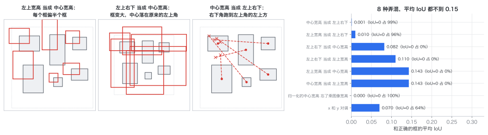
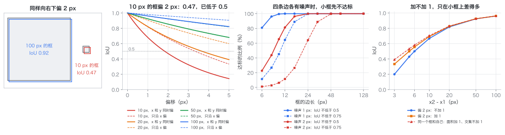
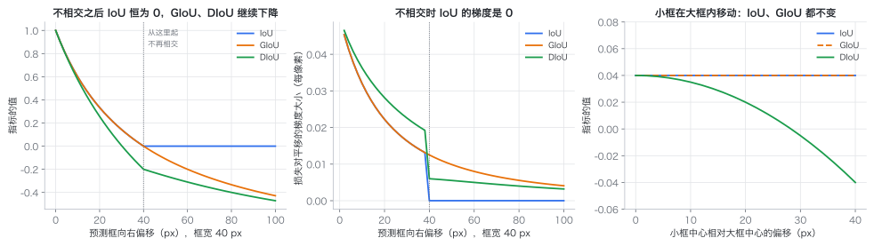
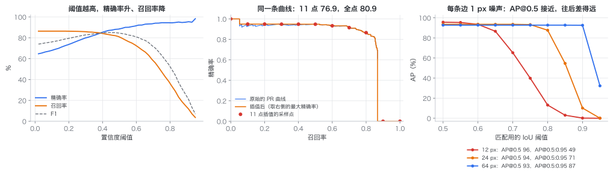
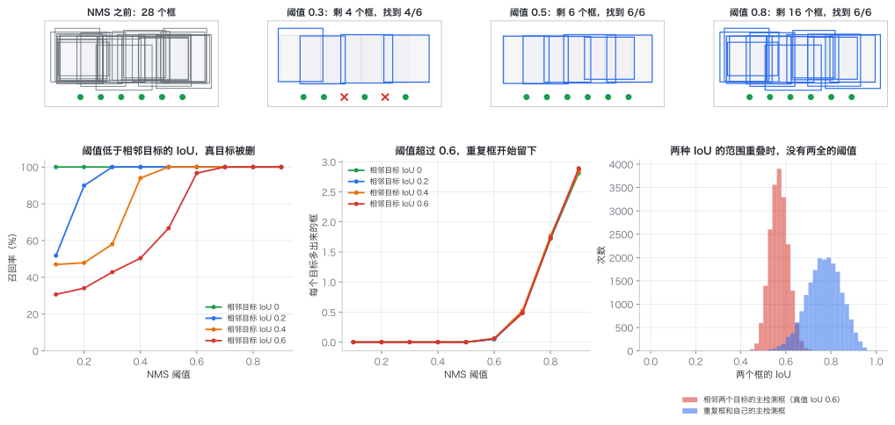
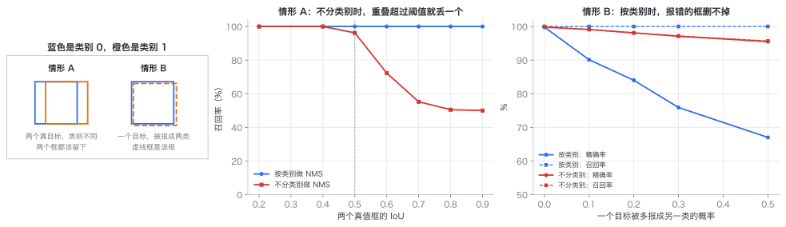

# 第 11 天：目标检测 —— 从“看见是什么”到“指出在哪里”

> [!NOTE]
> 本章所有数字都来自实测或脚本计算，记录在 [`figures/实测数字.json`](figures/实测数字.json)，由 `solutions` 分支的 `solutions/figures/ch11.py` 生成。IoU 和 NMS 一律调用本章作业的参考实现，GIoU、DIoU 和 RoI Align 的对照用 torchvision 0.29.2。本机没有检测模型，也没有 COCO，所以“检测器的输出”是模拟出来的：在真值框上加定位噪声得到主检测，再加重复框和位置随机的假框。换成真实检测器和真实数据，数值会变，结论的方向要自己再测一遍。

> 配套练习：`DL-7 YOLO 自定义检测` | `DL-8 手写 IoU + NMS`
>
> 前置知识：第 8 天的损失函数与反向传播、第 9 天的 CNN 与感受野、第 10 天的迁移学习和数据增强。

（原文写的是“第 9 天的 CNN 与特征金字塔直觉”。第 9 章没有讲特征金字塔，FPN 在本章 11.2 节第一次出现，第 9 章能提供的是 9.4 节的感受野。）

自动验收的作业是 [`作业_批量IoU与类别NMS.py`](./作业_批量IoU与类别NMS.py)，它就是 DL-8 的批量版本。DL-7 和 DL-8 的原始题目在 [`视觉算法学习计划.md`](../视觉算法学习计划.md) 第二部分“第 4 天：目标检测”一节，DL-7 需要自己准备照片和标注，在自己的机器上完成。

---

## 0. 本章怎么学

**应用场景**：有标注时定位并分类缺陷。产线上已经积累了带框标注的缺陷图（颗粒、划痕、缺失之类），希望模型直接输出“哪里有缺陷、是哪一类”，用的就是这一章的方法。工业缺陷往往只有十几个像素，本章花了不少篇幅量化“小目标”上的 IoU 和 AP 有多脆弱。

**优先级**：P3，已有基础或用得少。前置是第 9 章（卷积、感受野）。半导体检测里更常见的是第 18 章的比对法和第 19 章的异常检测，监督检测是它们之后的“第二步”（第 19 章第 7 节）。所以本章可以先走速通档，等真的要训练检测器时再升档。

| 档位 | 累计用时 | 做什么 | 做到什么算完 |
|---|---:|---|---|
| 速通 | 3 小时 | 读 11.1、11.4、11.5、11.6 节，看懂图 1 到图 6，做 11.6 节末尾演示的 5 步，答完 5 道小测 | 能讲清坐标格式弄混的症状，为什么小目标的 IoU 对一两个像素这么敏感，同一份检测结果的 AP 为什么能报出不同的数，NMS 阈值和按类别做 NMS 各在什么情况下出错 |
| 标准 | 10 小时 | 读完全章，跑 Notebook，完成 `作业_批量IoU与类别NMS.py` 并验收通过，做 11.12 节前三个破坏实验，填实验记录 | 验收 5 项全部通过，实验记录的五个场景（完全重合、完全分离、边界接触、链式重叠、跨类别重合）都填了，自测问题都能答 |
| 深挖 | 12 小时 | 再做 11.12 节其余的破坏实验和 11.13 节的扩展（在自己的机器上跑一次 DL-7，或者自己实现 AP 并和图 4 对照） | 能对一份检测结果按第 11.5 节的格式报告：写清 IoU 阈值、插值方式、置信度截断和按尺寸分组的结果 |

> [!TIP]
> 用时超过所选档位的 1.5 倍还没做完，就把卡点写进 `学习进度.md`，先往下一章走。本章作业很短，时间主要花在 11.5 和 11.6 节。DL-7 要训练模型，第一次跑通环境可能比预想的久，它不在速通和标准档里。

---

## 11.1 检测比分类多做了什么

分类模型回答：“图里有没有猫？”目标检测还要回答：“有几只猫？每只在哪里？”因此一张图的标签不再是单个类别，而是一组目标：

```text
[(class_id, x1, y1, x2, y2), ...]
```

`(x1,y1)` 是左上角，`(x2,y2)` 是右下角。也常用中心点形式 `(cx,cy,w,h)`。两者可互换：

```text
cx=(x1+x2)/2, cy=(y1+y2)/2, w=x2-x1, h=y2-y1
```

检测的难点来自“输出数量不固定”。一张图可能没有目标，也可能有几十个；网络却只能输出固定形状张量。现代检测器通常先产生大量候选预测，再通过置信度阈值和 NMS 留下最终结果。

一个预测通常包含三类信息：

1. **位置**：框的中心和宽高，或到四条边的距离；
2. **目标性 objectness**：这里是否存在任意目标；
3. **类别分数**：如果有目标，它属于哪一类。

第 9 天的分类网络把空间特征压成一个向量；检测网络必须保留空间布局，因为“在哪里”正藏在特征图的位置中。

### 坐标格式弄混时是什么样子

常见的格式至少有三种：左上右下 `(x1,y1,x2,y2)`、中心宽高 `(cx,cy,w,h)`、左上宽高 `(x,y,w,h)`。YOLO 的标签文件用的是中心宽高，再除以图像的宽和高归一化到 0 到 1。不同的库、不同的标注工具各用一种，弄混是检测项目里最常见的错误之一。它不会报错，只会让指标莫名其妙地低。

下面在 640×640 的画面里随机放 5000 个框（宽和高各自在 8 到 200 px 之间），把同一组数字按另一种格式解释，再和正确的框算 IoU。



| 弄混的方式（5000 个随机框，640×640） | 平均 IoU | IoU 为 0 的比例 | 其他症状 |
|---|---:|---:|---|
| 中心宽高 当成 左上右下 | 0.001 | 99.1% | 99.1% 的框“右下角”在“左上角”的左边或上边 |
| 左上宽高 当成 左上右下 | 0.01 | 96.1% | 96.1% 的框右下角不在左上角右下方 |
| 左上右下 当成 中心宽高 | 0.082 | 0% | 71.3% 的框超出画面 |
| 左上右下 当成 左上宽高 | 0.11 | 0% | 74.5% 的框超出画面 |
| 左上宽高 当成 中心宽高 | 0.143 | 0% | 每个框的 IoU 都是 0.143，19.5% 超出画面 |
| 中心宽高 当成 左上宽高 | 0.143 | 0% | 同上 |
| 归一化的中心宽高 忘了乘图像宽高 | 0 | 100% | 所有框挤在画面左上角 1 px 以内 |
| x 和 y 对调 | 0.07 | 63.8% | 正方形、靠近对角线的框碰巧对得上，3.4% 的 IoU 不低于 0.5 |

几个可以直接用来诊断的规律：

1. **左上宽高和中心宽高互相弄混时，IoU 恒等于 1/7**（0.1429）。框只是平移了半个宽、半个高，交集是原面积的四分之一，并集是原面积的 7/4。不管框多大，结果都一样。看到所有预测的 IoU 都卡在 0.14 附近，基本可以断定是这一种。
2. **把宽高当成右下角，绝大多数框变成“负宽度”**。这类框的面积按 `max(x2-x1, 0)` 算是 0，IoU 也是 0，训练时可能直接产生 NaN。拿到数据先检查 `x2 > x1` 和 `y2 > y1` 的比例。
3. **把右下角当成宽高，框会变大并跑出画面**。超出画面的比例从 0 一下子跳到七成，比看 IoU 更早暴露问题。
4. **x 和 y 对调最隐蔽**。只要目标大致是正方形、又靠近对角线，IoU 可以很高（最大 0.946）。看平均数发现不了，要把框画到图上看。

11.8 节第 2 步“检查框与类别”说的就是这些情况。最有效的检查方法始终是把框画在图上。

<!-- quiz -->
**一批标注是左上宽高 `(x, y, w, h)`，读的时候当成了中心宽高 `(cx, cy, w, h)`。这批框和正确的框的 IoU 会是什么样子？**

- A. 大小不一，大框的 IoU 高，小框的低
- B. 每个框都是 1/7，大约 0.143
- C. 全部是 0

<details markdown="1"><summary>答案与解释</summary>

**B**。实测 5000 个框的 IoU 最小值和最大值都是 0.143。这种弄混只是把每个框向左上平移了半个宽、半个高，交集是原面积的 1/4，并集是 7/4，比值和框的大小无关。全部是 0 的是另一种错误：归一化坐标忘了乘图像的宽高。

</details>
<!-- /quiz -->

---

## 11.2 两阶段与一阶段：先找再认，还是一次完成

### Faster R-CNN：两阶段

两阶段检测器把问题拆开：

```text
图像 → Backbone 特征
     → RPN 产生候选区域
     → RoI Align 抽取每个区域的固定尺寸特征
     → 分类头 + 边框回归头
```

RPN 先问“哪些位置像目标”，第二阶段再精细分类和修框。这样通常定位精细、对小目标友好，但每个候选区域还要继续处理，速度和部署复杂度较高。

RoI Align 的关键不是名字，而是**避免粗暴取整**。候选框坐标映射到特征图后常是小数；RoI Pooling 取整会造成错位，RoI Align 用双线性插值采样，更适合需要精确边界的任务。

这里的错位有多大，可以用一张“斜坡”特征图量出来：步长 16 的特征图，每个格子的值就等于它的中心在原图上的 x 坐标。一个 32×32 px 的 RoI 每次右移 4 px，输出 1×1，理想的输出应该等于 RoI 中心的 x 坐标。

| RoI 右移（px），步长 16，torchvision 0.29.2 | 0 | 4 | 8 | 12 | 16 | 20 |
|---|---:|---:|---:|---:|---:|---:|
| RoI 的真实中心 x | 216 | 220 | 224 | 228 | 232 | 236 |
| `roi_align(..., aligned=True)` | 216 | 220 | 224 | 228 | 232 | 236 |
| `roi_align(..., aligned=False)` | 224 | 228 | 232 | 236 | 240 | 244 |
| `roi_pool`（取区域内最大值） | 248 | 248 | 248 | 248 | 264 | 264 |

1. **`roi_pool` 的输出按 16 px 一档跳**。RoI 右移 12 px 时输出没有变，再移 4 px 才跳一档，这就是取整造成的错位。
2. **RoI Align 也要用对参数**。`aligned=False` 时输出整体偏了 8 px，正好是半个格子：它没有把“像素中心在 0.5”这件事考虑进去。在 torchvision 0.29.2 里 `aligned` 的默认值是 `False`。半个格子在步长 16 时是 8 px，对一个十几像素的缺陷来说已经是半个缺陷的尺寸。用别的框架时，先查清它的默认约定。

### YOLO：一阶段

YOLO 把检测写成一次稠密预测：特征图上的许多位置同时预测框和类别。

```text
图像 → Backbone → Neck（融合多尺度）→ Detection Head → 候选框 → NMS
```

- **Backbone** 提取纹理到语义的层级特征；
- **Neck**（如 FPN/PAN）融合高分辨率细节与低分辨率语义；
- **Head** 在多个尺度上输出位置、目标性和类别。

例如输入 `640×640`，大尺度特征图负责小目标，小尺度特征图负责大目标。这对应第 9 天的感受野：深层单元“看得广”但位置粗，浅层单元“看得细”但语义弱，FPN 让两者合作。

换成具体的数：640×640 的输入在步长 8、16、32 的三层特征图上分别是 80×80、40×40、20×20 个位置，合计 8400 个候选位置。一个 10 px 的缺陷在这三层上的边长分别只有 1.25、0.62、0.31 个格子。步长 32 那一层根本“装不下”它，小目标只能靠最浅的那一层。

“一阶段一定不准、两阶段一定慢”只是历史印象。今天二者边界已经模糊，实际选择应看数据、延迟、显存、部署后端和可维护性，而不是只看论文类别。

---

## 11.3 Anchor 到底在帮助什么

直接让网络从零猜任意宽高很难。Anchor-based 检测器先在每个位置放若干参考框，例如“细长、方形、扁宽”，网络只学习相对修正：

```text
tx, ty：中心相对网格的偏移
 tw, th：宽高相对 anchor 的缩放
```

一种常见参数化是：

```text
bx = sigmoid(tx) + cx
by = sigmoid(ty) + cy
bw = aw * exp(tw)
bh = ah * exp(th)
```

其中 `(cx,cy)` 是网格位置，`(aw,ah)` 是 anchor 尺寸。指数保证宽高为正。训练时需要把真实框分配给合适的 anchor，这叫 **label assignment**。

Anchor 的代价是超参数多、正负样本分配复杂。Anchor-free 方法改为预测中心点、四边距离或关键点，减少手工设计。不要把“无 anchor”等同于“没有候选位置”：它仍在特征图位置上做稠密预测，只是不再依赖预设宽高。

自定义数据若目标形状很特殊，旧式 YOLO 可能需要重新聚类 anchor；新版本常有自动适配或 anchor-free 头，应先确认实现，别机械照搬旧教程。

label assignment 多半也是按 IoU 决定的：和真值框 IoU 够大的 anchor 才算正样本。下一节会看到，十几个像素的目标只要偏一两个像素，IoU 就掉得很厉害，所以小目标在分配阶段就容易“分不到”正样本。具体的分配规则各个版本不同，以所用实现的源码为准。

---

## 11.4 IoU：框重叠得有多好

交并比 Intersection over Union：

```text
IoU(A,B) = area(A∩B) / area(A∪B)
```

范围为 `[0,1]`。完全不重叠是 0，完全相同是 1。计算步骤：

```python
inter_x1 = max(ax1, bx1)
inter_y1 = max(ay1, by1)
inter_x2 = min(ax2, bx2)
inter_y2 = min(ay2, by2)
inter_w = max(0.0, inter_x2 - inter_x1)
inter_h = max(0.0, inter_y2 - inter_y1)
inter = inter_w * inter_h
union = area_a + area_b - inter
iou = inter / (union + 1e-7)
```

`max(0,...)` 不能省，否则不相交时会得到负面积。还要统一坐标约定：连续坐标通常不写 `+1`；某些旧式整数像素实现写 `x2-x1+1`，混用会产生隐蔽误差。

省掉 `max(0,...)` 的后果比“负面积”更糟：两个方向都不相交时，两个负数相乘得到正的交集。在 2000 对随机框里，有 24.6% 本来不相交、却算出了正的 IoU，最大的一个是 1340.156，远远超出 [0, 1]。

**分母加 `1e-7` 的写法要小心**。坐标是像素时，这一项的影响可以忽略：两个相同的 4 px 框算出的 IoU 只比 1 小 6.3e-09。但 YOLO 的标签是归一化到 0 到 1 的坐标，4096 宽的图像里一个 4 px 的框，归一化之后的面积只有 9.5e-07，和 `1e-7` 是同一个量级：

| 两个完全相同的框按 `inter/(union+1e-7)` 算（坐标归一化） | 2 px | 4 px | 8 px | 16 px |
|---|---:|---:|---:|---:|
| 图像宽 640 | 0.9899 | 0.9974 | 0.9994 | 0.9998 |
| 图像宽 4096 | 0.7045 | 0.9051 | 0.9745 | 0.9935 |

晶圆图、面板图常常有几千像素宽，同一个框和自己的 IoU 只有 0.9051，后面所有阈值判断都会偏。作业要求的做法是“并集大于 0 才相除，否则返回 0”，不加 eps，同样的 4 px 框在 float32 下也得到 1.0。验收脚本里有一项专门用归一化坐标下的小框来查这件事（边长 1/512，相当于 4096 宽图像里的 8 px，上表里是 0.9745），分母加固定 `1e-7` 的写法过不了。

IoU 既用于评价，也用于样本匹配和 NMS。但普通 IoU 在两框不相交时恒为 0，无法告诉优化器“应该往哪个方向移动”。因此回归损失常使用 GIoU、DIoU、CIoU：除重叠外，再考虑最小包围框、中心距离和宽高比。

### 一个逐步例子

真实框 `G=(10,10,50,50)`，预测框 `P=(30,20,70,60)`：

```text
交集左上 = (30,20)，右下 = (50,50)
交集面积 = 20×30 = 600
G 面积 = 40×40 = 1600
P 面积 = 40×40 = 1600
并集 = 1600+1600-600 = 2600
IoU = 600/2600 ≈ 0.231
```

它们看起来有重叠，但若评价阈值是 0.5，这个预测仍算定位失败。（参考实现算出的也是 0.231。）

### 小目标：同样偏 2 个像素，IoU 掉得完全不一样

两个同样大小的正方形框，一个相对另一个平移，算 IoU（连续坐标，面积不加 1）：



| 框的边长 | 5 px | 10 px | 20 px | 50 px | 100 px | 200 px |
|---|---:|---:|---:|---:|---:|---:|
| 只沿 x 偏 1 px | 0.667 | 0.818 | 0.905 | 0.961 | 0.98 | 0.99 |
| 只沿 x 偏 2 px | 0.429 | 0.667 | 0.818 | 0.923 | 0.961 | 0.98 |
| x 和 y 同时偏 2 px | 0.22 | 0.471 | 0.681 | 0.855 | 0.924 | 0.961 |
| 位置不变，四条边各向外多 1 px | 0.51 | 0.694 | 0.826 | 0.925 | 0.961 | 0.98 |

1. **同样偏 2 px，10 px 的框 IoU 掉了 0.333，100 px 的框只掉 0.039**（只沿 x 偏）。x 和 y 同时偏时分别掉 0.529 和 0.076。只沿一个方向偏 $d$ 时 IoU 是 $(s-d)/(s+d)$，掉多少只由 $d/s$ 决定，所以框小 10 倍，同样的像素误差就相当于大 10 倍的相对误差。
2. **10 px 的框，向右下偏 2 px 就已经低于 0.5**（0.471），按 IoU 0.5 匹配会被判成定位失败，同时记一次漏检、一次误报。100 px 的框要偏 18.35 px 才掉到 0.5。
3. **框画大一圈也不行**。中心完全对准、四条边各向外多画 1 px，10 px 的框 IoU 只有 0.694，5 px 的框只有 0.51。标注工具里手一抖就是这个量级。

换成更接近实际的情况：预测框四条边各自带独立的高斯噪声，每格 20000 次。

| 框的边长（px） | 6 | 8 | 10 | 12 | 16 | 24 | 32 |
|---|---:|---:|---:|---:|---:|---:|---:|
| 噪声 1 px：IoU 不低于 0.5 的比例 | 80.9% | 96.1% | 99.5% | 100% | 100% | 100% | 100% |
| 噪声 1 px：IoU 不低于 0.75 的比例 | 11.3% | 26.7% | 45.1% | 64.4% | 88.9% | 99.7% | 100% |
| 噪声 2 px：IoU 不低于 0.5 的比例 | 22.6% | 43.7% | 65.4% | 81.3% | 96.3% | 99.9% | 100% |
| 噪声 2 px：IoU 不低于 0.75 的比例 | 1.1% | 2.7% | 6.2% | 11.4% | 26.4% | 64.0% | 88.8% |

同样是 1 px 的定位噪声，32 px 的框 100% 达到 0.75，10 px 的框只有 45.1%。另外，噪声 2 px、边长 16 px 这一格和噪声 1 px、边长 8 px 的平均 IoU 都是 0.684：IoU 只取决于“噪声除以边长”，图 2 右二的两组曲线在横轴上正好错开一倍。

这对工业检测的含义很直接：缺陷常常只有十几个像素，而标注和定位的误差是一两个像素，IoU 0.75 这样的门槛对它们几乎不可能达到。第 18 章 6.1 节用“匹配半径”讨论过同一个问题，11.5 节会把两者放在一起比较。

<!-- quiz -->
**一个 10 px 的方框，预测框向右、向下各偏了 2 px。它们的 IoU 大约是多少？**

- A. 0.92，偏得不多
- B. 0.67
- C. 0.47，已经低于 0.5

<details markdown="1"><summary>答案与解释</summary>

**C**。实测 0.471。0.92 是 100 px 的框同样偏 2 px 时的值（0.924），0.67 是 10 px 的框只沿一个方向偏 2 px 的值（0.667）。IoU 掉多少只由偏移和边长之比决定，10 px 的框偏 2 px 相当于 100 px 的框偏 20 px。

</details>
<!-- /quiz -->

### 端点加不加 1

原文说“混用会产生隐蔽误差”。误差有多大，取决于框有多小：

| x2 - x1（px） | 3 | 5 | 10 | 20 | 50 | 100 |
|---|---:|---:|---:|---:|---:|---:|
| 沿 x 偏 2 px，不加 1 | 0.2 | 0.429 | 0.667 | 0.818 | 0.923 | 0.961 |
| 沿 x 偏 2 px，加 1 | 0.333 | 0.5 | 0.692 | 0.826 | 0.925 | 0.961 |
| 同一个框和自己：面积加 1、交集不加 1 | 0.391 | 0.532 | 0.704 | 0.83 | 0.925 | 0.961 |
| 只有一条边相接的两个框，加 1 | 0.1429 | 0.0909 | 0.0476 | 0.0244 | 0.0099 | 0.005 |

- **100 px 以上的框，两种约定没有差别**；3 px 的框，同样的偏移一个算出 0.2，一个算出 0.333。
- **混用最伤**。面积按加 1 算、交集却按不加 1 算时，同一个 10 px 的框和自己的 IoU 只有 0.704，3 px 的只有 0.391。反过来（交集加 1、面积不加 1），3 px 的框和自己的 IoU 是 8.0，超出了 [0, 1]。
- **加 1 时，边界相接也算重叠**。不加 1 时只有一条边相接的两个框 IoU 是 0；加 1 时 3 px 的框是 0.1429，因为“共用的那一列像素”被算成了交集。作业用的是不加 1 的连续坐标，边界接触的 IoU 必须是 0。
- **在一批小框上，约定不同会让判定翻转**。x2 - x1 在 6 到 16 px 之间、四条边各带 1.5 px 噪声并取整，按不加 1 算有 84.5% 达到 0.5，按加 1 算有 89.3%，4.7% 的框两种约定给出的判定相反。和别人对数时，先问清楚坐标是像素下标还是连续坐标。

### GIoU、DIoU：不相交时还有没有方向

原文这一段说得对：IoU 在两框不相交时恒为 0，没有梯度。下面用两个 40×40 的框把它量出来，梯度是损失 $1 - \text{指标}$ 对预测框整体沿 x 平移的导数。



| 预测框向右偏（px），框宽 40 | 10 | 20 | 30 | 40（刚好相接） | 50 | 80 |
|---|---:|---:|---:|---:|---:|---:|
| IoU | 0.6 | 0.333 | 0.143 | 0 | 0 | 0 |
| GIoU | 0.6 | 0.333 | 0.143 | 0 | -0.111 | -0.333 |
| DIoU | 0.576 | 0.256 | 0.004 | -0.2 | -0.258 | -0.4 |
| IoU 损失对平移的梯度 | 0.032 | 0.0222 | 0.0163 | 0 | 0 | 0 |
| GIoU 损失对平移的梯度 | 0.032 | 0.0222 | 0.0163 | 0.0125 | 0.0099 | 0.0056 |

GIoU 和 DIoU 在两框分开以后仍然继续下降，梯度不为 0，优化器知道该往哪边挪。

原文没有提到的一点：**一个框完全落在另一个框里面时，GIoU 退化成 IoU**。20×20 的预测框在 100×100 的真值框里左右移动，IoU 和 GIoU 都恒等于 0.04，平移的梯度都是 0。这时最小包围框就是大框本身，GIoU 额外的那一项等于 0。DIoU 惩罚中心距离，小框中心偏 20 px 时它从 0.04 降到 0.02，所以能把小框往中心推。预测框远小于真值框是训练初期的常见情况，这正是 DIoU、CIoU 被提出来的原因之一。

---

## 11.5 Precision、Recall、AP 与 mAP

先在某个 IoU 阈值下匹配预测与真实框：

- **TP**：类别正确，且与尚未匹配的真实框 IoU 达标；
- **FP**：背景误报、类别错、定位不达标，或同一目标被重复预测；
- **FN**：真实目标没有被检测到。

```text
Precision = TP/(TP+FP)   预测出来的有多少是真的
Recall    = TP/(TP+FN)   真实目标有多少被找到了
```

改变置信度阈值，会得到一条 Precision-Recall 曲线。**AP** 是该类别 PR 曲线下面积，**mAP** 是各类别 AP 的平均。

常见的 `mAP@0.5` 只要求 IoU≥0.5；`mAP@0.5:0.95` 在 0.50、0.55……0.95 十个阈值上求平均，更强调精确定位。报告结果必须写清口径，否则两个“mAP 80%”可能根本不可比。

类别不均衡时，mAP 给每类相同权重：稀有类很差会明显拉低平均值。这通常比只看总体准确率合理，但业务还可能更关心某些关键类，需要同时报告 per-class AP、召回率和混淆矩阵。

下面把“口径”的每一项量出来。本机没有检测模型，用的是一个模拟检测器：200 张 640×640 的图，每张 6 到 10 个真值框（宽高 16 到 128 px），3 个类别，共 1592 个真值框。每个真值以 92% 的概率得到一个主检测（四条边各加边长 5% 的噪声），每个主检测再带若干个重复框，每张图另有几个位置随机的假框，5% 的主检测类别标错。NMS 之前共 4237 个框，按类别做 NMS（阈值 0.5）之后剩 2141 个。完整的生成规则写在 `实测数字.json` 的“模拟检测器”一项里。



### 置信度阈值

同一份 NMS 之后的结果，匹配的 IoU 阈值 0.5，只改变置信度阈值：

| 置信度阈值 | 0.05 | 0.25 | 0.4 | 0.5 | 0.6 | 0.7 | 0.8 | 0.9 |
|---|---:|---:|---:|---:|---:|---:|---:|---:|
| 精确率 | 65.9% | 76.7% | 85.4% | 88.4% | 91.5% | 93.8% | 94.2% | 95.2% |
| 召回率 | 86.4% | 86.1% | 84.1% | 80.8% | 72.2% | 58.4% | 36.5% | 13.6% |
| F1 | 74.7% | 81.1% | 84.8% | 84.4% | 80.7% | 72.0% | 52.6% | 23.7% |
| 每张图的误报数 | 3.56 | 2.08 | 1.14 | 0.84 | 0.54 | 0.3 | 0.18 | 0.06 |

阈值从 0.05 提到 0.4，召回率几乎不动（86.4% 到 84.1%），误报却从每张图 3.56 个降到 1.14 个：低分段里主要是假框。再往上提，召回率掉得越来越快。召回率的上限 86.4% 由“漏检”决定，任何阈值都补不回来。这条曲线的形状取决于分数分布，这里的分数分布是人为设定的，真实检测器要自己画。第 14 章 14.6 节讲怎样在验证集上选这个工作点。

### AP 的算法

同一份检测结果，只换 AP 的算法：

| 算法（同一份结果，IoU 阈值 0.5） | mAP | 类别 0 的 AP |
|---|---:|---:|
| 不插值，直接按召回率的增量累加精确率 | 80.8 | 80.5 |
| 全点插值（VOC2010 起） | 81.2 | 80.9 |
| 11 点插值（VOC2007） | 77.5 | 76.9 |
| 101 点插值（COCO） | 80.8 | 80.4 |

插值的意思是：每个召回率处的精确率，换成它右边（召回率更高处）的最大精确率，得到图 4 中间那条橙色的阶梯包络。11 点插值只在召回率 0、0.1、……、1.0 这 11 个点上取包络的值再平均。

**11 点插值比全点低了 3.7**。类别 0 能达到的最高召回率是 86.8%，11 个采样点里 0.9 和 1.0 两个点落在曲线外，取 0；全点插值只按实际缺少的那 13.2% 扣分。召回率上限越不接近采样点，两者差得越多。所以原文“AP 是 PR 曲线下面积”要补一句：曲线怎么插值、在哪些点上采样，都会改变这个面积。

**IoU 阈值的影响比插值大得多**：

| 匹配用的 IoU 阈值（101 点） | 0.5 | 0.6 | 0.7 | 0.75 | 0.8 | 0.85 | 0.9 | 0.95 |
|---|---:|---:|---:|---:|---:|---:|---:|---:|
| mAP | 80.8 | 80.8 | 80.7 | 76.7 | 60.6 | 26.4 | 3.7 | 0 |

十档平均（mAP@0.5:0.95）是 57.1，比 mAP@0.5 低 23.7。这份模拟数据里定位噪声是边长的 5%，IoU 在 0.7 以前几乎都达标，0.8 以后迅速崩掉。

另外两个容易被忽略的口径：

- **评估前先按置信度截断**。原文说“通常先按置信度过滤，再做 NMS”，部署时是对的，算 mAP 时要小心。先按 0.5 截断再算，mAP 从 81.2 降到 76.5，少了 4.7：低分段被砍掉，PR 曲线后半段直接没了。按 0.25 截断只差 0.1。所以评估时阈值要设得很低（例如 0.001），部署时的置信度阈值另外定。
- **不做 NMS 直接算**，mAP 从 81.2 降到 71.6：重复框全部记成误报。
- 把匹配规则换成 VOC 式（IoU 最大的那个真值已被占用就直接算误报），在这份数据上 mAP 没有变化（81.2）。目标密集时就不一样了：11.6 节的场景里相邻目标 IoU 0.7、NMS 阈值 0.7 时，COCO 式是 95.2，VOC 式是 91.9。

<!-- quiz -->
**同一份检测结果，一次按 11 点插值算 AP@0.5，一次按全点插值算。这份结果能达到的最高召回率是 86.8%。两个数会差多少？**

- A. 完全一样，插值只是计算技巧
- B. 11 点插值低 3 到 4 个点
- C. 11 点插值低 20 个点以上

<details markdown="1"><summary>答案与解释</summary>

**B**。实测 mAP 分别是 77.5 和 81.2，差 3.7。召回率到不了 0.9，11 个采样点里最后两个直接取 0；全点插值只按实际缺的 13.2% 扣分。差 20 个点以上的是另一个口径：mAP@0.5（80.8）和 mAP@0.5:0.95（57.1）差 23.7。

</details>
<!-- /quiz -->

### 小目标的 AP：0.5 和 0.5:0.95 的差别主要在这里

单一类别，每张图 8 个同样大小的目标，150 张图。每个目标以 95% 的概率得到一个检测框，四条边各加固定像素数的噪声（不随目标大小变），每张图另有两个左右的同尺寸假框，AP 用 101 点：

| 目标边长（px） | 8 | 12 | 16 | 24 | 32 | 64 | 128 |
|---|---:|---:|---:|---:|---:|---:|---:|
| 噪声 1 px：AP@0.5 | 87.7 | 95.7 | 93.6 | 93.5 | 92.6 | 92.7 | 95.5 |
| 噪声 1 px：AP@0.75 | 7.7 | 39.9 | 75.4 | 93.3 | 92.6 | 92.7 | 95.5 |
| 噪声 1 px：AP@0.5:0.95 | 30.3 | 49.3 | 59.3 | 71.3 | 76.5 | 86.7 | 95.4 |
| 噪声 2 px：AP@0.5 | 20.3 | 62.5 | 86.3 | 93.5 | 92.6 | 92.7 | 95.5 |
| 噪声 2 px：AP@0.5:0.95 | 3.9 | 15.6 | 29.3 | 48.9 | 58.7 | 77.3 | 89.1 |

定位能力（以像素计）完全相同的一个检测器，在 128 px 的目标上 AP@0.5:0.95 是 95.4，在 12 px 的目标上只有 49.3，AP@0.5 却几乎一样。COCO 把指标按目标面积分成小、中、大三组分别报告，就是这个原因。工业缺陷检测报 mAP@0.5:0.95 时，一个“低”的数字可能只是说明缺陷小，不一定说明模型差；反过来，只报 mAP@0.5 会掩盖小缺陷定位不准的问题。最稳妥的做法是按缺陷尺寸分组报告。

### 怎样算“命中”：和第 18 章互相印证

第 18 章 6.1 节测过：检测结果完全不变，只改变匹配半径，检出率能从 14% 报到 73%。检测框架用 IoU 阈值代替匹配半径，问题是同一个。这里用 12×12 px 的目标、每条边 1.5 px 的定位噪声，置信度阈值固定 0.3，150 张图：

| 匹配规则（12 px 目标，同一份检测结果） | 召回率 | 精确率 | 每张图的误报数 |
|---|---:|---:|---:|
| IoU 不低于 0.1 | 95.0% | 93.0% | 0.57 |
| IoU 不低于 0.3 | 94.9% | 92.9% | 0.58 |
| IoU 不低于 0.5 | 91.7% | 89.7% | 0.84 |
| IoU 不低于 0.75 | 26.9% | 26.3% | 6.02 |
| 中心距离不超过 1 px | 34.8% | 34.1% | 5.39 |
| 中心距离不超过 3 px | 93.2% | 91.3% | 0.71 |

IoU 阈值从 0.5 提到 0.75，召回率从 91.7% 掉到 26.9%，误报从每张图 0.84 个涨到 6.02 个：定位稍差的命中同时被记成一次漏检和一次误报，和第 18 章半径太小的现象一样。对十几像素的缺陷，IoU 0.5 已经偏严，有的项目改用中心距离或者更低的 IoU 阈值来判命中。用哪种规则可以商量，但必须写进报告。

### 怎么报告一份检测结果

- **写清口径**：匹配用的 IoU 阈值（或中心距离）、AP 的插值方式、评估时的置信度截断、NMS 阈值和是否按类别。
- **按类别、按尺寸分组**。mAP 之外给每类 AP，并按目标大小分组；小缺陷的组单独看。
- **给一个工作点**。mAP 和阈值无关，产线要的是某个置信度阈值下的召回率和每张图的误报数，像上面的置信度表那样列出来，标出选定的那一行。
- **样本少时报区间**。缺陷样本几十个时，一两个样本就能让召回率变好几个百分点，做法见第 18 章 6.2 节。

---
## 11.6 NMS：从一堆重叠框中选代表

同一目标附近会产生许多高分框。经典 NMS 是贪心算法：

```text
1. 按置信度从高到低排序；
2. 取最高分框加入结果；
3. 删除与它同类别且 IoU 超过阈值的框；
4. 对剩余框重复。
```

NMS 阈值太低，会误删密集目标；太高，会保留重复框。通常先按置信度过滤，再做 NMS，避免处理海量低质量框。

必须理解 **class-aware NMS**：不同类别通常分别去重，否则“人”和“背包”高度重叠时可能互相删除。Soft-NMS 不直接删框，而是按重叠程度降低分数；密集场景可能更稳。

DL-8 应自己实现 IoU 与 NMS，但不要只验证“能运行”。至少设计四类测试：完全重合、完全分离、边界接触、三个框链式重叠。教程不直接给完整练习答案，排序、索引更新和批处理留给你完成。

### 链式重叠：贪心意味着什么

三个同类的框 (0,0,10,10)、(4,0,14,10)、(8,0,18,10)，相邻两个的 IoU 是 0.429，隔一个的 IoU 是 0.111，NMS 阈值 0.3：

- 分数是 0.9、0.8、0.7 时，保留第 0 和第 2 个。第 0 个先删掉第 1 个，第 1 个已经被删，就没有资格再去删第 2 个。
- 分数换成 0.8、0.9、0.7（中间的最高）时，只保留第 1 个，它一次把两边都删了。
- 如果实现时让“已经被删的框”继续去删别人，第一种分数下只会剩第 0 个。

同一组框，留下几个取决于分数的顺序，这就是“贪心”。验收脚本里有这一组链式重叠的框，两种分数顺序各测一次。配图脚本里把第三种错误写法交给验收脚本，5 项里通过 4 项，没通过的就是链式重叠那一项。

### 阈值和密集目标：两种 IoU 的分布重叠了

一排 6 个同类、40×40 px 的目标，相邻两个真值框的 IoU 分别取 0、0.2、0.4、0.6。每个目标一个主检测（四条边加边长 3% 的噪声），再带平均 3 个重复框（噪声为边长的 8%，分数比主检测低），没有漏检和假框，各 300 组。NMS 之后不做置信度过滤，按 IoU 0.5 匹配。



| 召回率，按 NMS 阈值（6 个 40 px 目标一排，300 组） | 0.1 | 0.2 | 0.3 | 0.4 | 0.5 | 0.6 | 0.7 | 0.8 |
|---|---:|---:|---:|---:|---:|---:|---:|---:|
| 相邻目标 IoU 0（互不重叠） | 100% | 100% | 100% | 100% | 100% | 100% | 100% | 100% |
| 相邻目标 IoU 0.2 | 51.8% | 89.9% | 100% | 100% | 100% | 100% | 100% | 100% |
| 相邻目标 IoU 0.4 | 47.0% | 47.9% | 58.0% | 94.0% | 100% | 100% | 100% | 100% |
| 相邻目标 IoU 0.6 | 30.7% | 34.1% | 42.8% | 50.4% | 66.7% | 96.7% | 100% | 100% |
| 每个目标多出来的框（四种密度大致相同） | 0 | 0 | 0 | 0 | 0 | 0.05 到 0.06 | 0.48 到 0.52 | 1.72 到 1.77 |

1. **阈值一旦低于相邻目标之间的 IoU，真目标就被成片删掉**。相邻 IoU 0.4 时，阈值 0.3 只剩 58.0% 的召回率；IoU 0.6 时，常用的阈值 0.5 只有 66.7%。相邻 IoU 0.2 和 0.4 时，阈值 0.1 的召回率只有 51.8% 和 47.0%，一排目标里大约每隔一个被删一个。
2. **阈值超过 0.6，重复框开始留下来**，每个目标多出的框从 0.05 涨到阈值 0.8 时的 1.72 到 1.77，而且和密度无关。原因在图 5 右下：重复框和自己的主检测框之间的 IoU，5% 分位是 0.639，中位数是 0.772。
3. **两种 IoU 的分布一旦重叠，就没有两全的阈值**。相邻目标真值 IoU 0.6 时，它们的主检测框之间的 IoU 在 0.504 到 0.637 之间（5% 到 95% 分位），和重复框的 IoU 范围接上了。这时阈值 0.6 召回率 96.7%、还剩少量重复框，0.7 召回率 100%、每个目标多出 0.48 个框，选哪个要看漏检和误报哪个代价高。

**Soft-NMS 是不是更稳**，要看在什么指标上（脚本里按高斯降分公式写的朴素版本，sigma=0.5）：

| 相邻目标 IoU | 0 | 0.4 | 0.6 | 0.7 |
|---|---:|---:|---:|---:|
| 硬 NMS 阈值 0.5：AP@0.5 | 100.0 | 99.9 | 66.6 | 51.2 |
| 硬 NMS 阈值 0.7：AP@0.5 | 93.7 | 94.0 | 95.4 | 95.2 |
| Soft-NMS：AP@0.5 | 99.9 | 99.6 | 97.1 | 97.0 |
| Soft-NMS，置信度阈值 0.3 时的召回率 | 99.7% | 93.8% | 62.8% | 49.9% |
| 硬 NMS 阈值 0.7，置信度阈值 0.3 时的召回率 | 99.7% | 99.4% | 99.8% | 97.9% |

按 AP 看，Soft-NMS 在每种密度下都接近最好（相邻 IoU 0.6 时 97.1）。可是它把相邻真目标的分数也降了，部署时只要设一个置信度阈值（这里是 0.3），这些被降分的真目标就被筛掉，召回率反而和阈值 0.5 的硬 NMS 差不多（0.6 时 62.8% 对 65.3%）。AP 是对所有阈值的平均，它看不出部署时会发生什么。所以原文“密集场景可能更稳”要加一个条件：在 AP 上更稳；要在固定阈值下用它，必须和置信度阈值一起重新调。

<!-- quiz -->
**一排同类目标，相邻两个的 IoU 大约 0.6。NMS 阈值用常见的 0.5，每个目标的检测框都很准。召回率大约是多少？**

- A. 接近 100%，因为检测框都很准
- B. 大约三分之二
- C. 不到 10%

<details markdown="1"><summary>答案与解释</summary>

**B**。实测 66.7%。相邻两个目标的检测框之间的 IoU 有一大部分超过 0.5，分数高的那个就把相邻的真目标当成重复框删了。阈值提到 0.6 时召回率回到 96.7%，但重复框开始留下来（每个目标多 0.05 到 0.06 个），提到 0.7 时每个目标多出约 0.5 个。

</details>
<!-- /quiz -->

### 按类别还是不分类别

“按类别做”和“不分类别做”各有一种情况会出错：



**情形 A：两个不同类别的真目标互相重叠**（各 500 组，NMS 阈值 0.5）：

| 两个真值框的 IoU | 0.4 | 0.5 | 0.6 | 0.7 | 0.8 | 0.9 |
|---|---:|---:|---:|---:|---:|---:|
| 按类别：召回率 | 100% | 100% | 100% | 100% | 100% | 100% |
| 不分类别：召回率 | 100% | 96.2% | 72.3% | 55.2% | 50.5% | 50.0% |

不分类别时，两个真目标的重叠一旦接近 NMS 阈值，分数低的那个就被当成重复框删掉，重叠越大越接近“两个只剩一个”。这是原文“人和背包互相删除”的情形。

**情形 B：同一个目标被报成了两个类别**（每张图 6 个目标，各 300 张，报错的框分数偏低）：

| 一个目标多出一个错类别框的概率 | 0 | 0.1 | 0.2 | 0.3 | 0.5 |
|---|---:|---:|---:|---:|---:|
| 按类别：精确率 | 99.8% | 90.1% | 84.0% | 75.9% | 67.0% |
| 按类别：每张图的误报数 | 0.01 | 0.66 | 1.15 | 1.9 | 2.95 |
| 不分类别：精确率 | 99.8% | 99.1% | 98.1% | 97.1% | 95.5% |
| 不分类别：召回率 | 100% | 99.1% | 98.1% | 97.2% | 95.7% |
| 按类别：mAP@0.5 | 100.0 | 99.0 | 97.9 | 96.6 | 95.5 |
| 不分类别：mAP@0.5 | 100.0 | 98.7 | 97.5 | 95.9 | 94.0 |

按类别做 NMS 时，错类别的框和正确的框不在一组里，谁也删不掉谁，每张图多出最多 2.95 个误报，精确率掉到 67.0%。不分类别时这个错框被删了，但如果它的分数碰巧更高，删掉的就是正确的框，召回率也跟着降一点。

两个容易误判的地方：

- **mAP 几乎看不出情形 B**。报错概率 0.5 时按类别的 mAP@0.5 是 95.5，比不分类别的 94.0 还高，精确率却低了将近 30 个点。错类别的框分数偏低，落在 PR 曲线的尾部，对面积影响很小；但在固定的置信度阈值下它们全都算误报。
- **缺陷检测里情形 B 很常见**。颗粒和凸起、划痕和裂纹，外观接近的类别之间模型经常犹豫。一个物理位置只该有一个缺陷时，常见的做法是先按类别做 NMS，再对剩下的框做一次不分类别、阈值更高的去重，或者把容易混的类别合并。要不要这样做，按自己的数据测过再定。

作业要求的是按类别做，`labels` 不同的框之间不互相抑制。实现上不需要为每个类别循环一次：只要在“删除”这一步加一个同类别的条件即可。torchvision 0.29.2 的 `batched_nms` 在框不多时（看它的源码，CPU 上是坐标总数不超过 4000）用的是另一种办法：给每个类别的框加上一个足够大的坐标偏移，让不同类别的框不可能重叠，再做一次普通的 NMS。参考实现和它在 300 组随机输入上保留的下标完全相同。

<!-- quiz -->
**同一个缺陷被模型同时报成“颗粒”和“凸起”两个框，位置几乎重合。用按类别的 NMS（阈值 0.5），结果会怎样？**

- A. 分数低的那个被删掉，只留一个
- B. 两个都留下，多出一个误报
- C. 两个都被删掉

<details markdown="1"><summary>答案与解释</summary>

**B**。按类别的 NMS 只在同一类别里互相抑制，类别不同的两个框谁也删不掉谁。实测每个目标有一半的概率出现这种错误时，每张图多出 2.95 个误报，精确率从 99.8% 掉到 67.0%，mAP@0.5 却还有 95.5，只看 mAP 发现不了。A 是不分类别做 NMS 的结果。

</details>
<!-- /quiz -->

### 交互演示：拖动两个框，调 NMS 阈值

演示页里可以拖动框（拖右下角的小方块改大小），实时看 IoU、交集和并集；调 NMS 阈值和置信度阈值，看一组重叠的框里哪些被保留、哪些被谁删掉。页面下方的五步引导依次对应 11.4 节小目标的 IoU、端点加不加 1，以及本节的重复框、密集目标和按类别做 NMS。演示页的计算和作业规则相同（只删同类别且 IoU 严格大于阈值的框），场景是手工摆的几个框，所以数值和上面的表不同，现象相同。

<!-- embed: ../demos/IoU与NMS.html 1080 -->
[打开交互演示：IoU 与 NMS](../demos/IoU与NMS.html)

---

## 11.7 检测损失：三个目标如何一起学

简化后总损失可写为：

```text
L = λ_box L_box + λ_obj L_obj + λ_cls L_cls
```

- `L_box`：IoU 系列损失，推动框贴近真实框；
- `L_obj`：二元交叉熵，区分目标与背景；
- `L_cls`：交叉熵或 BCE，学习类别。

背景位置远多于目标位置，若全部同等训练，模型可能靠“一律预测背景”获得很小的平均损失。常见处理包括正负样本筛选、Focal Loss 和动态标签分配。

Focal Loss 在 BCE 上乘 `(1-p_t)^γ`。容易样本的 `p_t` 接近 1，权重被压低；困难样本获得更多关注。它不是“类别权重”的同义词：类别权重解决类间不均衡，Focal 更关注难易不均衡。

用 11.2 节的 8400 个候选位置算一个纯算术的例子（不是训练实测）：假设其中 10 个是正样本，模型给它们的概率是 0.3；其余全是负样本，模型已经比较有把握，给它们的“是目标”的概率是 0.02。

| 8400 个位置，10 个正样本 | 正样本的损失之和 | 负样本的损失之和 | 负样本占总损失 |
|---|---:|---:|---:|
| 交叉熵 | 12.04 | 169.5 | 93.4% |
| Focal，$\gamma = 2$ | 5.9 | 0.068 | 1.1% |

每个负样本的交叉熵都很小，但 8390 个加起来占了总损失的 93.4%，梯度主要在教模型“背景是背景”。乘上 $(1-p_t)^2$ 之后，$p_t = 0.98$ 的负样本权重只剩 0.0004，正样本（$p_t = 0.3$）的权重是 0.49，负样本只占 1.1%。这里的概率是假设的，真实训练中它们一直在变，只用来说明量级。

训练日志中不要只看总 loss。框损失下降但分类损失不降，可能是标签类别错；目标性损失异常，可能是框格式或样本分配有问题。

---

## 11.8 数据流程：标注正确比换模型更重要

### 1. 定义类别和标注规则

先明确遮挡目标是否标、截断目标怎么标、模糊到什么程度忽略。规则不一致等于给模型互相矛盾的监督。

小缺陷还要规定框画多大：贴着缺陷的边缘，还是向外留一两个像素。11.4 节的表说明，10 px 的缺陷四边各多画 1 px，和贴边画的框之间 IoU 只有 0.694。两个标注员各按自己的习惯画，评估时就有一部分“漏检”其实是标注不一致。

### 2. 检查框与类别

训练前随机可视化至少几十张。重点检查：

- `(x,y,w,h)` 与 `(x1,y1,x2,y2)` 是否混淆；
- YOLO 归一化坐标是否真的除以图像宽高；
- resize/flip/crop 后框是否同步变换；
- 类别编号是否从框架要求的起点开始；
- 空标签图是否被正确处理。

除了画图，还可以先跑几个数字检查（11.1 节）：右下角不在左上角右下方的框占多少，超出画面的框占多少，所有坐标是不是都小于 1。任何一项不是接近 0（或者归一化坐标不是全在 0 到 1 之间），先停下来查格式。

### 3. 划分数据

同一视频相邻帧、同一物体连拍、同一场景切图不能随机散到训练和验证集，否则会数据泄漏。应按视频、拍摄批次、设备或物体实例分组划分。

### 4. 增强

水平翻转、颜色扰动、随机缩放、Mosaic 可提升泛化，但增强必须符合业务。文字、交通方向、医学左右侧等场景不能随意翻转。裁剪后只剩极小框时，应设可见面积规则。

---

## 11.9 YOLO 自定义训练：先跑通最小闭环

以 Ultralytics 风格接口说明流程，具体参数以本机版本为准：

```python
from ultralytics import YOLO

model = YOLO("yolo11n.pt")          # 小模型先验证流程
model.train(
    data="dataset.yaml",
    imgsz=640,
    epochs=20,
    batch=16,
    device=0,                      # 第 0 块 NVIDIA 显卡；Apple 芯片写 "mps"，没有显卡写 "cpu"
)
metrics = model.val()
results = model.predict("demo.jpg", conf=0.25, iou=0.7)
```

`dataset.yaml` 通常描述训练/验证图像路径、类别数和名称。建议按以下顺序调试：

1. 用 10～30 张图训练到明显过拟合；若做不到，先查标签与代码；
2. 再跑完整训练集，观察 train/val 曲线；
3. 固定验证集比较模型、输入尺寸和增强；
4. 最后才做长周期训练。

“能在小数据上过拟合”是重要的单元测试。若一个高容量模型连 20 张图都记不住，通常不是泛化问题，而是数据读取、标签映射、损失或学习率有错误。

推理时别只展示最好看的图片。应保存低置信度漏检、高置信度误检、小目标、遮挡、逆光等失败样本，为第 14 天错误分析做准备。

> [!IMPORTANT]
> 这一节是读者在自己机器上做的部分。本课程的配图机器没有安装 ultralytics，也没有下载任何检测模型和数据集，所以本章没有任何 YOLO 训练的精度和耗时数字。上面的代码和参数以 Ultralytics 的官方文档和你安装的版本为准。

**在自己的笔记本上用显卡训练**（读者的机器是 RTX 4060，8 GB 显存）。下面是通用做法，具体数字要自己测：

- **先确认显卡可用**。命令行运行 `nvidia-smi`，能看到显卡型号和驱动版本；在 Python 里 `torch.cuda.is_available()` 应该是 `True`，`torch.cuda.get_device_name(0)` 应该显示显卡名。是 `False` 时，多半是装了 CPU 版本的 PyTorch，按 PyTorch 官网的安装命令装带 CUDA 的版本。上面代码里的 `device=0` 指第 0 块 NVIDIA 显卡；在 Apple 芯片的 Mac 上改成 `device="mps"`。
- **看显存占用**。训练时另开一个终端运行 `nvidia-smi -l 1`，每秒刷新一次；在代码里可以用 `torch.cuda.max_memory_allocated()` 看 PyTorch 实际分配的峰值。`nvidia-smi` 显示的数字会比它大，因为还包括 CUDA 上下文和缓存。
- **显存不够（out of memory）时**，按顺序试：减小 `batch`；减小 `imgsz`（但小缺陷会变得更小，见 11.10 节）；换更小的模型；打开混合精度（Ultralytics 的 `amp` 参数，默认值以你安装的版本的文档为准）。批大小小到只有几张时，BatchNorm 的统计会变得不稳（第 9 章 9.5 节），可以用梯度累积凑出等效的大批量。

### 交给 NMS 之前：评估和部署用的阈值不一样

上面的 `predict(..., conf=0.25, iou=0.7)` 是部署时的阈值。11.5 节测过，评估时先按 0.5 截断，mAP 会少 4.7；按 0.25 截断只少 0.1。`val()` 评估时用的置信度阈值应该很低（具体默认值以 Ultralytics 文档为准，本课程没有在本机验证），两者不要混用。`iou=0.7` 是 NMS 阈值，11.6 节的表说明它在目标互不重叠时会留下一些重复框（每个目标约 0.5 个），换来的是密集目标不被误删。你的数据里目标有多密，决定了该往哪个方向调。

---

## 11.10 常见坑与排查顺序（常见错误）

### 小目标总漏检

目标 resize 后可能只剩几像素。检查原始分辨率和目标尺寸分布；可提高输入尺寸、使用切片推理、补充近景数据或强化高分辨率特征层。提高输入尺寸会近似按面积增加计算量，不是免费午餐。

还要先分清是“真的漏了”还是“框偏了一两个像素被判成漏检”。把匹配的 IoU 阈值临时降到 0.1 或者改用中心距离，召回率如果一下子上来（11.5 节的表里，12 px 的目标按 IoU 0.75 匹配召回率只有 26.9%，降到 0.1 是 95.0%），问题在定位精度或标注一致性，而不是模型没看见。

### 密集目标互相删除

先检查是不是 NMS 阈值过低，再看标注是否包含每个实例。可尝试更合适的 NMS、Soft-NMS 或专门的密集检测方案。

具体到阈值：先统计验证集里同类目标两两之间 IoU 的分布，NMS 阈值要高于它的大部分（11.6 节，相邻 IoU 0.6 时阈值 0.5 只剩 66.7% 的召回率）。

### 训练集很好，验证集很差

优先检查划分是否同分布、样本是否过少、增强是否失真、背景是否形成捷径。第 10 天的 Grad-CAM/Shortcut Learning 直觉仍适用：检测器也可能只认背景纹理。

### 框整体偏移或比例错误

几乎总是几何变换或坐标格式问题。把“增强前图+框”和“增强后图+框”并排画出来，比盯 loss 更有效。

### 类别不均衡

先统计“图片数”和“实例数”，两者不同。可补数据、重采样、调整损失或合并无法可靠区分的类别。不要只复制稀有类图片，否则背景也被重复记忆。

### 指标不错但业务不可用

离线数据可能太干净，或指标没有体现关键成本。例如漏掉安全帽比多报一个安全帽严重，应单独设置关键类召回目标，并在真实设备上测端到端延迟。

### 按现象查

前七行是做作业 `作业_批量IoU与类别NMS.py` 时最容易遇到的。括号里的“验收”是把这种写错的实现交给本章验收脚本（共 5 项）之后通过的项数，配图脚本里实测过；参考实现是 5/5。这几种写法验收都能查出来，报错信息会指出是哪一组输入不对，“怎么查”一栏是自己定位时可以用的最小例子。

| 现象 | 原因 | 怎么查 |
|---|---|---|
| 不相交的两个框算出正的 IoU，甚至大于 1（验收 3/5） | 交集的宽、高没有截断到 0，两个负数相乘变成正数 | 测两个在 x、y 两个方向都分开的框，IoU 必须是 0 |
| 面积为 0 的框和自己的 IoU 是 NaN（验收 4/5） | 并集为 0 时直接相除 | 测 `(5,5,5,5)` 和它自己，应返回 0 而不是 NaN |
| 保留的下标对不上原来的框（验收 2/5） | 先排序再做 NMS，返回的是排序后的位置 | 输入分数故意不按顺序排；300 组随机输入里 99.3% 的结果和参考实现不同 |
| 链式重叠时留下的框太少（验收 4/5） | 已经被删掉的框还在继续删别人 | 用 11.6 节的三个链式框，阈值 0.3，应保留第 0 和第 2 个 |
| IoU 正好等于阈值的框被删了（验收 4/5） | 写成了大于等于；作业要求“严格大于才抑制”，torchvision 的 `nms` 也是 | 测 IoU 正好 0.5 的两个框、阈值 0.5，两个都应保留 |
| 不同类别的重叠目标被删（验收 2/5） | 抑制时没有加同类别的条件 | 两个完全重合、类别不同的框，两个都应保留 |
| 空输入时报错，或返回的不是 long | `torch.tensor([])` 默认是 float | 用 `boxes[:0]` 测，检查返回值的 `dtype` |
| 所有预测的 IoU 都在 0.14 附近 | 左上宽高和中心宽高弄混（11.1 节，恒为 1/7） | 画出几个框和真值叠在一起 |
| 大量框面积为 0，训练出现 NaN | 把宽高当成了右下角 | 统计 `x2 <= x1` 的比例 |
| 所有框挤在图像左上角 | 归一化坐标忘了乘图像宽高 | 打印坐标的最大值，是否都小于 1 |
| 大图上小框的 IoU 总是达不到 1（验收 4/5） | 归一化坐标下分母加了 `1e-7`（11.4 节，4096 宽图上的 4 px 框只有 0.9051） | 改成“并集大于 0 才相除” |
| 和别人算的 IoU 对不上，小框差得多 | 一方的面积加了 1，另一方没有 | 问清坐标是像素下标还是连续坐标；测边界相接的两个框 |
| mAP 和别人报的差几个点 | 插值方式、IoU 阈值、评估时的置信度截断不同 | 逐项核对 11.5 节的口径 |
| mAP 很高但产线上误报多 | 同一个目标被报成两类，按类别 NMS 删不掉（11.6 节） | 统计同一位置、不同类别的框对 |
| RoI 特征整体偏了半个格子 | `roi_align` 用了 `aligned=False`（torchvision 0.29.2 的默认值） | 用斜坡特征图测一次（11.2 节） |

---
## 11.11 与 DL-7～DL-12 的衔接

- **DL-7 YOLO 自定义检测**：本章的数据格式、最小过拟合测试、训练/验证和错误样本保存是主线；你需要自己完成数据集配置和参数实验。
- **DL-8 手写 IoU+NMS**：本章给出定义、边界条件与测试思路，但保留批量实现和最终练习组织，不直接给完整答案。
- **DL-9 U-Net 分割**：检测框只能给粗定位；需要像素边界时转向下一章。
- **DL-10/11**：自编码器或自监督预训练可利用无标签图像，缓解检测标注昂贵的问题。
- **DL-12 综合项目**：将 DL-7 的检测器与 DL-9 的分割器组成端到端系统，并进行部署评估。

这几道题的原文在 `视觉算法学习计划.md` 第二部分：DL-7、DL-8 在“第 4 天：目标检测”，DL-9 在“第 5 天：图像分割”（第 12 章），DL-10、DL-11 在“第 6 天：生成与自监督”（第 13 章），DL-12 在“第 7 天：DL 综合项目”（第 14 章）。本章目录里自动验收的只有 `作业_批量IoU与类别NMS.py`，它是 DL-8 的批量、按类别的版本；DL-7 没有现成的文件，要自己建目录完成。

---

## 11.12 破坏实验

每个实验先写下预测，再运行，把结果和原因记到 `实验记录.md`。前三个是标准档必做。

1. **Notebook 的阈值**。Notebook 里 0 号和 1 号框的 IoU 是多少？先预测阈值取 0.1、0.45、0.9 时各保留哪几个框，再运行最后一个单元对照。1 号框要阈值超过多少才能留下？3 号框为什么在每个阈值下都留着？
2. **去掉交集的截断**。在你的 `pairwise_iou` 里临时去掉交集宽高的 `clamp(min=0)`，先预测验收脚本哪一项会失败，再运行。然后找两个在 x、y 两个方向都分开的框，看算出的 IoU 是多少。（配图脚本里这样改之后验收是 3/5，不相交的框对里算出过 1340.156。）
3. **链式重叠**。用 11.6 节的三个框 (0,0,10,10)、(4,0,14,10)、(8,0,18,10)，阈值 0.3，分数分别取 0.9、0.8、0.7 和 0.8、0.9、0.7。先预测你的 `class_aware_nms` 各保留哪些下标，再把结果写进实验记录的“链式重叠”一行。验收脚本里也有这一组框；这里要的是你先自己说出答案和理由，再去对照。
4. **端点约定**。一个 10 px 的框和它沿 x 偏 2 px 的框，分别按“不加 1”和“加 1”算 IoU，和 11.4 节的表对照。再把两个只有一条边相接的框按两种约定各算一次。
5. **坐标格式**。随机生成一批 xyxy 的框，先转成左上宽高，再故意当成中心宽高交给你的 `pairwise_iou` 和原来的框比。预测 IoU 的分布，再看是不是每个都是 0.143。
6. **按类别与不分类别**。两个完全重合的框、分数 0.9 和 0.8、类别不同，阈值 0.5，用你的 `class_aware_nms` 跑一次，再把 `labels` 全部设成 0 跑一次。然后把两个框错开到 IoU 约 0.6，重复一遍。对照图 6 中间那幅，说出每种情况下哪个框被删、该不该删。

---

## 11.13 扩展（深挖档）

- **在自己的机器上跑 DL-7**。按 11.9 节的顺序先做 20 张图的过拟合测试，再做完整训练。报告时按 11.5 节的格式：写清匹配的 IoU 阈值和 AP 的计算方式，给出 AP@0.5、AP@0.5:0.95，按目标尺寸分组，再给一个固定置信度阈值下的召回率和每张图的误报数。训练耗时和显存占用写清是在哪块显卡、什么批大小下测的。
- **自己实现 AP**。按 11.5 节的四种算法（不插值、全点、11 点、101 点）写一个 `average_precision`，用本章的模拟检测器（规则写在 `实测数字.json` 的“模拟检测器”一项）复现图 4 中间那幅图的两个数。有条件的话，在自己的机器上装 `pycocotools`，对同一份结果对一遍 101 点的数。
- **Soft-NMS 和置信度阈值一起调**。写一个高斯 Soft-NMS，在 11.6 节的密集场景里扫描 sigma 和置信度阈值，画出固定阈值下的召回率和误报数，看能不能同时胜过硬 NMS 的阈值 0.5 和 0.7。
- **切片推理**。把一张大图切成有重叠的小块分别检测，再把结果拼回原图坐标，拼完再做一次 NMS。用 11.4 节的结论解释：为什么切片能帮小缺陷，块和块之间的重叠应该至少多大。
- **用中心距离评估小缺陷**。在同一份检测结果上分别用 IoU 0.5 和中心距离 3 px 算召回率和误报数，和第 18 章 6.1 节的匹配半径表对照，写一段话说明你的项目该用哪一种。

---

## 11.14 和后续章节的关系

- **第 9 章**是前置。9.4 节的感受野和步长解释了 11.2 节“10 px 的缺陷在步长 32 的特征图上只有 0.31 个格子”；9.5 节的 BatchNorm 在批量很小时会不稳，训练检测器时会遇到。
- **第 10 章**的 Grad-CAM 和 shortcut learning 直接用于 11.10 节“训练集很好，验证集很差”的排查。
- **第 12 章** 12.6 节的像素 IoU 和本章的框 IoU 是同一个公式，只是一个按像素数、一个按面积算。分割里 Dice 和 IoU 的换算关系也在那一节。
- **第 14 章** 14.6 节讲怎样在验证集上选置信度阈值和 NMS 阈值，对应本章图 4 左栏和 11.6 节的表。
- **第 18 章** 6.1 节的匹配半径和本章 11.5 节的 IoU 阈值是同一个问题：检测结果不变，命中的规则一改，检出率就能差好几倍。
- **第 19 章**第 7 节说明了监督检测在缺陷检测流程里的位置：异常检测负责召回，监督模型负责把多报的筛掉、给真缺陷分类。

---

## 章末检查清单

- [ ] 能解释分类、检测、分割的输出差异。
- [ ] 能画出 Faster R-CNN 与 YOLO 的主要数据流。
- [ ] 知道 Anchor 帮助了什么，也知道 Anchor-free 并非没有候选位置。
- [ ] 能手算两个框的 IoU，并处理不相交情形。
- [ ] 能区分 Precision、Recall、AP、mAP@0.5 与 mAP@0.5:0.95。
- [ ] 能逐步描述 NMS，并说明阈值过高、过低的后果。
- [ ] 能解释框、目标性、分类三类损失。
- [ ] 会在增强后可视化框，排除坐标同步错误。
- [ ] 会先用几十张图做“最小过拟合”测试。
- [ ] 会按视频/场景/实例分组划分数据，避免相邻样本泄漏。
- [ ] 不只汇报总 mAP，还检查 per-class 指标和失败样本。
- [ ] 已准备好进入 DL-7 与 DL-8，但不会照抄现成完整答案。

---

## 自测问题

速通档答小测，标准档把下面的问题答一遍。

1. 一批预测和真值的 IoU 几乎都在 0.14 附近，最可能是哪里错了？如果几乎全是 0 呢？
2. 同样偏 2 个像素，为什么 10 px 的框 IoU 低于 0.5，100 px 的框还有 0.92？这对小缺陷的标注规范有什么要求？
3. 两份报告对同一个检测器给出的 mAP 一个是 81，一个是 57，可能都没有算错。各自可能用了什么口径？
4. 为什么评估时的置信度阈值要设得很低，部署时却不能？
5. NMS 阈值该怎么定？在一排密集目标上，阈值太低和太高各有什么症状？
6. 按类别做 NMS 和不分类别做 NMS，各在什么情况下出错？为什么只看 mAP 可能发现不了？
7. 预测框完全落在真值框里面时，IoU 损失和 GIoU 损失能不能把它推向真值框的中心？DIoU 呢？
