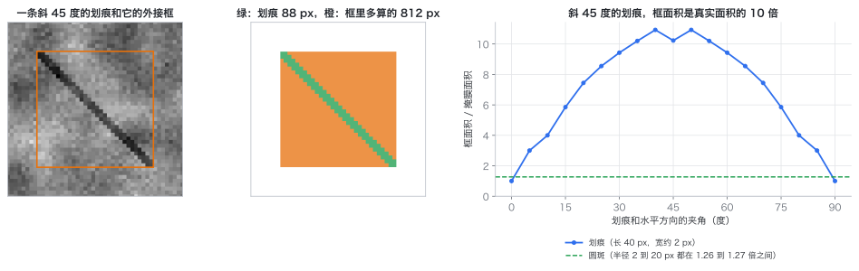
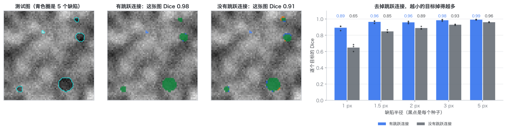
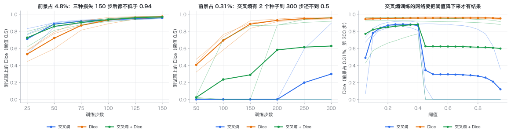
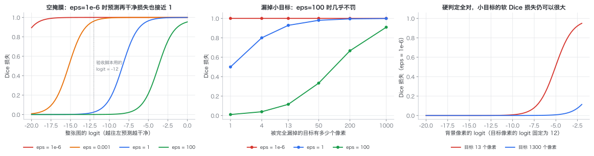
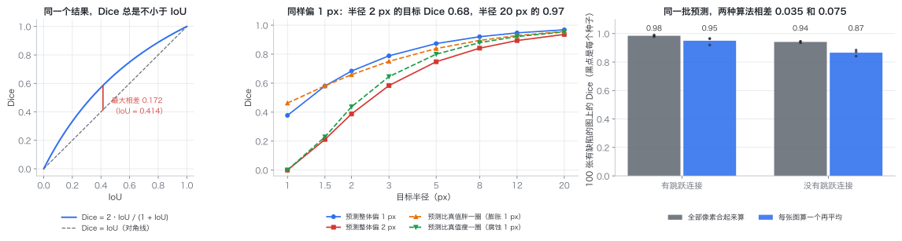
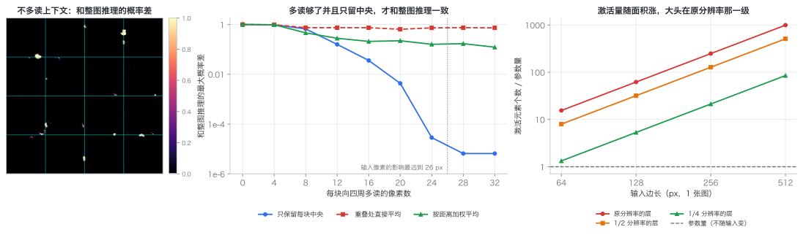

# 第 12 天：图像分割 —— 让模型理解每一个像素

> [!NOTE]
> 本章所有数字都来自合成数据上的实测，记录在 [`figures/实测数字.json`](figures/实测数字.json)，由 `solutions` 分支的 `solutions/figures/ch12.py` 生成。数据是代码生成的 64×64 纹理加圆斑缺陷，网络是一个约 2.8 万参数的小 U-Net，损失和跳跃连接的拼接用本章作业的参考实现，全部在一台 Mac 的 CPU 上训练，几分钟跑完，重复运行结果相同。网络里用的是 BatchNorm，批大小只有 8，所以每次评估前都先用训练图把它的均值和方差重新统计一遍，原因和不这样做的后果见 12.8 节。训练实验每组只有 2 到 3 个随机种子，表里把每个种子的结果都列出来，不只给平均。换成真实图像、别的网络或别的超参数，数值会变，结论的方向要自己再测一遍。本章不引用任何公开数据集上的分数。

> 配套练习：`DL-9 U-Net 细胞分割`
>
> 前置知识：第 9 天 CNN 与残差连接、第 10 天迁移学习、第 11 天检测的 IoU、数据标注和错误分析。

自动验收的作业是 [`作业_Dice与跳跃连接.py`](./作业_Dice与跳跃连接.py)。练习 DL-9（U-Net 细胞分割）的题目在 [`视觉算法学习计划.md`](../视觉算法学习计划.md) 的“题 DL-9”一节，目录里没有现成的文件，需要自己新建并准备数据。

---

## 0. 本章怎么学

**应用场景**：需要缺陷的精确面积和形状时。检测框只能说“这一块里有东西”，要算缺陷面积、长宽、是否跨过某条线、占某个区域的比例，就要知道每个像素属于不属于缺陷。缺陷分割和常见的分割数据集有一点很不一样：前景通常只占图像的很小一部分，很多图上根本没有缺陷。本章的实验都按这个特点设计。

**优先级**：P3，已有基础或用得少的内容，分到深度学习检测方向时再细读。前置是第 9 章（卷积、下采样、感受野、BatchNorm）。本章用到第 11 章的 IoU，后面第 19 章第 7 节把分割列为有标注时的三种监督方法之一。

| 档位 | 累计用时 | 做什么 | 做到什么算完 |
|---|---:|---|---|
| 速通 | 3 小时 | 读 12.1、12.3、12.5、12.6 节和 12.9 节的切块部分，看懂图 1 到图 6，做 12.6 节末尾演示的前 3 步，答完 5 道小测 | 能讲清前景很少时交叉熵为什么会停在全背景，Dice 的平滑项管什么，同样偏 1 px 小目标和大目标的 Dice 差多少，大图切块时重叠处该怎么拼 |
| 标准 | 8 小时 | 读完全章，跑 Notebook，完成 `作业_Dice与跳跃连接.py` 并验收通过，做 12.13 节前三个破坏实验，填实验记录 | 验收五项全部 PASS，实验记录里有一次“像素准确率很高而 Dice 为 0”的结果和一次去掉跳跃连接的对比，自测问题都能答 |
| 深挖 | 10 小时 | 再做 12.13 节其余的破坏实验和 12.14 节的扩展（练习 DL-9 或带小缺陷的合成数据选一个） | 在一组真实或自己合成的数据上报告按目标大小分组的 Dice，写清是逐图平均还是全部像素合起来算、空图怎么处理、阈值在哪个集合上定的 |

> [!TIP]
> 用时超过所选档位的 1.5 倍还没做完，就把卡点写进 `学习进度.md`，先往下一章走。本章作业只有两个函数，时间主要花在 12.5 和 12.6 节。速通档可以只记这两节的结论，做第 19 章的监督分割或第 24 章的综合项目时再回来。

---

## 12.1 从框到像素：为什么还需要分割

目标检测用矩形框回答“目标大致在哪里”。但细胞面积、道路边界、零件缺陷、抠图轮廓都不能靠矩形精确表达。图像分割要为每个像素分配标签。

对输入 `x∈R^(C×H×W)`，语义分割网络通常输出：

```text
logits ∈ R^(K×H×W)
```

其中 `K` 是类别数。每个像素都有 K 个未归一化分数，取 `argmax` 得到类别。二分类也常只输出一个通道，用 sigmoid 得到“前景概率”。

### 三种分割任务

| 任务 | 问题 | 同类实例是否分开 | 典型输出 |
|---|---|---:|---|
| 语义分割 | 每个像素属于哪一类 | 否 | 天空/路/人 |
| 实例分割 | 每个目标实例的像素在哪 | 是 | 第 1 个人、第 2 个人 |
| 全景分割 | 所有像素是什么且属于谁 | “物体”类分开 | 语义+实例统一图 |

语义分割会把两个相邻的人都标成“人”；实例分割还要给不同 instance id。全景分割同时处理可数的 thing（人、车）与不可数的 stuff（天空、草地）。

别把“二分类分割”理解成整张图二分类。它仍对每个像素分类，只是类别为背景/前景。

缺陷检测里最常用的是二分类语义分割：每个像素是不是缺陷。要把相邻的两个缺陷分开计数时，通常在分割结果上再做连通域标记（第 3 章 3.5 节），而不是换成实例分割模型。本章后面的实验都是二分类。

### 框和掩膜差多少（实测）

“不能靠矩形精确表达”可以量出来。取一条长 40 px、宽约 2 px 的划痕，画在 96×96 的图中央，转不同角度，数它的掩膜有多少像素，再数它的外接矩形框有多少像素。



| 划痕和水平方向的夹角（长 40 px、宽约 2 px） | 0° | 5° | 10° | 20° | 30° | 45° |
|---|---:|---:|---:|---:|---:|---:|
| 掩膜像素数 | 84 | 84 | 84 | 86 | 84 | 88 |
| 框面积除以掩膜面积 | 1.0 | 3.0 | 4.0 | 7.44 | 9.43 | 10.23 |

1. **划痕只要歪 5°，框面积就是真实面积的 3 倍**；斜 45° 时是 10.23 倍。拿框面积当缺陷面积，同一条划痕转个方向，数值能差一个数量级。
2. **圆斑的比值稳定在 1.27 左右**（半径 2 到 20 px 实测 1.26 到 1.27，理论值是 $4/\pi$ = 1.273）。紧凑的缺陷用框估面积，偏差是固定的两成多，可以修正；细长的缺陷不行。
3. **前景占比很小**。64×64 的图里一个半径 2 px 的圆斑只占 0.31%，十六个也只占 4.9%；1024×1024 的图里一个 10×10 的缺陷占 0.0095%。后面 12.5 和 12.6 节的大部分问题都从这个比例来。

---

## 12.2 FCN：把分类网络改造成像素预测器

经典分类 CNN 最后用全连接层输出一个类别，这会丢掉空间位置。FCN（Fully Convolutional Network）做了三件事：

1. 用卷积替代全连接，使网络接受不同尺寸输入；
2. 保留二维特征图，不把整图压成一个向量；
3. 把低分辨率预测上采样回原图大小。

为什么全连接可改成卷积？假设进入全连接层的特征是 `C×h×w`，一个输出神经元与全部元素相连，这等价于用大小为 `h×w` 的卷积核做一次卷积。改成全卷积后，网络能在更大图像上滑动地产生空间输出。

但下采样带来矛盾：分类希望特征对小位移不敏感，分割却要求边界精确。连续四次 `2×` 下采样后，特征图边长变成原来的 `1/16`，一个特征点对应原图大片区域。只把它插值放大，轮廓往往很粗。

“大片区域”对小缺陷意味着什么，可以直接算。半径 2 px 的圆斑约 13 个像素：

| 总下采样倍率 | 2 | 4 | 8 | 16 | 32 |
|---|---:|---:|---:|---:|---:|
| 一个特征点对应的原图像素数 | 4 | 16 | 64 | 256 | 1024 |
| 13 个像素占一个特征点的比例 | 325.0% | 81.2% | 20.3% | 5.1% | 1.3% |

下采样 16 倍之后，这个缺陷只占一个特征点所管面积的 5.1%，它在最深的特征图上最多只是一个点里的一小部分信号。第 9 章 9.3 节和 9.4 节讲了 stride、池化和感受野怎样改变空间信息，这里是它在小目标上的后果。

FCN 的解决方向是融合浅层细节与深层语义，这也引出了 U-Net 和后来的 FPN、DeepLab 等结构。

---

## 12.3 U-Net：为什么跳跃连接是分割标配

U-Net 像字母 U：左边编码，右边解码。

```text
输入
 ↓
Encoder：卷积→下采样→语义越来越强、分辨率越来越低
 ↓ bottleneck
Decoder：上采样→与对应 Encoder 特征拼接→卷积融合
 ↓
像素级输出
```

Encoder 回答“这是什么”，Decoder 恢复“具体在哪里”。Skip Connection 把同尺度的浅层特征直接送到解码器，补回边缘、纹理和细小结构。

这里的跳跃连接和 ResNet 不完全相同：

- ResNet 常做逐元素相加，目的是让梯度和恒等映射更顺畅；
- 原始 U-Net 常在通道维拼接 `concat`，目的是同时保留编码特征与解码特征。

### 有没有跳跃连接差多少（实测）

本章的实验网络是一个小 U-Net：两次 2 倍下采样，三级的通道数是 8、16、32，每级两个 3×3 卷积加 BatchNorm 和 ReLU，上采样用双线性插值，拼接调用作业 `align_and_concat` 的参考实现，一共 27721 个参数。对照组把解码器里的拼接去掉，其余不变，参数是 24841 个。

数据是 64×64 的合成纹理，每张图 5 个圆斑缺陷，半径 1、1.5、2、3、5 px 各一个，比周围亮或暗 0.18，互不相连，前景占 3.2%。96 张训练图，100 张测试图，损失是交叉熵加 Dice，批大小 8，Adam，训练 300 步，3 个种子。



下表每格三个数是种子 0、1、2。“逐个目标的 Dice”只看每个目标周围 2 px 以内的预测，再对 100 个目标取平均。“边界带”是真值边界内外各 1 px 的那一圈像素。

| 64×64，每张图 5 个缺陷，训练 300 步 | 有跳跃连接 | 没有跳跃连接 |
|---|---:|---:|
| 全部像素合起来的 Dice | 0.976、0.985、0.99 | 0.928、0.935、0.938 |
| 半径 1 px 的目标（约 3 个像素） | 0.857、0.91、0.909 | 0.6、0.66、0.684 |
| 半径 1.5 px 的目标 | 0.945、0.974、0.972 | 0.838、0.836、0.865 |
| 半径 2 px 的目标 | 0.943、0.96、0.971 | 0.881、0.876、0.908 |
| 半径 3 px 的目标 | 0.972、0.987、0.992 | 0.921、0.931、0.934 |
| 半径 5 px 的目标（约 79 个像素） | 0.987、0.992、0.994 | 0.956、0.962、0.962 |
| 边界带里的像素错误率 | 2.9%、1.8%、1.3% | 9.0%、8.3%、8.1% |
| 半径 1 px 的目标至少被碰到一个像素的比例 | 93%、97%、96% | 82%、86%、92% |

1. **合起来的 Dice 只差 0.05，小目标差得多**。3 个种子平均，合起来的 Dice 是 0.984 对 0.934；半径 1 px 的目标是 0.892 对 0.648，半径 5 px 的目标是 0.991 对 0.96。目标越小掉得越多，图 2 右栏五组柱子的差距从左到右依次缩小。
2. **错误集中在边界上**。去掉跳跃连接后，边界带里的错误率从 2.0% 升到 8.5%（3 个种子平均），边界带以外两种网络的错误率都在万分之三以下。
3. **“合起来的 Dice”看不出小目标的问题**。半径 5 px 的目标一个就有约 79 个像素，是半径 1 px 的二十多倍，合起来算时小目标几乎不占分量。12.6 节专门讲这件事。

这组结果只说明这一个小网络和这一种数据。两次下采样已经能看出差别，下采样次数更多的网络没有测。

<!-- quiz -->
**把小 U-Net 的跳跃连接去掉，测试集上全部像素合起来的 Dice 从 0.984 降到 0.934。能不能据此说“跳跃连接在这个任务上只值 0.05”？**

- A. 能，Dice 是分割的标准指标
- B. 不能，按目标大小分开看，半径 1 px 的目标从 0.892 掉到 0.648
- C. 不能，因为两个网络的参数量不同，没法比

<details markdown="1"><summary>答案与解释</summary>

**B**。合起来算时每个像素权重相同，半径 5 px 的目标约 79 个像素，半径 1 px 的只有约 3 个，小目标的损失被大目标盖住了。边界带里的错误率也从 2.0% 升到 8.5%。C 不对：参数量确实差了一成（27721 对 24841），但这点差别解释不了“越小掉得越多”这个规律。

</details>
<!-- /quiz -->

### 尺寸为什么经常对不上

若输入边长不能被总下采样倍率整除，或卷积未使用 same padding，上采样后的尺寸可能与 skip 特征差 1 个像素。拼接前应显式检查：

```python
assert up.shape[-2:] == skip.shape[-2:]
x = torch.cat([up, skip], dim=1)
```

工程上可把输入 pad 到 16 或 32 的倍数，推理后再裁回原尺寸。不要靠随意 resize 掩盖错位，否则标签边界和预测空间会悄悄偏移。

本章的小网络有两次 2 倍池化（向下取整）和两次 2 倍上采样，总倍率是 4。输入边长从 64 到 67 时各级的尺寸：

| 输入边长 | 64 | 65 | 66 | 67 |
|---|---:|---:|---:|---:|
| 编码器三级的边长 | 64、32、16 | 65、32、16 | 66、33、16 | 67、33、16 |
| 两次上采样后的边长 | 32、64 | 32、64 | 32、66 | 32、66 |
| 比对应的编码特征少几个像素（1/2 级、原分辨率级） | 0、0 | 0、1 | 1、0 | 1、1 |

只有 4 的倍数两级都对得上。作业里的 `align_and_concat` 做的就是这一步对齐：把解码特征居中裁剪或对称补零到编码特征的尺寸再拼接。用参考实现时，这四种输入的输出边长分别是 64、65、66、67，和输入相同。补零的位置上没有真实特征，所以它只是让代码能跑，边缘那一行的预测质量没有保证；训练和推理时仍然建议把输入补到总倍率的整数倍。

### 一个最小结构骨架

下面只展示模块关系，不是 DL-9 的完整答案：

```python
class DoubleConv(nn.Module):
    def __init__(self, cin, cout):
        super().__init__()
        self.block = nn.Sequential(
            nn.Conv2d(cin, cout, 3, padding=1),
            nn.BatchNorm2d(cout), nn.ReLU(inplace=True),
            nn.Conv2d(cout, cout, 3, padding=1),
            nn.BatchNorm2d(cout), nn.ReLU(inplace=True),
        )

    def forward(self, x):
        return self.block(x)
```

完整 U-Net 还需要编码块、上采样块、skip 对齐和输出头，这些留给练习实现与验证。

骨架里用了 `BatchNorm2d`。分割的输入大、批往往很小，这时 BatchNorm 在推理模式下会出一个不容易发现的问题，12.8 节有实测。

---

## 12.4 上采样：放大不等于恢复

### 双线性插值 + 卷积

插值是固定计算，不学习参数；后续卷积再学习如何融合。优点是稳定、尺寸可控，通常不易产生棋盘格。

### 转置卷积

转置卷积是可学习上采样。它不是普通卷积的逆运算，而是与卷积线性变换对应的转置操作。若 kernel、stride、padding 组合导致输出位置被不均匀覆盖，某些像素累加次数多、某些少，就可能出现棋盘效应。

避免方法包括：

- 选择能被 stride 整除的 kernel，如 `kernel=2,stride=2`（它只消除“覆盖不均”这一个来源，见下面的实测）；
- 使用插值+卷积；
- 检查输出图是否出现周期性纹理。

“覆盖不均匀”可以数出来：把转置卷积的权重全设成 1，输入全 1，输出里每个位置的值就是它被多少个卷积核位置覆盖。

| 设置 | k=2, s=2 | k=3, s=2 | k=4, s=2 | k=5, s=2 | k=4, s=4 | k=6, s=4 |
|---|---|---|---|---|---|---|
| 输出内部各位置的覆盖次数 | 都是 1 | 1、2、4 | 都是 4 | 4、6、9 | 都是 1 | 1、2、4 |

kernel 能被 stride 整除时每个位置的覆盖次数相同；不能整除时，相邻位置的覆盖次数最多差到 4 倍（k=3, s=2 时是 1 和 4）。

但覆盖次数均匀并不等于没有周期图案。转置卷积的每个输出位置按它在 2×2 小格里的位置，用的是卷积核里不同的那几个权重，这几组权重彼此独立。测一下：8 通道进 8 通道出，PyTorch 默认随机初始化 200 次，输入是全 1 的常数图（没有任何结构），把输出按 2×2 的四个位置分组求平均，看四组平均值的极差相对输出平均幅度有多大。输出若不带周期图案，这个数是 0。

| 上采样方式（随机初始化 200 次，常数输入） | 四个位置的平均值相差多少（相对输出的平均幅度） |
|---|---:|
| 转置卷积 k=2, s=2 | 2.603 |
| 转置卷积 k=3, s=2 | 2.731 |
| 转置卷积 k=4, s=2 | 2.56 |
| 双线性上采样后接 3×3 卷积 | 0 |

三种转置卷积的数值在同一个量级，k=2 并不比 k=3 好多少。也就是说，“kernel 能被 stride 整除”只去掉了覆盖不均这一个来源；另一个来源是四个位置各用各的权重，只要是转置卷积就有。插值加卷积对四个位置用的是同一组权重，常数输入下输出严格没有周期图案。这里测的是初始化时的情况，训练之后周期图案还剩多少没有测，所以上面第三条“检查输出图是否出现周期性纹理”仍然要做。

### Pixel Shuffle

先在通道维产生 `r²` 倍特征，再重排到空间维。超分辨率中常见，分割也可用，但需注意通道组织。

重要直觉：上采样不能凭空恢复已经丢失的信息。U-Net 能得到细边界，是因为 skip connection 提供了高分辨率线索，而不只是“用了某种放大算法”。

这句话在 12.3 节的表里有对应的数字：两种网络用的是同一种上采样（双线性），差别只在有没有拼接编码特征，边界带里的错误率是 2.0% 对 8.5%。

---

## 12.5 分割损失：为什么只用交叉熵可能不够

### 像素交叉熵

多分类分割对每个像素做交叉熵：

```text
L_CE = -Σ_i Σ_k y_ik log p_ik
```

它稳定、概率解释清楚，但每个像素权重近似相同。若前景只占 1%，模型把所有像素预测为背景也能得到 99% 像素准确率。

### 全背景的预测在交叉熵下有多便宜

不只是像素准确率高，全背景预测的交叉熵本身也很低。设前景占比是 $\pi$，网络对每个像素都输出同一个概率 $p$，二分类交叉熵的平均值是

$$
L(p) = -\pi \ln p - (1 - \pi)\ln(1 - p)
$$

它在 $p = \pi$ 时最小。也就是说，一个什么都没检出、只学会了“前景很少”的网络，损失已经降到下面这一行：

| 前景占比 | 5% | 1% | 0.32% | 0.1% | 0.01% |
|---|---:|---:|---:|---:|---:|
| 全背景常数预测的最小交叉熵 | 0.1985 | 0.056 | 0.0214 | 0.0079 | 0.001 |
| 它占初始损失 $\ln 2$ = 0.6931 的比例 | 28.6% | 8.1% | 3.1% | 1.1% | 0.1% |
| 阈值 0.5 下的像素准确率 | 95% | 99% | 99.68% | 99.9% | 99.99% |
| 阈值 0.5 下的 Dice | 0 | 0 | 0 | 0 | 0 |

前景占 0.32% 时（64×64 的图里 13 个像素，相当于一个半径 2 px 的圆斑），全背景预测的损失只有初始值的 3.1%。训练曲线上损失已经降了 97%，看起来训练得很顺利，Dice 却是 0。把缺陷真正找出来，能再降的只有剩下那 3.1%。

### Dice 系数与 Dice Loss

Dice 衡量两个集合的重叠：

```text
Dice = 2|P∩G| / (|P|+|G|)
```

软 Dice 直接使用预测概率：

```text
Dice = (2Σ p_i g_i + ε) / (Σ p_i + Σ g_i + ε)
L_Dice = 1 - Dice
```

它关注整体重叠，对小前景更敏感。分子乘 2 是因为完全重合时，交集等于 P 和 G 各自大小的一半总和。

实践中常用：

```text
L = L_BCE/CE + λ L_Dice
```

CE 提供逐像素稳定梯度，Dice 优化全局重叠。若一个 batch 中某类完全不存在，要明确 Dice 的空类策略：跳过该类、视预测也为空时为 1，或加入大小合适的平滑项（取多大差别很大，见本节后面的实测）。不同实现会显著改变指标。

作业里的 `binary_dice_loss` 是上面软 Dice 的二分类版本：先对 logits 做 sigmoid，每张图单独算一个 Dice，再对批取平均。“每张图单独算”和“整个批合起来算”不是一回事。举一个两张图的批：第一张有 1300 个像素的目标，预测完全正确；第二张有 13 个像素的目标，完全漏掉。参考实现给出的损失是 0.5，把两张图的像素合起来算一个 Dice，损失只有 0.005，小目标那张图的漏检几乎不被罚。

### 三种损失各训练出什么（实测）

用同一个小 U-Net 比较三种损失：只用交叉熵、只用 Dice、两者相加（各占一份，Dice 的 `eps` 用作业默认的 1e-6）。缺陷都是半径 2 px 的圆斑（约 13 个像素），两组数据只差每张图里缺陷的个数：每张图 16 个（前景占 4.77%）和每张图 1 个（前景占 0.31%）。各 96 张训练图、100 张测试图，批大小 8，Adam，学习率 0.003。前一组训练 150 步，后一组训练 300 步。指标在测试集上把全部像素合起来算。



每格三个数是种子 0、1、2：

| 损失 | 前景占 4.77%，150 步：Dice（阈值 0.5） | 前景占 0.31%，300 步：Dice（阈值 0.5） | 同一批网络换成各自最好的阈值 | 缺陷像素上概率的中位数 |
|---|---:|---:|---:|---:|
| 交叉熵 | 0.948、0.966、0.96 | 0、0.887、0 | 0.868、0.887、0.918 | 0.43、0.892、0.448 |
| Dice | 0.966、0.974、0.981 | 0.948、0.952、0.967 | 0.948、0.956、0.967 | 1.0、1.0、1.0 |
| 交叉熵 + Dice | 0.958、0.973、0.979 | 0、0.954、0.914 | 0.77、0.964、0.924 | 0.427、1.0、1.0 |

1. **前景占 4.77% 时三种损失差不多**。150 步之后 9 次训练的 Dice 都不低于 0.948。
2. **前景占 0.31% 时，交叉熵有两个种子在阈值 0.5 下 Dice 是 0**。这两个网络的像素准确率是 99.69%，和全背景预测一样。
3. **但它们不是没学到**。把阈值降到 0.25 和 0.3，这两个网络的 Dice 是 0.868 和 0.918。它们已经知道缺陷在哪，只是给缺陷像素的概率停在 0.43 和 0.448，没有越过 0.5。图 3 右栏里交叉熵那条线在阈值 0.4 和 0.45 之间断崖式下跌，就是这个原因。
4. **只用 Dice 损失的三个种子都不低于 0.948**，而且对阈值不敏感：阈值从 0.05 到 0.95，3 个种子平均的 Dice 始终在 0.943 到 0.956 之间。原因是它把概率推到了两头，缺陷像素上概率的中位数是 1.0。代价是这些概率不能再当“置信度”用。
5. **两者相加并没有更稳**。3 个种子里有一个和交叉熵一样卡住（Dice 为 0，缺陷像素上的概率中位数 0.427）。常见的建议是用交叉熵加 Dice 作为基线，在这组实验里它不如只用 Dice。只有 3 个种子，不能据此说哪种损失更好，能说的是：把交叉熵加进来，也把它卡住的可能性带了进来。

再训练 300 步到第 600 步，交叉熵的三个种子在阈值 0.5 下的 Dice 是 0、0.925、0.915：原来卡住的两个里有一个出来了，另一个仍然是 0（最大概率 0.418）。所以交叉熵在这里是慢，而且慢多少因种子而异，不是学不会。

### 交叉熵为什么卡在 0.5 以下

卡住的两个网络有一个共同点。第 300 步时：

| 交叉熵，前景占 0.31%，第 300 步 | 种子 0（卡住） | 种子 1（没卡住） | 种子 2（卡住） |
|---|---:|---:|---:|
| 整个测试集上的最大概率 | 0.433 | 0.995 | 0.465 |
| 输出层的偏置过 sigmoid 之后的值 | 0.43 | 0.397 | 0.448 |
| 缺陷像素里，输出层之前的 8 个特征全为 0 的比例 | 40.1% | 0% | 54.8% |
| 背景像素里的同一比例 | 0.01% | 0% | 0% |
| 背景像素里 logit 低于偏置的比例 | 99.99% | 99.95% | 99.99% |
| 缺陷像素里 logit 低于偏置的比例 | 46.6% | 8% | 22.6% |

输出层是一个 1×1 卷积，它的输入是 ReLU 之后的 8 个特征。8 个特征全为 0 时，输出的 logit 就等于偏置；logit 低于偏置，说明被激活的特征合起来给的是负的贡献。

卡住的两个网络是这样区分缺陷的：背景像素上有特征被激活，把 logit 压到偏置以下（99.99% 的背景像素如此）；缺陷像素上四到五成什么都不激活，logit 正好停在偏置，另有两到五成也被压低了一些，只剩少数略高于偏置。所以缺陷像素上概率的中位数（0.43、0.448）正好等于偏置过 sigmoid 的值，整个测试集的最大概率也只比它高一点（0.433 对 0.43，0.465 对 0.448）。

这样已经能把交叉熵降到很低，但缺陷像素的概率被偏置封了顶，而背景像素占绝对多数，它们给偏置的梯度方向是往下的。要越过 0.5，网络得另外长出一个在缺陷上取正值的特征。没卡住的种子 1 就是这样：它的缺陷像素没有一个是特征全为 0 的，只有 8% 低于偏置。

这个机制是在这个 8 通道的小网络上看到的，更宽的网络是不是也这样没有测。它给出的排查办法是通用的：全背景时先看概率图，不要只看二值结果；最大概率卡在一个固定值附近时，打印输出层的偏置对一下。

<!-- quiz -->
**前景占 0.31% 的数据上只用交叉熵训练 300 步，损失降得很低，像素准确率 99.69%，阈值 0.5 下的 Dice 是 0。这个网络学到东西了吗？**

- A. 没有，它只学会了全部预测成背景
- B. 学到了，把阈值降到 0.25 左右，Dice 是 0.868
- C. 无法判断，要重新训练

<details markdown="1"><summary>答案与解释</summary>

**B**。实测卡住的两个种子换成各自最好的阈值（0.25 和 0.3）后 Dice 是 0.868 和 0.918。缺陷像素的概率停在 0.43 和 0.448，比背景高得多，只是没过 0.5。A 是只看二值结果得出的结论，像素准确率 99.69% 和全背景预测相同，区分不了这两种情况。要看概率图，或者扫一遍阈值。

</details>
<!-- /quiz -->

### 平滑项 eps 到底管什么（实测）

上面说空类可以靠加入平滑项处理。平滑项取多大，结果差别很大。下面的数字都是把构造好的 logits 直接交给参考实现 `binary_dice_loss` 算出来的，不涉及训练。图像 64×64，一个样本。



**空掩膜**。掩膜里一个前景像素都没有，预测也很干净（整张图的 logit 是同一个负数）：

| 空掩膜，整张图 logit 相同 | logit = -4 | -8 | -12 | -20 |
|---|---:|---:|---:|---:|
| eps = 1e-6（作业默认值） | 1.0 | 1.0 | 1.0 | 0.8941 |
| eps = 0.001 | 1.0 | 0.9993 | 0.9618 | 0.0084 |
| eps = 1 | 0.9866 | 0.5787 | 0.0245 | 0 |
| eps = 100 | 0.4242 | 0.0135 | 0.0003 | 0 |

logit 为 -12 时每个像素的概率只有 6.14e-06，阈值 0.5 下的预测是完全正确的“空对空”，eps = 1e-6 时损失却是 1.0。原因在公式里：目标为空时 Dice 等于 $\varepsilon / (\sum p_i + \varepsilon)$，4096 个像素的概率加起来比 1e-6 大得多，比值接近 0。验收脚本里那个例子（2 张 4×4 的空掩膜，logit 全是 -12）的损失是 0.9899。作业的文档字符串把这一点写成了约定：默认的 eps 只保证结果有限，“空对空”的损失接近 1，不是 0。验收脚本按这个约定检查，要求这个例子的损失约为 0.9899。

同一种情况下损失对 logit 的梯度（logit 全是 -4，绝对值求和）：eps = 1e-6 时是 1.3e-08，eps = 1 时是 0.013，eps = 100 时是 0.24。所以用很小的 eps 时，没有缺陷的图给总损失加上一个接近 1 的常数，却几乎不提供梯度：这张图上误报多一点少一点，Dice 这一项几乎没有反应，要靠别的图或者交叉熵那一项来管。

**极小目标**。eps 取大，空掩膜的问题缓解了，代价转到小目标上。一个 g 个像素的目标被完全漏掉时的损失：

| 完全漏掉的目标有多少像素 | 1 | 4 | 13 | 50 | 200 | 1000 |
|---|---:|---:|---:|---:|---:|---:|
| eps = 1e-6 | 1.0 | 1.0 | 1.0 | 1.0 | 1.0 | 1.0 |
| eps = 1 | 0.5 | 0.8 | 0.9286 | 0.9804 | 0.995 | 0.999 |
| eps = 100 | 0.0099 | 0.0385 | 0.115 | 0.3333 | 0.6667 | 0.9091 |

eps = 100 时漏掉一个 13 个像素的缺陷只罚 0.115，漏掉 50 个像素的罚 0.3333。eps 和目标的像素数在同一个量级或者更大时，漏检这个目标就罚不到多少。反过来，空掩膜上有 13 个像素被误判成前景，eps = 1 时损失是 0.9286，eps = 100 时只有 0.115。

**软 Dice 和硬 Dice 不是一回事**。还有一个只在小目标上才明显的现象：目标像素的 logit 是 12，背景 logit 是负数，阈值 0.5 下的预测和真值完全重合，硬 Dice 是 1。软 Dice 损失却不是 0（eps = 1e-6）：

| 背景像素的 logit | -4 | -6 | -8 | -12 |
|---|---:|---:|---:|---:|
| 背景每个像素的概率 | 0.018 | 0.0025 | 0.00034 | 6.1e-06 |
| 目标 13 个像素时的损失 | 0.7385 | 0.2797 | 0.05 | 0.001 |
| 目标 1300 个像素时的损失 | 0.019 | 0.0027 | 0.0004 | 0 |

背景每个像素只有 0.0025 的概率，四千多个像素加起来就和 13 个像素的目标差不多大了，损失是 0.2797；同样的背景，1300 个像素的目标损失只有 0.0027。所以在小目标上，Dice 损失会一直把背景的概率往 0 推，直到推到比目标小得多。前面只用 Dice 训练出来的概率都在两头，和这一点是一致的。训练日志里的 Dice 损失和验证时按阈值算的硬 Dice 不能直接对比。

实用的结论：

- eps 没有通用的“正确值”。它相当于往分子和分母里各加了 eps 个“虚拟的命中像素”，要拿它和目标的像素数、空图上残留的概率总和去比。
- 数据里有很多空图时，用很小的 eps 等于让这些图不参与 Dice 这一项。要么把 eps 调到和典型小目标的像素数相比小、和空图上残留的概率总和相比不小的范围，要么明确跳过空图，要么加上交叉熵让它管空图。
- 换 eps 之后重新看一遍小目标的检出，不要只看总的 Dice。

<!-- quiz -->
**一张图的掩膜是空的，网络的输出也很干净，每个像素的 logit 都是 -12。用作业默认的 eps = 1e-6 算 Dice 损失，结果最接近哪个？**

- A. 0，因为预测和真值都是空的
- B. 0.5
- C. 1

<details markdown="1"><summary>答案与解释</summary>

**C**。实测 64×64 的图上是 1.0，验收脚本里 4×4 的例子是 0.9899。目标为空时 Dice 等于 eps 除以“概率总和加 eps”，logit 为 -12 时每个像素的概率是 6.14e-06，加起来仍然远大于 1e-6。要让这个损失接近 0，要么概率总和小到和 eps 相当（logit 降到 -20 时损失才是 0.8941），要么把 eps 取大（eps = 1 时同一个预测的损失是 0.0245）。

</details>
<!-- /quiz -->

### 其他损失

- **Focal Loss**：降低易分类背景的权重；
- **Tversky Loss**：分别控制 FP 与 FN，适合漏检代价更高的医学任务；
- **Boundary Loss**：强调轮廓，但通常作为辅助项；
- **Lovász Loss**：更直接近似优化 IoU。

损失越复杂不一定越好。先用可解释的 CE/BCE+Dice 建立基线，再按明确失败模式增加项。

对照上面的实测，“明确失败模式”可以这样对应：全背景而概率图里看得见缺陷，先调阈值或换 Dice，再考虑 Focal 或给前景加权；空图上误报多，先查 eps 和空图的处理；小目标漏得多，先按目标大小分组看指标（12.6 节），再考虑 Tversky 这类偏向查全的损失。这几种损失本章都没有实测。

---

## 12.6 指标：像素准确率为什么会骗人

### Pixel Accuracy

```text
PA = 正确分类像素数 / 总像素数
```

背景占 99% 时，全背景模型也有 99%，所以必须结合类别指标。

12.5 节里已经见过一次：前景占 0.31% 时，交叉熵训练卡住的两个网络像素准确率是 99.69%，Dice 是 0。下面“逐图平均还是合起来算”那组数据里，什么都不预测的像素准确率是 99.55%。

### IoU 与 mIoU

对类别 k：

```text
IoU_k = TP_k / (TP_k + FP_k + FN_k)
mIoU = 各类别 IoU 的平均
```

这里 TP/FP/FN 按像素统计。二分类时，前景 Dice 与 IoU 有确定关系：

```text
Dice = 2IoU / (1+IoU)
IoU = Dice / (2-Dice)
```

对同一对掩膜，两者排序一致，但数值不同，不能混报。

换算式的来历：用 TP、FP、FN 写出来，

$$
\text{Dice} = \frac{2\,TP}{2\,TP + FP + FN}, \qquad \text{IoU} = \frac{TP}{TP + FP + FN}
$$

把第二个式子代进第一个就得到上面的关系。

### Dice 和 IoU 差多少（实测）



| IoU | 0.1 | 0.3 | 0.5 | 0.7 | 0.9 |
|---|---:|---:|---:|---:|---:|
| 对应的 Dice | 0.182 | 0.462 | 0.667 | 0.824 | 0.947 |

| Dice | 0.1 | 0.3 | 0.5 | 0.7 | 0.9 |
|---|---:|---:|---:|---:|---:|
| 对应的 IoU | 0.053 | 0.176 | 0.333 | 0.538 | 0.818 |

1. **同一个结果，Dice 总是不小于 IoU**，只在 0 和 1 两头相等。IoU 等于 0.414 时两者相差最大，Dice 是 0.586，高出 0.172。一份报告写 Dice 0.667，另一份写 IoU 0.5，说的是同一个水平。
2. **“排序一致”只对同一对掩膜成立**。实际报告的往往是很多张图的平均，平均之后排序可以反过来。举一个由脚本算出的例子：模型甲在两张图上的 IoU 是 0.92 和 0.1，模型乙是 0.5 和 0.5。平均 IoU 是甲 0.51、乙 0.5，甲略好；平均 Dice 是甲 0.57、乙 0.667，乙明显好。原因是换算曲线是弯的，低分段 Dice 比 IoU 抬得多。所以比较两个模型时要用同一个指标，不能一个报 Dice、一个报 IoU 再靠换算去比平均值。

### 预测偏一两个像素，Dice 掉多少（实测）

真值是一个圆斑（圆心位置带随机小数，每个半径 200 次取平均），预测就是真值本身，只做一件事：整体平移，或者用 3×3 十字结构元膨胀、腐蚀一次。没有任何别的误差。

| 目标半径（px） | 1 | 1.5 | 2 | 3 | 5 | 8 | 12 | 20 |
|---|---:|---:|---:|---:|---:|---:|---:|---:|
| 平均像素数 | 3.1 | 7.1 | 12.6 | 28.3 | 78.6 | 200.9 | 452.6 | 1256.8 |
| 预测整体偏 1 px：Dice | 0.378 | 0.58 | 0.684 | 0.789 | 0.873 | 0.92 | 0.947 | 0.968 |
| 预测整体偏 2 px：Dice | 0 | 0.212 | 0.387 | 0.584 | 0.748 | 0.841 | 0.894 | 0.936 |
| 预测胖一圈（膨胀 1 px）：Dice | 0.462 | 0.581 | 0.658 | 0.751 | 0.839 | 0.895 | 0.928 | 0.956 |
| 预测瘦一圈（腐蚀 1 px）：Dice | 0 | 0.229 | 0.437 | 0.645 | 0.8 | 0.88 | 0.922 | 0.954 |
| 预测整体偏 1 px：IoU | 0.24 | 0.409 | 0.52 | 0.651 | 0.775 | 0.853 | 0.899 | 0.938 |

1. **同样偏 1 px，半径 2 px 的目标 Dice 只剩 0.684，半径 20 px 的还有 0.968**。偏 2 px 时是 0.387 对 0.936。Dice 罚的是错的像素占目标像素的比例，目标越小，边界上那一圈占的比例越大。
2. **标注粗一圈或细一圈，效果和偏 1 px 差不多**。半径 2 px 的目标，预测只比真值胖一圈，Dice 是 0.658；瘦一圈是 0.437。
3. **这给小目标的 Dice 定了一个上限**。标注的边界本身往往就有一个像素上下的不确定（12.7 节的“标签质量”），不同的人标同一个缺陷，边界差一圈是可能的。半径 2 px 的缺陷上 Dice 做到 0.7 左右，可能已经碰到了标注一致性的上限，继续调模型之前要先确认这一点。判断办法是让两个人各标一遍，算他们之间的 Dice。
4. 12.3 节有跳跃连接的网络在半径 1 px 的目标上 Dice 是 0.892，远高于这里偏 1 px 的 0.378，说明它在这组合成数据上的误差比整体偏 1 px 小得多。合成数据的真值没有标注误差，真实数据做不到这一点。

<!-- quiz -->
**一个半径 2 px 的缺陷（约 13 个像素），预测的形状和大小完全正确，只是整体偏了 1 px。Dice 最接近哪个？**

- A. 0.95
- B. 0.68
- C. 0.3

<details markdown="1"><summary>答案与解释</summary>

**B**。实测 0.684（IoU 是 0.52）。同样偏 1 px，半径 20 px 的目标是 0.968，半径 1 px 的只有 0.378。所以同样是 Dice 0.7，在半径 20 px 的目标上意味着误差远不止一两个像素，在两三个像素大的缺陷上可能已经接近标注精度的上限。报告小目标的分割质量时，要把目标大小一起写出来。

</details>
<!-- /quiz -->

### 逐图平均还是全部像素合起来算（实测）

同一批预测，Dice 有两种算法：把所有图的 TP、FP、FN 加在一起算一个 Dice；或者每张图算一个 Dice 再取平均。用 12.3 节训练好的网络预测另一批图：100 张各有 1 个缺陷（半径 1、1.5、2、3、5 px 各 20 张），另有 40 张没有缺陷。这批图里，半径 5 px 的缺陷占全部缺陷像素的 60.8%，半径 1 px 的只占 2.5%。

每格三个数是种子 0、1、2：

| 同一批预测 | 有跳跃连接 | 没有跳跃连接 | 什么都不预测 |
|---|---:|---:|---:|
| 100 张有缺陷的图，合起来算 | 0.978、0.985、0.99 | 0.935、0.945、0.945 | 0 |
| 100 张有缺陷的图，逐图平均 | 0.92、0.966、0.964 | 0.842、0.872、0.885 | 0 |
| 加上 40 张空图，合起来算 | 0.978、0.985、0.99 | 0.934、0.945、0.945 | 0 |
| 加上 40 张空图，逐图平均（空对空记 1，有误报记 0） | 0.929、0.975、0.974 | 0.88、0.908、0.918 | 0.286 |
| 40 张空图里有误报的张数 | 2、0、0 | 1、0、0 | 0 |

逐图平均按半径分开（3 个种子平均）：

| 缺陷半径（px） | 1 | 1.5 | 2 | 3 | 5 |
|---|---:|---:|---:|---:|---:|
| 有跳跃连接 | 0.841 | 0.957 | 0.976 | 0.983 | 0.993 |
| 没有跳跃连接 | 0.68 | 0.849 | 0.91 | 0.925 | 0.967 |

1. **同一批预测，两种算法差 0.035 到 0.075**。有跳跃连接的网络，合起来是 0.985，逐图平均是 0.95；没有跳跃连接的是 0.942 对 0.866（都是 3 个种子平均）。合起来算时每个像素一票，大缺陷说了算；逐图平均时每张图一票，小缺陷的图和大缺陷的图分量相同。
2. **两种算法给出的“差距”也不一样**。去掉跳跃连接，合起来算掉了 0.043，逐图平均掉了 0.084，差不多是两倍。想知道模型在小缺陷上行不行，逐图平均（或者按目标大小分组）更能说明问题。
3. **空图的约定能凭空造出分数**。什么都不预测的“模型”，在 140 张图上逐图平均是 0.286，正好是空图所占的比例（40 张除以 140 张）。没有跳跃连接的网络加上空图之后，逐图平均从 0.842、0.872、0.885 涨到 0.88、0.908、0.918，模型没有变，只是分母里多了一批容易的图。缺陷检测的数据里空图常常占大多数，按“空对空记 1”算出来的逐图平均 Dice 会被空图抬得很高。
4. **合起来算对空图不敏感**。加上 40 张空图，合起来的 Dice 几乎不变。这既是优点也是缺点：空图上的误报只要像素不多，在这个指标里就看不出来。空图上的表现要单独报，最直接的是“有误报的图占多少”和“每张图多少个误报”，第 18 章第 6 节就是这样报的。

第 19 章 5.2 节讲的是同一件事的另一面：pixel AUROC 把所有缺陷像素放在一起，大缺陷占了绝大部分像素，小缺陷全丢了它也几乎不动；AUPRO 先按每个缺陷区域算覆盖率再平均，大小缺陷权重相同。这里的“逐图平均”和 AUPRO 的“按区域平均”是一个思路。

### Boundary IoU / Hausdorff Distance

两个预测可能区域重叠相近，但一个边界平滑，一个边界锯齿。医学、遥感、工业测量常需边界指标。Hausdorff Distance 关注两组边界点的最坏距离，对离群点敏感；HD95 用 95 分位减弱极端点影响。

12.3 节用的是一个更简单的边界指标：只统计真值边界内外各 1 px 那一圈里的像素错误率。它把“合起来的 Dice 只差 0.05”的两个网络拉开到了 2.0% 对 8.5%。Boundary IoU 和 Hausdorff 距离本章没有实测。

### 实例与全景指标

实例分割常用 mask AP，与检测 AP 类似，只是 IoU 在掩码上计算。全景分割常用 PQ：

```text
PQ = SQ × RQ
```

SQ 衡量匹配区域质量，RQ 衡量实例识别质量。评价前先确认任务类型，别拿语义 mIoU 评价实例是否分开。

### 交互演示：Dice 与 IoU

演示页在 96×96 的画布中央放一个真值目标（圆斑，或者一条长 40 px 的划痕），预测是把它平移、加粗或减细得到的。可以调目标大小、两个方向的偏移和胖瘦，看 Dice、IoU 和像素准确率怎么变。页面下方有五步引导，对应本节的结论：

- 第 1 步：半径 20 px 的圆斑偏 1 px，Dice 是 0.967；半径拖到 2 px，同样偏 1 px，Dice 是 0.615。
- 第 2 步：半径 2 px 的圆斑，预测胖 1 px，Dice 是 0.619，IoU 是 0.448。
- 第 3 步：半径 2 px 的圆斑，预测偏 6 px 完全错开，Dice 和 IoU 都是 0，像素准确率是 99.72%。
- 第 4 步：水平的划痕，预测垂直于划痕偏 1 px，Dice 是 0.5，IoU 是 0.333；改成沿着划痕偏 1 px，Dice 是 0.976。细长的目标对垂直方向的偏移最敏感。
- 第 5 步：拖动偏移，看 Dice 和 IoU 两条曲线在中间离得最远、在两头靠拢。

演示页里圆心固定在整数像素上，上面表里的圆心带随机小数并取了平均，所以同样“半径 2 px 偏 1 px”，演示页是 0.615，表里是 0.684，结论相同。

<!-- embed: ../demos/Dice与IoU.html 1080 -->
[打开交互演示：Dice 与 IoU](../demos/Dice与IoU.html)

---

## 12.7 数据与掩码：最容易出错的地方

### 掩码不是普通图片

类别掩码中的像素值是离散 id，不是亮度。对 mask resize 必须用最近邻插值：

```python
mask = cv2.resize(mask, (w, h), interpolation=cv2.INTER_NEAREST)
```

若用双线性插值，类别 0 和 2 之间会产生 1，凭空制造新类别。也不要对 mask 做颜色抖动或归一化。

第 4 章 4.1 节的“缩小和掩码”实测过这一点：标签图用双线性或双三次做旋转，边界上会出现原来没有的类别编号，还有一部分编号合法但位置上根本没有这一类，后一种用 `np.unique` 查不出来。

最近邻不制造新类别，但它解决不了另一个问题：**缩小的时候，小目标会直接消失**。128×128 的二值掩膜里放一个 s×s 的方块，位置随机，用 `cv2.resize` 缩小到 32×32（边长变成四分之一），每种边长 500 次。“保留比例”是缩小后至少还剩一个前景像素的次数占比，“面积比”是缩小后的前景像素数乘 16 再除以原来的像素数。

| 方块边长 s（px），掩膜缩小到 1/4 | 1 | 2 | 3 | 4 | 6 | 8 |
|---|---:|---:|---:|---:|---:|---:|
| 最近邻：保留比例 | 5.2% | 26.6% | 60% | 100% | 100% | 100% |
| 最近邻保留比例的理论值 | 6.2% | 25% | 56.2% | 100% | 100% | 100% |
| 双线性后取大于 0.5：保留比例 | 0% | 7% | 24% | 58.4% | 100% | 100% |
| 块里有前景就算前景：保留比例 | 100% | 100% | 100% | 100% | 100% | 100% |
| 块里有前景就算前景：面积比 | 16.0 | 6.43 | 3.98 | 2.96 | 2.25 | 1.88 |
| 最近邻：面积比 | 0.83 | 1.06 | 1.07 | 1.0 | 1.01 | 1.0 |

- 最近邻每 4×4 个像素只取一个，2×2 的缺陷有四分之三的机会一个像素都没被取到（实测保留 26.6%，理论值 25%）。掩膜里没有了，这张图就成了“没有缺陷”的训练样本，而图像上缺陷的痕迹还在。
- “块里只要有前景就算前景”（等价于对掩膜做最大池化）一个都不丢，代价是面积被放大：2×2 的缺陷缩小后按面积算是原来的 6.43 倍。用它做训练标签，模型学到的是“这一块里有缺陷”，不再是精确的轮廓。
- 平均起来最近邻的面积是对的（面积比接近 1），它的问题是单个小目标要么留下要么消失。

所以对带小缺陷的数据，更稳妥的做法是不缩小：在原分辨率上裁成小块训练（12.9 节）。一定要缩小时，先想清楚要的是“有没有”还是“多大”，再选缩小掩膜的办法，并统计缩小前后各有多少个连通域。

### 二分类张量形状

常见约定：

```text
logits: [N,1,H,W]，float
mask:   [N,1,H,W]，float，值为 0/1
loss:   BCEWithLogitsLoss（内部含 sigmoid）
```

此时训练前不要手动 sigmoid，否则会重复压缩，损失根本降不下去（下面有数字）。推理时才 `sigmoid(logits)>threshold`。

“重复压缩”的后果不只是数值稳定性的问题。第一次 sigmoid 的输出在 0 到 1 之间，把它当成 logit 再做一次，最终概率只能落在 0.5 到 0.731 之间：背景像素的损失最低只能到 $\ln 2$ = 0.6931，前景像素最低 0.3133。前景占 0.32% 时整张图的损失下限是 0.6919。现象是损失停在 0.69 附近几乎不动，按阈值 0.5 判定时整张图都是前景。

另一个同样常见的错误是掩膜取值是 0 和 255（直接读了 8 位 PNG 没有除以 255）。这时即使预测完全正确，参考实现的 Dice 损失是 -0.9922，交叉熵是 -967.383。损失出现负数，先查 `mask.unique()`。

多分类通常是：

```text
logits: [N,K,H,W]，float
mask:   [N,H,W]，long，值为 0...K-1
loss:   CrossEntropyLoss（内部含 log-softmax）
```

形状、dtype 或取值错一个，可能直接报错，也可能更糟——代码能跑但学不对。

### 同步增强

图像和 mask 必须使用同一组随机几何参数。若分别调用随机裁剪，二者会错位。可用支持多目标同步变换的库，或先采样参数再同时应用。

```text
可只作用于图像：亮度、对比度、噪声
必须同步作用：翻转、旋转、裁剪、缩放、仿射
```

错位多少算严重，12.6 节的表已经给了：图像和掩膜之间只差 1 px，半径 2 px 的目标 Dice 上限就只有 0.684。用这样的数据训练，等于让模型去拟合一个偏了的答案。

### 标签质量

边界是否包含模糊像素、孔洞是否保留、相邻实例如何分隔，都要有统一规则。模型不可能学会标注者之间都无法统一的边界。

---

## 12.8 从一张样本到训练闭环

以细胞二分类分割为例：

1. 读取 RGB 图像和单通道 mask；
2. 可视化叠加，确认前景位置一致；
3. 同步 resize/crop/flip；
4. 图像转 `float32` 并按预训练模型要求归一化；
5. mask 转 0/1，保持最近邻变换；
6. 前向得到 `[N,1,H,W]` logits；
7. 计算 BCE+Dice；
8. 反向传播；
9. 验证时累计全数据集混淆统计；
10. 保存最佳验证指标对应权重，而非最后一个 epoch。

一个训练步的轮廓：

```python
optimizer.zero_grad()
logits = model(images)
bce = F.binary_cross_entropy_with_logits(logits, masks)
probs = logits.sigmoid()
intersection = (probs * masks).sum(dim=(1, 2, 3))
dice = (2 * intersection + 1e-6) / (
    probs.sum(dim=(1, 2, 3)) + masks.sum(dim=(1, 2, 3)) + 1e-6
)
loss = bce + (1 - dice.mean())
loss.backward()
optimizer.step()
```

这段用于理解损失连接方式，不包含完整 Dataset、U-Net、验证和保存逻辑，因此不是 DL-9 完整答案。

第 9 步“累计全数据集混淆统计”对应 12.6 节的“全部像素合起来算”。它稳定，但大目标说了算；缺陷任务里建议同时记一个按目标大小分组或逐图平均的数。第 10 步按验证指标挑权重时，还要留意下面这个问题。

### 先做小样本过拟合

取 2～8 张图，关闭强增强，训练到预测几乎贴合标签。若失败，依次检查：

- 输入和 mask 是否对齐；
- mask 值是否真为 0/1 或合法类别 id；
- logits 与标签 shape 是否一致；
- 输出是否被错误 sigmoid 两次；
- 学习率与梯度是否正常；
- 模型输出尺寸是否正确。

这比直接训练几千张图更快定位管线错误。

对照前面的实测，这张清单里有三条可以直接看数字判断：mask 是 0/255 时损失是负数；sigmoid 做了两次时损失停在 0.69 附近；前景很少而损失很低、Dice 为 0 时先看概率图的最大值（12.5 节）。

### 批很小时 BatchNorm 在推理模式下不稳（实测）

分割的输入大，批往往只有几张。本章的批大小是 8，网络里用的是 BatchNorm。训练时 BatchNorm 用当前批的均值和方差，同时用滑动平均（momentum 0.1）记下一份统计量给推理用。批小的时候，这份滑动平均可能很不稳。

下面是 12.3 节有跳跃连接的三次训练。从第 200 步到第 300 步每 25 步把同一份权重用三种方式在测试集上评估：推理模式（用滑动平均）；训练模式（用测试批自己的统计量，每批 8 张）；先用全部 96 张训练图把均值和方差重新统计一遍，再用推理模式。

| 种子 0，训练步数 | 200 | 225 | 250 | 275 | 300 |
|---|---:|---:|---:|---:|---:|
| 推理模式（滑动平均） | 0.963 | 0.943 | 0.938 | 0.957 | 0.794 |
| 训练模式 | 0.963 | 0.968 | 0.969 | 0.974 | 0.975 |
| 重新统计后的推理模式 | 0.965 | 0.969 | 0.969 | 0.974 | 0.976 |

| 三个种子、五个时刻合在一起 | 最小 | 最大 |
|---|---:|---:|
| 推理模式（滑动平均） | 0.794 | 0.989 |
| 训练模式 | 0.963 | 0.99 |
| 重新统计后的推理模式 | 0.965 | 0.99 |

1. **权重在稳步变好，推理模式下的 Dice 却忽高忽低**。种子 0 在第 300 步，同一份权重按滑动平均评估是 0.794，重新统计后是 0.976，相差 0.182，这也是 15 次评估里的最大差。另两种方式下，三个种子的 Dice 在这五个时刻都没有下降过。
2. **这会直接影响“保存最佳验证指标对应的权重”**。按推理模式的验证 Dice 挑权重，挑中的可能只是统计量碰巧好的那一步。
3. **重新统计一遍就稳了**。做法是把 BatchNorm 的滑动统计量清零，用训练集在训练模式下前向一遍（不反向传播），再切回推理模式。本章所有实验在评估前都做了这一步。
4. 训练模式下的结果虽然也稳，但不能当正式的评估方式：它用的是测试批自己的统计量，一张图的预测会随同批的其他图改变。

第 9 章 9.5 节讲了 BatchNorm 在训练和推理时的区别，这里是批很小时的具体表现。只测了批大小 8 这一种情况。

### 换成 GroupNorm 行不行（实测）

批小的时候常见的建议是把 BatchNorm 换成 GroupNorm，它不依赖批。把同一个网络的归一化换成 GroupNorm（4 组），其余不变，训练两个种子：

| 有跳跃连接，训练 300 步 | BatchNorm（种子 0、1、2） | GroupNorm（种子 0、1） |
|---|---:|---:|
| 每张图 5 个缺陷的测试集：Dice | 0.976、0.985、0.99 | 0.961、0.963 |
| 100 张只有 1 个缺陷的图：合起来的 Dice | 0.978、0.985、0.99 | 0.768、0.84 |
| 40 张没有缺陷的图里有误报的张数 | 2、0、0 | 40、38 |

在和训练集同分布的测试集上，GroupNorm 略低一点。换到每张图只有一个缺陷或者没有缺陷的图上，它在几乎每一张空图上都报了缺陷。GroupNorm 的均值和方差来自当前这一张输入。一个说得通的解释是：训练时每张图都有 5 个缺陷，推理时遇到没有缺陷的图，统计量变了，特征被重新拉伸；这个解释没有单独验证。产线上的图如果大多数没有缺陷，就正好撞上这一点。

这只是一个小网络、两个种子、一种“训练图都有缺陷”的设置。训练集里放进足够多的空图之后还会不会这样，没有测。它说明的是：归一化层的选择会改变模型对“这张图里缺陷多少”的敏感程度，换归一化之后要在空图上单独验一遍。GroupNorm 对切块推理还有另一个影响，见 12.9 节。

---

## 12.9 推理：大图、阈值与后处理

显微、遥感图可能远大于训练尺寸。直接缩小会丢小结构，可采用滑窗：把大图切成有重叠的小块，分别预测，再把结果拼起来。重叠区可以平均概率或加权融合，也可以每块只保留中央、把重叠的部分只当上下文；下面的实测里后一种最接近整图推理。切片不能按图片随机划分训练/验证，否则同一原图邻近块泄漏；应先按原图划分，再切片。

二分类默认阈值 0.5 不一定最优。应在验证集上绘制不同阈值的 Precision、Recall、Dice，按业务代价选择，不能在测试集上调阈值。

后处理可使用第 3 天的传统 CV：

- 连通域删除极小噪点；
- 闭运算填小孔；
- 分水岭拆分粘连实例；
- 轮廓提取计算面积与周长。

深度学习和传统 CV 不是互斥路线。模型负责复杂语义，确定性的形态学规则负责可解释清理。但后处理参数也必须在验证集确定并记录。

下面把“重叠多少”“怎么融合”“阈值差多少”“后处理删掉什么”各量一遍，最后讲显存。

### 大图怎么切（实测）

用 12.3 节有跳跃连接、种子 0 的网络（在 64×64 的图上训练）预测 2 张 256×256 的图，每张 80 个缺陷。全卷积网络可以直接吃大图，先整张图推理一次作为参照（Dice 0.9663），再切成 4×4 个 64×64 的块分别推理，看拼回去的结果和整图推理差多少。每块向四周多读 h 个像素的上下文，三种拼法：只保留每块中央的 64×64；把重叠处的概率直接平均；按离块边的距离加权平均。



2 张图共 131072 个像素，下表是阈值 0.5 下判定和整图推理不同的像素数：

| 每块向四周多读的像素数 | 0 | 4 | 8 | 12 | 16 | 20 | 24 | 28 | 32 |
|---|---:|---:|---:|---:|---:|---:|---:|---:|---:|
| 只保留每块中央 | 524 | 60 | 19 | 2 | 0 | 0 | 0 | 0 | 0 |
| 重叠处直接平均 | 524 | 150 | 106 | 85 | 81 | 78 | 91 | 60 | 81 |
| 按离块边的距离加权平均 | 524 | 68 | 27 | 11 | 9 | 7 | 7 | 5 | 5 |
| 只保留中央：最大概率差 | 1.0 | 0.97 | 0.66 | 0.16 | 0.036 | 0.0043 | 2.8e-05 | 6.5e-06 | 6.5e-06 |

1. **不多读上下文，块边界上的缺陷会被切坏**。524 个像素判定不同，Dice 从 0.9663 掉到 0.9031。图 6 左栏里差别都贴着块的边界：块的边缘在网络看来是图像边缘，补的是零，和整图推理时看到的真实邻居不一样。
2. **多读的像素数要够到网络的影响范围**。用梯度实测，这个网络的一个输出像素最远受到 26 px 远的输入像素影响。多读 16 px 时判定已经完全一致，多读 28 px 以上时概率差只剩 6.5e-06，是浮点舍入的量级。
3. **重叠处直接平均不如只保留中央**。多读 16 px 时，只保留中央已经没有判定不同的像素，直接平均还有 81 个，多读到 32 px 也没有降下来。原因是直接平均把每块边缘那些被切坏的预测也按同样的权重算了进去。按距离加权好得多（多读 32 px 时剩 5 个），但仍不如直接丢掉边缘。所以在这组实验里，重叠区的三种处理办法按接近整图推理的程度排是：只保留中央、按距离加权、直接平均。
4. **块的起点要是总下采样倍率的整数倍**。从大图里切一个 128×128 的块，四周各留 48 px 再比较中央：起点在 (32, 32) 时和整图推理的最大概率差是 2.1e-06；起点在 (34, 34) 时是 0.14。这个网络的总倍率是 4，起点不是 4 的倍数时，池化的格子和整图推理时错开了，算出来的是另一组同样合理、但不相同的结果。想逐像素复现整图推理，起点要对齐。
5. **GroupNorm 的网络切块之后和整图对不上**。同样的切法用在 12.8 节 GroupNorm 的网络上，多读 16 px 和 32 px 时判定不同的像素还有 252 和 181 个，最大概率差 0.97。它的统计量来自整块输入，输入 128×128 时实测一个输出像素最远受到 67 px 远的输入像素影响，也就是整张输入都算在内。用了 GroupNorm 这类按整块输入统计的层时，切块推理和整图推理不等价，多读多少上下文都补不回来，要单独验证。

按原图划分训练和验证这一条，第 14 章 14.3 节讲数据泄漏时有更一般的说法。

<!-- quiz -->
**大图切成 64×64 的块推理，每块向四周多读 16 px 的上下文。把重叠处的概率直接平均，和“每块只保留中央的 64×64”相比，哪种更接近整图推理？**

- A. 直接平均，因为每个像素用了多个预测
- B. 只保留中央，直接平均会把块边缘被切坏的预测也算进去
- C. 一样，重叠够了就没有区别

<details markdown="1"><summary>答案与解释</summary>

**B**。实测多读 16 px 时，只保留中央和整图推理没有一个像素判定不同，直接平均有 81 个；多读到 32 px，直接平均仍有 81 个。块边缘的预测是在“邻居被换成零”的条件下算出来的，平均并不能把它们修好。按离块边的距离加权可以降到 9 个，仍不如只保留中央。

</details>
<!-- /quiz -->

### 阈值差多少（实测）

12.5 节前景占 0.31%、训练 300 步的网络，3 个种子平均：

| 阈值 | 0.1 | 0.2 | 0.3 | 0.4 | 0.5 | 0.7 | 0.9 |
|---|---:|---:|---:|---:|---:|---:|---:|
| 交叉熵训练 | 0.779 | 0.869 | 0.882 | 0.866 | 0.296 | 0.289 | 0.209 |
| Dice 训练 | 0.948 | 0.951 | 0.953 | 0.955 | 0.955 | 0.956 | 0.954 |

交叉熵训练的网络，阈值 0.3 时 Dice 是 0.882，阈值 0.5 时只有 0.296。Dice 训练的网络在整个范围内只差 0.008。所以“阈值要不要调”取决于损失：用交叉熵训练、前景又少时，阈值是必须扫的；只用 Dice 训练时概率都在两头，阈值几乎不起作用，这时也就很难靠调阈值在查全和查准之间做权衡。阈值的选法见第 14 章 14.6 节，原则相同：在验证集上定，不在测试集上调。

### 后处理会删掉什么（实测）

把 12.3 节有跳跃连接的三个网络在测试集上的二值预测做几种后处理，再按目标大小算逐个目标的 Dice（3 个种子平均，连通域按 8 连通）：

| 后处理 | 半径 1 px | 1.5 px | 2 px | 3 px | 5 px | 全部像素合起来 |
|---|---:|---:|---:|---:|---:|---:|
| 不做后处理 | 0.892 | 0.964 | 0.958 | 0.984 | 0.991 | 0.984 |
| 开运算，3×3 方形 | 0 | 0.044 | 0.742 | 0.952 | 0.985 | 0.922 |
| 开运算，3×3 十字 | 0.002 | 0.663 | 0.885 | 0.965 | 0.988 | 0.95 |
| 面积过滤，不小于 3 个像素 | 0.751 | 0.963 | 0.958 | 0.984 | 0.991 | 0.983 |
| 面积过滤，不小于 5 个像素 | 0.053 | 0.941 | 0.954 | 0.984 | 0.991 | 0.973 |

- 3×3 方形开运算把半径 1 px 和 1.5 px 的目标几乎全部删掉（0.892 到 0，0.964 到 0.044），合起来的 Dice 只从 0.984 掉到 0.922。第 3 章 3.4 节的结论是 k×k 的方形开运算删掉所有宽或高小于 k 的东西，这里是它在分割结果上的表现。
- 面积过滤温和得多，但门槛取到 5 个像素时，半径 1 px 的目标（平均 3.2 个像素）也基本没了。
- 这组预测本来就很干净（12.6 节的 40 张空图里最多 2 张有误报），后处理在这里只有代价没有收益。真实数据上它能去掉多少误报，要和这张表里的代价一起看。第 3 章 3.4 节的“开运算和面积过滤怎么分工”和第 18 章 5.1 节的面积过滤实测是同一个权衡。

### 显存花在哪里，图太大时怎么办

分割模型的显存主要不花在参数上。图 6 右栏统计了本章的小 U-Net 在一次前向里产生的中间张量（每个卷积、BatchNorm、池化、上采样、拼接的输出）一共有多少个元素，和参数量比：

| 输入边长（1 张图） | 64 | 128 | 256 | 512 |
|---|---:|---:|---:|---:|
| 激活元素个数除以参数量 | 24.8 | 99.3 | 397.2 | 1588.7 |

- 参数只有 27721 个，不随输入变化。输入 64×64 的一张图，中间结果的元素个数已经是参数量的 24.8 倍。
- **边长加倍，激活量变成 4 倍**；批大小加倍，再乘 2。
- **大头在原分辨率那一级**：原分辨率、1/2、1/4 三级各占 62.5%、32.1%、5.4%。U-Net 的第一级编码和最后一级解码都在原分辨率上，通道数不多，但每个通道都是整张图那么大。
- 训练时反向传播要用到这些中间结果，所以它们要一直留到反向传播用完，显存大致和这个数成正比。推理时套上 `torch.no_grad()`，用过的中间结果可以马上释放（跳跃连接要用的那几个除外），占用小得多。具体占多少字节取决于实现和数据类型，这里只比较了个数。

在自己的机器上确认显卡和显存：

```python
import torch
print(torch.cuda.is_available(), torch.cuda.get_device_name(0))
torch.cuda.reset_peak_memory_stats()
# ……跑一个训练步……
print(torch.cuda.max_memory_allocated() / 2**20, "MiB")
```

命令行里用 `nvidia-smi` 看整块显卡的占用。本章的数字都是在没有 CUDA 的机器上用 CPU 测的，配图脚本没有在显卡上跑过，你的显卡上占多少、跑多快要自己量。

显存不够时，按下面的顺序处理：

1. **训练时裁成小块**。从大图里随机裁固定大小的块（边长是总下采样倍率的整数倍），显存只和块的大小有关，和原图大小无关。前景很少时，随机裁出来的块大部分是纯背景，要保证每批里有一定比例的块含有缺陷。
2. **减小批大小**。批变小之后 BatchNorm 的问题更突出（12.8 节），需要的话用梯度累积凑出等效的大批，并在评估前重新统计 BatchNorm。
3. **混合精度**。用 `torch.autocast` 让大部分中间结果以半精度存放。开了之后重新看一遍损失有没有出现 nan，Dice 里的 eps 在半精度下是否还有效。
4. **推理时切块**，做法和注意事项见上面的“大图怎么切”：多读够上下文，只保留中央，起点对齐。
5. 最后才考虑缩小输入或减少通道。缩小输入对小缺陷的代价见 12.7 节。

---

## 12.10 常见坑与错误分析（常见错误）

### 全部预测为背景

常见原因是前景稀少、mask 读取错、损失不匹配或阈值过高。先看 sigmoid 概率分布，不要只看二值结果；若概率整体在 0.3～0.4，模型并非“完全没学”，可能是校准或阈值问题。

12.5 节的实测正是这种情况：卡住的网络缺陷像素上的概率是 0.43 和 0.448，把阈值降下来 Dice 就有 0.868 和 0.918。

### 边界模糊

检查输出 stride、输入分辨率、skip connection 和标签边界质量。可增加边界辅助损失，但先排除图像/mask 插值错误。

### 小物体消失

下采样后尺寸可能小于一个特征点。可减少下采样、提高输入尺寸、采样含前景 patch，或使用多尺度特征。随机裁剪若大部分都是纯背景，会进一步恶化。

小物体消失还有三个不在模型里的原因，本章都测到了：掩膜缩小时被最近邻丢掉（12.7 节）；后处理的开运算或面积过滤把它删了（12.9 节）；指标是全部像素合起来算的，小物体丢了也看不出来（12.6 节）。

### 验证 Dice 波动大

样本少或每图前景比例差异大时，按 batch 平均 Dice 方差很高。应明确是“逐图平均”还是“全数据集累计交并后计算”，二者数值不同。

批很小、用了 BatchNorm 时还有一个原因：推理用的滑动统计量不稳，同一份权重的 Dice 能差 0.182（12.8 节）。

### 训练很好但外部图崩溃

可能学了染色风格、设备噪声、固定背景等捷径。按设备、医院、拍摄批次分组验证，并检查第 10 天讲过的域偏移和 shortcut learning。

### 预测 mask 有奇怪类别

优先检查 mask resize 是否用了线性插值、调色板 PNG 是否被错误转成 RGB、忽略标签 `ignore_index` 是否配置一致。

### 常见错误：现象、原因、怎么查

前八行是做作业 `作业_Dice与跳跃连接.py` 时最容易遇到的。验收脚本有五项：Dice 损失三项（手算的数值和逐样本平均、空掩膜和 eps 的约定、梯度），对齐拼接两项（居中裁剪和对称补零的位置、尺寸差为奇数和 batch 不同的情况）。前八行里除了第四行（那不是写错），其余的写法验收都会报出来，报错信息会指出是哪一组输入不对；“怎么查”一栏是自己定位时可以用的最小例子。

| 现象 | 原因 | 怎么查 |
|---|---|---|
| 验收时 `backward()` 报 `does not require grad`，或者梯度是 `None` | Dice 里先做了 `> 0.5` 的硬判定，或者中途用了 `.detach()`、`.item()` | 损失要从 sigmoid 之后的概率直接算；打印 `loss.requires_grad`，应为 `True` |
| 预测完全正确，损失是负数 | 忘了做 sigmoid，直接把 logits 当概率 | 构造 logit 全为 12、掩膜全 1 的例子，损失应在 0 到 1e-4 之间，是负数就说明没有做 sigmoid |
| 空掩膜、预测也正好全是 0 时损失是 nan | 分母为 0，没有加 eps。logit 极负时 sigmoid 的输出会正好是 0 | 全零掩膜配 logit 为 -200 的预测，结果应是有限值，而且正好是 0（分子和分母都只剩 eps） |
| 空掩膜、预测也干净，损失接近 1 | 不是写错了。eps = 1e-6 远小于残留的概率总和，验收脚本里的例子就是 0.9899 | 对照 12.5 节的表；需要它接近 0 时调 eps 或单独处理空图 |
| 一批里大目标全对、小目标全漏，损失只有 0.005 | 把整个批的像素合起来算了一个 Dice，没有逐样本 | 用 12.5 节那个两张图的例子，逐样本的结果应是 0.5 |
| 验收报拼接结果的后几个通道和 skip 不相等 | 拼接顺序写成了 skip 在前 | 约定是 decoder 在前、skip 在后 |
| `torch.cat` 报尺寸不一致 | 只处理了 decoder 偏小或偏大的一种情况；或者 `F.pad` 的参数顺序弄反了，它从最后一维开始写（左、右、上、下） | 用验收脚本里的例子：decoder 是 9×11，skip 是 8×14，高要裁、宽要补 |
| 形状对了，预测整体偏一个像素 | 裁剪只从一角裁，或者补零全补在一侧，没有居中；或者用 resize 代替了裁剪和补零 | 做一张只有一个亮点的特征图，对齐后看亮点落在哪。验收用每个位置数值都不同的特征图查这件事 |
| 像素准确率 99% 以上，Dice 是 0 | 全背景预测。前景占 0.32% 时它的交叉熵只有初始值的 3.1% | 看概率图的最大值；扫一遍阈值；最大概率卡在固定值时对一下输出层的偏置（12.5 节） |
| 损失停在 0.69 附近不动，预测整张图都是前景 | sigmoid 做了两次，概率只能在 0.5 到 0.731 之间 | 打印送进损失函数的张量的最小值和最大值 |
| 损失是负数 | 掩膜取值是 0 和 255 | `mask.unique()`；预测全对时 Dice 损失是 -0.9922 |
| 训练损失平稳下降，验证 Dice 忽高忽低 | 批很小，BatchNorm 的滑动统计量不稳（0.794 对 0.976） | 评估前用训练集重新统计一遍再比 |
| 换成 GroupNorm 后，没有缺陷的图上到处是误报 | 统计量来自单张输入，训练图都有缺陷而推理图没有 | 单独统计空图里有误报的张数（12.8 节） |
| 切块推理的结果在块边界上断开或多报 | 没有多读上下文；或者重叠处直接平均 | 拿一张能整图推理的图，切块结果和整图结果逐像素比 |
| 切块留了足够的重叠，仍和整图推理不一致 | 块的起点不是总下采样倍率的整数倍；或者网络里有 GroupNorm 这类按输入统计的层 | 把起点改成倍率的整数倍再比（12.9 节） |
| 缩小后的掩膜里小缺陷不见了 | 最近邻每 4×4 只取一个像素，2×2 的缺陷只有 26.6% 能留下 | 缩小前后各数一遍连通域个数 |
| 两份报告的 Dice 对不上 | 一个逐图平均，一个全部像素合起来；或者空图的约定不同 | 同一批预测两种都算一遍；空图单独列 |
| 小缺陷的 Dice 怎么调都在 0.7 上下 | 偏 1 px 的上限。半径 2 px 的目标偏 1 px 就是 0.684 | 让两个人各标一遍，算标注之间的 Dice |
| 后处理之后小缺陷全没了 | 3×3 开运算删掉了窄于结构元的目标 | 按目标大小分组，比较后处理前后的 Dice（12.9 节） |
| 掩膜的类别边界上多出一圈别的类别 | 掩膜用了线性插值 | 掩膜一律用最近邻；变换前后比较各类别的像素数（第 4 章 4.1 节） |

---

## 12.11 与 DL-7～DL-12 的衔接

- **DL-7/8**：检测先给出目标框，分割可在框内细化；IoU 思想从框集合扩展到了像素集合。
- **DL-9 U-Net 细胞分割**：本章提供结构、损失、数据检查和最小过拟合路线；完整网络与实验由你完成。
- **DL-10 AutoEncoder**：编码器—解码器结构与 U-Net 相似，但目标是重建输入，不是输出语义 mask。
- **DL-11 SimCLR**：可先用无标签图预训练 encoder，再用少量 mask 微调。
- **DL-12 综合项目**：检测负责找桌面物体，分割负责精确轮廓；要统一坐标变换、评估口径与部署接口。

这些练习的题目都在 `视觉算法学习计划.md` 里，目录里没有对应的文件。本章自动验收的只有 `作业_Dice与跳跃连接.py`：

- `binary_dice_loss`：对 logits 做 sigmoid，每张图算一个软 Dice，再取平均。要点在文档字符串里，容易错的地方见 12.10 节表格的前五行，eps 的含义见 12.5 节。验收只覆盖文档字符串里规定的行为；训练里 eps 取多大、空图怎么处理，还要按 12.5 节自己判断。
- `align_and_concat`：把解码特征居中裁剪或对称补零到编码特征的尺寸，再在通道维拼接。什么时候尺寸会对不上见 12.3 节，容易错的地方见 12.10 节表格的第六到第八行。

完成后运行 `python tests/check_progress.py`。

---

## 12.12 怎样评估一次分割结果

前面每一节都碰到“这个数该怎么算”。合在一起，报告一次缺陷分割的结果时要写清这几件事：

- **用哪个指标，怎么汇总**。Dice 还是 IoU（同一个结果能差 0.172）；全部像素合起来还是逐图平均（同一批预测差 0.035 到 0.075）。两份结果口径不同就不能比。
- **按目标大小分组**。合起来的 Dice 由大目标决定。12.3 节去掉跳跃连接，合起来只差 0.05，半径 1 px 的目标差了 0.244。至少报告小、中、大三档各自的 Dice，或者像第 19 章 5.1 节的 PRO 那样按每个缺陷区域算覆盖率再平均。
- **按目标报检出**。业务上先问的是“这个缺陷找到没有”，然后才是轮廓准不准。把每个真值连通域是否被预测碰到统计成检出率，把没有对应真值的预测连通域统计成误报个数，匹配规则和报告方式沿用第 18 章第 6 节。
- **空图单独报**。有误报的空图占多少，每张图多少个误报。不要把空图并进逐图平均的 Dice 里。
- **阈值在哪定的**。在验证集上定，报告里写出阈值和定阈值用的图数。用交叉熵训练时再附一条 Dice 随阈值变化的曲线。
- **标注精度给的上限**。小目标的 Dice 先和“两位标注员之间的 Dice”比，再和模型比。
- **边界**。需要量尺寸时加一个边界指标，最简单的是边界带里的错误率。
- **随机性**。本章每组 3 个种子，交叉熵那一组三个种子的 Dice 是 0、0.887、0。只跑一次、只报一个数，结论可能完全相反。至少报告几个种子的范围。
- **评估时的模型状态**。用了 BatchNorm 而批很小时，说明评估前有没有重新统计。
- **训练集、验证集、测试集按原图（缺陷任务里按晶圆或批次）划分**，再切块。

---

## 12.13 破坏实验

每个实验先写下预测，再运行，把结果和原因记到 `实验记录.md`。前三个是标准档必做。

1. Notebook 的默认设置（圆的半径 4 到 7 px，训练 60 步）在写课程的机器上就会打印出硬 Dice 为 0，而像素准确率很高，先按 Notebook 里的说明看懂它。然后把圆的半径改成 1 到 2 px（`torch.randint(1, 3, (1,))`），其余不变，仍然训练 60 步。先预测像素准确率和 Dice 各是多少。再打印概率图的最大值，把阈值从 0.5 往下扫，看 Dice 怎么变。和 12.5 节的表对照。
2. Notebook 里去掉跳跃连接（解码器只接上采样后的特征，输入通道数相应改小）。先预测合起来的 Dice 会掉多少、边界会怎样。再把圆的半径改小重复一次。
3. 用你写的 `binary_dice_loss` 复现 12.5 节的两张表：空掩膜配 logit 全为 -12 的预测，eps 分别取 1e-6、1、100；13 个像素的目标被完全漏掉，同样三种 eps。先预测六个数，再运行。
4. 写一个算硬 Dice 的函数，对同一批预测分别按“全部像素合起来”和“逐图平均”各算一次。然后往这批图里加一半空图，两种算法各变多少？什么都不预测时各是多少？
5. 生成一张带若干 2×2 小方块的 128×128 掩膜，分别用最近邻和“4×4 块内取最大”缩小到 32×32，数缩小前后的连通域个数，和 12.7 节的表对照。
6. 把 Notebook 里训练好的网络用在一张 64×64 的大图上（把四张 32×32 的图拼成两行两列）：整图推理一次；切成四块分别推理再拼回去。两个结果差在哪里？每块多读几个像素的上下文、只保留中央，差别还剩多少？

---

## 12.14 扩展（深挖档）

- **练习 DL-9：U-Net 细胞分割**（题目在 `视觉算法学习计划.md`）。题目里写的 `torchvision.datasets.EMSegmentation` 在本机安装的 torchvision 里没有这个类，数据来源以 `data/README.md` 列的官方页面为准，下载前核对许可。完成后按 12.12 节的清单报告结果，至少包括按目标大小分组的 Dice 和一条阈值曲线。
- **带小缺陷的合成数据**。不想下载数据时，照本章的做法自己生成：纹理背景加半径 1 到 5 px 的圆斑或细划痕，前景占比控制在 1% 以下。复现图 3 中间那幅图里的一条曲线，再试三种本章没有测的做法各能不能让交叉熵不再卡住：给前景像素加权（`pos_weight`）、Focal Loss、把输出层的偏置按前景占比初始化。记录每种做法下最好的阈值移到了哪里。
- **真正的边界指标**。用 `cv2.distanceTransform` 实现 HD95 和 Boundary IoU，在有、没有跳跃连接的两个网络上比较，看它们和“边界带里的错误率”排序是否一致。
- **更深的 U-Net**。把下采样加到 3 次、4 次，重做 12.3 节的对照和 12.9 节的切块实验。影响范围变大多少？需要多读多少像素？小目标的 Dice 怎么变？
- **训练集里放空图**。重做 12.8 节 GroupNorm 的对照，但训练集里一半的图没有缺陷，看空图上的误报还剩多少。同时比较 Dice 损失的 eps 取 1e-6 和 1 时空图上的误报。
- **和异常检测比**。在同一批合成图上，把第 19 章的异常热图和本章分割网络的概率图用同一套指标（逐个缺陷的检出率、每张图的误报数、AUPRO）评估，体会“有标注的分割”和“只有良品的异常检测”各自擅长什么。

---

## 12.15 和后续章节的关系

- **第 3 章**是后处理的来源：连通域（3.5 节）把像素变成“一个个缺陷”，开运算和面积过滤（3.4 节）清理误报。12.9 节量了它们对小目标的代价。
- **第 4 章** 4.1 节实测了掩膜为什么只能用最近邻；本章 12.7 节补了另一半：最近邻缩小会丢小目标。
- **第 9 章**是前置：下采样和感受野（9.3 节、9.4 节）决定了 12.2 节的矛盾和 12.9 节切块时要多读多少像素，BatchNorm（9.5 节）在批很小时的表现见 12.8 节。
- **第 11 章**的 IoU 从框搬到了像素上（12.6 节），检测框和掩膜的差别见 12.1 节。
- **第 13 章**第 1 节的自编码器和 U-Net 一样是编码器加解码器，目标是重建输入而不是输出掩膜；普通的自编码器也没有跳跃连接。
- **第 14 章**的数据划分（14.3 节）和阈值调优（14.6 节）是 12.9 节的一般形式。
- **第 18 章**的面积过滤（5.1 节）、检出率和误报的报告方式（第 6 节）可以原样用在分割结果的连通域上。
- **第 19 章**第 7 节把分割列为有标注时的监督方法之一；它的像素级指标（5.1、5.2 节的 PRO 和 AUPRO）按缺陷区域平均，和本章“不要只看全部像素合起来的 Dice”是同一个道理。
- **第 20 章**讲怎样合成缺陷样本。缺陷分割最缺的是带像素级标注的缺陷图，合成数据是补充训练集的一条路，评估仍然要用真实数据。

---

## 章末检查清单

- [ ] 能区分语义、实例和全景分割。
- [ ] 能解释分类 CNN 如何改成 FCN。
- [ ] 能画出 U-Net，并说清 skip connection 提供了什么。
- [ ] 知道转置卷积棋盘效应的来源。
- [ ] 能写出 Dice 与 IoU，并解释它们的关系。
- [ ] 能根据二分类/多分类选择输出 shape、dtype 和损失。
- [ ] 知道 mask resize 必须使用最近邻插值。
- [ ] 能保证随机几何增强对图像和 mask 同步。
- [ ] 会用 2～8 张图做最小过拟合测试。
- [ ] 不会被高 Pixel Accuracy 欺骗，会查看 mIoU、Dice 和边界错误。
- [ ] 知道滑窗切片应在原图划分之后进行。
- [ ] 能把形态学后处理作为可记录、可验证的管线步骤。

---

## 自测问题

速通档答小测，标准档把下面的问题答一遍。

1. 检测框和分割掩膜各适合回答什么问题？一条斜着的细划痕，用框面积当缺陷面积会差多少？
2. 前景只占千分之几时，只用交叉熵训练，损失很快降到很低而 Dice 是 0。可能是哪两种情况？怎样用一两个操作区分它们？
3. Dice 损失里的 eps 取 1e-6 和取 1，对没有缺陷的图和只有几个像素的缺陷各有什么影响？
4. 去掉跳跃连接后，全部像素合起来的 Dice 只掉了一点。还应该看哪些数才能下结论？
5. 两份报告对同一个模型给出的 Dice 相差 0.05 以上，最先核对哪三件事？
6. 一个两三个像素大的缺陷，Dice 做到 0.7 算好还是差？依据是什么？
7. 一张比显存能容纳的尺寸大得多的图要做分割推理。怎么切块、重叠多少、重叠处怎么处理、起点有什么要求？如果网络里用的是 GroupNorm 呢？
