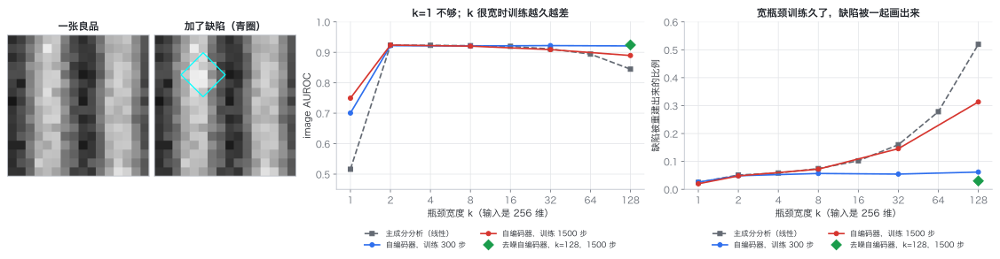
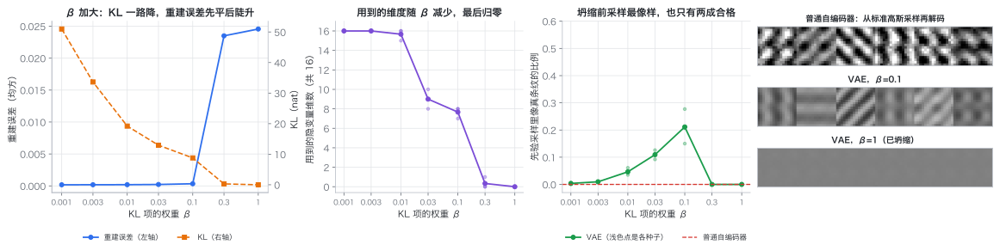
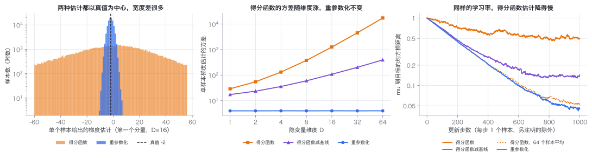
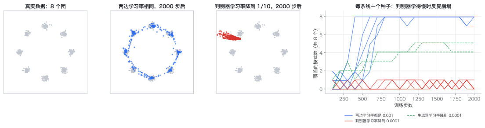
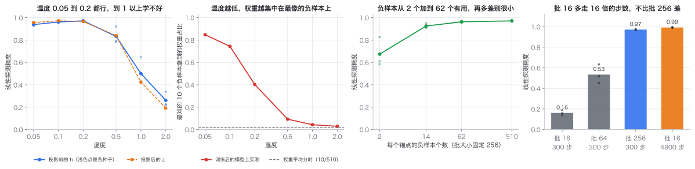
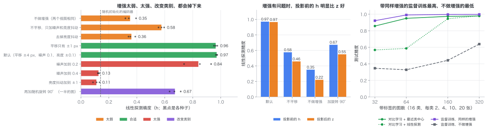

# 生成模型与自监督学习：从“压缩并还原”到“从数据中自己出题”

> [!NOTE]
> 本章所有数字都来自代码生成的 16×16 条纹小图和二维点集上的实测，记录在 [`figures/实测数字.json`](figures/实测数字.json)，由 `solutions` 分支的 `solutions/figures/ch13.py` 生成。重参数化和 NT-Xent 用的是本章作业的参考实现，网络都是几万到十万参数的全连接网络，在一台 Mac 的 CPU 上两三分钟跑完，重复运行结果相同。这些实验比真实的生成模型和自监督预训练小好几个数量级，结论只在所写的条件下成立；换成真实图像和大模型，数值会变，方向要自己再测一遍。讲到 MNIST、CIFAR-10、ImageNet 和各篇论文时，本章不引用任何没有跑过的精度数字。

本章面向学过概率、线性代数和基础神经网络，但细节已有些模糊的读者。生成模型和自监督学习常被放在一起讨论：前者试图学习数据分布，进而生成新样本；后者不依赖人工标签，而是从数据本身构造监督信号。二者并不等价，却共享一个核心问题：怎样迫使模型学到可迁移、可解释或可采样的表示？

自动验收的作业是 [`作业_重参数与对比损失.py`](./作业_重参数与对比损失.py)。第 8 节提到的练习 DL-10、DL-11 的题目在 [`视觉算法学习计划.md`](../视觉算法学习计划.md) 的“第 6 天”一节，目录里没有现成的文件，需要自己新建。

## 0. 本章怎么学

**应用场景**：无标注预训练和合成数据的入门，第 20 章的前置。检测场景里良品多、缺陷少、标注贵，本章的三样东西各对应一种用法：自编码器和 VAE 是重建类异常检测的基础（第 19 章 2.3 节）；对比学习是只有无标签图时先学一个特征的做法；GAN 和扩散模型是第 20 章合成缺陷时要用的生成器。

**优先级**：P3，选修，遇到再回看。前置是第 9 章（卷积网络和训练循环）。走“加学：数据生成”路线时，本章按速通档读完就进第 20 章。

| 档位 | 累计用时 | 做什么 | 做到什么算完 |
|---|---:|---|---|
| 速通 | 2 小时 | 读第 1、2 节和 5.1 节，看懂图 1、2、3、5、6，把 5.1 节演示的五步试一遍，答完 5 道小测 | 能讲清瓶颈宽度和“把异常也重建出来”的关系，KL 权重太大时发生什么，重参数化换来了什么，温度和增强各自在调什么 |
| 标准 | 7 小时 | 读完全章，跑 Notebook，完成 `作业_重参数与对比损失.py` 并验收通过，用第 8 节的自检数值核对自己的实现，做第 12 节前三个破坏实验，填实验记录 | 四项测试全部 PASS，自检数值对得上，实验记录里有一个失败案例（瓶颈过宽、增强失效或表示坍缩），自测问题都能答 |
| 深挖 | 9 小时 | 再做第 12 节其余的破坏实验和第 13 节的扩展（选一个） | 能在 MNIST 或自己的数据上报告一条带条件的曲线：KL 权重对重建误差和用到的维数，或者温度、增强对线性探测精度 |

> [!TIP]
> 用时超过所选档位的 1.5 倍还没做完，就把卡点写进 `学习进度.md`，先往下一章走。本章的作业只有两个短函数，时间主要花在读懂第 2 节和 5.1 节的实测上。GAN 和 DDPM 两节在速通档可以只读原文，第 20 章用到时再回来。

## 1. AutoEncoder：先学会压缩，再学会还原

AutoEncoder（自编码器，AE）由两部分组成。编码器将输入映射为低维表示：

$$
z=f_\theta(x),
$$

解码器再从表示重建输入：

$$
\hat{x}=g_\phi(z).
$$

训练时没有额外标签，目标就是让 $\hat{x}$ 尽量接近 $x$。连续值或归一化图像常用均方误差：

$$
\mathcal L_{rec}=\frac{1}{N}\sum_i\|x_i-\hat{x}_i\|_2^2.
$$

若每个像素可理解为伯努利变量，也可用二元交叉熵。损失并非越“高级”越好：MSE倾向于平均多个可能答案，因此图像可能偏平滑；交叉熵要求输出和数据范围匹配；面向感知质量时还可使用特征空间损失，但它优化的已不再是逐像素一致。

中间的 $z$ 所在空间称为 latent space（潜在空间）。如果瓶颈足够窄，模型无法机械复制每个像素，只能保留较重要的信息，如轮廓、姿态和纹理。潜在空间中的邻近点通常对应相似样本，方向有时还会呈现语义变化。可视化或对 $z$ 做分类、聚类，都是检查表示质量的方法。

但普通AE不是严格的生成模型。训练只保证“由真实样本编码得到的那些点”能被解码，没有约束潜在空间的空白区域。随便从高斯分布采一个 $z$，可能落在解码器从未见过的位置，产生无意义结果。若瓶颈过宽、模型过强，它还可能学成近似恒等映射，重建很好却没有抽取有用语义。

### 瓶颈多宽才合适：实测“把异常也重建出来”

上面最后一句说瓶颈过宽会学成恒等映射。这件事在异常检测里有直接的后果：重建类方法靠“缺陷处重建不出来”报警，如果自编码器把缺陷也画出来了，残差里就没有缺陷了。第 19 章 2.3 节用主成分分析做过一次，这里在同一种条纹上换成真正训练出来的自编码器，看两处的结论能不能对上。

良品是 16×16 的竖条纹（周期 8 px，幅度 0.3，像素噪声标准差 0.06，相位随机），2000 张训练。待检图是 500 张良品加 500 张带缺陷的图，缺陷是半径 2 px、幅度 0.12 的圆斑，亮暗随机。自编码器是 256-128-k-128-256 的全连接网络，k 是瓶颈宽度，Adam，学习率 0.002，批大小 256。异常分数是整图重建误差的均方值，3 个种子取平均。“缺陷被重建出来的比例”这样量：同一张图加缺陷前后各重建一次，看两次重建的差里有多少是缺陷本身，0 表示缺陷完全留在残差里，1 表示被原样画了出来。主成分分析保留前 k 个主成分，相当于最优的线性自编码器，放在一起对照。



| 瓶颈宽度 k（输入 256 维，3 个种子） | 1 | 2 | 8 | 32 | 128 |
|---|---:|---:|---:|---:|---:|
| 主成分分析：image AUROC | 0.516 | 0.923 | 0.922 | 0.911 | 0.845 |
| 自编码器训练 300 步：image AUROC | 0.701 | 0.922 | 0.921 | 0.922 | 0.921 |
| 自编码器训练 1500 步：image AUROC | 0.749 | 0.924 | 0.920 | 0.909 | 0.890 |
| 主成分分析：缺陷被重建出来的比例 | 2.5% | 5.1% | 7.4% | 16.0% | 52.0% |
| 训练 300 步：缺陷被重建出来的比例 | 2.6% | 4.9% | 5.7% | 5.5% | 6.2% |
| 训练 1500 步：缺陷被重建出来的比例 | 2.0% | 4.8% | 7.2% | 14.6% | 31.3% |
| 训练 1500 步：良品重建的均方根误差 | 0.0808 | 0.0603 | 0.0596 | 0.0572 | 0.0510 |

1. **瓶颈太窄不行**。k=1 时主成分分析的 AUROC 是 0.516，和随机猜差不多；自编码器好一些（0.701 和 0.749），仍然远低于 k=2 时的 0.92。条纹只有相位一个自由度，但相位是一个角度，线性地表示它需要正弦和余弦两个数，k=2 刚好够。
2. **线性的版本越宽越差**，和第 19 章 2.3 节的结论一致。主成分分析从 k=2 到 k=128，AUROC 从 0.923 降到 0.845，缺陷被重建出来的比例从 5.1% 升到 52.0%。第 19 章在 8×8 的像素块上得到的是同样的三段：k=1 不够，k=2 刚好够，再宽逐渐变差。
3. **训练出来的自编码器，光是瓶颈宽还不够，要宽并且训练得久才出问题**。k=128 训练 300 步时，AUROC 是 0.921，缺陷只被重建出 6.2%，和 k=2 没有差别。同一次训练继续到 1500 步，AUROC 降到 0.890，缺陷被重建出 31.3%。这时良品的重建均方根误差是 0.0510，已经低于像素噪声的标准差 0.06，说明网络开始去拟合训练图上的噪声，缺陷也就跟着被画出来了。k=2 时训练 300 步和 1500 步没有差别（0.922 和 0.924）。
4. **去噪目标能挡住这件事**。同样是 k=128、训练 1500 步，给输入加标准差 0.3 的噪声、让网络还原不加噪声的图（本章 Notebook 用的就是这种去噪自编码器），AUROC 是 0.924，缺陷只被重建出 3.0%，重建均方根误差停在 0.0605。Notebook 最后一个实验用同样的设置在一个种子上重做了 k=2、k=128 和 k=128 加去噪这三组，可以拿来和上表对照。

所以原文“瓶颈过宽、模型过强会学成近似恒等映射”要补两个条件：还得训练得足够久；而且限制瓶颈宽度不是唯一的办法，早停和去噪目标起同样的作用。这组实验里各种设置的差距并不大（0.92 对 0.89），数据也只有一种条纹，它说明的是方向。真实图像上瓶颈该多宽、训练多久，要在自己的数据上扫。

<!-- quiz -->
**一个自编码器的输入是 256 维，把瓶颈从 2 加宽到 128，只训练 300 步，用重建误差做异常检测。image AUROC 会怎样变？**

- A. 明显下降，宽瓶颈会把缺陷也重建出来
- B. 基本不变
- C. 明显上升，宽瓶颈重建得更准

<details markdown="1"><summary>答案与解释</summary>

**B**。实测 0.922 和 0.921，缺陷被重建出来的比例是 4.9% 和 6.2%。A 说的现象要训练得久才出现：同一次训练到 1500 步，k=128 的 AUROC 降到 0.890，缺陷被重建出 31.3%。线性的主成分分析没有“训练多久”这回事，k=128 时直接是 0.845。换成去噪目标，k=128 训练 1500 步仍有 0.924。

</details>
<!-- /quiz -->

## 2. VAE：把潜在表示变成概率分布

Variational AutoEncoder（变分自编码器，VAE）不再把一个输入编码成确定点，而是编码成一个条件分布，常设为对角高斯：

$$
q_\theta(z|x)=\mathcal N\big(\mu_\theta(x),\operatorname{diag}(\sigma_\theta^2(x))\big).
$$

编码器输出 $\mu$ 和 $\log\sigma^2$，从该分布采样 $z$，解码器建模 $p_\phi(x|z)$。同时预先规定简单先验 $p(z)=\mathcal N(0,I)$。训练目标可写成负证据下界：

$$
\mathcal L_{VAE}=\mathcal L_{rec}+\beta D_{KL}\big(q_\theta(z|x)\|p(z)\big).
$$

重建项要求 $z$ 留住当前样本的信息；KL项要求每个样本的潜在分布不要离标准高斯太远。直觉上，重建项像“记清楚自己是谁”，KL项像“大家仍住在同一个整齐社区”。只有重建项，潜在空间可能碎成互不相连的小岛；只有KL项，所有样本又可能挤在一起，失去区分度。$\beta$ 控制二者权衡，过大可能导致 posterior collapse：解码器忽略 $z$，编码器输出几乎都等于先验。

直接执行随机采样会阻断梯度，因为“从某分布抽一个数”不是普通可微函数。重参数技巧把随机性移到与参数无关的噪声中：

$$
\epsilon\sim\mathcal N(0,I),\qquad z=\mu+\sigma\odot\epsilon.
$$

这样 $\epsilon$ 只是外部随机输入，梯度可以沿 $z\rightarrow\mu,\sigma$ 传播。实现时通常输出 `logvar`，再计算 `std = exp(0.5 * logvar)`，比直接预测可能为负的标准差稳定。训练完成后，可从 $\mathcal N(0,I)$ 采样并解码，因此VAE比普通AE更适合生成。它的潜在空间连续、插值自然，但像素级似然常使样本偏模糊。

### KL 项的闭式，以及“用到的维数”

对角高斯和标准高斯之间的 KL 有闭式，每一维单独算再相加：

$$
D_{KL}\big(q_\theta(z|x)\|p(z)\big)=\frac{1}{2}\sum_{d}\big(\mu_d^2+\sigma_d^2-1-\log\sigma_d^2\big).
$$

$\mu_d^2$ 这一项把均值往 0 拉；$\sigma_d^2-1-\log\sigma_d^2$ 在 $\sigma_d=1$ 时最小，等于 0，方差偏大偏小都要付代价。用一维的例子核对：均值 1、标准差 0.5 时，闭式给出 0.8181 nat，用 20 万个样本直接估计 $\mathbb E_q[\log q-\log p]$ 得到 0.8149。

某一维的 KL 等于 0，当且仅当这一维对任何输入都输出均值 0、标准差 1，也就是和先验完全一样，不带任何关于 $x$ 的信息。所以可以用“每一维的平均 KL”来数模型实际用了几维：下面把平均 KL 大于 0.01 nat 的维度算作用到了。

### KL 权重从小到大：后验坍缩长什么样

原文说 $\beta$ 过大会后验坍缩。多大算大，坍缩前后各是什么样，下面扫一遍。数据是四个方向的条纹（16×16，相位、幅度、亮度随机，像素噪声标准差 0.06），4096 张训练。VAE 是 256-128-128 的编码器、16 维隐变量、16-128-128-256 的解码器，损失是“每张图 256 个像素的平方误差之和 + β×KL”，训练 600 步，3 个种子取平均。重建误差用隐变量的均值解码，在 2000 张测试图上和不带噪声的图比。最后一行从标准高斯采 1000 个 $z$ 解码，解码出的图如果和某一类条纹的差（均方根）小于 0.03，并且条纹幅度落在 0.08 到 0.32 之间，就算“像真条纹”；真实的不带噪声的图按这个标准全部合格。



| β（重建项按像素求和，3 个种子） | 0.001 | 0.003 | 0.01 | 0.03 | 0.1 | 0.3 | 1 |
|---|---:|---:|---:|---:|---:|---:|---:|
| 重建误差（均方） | 0.0002 | 0.0002 | 0.0002 | 0.0002 | 0.0003 | 0.0235 | 0.0246 |
| KL（nat，每张图） | 50.98 | 33.64 | 19.21 | 12.95 | 8.79 | 0.30 | 0 |
| 用到的隐变量维数（共 16） | 16 | 16 | 15.7 | 9 | 7.7 | 0.3 | 0 |
| 先验采样里像真条纹的比例 | 0.4% | 1.0% | 4.6% | 10.9% | 21.1% | 0% | 0% |

同一个网络去掉采样和 KL 项就是普通自编码器：重建误差同样是 0.0002，先验采样里像真条纹的比例是 0%。完全不看隐变量、只输出平均图时，重建误差是 0.0245。

1. **β 从 0.001 加到 0.1，重建几乎没有变差，KL 却降到了六分之一左右**（50.98 到 8.79）。模型先把用不着的维度关掉：用到的维数从 16 降到 7.7。这批数据本身只需要 9 个数左右（四类条纹各一对正弦余弦系数，加一个亮度），β 适中时模型自己找到了这个数量级。
2. **坍缩是突然发生的**。β 从 0.1 到 0.3，重建误差从 0.0003 跳到 0.0235，已经贴近“只输出平均图”的 0.0245；用到的维数从 7.7 掉到 0.3（3 个种子分别是 1、0、0）。并不存在一段“重建慢慢变差”的过渡可以用来预警，要直接看每一维的 KL。
3. **原文说 VAE 比普通 AE 更适合生成，实测成立，但只在坍缩之前的一小段**。普通自编码器的采样没有一个合格；β=0.1 时最好，有 21.1%（3 个种子分别是 20.7%、15.0%、27.7%），四类都能采到；β 再大就全是灰图。即使在最好的 β 下，也有近八成的采样不合格。这个小模型、600 步的条件下，“从先验采样”的质量远不如“重建”的质量。
4. **β 多大算大，取决于重建项怎么写**。把重建项从“对 256 个像素求和”换成“取平均”（`F.mse_loss` 的默认行为），KL 仍然对各维求和，同样写 β=0.03，结果是用到的维数为 0、重建误差 0.0246，完全坍缩。原因是取平均等于把重建项缩小到 1/256，相当于求和写法下的 β=7.68。读别人的代码或论文里的 β 值，先看重建项是求和还是平均。

<!-- quiz -->
**上表 β=0.03 时模型用到 9 维、重建正常。现在把损失写成 `F.mse_loss(recon, x) + 0.03 * kl`，其中 `kl` 仍然对各维求和、对批取平均，其余不变。训练结果最接近哪个？**

- A. 和上表 β=0.03 一样，用到 9 维左右
- B. 隐变量全部被忽略，输出都是平均图
- C. 重建更好，因为均方误差的数值更稳定

<details markdown="1"><summary>答案与解释</summary>

**B**。`F.mse_loss` 默认对 256 个像素取平均，重建项缩小到 1/256，相当于求和写法下的 β=7.68，远在坍缩点（0.1 到 0.3 之间）以上。实测用到的维数是 0，重建误差 0.0246，和只输出平均图的 0.0245 一样。排查方法是打印每一维的平均 KL。

</details>
<!-- /quiz -->

### 重参数化换来了什么：两种梯度估计的方差

原文说直接采样会阻断梯度。在 PyTorch 里这很容易验证：`torch.distributions.Normal(mu, std).sample()` 的结果不带梯度，`rsample()`（内部就是重参数化）的结果才带。但“梯度传不过去”不等于“没有办法求梯度”。不用重参数化，也可以用得分函数估计（强化学习里叫 REINFORCE）：

$$
\nabla_\mu\,\mathbb E_{z\sim q}[f(z)]=\mathbb E_{z\sim q}\big[f(z)\,\nabla_\mu\log q(z)\big]=\mathbb E_{z\sim q}\Big[f(z)\,\frac{z-\mu}{\sigma^2}\Big].
$$

它只需要 $f(z)$ 的数值，不需要 $f$ 可导。重参数化用的是另一个等式：

$$
\nabla_\mu\,\mathbb E_{z\sim q}[f(z)]=\mathbb E_{\epsilon}\big[\nabla_z f(\mu+\sigma\epsilon)\big].
$$

两个估计的期望都等于真实梯度，区别在方差。用一个能算出真值的玩具问题来量：$z$ 服从 $D$ 维高斯 $\mathcal N(\mu, I)$，目标是 $\mathbb E\|z-a\|^2$ 对 $\mu$ 的梯度，每个 $D$ 采 10 万个样本，每个样本各给出一个估计，统计这些估计的方差。重参数化的梯度由 autograd 穿过作业参考实现的 `reparameterize` 得到。“减基线”是把 $f(z)$ 换成 $f(z)$ 减去它的期望，这是给得分函数估计降方差的标准做法。



| 隐变量维度 D（各 10 万个样本） | 1 | 4 | 16 | 64 |
|---|---:|---:|---:|---:|
| 重参数化：单样本估计的方差 | 3.996 | 4.005 | 4.003 | 4.004 |
| 得分函数：单样本估计的方差 | 29.2 | 131.7 | 1263 | 17330 |
| 得分函数减基线：单样本估计的方差 | 17.4 | 35.88 | 108.5 | 395.9 |
| 方差之比，得分函数对重参数化 | 7.3 | 32.9 | 315.4 | 4328.5 |

1. **两种估计都没有偏**。D=16 时，重参数化和得分函数的 10 万次估计的平均值分别是 -2.0 和 -2.009，真值是 -2。
2. **重参数化的方差不随维度变**，始终是理论值 4.0。得分函数的方差随维度增长，D=16 时是重参数化的 315.4 倍，D=64 时是 4328.5 倍。方差大 315 倍的意思是：要得到同样准的梯度，得分函数每步要多采 315 倍的样本。
3. **减基线有用，但补不回来**。D=16 时减基线把倍数从 315.4 降到 27.1，D=64 时从 4328.5 降到 98.9。
4. **落到优化上**（D=16，学习率 0.002，每步 1 个样本，20 次重复取中位数，起点误差为 1）：走 1000 步后，重参数化的误差是 0.0452，得分函数是 0.492，减基线是 0.143；得分函数每步用 64 个样本平均，才追到 0.0516。把学习率加大到 0.02，重参数化仍然正常（300 步时 0.138），得分函数在第 10 步就发散了。
5. **在训练好的 VAE 上量一次**（图 2 里 β=0.03 的模型，固定 64 张图，重复采 400 次噪声），重建项对编码器输出的梯度，得分函数估计的方差是重参数化的 683 倍；单次估计的信噪比，重参数化是 0.214，得分函数是 0.0041。

所以重参数化解决的不是“能不能求梯度”，而是“梯度的噪声大不大”。得分函数估计仍然有它的位置：隐变量是离散的，或者 $f$ 不可导（强化学习里的回报）时，没有办法重参数化，只能用它再配合各种降方差的手段。

<!-- quiz -->
**16 维的高斯隐变量，改用得分函数估计（不减基线）代替重参数化。要让梯度估计和重参数化单个样本一样准，每步大约要采多少个样本？**

- A. 2 个
- B. 16 个，和维度一样多
- C. 300 个以上

<details markdown="1"><summary>答案与解释</summary>

**C**。D=16 时得分函数单样本估计的方差是重参数化的 315.4 倍，平均 N 个样本方差降到 1/N，所以要 300 多个。优化实验也对得上：每步平均 64 个样本，1000 步后的误差是 0.0516，仍略高于重参数化单样本的 0.0452。减去基线后倍数降到 27.1，仍然不是一个量级。

</details>
<!-- /quiz -->

## 3. GAN：生成器与判别器的对抗博弈

Generative Adversarial Network（生成对抗网络，GAN）包含生成器 $G$ 和判别器 $D$。生成器把随机噪声 $z$ 变成假样本 $G(z)$，判别器判断输入来自真实数据还是生成器。经典目标是极小极大博弈：

$$
\min_G\max_D\;\mathbb E_{x\sim p_{data}}[\log D(x)]
+\mathbb E_{z\sim p(z)}[\log(1-D(G(z)))].
$$

判别器希望增大目标，生成器希望减小目标。理想平衡下，生成分布等于真实分布，判别器对任何样本都只能输出约 $1/2$。实际训练中常用非饱和生成器损失 $-\log D(G(z))$，因为训练早期判别器太强时，原始生成器目标可能梯度很小。

GAN的优势是可以生成锐利图像，不必显式写出数据似然；困难是训练不是单一目标下降，而是两个网络不断改变彼此的损失地形。若判别器学得过快，生成器拿不到有效梯度；若生成器过强，判别器又无法提供细致反馈。学习率、更新次数、归一化方式和网络结构都很敏感，损失数值也不一定与视觉质量同步。

mode collapse（模式崩塌）指生成器把许多不同噪声映射到少数几类样本。例如真实数据含十种数字，生成器却反复输出最容易骗过判别器的“1”。此时单张图可能很真，但多样性很差。常见缓解思路包括WGAN类距离、梯度惩罚、谱归一化、合理的数据增强，以及监控生成样本覆盖度。不要仅展示“最好看的九张图”，应固定噪声观察训练演化，并检查批次间多样性。

### 在二维数据上看“两边速度不匹配”和模式崩塌

上面三段里的“可能”“敏感”“不一定同步”，在一个二维的小实验里就能看到。真实数据是 8 个高斯团，均匀排在半径 2 的圆上，每团标准差 0.1。生成器是 2-64-64-2 的全连接网络，判别器是 2-64-64-1，生成器用非饱和损失，Adam（beta1 取 0.5），批大小 256，两个网络每步各更新一次，训练 2000 步。每 100 步用同一批 2000 个噪声生成样本：落在某个团中心 3 倍标准差以内算高质量，一个团拿到的高质量样本超过全部样本的 2% 算被覆盖。只改两个网络的学习率，比较三种设置。



| 设置（训练 2000 步） | 各种子最终覆盖的模式数（共 8 个） | 最终的高质量样本比例 | 最后 100 步的生成器损失 |
|---|---|---:|---:|
| 两边学习率都是 0.001（5 个种子） | 7、8、8、8、8 | 0.56 到 0.84 | 0.77 到 0.88 |
| 判别器学习率降到 0.0001（5 个种子） | 0、0、0、0、1 | 0 到 0.28 | 0.70 到 0.73 |
| 生成器学习率降到 0.0001（3 个种子） | 5、4、4 | 0.52 到 0.62 | 2.01 到 2.29 |

1. **只改一个学习率，结果从“基本覆盖”变成“全部崩塌”**。判别器慢 10 倍时，后 1000 步里 5 个种子覆盖的模式数始终在 0 到 1 之间。图 4 左三里生成的样本挤成一小团，而且不在任何一个真实的团上；右栏的红线在 0 和 1 之间来回跳。看上去是生成器把所有样本搬到判别器当前打分高的地方，判别器慢慢跟上来之后它再整体搬走，这个过程本章没有逐步验证。它对应原文说的“生成器过强，判别器无法提供细致反馈”。
2. **反过来让生成器慢 10 倍，没有崩，只是慢**。2000 步时覆盖 4 到 5 个模式，后 1000 步里一直在 4 到 5 之间。这组实验只跑到 2000 步，不能说它最后会停在哪里。原文说“判别器学得过快，生成器拿不到有效梯度”，在这组用非饱和损失的实验里没有出现，下面的表给出了原因。
3. **即使是学习率相同的那一组，训练早期也是崩的**。第 200 步时，5 个种子覆盖的模式数是 1、2、0、1、1。只看早期的样本会误判。
4. **损失不反映质量**。崩塌的那一组，生成器损失是三组里最低的（0.70 到 0.73），而且贴着 ln 2，也就是 0.693。这正是判别器对什么都输出 0.5 时的损失：判别器分不清真假，不是因为假样本够好，而是因为它自己太弱。覆盖得最好的那一组损失反而高一些（0.77 到 0.88）。

为什么用非饱和损失：设判别器对一个假样本的输出是 $D$，两种生成器损失对判别器 logit 的梯度大小（由 autograd 算出）如下。

| 判别器对假样本的输出 D | 0.5 | 0.1 | 0.01 | 0.001 |
|---|---:|---:|---:|---:|
| 原始损失 $\log(1-D)$ 的梯度大小 | 0.5 | 0.1 | 0.01 | 0.001 |
| 非饱和损失 $-\log D$ 的梯度大小 | 0.5 | 0.9 | 0.99 | 0.999 |

判别器越确信样本是假的，原始损失给生成器的梯度越小，D=0.01 时只有非饱和损失的 1/99。非饱和损失在这种时候梯度反而接近 1，所以判别器强一些并不会让生成器停下来。

这是一个二维的玩具实验，真实图像上的 GAN 要复杂得多。它能复现的只有两点：结果对两个网络的相对速度很敏感；损失不能当质量指标，要固定噪声、数覆盖了多少种样本。WGAN、梯度惩罚、谱归一化在这组数据上有没有帮助，本章没有测，留在第 13 节的扩展里。

## 4. DDPM：逐步加噪，再逐步学会去噪

Denoising Diffusion Probabilistic Model（去噪扩散概率模型，DDPM）把复杂生成任务拆成许多简单的小步。前向过程是固定的：从真实样本 $x_0$ 开始，每一步加入少量高斯噪声，最终得到近似标准高斯的 $x_T$：

$$
q(x_t|x_{t-1})=\mathcal N(\sqrt{1-\beta_t}x_{t-1},\beta_t I).
$$

记 $\alpha_t=1-\beta_t$，$\bar\alpha_t=\prod_{s=1}^t\alpha_s$，则无需真的循环加噪，可一步得到任意时刻：

$$
x_t=\sqrt{\bar\alpha_t}x_0+\sqrt{1-\bar\alpha_t}\epsilon,
\quad \epsilon\sim\mathcal N(0,I).
$$

反向过程要从噪声恢复数据。神经网络通常接收 $x_t$ 和时间步 $t$，预测本次混入的噪声 $\epsilon_\theta(x_t,t)$，使用简单MSE：

$$
\mathcal L=\mathbb E_{x_0,t,\epsilon}
\|\epsilon-\epsilon_\theta(x_t,t)\|_2^2.
$$

为什么预测噪声等价于学习去噪？因为给定 $x_t$、时间步和噪声估计，就能由上式推回对 $x_0$ 或反向均值的估计。网络实际学的是：在不同噪声强度下，数据应朝哪个方向移动才能更像真实样本。时间嵌入很重要，否则网络无法区分“几乎干净”和“几乎全是噪声”的输入。

训练与采样必须分清。训练时，从数据集中取 $x_0$，随机抽一个 $t$ 和一份 $\epsilon$，直接构造 $x_t$，一次前向和反向传播即可；不需要从1走到 $T$。采样时没有真实 $x_0$，只能从 $x_T\sim\mathcal N(0,I)$ 开始，按 $T,T-1,\ldots,1$ 多次调用网络，逐步去噪。因而DDPM训练可并行抽时间步，采样却往往较慢。减少采样步数或使用DDIM等方法能加速，但改变了采样过程，不等于“训练时少加几次噪声”。

扩散模型通常比GAN稳定、覆盖模式更好，生成质量也高；代价是采样计算量大。噪声调度、数据归一化和反向方差设置都会影响结果。图像常归一化到 `[-1, 1]`，生成后再反归一化显示，若范围搞错，模型和可视化都可能看似异常。

### 前向过程里几个可以算出来的数

本章没有训练扩散模型，下面只把上面公式里能直接算的量算出来。取 DDPM 论文里的线性噪声调度：$T$ 为 1000，$\beta_t$ 从 0.0001 线性加到 0.02。

| 时间步 t | 1 | 100 | 250 | 500 | 750 | 1000 |
|---|---:|---:|---:|---:|---:|---:|
| 信号系数 $\sqrt{\bar\alpha_t}$ | 1.0 | 0.947 | 0.724 | 0.28 | 0.0579 | 0.00635 |
| 噪声系数 $\sqrt{1-\bar\alpha_t}$ | 0.01 | 0.321 | 0.69 | 0.96 | 0.998 | 1.0 |

- “最终得到近似标准高斯”里的“近似”是可以量的：最后一步信号系数还剩 0.00635，不是 0。
- 闭式和逐步加噪是一回事。把 20000 个都等于 1 的样本按第一条公式一步步加噪，到第 500 步时均值是 0.274、标准差是 0.962，闭式给出的是 0.28 和 0.96；到第 1000 步时是 0.012 和 0.997，闭式是 0.006 和 1.0。差别在采样误差的范围内。
- 走到一半（t=500）时信号系数已经只有 0.28。后半程的输入几乎全是噪声。通常的理解是网络在这些时间步学的是大的轮廓，细节在噪声小的时间步里学，本章没有验证这一点。
- 训练一步只调用 1 次网络，采样一张图（不做加速）要调用 1000 次，这就是原文“采样往往较慢”的来源。

第 20 章从合成缺陷的角度再讲一次扩散模型；Stable Diffusion、ControlNet、LoRA 在第 29 章。

## 5. 自监督学习：标签来自数据本身

自监督学习不是“完全没有监督信号”，而是不依赖人工标注，监督目标由原始数据自动构造。例如遮住图像块再预测、把同一图片的两种增强视为正样本、把图像与其原始文本配对。预训练得到编码器后，可进行线性探测、微调或直接用于检索。它与无监督学习边界有交叉，但“自己构造可计算的目标”是更实用的定义。

### 5.1 SimCLR：让同一图片的两种视图靠近

SimCLR对每张图片独立做两次随机增强，形成正样本对；同一批次中其他图片的视图通常作为负样本。增强不是附属细节，而是在定义模型应忽略什么：随机裁剪鼓励位置和尺度不变性，颜色抖动减少对颜色捷径的依赖，翻转是否合理则取决于任务。数字识别若随意上下翻转，可能改变语义。

两种视图先经过共享编码器 $f$ 得到表示 $h$，再经过投影头 $g$ 得到 $z=g(h)$。对比损失施加在 $z$ 上，而下游任务通常使用投影前的 $h$。投影头允许模型把“为对比目标服务的信息”与“可迁移表示”适当分开，训练后常丢弃。

NT-Xent损失先对向量归一化，用余弦相似度衡量正对相似程度。对锚点 $i$ 及其正样本 $j$：

$$
\ell_{i,j}=-\log
\frac{\exp(\operatorname{sim}(z_i,z_j)/\tau)}
{\sum_{k\ne i}\exp(\operatorname{sim}(z_i,z_k)/\tau)}.
$$

温度 $\tau$ 控制分布尖锐度。分母包含正样本，也包含所有允许的负样本，但排除锚点自身。一个原始批次大小为 $B$，增强后通常有 $2B$ 个向量。实现中最常见错误是正样本索引错位、忘记去掉对角线，或没做L2归一化。大批次提供更多负样本，但显存需求也随相似度矩阵快速增长。

#### 温度在调什么：NT-Xent 的梯度

记 $s_{ik}=\operatorname{sim}(z_i,z_k)$，$p_{ik}$ 是锚点 $i$ 把 $k$ 当成正样本的 softmax 概率（分母同上，不含 $i$ 自己）。对相似度求导：

$$
\frac{\partial \ell_{i,j}}{\partial s_{ij}}=-\frac{1-p_{ij}}{\tau},\qquad
\frac{\partial \ell_{i,j}}{\partial s_{ik}}=\frac{p_{ik}}{\tau}\quad(k\ne j).
$$

也就是说，正样本被拉近的力度是 $1-p_{ij}$，每个负样本被推开的力度正比于它自己的 $p_{ik}$，而所有负样本的 $p_{ik}$ 加起来恰好是 $1-p_{ij}$。负样本之间怎样分这份权重，由温度决定：温度低，$\exp(s/\tau)$ 把相似度的差距放大，权重集中到最像锚点的几个负样本上；温度高，各个负样本拿到的权重接近平均。

损失的数值本身也有一个可以记住的参照点：所有向量都相同（表示坍缩，或者什么都没学到）时，每个锚点面对的 $2B-1$ 个候选没有区别，损失等于 $\ln(2B-1)$，和温度无关。批大小 256 时它是 6.236。

#### 温度、负样本个数、批大小的实测

数据是 16 类条纹小图（16×16，类别决定条纹的方向和疏密，相位、幅度、亮度随机），像素噪声标准差特意加大到 0.2，让各种设置能拉开差距。4096 张无标签图做对比学习：编码器是 256-128-64 的全连接网络（输出 $h$），投影头 64-64-32（输出 $z$），损失是作业参考实现的 `nt_xent_loss`，Adam，学习率 0.002。默认设置是温度 0.2、批大小 256、训练 300 步，两个视图各自做循环平移（x、y 各在 ±4 px 内随机）、亮度抖动（整图加 ±0.1 以内的常数）、加标准差 0.1 的噪声。评估用线性探测：冻结编码器，用 320 张带标签的图在 $h$ 上拟合一个线性分类器（带 L2 的最小二乘），在另外 2000 张图上算精度。每个设置 3 个种子。16 类随机猜的精度是 0.0625。



| 温度（批大小 256，300 步，3 个种子） | 0.05 | 0.1 | 0.2 | 0.5 | 1 | 2 |
|---|---:|---:|---:|---:|---:|---:|
| 线性探测精度（投影前的 h） | 0.938 | 0.961 | 0.971 | 0.832 | 0.500 | 0.261 |
| 线性探测精度（投影后的 z） | 0.956 | 0.972 | 0.966 | 0.839 | 0.424 | 0.192 |
| 最像的 10 个负样本占负样本权重的比例 | 84.7% | 74.3% | 40.2% | 9.3% | 4.3% | 2.9% |
| 训练结束时的损失 | 2.436 | 2.573 | 3.217 | 4.715 | 5.531 | 5.973 |

1. **温度在 0.05 到 0.2 之间都能用，0.2 最好（0.971）；到 1 以上明显学不好**。温度 1 时 3 个种子分别是 0.424、0.647、0.429。
2. **第三行就是上面那条梯度公式的实测**。510 个负样本里最像的 10 个，按个数只占 2.0%。温度 0.05 时它们拿走 84.7% 的权重，温度 2 时只拿 2.9%，和平均分配几乎一样。温度太高时，所有负样本被一视同仁地推开，“把最容易混的图分开”这件事得不到额外的力度。
3. **损失不能跨温度比较**。损失最低的是温度 0.05（2.436），精度最好的是 0.2。温度 2 时损失 5.973，离“什么都没学到”的 6.236 不远。
4. 这组实验固定训练 300 步。温度高的那几档是不是只是学得慢、多训练就能追上，没有测。

把负样本个数和批大小拆开看。先固定批大小 256，把每批拆成若干组，NT-Xent 只在组内计算再取平均：每组 c 对图时，每个锚点有 2c-2 个负样本。每步用到的图和更新次数都不变，只有负样本个数变了。

| 每个锚点的负样本个数（批大小固定 256，300 步） | 2 | 14 | 62 | 510 |
|---|---:|---:|---:|---:|
| 线性探测精度（h） | 0.674 | 0.925 | 0.963 | 0.971 |

再整批一起算（负样本个数是 2B-2），改批大小和步数：

| 批大小 × 训练步数 | 16 × 300 | 64 × 300 | 256 × 300 | 16 × 4800 |
|---|---:|---:|---:|---:|
| 一共见过的图对数 | 4800 | 19200 | 76800 | 76800 |
| 线性探测精度（h） | 0.162 | 0.534 | 0.971 | 0.992 |

1. **负样本从 2 个加到 62 个有明显的收益，再多差别很小**。2 个负样本时只有 0.674，而且种子之间差很多（0.584、0.826、0.611）；62 个和 510 个只差 0.008，在种子的波动之内。
2. **同样训练 300 步，批越小越差，但主要原因不是负样本少**。批大小 16 时有 30 个负样本，精度只有 0.162；上一张表里负样本只有 14 个、批大小仍是 256 时，精度是 0.925。两者的区别在每步用了多少张图。
3. **把见过的图对数补齐，小批次并不差**。批大小 16 训练 4800 步，和批大小 256 训练 300 步见过同样多的图对，精度是 0.992，比 0.971 还高一点。
4. 原文说“大批次提供更多负样本，但显存需求也随相似度矩阵快速增长”。两半都要加限定。前一半：在这组小实验里，负样本超过几十个之后就没有收益了，批大小的作用主要是每步见的图多。SimCLR 论文在 ImageNet 上报告大批次有好处，那是另一个规模的实验，本章没有复现，以论文为准。后一半：相似度矩阵确实随批大小平方增长，但它很小。按 float32 算，批大小 256 时是 1 MB，4096 时是 256 MB。真正占显存的是编码器的中间输出，它随批大小线性增长：按元素数估算，ResNet-18 在 224×224 输入下，一张图所有卷积层和归一化层的输出合计约 18.9 MB，批大小 256、两个视图就是约 9.5 GB。这是按张量大小做的估算，不是在显卡上实测的显存。

<!-- quiz -->
**批大小从 256 降到 16，其余不变，同样训练 300 步，线性探测精度从 0.971 掉到 0.162。主要原因是什么？**

- A. 每个锚点的负样本从 510 个减到了 30 个
- B. 每步只用 16 对图，300 步一共见过的图对少了 16 倍
- C. 相似度矩阵太小，损失算不准

<details markdown="1"><summary>答案与解释</summary>

**B**。把步数加到 4800，让它和批大小 256 见过同样多的图对（76800 对），精度是 0.992。A 不是主因：批大小保持 256、把负样本限制到 14 个，精度仍有 0.925，比 30 个负样本、批大小 16 的 0.162 高得多。C 不成立，NT-Xent 在 2 对图上也能算。

</details>
<!-- /quiz -->

#### 交互演示：对比损失与温度

把归一化后的表示画成单位圆上的点，同色的两个点是一对正样本。演示页里的损失和作业的 NT-Xent 相同（用参考实现核对过同一种摆法下的数值），可以调温度，看锚点对每个负样本的权重怎么变，也可以让点沿梯度移动。页面下方有五步引导：

- 第 1 步对应上面的梯度公式和图 5 左二。锚点旁边有一个很像的负样本，温度 0.2 时它拿走负样本权重的 64.2%，温度 0.05 时是 92.2%，温度 2 时是 24.8%（6 个负样本平均分是 16.7%）。
- 第 2 步是坍缩：8 个点全部重合时，损失是 1.946（ln 7），和温度无关，点也不会动，因为这时梯度恰好是 0。换成相邻的点各差 1° 的摆法再优化，损失从 1.938 降到 0.027，说明完全重合是一个不稳定的平衡点。
- 第 3 步看“拉近正样本、推开负样本”两种力怎样把打散的点整理成 4 对各自重合、互相隔 90°，损失从 7.986 降到 0.027。停下来把温度改成 1，点不动，损失变成 1.009：同一组表示，换一个温度损失就不一样，所以损失不能跨温度比较。
- 第 4 步把两对点放得很近，当作同一类的两张图。温度 0.05 时，锚点的负样本权重 100% 落在相邻那一对身上；温度 1 时降到 61.8%。温度越低，和锚点最像的负样本被推得越狠，不管它其实是不是同类。
- 第 5 步换正样本对数：全部重合时，2、4、8 对的损失分别是 1.099、1.946、2.708，也就是 ln 3、ln 7、ln 15。损失的绝对值随批大小变，不能跨批大小比较。

演示页是二维的，4 对点正好能互相错开 90°；真实的表示有几十到几千维，数值不同，现象相同。

<!-- embed: ../demos/对比损失与温度.html 990 -->
[打开交互演示：对比损失与温度](../demos/对比损失与温度.html)

#### 增强太弱、太强、改变类别

原文说增强“在定义模型应忽略什么”。下面只改增强，其余同默认设置（温度 0.2，批大小 256，300 步，3 个种子）。



| 增强（其余同默认，3 个种子） | 分组 | 精度（h） | 精度（z） | 训练结束时的损失 |
|---|---|---:|---:|---:|
| 不做增强，两个视图相同 | 太弱 | 0.352 | 0.221 | 1.926 |
| 不平移，只加噪声和亮度抖动 | 太弱 | 0.576 | 0.458 | 2.343 |
| 去掉亮度抖动 | 太弱 | 0.361 | 0.300 | 3.508 |
| 平移只有 ±1 px | 合适 | 0.964 | 0.972 | 3.213 |
| 默认（平移 ±4 px，噪声 0.1，亮度 ±0.1） | 合适 | 0.971 | 0.966 | 3.217 |
| 噪声加到 0.2 | 太强 | 0.840 | 0.832 | 3.980 |
| 噪声加到 0.4 | 太强 | 0.126 | 0.098 | 6.152 |
| 亮度抖动加到 ±1 | 太强 | 0.111 | 0.106 | 6.237 |
| 再加随机旋转 90°（一半的图） | 改变类别 | 0.673 | 0.550 | 3.648 |

作为参照：随机初始化、没有训练过的编码器是 0.141，直接在原始像素上做线性探测是 0.078。像素上这么低是因为相位随机，每一类条纹的平均图都是一片均匀的灰，线性分类器在像素上分不开它们。

1. **平移是这组数据里最关键的增强**。不平移时只有 0.576；平移哪怕只有 ±1 px，就到了 0.964。类别信息在条纹的方向和疏密里，和相位无关，平移增强告诉模型的正是“相位该忽略”。
2. **去掉亮度抖动，精度掉到 0.361，和完全不做增强（0.352）差不多**。每张图有自己的平均亮度（0.4 到 0.6 之间），同一张图的两个视图亮度相同。最可能的解释是模型靠比亮度就能认出不少正样本对，不必去看条纹，这就是原文说的“捷径”，亮度抖动把这条捷径堵上。这个解释本章没有单独验证（比如去探测 $h$ 里有多少亮度信息）。
3. **太强有两种表现**。噪声加到 0.4 或亮度抖动加到 ±1 时，训练结束时的损失是 6.152 和 6.237，等于或贴近 $\ln(2B-1)$ 的 6.236：两个视图之间已经没有可以认出来的共同信息，模型什么都没学到，精度和没训练过的编码器（0.141）一个水平。噪声 0.2 是中间状态，平均 0.840，3 个种子从 0.738 到 0.932，很不稳定。
4. **改变类别的增强把类别信息抹掉**。旋转 90° 把竖条纹变成横条纹，16 类两两配成 8 对。如果一对里的两类完全分不开，精度的上限是 0.5。实测投影后的 $z$ 是 0.550，接近这个上限；投影前的 $h$ 还剩 0.673。这就是原文“数字识别若随意上下翻转，可能改变语义”的量化版本。
5. **损失低不等于表示好**。损失最低的是不做增强（1.926），它的精度只有 0.352：任务太容易，模型不需要学到类别就能把两个一模一样的视图配上。
6. **投影头**。增强合适时，$h$ 和 $z$ 差不多，互有高低（默认设置 0.971 对 0.966，平移 ±1 px 时 0.964 对 0.972，各档温度下的差距都在 0.08 以内）。增强丢掉了有用信息时，$h$ 明显更好：旋转时 0.673 对 0.550，不做增强时 0.352 对 0.221。对比损失直接作用在 $z$ 上，增强要求忽略的东西在 $z$ 里被抹得最干净，$h$ 隔了一层，保留得多一些。所以原文“下游通常使用投影前的 $h$”是稳妥的默认做法，尤其是在不确定增强是否丢了下游需要的信息时。

<!-- quiz -->
**默认的增强是平移、亮度抖动和加噪声。只去掉亮度抖动，平移和噪声照旧，线性探测精度会怎样？**

- A. 基本不变，仍在 0.97 左右
- B. 略有下降，到 0.9 左右
- C. 掉到 0.36 左右，和完全不做增强差不多

<details markdown="1"><summary>答案与解释</summary>

**C**。实测 0.361，完全不做增强是 0.352，默认是 0.971。每张图的平均亮度在两个视图里相同，模型很可能靠它来配对。增强里少了哪一种，模型就可能抓住那一种线索不放。真实图像上的颜色抖动起的是同样的作用。

</details>
<!-- /quiz -->

#### 和直接监督训练比

自监督学到的表示到底值多少，要和“把这点标签直接拿去训练”比。换一批带标签的图，每类正好 n 张，比较四种做法。前两种用默认设置训练好的对比学习编码器（没用到标签），只在 $h$ 上放一个分类器：“最近类中心”是把每类带标签图的 $h$ 归一化后取平均当类中心，测试图归到最像的那一类。后两种不做对比学习，用同样的编码器加一个线性层从头训练（Adam，学习率 0.002，300 步）。3 个种子取平均。

| 带标签的图数（16 类，每类 2、4、10、20 张） | 32 | 64 | 160 | 320 |
|---|---:|---:|---:|---:|
| 对比学习的 h，最近类中心 | 0.857 | 0.950 | 0.974 | 0.978 |
| 对比学习的 h，线性探测（最小二乘） | 0.568 | 0.587 | 0.945 | 0.981 |
| 直接监督训练，用同样的增强 | 0.922 | 0.991 | 0.997 | 0.998 |
| 直接监督训练，不做增强 | 0.347 | 0.329 | 0.443 | 0.639 |

1. **在这组实验里，带同样增强的监督训练在每一档标签数下都是最高的**。每类只有 2 张标签时它是 0.922，对比学习加最近类中心是 0.857。自监督没有赢。
2. **差别最大的是用没用上增强里的先验**。不做增强的监督训练在 320 张标签下只有 0.639，对比学习的表示配任何一种分类器都比它高得多。对比学习的收益，很大一部分来自“相位、亮度、噪声都该忽略”这些写在增强里的知识，而这些知识监督训练同样可以用。
3. **分类器怎么放也有讲究**。标签数是 64、正好等于 $h$ 的维数时，最小二乘的线性探测只有 0.587，最近类中心是 0.950。样本数和特征数接近时，正则很弱的最小二乘最不稳。报告线性探测的结果时，要写清用的是什么分类器、多少标签。
4. **重建好不等于表示好**。在同一批无标签图上训练一个自编码器（同样的 256-128-64 编码器，训练 600 步），它的重建误差是 0.011，比只输出平均图的 0.0251 小一半以上；但在它的 64 维编码上做线性探测，精度只有 0.255，对比学习是 0.971。

那么自监督预训练的价值在哪里？通常的理由是：预训练时还不知道下游任务是什么，一个编码器要服务多个任务；无标签数据比有标签数据多几个数量级；下游的标签少到不足以从头训练一个大模型。这些情况本章的小实验都没有覆盖，所以这里不下结论。第 26 章讲 MAE、DINOv2 这类预训练好的通用特征怎么直接拿来用。本章能确定的只有一条：比较时要给监督基线用上同样的增强，否则会把增强的功劳算到自监督头上。

### 5.2 MAE：遮住大部分图像，再重建缺失块

Masked Autoencoder（MAE）把图像切成patch，随机遮住很高比例，只把可见patch送入编码器；轻量解码器接收编码结果、掩码标记和位置信息，重建被遮住的像素。损失通常只在被遮住部分计算，防止模型把精力浪费在复制已知输入。

高遮挡率之所以可行，是因为自然图像存在强冗余；同时它迫使编码器利用全局结构，而不是从相邻像素做简单插值。只编码可见patch还能显著降低预训练计算。MAE与普通AE都做重建，但MAE的关键瓶颈来自“缺失内容”，重点是学表示；普通AE通常把完整输入压进连续潜变量，重点是低维重建。

“显著降低预训练计算”可以算一下。224×224 的图切成 16×16 的 patch，一共 196 个；按 MAE 论文默认的 75% 掩码率，编码器只处理 49 个。自注意力的计算量大致和 patch 数的平方成正比，所以编码器这一部分降到不遮挡时的 0.0625，也就是十六分之一。本章没有训练 MAE，Transformer 和 MAE 分别在第 25、26 章。

和第 1 节对照着看：普通自编码器防止“照抄输入”靠的是窄瓶颈、早停或去噪（图 1），MAE 靠的是把大部分输入拿走。两者都是在给重建任务制造困难，让网络没法只做恒等映射。

### 5.3 CLIP：把图像和文本放到同一个语义空间

CLIP使用图像编码器和文本编码器，把一批匹配的图文对映射到共享向量空间。真实配对为正样本，批内错配为负样本，并同时优化“图找文”和“文找图”的对称对比损失。训练后，一张图可与多条文本比较；也可把类别写成提示词，如“一张猫的照片”，编码后与图像向量计算相似度，实现零样本分类。

CLIP学到的是跨模态对齐，不是像素级生成。其能力依赖大规模且多样的图文数据，文本噪声、数据偏差和提示词措辞都会影响结果。相似度高表示在训练语义空间中更匹配，不等于模型给出了严格概率，更不保证细粒度计数、空间关系或事实判断正确。

把“对称对比损失”写出来。一批 $N$ 个图文对，图像向量 $u_i$ 和文本向量 $v_i$ 都做 L2 归一化，记 $s_{ij}=u_i\cdot v_j/\tau$：

$$
\mathcal L_{CLIP}=\frac{1}{2N}\sum_{i=1}^{N}\Big[-\log\frac{\exp(s_{ii})}{\sum_{j}\exp(s_{ij})}-\log\frac{\exp(s_{ii})}{\sum_{j}\exp(s_{ji})}\Big].
$$

第一项是“图找文”：第 $i$ 张图在 $N$ 条文本里认出自己那一条。第二项是“文找图”。和 5.1 节的 NT-Xent 比，形式上是同一种损失，有三处不同：

- 两个视图来自两个不同的编码器，而不是同一个编码器加两次增强。“增强”的角色由“同一内容的两种模态”承担。
- 相似度矩阵是 $N\times N$ 的，只有图和文之间的相似度，正样本在对角线上，所以不需要像 NT-Xent 那样去掉对角线。每个锚点的负样本只有另一种模态的 $N-1$ 个。
- 温度不是手工设定的超参数，而是和网络一起学出来的参数，具体的初值和上限以论文为准。

零样本分类也可以和上一小节的“最近类中心”对上：那里的类中心是每类几张带标签图的表示的平均，CLIP 的类中心是把类别名写成提示词后文本编码器给出的向量，分类规则都是“归到余弦相似度最高的那一类”。区别只在类中心从哪里来，一个要几张带标签的图，一个只要一句话。

5.1 节关于温度的梯度公式对这个损失同样成立。但本章没有训练也没有运行任何 CLIP 模型，以上只是公式层面的对应，不代表 5.1 节的实测数字能搬到 CLIP 上。视觉语言模型在第 28 章。

## 6. 方法对比：该选哪一种

- **AE**：结构最简单，适合降维、去噪、异常检测和理解编码器—解码器；普通版本不适合直接从先验采样。
- **VAE**：需要连续潜在空间、可解释插值或概率生成时优先；训练相对稳定，但样本可能偏平滑。
- **GAN**：重视锐利度、采样速度快且有足够调参经验时可选；需要特别监控不稳定和模式崩塌。
- **DDPM**：重视生成质量、分布覆盖和训练稳定性，且能接受较慢采样时合适；条件生成也很自然。
- **SimCLR**：有大量无标签图像，希望得到通用分类表示时合适；效果高度依赖增强、批大小和负样本设计。
- **MAE**：适合视觉Transformer和高分辨率图像预训练，计算重点放在可见patch；若下游更关心全局视觉结构，通常很有竞争力。
- **CLIP**：任务需要图文检索、零样本分类或开放词汇语义时优先；前提是有合适的图文配对或可用预训练模型。

选择时先问目标：要“生成新样本”，还是“学好表示”？要逐像素还原、概率潜变量、视觉逼真度，还是跨模态语义？不要只按流行度选模型。数据规模、算力、延迟、是否有配对文本，以及评价指标，往往比模型名字更决定结果。

上面几条里，本章用小实验碰过的有四处，可以回到对应的图表核对：AE“不适合直接从先验采样”（图 2，合格比例 0%）；VAE 的权衡（图 2，采样最好时 21.1% 合格，β 再大就坍缩）；GAN“需要特别监控”（图 4，只改一个学习率就全部崩塌）；SimCLR“高度依赖增强、批大小和负样本设计”（图 5、图 6，其中增强的影响最大，负样本个数超过几十之后影响很小）。DDPM、MAE、CLIP 三条本章没有做实验。

## 7. PyTorch 与 MPS 实践注意

在Apple Silicon上可用 `device = torch.device("mps" if torch.backends.mps.is_available() else "cpu")`。模型、输入、标签、时间步和随机噪声必须在同一设备；新建张量时最好从现有张量派生，或显式指定 `device`。训练循环使用 `optimizer.zero_grad(set_to_none=True)`、`loss.backward()`、`optimizer.step()`，验证和采样使用 `torch.no_grad()`。

MPS对部分算子、数据类型或第三方扩展的支持可能与CUDA不同。优先使用 `float32` 建立正确基线，不要默认所有混合精度代码都可原样迁移。遇到设备算子报错，先缩小到具体操作并核对张量的 `dtype`、`shape`、`device`，而不是立刻把整个训练静默回退到CPU。固定 `torch.manual_seed` 有助复现，但随机增强、DataLoader和设备后端仍可能带来差异。

生成任务中要定期保存固定输入的结果：AE/VAE固定验证图片，GAN固定噪声，DDPM固定初始噪声。对比学习应同时记录损失和线性探测准确率，因为低对比损失不保证下游表示最好。MPS统一内存并不等于无限显存；SimCLR的相似度矩阵、扩散模型的中间特征都可能占用大量内存，应先减小批次或图像尺寸。采样时及时切换 `model.eval()`；回到训练前再 `model.train()`。

### 换到带 NVIDIA 显卡的 Windows 笔记本

上面三段是针对 Mac 写的。在带 CUDA 的机器上，做法相同，换几条命令。

**确认显卡可用**。在命令行运行 `nvidia-smi`，能看到显卡型号和驱动版本；在 Python 里 `torch.cuda.is_available()` 应返回 `True`，`torch.cuda.get_device_name(0)` 应是你的显卡。返回 `False` 时，最常见的原因是装了只支持 CPU 的 PyTorch，打印 `torch.__version__` 和 `torch.version.cuda` 核对。设备可以写成三选一：

```python
device = torch.device("cuda" if torch.cuda.is_available()
                      else "mps" if torch.backends.mps.is_available() else "cpu")
```

**看显存占用**。`nvidia-smi` 看的是整个进程占了多少，包含 PyTorch 预留但没在用的部分。要知道一段代码的峰值，用 `torch.cuda.reset_peak_memory_stats()` 清零，跑完再读 `torch.cuda.max_memory_allocated()`。先用小批次量一次，再按批大小估算，比直接试到报错省事。

**批大小放不下时**，按这个顺序试：减小批大小或图像尺寸；用混合精度（`torch.autocast` 加 `torch.amp.GradScaler`）；用梯度累积凑出等效的大批次。对比学习要注意，梯度累积不会增加每个锚点的负样本个数。不过按 5.1 节的实测，负样本超过几十个之后收益很小，小批次多训练一些步数同样能到位，所以显存不够时不必执着于大批次。

**本章实验的规模**。对比学习的编码器加投影头一共 47392 个参数，VAE 是 105248 个，图 1 里 k=128 的自编码器是 98944 个，都远小于 ResNet-18 的 11689512 个。在一台 Mac 的 CPU 上（2 个线程，同时还有别的程序在跑），对比学习训练一次（批大小 256，300 步）约 0.98 秒，整个配图脚本约 140 秒。这只是那台机器上一次测量的量级。代码里把 `device` 换成上面的写法就能在显卡上跑，本章没有在任何 NVIDIA 显卡上测过耗时和显存，这么小的模型放到显卡上也未必更快。

## 8. 与 DL-10 / DL-11 练习的连接

**DL-10建议按“重建—概率化—对抗—扩散”推进。**先实现AE，观察瓶颈维度变化对重建和潜在空间的影响；再把编码器改为输出 `mu/logvar`，加入重参数和KL项，比较不同 $\beta$ 下的重建、随机采样与插值。随后在小型数据集上训练GAN，用固定噪声记录样本演化，并主动检查是否只生成少数模式。最后实现DDPM的随机时间步训练：验证闭式加噪公式、噪声预测损失，以及从纯噪声逐步采样的区别。练习重点不是堆大模型，而是确保每个损失与张量形状都能解释。

**DL-11建议按“对比—遮挡—跨模态”推进。**SimCLR中先可视化两次增强，确认语义未被破坏，再实现正样本索引和NT-Xent；预训练后冻结编码器做线性探测。MAE中检查patch切分、mask索引、位置编码和“只在遮挡处算损失”。CLIP练习可在小型图文对上实现双向相似度矩阵与对称交叉熵，再尝试文本到图像检索和提示词分类。DL-10关注“如何生成或重建”，DL-11关注“如何从数据自身获得迁移表示”，二者都应通过可视化与下游指标验证，而非只看训练损失。

本章有两类练习，不要混：DL-10 和 DL-11 是 `视觉算法学习计划.md` 里的开放练习（MNIST 上的自编码器、用预训练 ResNet 特征验证 NT-Xent），目录里没有对应的文件，属于深挖档；自动验收的是下面这个作业。

### 自动验收的作业：重参数化与对比损失

`作业_重参数与对比损失.py` 里有两个函数。`reparameterize` 对应第 2 节的公式；`nt_xent_loss` 对应 5.1 节的公式，要求对两个视图对称。完成后运行 `python tests/check_progress.py`。

自动验收有四项：重参数化两项（给定 `eps` 时的数值；梯度，以及不传 `eps` 时采样的均值和标准差），NT-Xent 两项（手算的数值、温度和交换两个视图；归一化，以及梯度能不能传回两个视图）。下面这些写错的情况验收都会报出来。表里的数是用参考实现算的，验收报错时可以拿来定位，以后在自己的训练代码里也可以当自检用。

`reparameterize`：取 $\mu=1$、`logvar` 等于 $\ln 4$（标准差应该是 2），采 20 万个样本。

| 核对项 | 正确的实现 | 把 `exp(0.5 * logvar)` 写成 `exp(logvar)` |
|---|---:|---:|
| 样本均值 | 0.999 | 不变 |
| 样本标准差 | 2.005 | 4.001 |
| 交给验收脚本，通过的项数 | 4/4 | 2/4。`logvar` 取 0 时两种写法结果相同，验收用的是 `logvar` 不为 0 的输入 |

`nt_xent_loss`：取 4 对正样本，`z1` 和 `z2` 都是 6 维单位矩阵的前 4 行（正样本相似度是 1，负样本相似度是 0），温度 0.2。

| 核对项 | 正确的实现 | 写错时 |
|---|---:|---|
| 这组输入上的损失 | 0.0396 | 忘了去掉对角线得到 0.7132；正样本错位一行得到 5.0396 |
| 把 `z1`、`z2` 都乘以 10，损失的变化 | 约 5e-07，可以认为不变 | 没做归一化时从 40.686 变成 4061.084 |
| 256 对完全相同的向量 | 6.236 | |

第一行的正确值可以手算：每个锚点的分母里有 1 个正样本和 6 个相似度为 0 的负样本，损失是 $\ln(1+6e^{-1/\tau})$。

这三种写错放进训练里各是什么后果，也测了（默认设置，各 2 个种子；正确实现的 3 个种子是 0.972、0.975、0.965）：

| 写错的地方 | 验收通过的项数（共 4 项） | 线性探测精度（h） | 训练结束时的损失 |
|---|---|---:|---:|
| 不去掉对角线 | 3/4 | 0.973、0.977 | 3.316、3.255 |
| 不做归一化 | 3/4 | 0.575、0.817 | 4.198、3.172 |
| 正样本错位一行 | 3/4 | 0.150、0.159 | 6.236、6.236 |

正样本错位时损失停在 $\ln(2B-1)$ 不动，最容易发现。不做归一化能训练但明显变差，而且不稳定。忘了去掉对角线在这组实验里对精度没有影响，只是损失的数值偏大。归一化之后每个向量和自己的相似度恒为 1，相当于给每个锚点多加了一个固定不动的负样本。它仍然是错的，损失的数值和别人的实现对不上，但不要指望靠“训练效果变差”来发现它，要靠验收里那种能手算出结果的小例子。

## 9. 常见误区（常见错误）

1. **“重建好就代表表示好。”** 宽瓶颈AE可能只会复制；应增加下游分类、聚类或线性探测。
2. **“VAE的KL越小越好。”** KL接近零可能意味着潜变量被忽略，应同时看重建和潜变量使用情况。
3. **“GAN损失下降就一定生成更好。”** 对抗损失是相对博弈结果，必须查看质量与多样性。
4. **“扩散训练要完整走完所有时间步。”** 训练通常随机抽单个 $t$；完整反向链主要发生在采样阶段。
5. **“预测噪声只是辅助任务。”** 在DDPM参数化中，它直接决定反向去噪方向。
6. **“自监督等于无损压缩。”** 自监督目标应服务于有用不变性，不要求保存所有输入细节。
7. **“增强越强越好。”** 若增强改变语义，SimCLR会被迫把不同类别拉近。
8. **“投影头输出就是最佳下游特征。”** SimCLR通常使用投影前表示，需通过实验比较。
9. **“MAE和普通AE只是mask不同。”** MAE只编码可见patch、主要在缺失处重建，计算路径和学习压力都不同。
10. **“CLIP会生成图片或理解所有文字事实。”** CLIP核心是对齐与检索，相似度不是事实验证器。
11. **“MPS与CUDA行为完全一致。”** 算子支持、精度和性能可能不同，先做小批次正确性检查。

其中六条在本章有对应的实测，可以带着数字记：

- 第 1 条：自编码器的重建误差比只输出平均图小一半以上，编码的线性探测精度只有 0.255（5.1 节）。
- 第 2 条：KL 最小的那两档 β（0.3 和 1），重建误差是 0.0235 和 0.0246，和完全不看输入、只输出平均图的 0.0245 差不多（图 2）。
- 第 3 条：生成器损失最低的那一组（0.70 到 0.73）正是模式全部崩塌的那一组（图 4）。
- 第 4 条：训练一步调用 1 次网络，采样一张图调用 1000 次（第 4 节）。
- 第 7 条：增强太强有两种后果，改变类别的旋转让精度从 0.971 降到 0.673，过大的噪声让模型什么都学不到（图 6）。
- 第 8 条：增强合适时 $h$ 和 $z$ 差不多，增强丢了信息时 $h$ 明显更好（图 6 中栏）。

下面是做作业和跑实验时容易犯的错，按现象查。前七行是 `作业_重参数与对比损失.py` 里最常见的。

| 现象 | 原因 | 怎么查 |
|---|---|---|
| 验收报重参数化的数值不对，或者 VAE 的采样明显过于分散或过于集中 | 把 `exp(0.5 * logvar)` 写成了 `exp(logvar)`。`logvar` 是 0 时两种写法结果相同，只用这种输入测试发现不了 | 取 `logvar` 为 $\ln 4$ 采 20 万个样本，标准差应约为 2；写错时是 4.001 |
| 验收报梯度是 `None` | 用了 `torch.normal`、`Normal(...).sample()` 这类不带梯度的采样，或者对结果做了 `.detach()` | 打印 `z.requires_grad`；`sample()` 的结果不带梯度，`rsample()` 才带 |
| 传了 `eps`，两次调用结果却不同 | 没有用传进来的 `eps`，函数里总是重新采样 | 用同一个 `eps` 调两次，结果应逐元素相同 |
| 在 GPU 上报设备不一致 | 噪声或掩码是在 CPU 上新建的 | 用 `torch.randn_like`，或者从已有张量取 `device` |
| NT-Xent 在第 8 节的自检输入上得到 0.7132 | 没有去掉对角线，自己和自己的相似度进了分母 | 正确值是 0.0396 |
| 把向量整体乘以 10，损失变了 | 没有做 L2 归一化 | 正确的实现变化约 5e-07 |
| 损失一直停在 $\ln(2B-1)$（批大小 256 时是 6.236） | 正样本索引错位；或者增强太强，两个视图没有共同信息；或者表示坍缩 | 先用自检输入查索引（错位一行得到 5.0396），再把一批图的两个视图画出来看 |
| 损失出现 `nan` | 用 `-inf` 做掩码之后又乘了 0，或者没归一化时相似度太大导致溢出 | 用 `masked_fill` 而不是乘法做掩码；检查是否先归一化 |
| VAE 的输出全是同一张灰图，KL 接近 0 | 后验坍缩。常见的原因是重建项用了取平均的 `F.mse_loss` 而 KL 求和，β 实际被放大了像素个数那么多倍 | 打印每一维的平均 KL；把重建项改成按像素求和，或者把 β 相应调小 |
| 自编码器的重建误差低于数据噪声，异常检测反而变差 | 瓶颈宽并且训练久，开始重建噪声，缺陷也被画出来 | 比较良品的重建均方根误差和噪声标准差；早停，或者改用去噪目标（图 1） |
| GAN 的生成器损失稳定在 0.69 附近，样本却挤在一处 | 判别器太弱，对真假都输出 0.5 | 固定噪声定期画样本，数覆盖了几种；检查两个网络的学习率比例 |
| 对比损失很低，线性探测很差 | 增强太弱，任务太容易。不做增强时损失 1.926，精度 0.352 | 同时记录损失和线性探测精度；画出两个视图，确认它们确实不同 |
| 去掉一种增强后精度大跌 | 模型抓住了这种增强原本堵住的捷径（去掉亮度抖动后 0.361） | 逐个去掉增强做消融 |
| 标签数接近特征维数时线性探测特别差 | 正则很弱的最小二乘在样本数约等于特征数时不稳（64 张标签时 0.587，最近类中心 0.950） | 加大正则，或者换最近类中心；报告时写清分类器 |

## 10. 章末检查清单

- [ ] 能画出AE的编码器、潜在变量、解码器，并解释重建损失的选择。
- [ ] 能说明普通AE为何不能保证从标准高斯采样有效。
- [ ] 能写出VAE的 `mu`、`logvar`、重参数公式，并用自己的话解释KL项。
- [ ] 能解释VAE中重建质量与潜在空间规整性的权衡。
- [ ] 能写出GAN极小极大目标，说明训练不稳定与mode collapse的表现。
- [ ] 能区分DDPM前向加噪、反向去噪、噪声预测，以及训练和采样流程。
- [ ] 能给出自监督学习的定义，并说明监督信号来自哪里。
- [ ] 能完整描述SimCLR的增强、共享编码器、投影头和NT-Xent。
- [ ] 能说明MAE为什么采用高掩码率、为何主要在掩码patch上计算损失。
- [ ] 能解释CLIP如何用双向对比学习完成图文对齐和零样本分类。
- [ ] 能根据生成质量、表示迁移、数据类型、算力和延迟选择方法。
- [ ] 能在PyTorch/MPS中正确管理设备、数据类型、训练/评估模式和内存。
- [ ] 已将DL-10中的生成流程与DL-11中的自监督流程分别跑通，并用可视化或下游指标验证。

## 11. 怎样评估

本章反复出现同一件事：训练损失不能当成结果。损失最低的对比学习设置精度只有 0.352，损失最低的 GAN 是崩塌的那一组，KL 最小的 VAE 忽略了输入。每一类方法都要另找一个和目的直接相关的量。

**重建类（AE、去噪 AE）**。只报重建误差不够。用来做异常检测时，报 image AUROC 和漏检约束下的过检率，读法见第 19 章第 5 节。同时把良品的重建均方根误差和数据的噪声标准差放在一起看，前者低于后者是过拟合的信号（图 1）。

**VAE**。至少报四个量：重建误差、KL、用到的维数、先验采样的质量。重建好不代表采样好：图 2 里 β=0.001 时重建误差和 β=0.1 时几乎一样，采样合格的比例却是 0.4% 对 21.1%。还要写清 β 是配哪种重建项（按像素求和还是取平均），否则数值没有可比性。

**GAN 和其他生成模型**。固定一批噪声，在训练过程中反复生成，同时看质量和覆盖。本章的二维数据可以直接数覆盖了几个团。真实图像没有这么方便的真值；怎样证明生成的数据有用，是第 20 章的主题之一。只展示挑出来的几张好样本说明不了任何问题。

**自监督表示**。标准做法是线性探测：冻结编码器，只训练一个线性分类器。报告时写清五件事：用的是哪一层的表示（投影前还是投影后）；多少张带标签的图；分类器和正则（最小二乘、逻辑回归还是最近类中心）；预训练见过多少图（批大小乘步数）；几个种子、种子之间差多少。最后一条不能省：噪声增强 0.2 那一档，3 个种子从 0.738 到 0.932，只跑一次可能得出相反的结论。

**基线要公平**。和监督训练比时，给监督基线用同样的增强（5.1 节最后一张表）。和“不预训练”比时，至少放上随机初始化的编码器（0.141）和原始像素（0.078）这两个参照，才知道预训练到底带来了多少。

## 12. 破坏实验

每个实验先写下预测，再运行，把结果和原因记到 `实验记录.md`。前三个是标准档必做。

1. Notebook 里把 `noise_std` 从 0.30 依次加大到 0.8、1.5、3.0 重新训练。先预测重建 MSE 和“自监督表示观察”那个单元里的两个相似度（同一张图的两个加噪视图、不同图）各怎么变，再运行。噪声大到什么程度，同图相似度和不同图相似度就分不开了？和 5.1 节增强那张表里“噪声加到 0.4”一行对照。
2. Notebook 的自编码器是 256-128-`latent_dim`-128-256 的全连接网络，`latent_dim` 默认是 8。把它依次改成 1、2、32、128 重新训练，先预测重建 MSE 怎么变：太窄时会怎样，从 8 加宽到 128 还会不会变好。然后看 Notebook 最后的“瓶颈宽度”实验：先预测 k=2、k=128、k=128 加去噪这三组训练到 1500 步时，哪一组缺陷被重建出来的比例最高，再运行，和图 1 的表对照。对照图 1 解释：Notebook 用的是去噪目标，它和普通自编码器在“宽加久”时的表现有什么不同？
3. 作业通过验收之后，把你的 `nt_xent_loss` 故意改错三次（去掉对角线的掩码、去掉归一化、把正样本索引错开一行），每次都跑 `tests/check_progress.py` 和第 8 节的自检输入。先预测四项验收里哪一项会报错，再运行，和第 8 节的表对照。再对 `reparameterize` 做同样的事：把 0.5 去掉。最后想一想：只用 `logvar` 等于 0 的输入来测试，为什么发现不了去掉 0.5 这个错？
4. 写一个小 VAE（可以在 Notebook 的自编码器上改：编码器多输出一份 `logvar`，中间用你的 `reparameterize`），损失用 `F.mse_loss(recon, x) + beta * kl`。`beta` 取 1，打印每一维的平均 KL。然后把重建项改成按像素求和，其余不变，再看。和图 2 对照。
5. 在 16 维上各用 1000 个样本估计 $\mathbb E\|z-a\|^2$ 对 $\mu$ 的梯度，一次用你的 `reparameterize` 加 autograd，一次用得分函数公式，画两个直方图。先预测哪个更宽、宽多少倍，再和图 3 对照。给得分函数估计减去基线之后再画一次。
6. 用你的 `nt_xent_loss` 在任意一批随机向量上，把温度从 0.05 改到 2，打印每个锚点最像的那个负样本拿到的 softmax 权重。再把向量全部设成相同的，确认损失等于 $\ln(2B-1)$ 而且不随温度变。和演示页的第 1、2 步对照。

## 13. 扩展（深挖档）

- **DL-10：MNIST 上的自编码器**（题目在 `视觉算法学习计划.md`）。做完基本要求后加两条曲线：瓶颈从 2 维扫到 128 维的重建误差；在瓶颈表示上做线性探测的精度。看“重建好不等于表示好”在 MNIST 上成立到什么程度。
- **DL-11：对比学习**（同上）。用预训练 ResNet-18 提特征，用你的 `nt_xent_loss` 验证同图两个增强的相似度高于不同图。再做本章 5.1 节的两个消融：去掉颜色抖动，或者加一种会改变类别的增强，看相似度的分布怎么变。
- **在 MNIST 上复现图 2**。训练一个小 VAE，β 扫六七个值，画重建误差、用到的维数和采样结果。注意先定好重建项是求和还是平均。
- **在二维数据上训练一个小 DDPM**。用图 4 的 8 个高斯团，网络输入是二维坐标加时间步的编码，训练噪声预测，再从纯噪声采样，用图 4 同样的标准数覆盖了几个团。原文说扩散模型“覆盖模式更好”，本章没有测，这正好可以自己验证。再试试只走十分之一的采样步数会怎样。
- **给图 4 的 GAN 换损失**。把判别器学习率降到十分之一那一组，换成 WGAN 加梯度惩罚，或者给判别器加谱归一化，看还崩不崩。
- **在自己的显卡上量显存**。用 torchvision 的 ResNet-18 做编码器，批大小从 32 开始翻倍，每次记录 `torch.cuda.max_memory_allocated()`，和 5.1 节按元素数做的估算比一比，再看混合精度能省多少。

## 14. 和后续章节的关系

- **第 9 章**是前置：卷积网络和训练循环。本章为了能在 CPU 上快速做对照，网络都用全连接层，换成卷积是直接的。
- **第 10 章**讲迁移学习、数据增强和线性探测。本章 5.1 节的“增强在定义模型应忽略什么”和那里是同一个道理，只是这里没有标签。
- **第 19 章** 2.3 节用主成分分析量过重建类异常检测的容量问题，本章第 1 节在同一种条纹上换成训练出来的自编码器，结论对得上，并补了训练时长和去噪目标这两个因素。第 19 章的主角 PatchCore 用的是预训练特征，不是重建。
- **第 20 章**讲合成缺陷与生成模型，本章是它的前置：VAE、GAN、扩散模型在那里用来造缺陷数据。
- **第 25、26 章**讲 Transformer、MAE 和 DINOv2，接着本章 5.2 节。
- **第 28 章**讲视觉语言模型与开放词汇检测，接着本章 5.3 节。
- **第 29 章**讲扩散模型实战，接着本章第 4 节和第 20 章。

## 15. 自测问题

速通档答小测，标准档把下面的问题答一遍。

1. 用自编码器的重建误差做异常检测，瓶颈太窄和太宽各会怎样？宽瓶颈在什么条件下才真的出问题，有哪些办法可以挡住？
2. VAE 的 β 从很小加到很大，重建误差、KL、用到的维数、先验采样的质量各自怎么变？坍缩是渐变的还是突变的？
3. 别人的代码里写着 β=1，你照着设却全部坍缩了。先检查什么？
4. 不用重参数化就没法训练 VAE 吗？得分函数估计差在哪里，什么时候不得不用它？
5. GAN 的生成器损失稳定在 0.69 附近，能说明训练得好吗？还要看什么？
6. NT-Xent 的温度调的是什么？温度太低和太高各有什么问题？损失停在 $\ln(2B-1)$ 说明什么？
7. 有人说“对比学习必须用大批次，因为负样本多”。按本章的实测，这句话哪里要打折扣？显存不够时怎么办？
