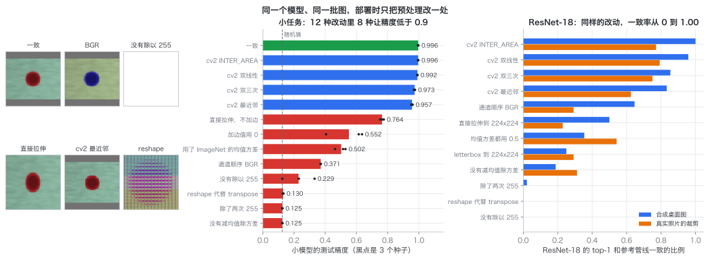
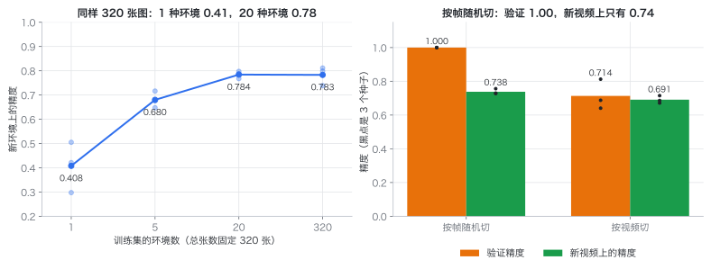
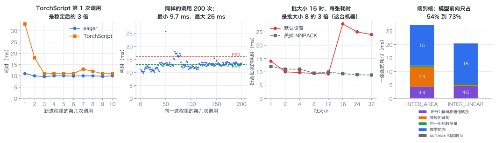
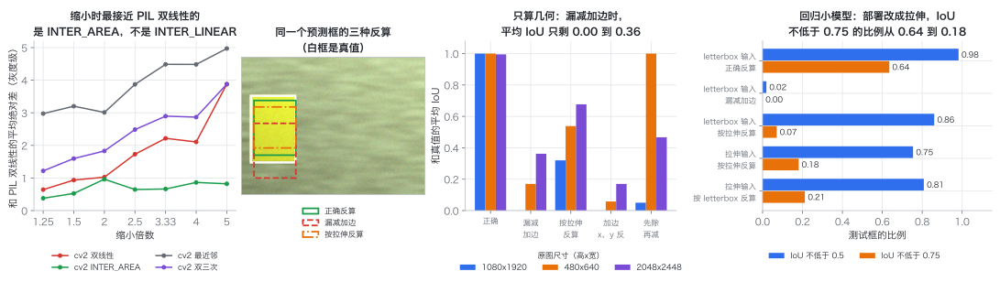
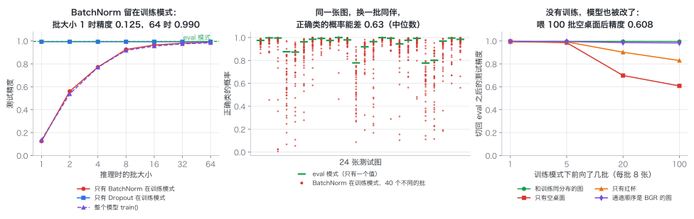
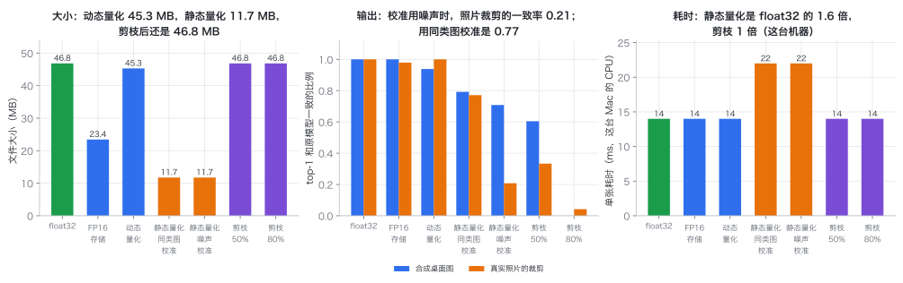

# 第 14 天：DL 综合项目与部署 —— 教程

> [!NOTE]
> 本章新增的数字都来自实测，记录在 [`figures/实测数字.json`](figures/实测数字.json)，由 `solutions` 分支的 `solutions/figures/ch14.py` 生成。实验分两类：一个代码生成的“桌面物体”小任务（在一台 Mac 的 CPU 上训练小卷积网络），以及 torchvision 的 ResNet-18（ImageNet 权重，只做前向）。letterbox 的元数据和框的反算用本章作业的参考实现。耗时是在一台 Apple M5 Pro 的 CPU 上、限制 2 个线程、机器上同时跑着别的任务时测的一次结果，只保留两位有效数字，只能看量级和倍数。本机没有 CUDA，也没有 onnx 和 onnxruntime，所以本章没有任何显卡上的数字，也没有 ONNX 的实测数字。换成真实数据、别的机器或别的库版本，要自己再测一遍。

自动验收的作业是 [`作业_预处理与部署契约.py`](./作业_预处理与部署契约.py)，配套实验是 [`实验_端到端推理与导出.ipynb`](./实验_端到端推理与导出.ipynb)。练习 DL-12（桌面物体检测与分割）的题目在 [`视觉算法学习计划.md`](../视觉算法学习计划.md) 第二部分的“第 7 天：DL 综合项目”一节，目录里没有现成的文件，需要自己新建 `DL-12_桌面物体检测与分割.py` 完成。

---

## 0. 本章怎么学

**应用场景**：把训练好的模型变成能交付的推理程序。模型在 Notebook 里精度很好，换到另一段代码、另一种语言、另一台机器上运行时，输入怎样准备、输出怎样解释、耗时怎样量，都要重新对一遍。本章的主线是一个问题：训练时和部署时不一致会出什么事，能不能量出来。

**优先级**：P3，选修，已有基础或用得少，遇到再回看。前置是第 10 章（预训练模型的输入契约和 `weights.transforms()`）。本章还用到第 9 章 9.5 节的 BatchNorm。后面第 15 章讲 Python 和 C++ 的对拍；部署加速（ONNX、TensorRT、量化）规划在第 31 章，还没有写，本章不展开。

| 档位 | 累计用时 | 做什么 | 做到什么算完 |
|---|---:|---|---|
| 速通 | 3 小时 | 读 14.1 节、14.7 节、14.8 节里标题以“实测”开头的小节和 14.11 节的表，看懂图 1、图 3、图 4、图 5，把 14.12 节演示的五步试一遍，答完 5 道小测 | 能说出一份预处理契约要写清哪几项、哪些项错了程序不会报错；能说出忘了 `eval()` 的三种后果；知道报告耗时要带哪些条件 |
| 标准 | 12 小时 | 读完全章，跑 Notebook，完成 `作业_预处理与部署契约.py` 并验收通过，做 14.14 节前三个破坏实验，填 `实验记录.md` | 四项测试全部 PASS；实验记录里有 eager 和导出模型的最大张量误差、P50 和 P95、一个预处理不一致的失败案例；自测问题都能答 |
| 深挖 | 20 小时 | 再做其余破坏实验和 14.15 节的扩展：在自己的机器上导出 ONNX 并做三层一致性检查，或者用 C++ 复现预处理并和 Python 对拍 | 能在自己的机器上给出带条件的 P50、P95、显存峰值和导出前后的最大误差，并说明容差是怎么定的 |

> [!TIP]
> 用时超过所选档位的 1.5 倍还没做完，就把卡点写进 `学习进度.md`，先往下一章走。原有的 14.2 节到 14.6 节讲项目流程，做过完整项目的话可以只看其中标题以“实测”开头的小节。深挖档要自己装 onnx 和 onnxruntime，环境问题卡超过一小时就先跳过，回头再做。

---

## 14.1 先定义问题，再选择模型

一个深度学习项目最危险的开场是：“先训个 YOLO 看看。”模型只是流水线中的一个零件，真正的起点应该是**业务问题、输入输出和验收条件**。

本章以“桌面物体检测与分割”为例：输入一张或一帧桌面图像，输出杯子、手机、键盘等物体的类别、置信度、边界框和像素级掩码。它同时包含检测与实例分割，适合串起数据、训练、评估、压缩和部署的完整流程。

先把问题写成一页任务说明：

| 项目项 | 明确定义 |
|---|---|
| 使用场景 | 室内桌面，手机或电脑摄像头，可能有遮挡、反光和暗光 |
| 输入 | RGB 图像；部署时最长边不超过 1280 像素 |
| 输出 | `class, score, box, mask`，允许画面中同时出现多个实例 |
| 类别 | 只保留确实需要且视觉上可区分的类别，先从 5～10 类开始 |
| 质量指标 | 检测 mAP、分割 mask mAP；另统计每类召回率和误报率 |
| 性能指标 | 指定设备上的端到端延迟、峰值内存、模型体积和功耗 |
| 失败边界 | 极端遮挡、训练集中从未出现的类别可返回“未知”或不输出 |

**为什么要先写验收条件？**因为“准确率高”无法指导取舍。一个模型 mAP 更高，却在目标设备上每帧耗时两秒，仍然不合格；另一个模型平均指标不错，却总漏掉业务最重要的手机，也不能上线。指标必须和真实使用方式绑定。

还要明确任务粒度。若只需判断桌面上“有没有杯子”，分类即可；若要指出位置，用检测；若要精确计算占用面积或实现抠图，才需要分割。不要用更复杂的任务给自己制造成本。

### 实测：“输入”这一行没写清会怎样

上面那张任务说明表里，输入只写了“RGB 图像；部署时最长边不超过 1280 像素”。交给另一个人或另一段代码去实现时，至少还有七件事没有说：通道顺序、取值范围、减什么均值除什么标准差、缩放时保持比例还是拉伸、用哪种插值、加边填什么值、数组在内存里按什么顺序排。这七件事合起来就是**预处理契约**。任何一项和训练时不一样，程序都照常运行，只是结果变了。

变多少可以量。实验用一个代码生成的小任务：120×160 的 RGB 桌面图，8 类（空桌面、红杯、蓝杯、方便签、横卡片、竖卡片、键盘、鼠标垫），训练集 1280 张，测试集 1200 张。类别是故意这样设计的：红杯和蓝杯只差颜色；方便签（1:1）、横卡片（3:2）、竖卡片（2:3）只差长宽比；键盘和鼠标垫只差有没有细格纹。这样每一种不一致都有东西可以破坏。模型是一个 61208 个参数的小卷积网络（4 个 Conv-BN-ReLU 块、全局平均池化、Dropout、全连接），3 个随机种子各训练一个。

训练时的契约：RGB；保持比例缩到 48×48，上下加边（PIL 的双线性，加边值 114）；除以 255；减训练集的通道均值（0.522、0.515、0.504），除以通道标准差（0.144、0.139、0.138）；HWC 转成 CHW。部署时每次只改一处，其余不动。



| 部署时改的一处（1200 张测试图） | 精度，3 个种子平均 | 各种子 | 平均 top-1 概率 |
|---|---:|---|---:|
| 和训练一致 | 0.996 | 0.996、0.998、0.996 | 0.93 |
| 缩放用 cv2 的 `INTER_AREA` | 0.996 | 0.996、0.998、0.996 | 0.933 |
| 缩放用 cv2 的双线性 | 0.992 | 0.992、0.992、0.992 | 0.926 |
| 缩放用 cv2 的双三次 | 0.973 | 0.976、0.975、0.969 | 0.916 |
| 缩放用 cv2 的最近邻 | 0.957 | 0.96、0.959、0.952 | 0.912 |
| 直接拉伸，不加边 | 0.764 | 0.776、0.752、0.765 | 0.91 |
| 加边值用 0 | 0.552 | 0.405、0.636、0.615 | 0.783 |
| 用了 ImageNet 的均值方差 | 0.502 | 0.53、0.463、0.514 | 0.668 |
| 通道顺序 BGR | 0.371 | 0.372、0.371、0.372 | 0.831 |
| 没有除以 255 | 0.229 | 0.332、0.125、0.231 | 0.999 |
| `reshape` 代替 `transpose` | 0.13 | 0.127、0.132、0.131 | 0.976 |
| 除了两次 255 | 0.125 | 0.125、0.125、0.125 | 0.817 |
| 没有减均值除方差 | 0.125 | 0.125、0.125、0.125 | 0.982 |

随机猜的精度是 0.125。读这张表的五点：

1. **12 种改动里有 8 种让精度低于 0.9，没有一种会报错**。数组的形状和类型都对，模型照常给出一个类别。
2. **哪些类别坏掉，取决于类别靠什么区分**。通道顺序反了以后，带颜色的五类几乎全错：红杯、蓝杯、竖卡片的精度是 0，方便签 0.002，横卡片 0.004；空桌面和键盘仍然是 1.0，鼠标垫 0.964。直接拉伸以后，靠长宽比区分的出错：方便签 0.113，横卡片 0.04，其余六类都在 0.97 以上。你的任务对哪一种不一致敏感，要看它的类别靠什么区分，这张表的数值不能直接搬过去。
3. **数值量级错了最致命，而且模型很自信**。没有除以 255 时精度 0.229，平均 top-1 概率却有 0.999。置信度不会提醒你输入错了，14.6 节再说这一点。
4. **均值方差“差一点”不是小事**。ImageNet 的通道标准差是 0.229、0.224、0.225，这个任务训练集的是 0.144、0.139、0.138。照抄 ImageNet 的常数，输入的幅度缩到原来的六成左右，精度掉到 0.502。
5. **插值方式的影响在这个任务上最小，但不是零**。用 cv2 的双线性是 0.992，最近邻是 0.957，用 `INTER_AREA` 和训练时完全一样（0.996）。原因和在 C++ 里怎样选，见 14.8 节。

同样的改动再放到一个通用的预训练模型上看。torchvision 的 ResNet-18（参数 11.69 百万个，224×224 输入时一次前向 1.814 十亿次乘加）自带的预处理是：RGB，短边用 PIL 双线性缩到 256，中心裁 224，除以 255，减 ImageNet 均值除以标准差。把它当作参考管线，部署时只改一处，看 1000 类输出里的 top-1 是否还和参考管线相同。用了两组图，各 48 张：合成桌面图（放大到 240×320），以及 matplotlib 自带的一张 600×512 真实照片的 48 个随机裁剪。

| 部署时改的一处 | 合成图：top-1 一致率 | 合成图：logits 相对变化 | 合成图：特征余弦相似度 | 照片裁剪：top-1 一致率 | 照片裁剪：logits 相对变化 | 照片裁剪：特征余弦相似度 |
|---|---:|---:|---:|---:|---:|---:|
| 缩放用 cv2 的 `INTER_AREA` | 1.0 | 0.022 | 1.0 | 0.771 | 0.044 | 0.999 |
| 缩放用 cv2 的双线性 | 0.958 | 0.022 | 1.0 | 0.792 | 0.07 | 0.997 |
| 缩放用 cv2 的双三次 | 0.854 | 0.075 | 0.998 | 0.75 | 0.139 | 0.991 |
| 缩放用 cv2 的最近邻 | 0.833 | 0.113 | 0.995 | 0.625 | 0.188 | 0.983 |
| 通道顺序 BGR | 0.646 | 0.374 | 0.937 | 0.292 | 0.543 | 0.874 |
| 直接拉伸到 224×224，不裁 | 0.5 | 0.382 | 0.942 | 0.229 | 0.375 | 0.938 |
| 均值方差都用 0.5 | 0.354 | 0.421 | 0.926 | 0.542 | 0.33 | 0.952 |
| letterbox 到 224×224 | 0.25 | 0.63 | 0.854 | 0.292 | 0.447 | 0.899 |
| 没有减均值除方差 | 0.188 | 0.659 | 0.796 | 0.312 | 0.554 | 0.88 |
| 除了两次 255 | 0.021 | 1.136 | 0.246 | 0.0 | 0.96 | 0.256 |
| `reshape` 代替 `transpose` | 0.0 | 1.164 | 0.421 | 0.0 | 1.186 | 0.422 |
| 没有除以 255 | 0.0 | 175.506 | 0.349 | 0.0 | 94.504 | 0.412 |

“logits 相对变化”是输出向量之差的范数除以参考输出的范数，取各图的中位数。“特征余弦相似度”是全局平均池化之后 512 维特征和参考管线的余弦相似度，同样取中位数。

读这张表要先知道它的局限：这些图不是 ImageNet 里的东西，模型本来就拿不准，参考管线下的平均 top-1 概率只有 0.197（合成图）和 0.32（照片裁剪），照片裁剪还都来自同一张照片。所以一致率对小改动偏敏感。例如 `INTER_AREA` 只让 logits 变了 0.044，照片裁剪的一致率就掉到 0.771。在模型很有把握的图上，同样的改动翻转 top-1 的比例会低，低多少本章没有测。可以放心用的是相对大小和下面三点：

1. 排序和小模型大体一致：插值的影响最小，通道顺序和缩放方式居中，取值范围和内存布局错了就完全不能用。
2. **保持比例加边并不天然更安全**。这个模型训练时用的是“缩放后中心裁剪”，部署改成 letterbox，合成图的一致率只有 0.25，比直接拉伸（0.5）还低；照片裁剪上两种做法都不到 0.3（0.292 和 0.229）。对错的标准只有一个：和训练时一样。
3. 没有除以 255 时，两组图的平均 top-1 概率分别是 1.0 和 0.973，输出全错，置信度接近满分。

第 19 章把冻结的 ResNet-18 当特征提取器。上表最右一列说明预处理不一致时特征也跟着变：通道顺序反了，余弦相似度掉到 0.937 和 0.874。建记忆库和推理如果走了两套预处理，待检图的特征和记忆库就不在同一个条件下比了。

<!-- quiz -->
**一个小模型训练时减的是自己训练集的均值、除的是自己训练集的标准差（约 0.14）。部署的人照抄了 ImageNet 的均值和标准差（标准差约 0.225，均值相差不到 0.1），别的都没动。测试精度原来是 0.996，现在最接近哪个？**

- A. 0.99，均值方差只差一点，影响很小
- B. 0.5 左右
- C. 0.125，和随机猜一样

<details markdown="1"><summary>答案与解释</summary>

**B**。实测 0.502（3 个种子是 0.53、0.463、0.514）。标准差从 0.14 换成 0.225，输入的幅度缩到原来的六成左右，这个小网络对输入幅度的整体缩放很敏感。完全不减均值除方差才会掉到 0.125。A 是最常见的想当然：这两组常数看起来差不多，换算到输入上却不是小改动。

</details>
<!-- /quiz -->

---

## 14.2 数据收集与标注：上限往往在模型训练前就决定了

### 数据要覆盖变化，而不是只追求数量

同一张桌面连拍一千张，信息量可能不如在十种环境各拍二十张。收集时应围绕真实分布建立覆盖矩阵：

- **环境**：不同桌面材质、背景杂物、室内地点；
- **光照**：日光、灯光、暗光、逆光、阴影和反光；
- **视角与尺度**：俯视、斜视、近景、远景、画面边缘和小目标；
- **物体状态**：旋转、叠放、部分遮挡、截断、脏污、包装变化；
- **设备差异**：不同相机、分辨率、压缩率、对焦和白平衡；
- **负样本**：没有目标的空桌面，以及外观相近但不属于目标类别的物体。

收集前先做一个小规模闭环：每类约一百个实例，完成标注、训练和错误分析，再根据失败模式补数据。这叫**数据驱动的迭代**，比盲目拍摄更有效。

### 标注规范必须先于大规模标注

标注不是“把物体圈起来”这么简单。边界框遇到遮挡时框可见部分还是完整物体？杯把要不要算进掩码？手机壳和手机算一个实例吗？画面边缘只露出一点的目标是否标注？如果不同人答案不同，模型会同时收到互相矛盾的监督信号。

建议先写一份短规范并配正反例：

1. 类别采用互斥、稳定的定义，避免“杯子”和“容器”这种上下位类别混用；
2. 检测框尽量贴合所有可见像素，不凭空猜测遮挡部分；
3. 分割掩码沿可见边界标注，孔洞、细长结构和遮挡关系保持一致；
4. 小于最低像素面积、严重模糊或无法确认类别的实例统一忽略；
5. 难例使用 `ignore` 标记，不要为了凑标签强行猜测；
6. 每批数据抽样复核，并统计漏标、错标、边界偏差和类别混淆。

**漏标尤其危险**：画面中真实存在手机却没有标签，训练时它可能被当成背景，模型会因正确预测反而受到惩罚。数据版本应与标注工具、类别表和规范版本一起保存，任何修订都可追溯。

### 实测：覆盖比数量重要

“同一张桌面连拍一千张，信息量可能不如在十种环境各拍二十张”，这句话可以用上一节的小任务量出来。这里把一组桌面灰度、白平衡、亮度、光照方向和噪声水平叫作一种**环境**。训练集固定 320 张（每类 40 张），来自 1、5、20、320 种环境，每种环境的张数相同；测试集 800 张，每张都是没见过的新环境。小模型训练 12 轮，3 个种子。



| 训练集的环境数（总张数固定 320 张） | 1 | 5 | 20 | 320 |
|---|---:|---:|---:|---:|
| 新环境上的精度，3 个种子平均 | 0.408 | 0.68 | 0.784 | 0.783 |
| 各种子 | 0.505、0.298、0.421 | 0.676、0.647、0.716 | 0.798、0.788、0.767 | 0.811、0.739、0.799 |

1. **同样 320 张图，只来自 1 种环境时精度是 0.408，来自 20 种环境时是 0.784**。张数没有变，变的只是覆盖。
2. **只有 1 种环境时，换一个环境结果差很多**：3 个种子是 0.505、0.298、0.421。模型学到的东西和那一种环境绑在一起，绑得巧不巧全看运气。
3. **环境数从 20 加到 320（每张图一种环境），精度没有再涨**（0.784 对 0.783）。覆盖够了以后，瓶颈换成了总张数和模型本身，这时再去凑环境数没有用。

这里的“环境”只变了灰度、白平衡、亮度、光照和噪声，真实场景里还有桌面材质、杂物、相机和镜头，差别更大。所以这组数只说明方向，具体要多少种环境得在自己的数据上按 14.5 节的分组评估来定。

---

## 14.3 train / val / test：三份数据承担不同职责

- **训练集 train**：用于计算梯度和更新参数；
- **验证集 val**：用于选超参数、选 epoch、调阈值和比较实验；
- **测试集 test**：只在方案基本确定后做最终验收，不能反复查看再改模型。

常见比例是 70%/15%/15% 或 80%/10%/10%，但比例不是重点，**独立性和代表性**才是。数据少时可用交叉验证估计稳定性，但仍应保留一份最终测试集。

### 数据泄漏为什么会让指标“虚高”

如果从同一段视频逐帧抽图后随机切分，相邻帧可能分别进入 train 和 test。它们的背景、视角甚至物体位置几乎相同，模型像是在做记忆题。正确方式是按视频、拍摄批次、桌面、设备或用户分组后再切分。

典型泄漏还包括：

- 同一原图的裁剪版、增强版或重复文件跨集合出现；
- 先用全量数据计算归一化均值，再划分集合；
- 根据 test 结果选择模型、类别阈值或后处理参数；
- 文件名、水印、固定背景与类别偶然绑定，模型学到“提示答案”；
- 标注人员或采集来源只出现在某个集合，形成隐蔽域差异。

切分后要检查文件哈希、感知哈希和来源分组；所有增强只作用于 train。val 与 test 应尽量保持真实分布，不要为了“好看”把困难样本删掉。若线上场景会随时间变化，最好按时间切分：过去训练，未来测试。

### 实测：相邻帧泄漏能让验证精度虚高多少

用同一个小任务造 80 段“视频”，每段 8 帧，共 640 帧，每类 10 段。同一段里环境和物体都相同，物体每帧只随机挪动不超过 1.5 px，噪声每帧重新生成。两种切分都留 20% 做验证：

- **按帧随机切**：640 帧打乱后取 20%。同一段视频的帧会同时出现在训练集和验证集里。
- **按视频切**：每类留 2 段，整段进验证集，共 16 段。

两种切分的训练集都是 512 帧。真实水平用 800 张全新环境、全新物体的图来测（图 2 右）。

| 切分方式（3 个种子） | 验证精度 | 新视频上的精度 | 验证精度虚高了多少 |
|---|---|---|---:|
| 按帧随机切 | 1.0、1.0、1.0 | 0.756、0.728、0.73 | 0.262 |
| 按视频切 | 0.688、0.812、0.641 | 0.715、0.671、0.686 | 0.023 |

1. **按帧随机切，验证精度是满分，新视频上只有 0.738**（3 个种子的平均）。验证集里每一帧在训练集里都有几乎一样的邻居，验证变成了查表。
2. **按视频切，验证精度（平均 0.714）和新视频上的精度（平均 0.691）基本对得上**，平均只差 0.023。
3. **按视频切并没有让模型变好**，新视频上的精度反而略低（0.691 对 0.738），因为训练集只剩 64 段视频。它的作用是让验证集上的数字说真话。
4. 按视频切的验证集只有 16 段，3 个种子的验证精度从 0.641 到 0.812，波动很大。数据少的时候，按来源分组后的验证集更小，要用交叉验证或者多留几段。

<!-- quiz -->
**80 段视频、每段 8 帧，把 640 帧打乱后按 8:2 切成训练集和验证集。训练出来的模型验证精度是 1.0。拿到 800 张全新的图上测，精度最接近哪个？**

- A. 0.95 以上，验证集已经是没参与训练的数据
- B. 0.74 左右
- C. 0.125，模型什么都没学到

<details markdown="1"><summary>答案与解释</summary>

**B**。实测 3 个种子是 0.756、0.728、0.73，平均 0.738。验证集的帧确实没有参与训练，但它们在训练集里都有同一段视频的邻居，物体只挪了不到 1.5 px。改成按视频切之后，验证精度降到 0.714，和新视频上的 0.691 接近。C 不对，模型学到了东西，只是没有验证集显示的那么多。

</details>
<!-- /quiz -->

---

## 14.4 先建立 baseline，再谈高级技巧

Baseline 的作用不是追求最好成绩，而是建立一个**可运行、可复现、可比较**的参照点。第一版应尽量朴素：使用成熟的预训练模型、官方默认损失、单一输入尺寸、少量基础增强，并跑通“数据读取 → 训练 → 验证 → 导出 → 单张推理”。

在正式长训练前做三个小测试：

1. **可视化一个 batch**：确认 RGB/BGR、缩放、框坐标和掩码没有错位；
2. **过拟合 10～20 张图**：若训练损失无法明显下降，优先查数据与代码，不要先调学习率；
3. **固定样例端到端推理**：保存预处理前后图像和原图映射结果，尽早发现部署坐标错误。

Baseline 报告至少包含：总体指标、逐类指标、模型参数量、计算量、目标设备延迟、峰值内存，以及若干成功和失败可视化。只报告一个 mAP，会掩盖类别不均衡和部署瓶颈。

### 实验记录：让每次训练都回答一个问题

每次实验只改变一个主要因素，例如“更换输入尺寸是否改善小目标召回”。建议记录：

```text
实验 ID / Git 提交 / 数据版本 / 随机种子
模型与预训练权重 / 输入尺寸 / batch size
优化器 / 学习率与调度 / epoch / 数据增强
最佳 checkpoint / 评价脚本版本
总体与逐类指标 / 延迟 / 内存 / 模型大小
本次假设、结果、结论和下一步
```

配置文件、日志、曲线和权重应放在同一实验目录，最佳模型的选择规则提前固定。随机种子能提高复现性，但 GPU 算子仍可能存在非确定性，因此重要结论最好重复运行并报告均值与波动。实验表中也要保留失败结果，否则团队会重复踩坑。

### 三个小测试各能抓住什么

对照 14.1 节的实测，上面三个小测试的分工可以说得更具体：

| 小测试 | 能抓住的（本章实测过的错误） | 抓不住的 |
|---|---|---|
| 可视化一个 batch：把送进模型的张量按契约还原成图 | 通道顺序反了（图 1 里红杯变蓝杯）、`reshape` 代替 `transpose`（彩色条纹）、没有除以 255（全白）、拉伸（圆变成椭圆） | 插值方式不同，像素只差一两个灰度级，不容易看出来；均值方差用错，因为还原时用的是同一组错的数，画出来是正常的 |
| 过拟合 10 到 20 张图 | 训练这一侧的问题：标签和图对不上、损失写错、学习率量级不对 | 部署这一侧的任何不一致，因为训练和验证走的是同一套预处理 |
| 固定样例端到端推理：保存训练侧的输入张量和输出，部署侧逐项对比 | 本章测过的全部不一致，包括插值和均值方差 | 样例没有覆盖到的情况，例如样例都是横图，竖图的加边方向就没有验证 |

三个测试里只有第三个能把训练和部署连起来，14.13 节给出它的具体做法。

Baseline 报告里的“模型参数量、计算量”可以直接数出来。本章两个模型：小卷积网络 61208 个参数，48×48 输入时一次前向 7.631 百万次乘加；ResNet-18 是 11.69 百万个参数，224×224 输入时 1.814 十亿次乘加（只数卷积和全连接）。这两个数和设备无关，耗时和内存才要在目标设备上量。

---

## 14.5 错误分析：不要只盯着一条指标曲线

评价指标告诉你“差多少”，错误分析才告诉你“下一步做什么”。将验证集预测按以下类型整理：

| 错误类型 | 可能原因 | 优先动作 |
|---|---|---|
| 漏检 | 小目标、遮挡、阈值过高、标签漏标 | 分桶统计，复核标注，补相似难例 |
| 误检 | 背景相似、负样本不足、阈值过低 | 收集 hard negative，检查类别定义 |
| 分类混淆 | 类间外观相近、类别边界含糊 | 看混淆矩阵，合并或重定义类别 |
| 框不准 | 输入分辨率低、框标注不一致 | 检查 IoU 分布，提高分辨率或标注质量 |
| 掩码粗糙 | 下采样过强、边缘标注差 | 放大边界样例，评估不同尺寸目标 |
| 特定场景崩溃 | 域偏移或 shortcut learning | 按光照、设备、背景、视角分组评估 |

抽样时不要只看最高置信度结果。分别查看高置信误报、低置信真阳性、最大目标、最小目标和最差场景。对检测与分割，按目标面积、遮挡程度和类别频次分桶，往往比换网络更快找到瓶颈。

如果训练损失不降，先检查标签映射、数据范围、损失是否为有限值，再看学习率；如果训练指标很好而验证差，优先考虑过拟合、泄漏后的分布重切分或增强不足；如果训练和验证都差，则可能是欠拟合、数据噪声或任务定义本身有问题。

线上指标比离线差的时候，先分清是模型的问题还是契约的问题。用 14.13 节的固定样例把预处理、导出和后处理各对一遍，确认部署侧和训练侧给出相同的输出，再做上面这些错误分析。否则很容易把“通道顺序反了”当成“模型对红色物体泛化不好”去补数据。

---

## 14.6 阈值调优：模型输出分数不等于最终决策

部署时至少涉及两个阈值：**置信度阈值**决定候选是否保留，**NMS IoU 阈值**决定重叠预测是否去重。阈值降低通常提高召回率但增加误报；阈值提高则相反。

不要凭感觉设成 0.5。应在验证集上扫描阈值，绘制 Precision-Recall 曲线，并根据业务成本选择工作点：桌面整理提示可以容忍少量误报，优先召回；自动机械臂抓取若误判会碰撞，则应优先精度。类别难度不同，可以使用逐类阈值，但要记录版本，不能拿 test 调参。

还要检查置信度是否校准：分数 0.8 的预测是否大约有八成正确？若模型普遍过度自信，可在独立校准集上使用温度缩放等方法。视频场景还可加时间平滑，但这属于业务后处理，必须同时测量它带来的延迟和滞后。

### 实测：预处理错了，置信度不会提醒你

置信度阈值能挡住一部分“模型拿不准”的预测，但挡不住“输入本身就错了”的预测。14.1 节的两张表里各有一列平均 top-1 概率：

| 情况 | 精度或一致率 | 平均 top-1 概率 |
|---|---:|---:|
| 小模型，预处理一致 | 0.996 | 0.93 |
| 小模型，没有除以 255 | 0.229 | 0.999 |
| 小模型，没有减均值除方差 | 0.125 | 0.982 |
| 小模型，`reshape` 代替 `transpose` | 0.13 | 0.976 |
| 小模型，用了 ImageNet 的均值方差 | 0.502 | 0.668 |
| ResNet-18，合成图，预处理一致 | 1.0 | 0.197 |
| ResNet-18，合成图，没有除以 255 | 0.0 | 1.0 |

1. 输入的数值范围错了以后，模型不是变得犹豫，而是变得更自信。小模型没有除以 255 时平均 top-1 概率是 0.999，比预处理正确时的 0.93 还高。ResNet-18 在这些它本来拿不准的图上，从 0.197 变成了 1.0。按置信度过滤，这些错误一个也滤不掉。
2. 另一些不一致会让置信度整体变低，例如用了 ImageNet 的均值方差时是 0.668。这时验证集上调好的阈值对应的已经不是原来的工作点，召回会掉。

所以阈值也是契约的一部分：它只在调阈值时用的那套预处理下有效。预处理改了，阈值要在验证集上重新扫一遍。

---

## 14.7 性能优化：先测端到端，再找瓶颈

推理耗时不只有模型前向：

```text
采集/解码 → resize 与归一化 → 模型前向 → NMS/掩码后处理 → 绘制或传输
```

只测一次 `model(x)` 会过度乐观。应先预热，再在目标设备上多次运行，报告 P50、P95 延迟和峰值内存；GPU 测时要正确同步。吞吐量和单帧延迟也不是一回事：增大 batch 可能提高每秒图片数，却让实时交互更慢。

优化顺序建议是：

1. 用 profiler 确认瓶颈，避免猜测；
2. 减少重复解码、内存拷贝和张量格式转换；
3. 固定或限制输入尺寸，选择更小的模型和合适 batch；
4. 使用推理模式、算子融合、半精度和平台加速后端；
5. 再考虑量化、剪枝或蒸馏；
6. 每次优化后重新测精度，防止“跑得快但结果错”。

分割后处理常成为隐藏瓶颈：若先把所有低分掩码放大到原图再筛选，会浪费大量计算。应先做置信度过滤和 NMS，再只还原保留实例的掩码。

### 实测：怎样量推理耗时才可信

下面四组测量都用 ResNet-18、224×224 输入，在一台 Apple M5 Pro 的 CPU 上限制 2 个线程测的，测的时候机器上还跑着别的任务。绝对值只有参考意义，看的是现象和倍数。



**第一，预热。** 每次新开一个 Python 进程，载入模型后连续调用，记下每一次的耗时（3 个进程的中位数，ms）：

| ResNet-18，批大小 1 | 第 1 次 | 第 2 次 | 第 11 到 30 次的中位数 |
|---|---:|---:|---:|
| eager（直接调用模型） | 11 | 10 | 11 |
| TorchScript（存盘后再载入） | 33 | 18 | 11 |

TorchScript 的第 1 次调用是稳定后的 3 倍左右，第 2 次仍然偏慢，第 3 次才稳定下来。eager 模式在这台机器的 CPU 上看不出预热效应。原文说“只测一次 `model(x)` 会过度乐观”，指的是只测前向这一段、不算前后处理（见下面第四点）。如果“一次”指的是只调用一次，方向正好相反：第一次调用可能偏慢，测出来是偏悲观的。两种情况都说明单次计时不能用。显卡上第一次调用还要初始化 CUDA 和选择卷积算法，通常慢得更多，这一点本章没有条件测。

**第二，重复多次，报分位数。** 同一个进程里预热后对同一个输入连续调用 200 次：

| 200 次调用（ms） | 最小 | P50 | P95 | P99 | 最大 |
|---|---:|---:|---:|---:|---:|
| ResNet-18，批大小 1 | 9.7 | 13 | 16 | 17 | 26 |

同样的输入、同样的代码，最慢的一次是最快一次的 2.7 倍。图 3 左二能看到耗时成段地变化，多半是机器上别的任务造成的。实际部署的机器也不会只跑你一个程序，所以要报 P50 和 P95，并写明重复了多少次。P95 回答的是“二十次里最慢的那一次有多慢”，实时系统要按它留余量。

**第三，批大小。** 每个批大小预热 1 次后测 4 到 7 次取中位数（ms）：

| 批大小 | 1 | 2 | 4 | 8 | 12 | 16 | 24 | 32 |
|---|---:|---:|---:|---:|---:|---:|---:|---:|
| 默认设置：整批耗时 | 14 | 21 | 39 | 75 | 110 | 440 | 600 | 780 |
| 默认设置：折合每张 | 14 | 10 | 9.7 | 9.4 | 9.2 | 28 | 25 | 24 |
| 关掉 NNPACK：折合每张 | 12 | 11 | 11 | 9.5 | 9.9 | 9.3 | 8.9 | 8.8 |

1. **吞吐量和延迟是两回事**。批大小从 1 加到 8，折合每张从 14 ms 降到 9.4 ms，吞吐量是原来的 1.5 倍；但一张图要等整批算完才有结果，等待时间从 14 ms 变成 75 ms，是原来的 5.4 倍。原文“增大 batch 可能提高每秒图片数，却让实时交互更慢”说的就是这个。
2. **批大小再加大，吞吐量不一定跟着涨**。在这台机器的默认设置下，批大小 16 时折合每张 28 ms，是批大小 8 的 3 倍，比一张一张推理还慢。把 `torch.backends.nnpack` 关掉以后，这个台阶消失了（批大小 16 时 9.3 ms）。也就是说，这个版本的 PyTorch 在这台机器上，批大小到 16 以上时卷积换了一种实现，而那种实现更慢。批大小 12 及以下，开和关的差别在测量波动之内。PyTorch 源码里 NNPACK 的启用条件本章没有核对，以源码为准。
3. 这个台阶只属于这台机器和这个 PyTorch 构建。你的 Windows 笔记本用的是另一套 CPU 后端，显卡上又是另一回事，台阶在不在、在哪里，只能扫一遍批大小才知道。**不要从一个批大小的结果外推到另一个批大小。**

线程数也要写进条件。在这台机器上把线程数设成 1、2、4，批大小 1 的耗时是 13、16、15 ms，差别和测量波动是一个量级，说明不了什么；但不写线程数，别人就没法复现你的数字。

**第四，量端到端，不只量前向。** 一张 1920×1080 的 JPEG（质量 90）走完整条分类流水线，各阶段取 40 次的中位数（ms）：

| 阶段 | 缩放用 `INTER_AREA` | 缩放用 `INTER_LINEAR` |
|---|---:|---:|
| JPEG 解码和通道转换 | 4.4 | 4.6 |
| 缩放和裁剪 | 7.3 | 0.29 |
| 归一化和转张量 | 0.5 | 0.51 |
| 模型前向 | 15 | 15 |
| softmax 和取前 5 | 0.04 | 0.038 |
| 合计 | 27 | 20 |
| 模型前向占合计的比例 | 54% | 73% |

1. 缩放用 `INTER_AREA` 时，模型前向只占端到端耗时的 54%。只报前向的 15 ms，实际每张图要 27 ms。
2. 一行不起眼的缩放可以和半个模型一样贵：从 1920×1080 缩到短边 256，`INTER_AREA` 要 7.3 ms，是 `INTER_LINEAR`（0.29 ms）的 25 倍。可是 14.8 节会看到，`INTER_AREA` 才是和 PIL 的缩小最接近的那一个。速度和一致性在这里是冲突的，解决办法是在训练之前就把部署要用的缩放方式定下来，训练也用它。
3. 这是 CPU 上的比例。模型放到显卡上以后前向会变快，解码和缩放如果还留在 CPU 上，它们占的比例只会更高。具体是多少要在你的机器上量。分类的后处理几乎不花时间；检测和分割的 NMS、掩码还原不是这样，原文最后一段说的就是这件事。

把这四点合起来，一次可信的计时要做到：

- 先预热（十几次到几十次），再开始计时。
- 重复足够多次，报 P50 和 P95，写明次数。比较两种做法时交替着测，让机器负载平摊到两边（第 15 章第 12 节用的是同样的做法）。
- 量端到端，同时分段量，知道时间花在哪。
- 写清条件：处理器或显卡的型号、线程数、批大小、输入尺寸、库的版本、是否有别的任务在跑。
- 数字只保留两位有效数字。图 3 左二的波动说明第三位没有意义。

<!-- quiz -->
**在本章测量用的这台机器上，ResNet-18 的批大小从 8 加到 16，其余不变。折合每张图的耗时怎样变化？**

- A. 变小，批越大越划算
- B. 基本不变
- C. 变成原来的 3 倍左右

<details markdown="1"><summary>答案与解释</summary>

**C**。实测批大小 8 时每张 9.4 ms，批大小 16 时 28 ms，是 3 倍，比一张一张推理（14 ms）还慢。关掉 NNPACK 之后是 9.3 ms，说明批大小到 16 时卷积换成了一种更慢的实现。这个台阶只属于这台机器和这个 PyTorch 构建，换一台机器不一定有。要记住的不是 16 这个数，而是批大小的效果必须逐个量，不能从小批的结果外推。

</details>
<!-- /quiz -->

### 在自己的机器上量：确认显卡、同步、看显存

你的笔记本有独立显卡，本章的测量都是 CPU 上的。下面是换到显卡上要多做的几件事，只写做法，不给数字，数字要你自己量。这一小节的代码没有在带 CUDA 的机器上运行过，接口名在本机的 PyTorch 里核对过存在。

**确认显卡可用。**

```python
import torch
print(torch.cuda.is_available())        # False 的话先查显卡驱动，以及装的 PyTorch 是不是带 CUDA 的构建
print(torch.cuda.get_device_name(0))    # 确认用的是独立显卡
device = torch.device("cuda" if torch.cuda.is_available() else "cpu")
model = model.to(device).eval()
x = x.to(device)                        # 模型和输入必须在同一个设备上
```

**计时要同步。** 显卡上的运算是异步提交的，`model(x)` 返回时计算可能还没做完。不同步就停表，量到的只是“把任务交出去”的时间。

```python
import time
import numpy as np

def bench(model, x, warmup=20, repeats=100):
    times = []
    with torch.inference_mode():
        for _ in range(warmup):
            model(x)
        torch.cuda.synchronize()
        for _ in range(repeats):
            t0 = time.perf_counter()
            model(x)
            torch.cuda.synchronize()     # 等显卡真的算完再停表
            times.append((time.perf_counter() - t0) * 1000)
    return np.percentile(times, [50, 95])
```

把结果取回 CPU（`.cpu()`、`.item()`、`.numpy()`）也会等计算结束，所以端到端计时如果最后取了结果，就不需要再显式同步。把图从 CPU 搬到显卡的时间要算进端到端里。

**看显存。**

```python
torch.cuda.reset_peak_memory_stats()
with torch.inference_mode():
    y = model(x)
torch.cuda.synchronize()
print(torch.cuda.max_memory_allocated() / 2**20, "MiB")   # 这段代码里张量占用的峰值
print(torch.cuda.memory_reserved() / 2**20, "MiB")        # PyTorch 向显卡申请后留在手里的总量
```

`nvidia-smi` 看到的是整个进程的占用，包含 CUDA 自身的开销和 PyTorch 缓存着没还的部分，会比 `max_memory_allocated` 大。报告峰值显存时写清用的是哪一个数、批大小和输入尺寸是多少。

**显存不够时**，按代价从小到大试：

1. 推理放在 `torch.inference_mode()` 里。不记录梯度，中间结果用完就释放。
2. 减小批大小。显存占用大致随批大小增长，这是最直接的办法。
3. 减小输入尺寸，或者把大图切成小块分别推理再拼回去（第 12 章 12.9 节的滑窗）。
4. 用半精度推理，例如 `torch.autocast("cuda", dtype=torch.float16)`。换了精度要重新核对输出（14.13 节）。
5. 不要长期持有不再需要的输出张量。`torch.cuda.empty_cache()` 只是把缓存还给系统，不会让模型本身需要的显存变少。
6. 训练时显存不够，除了减小批大小，还可以用梯度累积凑出等效的大批量。批大小很小时 BatchNorm 的统计量会抖，第 9 章 9.5 节讲了对策。

---

## 14.8 部署：训练代码结束的地方，工程问题才刚开始

一个可交付部署包至少包括：模型文件、输入输出说明、预处理与后处理参数、类别表、阈值、版本号和最小验证样例。部署流程可以概括为：

1. 将模型切到推理模式，固定输入约定并导出；
2. 在原框架中保存一组基准输入与输出；
3. 用目标推理引擎运行同一输入，对比数值误差和最终框、掩码；
4. 接入真实图片、摄像头或服务接口；
5. 测量目标设备上的准确率、延迟、内存、稳定性；
6. 灰度发布并监控输入漂移、低置信样本、错误率和资源占用。

### ONNX 与 Core ML 是什么

**ONNX** 是一种开放的模型交换格式，可把 PyTorch 等框架中的计算图表示成相对通用的算子图，再交给 ONNX Runtime、TensorRT 或其他后端执行。它不是“自动加速按钮”：若模型包含不支持的算子、动态控制流或特殊后处理，导出可能失败，或导出成功但结果不一致。应明确 opset、动态轴、输入布局和预处理是否被包含在图中。

**Core ML** 是 Apple 平台的模型与推理框架，可利用 CPU、GPU 和 Neural Engine，并集成到 iOS、macOS 等应用。模型通常转换为 Core ML 格式，输入可声明为图像或多维数组。转换时尤其要确认 RGB/BGR、`NCHW/NHWC`、像素缩放、均值方差、动态尺寸，以及检测和分割后处理放在模型内还是应用侧。

无论导出到哪种格式，都要做三层一致性检查：原框架与导出模型的张量误差、后处理后预测结果差异、完整测试集指标差异。单张图片“看起来差不多”不等于导出正确。

### 一份预处理契约要写到什么程度

把 14.1 节的七件事写成表，每一项都要有一个明确的值，写进部署包的说明里：

| 契约项 | 要写清的内容 | 写错时本章测到的后果（小模型的精度，一致时 0.996） |
|---|---|---|
| 通道顺序 | RGB 还是 BGR。`cv2.imread` 和 `cv::imread` 读出来是 BGR | 0.371 |
| 取值范围和类型 | 输入是 0 到 255 的整数还是 0 到 1 的浮点；除以 255 在谁那里做 | 没有除：0.229；除了两次：0.125 |
| 均值和标准差 | 具体的三个均值、三个标准差，以及它们对应的通道顺序 | 不做：0.125；照抄 ImageNet 的：0.502 |
| 缩放方式 | 拉伸、保持比例加边，还是缩放后中心裁剪；目标尺寸的宽和高 | 拉伸代替加边：0.764 |
| 插值 | 哪个库的哪种插值，缩小时有没有抗锯齿 | cv2 双线性 0.992，最近邻 0.957 |
| 加边 | 填什么值，加在哪一侧，多出来的 1 个像素放哪边 | 加边值 0 代替 114：0.552 |
| 内存布局 | HWC 还是 CHW，批的维度在不在 | `reshape` 代替 `transpose`：0.13 |

其中“取值范围”最容易被一种写法坑到：预处理函数里写“如果最大值大于 1 就除以 255”，想让它两种输入都能用。这种自动判断在导出时会出问题，本节后面有实测。

### 实测：缩放和插值，在 OpenCV 里怎样对上 PIL

你将来的岗位用 C++，部署时的缩放多半是 `cv::resize`；而训练时如果用了 torchvision 的变换，缩放是 PIL 做的。两者名字都叫“双线性”，结果并不一样：**PIL 缩小图像时自带抗锯齿，采样范围随缩小倍数变宽；`cv2.resize` 的 `INTER_LINEAR` 只看相邻的 2×2 个像素，缩得越多，漏掉的像素越多。**

取 64 张 120×160 的合成桌面图，缩小到原来的若干分之一，以 PIL 的双线性为参考，量 cv2 四种插值和它的平均绝对差（单位是灰度级，0 到 255）：



| 缩小倍数（64 张 120×160 的图） | 1.25 | 1.5 | 2 | 2.5 | 3.33 | 4 | 5 |
|---|---:|---:|---:|---:|---:|---:|---:|
| cv2 `INTER_LINEAR` | 0.643 | 0.935 | 1.025 | 1.729 | 2.216 | 2.105 | 3.878 |
| cv2 `INTER_AREA` | 0.378 | 0.525 | 0.962 | 0.646 | 0.662 | 0.864 | 0.821 |
| cv2 `INTER_CUBIC` | 1.218 | 1.597 | 1.829 | 2.485 | 2.897 | 2.867 | 3.878 |
| cv2 `INTER_NEAREST` | 2.975 | 3.202 | 3.011 | 3.872 | 4.486 | 4.484 | 4.972 |
| torch `F.interpolate`，`antialias=True` | 0.293 | 0.286 | 0.289 | 0.271 | 0.266 | 0.264 | 0.261 |
| torch `F.interpolate`，`antialias=False` | 0.652 | 0.93 | 0.999 | 1.725 | 2.224 | 2.119 | 3.878 |

1. **缩小时，和 PIL 双线性最接近的是 `INTER_AREA`，不是同名的 `INTER_LINEAR`**。`INTER_AREA` 的差在各个倍数下都不到 1 个灰度级；`INTER_LINEAR` 的差随缩小倍数变大，缩小 5 倍时到了 3.878。
2. torch 的 `F.interpolate` 开了 `antialias=True` 就和 PIL 基本一致，剩下 0.3 左右的差和 PIL 把结果取整成整数的误差是一个量级；不开就和 cv2 的 `INTER_LINEAR` 是一类。
3. **放大时反过来**。把同样的图放大 2 倍，`INTER_LINEAR` 和 PIL 只差 0.309，`INTER_CUBIC` 差 0.863，`INTER_AREA` 差 1.642，而且它这时的输出和最近邻逐像素相同（最大差 0）。所以一个既要缩小又要放大的 letterbox 函数，插值标志要按方向选，不能写死一个。
4. 第 4 章 4.1 节测过另一个相关的事实：`INTER_AREA` 只在 `resize` 里起作用，传给 `warpAffine` 和 `warpPerspective` 没有效果。用仿射变换一步完成“缩放加平移”的 letterbox 写法，缩小时得不到抗锯齿。

这点像素差对模型的影响，14.1 节已经给了：小模型从 0.996 到 0.992（cv2 双线性）和 0.957（最近邻），ResNet-18 的 logits 相对变化是 0.022 到 0.188。影响不大，但它是“验证集 0.996、上线后差一点、谁也说不清为什么”的常见来源。另一头的代价在 14.7 节：对 1920×1080 的图，`INTER_AREA` 的缩放耗时是 `INTER_LINEAR` 的 25 倍。最省事的做法是训练和部署用同一个库的同一个函数，例如训练时也用 cv2 的 `INTER_LINEAR` 读图缩放，而不是事后在部署侧去凑。

### 实测：letterbox 的几何（本章作业）

letterbox 做三件事：算一个保持比例的缩放系数，把图缩到整数尺寸，把它放到目标画布中间、四周加边。模型在画布上给出的框，要反过来减掉加边、除以缩放系数，才回到原图。作业让你实现的就是这两步的数学部分。

缩放系数取两个方向里较小的那个，保证整张图都能放进画布：

$$
s = \min\left(\frac{H_{dst}}{H_{src}},\ \frac{W_{dst}}{W_{src}}\right)
$$

缩放后的尺寸取到最近的整数。正好落在 .5 上时往哪边取，作业的文档字符串明确规定了：取偶数，也就是 Python 内置 `round` 的行为，为什么要把这一条写死见下面“Python 和 C++ 的取整不一样”。剩下的空间两边平分，多出来的 1 个像素放右侧或下侧。反算时，画布上的坐标 $(x', y')$ 回到原图是

$$
x = \frac{x' - p_x}{s}, \qquad y = \frac{y' - p_y}{s}
$$

再裁剪到原图范围内。验收的第一个用例是把 100×200（高×宽）的图放进 320×320 的画布：缩放系数 1.6，缩放后 160×320，加边在上下各 80。其余用例专门挑了竖图、缩放后带小数、加边为奇数、缩放后正好落在 .5 上的尺寸。

**反算错一步，框差多少。** 先不用模型，只算几何：把原图 letterbox 到 640×640，每种原图尺寸随机取 2000 个真值框，精确地变到画布上（当作一个完美检测器的输出），再用五种方式反算回原图和真值比。

| 反算方式 | 1080×1920：平均 IoU | 框中心偏移中位数（px） | 480×640：平均 IoU | 框中心偏移中位数（px） | 2048×2448：平均 IoU | 框中心偏移中位数（px） |
|---|---:|---:|---:|---:|---:|---:|
| 正确（参考实现） | 1.0 | 0.0 | 1.0 | 0.0 | 0.995 | 0.8 |
| 漏减加边 | 0.0 | 417.0 | 0.17 | 80.0 | 0.362 | 198.1 |
| 按拉伸反算 | 0.32 | 91.9 | 0.538 | 22.1 | 0.677 | 60.9 |
| 加边的 x 和 y 写反 | 0.0 | 548.6 | 0.058 | 113.1 | 0.17 | 280.7 |
| 先除缩放系数再减加边 | 0.05 | 280.0 | 1.0 | 0.0 | 0.467 | 146.1 |

1. **漏减加边，1080×1920 的图上所有框整体下移 420 px**（超出图像的部分再被裁掉），平均 IoU 是 0。画布上的加边只有 140 px，除以缩放系数三分之一就成了 420 px。
2. **“先除再减”在 480×640 的图上完全正确**（平均 IoU 1.0）。这张图的缩放系数正好是 1，除不除都一样。只用这一种尺寸测试，这个错误永远发现不了。测试用例要选缩放系数不等于 1、并且有加边的尺寸，作业的验收用例（缩放系数 2.0，加边 10 和 20）就是这样选的。
3. 把 x 和 y 的加边写反，在横图上和漏减加边一样糟。只用方图测试同样发现不了。

**取整带来的误差。** 表里“正确”一行在 2048×2448 上的平均 IoU 是 0.995，不是 1。缩放后的高度应该是 535.4，取整成了 535，图像内容按 535 缩放，反算时除的却是没有取整的缩放系数。这一点差别，最大让角点偏 1.62 px。在 3000 种随机尺寸（高和宽在 200 到 4000 之间）上，取一个四边各离边界 5% 的框来看：反算误差的中位数是 0.903 px，45.2% 的尺寸超过 1 px，最大 2.895 px。原图越大、缩得越狠，这个误差越大，在图像边界处的上界是 $0.5/s$ 个像素。检测框差一两个像素通常无所谓，但如果你打算拿反算回来的框去做量测，就要知道它带着这个系统误差，量测应该回到原图上重新做（第 16 章讲亚像素定位）。

**Python 和 C++ 的取整不一样。** 缩放后的尺寸正好落在 .5 上时，Python 的 `round` 取偶数，C++ 的 `std::round` 远离零（第 15 章第 10 节有一张对照表）。把高和宽各从 200 到 2000 的 3243601 种尺寸都算一遍，放进 640×640 的画布时，缩放后正好落在 .5 上的有 2138 种，其中两种取整给出不同结果的有 1066 种，占 0.03%。看起来很少，但碰上了就是整张图的框都偏：

| 原图 721×1280（高×宽），画布 640×640 | 缩放后的尺寸（高×宽） | 加边（左, 上） |
|---|---|---|
| Python `round`（参考实现） | 360×640 | (0, 140) |
| C++ `std::round` | 361×640 | (0, 139) |

同一个画布上的框，按这两套元数据反算回原图，相差 2.0 px。Python 原型和 C++ 部署各算各的，这类尺寸上就会对不上。两种解决办法：C++ 里用和 Python 相同的舍入（第 15 章的表里，`std::nearbyint` 在默认舍入模式下和 numpy 一样取偶）；或者元数据只由一侧算一次，随结果一起传给另一侧，不要两边各算一遍。

作业因此把取整规则写进了文档字符串：用 Python 内置的 `round`，正好落在 .5 上时取偶数，上表这个尺寸应得到 360×640。参考实现和验收都按这一条。写成截断或者“逢 .5 进一”，验收会在这类尺寸上报错。

**换成真的模型。** 上面的几何实验假设检测器是完美的。再训练一个小的回归模型（和分类小模型同样的卷积主干，后面接两层全连接，输出一个框），训练集 1280 张、测试集 700 张，训练时的输入是 letterbox 到 48×48 的图，2 个种子。测试时换不同的输入做法和反算做法：

| 输入做法和反算做法（700 张测试图，2 个种子平均） | 平均 IoU | IoU 不低于 0.5 的比例 | IoU 不低于 0.75 的比例 |
|---|---:|---:|---:|
| letterbox 输入，正确反算 | 0.767 | 0.982 | 0.635 |
| letterbox 输入，漏减加边 | 0.319 | 0.019 | 0.0 |
| letterbox 输入，按拉伸反算 | 0.614 | 0.86 | 0.071 |
| 拉伸输入，按拉伸反算 | 0.601 | 0.754 | 0.181 |
| 拉伸输入，按 letterbox 反算 | 0.622 | 0.808 | 0.212 |

1. 第四行是“训练使用等比例 letterbox，部署直接拉伸”的情况，而且部署这一侧的几何是自洽的：拉伸进去，按拉伸反算回来，一个完美的检测器会得到 IoU 1。但模型是在 letterbox 的图上训练的，没见过被压扁的物体，也没见过不带加边的画面。IoU 不低于 0.75 的框从 0.635 掉到 0.181。**几何自洽不够，要和训练时一致。**
2. 这一行两个种子差得很多：IoU 不低于 0.5 的比例一个是 0.867，一个是 0.64。模型在没见过的输入上怎么表现没有保证，换一次训练结果就可能不同。
3. 一致管线的平均 IoU 只有 0.767，是因为输入只有 48×48，画布上 1 个像素对应原图 3.3 个像素。这是小模型本身的精度，不是反算造成的。

### 实测：忘了切到推理模式

原文流程的第一步是“将模型切到推理模式”。`model.eval()` 改变两类层的行为：Dropout 不再随机丢弃，BatchNorm 不再用当前这一批的均值方差，改用训练时累积下来的运行统计量（第 9 章 9.5 节）。忘了这一步有三种后果，都可以量。实验用 14.1 节的分类小模型（种子 0，`eval` 模式下测试精度 0.996），它同时有 BatchNorm 和 Dropout。



**后果一：精度取决于批大小。** 把 1200 张测试图打乱，按不同的批大小推理，全程放在 `torch.no_grad()` 里：

| 推理时的批大小 | 1 | 2 | 4 | 8 | 16 | 32 | 64 |
|---|---:|---:|---:|---:|---:|---:|---:|
| 只有 BatchNorm 在训练模式 | 0.125 | 0.56 | 0.772 | 0.926 | 0.964 | 0.98 | 0.99 |
| 只有 Dropout 在训练模式 | 0.993 | 0.993 | 0.993 | 0.993 | 0.993 | 0.993 | 0.993 |
| 整个模型 `train()` | 0.136 | 0.538 | 0.77 | 0.918 | 0.955 | 0.975 | 0.984 |

- 批大小 1 时精度是 0.125，和随机猜一样。这时每个通道都被这一张图自己的均值和方差归一化，一张图整体偏亮还是偏暗、某个通道整体偏强还是偏弱，这类信息过了 BatchNorm 就没有了。
- 批越大，这一批的统计量越接近整个数据集，精度越接近 `eval` 模式，批大小 64 时是 0.99。所以这个错误在离线评估时（成批跑验证集）几乎看不出来，到了一张一张处理的部署环境才暴露。
- 在这个模型上，伤害几乎全部来自 BatchNorm。只把 Dropout 留在训练模式，精度是 0.993，只比 `eval` 低一点。原文“Dropout 和 BatchNorm 仍按训练方式工作”，两者的分量差得很远。
- 上面的批是打乱的。如果一批里几乎都是同一类（把测试图按类别排好再分批，就像摄像头连续拍同一个物体），批大小 8 时精度 0.191，批大小 64 时也只有 0.328。批大并不保险，还要看批里是什么。

**后果二：同一张图的输出随同批的其他图变化。** 取 24 张测试图，每张和随机抽的 7 张别的图拼成一批，重复 40 次，只看这张图自己的输出：

| 模式 | 预测类别和 eval 模式不同的比例 | 正确类概率的最大值减最小值，各图的中位数 | 最大的一张图 |
|---|---:|---:|---:|
| `eval` | 0.0 | 0.0 | 0.0 |
| 只有 BatchNorm 在训练模式 | 7.1% | 0.626 | 0.993 |
| 整个模型 `train()` | 7.6% | 0.614 | 0.964 |

BatchNorm 留在训练模式时，同一张图换一批同伴，正确类的概率能差 0.626（中位数），最极端的一张差 0.993，也就是从几乎确定到几乎否定。`eval` 模式下，同一张图单独推理和放进 64 张的批里，logits 最大只差 1.9e-06，这是浮点运算顺序不同留下的；让成批的那一次换一种卷积实现（NNPACK），最大差是 1.3e-05。所以 `eval` 模式下的输出和同批无关，是指“差在 1e-5 以内”，不是逐位相同。

**后果三：模型自己被改了。** BatchNorm 在训练模式下每做一次前向，就用这一批的统计量更新一次运行均值和运行方差。这个更新不靠梯度，放在 `torch.no_grad()` 里照样发生。让模型在训练模式下对若干批图做前向（每批 8 张），然后切回 `eval`，在原来的测试集上重新测：

| 训练模式下前向的批数 | 1 | 5 | 20 | 100 |
|---|---:|---:|---:|---:|
| 喂的是和训练同分布的图 | 0.995 | 0.996 | 0.996 | 0.995 |
| 喂的只有空桌面 | 0.996 | 0.985 | 0.698 | 0.608 |
| 喂的只有红杯 | 0.996 | 0.992 | 0.902 | 0.829 |
| 喂的是通道顺序为 BGR 的图 | 0.996 | 0.995 | 0.986 | 0.983 |

没有反向传播，也没有优化器，喂了 100 批空桌面之后，模型在测试集上的精度从 0.996 掉到 0.608，而且切回 `eval` 也回不来，因为运行统计量已经被改写。如果这时把模型存盘，存下来的就是坏的。喂的图和训练集同分布时看不出变化，这又是一个离线发现不了、上线才出事的错误：产线上的图往往长时间是同一种产品、同一种背景。第 10 章讲微调时说“冻结参数不等于冻结 BatchNorm 的运行均值和方差”，是同一件事。

**`torch.no_grad()` 不能代替 `eval()`。** 两者管的不是一件事：`no_grad` 和 `inference_mode` 只是不记录梯度，省内存、省时间；BatchNorm 和 Dropout 用哪种行为由 `model.training` 决定。实测：同一批 8 张图，模型在训练模式下放进 `no_grad` 和放进 `inference_mode`，两次输出完全相同（最大差 0.0）；它们和 `eval` 模式输出的最大差是 3.018。正确的写法是两个都要：`model.eval()`，再把推理放在 `torch.inference_mode()` 里。

**预训练的 ResNet-18 同样如此。** 它只有 BatchNorm，没有 Dropout。把 48 张合成桌面图在训练模式下按批大小 1、8、48 各前向一遍：训练模式下 top-1 和 `eval` 模式一致的比例是 0.0、0.042、0.042；随后切回 `eval`，一致率是 0.042（前向了 48 批）、0.417（6 批）、0.854（1 批）。只前向了一批，模型就已经和原来不同了。合成图的像素统计和 ImageNet 差得远，所以这是偏极端的情况。另外，训练模式下批大小 1、输入 32×32 时它直接报错 `ValueError: Expected more than 1 value per channel when training`，因为最后一级特征图只剩 1×1，一个通道只有一个值，算不了方差。看到这句报错，先查是不是忘了 `eval()`。

<!-- quiz -->
**一个带 BatchNorm 的分类模型，验证集上成批评估的精度是 0.996。部署代码忘了调用 `model.eval()`，但推理写在 `torch.no_grad()` 里，而且每次只处理一张图。测试精度最接近哪个？**

- A. 0.996，`no_grad` 已经关掉了训练相关的行为
- B. 0.9 左右，略有下降
- C. 0.125，和随机猜一样

<details markdown="1"><summary>答案与解释</summary>

**C**。实测批大小 1 时是 0.136（只把 BatchNorm 留在训练模式是 0.125）。`no_grad` 只管不记录梯度，BatchNorm 仍然用当前这一批的统计量，而这一批只有一张图。B 是批大小 8 时的情况（0.918）。批大小 64 时有 0.984，所以成批跑验证集发现不了这个错误。

</details>
<!-- /quiz -->

### 实测：导出的一致性（TorchScript），ONNX 留给你自己的机器

Notebook 用 `torch.jit.trace` 把模型导出成 TorchScript。它的做法是拿一个样例输入把模型跑一遍，记下执行过的运算。先看正常情况：

| 在 `eval` 模式下 trace，存盘再载入 | 文件大小 | 和原模型输出的最大差 |
|---|---:|---:|
| 分类小模型，1200 张测试图 | 0.3 MB | 0.0 |
| ResNet-18，32 张图 | 46.9 MB | 0.0 |
| ResNet-18，换一个输入尺寸（2×3×160×192） | | 0.0 |

模型里没有分支时，导出前后的输出逐位相同，换输入尺寸也没有问题。

问题出在“记下执行过的运算”这句话上：**没有执行到的分支不会被记下来**。把预处理包进模型，并且写成自动判断取值范围（`if x.max() > 1: x = x / 255`），再去 trace：

| 分类小模型加上自动判断取值范围的预处理（数值是测试精度） | 喂 0 到 255 的输入 | 喂 0 到 1 的输入 |
|---|---:|---:|
| 不导出，直接运行 | 0.996 | 0.996 |
| 用 0 到 255 的样例 trace | 0.996 | 0.125 |
| 用 0 到 1 的样例 trace | 0.332 | 0.996 |
| `torch.jit.script` | 0.996 | 0.996 |

1. **在 trace 用的那个样例上，导出模型和原模型的最大差是 0.0**。只拿样例输入做一致性检查，结论是“导出正确”。换另一种取值范围的输入，精度掉到 0.125 或 0.332，因为那条分支在导出时被固定成了样例走过的那一条。原文“单张图片看起来差不多不等于导出正确”，在这里是字面意义上的。
2. trace 的时候 PyTorch 给了一条 `TracerWarning`，提示把张量转成 Python 的布尔值可能让结果不对。这条警告不要忽略。
3. `torch.jit.script` 会把分支保留下来。新的导出接口 `torch.export` 遇到这个模型直接报错（`GuardOnDataDependentSymNode`），不肯导出，这比悄悄固定一条分支要好。不带分支的小模型用 `torch.export` 导出，输出和原模型的最大差是 0.0。
4. 更根本的办法是不在模型里写依赖数据的分支。取值范围是契约的一部分，写死一种，由调用方负责满足。

**在训练模式下 trace。** 流程第一步如果漏了，对导出模型的影响比对原模型更大：

| 分类小模型在训练模式下 trace，之后再对导出模型调用 `.eval()` | 结果 |
|---|---:|
| 批大小 8 的测试精度 | 0.993 |
| 批大小 8 时和原模型 `eval` 输出的最大差 | 4.032 |
| 批大小 1 的精度（前 64 张） | 0.172 |
| 同一批图调用两次，两次输出的最大差 | 2.972 |

导出时 Dropout 和 BatchNorm 的训练行为被记进了图里，事后对导出的模型调用 `.eval()` 不起作用：同一批图调用两次结果不同（Dropout 还在随机丢弃），批大小 1 时精度只有 0.172。必须在导出之前切到推理模式。

还有一件和版本有关的事：这台机器上的 PyTorch 是 2.15.0，调用 `torch.jit.trace` 时会给出弃用提示，建议改用 `torch.compile` 或 `torch.export`。Notebook 里的 trace 仍然能运行，上面的数字就是用它测的；新项目用哪个接口，以你安装的版本的文档为准。Notebook 在跟踪那个单元前面加了一段说明，后面多了一个用 `torch.export` 导出同一个小模型的单元：导出、存、读回来，再和原模型比输出，最后换一个批大小试一次，看样例输入的形状是不是被固定了。

**ONNX 这一步请在自己的机器上做。** 本机没有 onnx 和 onnxruntime，上一小节关于 ONNX 的内容本章没有任何实测数字。你自己做的时候，按下面的清单核对，方法和上面完全一样：

- 导出前 `model.eval()`。导出时写明 opset 版本、输入的名字和形状、哪些维度是动态的。
- 至少准备三类输入去对比，不要只用导出时的样例：导出用的样例、另一批真实图、另一个批大小或另一个尺寸（如果声明了动态维度）。
- 对比两层：输出张量的最大绝对差，以及后处理之后的结果（类别、框）是否相同。容差自己定并写下来。本章测到，同一个框架里换一种卷积实现，输出就有 1e-5 量级的差，所以跨推理引擎的容差不能定成 0。
- 预处理如果没有包进导出的图里，部署侧的预处理要单独用 14.13 节的办法对。
- 最后在完整测试集上比任务指标。

---

## 14.9 量化、剪枝与蒸馏：三种压缩思路

| 方法 | 核心思想 | 优点 | 主要风险 |
|---|---|---|---|
| 量化 | 将 FP32 权重或激活改为 FP16、INT8 等低精度 | 模型更小，硬件支持时更快 | 小目标、边界和敏感算子可能掉点 |
| 剪枝 | 删除不重要的权重、通道或结构 | 可减少参数和计算 | 非结构化稀疏未必获得真实加速 |
| 蒸馏 | 用大教师模型指导小学生模型 | 小模型可学到更平滑的知识 | 训练更复杂，教师偏差也会传递 |

量化分为训练后量化和量化感知训练。前者简单，需要有代表性的校准数据；后者在训练中模拟量化误差，通常精度更稳。动态量化并不适合所有卷积视觉模型，是否加速取决于目标硬件和算子支持。

剪枝要区分“参数变成零”和“结构真的变小”。若后端不能高效执行稀疏矩阵，非结构化剪枝可能体积下降却不提速；端侧通常更关注通道级、层级等结构化剪枝。蒸馏则可组合类别概率、特征图和检测头输出，但第一版项目先用输出蒸馏即可，不必一次引入全部损失。

压缩后的正确比较方式是同时报告：原模型与压缩模型的任务指标、真实设备延迟、峰值内存、文件大小和能耗。压缩率不是最终目标，**满足验收条件的最小成本模型**才是。

### 实测：大小、输出差别和耗时

上面三种方法里，量化和剪枝可以直接在 ResNet-18 上量（蒸馏要训练，本章没有做）。文件大小是把权重用 `torch.save` 存下来的字节数；输出差别是在 96 张图上和原模型比（14.1 节那两组图，各 48 张，一致率同样偏敏感）；耗时是这台 Mac 的 CPU 上批大小 1 的单张耗时，各版本轮流测 15 次取中位数。



| ResNet-18 的版本 | 文件大小（MB） | 再用 zlib 压缩后（MB） | top-1 一致率：合成图 | top-1 一致率：照片裁剪 | logits 相对变化 | 单张耗时（ms） |
|---|---:|---:|---:|---:|---:|---:|
| float32（原模型） | 46.833 | 43.452 | 1.0 | 1.0 | 0.0 | 14 |
| 半精度存储：权重存成 FP16，载入后转回 float32 计算 | 23.434 | 21.639 | 1.0 | 0.979 | 0.0018 | 14 |
| 动态量化 | 45.297 | 41.922 | 0.938 | 1.0 | 0.018 | 14 |
| 静态量化，用 32 张同类图校准 | 11.733 | 7.662 | 0.792 | 0.771 | 0.1036 | 22 |
| 静态量化，用 32 张随机噪声校准 | 11.733 | 7.662 | 0.708 | 0.208 | 0.2088 | 22 |
| 剪掉 50% 的权重，不微调 | 46.833 | 25.868 | 0.604 | 0.333 | 0.4365 | 14 |
| 剪掉 80% 的权重，不微调 | 46.833 | 13.013 | 0.0 | 0.042 | 1.4483 | 14 |

1. **PyTorch 的动态量化对这个模型几乎没有作用**。`quantize_dynamic` 只处理全连接层，ResNet-18 的全连接层只占全部参数的 4.4%，文件只小了 3.3%，耗时没有变化。原文说“动态量化并不适合所有卷积视觉模型”，具体到这里就是：卷积层它根本不碰。换成一个全是全连接层的模型（三层，随机权重，只看大小和耗时），文件从 32.549 MB 变成 8.147 MB，缩小到四分之一，输出的相对变化是 0.0197；耗时却从 0.38 ms 变成 0.55 ms，是原来的 1.4 倍。
2. **静态量化把文件缩小到四分之一左右（46.833 MB 到 11.733 MB），在这台机器上却更慢**，单张 22 ms，是 float32 的 1.6 倍。原文常见坑里的“INT8 一定更快”在这里有了一个反例。这是这台 Mac 的 CPU 加上 PyTorch 自带的 qnnpack 后端的结果，换一个为 INT8 优化过的推理引擎或硬件，结论可能相反，所以只能在目标设备上量。
3. **校准数据要有代表性**。同样的量化流程，用 32 张同类图校准，照片裁剪的一致率是 0.771；换成 32 张随机噪声来校准，掉到 0.208。量化需要知道每一层激活值的范围，这个范围是从校准图上统计出来的。
4. **非结构化剪枝后文件没有变小，也没有变快**。把全部卷积和全连接的权重按绝对值排序，最小的 50% 置零：文件还是 46.833 MB（零照样按 4 个字节存），耗时还是 14 ms。只有再用通用的压缩算法压一遍才看得出差别（25.868 MB 对原来的 43.452 MB）。输出已经明显变了：一致率 0.604 和 0.333。剪到 80% 且不微调，模型基本不能用。原文“参数变成零”和“结构真的变小”的区别，量出来就是这样。
5. **半精度存储是最便宜的一步**：文件减半，logits 的相对变化只有 0.0018，照片裁剪里有 1 张的 top-1 变了（一致率 0.979）。这里只是存储用 FP16，计算仍然用 float32；在显卡上直接用 FP16 计算是另一回事，要重新核对输出，耗时和显存也要自己量。

两点限制要记住。第一，表里的一致率是在模型本来就拿不准的图上算的，静态量化 0.792 这样的数不能当成它在 ImageNet 上的精度变化，本章没有测 ImageNet 上的精度。第二，这里的静态量化只用了默认配置和 32 张校准图，没有调过。另外，这台机器上的 PyTorch 2.15.0 调用这些量化接口时会提示 `torch.ao.quantization is deprecated`，接口目前仍然能用，以你安装的版本的文档为准。

<!-- quiz -->
**对 ResNet-18 调用 PyTorch 的动态量化（`quantize_dynamic`，量化成 INT8）。权重文件原来是 46.8 MB，量化后最接近哪个？**

- A. 11.7 MB，INT8 是 float32 的四分之一
- B. 23.4 MB，减半
- C. 45.3 MB，几乎没变

<details markdown="1"><summary>答案与解释</summary>

**C**。实测 45.297 MB，只小了 3.3%。动态量化只处理全连接层，而 ResNet-18 的全连接层只占全部参数的 4.4%，卷积层原样保留。A 是静态量化的结果（11.733 MB），它要先融合 Conv-BN-ReLU，再用校准图统计激活范围。B 是把权重存成 FP16 的结果（23.434 MB）。

</details>
<!-- /quiz -->

---

## 14.10 DL-12：桌面物体检测与分割验收

DL-12 不是“训练脚本能跑完”就算完成。建议按以下标准验收：

### 功能验收

- 能对单张图片和摄像头帧输出类别、分数、边界框与实例掩码；
- 框与掩码映射回原图后无拉伸、偏移或横纵坐标颠倒；
- 空桌面能正常返回空结果，未知物体不会导致程序崩溃；
- 类别表、颜色、阈值和模型版本可追溯。

### 数据与实验验收

- 有明确的类别定义、标注规范和数据来源记录；
- train/val/test 按来源分组切分，无重复图和相邻视频帧泄漏；
- 有可复现 baseline，保留配置、随机种子、日志和最佳权重；
- 至少完成一次按类别、尺寸、光照或遮挡分组的错误分析；
- 阈值只在 val 上选择，test 仅用于最终报告。

### 指标与部署验收

- 报告 box mAP、mask mAP、逐类 Precision/Recall，而非只给总分；
- 报告指定设备上的 P50/P95 端到端延迟、峰值内存和模型大小；
- 至少导出一种部署格式，并用固定输入验证原模型与部署模型一致；
- 保存成功、漏检、误检、分类混淆和边界失败的代表案例；
- 写清已知限制，例如极小目标、强反光和严重遮挡。

具体数值目标应在项目开始时根据设备和业务确定，而不是训练结束后看结果“倒推及格线”。

---

## 14.11 常见坑（常见错误）

1. **标签编号错一位**：数据从 1 开始，模型却要求从 0 开始，损失可能照常计算但类别全乱。
2. **RGB/BGR 不一致**：训练用 RGB，部署按 BGR 输入，模型表现会无声下降。
3. **resize 规则不一致**：训练使用等比例 letterbox，部署直接拉伸，框和掩码都会偏。
4. **增强后标签未同步**：翻转了图像却没翻框，裁剪后掩码越界；先可视化再训练。
5. **`model.eval()` 遗漏**：Dropout 和 BatchNorm 仍按训练方式工作，推理结果不稳定。
6. **只保存权重不保存配置**：几周后无法确认类别顺序、输入尺寸和归一化方式。
7. **用 test 挑模型**：反复试到 test 分数最高，本质上已经把测试集变成验证集。
8. **只看平均指标**：高频大目标掩盖低频小目标的失败，必须看逐类和分桶结果。
9. **导出成功等于部署成功**：算子回退到 CPU、数值偏差和后处理不同都可能让线上变慢或变错。
10. **优化了模型却没优化流水线**：模型只占总耗时的一小部分，真正瓶颈可能是解码、拷贝或绘制。
11. **INT8 一定更快**：没有相应硬件内核时可能更慢；必须在目标设备实测。
12. **线上数据不监控**：相机、背景和物体包装变化后，离线高分不会自动延续。

上面第 1 条和第 5 条，实测之后要各补一句。第 1 条：在 CPU 上用 `cross_entropy` 实测，3 类的输出配上出现了标签 3 的数据，直接报 `IndexError: Target 3 is out of bounds`，损失并不会照常计算；只有输出的个数比类别数多（例如检测头把 0 留给背景）时，才会不报错而类别全乱。部署时类别表错一位则是另一种情况：模型输出从 0 开始编号，类别表按从 1 开始去查，小模型的精度是 0.0，一张都对不上。第 5 条：“推理结果不稳定”说轻了，实测有三种后果，见 14.8 节。

把上面的条目和本章实测到的情况合起来，按现象查。前六行是做作业 `作业_预处理与部署契约.py` 时最容易遇到的。

| 现象 | 原因 | 怎么查 |
|---|---|---|
| 验收报“letterbox 元数据”失败 | `resized_hw` 写成了（宽, 高），`pad_xy` 写成了（上, 左），或者缩放系数取了两个方向里较大的那个 | 用 100×200 的横图手算：应该是缩放后 160×320，加边（左 0，上 80） |
| 验收报“检测框回映射”失败，差一个固定的量 | 漏减加边，先除缩放系数再减加边，或者 x 减了上边的加边 | 把画布上内容区域的四个角代进去，应该正好得到原图的四个角 |
| 回映射的结果超出原图，或者被裁到宽减 1、高减 1 | 没有裁剪，或者裁剪的上界写错。作业的约定是裁到 0 和原图的宽、高 | 喂一个比画布还大的框，输出应该正好是整幅原图 |
| 调用之后输入的数组变了 | 直接在传进来的数组上改 | 调用前复制一份，调用后用 `np.array_equal` 比较 |
| 验收报回映射的输出不是浮点数组，或者数值被取整了 | 对输出做了取整，或者转成了整数类型。作业约定输出是连续坐标 | 喂一个映射后带小数的框，看小数还在不在 |
| 验收报“取整规则”失败，或者和别人的实现、C++ 版差 1 个像素 | 取整方式不同：截断、逢 .5 进一、取偶。作业规定取偶（Python 的 `round`），验收里有缩放后带小数和正好落在 .5 上的尺寸 | 用 721×1280 的图放进 640×640 的画布试：取偶是 360，逢 .5 进一是 361 |
| 红色的物体被认成蓝色，灰色的物体正常 | 通道顺序反了 | 把送进模型的张量还原成图看；用一张纯红的图测 |
| 输出几乎总是同一类，置信度接近 1 | 取值范围错了，没有除以 255 或者除了两次 | 打印输入张量的最小值、最大值和均值。演示页里一张图没有除以 255 时最大值是一千多 |
| 精度掉了一半，置信度整体变低 | 均值和标准差用的是别的数据集的 | 核对这几个常数是从哪里来的 |
| 送进模型的图成了彩色条纹 | HWC 转 CHW 用了 `reshape` 而不是 `transpose` | 同上，把张量还原成图 |
| 靠形状区分的类别出错，圆变成了椭圆 | 训练用保持比例加边，部署直接拉伸，或者反过来 | 画一个已知是圆的物体，看送进模型的图里它还是不是圆 |
| 横图上框是对的，竖图上全错 | 加边的方向写死在了一个轴上，或者 x 和 y 的加边写反 | 把同一张图转 90° 再测一次 |
| 同一张图每次结果不同，或者和同一批里别的图有关 | 模型留在训练模式 | 打印 `model.training`；同一张图单独推理和放进批里推理，输出应该相同 |
| 成批评估正常，一张一张推理时全错，或者报 `Expected more than 1 value per channel` | BatchNorm 在训练模式下用单张图的统计量 | 同上 |
| 上线一段时间后越来越差，重新载入权重又好了 | 推理时模型在训练模式，BatchNorm 的运行统计量被线上的图改掉了 | 把内存里的 `running_mean` 和权重文件里的比较 |
| 导出的模型在样例上和原模型一致，换一种输入就错 | trace 把依赖数据的分支固定成了样例走过的那一条 | 用不同取值范围、不同尺寸、不同批大小的输入各对比一次；不要忽略 `TracerWarning` |
| 对导出的模型调用 `.eval()` 不起作用 | 在训练模式下导出的 | 导出前先 `eval()`；同一个输入调用两次，输出应该相同 |
| 第一次推理特别慢 | 第一次调用要做初始化，TorchScript 前两次还在优化 | 预热之后再计时，第一次的耗时单独报 |
| 批大小加大，每张反而更慢 | 推理后端在某个批大小换了实现。这台机器上是批大小 16 | 把批大小从小到大扫一遍，不要外推 |
| 量化之后文件几乎没有变小 | 动态量化只处理全连接层 | 数一下模型里全连接层的参数占多少 |
| 剪枝之后文件没有变小，也没有变快 | 置零的权重仍然按稠密数组存和算 | 比较文件大小和耗时，而不是只看零的比例 |
| 验证精度接近满分，换一批新数据差很多 | 同一来源的样本同时出现在训练集和验证集里 | 按视频、批次、设备分组后重新切分 |
| 训练时报 `Target ... is out of bounds` | 标签从 1 开始编号，或者类别数写小了 | 打印标签的最小值和最大值 |

---

## 14.12 交互演示：预处理契约

演示页里是一张 160×120 的小图。训练时的契约固定不动，你可以把部署时的做法逐项改掉：通道顺序、缩放方式、插值、取值范围、均值方差、内存布局、加边值。页面并排画出“契约下模型收到的输入”和“部署做法下模型收到的输入”，后者按契约的均值方差还原成颜色，也就是模型以为自己看到的样子；旁边是两者之差，以及输入张量的统计量。原图上还画着一个真值框，可以选三种方式把它从画布反算回来，看 IoU。页面不运行模型，只让你看输入变成了什么。

页面下方有五步引导。第 1 步和第 2 步对应 14.1 节的通道顺序和取值范围，第 3 步对应 14.8 节的拉伸与反算，第 4 步对应 14.8 节的插值，第 5 步对应 `reshape`。其中第 1 步值得多停一会儿：通道顺序反了以后，三个通道的均值变化都不到 0.05，只比统计量是发现不了的。演示页的图和缩放代码都是页面里自己实现的，数值和本章的表不会完全相同，现象相同。

<!-- embed: ../demos/预处理契约.html 1260 -->
[打开交互演示：预处理契约](../demos/预处理契约.html)

---

## 14.13 怎样评估一次部署

原文 14.8 节的三层一致性检查，加上 14.7 节的计时，落到操作上是下面这些。每一层都用**固定样例**：从测试集里挑一小批图（几十张，覆盖横图、竖图、最小和最大的尺寸、空画面），在训练侧把每一步的结果存下来，部署侧逐项对比。

**第一层，输入张量。** 在训练侧保存这批图经过预处理后的张量。部署侧（另一段 Python、C++、或者导出图里的预处理）对同样的原图算一遍，报最大绝对差和平均绝对差。

- 两侧是同一个库的同一个函数时，差应该是 0。
- 两侧实现不同时差不会是 0，要有一个事先说明来源的容差。例如 PIL 的缩小和 cv2 的 `INTER_AREA`，本章测到平均差不到 1 个灰度级；如果测出来是十几个灰度级，就不是插值的问题，回 14.8 节的契约表逐项查。
- 只比均值和标准差不够。演示页第 1 步里，通道顺序反了，这两个统计量几乎不变。

**第二层，模型输出。** 把训练侧保存的输入张量直接喂给部署侧的模型（绕开部署侧的预处理），和训练侧的输出比最大绝对差。这一层只检查导出和推理引擎。

- 样例要包含和导出时不同的输入：别的图、别的批大小、别的尺寸。14.8 节的例子里，只在导出样例上比，差是 0.0，换一种输入精度掉到 0.125。
- 容差不能定成 0。本章测到同一个框架里换一种卷积实现，差就有 1.3e-05。
- 检查模式：同一个输入调用两次，输出应该相同；单张推理和放进批里推理，输出应该相同。

**第三层，最终结果和任务指标。** 后处理之后的类别、框、掩码是否相同；完整测试集上的指标差多少。压缩过的模型（量化、剪枝、半精度）在前两层必然有差，这一层才是验收的依据，而且要按 14.5 节的做法分组看，不只看总分。

**性能。** 按 14.7 节的五条做：预热，重复多次报 P50 和 P95，量端到端并分段，写清条件，保留两位有效数字。

报告里至少写这些，正好对应 `实验记录.md` 的表：

- 固定样例有多少张、覆盖了哪些情况。
- 三层各自的最大差和容差，容差是怎么定的。
- eager 和导出模型的任务指标各是多少。
- P50、P95、峰值内存或显存、模型文件大小，以及测量条件。
- 已知的不一致和它的影响，例如“部署用 `INTER_LINEAR`，和训练的 PIL 双线性不同，测试集精度从多少变成多少”。

---

## 14.14 破坏实验

每个实验先写下预测，再运行，把结果和原因记到 `实验记录.md`。前三个是标准档必做。

1. Notebook 最后一格交换了通道顺序。先预测 logits 的变化是大是小，再运行。然后把 `image` 换成一张三个通道相等的灰色图再跑一次，先预测这次的变化是多少。对照 14.1 节解释：为什么空桌面和键盘这两类在通道顺序反了以后精度还是 1.0。
2. 在 Notebook 的 `DeployableTinyNet` 里，卷积后面加一层 `nn.BatchNorm2d(6)`，把模型改成 `.train()`，推理仍然放在 `torch.inference_mode()` 里。取一张图，先单独推理，再和另外几张不同的图拼成一批推理，比较这张图的 logits。先预测两次是否相同。再连续前向 20 批之后切回 `.eval()`，和一开始 `eval` 模式的输出比。
3. 用你完成的作业做一次往返：原图 1080×1920，画布 640×640，在原图上取一个框，手工变到画布上，再用 `boxes_to_original` 变回来，应该回到原处。然后故意漏减加边，先预测框会偏多少像素，再验证。最后把原图换成 480×640，把反算改成“先除缩放系数再减加边”，预测结果对不对，解释原因。
4. 把 Notebook 里 `benchmark` 的 5 次预热去掉，重新导出并 `torch.jit.load` 一次，载入后不做任何调用，直接计时，把每一次的耗时都打印出来，看前三次。再把 `repeats` 从 40 改成 5，连跑十遍，看 P95 在各遍之间差多少。
5. 对 721×1280 的图调用你的 `letterbox_metadata`，画布 640×640。先预测 `resized_hw` 的高是 360 还是 361。再把取整换成 `math.floor(x + 0.5)`（C++ `std::round` 对正数的行为）重算一次（这样改之后验收会报错，量完记得改回来），把同一个画布框按两套元数据反算回原图，量相差多少。
6. 在自己的机器上取一张照片和 torchvision 的 ResNet-18，按 14.1 节的表逐项破坏预处理，记下每次的 top-1 类别和概率。重点看没有除以 255 时的概率，和你的预期比。

---

## 14.15 扩展（深挖档）

- **导出 ONNX 并做三层检查**。在自己的机器上装 onnx 和 onnxruntime，把 Notebook 里的小模型和 torchvision 的 ResNet-18 各导出一次，按 14.13 节的三层做对比，并且用不同批大小的输入验证动态维度。把最大张量误差填进 `实验记录.md`。本章没有 ONNX 的参考数字，你测到的就是第一手结果。
- **C++ 复现预处理**。用 OpenCV 的 C++ 接口实现本章的契约（读图、转 RGB、letterbox、归一化、转成 CHW），和 Python 版逐像素对拍，方法见第 15 章第 10 节和第 12 节。先分别用 `INTER_LINEAR` 和 `INTER_AREA` 对 PIL 的结果，复现图 4 左一的一个点；再用 721×1280 的图检查取整。OpenCV 的 `cv::dnn::blobFromImage` 把缩放、减均值、交换通道合在一个函数里，它每个参数的含义和顺序以 OpenCV 文档为准，用之前先拿固定样例对一遍。
- **在显卡上重做 14.7 节的四组测量**。按“在自己的机器上量”一小节的写法，扫批大小，记录每个批大小的 P50、P95 和峰值显存，找出吞吐量不再上涨的批大小。再比较 float32 和半精度的耗时、显存和输出差别。
- **把静态量化做好**。本章只用了 32 张校准图和默认配置。把校准图加到几百张，换一种观察器或者逐通道量化，看一致率能回到多少；有条件的话在 ImageNet 验证集的一个子集上量真正的精度变化。
- **DL-12 的最小版本**。按 `视觉算法学习计划.md` 的题目，用现成的检测加分割模型在自己拍的桌面照片上跑通，按 14.10 节验收。把本章的固定样例检查接进去：训练框架自带的预处理和你自己写的摄像头推理预处理，是否给出相同的输入张量。

---

## 14.16 和后续章节的关系

- **第 9 章** 9.5 节讲了 BatchNorm 在训练和推理时行为不同，并且提到忘记 `eval()` 会让预测受同批其他图影响。本章 14.8 节把它量了出来。
- **第 10 章**是前置。10.2 节用 `weights.transforms()` 保证输入契约正确，本章 14.1 节测的就是不照它做的后果；10.3 节说冻结参数不等于冻结 BatchNorm 的运行统计量，本章“模型自己被改了”是同一件事在推理时的表现。
- **第 11 章**的作业是 IoU 和 NMS，本章回映射实验里的 IoU 就是那个量。11.10 节说框整体偏移“几乎总是几何变换或坐标格式问题”，本章 14.8 节的表给出了几种具体的错法各偏多少。
- **第 12 章**处理掩码。掩码从画布反算回原图同样要先去掉加边再缩放，并且只能用最近邻（12.7 节，以及第 4 章 4.1 节的实测）。
- **第 4 章** 4.1 节和 4.8 节测过 `INTER_AREA` 只在 `resize` 里起作用、`resize` 和 `warpAffine` 的像素中心约定差半个像素，写 letterbox 时这两条都会碰到。
- **第 15 章**讲 C++。它的第 10 节列了 Python 和 C++ 对拍时最容易不一致的三类约定（边界、取整、通道顺序），本章的预处理契约是同一份清单在深度学习输入上的展开；它的第 12 节讲计时，和本章 14.7 节的做法一致。
- **第 19 章**把冻结的 ResNet-18 当特征提取器。建记忆库和推理必须走同一套预处理，本章 14.1 节的表里有预处理不一致时特征余弦相似度的变化。
- **第 24 章**的综合项目在扩展里要求先量出流水线各步的耗时，再决定把哪一步用 C++ 重写，用的是本章 14.7 节的量法。
- **第 31 章**讲部署与加速：ONNX、TensorRT、量化。本章只做到“导出前后一致、耗时量得可信”，推理引擎的选择和加速留到那一章。

---

## 项目提交前检查清单

### 问题与数据

- [ ] 输入、输出、类别、使用场景和失败边界是否写清？
- [ ] 质量、延迟、内存和模型大小是否都有验收目标？
- [ ] 数据是否覆盖设备、光照、视角、尺度、遮挡和负样本？
- [ ] 标注规范是否包含边界情况，并完成抽样复核？
- [ ] train/val/test 是否按来源分组，重复和近重复是否已排查？
- [ ] 所有数据增强是否只作用于训练集？

### 训练与分析

- [ ] 是否先建立了简单、可复现的 baseline？
- [ ] 是否看过 batch 可视化，并成功过拟合极小数据集？
- [ ] 每次实验是否记录代码、数据、配置、指标和结论？
- [ ] 是否查看逐类指标、混淆矩阵、目标尺寸和场景分桶？
- [ ] 是否保存并归类漏检、误检、分类和边界错误？
- [ ] 置信度和 NMS 阈值是否只在 val 上调优？

### 优化与部署

- [ ] 延迟是否包含预处理、前向、后处理和数据传输？
- [ ] 是否在真实目标设备上报告 P50/P95、内存和模型大小？
- [ ] ONNX 或 Core ML 的输入布局、色彩和归一化是否与训练一致？
- [ ] 原框架与部署模型是否完成张量、结果和全测试集三层对齐？
- [ ] 量化、剪枝或蒸馏后是否重新评估精度与真实速度？
- [ ] 部署包是否包含模型、类别表、阈值、版本和验证样例？
- [ ] 是否记录已知限制，并为线上漂移和失败样本建立回流机制？

当这些问题都有明确答案时，你交付的才不只是一个 checkpoint，而是一套能够被验证、部署、监控和继续迭代的视觉系统。

---

## 自测问题

速通档答小测，标准档把下面的问题答一遍。

1. 一份预处理契约至少要写清哪七项？其中哪几项写错了，输入张量的整体均值和标准差几乎不变？
2. 训练时用 torchvision 的变换（PIL 双线性）把图缩小，部署时用 `cv::resize`。缩小 4 倍时该选哪个插值标志才最接近？放大时呢？这个选择在速度上有什么代价？
3. 一张 1080×1920 的图 letterbox 到 640×640，模型在画布上给出一个框。反算回原图要哪两步，顺序是什么？漏掉第一步，框会偏多少？为什么只用 480×640 的图测试发现不了“顺序写反”？
4. 忘了调用 `model.eval()` 会有哪三种后果？为什么成批跑验证集时不容易发现？`torch.no_grad()` 能不能代替它？
5. 用 `torch.jit.trace` 导出之后，在导出用的样例上输出和原模型完全相同。这能说明导出正确吗？还要用什么样的输入去对比？
6. 有人报告“模型推理 15 ms”。你还要问哪些条件，才能判断这个数能不能用？为什么只报前向的耗时不够？
7. 对一个卷积网络做动态量化，文件几乎没有变小；做非结构化剪枝剪掉一半权重，文件也没有变小。各是什么原因？INT8 模型是否一定更快，该怎样判断？
