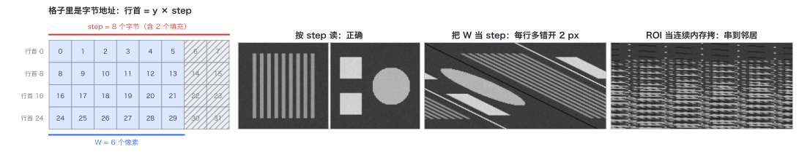
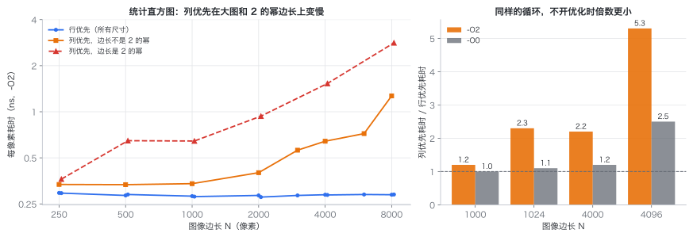
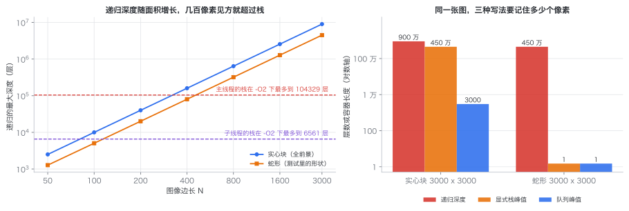
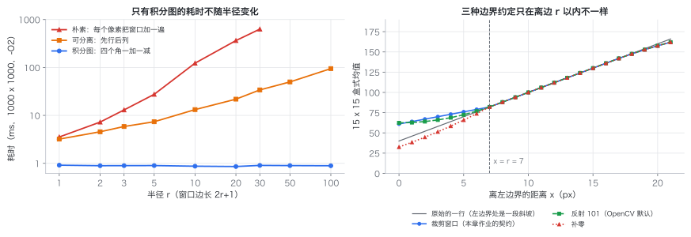
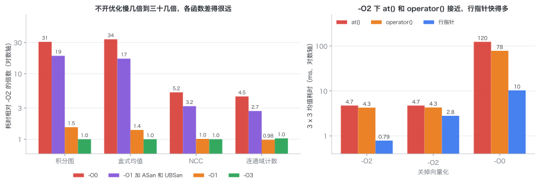

# 教程：面向视觉的 C++ 工程

> [!NOTE]
> 本章的数字都来自实测，记录在 [`figures/实测数字.json`](figures/实测数字.json)，由 `solutions` 分支的 `solutions/figures/ch15.py` 生成。这个脚本用 `g++` 把参考实现和几个小基准程序编译到 `/tmp` 下运行，内存布局、溢出、边界、取整这类和语言无关的概念用 numpy 和 Python 版 OpenCV 复现。**耗时都是在这台机器上一次测量的结果**：一台 Apple 芯片的 Mac（Apple M5 Pro，macOS 26.4，命令 `g++` 在这台机器上实际是 Apple clang 21，单线程），在机器空闲时测的。耗时和由耗时算出的倍数只写两位有效数字。这些值钉在 JSON 里，重跑脚本默认沿用，设置环境变量 `CH15_RETIME=1` 才重新计时。同一个脚本在这台机器很忙时还跑过一次（JSON 里“另一次运行的对照”一组）：多数耗时大了一到两成，同一次运行里算出的倍数大多只差百分之几，个别倍数差了一倍。下文依赖耗时的结论，两次运行都成立的照常写；不稳的写成范围，并给出两次各是多少。耗时只适合比较量级和明显的倍数，换一台机器、换编译器都会变，你在自己的 Windows 笔记本上要再测一遍。深度、阈值、误差这类不是耗时的数字，每次重跑脚本都重新计算，结果不变。第 5.2 节“现在的判据”那张表（JSON 里“验收的计时检查”一组）是 2026-11 加固验收之后补测的，测的时候这台机器上同时在跑别的任务，耗时偏大，只看倍数。凡是讲到 Windows 的地方（第 7.2 节，以及验收脚本对 Windows 的处理）都没有在 Windows 上实测过，文中逐处标了出来。

这一章不是完整的 C++ 教程，而是一份“工业视觉团队里最常用到、最容易出错”的清单。语法细节请配合 LearnCpp 查。

## 0. 本章怎么学

**应用场景**：读写产线上的 C++ 视觉代码：内存布局、积分图、连通域、CMake。算法验证常在 Python 里做，上机台的版本几乎都是 C++，新人最常见的卡点不是算法，而是看不懂工程、编不过、跑起来崩溃或者慢。

**优先级**：P0。没有前置章节，有一点 C 或 C++ 基础即可。第 1 章的 `uint8` 溢出和第 3 章的连通域在这里换成 C++ 再看一遍；后面第 16 章的 NCC、第 18 章的连通域、第 24 章的 C++ 重写都直接用到本章。

| 档位 | 累计用时 | 做什么 | 做到什么算完 |
|---|---:|---|---|
| 速通 | 4 小时 | 读第 1、2、4、9 节，看懂图 1 到图 4 和图 6，把第 11 节演示的五步做一遍，答完 5 道小测 | 能讲清 step 和宽度的区别、积分图为什么用 64 位整数而不是 `float`、连通域为什么不能递归、Debug 和 Release 的耗时差多少 |
| 标准 | 15 小时 | 读完全章，在 `15-1_图像基础.cpp` 里实现 4 个函数并验收通过，开 Sanitizer 编译一次，做第 14 节前三个破坏实验，填实验记录 | 4 项测试 PASS、零警告，实验记录里有 r=1 和 r=30 的耗时、一次 ASan 报错的定位过程 |
| 深挖 | 22 小时 | 再做第 14 节后三个破坏实验和第 15 节的扩展，自己用 CMake 建一个链接 OpenCV 的工程 | 能在自己的机器上按第 12 节的格式报告一组耗时，并和 OpenCV 对拍出一致的结果 |

> [!TIP]
> 用时超过所选档位的 1.5 倍还没做完，就把卡点写进 `学习进度.md`，先往下一章走。C++ 基础薄弱时，先用 LearnCpp 补引用、`const`、`vector` 和智能指针，再回来做作业。

## 1. 图像在内存里长什么样

一张 `H x W` 的单通道 8 位图，在内存里是 `H * W` 个连续字节，按行排列：

```text
地址：  0        1        ...  W-1      W        W+1 ...
像素：  (0,0)    (0,1)    ...  (0,W-1)  (1,0)    (1,1) ...
```

下标公式 `index = y * step + x`。`step` 是“一行占多少个元素”，通常等于 `W`，但不总是：

- 从大图里取 ROI 时，子图的 `step` 还是大图的宽度，数据不连续。
- 有些相机 SDK 为了对齐会在每行末尾补字节（padding），`step > W`。

所以写遍历代码时，用 `step` 而不是 `W` 算行首地址，这是新人改别人代码时最常见的越界来源。OpenCV 里对应 `mat.step`（字节数）和 `mat.ptr<T>(y)`（第 y 行行首指针）。本章的 `cpp/image.hpp` 为了简单没有 `step` 成员，数据总是连续的，行首就是 `y * cols`。

### 1.1 读错 step 会怎样

下面用 numpy 模拟读内存：一张 120 行、250 列的合成 die 图，每行后面补 2 个字节（step = 252）；另一张同样的图嵌在一张 200×400 的大图的 (40, 80) 处，作为 ROI。



| 读法（120×250 的图） | 整行完全正确的行数 | 平均绝对误差（灰度） |
|---|---:|---:|
| 行首 = y × step | 120 / 120 | 0.0 |
| 把 W 当成 step 读带填充的缓冲区 | 1 / 120 | 47.6 |
| 把 ROI 当成连续内存，拷 W×H 个字节 | 1 / 120 | 47.8 |

只有第 0 行是对的，后面每一行都错开，而且程序不会报任何错。ROI 这一行就是自测问题 2 的答案：ROI 视图的行步长是大图的 400 字节，不是自己的 250，数据在内存里不连续。

**多通道**：BGR 三通道是交错存储 `B G R B G R ...`。原讲义写的下标 `(y * step + x) * 3 + c` 只在 `step` 按像素计、而且没有行尾填充时成立。通用的写法是把 `step` 按字节算：

```text
第 y 行行首 = y * step（字节）
像素 (y, x) 的第 c 个通道 = y * step + x * 3 + c
```

同样大小的 BGR 图，每行 750 个字节补齐到 4 的倍数（step = 752 字节）时，用通用写法读 G 通道 120 行全对；用原来的写法只有 1 行对。OpenCV 的 `mat.step` 就是按字节的。

### 1.2 遍历顺序

外层循环 y、内层循环 x，按地址顺序访问，缓存命中最好。反过来写（外层 x、内层 y），每次访问都跳过一整行。

实测：N×N 的 8 位随机图，同一个函数只交换内外层循环，每像素耗时取多次里最快的一次。“统计直方图”这个循环，按编译器自己的报告两种顺序都没有被自动向量化，所以差距只来自访存。下表是这台机器上一次测量的结果；标“另一次”的三行是机器很忙时另一次运行的同一组倍数，放在一起看波动有多大。



| 边长 N | 1000 | 1024 | 2000 | 2048 | 4000 | 4096 | 8000 | 8192 |
|---|---:|---:|---:|---:|---:|---:|---:|---:|
| 统计直方图，-O2，列优先慢的倍数 | 1.2 | 2.3 | 1.4 | 3.4 | 2.2 | 5.3 | 4.4 | 9.8 |
| 同上，另一次 | 1.2 | 2.3 | 1.9 | 3.5 | 2.6 | 10 | 4.8 | 10 |
| 统计直方图，-O0，列优先慢的倍数 | 1.0 | 1.1 | | | 1.2 | 2.5 | | |
| 同上，另一次 | 1.1 | 1.1 | | | 1.5 | 3.2 | | |
| 求和，-O2，列优先慢的倍数 | 5.4 | 12 | 5.4 | 22 | 11 | 29 | 18 | 66 |
| 同上，另一次 | 5.5 | 12 | 5.6 | 21 | 12 | 67 | 20 | 66 |

读这张表的三个结论：

1. **原讲义说“大图上可能慢好几倍”，方向对，但倍数取决于尺寸**。两次运行里 1000×1000 都只慢 1.2 倍，4000×4000 慢 2.2 到 2.6 倍；边长恰好是 2 的幂时，两次都比相邻的尺寸明显更慢，8192 两次都是 10 倍左右。具体的倍数不稳：4096 这次是 5.3 倍，机器很忙的那次是 10 倍，差了将近一倍；2000 是 1.4 倍和 1.9 倍。所以这张表只能读出“图越大越慢、2 的幂更慢”，不能把某一格的倍数当成定值。常见的解释是：行宽是 2 的幂时，同一列的像素落在缓存的同一组里，互相挤掉。本章没有单独验证这个解释，但相机分辨率经常是 2048、4096 这样的数，值得记住。
2. **不开优化时差距反而小**。-O0 下 1000×1000 两种顺序几乎一样快（1.0 倍，另一次 1.1 倍），4096 是 2.5 倍（另一次 3.2 倍）；两次运行里测过的四个尺寸，-O0 的倍数都不超过 -O2 的。原因是 -O0 每访问一个像素要多执行好几条指令，访存在总耗时里的占比小了。所以在 Debug 版里测出“顺序无所谓”，换到 Release 就不成立。
3. **能向量化的循环差得更多**。求和这种简单循环两种顺序编译器都报告做了向量化，但列优先时每个向量要从相隔一整行的地址拼起来，1000×1000 上列优先慢 5.4 倍，8192 慢 66 倍，另一次运行几乎一样（5.5 倍和 66 倍）。波动最大的还是 4096 这一列：这次 29 倍，另一次 67 倍。

<!-- quiz -->
**同一个统计直方图的循环，把内外层循环交换（变成列优先）。在 1000×1000 的图上用 -O0 编译，慢多少？**

- A. 慢好几倍，因为缓存全部失效
- B. 基本不慢，-O0 下访存只占总耗时的一小部分
- C. 反而更快

<details markdown="1"><summary>答案与解释</summary>

**B**。实测 -O0 下 1000×1000 两种顺序的倍数是 1.0（机器很忙的另一次是 1.1），4096×4096 是 2.5（另一次 3.2）。同样的代码用 -O2 编译，4096 上慢 5.3 倍（另一次 10 倍）。遍历顺序的影响要在 Release 下测才看得出来。

</details>
<!-- /quiz -->

## 2. 类型与溢出

| 场景 | 坑 | 做法 |
|---|---|---|
| 两个 `uint8_t` 相加 | 255 + 1 在存回 `uint8_t` 时变成 0 | 先提升到 `int` 计算，再饱和截断（OpenCV 的 `saturate_cast`） |
| 积分图 | 全白图的像素和随面积增长，`int32` 在 2902×2902 就装不下 | 用 `uint64_t` 或 `double`，不要用 `float` |
| 平方和（方差、NCC） | `int` 很容易溢出 | 用 `double` 或 `int64_t` |
| 有符号和无符号混用 | `size_t i; i - 1` 在 i=0 时变成巨大正数 | 下标用 `int`，或者先判断再减 |
| 浮点比较 | `a == b` 不可靠 | 用 `std::fabs(a - b) < eps` |

`-Wall -Wextra` 会提示有符号和无符号的比较，警告要清零，不要忽略。但它管不了表里的大多数问题，第 8 节有实测。

实测（C++ 小程序，-O2）：`uint8_t` 的 255 + 1 存回 `uint8_t` 是 0，200 + 100 是 44，100 - 200 是 156；同样的加法存到 `int` 是 300。`size_t` 的 0 - 1 是 18446744073709551615。`0.1 + 0.2 == 0.3` 是 false。`float` 的 16777216 + 1 仍然等于 16777216。


### 2.1 积分图到底要多少位

全白（255）的 N×N 图，像素和是 $255N^2$。它第一次超过各类型上限的边长：

| 类型 | 上限 | 像素和超限的边长 | 窗口平方和超限的边长 |
|---|---:|---:|---:|
| `float`（能精确表示的连续整数） | 16777216 | 257 | 17 |
| `int32_t` | 2147483647 | 2902 | 182 |
| `uint32_t` | 4294967295 | 4105 | 258 |

**纠正原讲义的一个数**。原讲义写“4000x4000 的全白图求和约 4e9，超过 `uint32_t` 上限”。实际是 4080000000，只占 `uint32_t` 上限的 95.0%，没有超过；它超过的是 `int32_t`。本章的测试原来用的正是这张 4000×4000 的图，所以只能抓住用 `int` 累加的实现，抓不住用 `uint32_t` 的。

现在测试换成了 4200×4200 的全白图：像素和是 `4498200000`，是 `uint32_t` 上限的 104.7%（图 3 中栏的放大图）。测试不只看右下角，还在 (257, 257)、(2902, 2902)、(4105, 4105) 这几个刚越过上表各类型上限的位置核对，所以用 `float`、`int`、`uint32_t` 累加都会被查出来，报错里第一个出错的位置能告诉你是哪一种（第 13 节）。这张图的积分图占 135 MB 内存（输入图本身另占 16.8 MB），验收时电脑上要有两百兆左右的空闲内存。

一个容易踩的坑：Python 版 OpenCV 的 `cv2.integral` 对 8 位图默认输出 `int32`。2901×2901 的全白图结果正确，2902×2902 的右下角变成了 -2147458276。大图上调它要显式传 `sdepth=cv2.CV_64F`。

### 2.2 反直觉：`uint32_t` 回绕了也能算对，`float` 没溢出却算错

**`uint32_t` 回绕之后，矩形求和仍然是对的**。无符号整数的加减是模 $2^{32}$ 的运算，积分图里存的是真值模 $2^{32}$，四个角一加一减之后，只要真正的窗口和小于 $2^{32}$，结果就是对的。实测：5000×5000、灰度 240 到 255 的随机图，5.2% 的积分图单元已经回绕，右下角存的是 1892555749（真值 6187523045），但右下四分之一里 6240004 个 3×3 窗口的和全部正确，15×15 窗口也全部正确。这个性质只对无符号类型成立，`int` 溢出是未定义行为。工程上仍然推荐 `uint64_t`，因为整图总和、全图均值这类量会直接用到右下角那个值。作业里的 `integral_image` 返回 `ImageU64`，契约要求每个位置都是精确的和，所以用 `uint32_t` 累加在验收的 4200×4200 全白图上通不过。

**`float` 积分图在常见尺寸上就不能用**。`float` 只有 24 位有效数字，积分图里的大数相减，小窗口的和被舍入误差吞掉。用 `float` 递推积分图，再算盒式均值（随机图，只统计窗口完整的内部像素）：

| 图像边长 | 500 | 1000 | 2000 | 4000 |
|---|---:|---:|---:|---:|
| 3×3 均值的最大误差（灰度） | 0.67 | 2.44 | 9.67 | 39.0 |
| 3×3 均值误差超过 0.5 的像素比例 | 0.1% | 9.5% | 40.7% | 70.4% |
| 15×15 均值误差超过 0.5 的像素比例 | 0.0% | 0.0% | 0.3% | 15.2% |

2000×2000 的随机图像素总和只有 510061896，远没到任何整数类型的上限，`float` 版的 3×3 均值却有 40.7% 的像素错了半个灰度以上。`cv2.integral(sdepth=cv2.CV_32F)` 在 2000×2000 上的结果和这里完全一样。`double` 的有效位数多得多，全白图的平方和要到边长 372181 才会超出它能精确表示的整数范围，够用。

<!-- quiz -->
**一张 5000×5000、很亮的图，积分图用 `uint32_t` 存，右下角已经回绕成了一个比真值小得多的数。用它算 3×3 窗口的像素和，结果怎样？**

- A. 回绕区域里的窗口全部算错
- B. 全部正确，只要单个窗口的和不超过 uint32 上限
- C. 有一半左右算错

<details markdown="1"><summary>答案与解释</summary>

**B**。无符号加减是模 $2^{32}$ 的运算，四个角一加一减把回绕抵消了。实测 6240004 个 3×3 窗口没有一个算错。真正危险的反而是没有溢出的 `float`：2000×2000 的图上 40.7% 的 3×3 均值误差超过 0.5。

</details>
<!-- /quiz -->

## 3. 值语义、引用和拷贝

```cpp
void process(Image<uint8_t> img);         // 按值传：整张图拷贝一次，慢
void process(const Image<uint8_t>& img);  // const 引用：不拷贝，也不能改，读图首选
void process(Image<uint8_t>& img);        // 非 const 引用：原地修改
```

“慢”有多慢：把一张图传给一个只读一个像素的函数，每次调用的耗时（ms，这台机器上一次测量）：

| 图像 | 按值，-O2 | 按值，-O0 | 按 const 引用，-O2 |
|---|---:|---:|---:|
| 2000×2000（4 MB） | 0.047 | 7.7 | 低于 0.001 |
| 4000×4000（16 MB） | 0.21 | 31 | 低于 0.001 |

-O2 下拷一张 16 MB 的图只要零点二几毫秒（这次 0.21 ms，机器很忙的另一次 0.29 ms，相差约四成），单次看不出来；放进逐帧处理的循环里，或者在 Debug 版里，就是几十毫秒。读图一律传 `const&`。

`std::vector` 是值语义，赋值就是深拷贝。**`cv::Mat` 不一样**：它是引用计数的句柄，`Mat b = a;` 只拷贝句柄，`b` 和 `a` 指向同一块像素。要深拷贝用 `a.clone()` 或 `a.copyTo(b)`。这个差异导致过无数“我明明改的是副本，原图怎么也变了”的 bug。numpy 的切片也是视图：实测改 ROI 视图里 10×10 个像素，大图里变了 100 个像素；改 `.copy()` 得到的副本，大图里变了 0 个。

**RAII**：资源跟对象生命周期绑定。用 `std::vector`、`std::unique_ptr` 管理内存，不要手写 `new`/`delete`。相机缓冲区、文件句柄也用类包起来，在析构函数里释放。

> [!WARNING]
> 构造函数里的检查要放在分配之前。`cpp/image.hpp` 的 `Image(rows, cols)` 原来的写法是先在初始化列表里用 `rows * cols` 分配 `vector`，再在函数体里检查负数。这样写时 `Image(-1, 5)` 实测抛出的是 `std::length_error`（负数乘积转成 `size_t` 变成巨大的数，分配失败），而不是注释里说的 `std::invalid_argument`；两个都为负时乘积是正的，才走到检查。现在的 `image.hpp` 已经改成先检查再分配：检查放在 `rows` 和 `cols` 两个成员的初始化里，它们声明在 `data` 前面，所以先执行；两种情况实测都抛 `std::invalid_argument`。作业不会构造负尺寸的图，这里要记住的是：成员按声明的顺序初始化，自己写类时把校验排在分配之前。

## 4. 不要用递归做连通域和泛洪填充

一个 3000x3000 的蛇形前景区域，递归深度可达几百万层，默认栈（macOS 主线程 8 MB，子线程通常更小）一定会溢出，表现是程序直接崩溃（Segmentation fault），而且只在大图上出现。正确做法是用 `std::queue`（BFS）或 `std::vector` 当显式栈（DFS）。本章测试专门放了一个蛇形大区域来检查这一点。

实测：一个最朴素的递归泛洪填充（4 连通，按上、下、左、右的顺序递归），在 N×N 的图上运行。蛇形和测试里的完全相同，实心块是全前景。这台 Mac 上主线程的栈是 7.98 MB，`pthread` 子线程默认 512 KB。



| 条件（这份递归代码，这个编译器） | 每层占用的栈 | 主线程：实心块最大边长 | 主线程：蛇形最大边长 | 子线程：实心块最大边长 |
|---|---:|---:|---:|---:|
| -O2 | 80 字节 | 323（104329 层） | 456 | 81 |
| -O0 | 48 字节 | 417（173889 层） | 589 | 105 |

几点读法：

1. **几百像素见方就够崩溃**。不需要 3000×3000，-O2 编译时一个 324×324 的实心块就在主线程上溢出。递归深度随前景面积线性增长：3000×3000 的蛇形是 4501500 层，实心块是 9000000 层，按每层 80 字节要 343 MB 和 687 MB 的栈。
2. **子线程更容易崩**。512 KB 的栈只够 81×81 的实心块。产线软件的算法通常跑在工作线程里，在主线程上测过不等于安全。主线程溢出收到的是 SIGSEGV，子线程收到的是 SIGBUS，验收脚本里看到的返回码会不同。
3. **反直觉：Debug 版能处理的图比 Release 版大**。这份代码在 -O2 下每层用 80 字节，-O0 下只用 48 字节（多半是优化后的版本在函数开头保存了更多寄存器，本章没有逐条核对汇编）。370×370 的实心块，-O0 编译跑完了，-O2 编译栈溢出。“Debug 里好好的，Release 里崩了”不一定是未定义行为，也可能只是栈帧大小变了。
4. **显式栈不等于省内存**。不用递归时，容器里最多同时有多少像素（3000×3000）：

| 形状、连通性 | 前景像素 | 队列（BFS）峰值 | 显式栈（DFS）峰值 |
|---|---:|---:|---:|
| 实心块，4 连通 | 9000000 | 3000 | 4498501（50.0%） |
| 实心块，8 连通 | 9000000 | 5999 | 3004500（33.4%） |
| 蛇形，4 连通 | 4501500 | 1 | 1 |
| 蛇形，8 连通 | 4501500 | 2 | 3000 |

两种写法都“入队或入栈时就标记”。显式栈在实心块上峰值是前景的一半，每个元素是 8 字节的 `std::pair<int, int>`，共 34.3 MB，放在堆上不会崩，但比队列多三个数量级。队列的峰值大约是连通域的一条“波前”，和边长同量级。

把测试里的 3000×3000 蛇形交给递归实现，-O0 和 -O2 都在主线程上溢出。这时验收的“连通域计数”一项显示 FAIL：“程序在‘3000x3000 的蛇形大区域’这一步异常退出（被信号 SIGSEGV 终止，返回码 -11）”，负号表示进程是被信号杀掉的；另外三项照常显示 PASS。

加固之前的测试做不到这一点：验收只剩一行“程序异常退出（返回码 -11）”，四项的结果一项也看不到，因为测试程序的输出还在缓冲区里，进程就被杀掉了。现在测试程序每输出一行就刷新一次，蛇形也放到了连通域测试的最后，前面的小图先查完，所以报错能说出“小图都对、大区域才崩”。这是一条通用的经验：可能崩溃的程序，日志要逐行刷新。Windows 上没有信号，进程的返回码是一个很大的数（按微软的文档，栈溢出是 `0xC00000FD`），验收脚本会把它翻译成“栈溢出”；这一条没有在 Windows 上实测过。

第 11 节的交互演示可以在小图上看三种写法各自要记住多少像素。

<!-- quiz -->
**同一份递归泛洪填充，分别用 -O0 和 -O2 编译，在主线程上处理一个 370×370 的全前景块。结果是？**

- A. 两个都崩溃
- B. -O0 跑完，-O2 栈溢出
- C. -O2 跑完，-O0 栈溢出

<details markdown="1"><summary>答案与解释</summary>

**B**。递归深度相同（每个前景像素一层），但 -O2 版每层占 80 字节，-O0 版只占 48 字节，-O0 的极限是 417×417，-O2 是 323×323。优化不一定让栈用得更少，Debug 里能跑的图，Release 里可能崩。

</details>
<!-- /quiz -->

## 5. 积分图：让任意矩形求和变成 O(1)

定义 `II(y, x) = sum(img[0..y-1, 0..x-1])`，尺寸为 `(H+1) x (W+1)`，多出的第 0 行和第 0 列全为 0，这样就不用处理边界特判。矩形 `[y0, y1) x [x0, x1)` 的和是：

```text
S = II(y1, x1) - II(y0, x1) - II(y1, x0) + II(y0, x0)
```

递推：`II(y+1, x+1) = II(y, x+1) + rowsum(y, 0..x)`。

用途：盒式滤波、局部均值和方差（同时维护平方的积分图）、NCC 分母加速、Haar 特征。本章的盒式均值要求“耗时与半径无关”，测试会在同一张图上比较 r=1 和 r=10、30、200 的耗时（第 5.2 节）。

### 5.1 三种复杂度实测

同一个盒式均值（边界约定相同），三种写法，1000×1000 的随机图，-O2，耗时 ms（这台机器上一次测量）：



| 半径 r | 1 | 3 | 10 | 30 | 100 |
|---|---:|---:|---:|---:|---:|
| 朴素：每个像素把窗口加一遍，$O(r^2)$ | 3.5 | 13 | 120 | 630 | 没测 |
| 可分离：先行后列，$O(r)$ | 3.2 | 5.9 | 13 | 34 | 95 |
| 积分图，$O(1)$ | 0.91 | 0.89 | 0.87 | 0.90 | 0.89 |

积分图在所有半径下的耗时，最慢的是最快的 1.1 倍；r=30 时朴素写法慢 700 倍左右，可分离写法慢 38 倍。机器很忙的另一次运行里这些耗时都大了一到两成，这三个倍数只差百分之几，结论相同。

### 5.2 测试的计时检查能抓住什么

**现在的判据**。验收在一张 1200×1200 的随机图上做：r=1 和 r=R 先各调用一次预热，再交替运行最多 7 轮，各取最快的一次；只有 r=R 最快的一次超过 r=1 最快一次的 4 倍再加 2 毫秒，才判“耗时随半径增长”。R 依次取 10、30、200，哪一级超了就停，不再测更大的。预热、重复多次取最快、交替运行、在同一次运行里比较，正是第 12 节讲的计时方法。

把几种实现各跑 5 遍（两种很慢的跑 3 遍），每个半径取各遍的中位数。表里是这台机器上一次测量的结果，测的时候机器上同时在跑别的任务，耗时偏大，只看倍数；“r=1 最快”取的是和 r=10 交替计时的那一组：

| 实现 | r=1 最快（ms） | r=10 是它的几倍 | r=30 是它的几倍 | r=200 是它的几倍 | 在哪个半径被拦下 | 连跑验收，盒式均值通过的次数 |
|---|---:|---:|---:|---:|---|---:|
| 积分图（参考实现），$O(1)$ | 2.2 | 1.0 | 1.0 | 1.0 | 没有 | 5 / 5 |
| 行和列都用滑动和，不用积分图，$O(1)$ | 2.5 | 1.0 | 1.0 | 1.0 | 没有 | 5 / 5 |
| 可分离 $O(r)$，每个像素把窗口加一遍 | 5.4 | 3.4 | 7.6 | 没测 | r=30 | 0 / 5 |
| 可分离 $O(r)$，按行累加（编译器能向量化） | 2.8 | 2.2 | 4.3 | 15 | r=200 | 0 / 5 |
| 内部用积分图，离边不到 r 的像素逐个暴力求和 | 2.3 | 2.9 | 35 | 没测 | r=30 | 0 / 3 |
| 朴素 $O(r^2)$ | 6.6 | 33 | 没测 | 没测 | r=10 | 0 / 3 |

几点读法：

1. **两种 $O(1)$ 的写法三个半径都是 1.0 倍**，离 4 倍的上限很远。为了看机器很忙时会不会误判，把 36 份验收同时启动（这台机器是 18 核，另外还有别的任务在跑）：两种 $O(1)$ 的写法一共跑了 180 次，盒式均值全部通过，r=200 和 r=1 最快耗时之比在 0.93 到 1.13 之间；两种可分离的写法各跑 36 次，没有一次通过。
2. **半径要拉得够大**。按行累加的可分离写法在 r=30 是 4.3 倍，已经超过 4 倍，但加上 2 毫秒的余量后上限是 13 ms，它是 12 ms，没有超；到 r=200 是 15 倍才被拦下。只比 r=1 和 r=30 抓不住它。
3. **判据是往宽里定的**，宁可放过，不误判。耗时随半径涨得很慢的写法（r 从 1 到 200 涨不到 4 倍）仍然能通过，所以验收通过只说明耗时没有随半径明显增长。想知道自己的实现到底是几倍，运行 `python tests/check_progress.py --timing`（macOS 和 Linux 上是 `python3`），它把每个半径的耗时和倍数打印出来；$O(1)$ 的实现每个半径都应该在 1 倍左右。把这几个数填进实验记录。

**加固之前的判据**（2026-11 之前的测试，留在这里做对照）。原来的测试在 2000×2000 的图上让 r=1 和 r=30 各调用一次，不预热、不重复；r=30 的耗时超过 r=1 耗时的 4 倍再加 0.05 秒，才判“没做到 O(1)”。按这个写法单独计时，每种实现跑 5 次取中位数（这台机器上一次测量）：

| 实现 | r=1（ms） | r=30（ms） | 判据允许的 r=30 上限（ms） | 通过次数 |
|---|---:|---:|---:|---:|
| 积分图 | 7.3 | 3.8 | 79 | 5 / 5 |
| 可分离 $O(r)$ | 13 | 82 | 100 | 5 / 5 |
| 朴素 $O(r^2)$ | 17 | 2500 | 120 | 0 / 3 |

朴素写法超出上限二十倍左右，被拦下；**可分离的 $O(r)$ 写法 5 次全过**，因为 0.05 秒的余量比它多出来的耗时还大。它离上限只有一两成（82 ms 对 100 ms）：机器很忙的另一次运行里也是 5 次全过，2026-11-19 机器更忙的时候把整个旧验收分三批连跑 15 次，通过了 14 次。同一份代码时过时不过，是验收最不该有的行为。积分图一栏 r=1 比 r=30 还慢（两次运行都是这样），多半是因为 r=1 是第一次调用、要先向系统申请内存，没有预热的单次计时就是这么不稳（第 12 节）。新判据改的就是这三处：先预热，重复多次取最快，把半径拉到 200。

### 5.3 边界约定

作业的契约是“窗口裁剪到图像内，只对图像内像素求平均”。OpenCV 的 `cv::blur` 默认是反射 101（`BORDER_REFLECT_101`，实测和不传参数的结果完全一样），另一种常见做法是补零。三种约定只在离边不到 r 的像素上不同，图 5 右栏：

| 15×15 窗口（r=7），2000×2000 随机图 | 数值 |
|---|---:|
| 离边不到 r 的像素占比 | 1.4% |
| 裁剪窗口与反射 101 的最大差（灰度） | 8.0 |
| 裁剪窗口与补零的最大差（灰度） | 92.6 |
| 内部像素上三者的最大差 | 3e-14 |

补零在边上把均值拉低一大截（图 5 右栏 x=0 处：裁剪 61.0，反射 62.4，补零 32.5），反射和裁剪差得不多。和 OpenCV 对拍时只比内部区域，或者先把边界约定对齐（第 10 节）。

## 6. NCC 模板匹配的工程细节

公式和第 16 章的 ZNCC 相同（第 16 章把不减均值的版本叫 NCC，减了均值的叫 ZNCC；本章作业和原讲义沿用 NCC 这个名字，算的是减均值的版本）：

$$
\mathrm{NCC} = \frac{\sum (I - \bar I)(T - \bar T)}{\sqrt{\sum (I - \bar I)^2 \cdot \sum (T - \bar T)^2}}
$$

- 模板的均值和方差只算一次。
- 窗口方差为 0（平坦区域）时分母为 0，必须特判，否则产生 NaN。NaN 和任何数比较都是 false，后果取决于你怎么找最大值（第 6.2 节）。
- 直接实现是 O(H·W·h·w)，大图大模板很慢。工程上的做法：积分图算窗口均值和方差，FFT 算分子；或者图像金字塔先在缩小图上粗搜，再在原图局部精搜。

### 6.1 耗时随模板大小

320×240 的随机图，模板是从图里截下的 t×t 小块，-O2，耗时 ms（这台机器上一次测量）。“分母用积分图”是脚本里的对照实现：窗口的和与平方和查积分图，分子仍然逐像素相乘。OpenCV 一栏从 Python 调 `cv2.matchTemplate(TM_CCOEFF_NORMED)`，限制为单线程。

| 模板边长 t | 8 | 16 | 24 | 32 | 48 |
|---|---:|---:|---:|---:|---:|
| 直接计算（参考实现） | 4.3 | 20 | 48 | 82 | 170 |
| 分母用积分图 | 1.1 | 3.4 | 6.3 | 10 | 20 |
| OpenCV `matchTemplate` | 1.0 | 1.0 | 1.0 | 0.98 | 0.99 |

t 从 8 到 48，模板面积大 36 倍，直接计算的耗时大 38 倍，和 $O(hw)$ 相符。只把分母换成积分图就快 4.0 到 8.4 倍。直接计算每个位置要扫两遍窗口（先求均值，再求协方差和方差），换成积分图后只剩一遍整数乘加，这是主要原因之一。OpenCV 的耗时几乎不随模板变大，t=48 时比直接计算快 170 倍左右，它内部用的是别的算法（具体以 OpenCV 的文档和源码为准）。机器很忙的另一次运行里耗时普遍大一成多，这几个倍数只差百分之几。两种 C++ 实现找到的位置完全相同，分数最多差 2e-16。

### 6.2 NaN 会怎样影响最大值

四个分数里有一个是 NaN，真正的最大值 0.9 在下标 2。不同的找最大值写法返回的下标：

| 写法 | NaN 在下标 1 | NaN 在下标 0 |
|---|---:|---:|
| 最好分数初始化成 -2，用 `>` 更新 | 2 | 2 |
| 用第一个元素初始化，用 `>` 更新 | 2 | 0 |
| `std::max_element` | 2 | 0 |
| numpy `np.argmax` | 1 | 0 |

原讲义说 NaN“会导致最大值找错”，要看写法。初始化成一个很小的数再用 `>` 比较，NaN 会被悄悄跳过，位置反而是对的；NaN 恰好在开头、或者用了第一个元素做初值，就会返回 NaN 的位置；所有位置都是 NaN 时，“初始化成 -2”的写法返回 -1，调用方拿到一个非法坐标。不管哪种，特判都不能省：作业契约要求平坦窗口的分数是 0，测试会查。

另一个对拍时的坑：OpenCV 5.0 的 `matchTemplate` 在全平坦的图和模板上给出的分数是 1.0，本章契约是 0。两边都“对”，只是约定不同。

<!-- quiz -->
**NCC 的分母在平坦窗口上为 0，算出了 NaN。找最大值的代码是 `best = -2; if (s > best) {...}`。会发生什么？**

- A. 一定返回 NaN 所在的位置
- B. NaN 被跳过；只有全部是 NaN 时，返回一个从没被赋值的 -1 位置
- C. 程序崩溃

<details markdown="1"><summary>答案与解释</summary>

**B**。`NaN > best` 永远是 false，这个位置被跳过。实测 NaN 在开头或中间时都返回了真正的最大值；四个分数全是 NaN 时返回 -1。换成用第一个元素做初值，NaN 在开头时就会返回 0。行为依赖写法，所以要在算分数时就特判。

</details>
<!-- /quiz -->

## 7. CMake 最小知识

```cmake
cmake_minimum_required(VERSION 3.16)
project(demo CXX)
set(CMAKE_CXX_STANDARD 17)
find_package(OpenCV REQUIRED)                 # 找到已经装好的 OpenCV（Windows 上怎么装见第 7.2 节）
add_executable(demo main.cpp)
target_link_libraries(demo PRIVATE ${OpenCV_LIBS})
```

构建三步：配置、编译、运行。Windows 上用 Visual Studio 生成工具时，在“x64 Native Tools Command Prompt”里运行（第 7.2 节）：

```text
cmake -S . -B build
cmake --build build --config Release
build\Release\demo.exe
```

macOS 和 Linux：

```bash
cmake -S . -B build -DCMAKE_BUILD_TYPE=Release   # 配置
cmake --build build -j                           # 编译
./build/demo                                     # 运行
```

Windows 上用 MinGW-w64 的 `g++` 时和第二种写法相同，只是配置那一步要加 `-G Ninja`（另外装 Ninja）或 `-G "MinGW Makefiles"`，可执行文件是 `build\demo.exe`。

几个要点：

- **Debug 和 Release 性能差距可以是 10 倍以上**，测速一定用 Release。实测的倍数见第 7.1 节，从 4 倍到 30 多倍不等。
- 用 `target_*` 系列命令（`target_include_directories`、`target_link_libraries`），不要用全局的 `include_directories`。
- 构建目录和源码分开（`-B build`），不要在源码目录里直接 `cmake .`。

> [!NOTE]
> 这台测试机上没有装 CMake，本章的 `CMakeLists.txt`（包括 2026-11 新加的 MSVC 分支）没有实际运行过，只逐行核对了语法。下面所有耗时都是直接用 `g++` 加对应的编译选项测的。按 CMake 的文档，GCC 和 Clang 下 Debug 默认只加 `-g`（不优化），Release 默认是 `-O3 -DNDEBUG`。

### 7.1 优化级别差多少

参考实现的四个函数，同一份源码只换编译选项，耗时 ms（这台机器上一次测量）：



| 编译选项 | 积分图 2000×2000 | 盒式均值 2000×2000，r=7 | NCC 320×240，模板 24×24 | 连通域计数 2000×2000 |
|---|---:|---:|---:|---:|
| -O0（相当于 Debug） | 39 | 120 | 250 | 260 |
| -O1 | 1.9 | 5.0 | 49 | 56 |
| -O2 | 1.3 | 3.6 | 48 | 57 |
| -O3 | 1.3 | 3.6 | 48 | 58 |
| -O1 加 ASan 和 UBSan | 24 | 62 | 150 | 150 |
| -O0 比 -O2 慢的倍数 | 31 | 34 | 5.2 | 4.5 |

-O0 比 -O2 慢 4.5 到 34 倍，取决于函数：积分图和盒式均值是简单的连续访存，优化后能向量化，差 30 多倍；NCC 和连通域是浮点运算和队列操作，只差 5 倍左右。机器很忙的另一次运行里每个耗时都大一到两成，这个范围是 4.4 到 35 倍，几乎一样。-O3 和 -O2 的耗时这次最多差 3%，另一次最多差 7%，有快有慢，都在计时的波动以内，这组函数上没有可见的差别。所以“Release 快多少”没有一个固定的数，要对自己的函数测。

### 7.2 在 Windows 上编译

> [!WARNING]
> 这一小节和验收脚本里针对 Windows 的部分**都没有在 Windows 上实测过**：写课程的机器是 Mac，没有 Windows，也没有 MSVC。命令只写了有把握的，安装步骤以 `docs/环境安装.md` 的“C++ 编译器”一节和各工具的官方页面为准。按它做遇到问题，以你机器上的报错为准，先看本节的“第一次在 Windows 上运行先确认什么”，并把过程记到实验记录里。

本章是全书唯一需要 C++ 编译器的一章。验收脚本 `tests/check_progress.py` 不需要 CMake，也不需要 OpenCV，只要能找到下面三种编译器里的一种。装一种就够：

| 路线 | 验收脚本找的命令 | 前提 |
|---|---|---|
| MinGW-w64 的 `g++`（MSYS2 或其他发行版） | `g++` | 编译器的 `bin` 目录在 `PATH` 里 |
| LLVM 的 `clang++` | `clang++` | LLVM 的 `bin` 目录在 `PATH` 里；官方安装包里的 `clang++` 还需要装好 Visual Studio 生成工具 |
| Visual Studio 生成工具的 `cl` | `cl` | 要在“x64 Native Tools Command Prompt”里运行验收脚本 |

**路线一：MinGW-w64 的 `g++`**。装好 MSYS2 之后，在开始菜单里打开“MSYS2 UCRT64”终端，安装编译器：

```text
pacman -S mingw-w64-ucrt-x86_64-gcc
```

然后把它的 `bin` 目录加进 Windows 的 `PATH`（MSYS2 装在默认位置时是 `C:\msys64\ucrt64\bin`），重新打开 PowerShell，`g++ --version` 能打印出版本号就可以了。别的 MinGW-w64 发行版也行，要求只有两条：`g++` 支持 C++17，它的 `bin` 目录在 `PATH` 里。下载和安装以各自的官方页面为准。Windows 下的 MinGW 对 Sanitizer 的支持有限，第 8 节的 ASan 实验建议放到 WSL 里做。

**路线二：LLVM 的 `clang++`**。LLVM 官方的 Windows 安装包在 GitHub 上 llvm-project 仓库的发布页，安装时选择把 LLVM 加进 `PATH`。这个包里的 `clang++` 自己不带 C++ 标准库和 Windows SDK，用的是 Visual Studio 生成工具里的，所以要同时按路线三把生成工具装好。它通常能自己找到生成工具，不用进专门的命令行窗口；如果编译时报找不到 `<vector>` 这类标准头文件，就改在路线三说的窗口里运行。MSYS2 里也有 clang 的包，那是 MinGW 版的，用法和路线一相同，包名以 MSYS2 的官方页面为准。

**路线三：Visual Studio 生成工具的 `cl`**。从 Visual Studio 官网下载“Visual Studio 生成工具”（Build Tools for Visual Studio），安装时勾选“使用 C++ 的桌面开发”，里面带了 CMake。装了完整版 Visual Studio 的同理。`cl` 不在普通终端的 `PATH` 里：要从开始菜单打开“x64 Native Tools Command Prompt for VS”（名字后面带版本年份），在这个窗口里进到课程目录再运行验收脚本。这个窗口是 cmd，激活虚拟环境用 `.venv\Scripts\activate`。

**运行验收**。在课程的根目录下，Windows：

```text
python "15_C++视觉工程\tests\check_progress.py"
```

macOS 和 Linux：

```bash
python3 15_C++视觉工程/tests/check_progress.py
```

脚本做四件事：

1. **找编译器**。顺序是环境变量 `CXX`、`g++`、`clang++`、`c++`、`cl`，用找到的第一个，并在开头打印一行“编译器：”和它的完整路径。同时装了几种、想指定其中一种时设置 `CXX`：PowerShell 里是 `$env:CXX = "clang++"`，cmd 里是 `set CXX=clang++`，macOS 和 Linux 是在命令前面加 `CXX=clang++`。一个都找不到时，脚本按操作系统提示该装什么。
2. **编译**。把作业文件、`tests/test_main.cpp` 和 `cpp/` 下的头文件复制到系统的临时目录，换成英文文件名后在那里编译，编译器看到的文件名里没有中文，用完就删掉。`g++` 和 `clang++` 的选项是 `-std=c++17 -O2 -Wall -Wextra`，`cl` 的选项是 `/std:c++17 /EHsc /O2 /utf-8 /W4`。编译失败时打印前 30 行输出和完整的编译命令；想自己重现，先设置环境变量 `CH15_KEEP_BUILD=1` 再运行，脚本会保留临时目录并打印它的位置。
3. **运行测试程序**，逐项显示 `[TODO]`、`[FAIL]` 或 `[PASS]`。测试程序自己只输出英文的状态和代码，中文说明由 Python 脚本给出，这样做是为了避开中文 Windows 控制台上 C++ 程序输出中文乱码的问题。测试程序每输出一行就刷新一次；某一项让程序崩溃时，已经跑完的几项照常显示，后面还没跑的几项会单独再运行一遍。
4. **提醒警告**。作业文件有编译警告时列出前 5 条。

加 `--timing` 只做盒式均值的计时，打印 r=1 和 r=10、30、200 的耗时与倍数（第 5.2 节）。

**第一次在 Windows 上运行先确认什么**（这些都没有实测过，按顺序查）：

1. 开头“编译器：”那一行后面的路径是不是你想用的那一个。显示“没找到 C++ 编译器”时，新开一个终端运行 `g++ --version`、`clang++ --version` 或 `cl`，看系统到底找不找得到；`cl` 找不到多半是没在 Native Tools 窗口里。
2. 作业还没写时，应该看到四行 `[TODO]` 和“通过 0/4”。如果是“编译失败”，看打印出来的编译器输出：`cl` 报找不到头文件或 LIB，说明不在 Native Tools 窗口里；`clang++` 报找不到 `<vector>`，说明没装生成工具；`g++` 报不认识 `-std=c++17`，说明版本太旧。
3. 四行说明里的中文显示正常。如果中文是乱码，问题在终端的显示设置，不在 C++ 程序（它只输出英文），先换 Windows 终端（Windows Terminal）再试。
4. 如果四项都显示“测试程序启动不了：找不到运行需要的 DLL”，是测试程序找不到编译器的运行库（MinGW 的 `libstdc++-6.dll` 这一类），检查编译器的 `bin` 目录是不是在 `PATH` 里。
5. 杀毒软件可能会拦住刚编译出来的程序，表现是“测试程序启动不了”或者第一次运行特别慢。

**和 macOS、Linux 不一样的地方**：

- **CMake 的生成器**。Visual Studio 的生成器是多配置的，`CMAKE_BUILD_TYPE` 不起作用，要在编译时选：`cmake --build build --config Release`，可执行文件在 `build/Release/` 下。
- **编译选项**。`-Wall -Wextra` 和 `-fsanitize=address,undefined` 是 GCC 和 Clang 的写法。MSVC 对应的是 `/W4` 和 `/fsanitize=address`，MSVC 没有 UBSan。本章的 `CMakeLists.txt` 已经按编译器分了支：

  ```cmake
  if(MSVC)
    target_compile_options(ch15 PRIVATE /W4)
  else()
    target_compile_options(ch15 PRIVATE -Wall -Wextra)
  endif()
  ```

  `-DWITH_SANITIZERS=ON` 只对 GCC 和 Clang 起作用，MSVC 下会打印一条警告然后忽略；想在 MSVC 下用 ASan 要自己加 `/fsanitize=address`。
- **源文件的编码**。源文件和头文件是 UTF-8 编码，里面有中文的字符串和注释。`g++` 和 `clang++` 默认按 UTF-8 读；MSVC 默认按系统的本地编码（中文 Windows 是 GBK）读，要加 `/utf-8`，否则会有一串编码警告（C4819），字符串也可能出错。验收脚本和 `CMakeLists.txt` 都已经加了，自己敲 `cl` 命令时别忘了。
- **控制台输出中文**。中文 Windows 的控制台默认不是 UTF-8 编码，C++ 程序直接输出 UTF-8 的中文会显示成乱码。本章的测试程序和 `cpp/opencv_compare.cpp` 的输出都只用英文；自己写的实验程序也建议这样做。用 CMake 编出来的 `ch15_tests` 直接运行时，看到的是 `PASS|integral|ok|` 这样的英文代码，中文说明要通过 `tests/check_progress.py` 看。
- **栈更小**。按微软的文档，MSVC 链接器默认只给主线程保留 1 MB 的栈，第 4 节的递归在 Windows 上会更早崩溃。
- **`long` 是 32 位**。64 位 Windows 上 `long` 是 32 位（64 位 macOS 和 Linux 上是 64 位）。积分图写 `long` 在 Mac 上能过、在 Windows 上溢出，一律写 `std::uint64_t`。
- **标准头文件要写全**。`std::max`、`std::min` 在 `<algorithm>` 里，`std::sqrt` 在 `<cmath>` 里。有的标准库会顺带把它们带进来，不写也能编过，换一个编译器就报错。

**另一个选择：WSL2 里的 Ubuntu**。装好后在 WSL 里 `sudo apt install g++ cmake`，课程仓库放在 WSL 的文件系统里，验收脚本、编译选项和 Sanitizer 的用法都和本章在 macOS、Linux 下的写法一致，做第 8 节的 ASan 实验最省事。代价是多了一套环境，和 Windows 上的 Python 环境是分开的。

OpenCV 的 C++ 版在 Windows 上可以用官方发布的预编译包或者 vcpkg 安装，`find_package(OpenCV)` 找不到时把 `OpenCV_DIR` 指向包里含 `OpenCVConfig.cmake` 的目录。具体路径以你安装的版本为准。

## 8. 调试与定位

| 问题 | 工具 |
|---|---|
| 越界、use-after-free | 编译加 `-fsanitize=address`，出错时直接打印出错行和调用栈 |
| 整数溢出、未定义行为 | `-fsanitize=undefined` |
| 崩溃后看现场 | Windows 上用 Visual Studio 的调试器，或者 MinGW 带的 `gdb`（用法以各自的文档为准）；macOS 上 `lldb ./build/demo`，`run` 后 `bt` 看调用栈 |
| 慢 | 先用 `std::chrono` 给各阶段计时；再用采样分析器：Windows 上 Visual Studio 的性能探查器，macOS 上 Instruments 的 Time Profiler |

本章 `CMakeLists.txt` 已经提供 `-DWITH_SANITIZERS=ON` 选项（只对 GCC 和 Clang 起作用，Windows 上见第 7.2 节）。建议故意在 `box_mean` 里把 `y1` 写成 `y + r + 2`，体验一次 ASan 报错，记住它长什么样。实测（没有用 CMake，直接用 `g++` 加 `-O1 -g` 和与 `CMakeLists.txt` 相同的 Sanitizer 选项）：不开 Sanitizer 时程序不崩溃，只是盒式均值一项 FAIL（“输入 20x25、r=0 时，位置 (0, 0) 的均值应为 168，实际是 135。r=0 时输出应等于输入本身，检查窗口两端的下标”）；开了 ASan 之后报 `heap-buffer-overflow`，第一行调用栈直接指到 `box_mean` 里出错的那一行。

### 8.1 警告和 Sanitizer 各管什么

同一个小程序里放六种典型错误，看谁报（Apple clang 21）：

| 错误 | `-Wall -Wextra` | 再加 `-Wconversion -Wfloat-equal` | 运行时 `-fsanitize=undefined` | 再加两项扩展检查 |
|---|---|---|---|---|
| `int` 和 `size()` 比较 | 报 | 报 | 不报 | 不报 |
| `uint8_t` 相加后存回 `uint8_t` | 不报 | 不报 | 不报 | 报 |
| `size_t` 的 0 - 1 | 不报 | 不报 | 不报 | 报 |
| `int` 乘法溢出 | 不报 | 不报 | 报 | 报 |
| `uint32_t` 累加回绕 | 不报 | 不报 | 不报 | 报 |
| 浮点数用 `==` 比较 | 不报 | 报 | 不报 | 不报 |

扩展检查指 `-fsanitize=unsigned-integer-overflow,implicit-conversion`，只有 Clang 有。六种里 `-Wall -Wextra` 只报了 1 种；无符号回绕在语言里是合法的，标准的 UBSan 不管。零警告是底线，不是证明。

### 8.2 ASan 抓不到“行内越界”

4 行 6 列的图，用不检查边界的 `operator()` 读第 6 列（越界一列）：

| 读的位置 | ASan 报不报 | 读到什么 |
|---|---|---|
| 第 0 行第 6 列 | 不报 | 第 1 行第 0 列的值（100） |
| 最后一行第 6 列 | 报 `heap-buffer-overflow` | 读出了缓冲区 |
| 同样的下标改用 `at()` | | 抛出 `std::out_of_range` |

ASan 只知道整块缓冲区的边界。列下标越界但地址还在缓冲区里，读到的是下一行的像素，ASan 看不到，图 1 那种错位也就悄悄发生了。调试阶段用 `at()` 或者自己加 `assert(x < cols)`，确认无误再换回不检查的版本。

## 9. 性能的几条朴素规则

1. 先测量再优化，只优化最热的那一段。
2. 热循环里不要用带边界检查的 `at()`，用行指针。
3. 不要在循环里分配内存（`std::vector` 的 `push_back` 提前 `reserve`）。
4. 能用积分图、可分离滤波（先行后列）降低复杂度的，先降复杂度，再考虑 SIMD 和多线程。
5. OpenCV 的大部分函数已经做了 SIMD 和多线程优化，自己重写前先对比一下。

### 9.1 第 2 条：慢的不是边界检查

2000×2000 的图做 3×3 均值（输出 8 位），四种取像素的写法，耗时 ms（这台机器上一次测量，图 6 右栏）：

| 写法 | -O2 | -O2 关掉自动向量化 | -O0 |
|---|---:|---:|---:|
| `img.at(y, x)`，带边界检查 | 4.7 | 4.7 | 120 |
| `img(y, x)`，不检查 | 4.3 | 4.3 | 78 |
| 把 `data` 指针和宽度取到局部变量，再算下标 | 0.78 | 2.8 | 35 |
| 三个行指针 | 0.79 | 2.8 | 10 |

-O2 下 `at()` 只比 `operator()` 慢 11%，边界检查本身很便宜。行指针快 5.4 倍，原因在另一处：把 `data` 指针和宽度先取到局部变量（不用行指针，照样算 `y * W + x`）就一样快。关掉向量化后这个差距缩到 1.5 倍，说明大部分收益来自向量化。机器很忙的另一次运行里表中每个耗时都大一成多，这三个数几乎没变，结论相同。和测得的数字一致的解释是：循环里每写一次 `out(y, x)` 就是存一个 `uint8_t`，而 `uint8_t` 按语言规则可以指向任何对象，编译器不能排除这次写入改到了 `img` 的 `data` 指针或者 `cols`，只好每次重新读，循环也就没法向量化。规则 2 的做法没错，理由要换成：**把要反复用的指针和尺寸提到循环外面**。

<!-- quiz -->
**3×3 均值用 -O2 编译。把 `img.at(y, x)` 换成不检查边界的 `img(y, x)`，再换成三个行指针。哪一步带来了大部分提速？**

- A. 去掉边界检查（`at` 换成 `operator()`）
- B. 换成行指针（或者把 data 指针提到循环外）
- C. 两步差不多

<details markdown="1"><summary>答案与解释</summary>

**B**。实测 `at()` 4.7 ms，`operator()` 4.3 ms，只差 11% 左右；行指针 0.79 ms，又快了 5.4 倍。只把 data 指针和宽度取到局部变量、不用行指针，是 0.78 ms，一样快。真正起作用的是让编译器确信指针不会变，从而能向量化。这些是这台机器上一次测量的数，机器很忙的另一次运行里比例几乎相同。

</details>
<!-- /quiz -->

### 9.2 第 3 条和第 5 条

**循环里分配内存**（-O2，600×600 的图做 5×5 中值，窗口缓冲区是一个 `std::vector`，这台机器上一次测量）：每个像素新建一个不 `reserve` 的 `vector`，87 ms；新建但先 `reserve(25)`，58 ms；提到循环外复用，52 ms。不 `reserve` 慢 1.7 倍，`reserve` 了但仍在循环里新建还慢 13%。往 `vector` 里 `push_back` 400 万个元素，不 `reserve` 慢 1.6 倍。机器很忙的另一次运行里这三个比值几乎相同。

**和 OpenCV 对照**（同样尺寸的随机图，参考实现 -O2 在 C++ 里计时，OpenCV 从 Python 调用、单线程，输出类型和边界约定不完全相同，只比量级；这台机器上一次测量）：

| 函数 | 参考实现（ms） | OpenCV（ms） | 参考实现慢的倍数 |
|---|---:|---:|---:|
| 积分图 2000×2000（`cv2.integral`，64 位浮点输出） | 1.3 | 0.97 | 1.3 |
| 盒式均值 2000×2000，r=7（`cv2.boxFilter`） | 3.6 | 2.0 | 1.8 |
| NCC 320×240，模板 24×24（`cv2.matchTemplate`） | 48 | 1.1 | 46 |
| 连通域 2000×2000（`cv2.connectedComponents`） | 57 | 12 | 4.9 |

积分图和盒式均值写对了就和 OpenCV 同一个量级；NCC 差了 46 倍（机器很忙的另一次是 50 倍，另外三个倍数两次只差 0.1），是算法层面的差距（第 6.1 节），不是写法问题。所以规则 5 要具体到函数：简单的逐像素操作自己写没问题，NCC、连通域这类 OpenCV 做了专门算法的，先用它的。

## 10. Python 和 C++ 怎么协作

常见模式是 Python 里做算法原型和评估，验证完再移植到 C++。差距有多大：同一个积分图递推，纯 Python 双重循环每像素 33 ns，numpy 两次 `cumsum` 4.5 ns，C++ 参考实现 0.32 ns（这台机器上一次测量）。纯 Python 比 C++ 慢 100 倍左右，numpy 也慢十几倍（numpy 要分配中间数组、做类型转换）。机器很忙的另一次运行里三个耗时都大一到三成，这两个倍数的量级没变。

移植时：

- 用同一组输入图和同一份期望输出做对拍，逐像素比较差异。
- 注意边界策略（反射、复制、补零）、取整方式（四舍五入还是截断）、颜色通道顺序（OpenCV 是 BGR）这三类最容易不一致的地方。
- 需要在 Python 里调用 C++ 时，了解 pybind11 即可，入门阶段不必深挖。

这三类各差多少：

**边界**：见第 5.3 节，15×15 窗口时裁剪和补零在边上最多差 92.6 个灰度。

**取整**：0.5、1.5、2.5、254.5 四个数转成整数：

| 做法 | 0.5 | 1.5 | 2.5 | 254.5 |
|---|---:|---:|---:|---:|
| C++ `static_cast<uint8_t>`（截断） | 0 | 1 | 2 | 254 |
| C++ `std::round`（.5 远离零） | 1 | 2 | 3 | 255 |
| C++ `std::nearbyint`（默认舍入模式，.5 取偶数） | 0 | 2 | 2 | 254 |
| numpy `np.round` | 0 | 2 | 2 | 254 |
| OpenCV 饱和转换到 8 位 | 0 | 2 | 2 | 254 |

C++ 的 `std::round` 和 numpy、OpenCV 都不一样。随机图上的影响：2×2 均值转成整数，截断和四舍五入有 50.0% 的像素不同，四舍五入和取偶有 12.5% 不同（2×2 均值的小数部分正好是 .5 的情况很多）；3×3 均值截断和四舍五入有 44.5% 不同，取偶和四舍五入 0.0% 不同（除以 9 不会正好得到 .5）。

**通道顺序**：同一张随机彩色图按 BGR 和按 RGB 转灰度，平均差 15.8 个灰度，最大差 48。

## 11. 交互演示

在一张 N×N 的小图上数连通域，对比递归、显式栈、队列三种写法“还没处理完、必须先记住”的像素有多少。递归的调用栈上限可以调，超过上限就是栈溢出。邻居顺序和第 4 节的实验一致，按页面下方“按顺序试”的五步操作，每一步先预测再看：

1. 实心块、递归、32×32、上限 1000 层：1024 个前景像素，递归深度会达到前景像素数，溢出；拖到 31×31（961 个像素）就跑完了。
2. 换成显式栈：不会溢出，但栈里最多同时有 497 个像素，约占前景的一半。
3. 换成队列：峰值只有 32，8 连通时是 63，和边长同量级。
4. 蛇形：前景 528 个，递归深度也是 528；队列峰值是 1。
5. 斜线和方块：比较 4 连通和 8 连通数出的个数（第 3 章的结论）。

<!-- embed: ../demos/连通域遍历.html 940 -->
[打开交互演示：连通域的三种遍历](../demos/连通域遍历.html)

## 12. 怎样评估：测性能和对拍

**计时**。同一段代码（盒式均值 2000×2000、r=7、-O2）在这台机器上连续计时 30 次，这次测到最快 3.6 ms，中位数 4.1 ms，最慢 11 ms；机器很忙的另一次是 3.9 ms、5.0 ms 和 10 ms。两次里最慢的一次都是最快的两三倍，单次计时的数不能用。做法：

- 用 Release（-O2 或 -O3）编译，计时前先跑一次预热（第 5.2 节“加固之前的判据”那张表里，积分图 r=1 的第一次调用比 r=30 还慢）。
- 重复多次，报最小值或中位数，同时报重复次数。比较两种写法时交替运行，让机器负载平摊到两边。
- 写清条件：处理器、操作系统、编译器和版本、编译选项、单线程还是多线程、图像尺寸。本章 `实测数字.json` 的“计时条件”一组就是这个格式。
- 用 `volatile` 变量或者把结果写出去，防止编译器把整段计算优化掉。

**正确性**。和 Python 原型或 OpenCV 对拍：同一组输入，逐像素比较，报最大绝对差和超过容差的像素个数。先把三类约定（边界、取整、通道顺序）对齐，再看剩下的差异。浮点结果给容差，例如 OpenCV 的 `cv::blur` 输出 8 位，内部像素和浮点均值的最大差实测是 0.498，容差设 0.5 就够。

**内存错误**。至少用 `-fsanitize=address,undefined` 跑一遍全部测试。开 Sanitizer 后比 -O2 慢 2.7 到 19 倍（第 7.1 节那组测量，这台机器上一次的结果；另一次运行也是 2.7 到 19 倍），所以平时不开，提交前开一次。

## 13. 常见错误

| 现象 | 原因 | 怎么查 |
|---|---|---|
| “连通域计数”一项 FAIL：程序在“3000x3000 的蛇形大区域”这一步异常退出（macOS 和 Linux 上返回码是 -11，Windows 上是一个很大的数） | 连通域用了递归，栈溢出 | 在 324×324 的全前景图上单独调 `count_blobs`；改成队列 |
| 积分图 FAIL：“4200x4200 的全白图，积分图位置 (…) 应为 …，实际是 …” | 累加或中间结果的类型装不下：`float`、`int`、`uint32_t`，Windows 上还有 `long` | 看报错里的位置：(257, 257) 是 `float`，(2902, 2902) 是 32 位有符号整数，(4105, 4105) 是 32 位无符号整数 |
| 积分图 FAIL：运行到“空图”这一步时抛出了异常 | 把 0 行或 0 列的图当成了非法输入 | 空图应返回一张全 0 的 (rows+1)×(cols+1) 图 |
| 盒式均值 FAIL，r=0 时就不对 | 窗口右边界或下边界没裁剪，或者开区间多加了 1 | 开 ASan 编译；手算一个 3×3 小图的 r=0 结果 |
| 盒式均值 FAIL，r=1 时不对，报错说“这个像素离边不到 r” | 边上按补零算，除以了固定的 $(2r+1)^2$ | 看左上角像素，应只除以图像内的像素个数 |
| 盒式均值 FAIL：“r=12 时窗口比图像的边还长……” | 只考虑了窗口从一侧伸出图像；或者擅自把 r 截小了、把大窗口当成非法输入 | 在 20×25 的图上手算 r=12 时一个角上像素的窗口范围 |
| 盒式均值 FAIL：“1200x1200 的大图、r=10 时……” | 小图上对、大图上错：`box_mean` 里用了 `float` 的积分图或 `float` 的累加 | 把 `box_mean` 里所有的和换成 `uint64_t` 或 `double`（第 2.2 节） |
| 盒式均值 FAIL：“耗时随半径增长，没有做到每像素 O(1)” | 每个像素把窗口加一遍（$O(r^2)$），或者先行后列各加一遍（$O(r)$） | 运行 `python tests/check_progress.py --timing`，看各个半径的倍数，$O(1)$ 的实现都在 1 倍左右 |
| 验收通过，但 `--timing` 打印的倍数明显大于 1 | 耗时随半径慢慢增长，没到判据的 4 倍（第 5.2 节） | 同上；自己再测 r=1、10、30、100，看是不是一条平线 |
| NCC FAIL：“图和模板都是平坦的（方差为 0），分数应为 0” | 没特判方差为 0，算出了 NaN | 用一张常数图和常数模板测 |
| NCC FAIL：“模板是平坦的……应返回 (0, 0) 和 0 分” | 只特判了窗口的方差，没管模板；或者最好分数的初值不小于 0，所有位置都是 0 分时一次也没更新 | 用一张随机图和常数模板测，看返回的位置是不是 (-1, -1) |
| NCC FAIL：“模板等于窗口乘 2 加 30 时，原位置的分数应仍为 1” | 没减均值，或者只有一边减了均值 | 手算一个 2×2 的例子 |
| NCC FAIL：“……应返回光栅扫描顺序的第一个” | 更新最好位置时用了 `>=`；或者外层循环是 x、内层是 y | 看报错里返回的是哪一个位置 |
| NCC FAIL：“模板取自最靠右下的合法位置……” | 搜索范围少了最后一行或最后一列 | 模板和图一样大时应有且只有 (0, 0) 一个位置 |
| NCC 的分数略大于 1 或者位置偶尔不对 | 用 `float` 累加平方和，或者用单精度积分图算方差 | 全部换成 `double` 和 `uint64_t` |
| 连通域 FAIL：“这张图的前景在一行的最后一列和下一行的第一列” | 用一维下标加减找邻居，只判断了下标有没有出整块内存，行尾和下一行行首被连在了一起 | 用二维坐标判断越界 |
| 在 Mac 上通过，在 Windows 上积分图溢出 | 用了 `long`，Windows 上是 32 位 | 用 `std::uint64_t` |
| Windows 上验收显示“没找到 C++ 编译器” | 编译器没装，或者它的 `bin` 目录不在 `PATH` 里；用 `cl` 时没在 Native Tools 窗口里 | 新开一个终端运行 `g++ --version`、`clang++ --version` 或 `cl`（第 7.2 节） |
| 自己用 `cl` 编译时出现一串 C4819 警告，或者中文字符串乱码 | 没加 `/utf-8`，MSVC 按 GBK 读了 UTF-8 的源文件 | 加上 `/utf-8`；验收脚本和 `CMakeLists.txt` 已经加了 |
| 换了一个编译器之后报 `std::max` 或 `std::sqrt` 没有声明 | 漏了 `<algorithm>` 或 `<cmath>`，原来是被别的头文件顺带带进来的 | 用到什么就包含什么 |
| 结果整体错开、像斜的 | 用宽度代替 step 算行首 | 在带填充或 ROI 的图上测（图 1） |
| 编译警告 “comparison of integers of different signs” | `int` 和 `size()` 比较 | 下标统一用 `int`，或者把 `size()` 先转成 `int` |
| Debug 能跑，Release 崩溃 | 递归在 -O2 下栈帧更大；或者确实有未定义行为 | 先开 `-fsanitize=address,undefined`；再看是不是递归 |

## 14. 破坏实验

每个实验先写下预测，再运行，把结果和原因记到 `实验记录.md`。前三个是标准档必做。

1. 把你的 `count_blobs` 临时改成递归，在主线程上找出能跑完的最大全前景正方形。用 -O0 和 -O2 各找一次，和第 4 节的表比较。再把它放进一个 `std::thread` 里跑。
2. 把积分图的累加类型依次换成 `int`、`uint32_t`、`float`，各跑一次验收，记下报错里第一个出错的位置，和第 2.1 节表里的边长对一下。再让 `integral_image` 保持正确，只在 `box_mean` 里另建一张 `float` 的积分图：小图上的检查能过吗？在哪一步被查出来？这时 2000×2000 的随机图上，3×3 均值和暴力均值最多差多少？
3. 按第 8 节把 `y1` 写成 `y + r + 2`，分别不开和开 ASan 运行，记下两次的输出。再把越界改成只在列方向多读一列，ASan 还报吗？
4. 把 2.2 节的实验换成 `int` 积分图：回绕之后，矩形求和还对吗？用 `-fsanitize=undefined` 运行会报什么？
5. 在 1024×1024 和 1000×1000 的图上，分别用 -O0 和 -O2 测行优先和列优先的耗时，复现图 2 右栏。
6. 把盒式均值写成可分离的 $O(r)$ 版本，跑验收，再运行 `python tests/check_progress.py --timing`：它在哪个半径被拦下？（本章的测试机上，每个像素把窗口加一遍的写法在 r=30 被拦下，按行累加、编译器能向量化的写法到 r=200 才被拦下；加固之前的测试两种都拦不住。）再自己测 r=1、10、30、100 的耗时，画出和图 5 左栏一样的曲线。

## 15. 扩展（深挖档）

- 装好 CMake 和 C++ 版 OpenCV（Windows 见第 7.2 节；macOS 可以用 `brew install cmake opencv`），打开 `-DWITH_OPENCV=ON` 编译 `cpp/opencv_compare.cpp`，在你的机器上复现第 9.2 节的对照表，并按第 12 节的格式写清条件。
- 用积分图加平方积分图实现 NCC 的分母，复现第 6.1 节“分母用积分图”一行；再用 FFT 或者 OpenCV 的 `cv::dft` 算分子，看耗时能不能和模板大小无关。
- 实现两遍扫描加并查集的连通域标记，和 BFS 比较耗时与峰值内存。
- 用 pybind11 把 `box_mean` 包成 Python 模块，和 numpy 版本对拍，测一次调用的额外开销。
- 用 OpenMP 或 `std::thread` 把盒式均值按行分块并行，测 1、2、4、8 个线程的耗时，说明为什么加速比到不了线程数。

## 16. 和后续章节的关系

- 第 1 章讲了 numpy 的 `uint8` 回绕和 BGR 顺序，本章是同样的问题在 C++ 里的版本。第 3 章的连通域和 4、8 连通在这里自己实现一遍。
- 第 16 章的 ZNCC 就是本章的 NCC，它的分母可以用本章的积分图加速。
- 第 18 章的缺陷检测要对差值图数连通域，那一章引用了本章第 4 节“不要用递归”。
- 第 24 章的综合项目建议把流水线里最耗时的一步用 C++ 重写，对拍结果一致后比较耗时，用的就是第 10 节和第 12 节的方法。

## 自测问题

1. 一个 1920x1080 的 BGR 图，像素 (y=100, x=200) 的 G 通道在第几个字节？
2. 从大图取 ROI 后，为什么不能用 `memcpy(dst, roi.data, W*H)` 拷贝？
3. `Mat a = imread(...); Mat b = a; b.setTo(0);` 之后 `a` 是什么？
4. 用积分图求局部方差需要几张积分图？
5. 为什么 NCC 对亮度的线性变化不敏感？
6. 积分图用 `uint32_t` 存，大图上已经回绕了，矩形求和为什么还能是对的？为什么用 `float` 存反而不行？
7. 同一份递归代码，为什么可能 Debug 版能跑、Release 版栈溢出？产线软件的算法跑在工作线程里，这会让问题更严重还是更轻？
