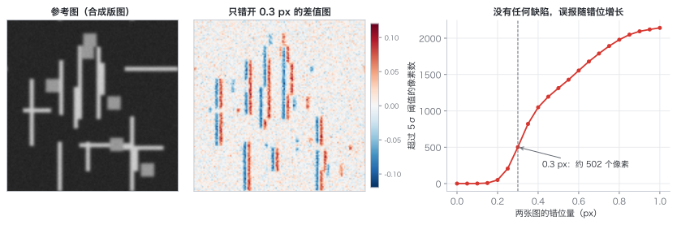
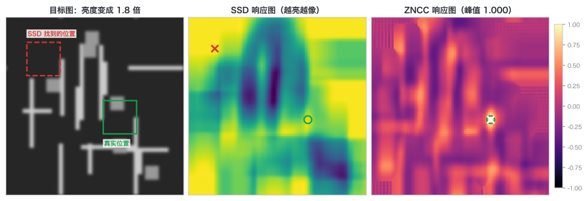
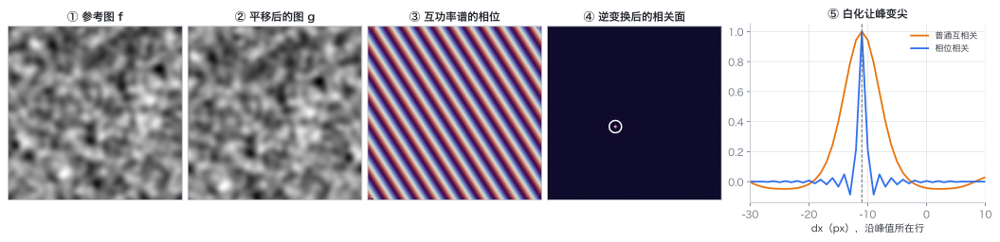
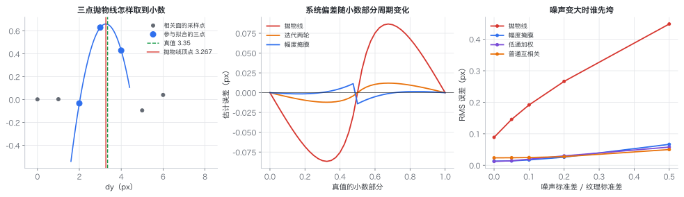
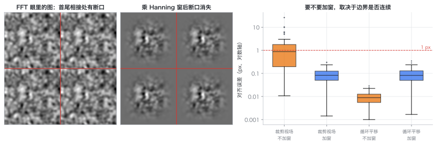
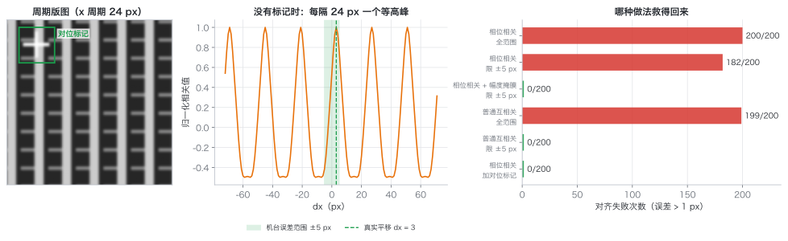

# 教程：图像对齐与亚像素配准

> [!NOTE]
> 本章所有数字都来自合成数据上的实测，记录在 [`figures/实测数字.json`](figures/实测数字.json)，由 `solutions` 分支的 `solutions/figures/ch16.py` 生成。换成真实图像，数值会变，结论的方向要自己再测一遍。

## 0. 本章怎么学

**应用场景**：die-to-die 和 die-to-database 比对、相邻视场拼接、多次曝光叠加、模板定位。只要算法里有“两张图相减”或“把模板放到正确位置”，前面就有一步对齐。

**优先级**：P0。前置是第 2 章（卷积）和第 4 章（几何变换）的基本概念，没学过也能读，遇到不懂的再回看。后面第 18 章和第 24 章直接依赖本章。

| 档位 | 累计用时 | 做什么 | 做到什么算完 |
|---|---:|---|---|
| 速通 | 2 小时 | 读第 1、4、5、8 节，做第 9 节演示的前 3 步，答完 4 道小测 | 能讲清对齐为什么影响误报，相位相关三步是什么，周期图案会怎样失败 |
| 标准 | 10 小时 | 读完全章，跑 Notebook，完成作业并验收通过，填实验记录 | 三项测试 PASS，实验记录里有一条误差曲线和一个失败案例 |
| 深挖 | 16 小时 | 再做第 12 节的破坏实验和第 13 节的扩展 | 能在自己拍的照片上报告对齐精度和它的适用条件 |

> [!TIP]
> 用时超过所选档位的 1.5 倍还没做完，就把卡点写进 `学习进度.md`，先往下一章走。速通档完成后本章就算“见过”，以后用到再升档，不需要一次学透。

## 1. 为什么要对齐：0.3 像素的代价

比对检测的做法是拿待测图减参考图，差值大的地方报缺陷。这个做法默认两张图已经逐像素对准。对不准会怎样，可以直接量出来。

下面的实验用一张 128×128 的合成版图，线条对比度 0.65，每张图加标准差 0.01 的噪声。图里**没有任何缺陷**，只把其中一张平移一点再相减，数一数有多少像素超过 5σ 阈值。

| 错位量（px） | 0 | 0.1 | 0.2 | 0.3 | 0.5 | 1.0 |
|---|---:|---:|---:|---:|---:|---:|
| 超过 5σ 的像素数 | 0 | 0.7 | 49 | 502 | 1314 | 2142 |

差值图上的假缺陷有一个明显特征：沿着每条边缘成对出现，一侧为正，一侧为负。原因是边缘处亮度变化快，差值近似等于“亮度梯度 × 错位量”，梯度越陡、错位越大，差值越大。

这张表给出本章的精度目标：在这组对比度和噪声下，错位要压到 0.1 px 左右才不产生误报。整数像素的对齐（最大误差 0.5 px）远远不够，所以需要亚像素。

<!-- quiz -->
**两张都没有缺陷的图相减，差值图上沿每条线出现一红一蓝成对的条纹。最可能的原因是什么？**

- A. 相机有坏点
- B. 两张图之间有亚像素的错位
- C. 第二张图整体变暗了

答案与解释

**B**。错位让边缘一侧变亮、另一侧变暗，所以正负成对并且只出现在边缘上。坏点是孤立的点，不沿边缘分布。整体变暗会让差值在所有亮区域同号，不会成对。

<!-- /quiz -->

## 2. 先选变换模型

| 变换模型 | 自由度 | 典型场景 |
|---|---:|---|
| 平移 | 2 | 机台定位误差下的 die 与 die、相邻视场 |
| 刚体（平移 + 旋转） | 3 | 晶圆放偏一个小角度 |
| 相似（再加缩放） | 4 | 不同倍率之间 |
| 仿射 | 6 | 轻微斜视、线扫相机的速度误差 |
| 单应 | 8 | 平面物体的透视拍摄 |
| 非刚性 | 很多 | 柔性材料、热形变 |

选模型的原则：**用能解释数据的最简单模型**。自由度越多，越容易把真实缺陷“对齐掉”，也越不稳定。半导体 die-to-die 比对绝大多数情况下用平移就够，必要时加一个小角度。本章只做平移。

## 3. 三类方法

**基于强度、全局搜索**：模板匹配（SSD、NCC、ZNCC）、相位相关（phase correlation）。不依赖特征，适合纹理丰富或者结构规整的图，平移场景首选。

**基于特征**：检测角点或描述子（第 5 章），匹配后用 RANSAC 估计变换（第 4 章）。适合大位移、旋转、缩放，但在重复图案上特征会大量误匹配。

**基于强度、迭代优化**：Lucas-Kanade、ECC。从一个初值出发，最小化两图差异，精度高，但需要好的初值，常用在全局方法之后做精修。

工程上常见的组合是：粗对齐（金字塔加模板匹配，或者对位标记）→ 精对齐（相位相关加亚像素，或者 ECC）。

## 4. 模板匹配与三种相似度

模板匹配是把模板 $T$ 放到图像 $I$ 的每个位置，算一个相似度，取最好的位置。三种常用的相似度，区别在于对亮度变化的态度。

设当前窗口里的像素是 $w$，模板是 $t$，窗口和模板的均值是 $\bar w$、$\bar t$。

$$
\mathrm{SSD} = \sum (w - t)^2, \qquad
\mathrm{NCC} = \frac{\sum w\,t}{\lVert w \rVert\,\lVert t \rVert}, \qquad
\mathrm{ZNCC} = \frac{\sum (w-\bar w)(t-\bar t)}{\lVert w-\bar w \rVert\,\lVert t-\bar t \rVert}
$$

**ZNCC 为什么不怕照明变化**。假设照明让窗口变成 $w' = a\,w + b$，其中 $a > 0$ 是增益，$b$ 是偏置。减均值后 $w' - \bar{w'} = a\,(w - \bar w)$，偏置 $b$ 被消掉。分子和分母各多出一个因子 $a$，相除后也消掉。所以 ZNCC 的值完全不变。NCC 没有减均值这一步，只能消掉增益，偏置会改变它的值。SSD 两样都消不掉。

实测：同一张版图，从 4 个位置各取一个 24×24 模板，把目标图的亮度改掉再全图搜索。

| 目标图的变化 | SSD 找对 | NCC 找对 | ZNCC 找对 | NCC 峰值 | ZNCC 峰值 |
|---|---:|---:|---:|---:|---:|
| 增益 0.5 | 2/4 | 4/4 | 4/4 | 1.000 | 1.000 |
| 增益 0.4、偏置 +20 | 2/4 | 4/4 | 4/4 | 0.956 | 1.000 |
| 增益 1.8 | 0/4 | 4/4 | 4/4 | 1.000 | 1.000 |
| 横向渐变照明 | 3/4 | 4/4 | 4/4 | 0.996 | 0.987 |

读表要注意三点：

1. SSD 在亮度变化下会找错位置，增益 1.8 时 4 个模板全错。
2. NCC 在这组实验里位置都对，但加了偏置后峰值掉到 0.956。产线上通常用“峰值是否高于某个门限”判断匹配是否可信，峰值随照明漂移会让这个门限失效。
3. 渐变照明不是整体线性变化，ZNCC 的峰值也会低于 1（0.987）。ZNCC 只对窗口内近似均匀的增益和偏置不变，窗口越大，这个假设越容易被破坏。

**工程细节**：

- 窗口完全平坦时分母为 0，要特判，输出 0。作业的契约里写了这一条。
- 直白的双重循环是 $O(HWhw)$。分母里的窗口均值和平方和可以用积分图（第 15 章）在 $O(1)$ 内取到，分子可以用 FFT 一次算完。先写对，再考虑加速。
- OpenCV 里对应的是 `cv2.matchTemplate` 的 `TM_CCOEFF_NORMED`。

<!-- quiz -->
**参考图和待测图之间整体亮度差了 1.8 倍。只看“最优位置对不对”，下面哪个说法成立？**

- A. SSD 一定不受影响，因为模板内容没变
- B. ZNCC 的最优位置不变，峰值也仍然是 1
- C. 三种度量都会找错

答案与解释

**B**。增益在 ZNCC 的分子分母里同时出现并约掉。SSD 的值变成 $\sum (1.8w - t)^2$，在暗的平坦区域反而可能更小，图 2 里它就跑到了左上角。

<!-- /quiz -->

## 5. 相位相关：用频域一次算出平移

模板匹配要在每个位置算一次相似度。如果只关心整幅图的平移，可以用傅里叶变换一次算完。

### 5.1 傅里叶平移定理

先看一维。长度为 $N$ 的信号 $f[n]$ 循环平移 $d$ 得到 $g[n] = f[n-d]$。按定义求 $g$ 的离散傅里叶变换，并令 $m = n - d$：

$$
G[k] = \sum_{n} f[n-d]\,e^{-i 2\pi k n / N}
     = \sum_{m} f[m]\,e^{-i 2\pi k (m+d) / N}
     = e^{-i 2\pi k d / N}\,F[k]
$$

结论：**平移不改变每个频率的幅度，只让相位多转一个和频率成正比的角度**。二维同理，$G(u,v) = F(u,v)\,e^{-i2\pi(u\,d_x + v\,d_y)}$。

### 5.2 互功率谱与白化

把 $G$ 乘上 $F$ 的共轭，幅度变成 $\lvert F \rvert^2$，相位只剩平移带来的那一项：

$$
G\,\overline{F} = \lvert F \rvert^2\, e^{-i2\pi(u\,d_x + v\,d_y)}
$$

再除以自己的模长，把 $\lvert F \rvert^2$ 去掉，这一步叫白化（whitening）：

$$
R = \frac{G\,\overline{F}}{\lvert G\,\overline{F} \rvert} = e^{-i2\pi(u\,d_x + v\,d_y)}
$$

$R$ 是一个纯相位的平面波。它的逆变换是一个位于 $(d_y, d_x)$ 的冲激，找最大值的位置就得到平移量。

不做白化、直接对 $G\,\overline{F}$ 做逆变换，得到的是普通互相关（cross-correlation）。图 3 最右一栏把两者画在一起：白化后高于半峰值的采样点只有 1 个，普通互相关有 7 个。

**白化带来的好处**：

- 峰很尖，定位到整数像素非常明确。
- 整体增益在分子分母里约掉，整体偏置只影响零频一个点，所以对整体亮度和对比度变化不敏感。
- 一次 FFT 搜完所有平移，复杂度 $O(N \log N)$。

**白化的代价**：所有频率被拉到同样的权重，包括那些本来几乎没有信号、只有噪声的频率。第 6 节和第 8 节会看到这个代价有多大。

### 5.3 两个必须处理的细节

**方向约定**。作业约定“moving 是 reference 平移 $(d_y, d_x)$ 得到的”，返回 $(d_y, d_x)$。OpenCV 的 `phaseCorrelate` 也有自己的方向约定，用之前一定要拿已知平移测一次。方向写反是这类函数最常见的 bug。

**循环卷绕**。FFT 把信号当成周期的，平移 $-3$ 会出现在下标 $N-3$ 处。下标大于 $N/2$ 的要减去 $N$。

<!-- quiz -->
**做相位相关之前，把两张图都乘以 2 再加 10。估计出的平移会变吗？**

- A. 不变
- B. 会变，因为亮度变了相关值就变了
- C. 只有加窗时才不变

答案与解释

**A**。乘 2 让互功率谱的幅度变成 4 倍，白化时被除掉。加 10 只改变零频那一个点，白化后它的幅度仍是 1，只给相关面加上一个常数，不改变最大值的位置。

<!-- /quiz -->

## 6. 亚像素：从整数峰到小数

整数峰的最大误差是 0.5 px，第 1 节已经说明这不够。常用的补救是在峰值附近插值。

### 6.1 三点抛物线

取峰值 $c$ 和它左右的邻点 $l$、$r$，位置记为 $-1$、$0$、$1$。过这三点的抛物线 $y = a x^2 + b x + c$ 满足

$$
a = \frac{l + r - 2c}{2}, \qquad b = \frac{r - l}{2}
$$

顶点在 $x^* = -b / (2a)$，也就是

$$
\delta = \frac{l - r}{2\,(l - 2c + r)}
$$

x、y 两个方向分别做一次。右邻点比左邻点高，$\delta$ 为正，峰往右偏，符合直觉。

### 6.2 抛物线有系统偏差

抛物线只有在峰的形状真是抛物线时才精确。相位相关的峰不是：平移不是整数时，冲激变成一个类似 sinc 的形状，两侧还有正负交替的旁瓣。用抛物线去套，估计值会被系统性地拉向整数。

图 4 中间一栏是把真值的小数部分从 0 扫到 1 得到的误差曲线。抛物线法的误差在小数部分为 0 和 0.5 时过零，在 0.3 和 0.7 附近最大，方向总是指向最近的整数。这种“随小数部分周期变化”的曲线是亚像素偏差的典型形状，也是验证亚像素实现的标准做法。

| 方法（无噪声） | 最大绝对误差（px） |
|---|---:|
| 相位相关 + 抛物线，本章纹理 | 0.087 |
| 相位相关 + 抛物线，全频带纹理 | 0.122 |
| 抛物线后再迭代两轮 | 0.012 |
| 相位相关 + 幅度掩膜 + 抛物线 | 0.014 |

偏差的大小和图像内容有关（0.087 对 0.122），所以不能用一个固定的修正量把它减掉。

### 6.3 三种改进

**迭代**：按当前估计把图移回去，对残差再做一次相位相关，把两次结果相加。残差越接近 0，抛物线的偏差越小。两轮后最大误差从 0.087 降到 0.012。第 24 章的参考流水线用的就是这个办法。

**频谱加权**：白化之后再乘一个权重，把没有信号的频率压下去。最简单的是幅度掩膜，只保留参考图频谱幅度高于最大值 10% 的频率。峰变宽、变光滑，更接近抛物线，最大误差降到 0.014。

**上采样**（Guizar-Sicairos）：在峰值附近用矩阵 DFT 做 10 到 100 倍的局部上采样，直接在更密的网格上找峰。`skimage.registration.phase_cross_correlation` 用的是这个方法。本章不要求实现，第 13 节有对照实验。

### 6.4 噪声下谁先垮

图 4 最右一栏给两张图都加噪声，统计 200 次随机平移的均方根误差：

| 噪声标准差 / 纹理标准差 | 0 | 0.05 | 0.1 | 0.2 | 0.5 |
|---|---:|---:|---:|---:|---:|
| 相位相关 + 抛物线 | 0.089 | 0.146 | 0.192 | 0.266 | 0.448 |
| 相位相关 + 幅度掩膜 | 0.013 | 0.014 | 0.017 | 0.026 | 0.066 |
| 普通互相关 + 抛物线 | 0.024 | 0.024 | 0.025 | 0.027 | 0.050 |

不加权的相位相关对噪声最敏感，噪声到 10% 时误差已经接近 0.2 px。原因就是第 5.2 节说的代价：这张纹理的能量集中在低频，白化把只有噪声的高频拉到和低频同样的权重。加上幅度掩膜后，误差降了一个数量级。

> [!IMPORTANT]
> 作业要求实现的是不加权的版本，验收标准是亚像素误差小于 0.25 px。它是理解原理的最小实现，不是工程上的最终形态。上产线之前至少要加频谱加权或迭代，并在自己的数据上重画图 4。

## 7. 加窗：取决于边界是否连续

FFT 把图像当成周期信号。真实图像的左边缘和右边缘并不相接，首尾接起来会出现一条断口，相当于图里多了一个强边缘。这个假边缘在两张图里位置相同（都在图像边界），相当于告诉算法“两张图没有动”，会把相位相关的峰拉向零平移。

解决办法是乘一个窗函数（Hanning、Tukey），让边界平滑衰减到 0。代价是靠近边缘的信息被削弱。

| 数据来源 | 是否加窗 | 误差中位数（px） | 最大误差（px） | 误差超过 1 px 的次数 |
|---|---|---:|---:|---:|
| 从大图裁剪两个视场 | 否 | 0.874 | 26.31 | 72/200 |
| 从大图裁剪两个视场 | 是 | 0.083 | 0.30 | 0/200 |
| 循环平移 | 否 | 0.009 | 0.03 | 0/200 |
| 循环平移 | 是 | 0.082 | 0.34 | 0/200 |

两种数据上的结论相反：

- **裁剪视场**（真实相机的情况）：不加窗约有三分之一的样本直接对错，而且 72 次失败里每一次都至少有一个方向的估计值落在 0 附近，正是假边缘在起作用。加窗后全部正确。
- **循环平移**（本章测试和第 24 章合成数据的情况）：信号本来就是周期的，没有断口。加窗反而破坏了“两张图互为循环平移”这个关系，误差大了约 9 倍。第 24 章开发时测到的也是这个方向：不加窗残差约 0.15 px，加窗约 0.35 px。

所以 `use_window` 是一个需要按数据决定的参数。验证算法时用循环平移的合成数据很方便，但它会掩盖边界问题，结论不能直接搬到真实图像上。

## 8. 周期图案：最重要的失败模式

半导体版图大量是周期结构（存储阵列、金属线）。周期为 $P$ 的图案平移 $P$ 之后和原图一模一样，所以平移 $d$ 和平移 $d + kP$ 没法区分。

下面的实验用一张 144×144 的合成版图，x 方向周期 24 px，y 方向周期 16 px。真实平移在 ±5 px 内随机，每张图加标准差 0.01 的噪声，各做 200 次。

| 做法 | 失败次数（误差 > 1 px） | 成功样本的平均误差（px） |
|---|---:|---:|
| 相位相关，全范围搜索 | 200/200 | |
| 相位相关，只在 ±5 px 内找峰 | 182/200 | |
| 相位相关 + 幅度掩膜，只在 ±5 px 内找峰 | 0/200 | 0.010 |
| 普通互相关，全范围搜索 | 199/200 | |
| 普通互相关，只在 ±5 px 内找峰 | 0/200 | 0.009 |
| 相位相关，版图上加一个对位标记 | 0/200 | 0.096 |

这里有两种不同的失败，要分开看。

**第一种：多个等高峰**。无噪声时相关面上有 54 个一样高的峰（x 方向 6 个周期，y 方向 9 个周期），一点噪声就决定了选中哪一个，误差恰好是整数个周期。对策是限制搜索范围：机台定位误差有上限，只在这个范围内找峰。范围必须小于半个周期才能唯一确定。普通互相关加上这一条就从 199/200 降到 0/200。

**第二种：白化把相关面淹没**。严格周期的图案，能量只落在少数几个谐波频率上，其余绝大多数频率是空的。白化把这些空频率里的噪声拉到和谐波同样的权重，真正的峰被噪声盖住。所以相位相关即使限制了搜索范围仍然失败 182/200。只保留有信号的频率（幅度掩膜）之后，才降到 0/200。

工程上的对策，按可靠程度排：

1. **对位标记**（alignment mark）：在版图上放非周期的十字或 L 形标记。它的频谱是宽带的，同时解决上面两种失败。实验里不需要限制搜索范围也是 0/200。
2. **限制搜索范围，并且不让空频率参与**：用普通互相关或 ZNCC，或者给相位相关加频谱掩膜。
3. **先粗后精**：用低分辨率或者大视场先定到整周期，再精修。
4. **用设计数据**（die-to-database）：拿版图渲染图做参考，参考图里有全局结构。

第 24 章开发时踩的就是这个坑：版图 x 方向周期 24 px，相位相关最大偏差 23.8 px，差不多正好一个周期。

<!-- quiz -->
**严格周期的版图上，相位相关限制搜索范围后仍然失败 182/200，换成普通互相关、同样的搜索范围就是 0/200。差别来自哪里？**

- A. 普通互相关的峰更尖
- B. 白化把没有信号的频率也拉到同样权重，相关面被噪声淹没
- C. 普通互相关不受周期影响

答案与解释

**B**。普通互相关同样有周期性的多峰（全范围搜索时 199/200 失败），所以 C 不对。它的峰比相位相关宽，A 也不对。区别在于它按频谱幅度加权，空频率里的噪声几乎不起作用。

<!-- /quiz -->

## 9. 交互演示

把二维图像换成一行 128 个像素，其余和作业里的算法一致。按页面下方“按顺序试”的五步操作，每一步先预测再拖动。

<!-- embed: ../demos/相位相关.html 1010 -->
[打开交互演示：相位相关与亚像素](../demos/相位相关.html)

## 10. 怎样评估对齐精度

不要只看一张图对得准不准。标准做法：

- **合成数据**：已知真值平移，统计误差的均值（偏差）和标准差，画误差随真值小数部分变化的曲线（图 4 中间一栏）。
- **真实数据的重复性**：同一个位置拍 N 次，估计平移的 3σ。
- **闭环检查**：A 对 B、B 对 C、A 对 C 的平移应满足加法关系。
- **报告格式**：在什么噪声水平、什么图案、多大搜索范围、是否加窗的条件下，误差多少，失败率多少。

本章每张表的表头都按这个格式写了条件。少了条件的精度数字没有意义。

## 11. 常见错误

| 现象 | 原因 | 怎么查 |
|---|---|---|
| 估计值符号和真值相反 | `reference` 和 `moving` 传反，或者共轭取在了另一边 | 用 `np.roll(ref, (3, -5))` 测，应返回 (3, -5) |
| 平移 -3 被估计成 N-3 | 没做循环卷绕换算 | 测一个负的平移 |
| 亚像素部分总是 0 | 邻点取错了行列，或者把整数下标当成了偏移 | 打印 $l$、$c$、$r$ 三个值 |
| 小数平移的测试数据本身不准 | 用双线性插值造平移，引入了模糊 | 用傅里叶相位斜坡造平移，测试和 Notebook 都是这样做的 |
| ZNCC 出现 nan | 平坦窗口分母为 0 | 用一张常数图测 |
| SSD 的结果不对且没有报错 | 用 `uint8` 直接相减，发生回绕 | 先转成 `float64` |
| 真实图像上偶尔对到 (0, 0) | 没加窗，边界断口把峰拉向零平移 | 对照第 7 节的实验 |

## 12. 破坏实验

每个实验先写下预测，再运行，把结果和原因记到 `实验记录.md`。前三个是标准档必做。

1. 把 `phase_correlation(ref, mov)` 的两个参数对调，估计值怎么变？
2. 把噪声加到纹理标准差的 50%，重画图 4 中间一栏的曲线，形状还在吗？
3. 复现第 8 节的表：周期图案上，全范围和限制范围各失败多少次？
4. 把纹理换成更平滑的（`width=0.02`），相位相关还可靠吗？和普通互相关比呢？
5. 把白化分母里的 `1e-12` 换成互功率谱最大幅度的 1%，误差怎么变？这相当于一种什么加权？
6. 对裁剪视场的数据，把 Hanning 窗换成只在边缘 10% 衰减的 Tukey 窗，误差怎么变？

## 13. 扩展（深挖档）

- 装上 `scikit-image`，用 `phase_cross_correlation(ref, mov, upsample_factor=100)` 重画图 4 中间一栏，和抛物线、迭代两种做法比较。
- 用 `cv2.findTransformECC` 估计平移加小角度旋转，体会迭代法对初值的依赖。
- 按 `data/README.md` 的建议用手机拍两张方格纸，报告你的对齐结果，并按第 10 节的格式写清条件。

## 14. 和后续章节的关系

- 第 18 章的金模板比对假设图已经对齐，图 1 就是没对齐时它会看到的东西。
- 第 24 章综合项目里，对齐质量直接决定误报数。
- 第 17 章标定后，对齐结果可以从像素换算成物理距离（微米）。
- 第 15 章的积分图可以用来加速 ZNCC 的分母。

## 自测问题

1. 为什么 ZNCC 比 SSD 更适合照明不稳定的产线？
2. 相位相关为什么要除以互功率谱的模长？不除会怎样？
3. 估计结果是 (60, 5)，图像尺寸 64×64，真实平移是多少？
4. 周期 16 px 的图案、机台误差 ±10 px，只限制搜索范围能不能唯一确定平移？
5. 你怎样证明自己的亚像素实现没有系统偏差？
6. 什么样的图像上白化会帮倒忙？有哪些补救办法？
7. 裁剪视场和循环平移两种数据上，加窗的结论为什么相反？
