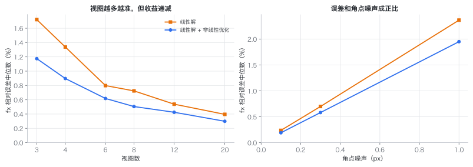
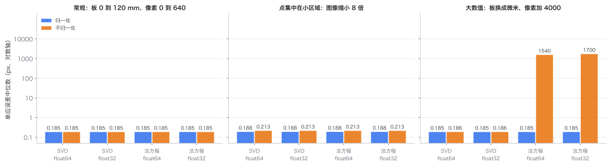
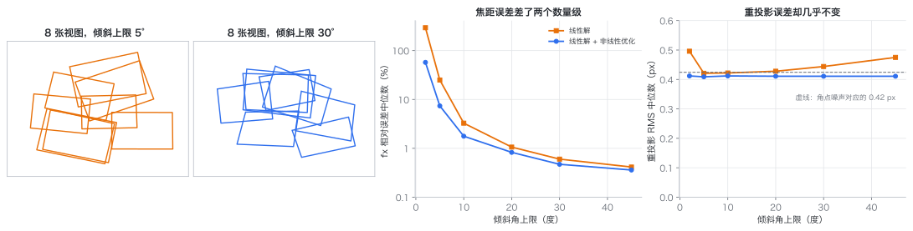
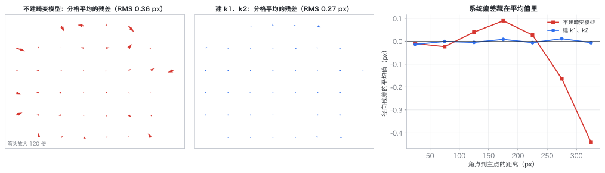
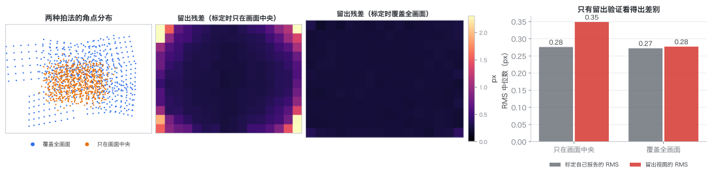

# 教程：相机标定

> [!NOTE]
> 本章所有数字都来自合成相机上的实测，记录在 [`figures/实测数字.json`](figures/实测数字.json)，由 `solutions` 分支的 `solutions/figures/ch17.py` 生成。线性解用本章作业的参考实现，带非线性优化的对照用 OpenCV 的 `calibrateCamera`。换成真实相机，数值会变，结论的方向要自己再测一遍。

## 0. 本章怎么学

**应用场景**：把像素换算成物理尺寸（线宽、缺陷大小、套刻偏差），校正镜头畸变，建立相机和运动平台、相机和相机之间的坐标关系。凡是要回答“这个东西有多大、在哪里”的检测和量测，前面都有一步标定。

**优先级**：P0，岗位要求里单独列出。前置是第 4 章（齐次坐标、单应）和第 7 章（针孔模型）。后面第 21 章的渲染相机和第 24 章的坐标变换用同一套模型。

| 档位 | 累计用时 | 做什么 | 做到什么算完 |
|---|---:|---|---|
| 速通 | 3 小时 | 读第 1、2 节和第 6 节，看懂图 3 到图 5，把第 7 节演示里列的四条都试一遍，答完 4 道小测 | 能讲清内参、外参、畸变各是什么，标定图应该怎么拍，为什么重投影误差小不代表标定准 |
| 标准 | 12 小时 | 读完全章并跟着推一遍第 3 节，跑 Notebook，完成作业并验收通过，填实验记录 | 验收全部 PASS，实验记录里有视图数、倾斜角和误差的关系 |
| 深挖 | 18 小时 | 再做第 10 节的破坏实验和第 11 节的扩展 | 用自己拍的棋盘图完成一次标定，并用留出的图报告误差 |

> [!TIP]
> 用时超过所选档位的 1.5 倍还没做完，就把卡点写进 `学习进度.md`，先往下一章走。第 3 节的推导是本章最花时间的部分，速通档可以只记结论。

## 1. 标定要求什么，不准会怎样

针孔模型（第 7 章）把三维点投影到像素：

```math
s \begin{bmatrix} u \\ v \\ 1 \end{bmatrix} = K\,[R \mid t] \begin{bmatrix} X \\ Y \\ Z \\ 1 \end{bmatrix},
\qquad
K = \begin{bmatrix} f_x & \gamma & c_x \\ 0 & f_y & c_y \\ 0 & 0 & 1 \end{bmatrix}
```

- **内参** $K$：焦距（以像素为单位）、主点、倾斜（现代相机 $\gamma \approx 0$）。换镜头或调焦之后才会变。
- **外参** $R$、$t$：世界坐标系到相机坐标系的变换，每张标定图各有一组。
- **畸变**：真实镜头不是理想针孔，需要额外参数（第 2 节）。

标定就是用已知几何的标定物（棋盘、圆点阵列），从图像里反推这些参数。

不准的代价可以直接量出来。本章的合成相机分辨率 640×480，带一点桶形畸变（$k_1 = -0.1$），它让画面右下角的点向内移动约 9.6 px。如果标定时不建畸变模型：

| | 不建畸变模型 | 建 k1、k2 |
|---|---:|---:|
| 重投影 RMS（px） | 0.34 | 0.27 |
| 焦距 fx 的相对误差 | 2.7% | 0.24% |

重投影误差只从 0.27 px 涨到 0.34 px，看上去差不多，焦距误差的中位数却到了 2.7%。在已知工作距离下，物体尺寸等于像素长度乘以距离再除以焦距，焦距错百分之几，量出来的尺寸就错百分之几。第 6 节会反复遇到这个现象：**重投影误差小，不代表参数准**。

## 2. 畸变模型

在归一化坐标 $(x, y) = (X_c / Z_c,\; Y_c / Z_c)$ 上，记 $r^2 = x^2 + y^2$：

```math
\begin{aligned}
x_d &= x\,(1 + k_1 r^2 + k_2 r^4 + k_3 r^6) + 2 p_1 x y + p_2 (r^2 + 2x^2) \\
y_d &= y\,(1 + k_1 r^2 + k_2 r^4 + k_3 r^6) + p_1 (r^2 + 2y^2) + 2 p_2 x y
\end{aligned}
```

然后 $u = f_x\,x_d + c_x$，$v = f_y\,y_d + c_y$。

- $k_1 < 0$ 是桶形畸变（广角常见），$k_1 > 0$ 是枕形畸变。
- 带 $p_1$、$p_2$ 的项是切向畸变，来自镜片和传感器不平行，通常很小。
- 畸变随 $r$ 增长，画面中央几乎没有，四角最大。这一点决定了标定图必须覆盖到四角（第 6.3 节）。
- 工业检测常用低畸变镜头或远心镜头，但亚像素测量时仍然要标。

## 3. Zhang 方法：用平面标定物

### 3.1 平面到图像是一个单应

把世界坐标系建在棋盘平面上，棋盘上所有点 $Z = 0$，旋转矩阵的第三列 $r_3$ 乘的是 0，直接消失：

```math
s \begin{bmatrix} u \\ v \\ 1 \end{bmatrix} = K\,[r_1\; r_2\; r_3\; t] \begin{bmatrix} X \\ Y \\ 0 \\ 1 \end{bmatrix} = K\,[r_1\; r_2\; t] \begin{bmatrix} X \\ Y \\ 1 \end{bmatrix}
```

所以棋盘平面到图像是一个 3×3 的**单应**（homography）$H = \lambda\,K\,[r_1\; r_2\; t]$，$\lambda$ 是任意非零尺度。

### 3.2 用 DLT 估计单应

设棋盘上的点 $(x, y)$ 对应图像上的 $(u, v)$，$H$ 的元素记为 $H_{ij}$：

$$
u = \frac{H_{11}x + H_{12}y + H_{13}}{H_{31}x + H_{32}y + H_{33}}, \qquad
v = \frac{H_{21}x + H_{22}y + H_{23}}{H_{31}x + H_{32}y + H_{33}}
$$

两边乘以分母并移项，每对点得到两个关于 $H$ 的 9 个元素的线性方程：

```math
\begin{aligned}
-x H_{11} - y H_{12} - H_{13} + u x H_{31} + u y H_{32} + u H_{33} &= 0 \\
-x H_{21} - y H_{22} - H_{23} + v x H_{31} + v y H_{32} + v H_{33} &= 0
\end{aligned}
```

$N$ 对点叠成 $2N \times 9$ 的矩阵 $A$，求 $A h = 0$ 的最小二乘解，也就是 $A$ 最小奇异值对应的右奇异向量。$H$ 有 9 个元素、差一个尺度，共 8 个自由度，所以至少要 4 对点。这个做法叫直接线性变换（direct linear transform，DLT）。

作业里的 `homography_dlt` 还要先做归一化，为什么要做、什么时候有用，见第 5 节。

### 3.3 两个约束

记 $H = [h_1\; h_2\; h_3]$（按列），则 $r_1 = K^{-1}h_1 / \lambda$，$r_2 = K^{-1}h_2 / \lambda$。旋转矩阵的列互相垂直并且等长：

```math
\begin{aligned}
r_1 \cdot r_2 = 0 \quad &\Rightarrow \quad h_1^\top K^{-\top} K^{-1} h_2 = 0 \\
\lVert r_1 \rVert = \lVert r_2 \rVert \quad &\Rightarrow \quad h_1^\top K^{-\top} K^{-1} h_1 = h_2^\top K^{-\top} K^{-1} h_2
\end{aligned}
```

令 $B = K^{-\top} K^{-1}$。它是对称矩阵，有 6 个独立元素，差一个尺度。每张图给出 2 个关于 $B$ 的线性方程。

### 3.4 写成线性方程组

把 $B$ 的 6 个独立元素排成向量 $b = [B_{11}, B_{12}, B_{22}, B_{13}, B_{23}, B_{33}]^\top$。记 $h_{ik}$ 为第 $i$ 列的第 $k$ 个元素，则 $h_i^\top B\,h_j = v_{ij}^\top b$，其中

```math
v_{ij} = \begin{bmatrix} h_{i1}h_{j1} \\ h_{i1}h_{j2} + h_{i2}h_{j1} \\ h_{i2}h_{j2} \\ h_{i3}h_{j1} + h_{i1}h_{j3} \\ h_{i3}h_{j2} + h_{i2}h_{j3} \\ h_{i3}h_{j3} \end{bmatrix}
```

每张图贡献两行：$v_{12}^\top$ 和 $(v_{11} - v_{22})^\top$。$n$ 张图叠成 $2n \times 6$ 的矩阵 $V$，求 $V b = 0$ 的最小二乘解。

**为什么至少 3 张**：$b$ 有 6 个元素、差一个尺度，即 5 个自由度，每张图 2 个方程，3 张图 6 个方程。若假设 $\gamma = 0$，可以再加一个方程，2 张图也能解。

**为什么板子要倾斜**。假设所有标定图都正对相机，板子只在自己的平面内旋转角度 $\theta$ 和平移。这时 $r_1 = (\cos\theta, \sin\theta, 0)^\top$，$r_2 = (-\sin\theta, \cos\theta, 0)^\top$，第三个分量都是 0。$K$ 的第三行是 $(0, 0, 1)$，所以 $h_1 = \lambda K r_1$ 和 $h_2 = \lambda K r_2$ 的第三个分量也是 0。代回 $v_{ij}$ 的定义，后三个元素全为 0，方程里根本不出现 $B_{13}$、$B_{23}$、$B_{33}$。

这三个量恰好携带主点和焦距的绝对大小。剩下的 $B_{11}$、$B_{22}$ 只确定到一个共同的尺度，能解出来的只有 $f_x / f_y$ 这个比值。直观上也说得通：正对相机时，焦距加倍、距离也加倍，图像完全一样。只有板子倾斜、出现近大远小，焦距才能和距离分开。第 6.1 节量了这件事有多严重。

<!-- quiz -->
**所有标定图都正对相机拍，板子只在自己的平面内旋转和平移。Zhang 方法的两个约束能确定什么？**

- A. 全部内参，只是精度差一些
- B. 只有 fx 和 fy 的比值
- C. 只有主点

<details markdown="1"><summary>答案与解释</summary>

**B**。这种姿态下 $h_1$、$h_2$ 的第三个分量为 0，方程里不出现 $B_{13}$、$B_{23}$、$B_{33}$，主点和焦距的绝对大小都没有约束。实测倾斜上限 2° 时线性解的焦距误差中位数是 294%，基本是随机数。

</details>
<!-- /quiz -->

### 3.5 从 B 恢复 K

两种方式：

- 用 Zhang 论文附录的闭式公式直接算 $f_x$、$f_y$、$c_x$、$c_y$、$\gamma$。
- 注意 $B$ 只确定到一个尺度，可能整体是负的。把它调成正定后做 Cholesky 分解得到 $K^{-1}$ 的转置，再求逆、归一化使 $K_{33} = 1$。

### 3.6 外参

有了 $K$，每张图的外参从它的单应里解出来：

$$
r_1 = s\,K^{-1}h_1, \quad r_2 = s\,K^{-1}h_2, \quad r_3 = r_1 \times r_2, \quad t = s\,K^{-1}h_3, \qquad s = \frac{1}{\lVert K^{-1}h_1 \rVert}
$$

两个细节：

- 如果 $t_z < 0$，说明板子被算到了相机后方，符号选反了，$r_1$、$r_2$、$t$ 整体取负。
- 噪声会让 $[r_1\; r_2\; r_3]$ 不严格正交。对它做 SVD 得到 $U \Sigma V^\top$，取 $R = U V^\top$，这是离它最近的旋转矩阵。还要检查 $\det R = +1$。

## 4. 非线性优化

线性解最小化的是代数量 $\lVert V b \rVert$，它没有几何含义，也不包含畸变。真正的标定以线性解为初值，最小化所有图、所有点的重投影误差：

$$
\min_{K,\,\text{dist},\,R_i,\,t_i} \; \sum_i \sum_j \left\lVert m_{ij} - \pi(K, \text{dist}, R_i, t_i, M_j) \right\rVert^2
$$

$m_{ij}$ 是第 $i$ 张图上第 $j$ 个角点的观测位置，$\pi$ 是带畸变的投影函数。用 Levenberg-Marquardt 同时优化内参、畸变和所有外参。`cv2.calibrateCamera` 做的就是这两步：Zhang 线性初值，再加 LM 优化。

优化能带来多少，视图数和噪声各有多大影响，用合成相机量一下。无畸变，倾斜上限 30°，各 200 次。



| 视图数（噪声 0.3 px） | 3 | 4 | 6 | 8 | 12 | 20 |
|---|---:|---:|---:|---:|---:|---:|
| 线性解：fx 误差中位数 | 1.72% | 1.34% | 0.80% | 0.72% | 0.54% | 0.40% |
| 优化后：fx 误差中位数 | 1.18% | 0.90% | 0.62% | 0.51% | 0.43% | 0.30% |

| 角点噪声（8 张视图） | 0.1 px | 0.3 px | 1.0 px |
|---|---:|---:|---:|
| 线性解：fx 误差中位数 | 0.24% | 0.70% | 2.36% |
| 优化后：fx 误差中位数 | 0.19% | 0.58% | 1.95% |

三个结论：

1. 视图越多越准，但收益递减。从 3 张加到 12 张，误差降到原来的三分之一左右；从 12 张再加到 20 张，只再降四分之一左右。常说的“拍 10 到 20 张”来自这里。
2. 误差和角点噪声成正比。角点检测的精度直接决定标定的精度，模糊、过曝、板子不平都会体现在这里。
3. 没有畸变时，优化后的误差是线性解的七到八成。线性解已经相当接近，它的主要用途是给优化提供一个好的初值。

> [!IMPORTANT]
> 本章作业实现的是线性部分，不含畸变。它的验收标准是在无畸变的合成数据上内参误差足够小。真实镜头都有畸变，一定要接着做非线性优化。有畸变时只用线性解，实测重投影 RMS 是 0.74 px，是建了畸变模型并优化之后的 2.7 倍。

## 5. 点坐标归一化到底有什么用

DLT 构造的矩阵里，像素坐标（几百到几千）、它们的乘积（几万到几百万）和 1 混在一起，各列的数量级差很多。Hartley 建议先把两组点各自平移到质心、缩放到离原点的平均距离为 $\sqrt{2}$，解完再变换回去。作业里的 `normalize_points` 做的就是这一步。

它到底起多大作用，取决于坐标长什么样、方程怎么解。下面用 54 个角点、0.5 px 噪声、300 个随机视图，比较三种坐标和两种解法。误差是估出的单应把板上的点映射到图像后，和无噪声位置的均方根距离。



| 坐标条件 | SVD，归一化 | SVD，不归一化 | 法方程，归一化 | 法方程，不归一化 |
|---|---:|---:|---:|---:|
| 常规：板 0 到 120 mm，像素 0 到 640 | 0.185 | 0.185 | 0.185 | 0.185 |
| 角点只占约 30×20 px 的小范围 | 0.188 | 0.213 | 0.188 | 0.213 |
| 大数值：板坐标用微米，像素坐标加 4000 | 0.185 | 0.186 | 0.185 | 1540 |

表里是 float64 的结果。用 SVD 求解时，float32 的六个数和 float64 到三位有效数字都相同。“SVD”指直接分解方程矩阵 $A$，“法方程”指先算 $A^\top A$ 再做特征分解。

读表的结论：

1. **常规坐标下，归一化与否没有差别**。四种做法都是 0.185 px。
2. **角点集中在小范围时，不归一化差 13%**（0.213 对 0.188），而且和精度、解法都无关。float32 和 float64 结果相同，说明这不是舍入误差。按 Hartley 的分析，DLT 最小化的是代数误差，各个方程在其中占多大权重取决于坐标怎么取，归一化之后的坐标让代数误差更接近几何误差。
3. **数值很大又用法方程时，不归一化会彻底失效**（1540 px）。方程矩阵最大奇异值和第二小奇异值之比，归一化后是 3.5，不归一化在大数值坐标下是 1.2e9。法方程把这个比值平方，超过了 float64 能分辨的范围（约 1e16）。直接对 $A$ 做 SVD 不平方，所以没事。

所以归一化的价值有两条，一条是统计上的，一条是数值上的。用 SVD 求解时，单纯换成 float32 在这组实验里没有造成差别。检测设备上，平台坐标常用微米甚至纳米，数值很大；对位标记通常只占视场的一小块。这两种情况都落在表的后两行，所以归一化值得作为默认步骤。

表里的三种条件下，用 SVD 时不归一化最多差 13%。坐标再极端一些，SVD 也顶不住。把板坐标和像素坐标都加上 1000000 的整体偏移（无噪声，100 个随机视图，float64，SVD），每个视图最大映射误差的中位数：归一化后是 2.4e-07 px，不归一化是 5 px。作业的验收里有一组这样的数据，跳过归一化的 `homography_dlt` 通不过。

<!-- quiz -->
**用 float64 和 SVD 解 DLT，角点在画面里分布得比较开。归一化和不归一化的结果差多少？**

- A. 差一个数量级
- B. 几乎没有差别
- C. 不归一化会解不出来

<details markdown="1"><summary>答案与解释</summary>

**B**。实测都是 0.185 px。归一化起作用的条件是角点只占很小的范围（差 13%），或者坐标数值很大并且用法方程求解（不归一化直接失效）。

</details>
<!-- /quiz -->

## 6. 标定质量怎么判断

**重投影误差（RMS）**是标定程序自己报告的数字，好的标定通常在 0.1 到 0.5 px。但它只说明模型在参与标定的那些点上自洽。下面三个实验各展示一种“RMS 很好看，标定却不对”的情况。

### 6.1 姿态太单一：焦距不可信

每次 8 张视图，角点噪声 0.3 px，无畸变。只改变板子绕 x、y 轴倾斜的上限。



| 倾斜上限 | 2° | 5° | 10° | 20° | 30° | 45° |
|---|---:|---:|---:|---:|---:|---:|
| 线性解：fx 误差中位数 | 294% | 25% | 3.3% | 1.06% | 0.60% | 0.41% |
| 优化后：fx 误差中位数 | 57% | 7.4% | 1.8% | 0.83% | 0.47% | 0.36% |
| 优化后：重投影 RMS（px） | 0.41 | 0.41 | 0.41 | 0.41 | 0.41 | 0.41 |

倾斜上限 2° 时，线性解在 200 次里还有 45 次解不出有效的内参。

倾斜从 30° 降到 5°，焦距误差从 0.5% 涨到 7%，重投影 RMS 一直是 0.41 px，一点没变。这正是第 3.4 节推导的结果：板子接近正对相机时，焦距和距离可以互相补偿，换一组错的焦距和错的距离，角点照样对得上。

实用的结论是倾斜至少 20° 到 30°，而且要朝不同方向倾斜。

### 6.2 模型不够：残差里有规律

真实相机带 $k_1 = -0.1$ 的畸变，标定时不建畸变模型。12 张视图覆盖全画面，角点噪声 0.2 px，各 100 次：

| | 重投影 RMS 中位数（px） | fx 误差中位数 |
|---|---:|---:|
| 不建畸变模型 | 0.34 | 2.7% |
| 建 k1、k2 | 0.27 | 0.24% |

只看 RMS，0.34 和 0.27 都在“好的标定”范围里。区别藏在残差的方向上。下面是一次 40 张视图的标定，把 2160 个角点的残差按位置分格取平均。随机噪声在平均后互相抵消，剩下的就是模型没解释掉的部分。



| 角点到主点的距离（px） | 25 | 75 | 125 | 175 | 225 | 275 | 325 |
|---|---:|---:|---:|---:|---:|---:|---:|
| 不建畸变：径向残差的平均（px） | -0.01 | -0.02 | 0.04 | 0.09 | 0.03 | -0.16 | -0.44 |
| 建 k1、k2：径向残差的平均（px） | -0.01 | 0.00 | -0.01 | 0.01 | -0.01 | 0.01 | -0.01 |

不建畸变时，径向残差先正后负，在画面边缘达到 -0.44 px。这次标定估出的焦距是 fx = 869.6、fy = 834.1，真值是 820 和 790，偏了约 6%：优化器用一个错的焦距去凑畸变造成的偏移。偏多少、往哪边偏取决于视图怎么摆，上表那 100 次里 fx 的偏差从 -2.3% 到 +7.5%（5% 到 95% 分位）。

判断方法：**把残差按图像位置画出来**。随机散布说明模型够用；有随半径或随位置变化的规律，说明模型缺了东西。

<!-- quiz -->
**一次标定报告重投影 RMS 是 0.3 px。这个数字能直接说明什么？**

- A. 内参的误差很小
- B. 模型在参与标定的那些角点上是自洽的
- C. 畸变已经被正确建模

<details markdown="1"><summary>答案与解释</summary>

**B**。姿态单一时焦距可以错 7% 而 RMS 不变（第 6.1 节）；不建畸变模型时焦距错 2.7%，RMS 只从 0.27 涨到 0.34（第 6.2 节）。RMS 小是必要条件，不是充分条件。

</details>
<!-- /quiz -->

### 6.3 覆盖不全：四角没有约束

相机仍带 $k_1 = -0.1$ 的畸变，这次标定时建了 k1、k2，模型是对的。区别只在拍法：一种让板子只出现在画面中央，一种覆盖全画面。然后另拍 40 张覆盖全画面的图，**不参与标定**，用标定结果去算它们的重投影误差。各 30 次。



| | 标定时只拍画面中央 | 标定时覆盖全画面 |
|---|---:|---:|
| 标定自己报告的 RMS（px） | 0.28 | 0.27 |
| 留出视图的 RMS（px） | 0.35 | 0.28 |
| 留出视图在画面中央的平均残差（px） | 0.27 | 0.25 |
| 留出视图在画面四角的平均残差（px） | 1.85 | 0.27 |
| 估出的 k1（真值 -0.1）的 5% 到 95% 分位 | -0.159 到 -0.050 | -0.120 到 -0.089 |

两种拍法自己报告的 RMS 几乎相同。但只拍中央时，四角的实际误差是 1.85 px，是中央的 7 倍，估出的 $k_1$ 在 -0.16 到 -0.05 之间乱跳。畸变在中央本来就很小，那里的点对畸变参数几乎没有约束，优化器给出什么值都能拟合好。

留出验证的总 RMS 只从 0.28 涨到 0.35，也不算显眼。**按位置看**才看得出问题集中在四角。Notebook 实验 6 用你的线性解和 OpenCV 各做一次留出验证，把画面中央和四角分开统计。

<!-- quiz -->
**标定板只出现在画面中央，标定程序报告 RMS 0.28 px。这台相机在画面四角的实际误差大约是多少？**

- A. 也是 0.28 px 左右
- B. 接近 2 px
- C. 一定比 0.28 px 小

<details markdown="1"><summary>答案与解释</summary>

**B**。实测 1.85 px。中央的点约束不了畸变参数，估出来的畸变系数不准，外推到四角误差就放大了。标定自己报告的 RMS 只统计参与标定的点，这些点都在中央。

</details>
<!-- /quiz -->

### 6.4 检查清单

- **姿态**：倾斜至少 20° 到 30°，朝不同方向。
- **覆盖**：角点要出现在画面四角和中心，把所有标定图的角点画在一张图上检查。
- **留出验证**：留几张图不参与标定，用标定结果算它们的重投影误差，并且按位置看。
- **残差图**：把残差按图像位置画出来，看有没有规律。
- **参数不确定度**：看各参数的标准差（OpenCV 的 `calibrateCameraExtended` 会给）。
- **参数数量**：$k_3$、薄棱镜项这类高阶参数容易过拟合，留出验证变差就去掉。
- **物理检查**：拍一把标准尺或一块标准片，测量长度和真值比较。这是最终的判据。

## 7. 交互演示

拖动内参、外参和畸变系数，看棋盘的投影怎么变。画面下方列了四条可以逐个试的操作，其中第二条对应第 6.1 节的焦距和距离耦合，第三条对应第 6.3 节的四角覆盖。

<!-- embed: ../demos/相机投影与畸变.html 920 -->
[打开交互演示：相机投影与镜头畸变](../demos/相机投影与畸变.html)

## 8. 工业检测里的标定

**像素尺寸标定**：显微和检测场景最常见。拍一块已知间距的标准片（刻线尺、点阵片），算出每像素对应多少微米，x 和 y 分开算，并检查视场内是否均匀。

**远心镜头**：放大倍率不随物距变化，没有“近大远小”，适合测量。它的投影更接近正交投影而不是透视投影，针孔模型不适用，需要专门的仿射或正交模型。

**相机与运动平台的关系**：检测设备上，相机固定、晶圆在 XY 平台上移动。要标定平台坐标轴在图像里的方向、两轴是否垂直、步进距离对应多少像素。做法是让平台按已知距离移动，用第 16 章的对齐方法测图像位移，拟合一个 2×2 矩阵加平移。平台坐标的数值通常很大，这里正好用得上第 5 节的归一化。

**线扫相机**：一维传感器加运动扫描成像，扫描方向的分辨率由运动速度和行频决定，两个方向的标定要分开处理。

**多相机拼接**：每台相机先单独标定，再用公共标定板求它们之间的关系，用于拼接大视场。

具体到某台设备用哪种标定物、精度要求多少，以设备和公司的资料为准。

## 9. 常见错误

| 现象 | 可能原因 | 怎么查 |
|---|---|---|
| 主点离画面中心很远 | 姿态不够多样，或者棋盘角点顺序错了 | 画出每张图的角点连线，看顺序是否一致；检查倾斜角 |
| fx 和 fy 差很多 | 像素不是正方形（少见），更可能是棋盘尺寸 x、y 写反 | 核对标定板的行列数和格子边长 |
| RMS 很大 | 角点检测错了、某张图模糊、棋盘不平 | 逐张看每张图各自的 RMS，找出最差的那张 |
| 换个距离测量就不准 | 普通镜头的放大倍率随距离变化 | 在工作距离上重新标定，或者改用远心镜头 |
| 标定好的参数换台机器不对 | 同型号镜头也有个体差异 | 每台单独标定 |
| 归一化后的平均距离不是 $\sqrt{2}$ | 算成了均方根距离，或者把尺度定成了 1 | 打印归一化后各点到原点距离的算术平均 |
| $T$ 对角线上的两个缩放系数不相等 | x、y 两个方向分开缩放，不是相似变换 | 用一组 x 方向铺得开、y 方向很窄的点测 |
| 无噪声时单应的映射误差就有几百像素 | 没有去归一化，或者去归一化的顺序、方向写反 | 把 `src` 用 $H$ 映射过去，和 `dst` 比 |
| 估出的单应差一个整体倍数 | 没有缩放到 $H_{33} = 1$ | 比较前先归一化 |
| 坐标带很大的整体偏移时单应不准 | 跳过了归一化 | 两组坐标都加上很大的偏移再测（第 5 节） |
| 带噪声时单应比预期差好几倍 | 只用了 4 个点，没有让全部点参与最小二乘 | 数一数方程矩阵的行数，应是点数的两倍 |
| 无噪声时内参就不对 | $v_{ij}$ 的下标写错，或者把 $h_i$ 取成了 $H$ 的行 | 用 $K\,[r_1\; r_2\; t]$ 构造精确的单应测 |
| 相机没有 skew 时都对，有 skew 时主点和 skew 对不上 | 从 $b$ 解内参的公式按 $\gamma = 0$ 化简了 | 用带 skew 的 $K$ 构造单应测 |
| 闭式公式开方时出现 nan | 两个约束或 $v_{ij}$ 写错（例如 $v_{11} - v_{22}$ 写成了加号），或者姿态退化 | 先用无噪声的精确单应测；再检查倾斜角 |
| 用 Cholesky 分解时报“不是正定矩阵” | SVD 给出的 $b$ 整体符号是任意的，$B$ 可能整体为负 | 检查 $B_{11}$ 的符号，为负时整体取负 |
| 外参里的 t_z 是负的，或者 R 差了半圈 | 没处理符号；或者只把 $t$ 取负，$r_1$、$r_2$ 没有一起取负 | 把单应整体乘以 -1 再求外参，结果应该不变 |
| R 的行列式是 -1 | $r_3$ 的叉乘顺序写反，或者 SVD 投影后没检查行列式 | 打印 `np.linalg.det(R)` |
| 单应带噪声时 R 不是正交矩阵 | 没有做 SVD 投影 | 打印 $R R^\top$，应是单位阵 |
| 重投影误差比别人算的小 | 算成了距离的算术平均，或者对 2N 个坐标分量取平均 | 只让 4 个点里的 1 个偏开 5 px，结果应是 5 px 的一半 |

## 10. 破坏实验

每个实验先写下预测，再运行，把结果和原因记到 `实验记录.md`。前三个是标准档必做。

1. 把倾斜角限制在 ±3° 左右（Notebook 实验 2 和实验 4），焦距和主点各变成什么样？重投影误差变了吗？
2. 把棋盘格边长写错（15 写成 10），哪些参数受影响，哪些不受影响？
3. 把某张视图的角点顺序打乱，结果怎样？
4. 只用 3 张视图，重复 20 次不同的随机种子，fx 的波动范围有多大？
5. 在 `homography_dlt` 里跳过归一化，把板坐标乘以 1000、像素坐标加 4000，结果变了吗？再把求解方式从 SVD 改成对 $A^\top A$ 做特征分解试试。做完把归一化改回来：验收里有一组整体偏移更大的数据，跳过归一化通不过（第 5 节末尾）。
6. 给合成数据加上 $k_1 = -0.1$ 的畸变，仍用线性解，内参偏了多少？把残差按位置画出来（Notebook 实验 5 画的是按半径分组的平均）。

## 11. 扩展（深挖档）

- 用手机拍 15 到 20 张棋盘图，用 `cv2.calibrateCamera` 标定。留 5 张不参与标定，按第 6.3 节的做法报告留出误差，并按位置画残差图。
- 在线性解的基础上自己实现一个只优化 $k_1$ 的非线性优化（可以用 `scipy.optimize.least_squares`，需要另外安装 scipy），和 OpenCV 的结果对照。
- 做一次像素尺寸标定：拍一把刻度尺，算出每像素对应多少毫米，在画面中央和边缘各测一次，比较两者的差别。
- 用第 16 章的相位相关测“平台移动”：把一张图按已知的仿射关系平移若干次，拟合 2×2 矩阵，看能恢复到什么精度。

## 12. 和后续章节的关系

- 第 4 章的单应和第 7 章的针孔模型是本章的前置。
- 第 16 章的对齐方法用来测平台移动造成的图像位移。
- 第 21 章的渲染相机用同一套内外参，只是 OpenGL 的坐标约定不同。
- 第 22 章的成像仿真需要像素尺寸和放大倍率。
- 第 24 章要把缺陷的像素坐标换算到 die 和晶圆坐标。

## 自测问题

1. 为什么平面标定物上 $Z = 0$ 可以把投影简化成单应？
2. 所有标定图都和相机平行（只平移不旋转）时会发生什么？
3. 0.2 px 的 RMS 和 1.5 px 的 RMS，哪个一定更好？
4. 检测设备说明书写“像素尺寸 0.5 µm”，你怎样验证？
5. 远心镜头为什么适合测量线宽？
6. 归一化在什么条件下有用？各是什么原因？
7. 怎样从残差图判断畸变模型够不够？为什么只看 RMS 看不出来？
