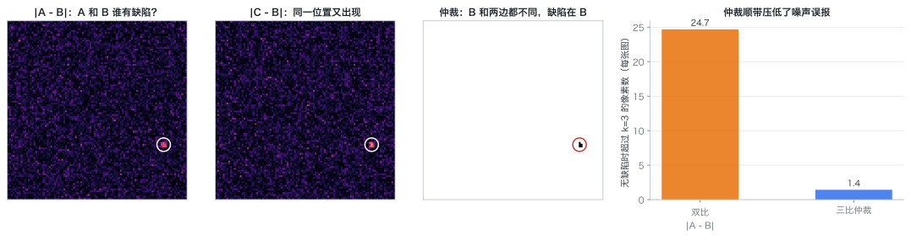
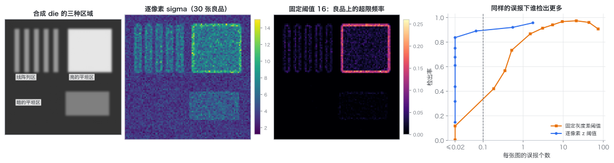
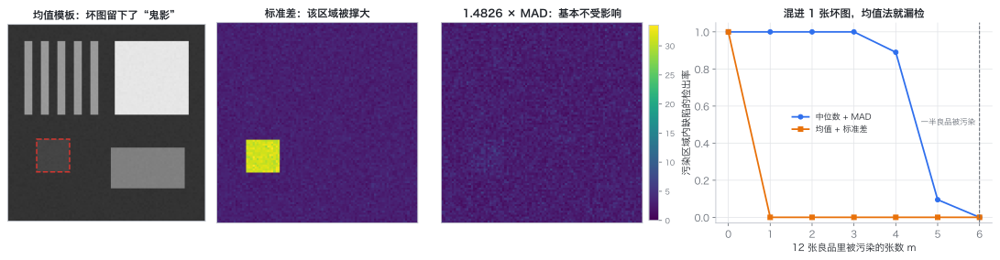
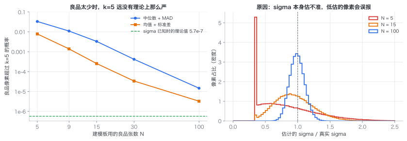
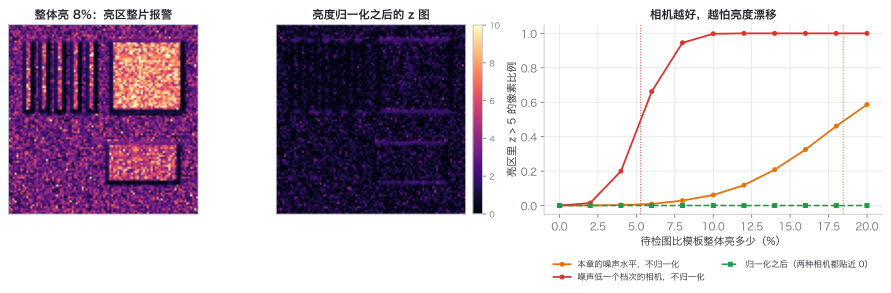
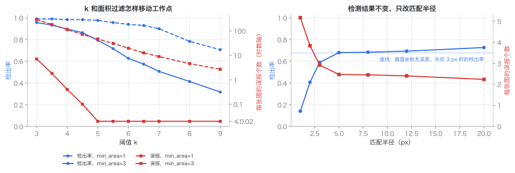

# 教程：传统缺陷检测

> [!NOTE]
> 本章所有数字都来自合成数据上的实测，记录在 [`figures/实测数字.json`](figures/实测数字.json)，由 `solutions` 分支的 `solutions/figures/ch18.py` 生成。换成真实图像，数值会变，结论的方向要自己再测一遍。

## 0. 本章怎么学

**应用场景**：金模板比对、die-to-die 比对、印刷品和面板的外观检测。只要流程是“和一张标准图比，差得多的地方报缺陷”，用的就是这一章的方法。它也是新人最先接触的检测流水线。

**优先级**：P0。前置是第 3 章（形态学和连通域）和第 16 章（对齐），本章默认图已经对齐。后面第 19 章的指标和第 24 章的综合项目直接建立在本章之上。

| 档位 | 累计用时 | 做什么 | 做到什么算完 |
|---|---:|---|---|
| 速通 | 3 小时 | 读第 1、3、6 节，看懂图 2、3、4、6，做第 7 节演示的三个问题，答完 4 道小测 | 能讲清为什么不用固定阈值，k 的含义为什么依赖良品张数，检出率数字为什么必须带匹配规则 |
| 标准 | 12 小时 | 读完全章，跑 Notebook，完成作业并验收通过，填实验记录 | 四项测试 PASS，实验记录里有一条 k 曲线、你选的工作点和一个失败案例 |
| 深挖 | 18 小时 | 再做第 10 节的破坏实验和第 11 节的扩展 | 能在一组自己准备的图上给出带条件的检出率和误报数 |

> [!TIP]
> 用时超过所选档位的 1.5 倍还没做完，就把卡点写进 `学习进度.md`，先往下一章走。速通档完成后本章就算“见过”，以后用到再升档。

## 1. 一条检测流水线长什么样

```text
采图 → 预处理 → 对齐 → 和参考图比对 → 差异阈值 → 连通域 → 缺陷特征 → 过滤和分类 → 统计与报告
```

每一步都会影响最终的检出和误报，排查问题时要逐段看中间结果，而不是只盯最后的数字。本章覆盖从“和参考图比对”到“统计与报告”这一段，前面的对齐在第 16 章。

## 2. 参考图从哪来

| 比对方式 | 参考图 | 优点 | 缺点 |
|---|---|---|---|
| die-to-die（双比） | 相邻 die | 简单，自动抵消缓慢变化的工艺和照明差异 | 参考 die 自己有缺陷时会在两边都报差异，分不清是谁的 |
| 三比（仲裁） | 左右两个相邻 die | 三张图两两比较，谁和另外两张都不同，缺陷就在谁身上 | 需要至少三个 die，耗时增加 |
| 多 die 金模板 | 很多良品 die 的统计（中位数） | 噪声低，单张坏图影响小 | 要先有足够的良品，对缓慢漂移敏感 |
| die-to-database | 设计版图渲染图 | 能抓出所有 die 都有的系统性缺陷（重复缺陷） | 渲染要模拟光学成像，难度大（第 21、22 章） |
| 阵列比对（cell-to-cell） | 同一 die 内相邻的周期单元 | 存储阵列这类重复结构的标准做法 | 只适用于周期区域 |

### 2.1 双比的两个问题：归属和噪声

下面的实验取三张相邻 die，记为 A、B、C，在 B 上放一个 3×3、幅度 35 的缺陷，重复 200 次。



| 做法 | 在缺陷位置报出（共 200 次） | 能否说出缺陷在哪张图 | 无缺陷时每张图超过 k=3 的像素数 |
|---|---:|---|---:|
| 双比，只看 A 和 B 的差 | 184 | 不能 | 24.7 |
| 三比，B 与 A、C 都不同且方向一致 | 169，全部判给 B，没有一次判给 A 或 C | 能 | 1.4 |

**归属**：A 减 B 的差值只说明两张图不一样。要知道是谁的问题，必须引入第三张图。

**噪声**：两张图各带独立噪声，方差相加，差值的噪声标准差是单张图的 $\sqrt{2} \approx 1.41$ 倍。用 $N$ 张良品的中位数做参考时，参考图自己的噪声小得多，按高斯噪声下中位数的渐近方差估算，差值噪声约为单张图的 $\sqrt{1 + \pi/(2N)}$ 倍，$N = 12$ 时约 1.06 倍。这是金模板的主要好处。

三比要求两次差值都超限，同样的 $k$ 下检出比双比少一些（169 对 184），但噪声造成的超限像素少了一个数量级，所以有余地把 $k$ 调低。

### 2.2 重复缺陷是比对方法的盲区

如果光罩上有缺陷，每个 die 同一位置都会有。把上面实验里的缺陷同时放到三张图的同一位置，双比和三比都是 **0/200** 报出。die 和 die 之间没有差异，任何互相比较的方法都看不见它，只有 die-to-database 或者光罩检测能发现。

## 3. 阈值：为什么不能用固定灰度差

最朴素的做法是 `|test - ref| > T`。问题在于不同区域的噪声水平不一样：

- 图形边缘对微小错位极其敏感，差值天然大（第 16 章图 1）。
- 亮区散粒噪声大（泊松噪声方差等于均值，见第 22 章）。
- 平坦暗区噪声小，很小的差异就很可疑。

下面的实验用一张 96×96 的合成 die，里面有线阵列、亮的平坦焊盘和暗的平坦背景。成像模型里有随亮度增大的噪声和标准差 0.15 px 的对齐残差。用 30 张良品建模板，再在 60 张待检图上各放 5 个 3×3 的缺陷。



各区域估出的 sigma 中位数：暗的平坦区 3.4，线阵列区 5.4，亮的平坦区 6.6。把固定阈值定在 16（约为全图 sigma 中位数的 4 倍），在良品上统计超限的位置：

| 统计的位置 | 占图像面积 | 每个像素的超限概率 |
|---|---:|---:|
| 图形边缘（亮度梯度大的像素） | 25% | 2.9% |
| 亮的平坦区（取焊盘内部一块） | 约 9% | 2.5% |
| 暗的平坦区（取背景里一块） | 约 17% | 0.001% |

70% 的超限事件落在只占面积 25% 的边缘像素上，亮区和暗区的超限概率差了三个数量级。固定 $T$ 调高，暗区的弱缺陷漏掉；调低，边缘和亮区误报一片。

| 允许的误报 | 固定阈值能达到的最高检出率 | 逐像素 z 阈值能达到的最高检出率 |
|---|---:|---:|
| 每张图不超过 0.1 个 | 12% | 89% |
| 每张图不超过 1 个 | 73% | 92% |

<!-- quiz -->
**固定灰度差阈值在良品图上的误报，主要出现在哪里？**

- A. 暗的平坦区，因为那里信号弱
- B. 图形边缘和亮区，因为那里的差值本来就大
- C. 全图均匀分布

<details markdown="1"><summary>答案与解释</summary>

**B**。边缘对亚像素的对齐残差敏感，亮区散粒噪声大，两者的差值波动都比暗区大得多。实测 70% 的超限落在边缘像素上，暗的平坦区几乎没有。

</details>
<!-- /quiz -->

### 3.1 按像素建噪声模型

用多张良品估计每个像素的中心值和离散程度，再算 z-score：

$$
z = \frac{\lvert \text{test} - \text{median} \rvert}{\sigma}
$$

$z > k$ 才算异常。这样 $k$ 有了统计含义。噪声是高斯分布、$\sigma$ 准确已知时，一个良品像素超过 $k$ 的概率是 $\operatorname{erfc}(k/\sqrt{2})$：

| k | 单像素误报概率 | 400 万像素的图上期望的超限像素数 |
|---:|---:|---:|
| 3 | 2.7e-3 | 10800 |
| 4 | 6.3e-5 | 253 |
| 5 | 5.7e-7 | 2.3 |
| 6 | 2.0e-9 | 0.008 |

这张表解释了为什么工业上常用 $k = 5$ 左右：图像有几百万像素，$k = 3$ 意味着每张图上万个噪声点。但它有一个前提，$\sigma$ 准确已知。第 3.3 节会看到这个前提不成立时差多少。

### 3.2 鲁棒统计：中位数和 MAD

良品里难免混进坏图或者离群像素。均值和标准差会被它们拉偏，中位数和 MAD（median absolute deviation，中位数绝对偏差）不会：

```text
median = 逐像素中位数
MAD    = median(|x - median|)
sigma  ≈ 1.4826 × MAD
```

**1.4826 从哪来**。对高斯分布，一半的样本落在 $\mu \pm \text{MAD}$ 之内，也就是 $\text{MAD} = \sigma \cdot \Phi^{-1}(0.75) = 0.6745\,\sigma$。反过来 $\sigma = \text{MAD} / 0.6745 = 1.4826 \times \text{MAD}$。乘这个系数是为了让 MAD 估出的值和标准差在同一个尺度上，$k$ 才有上一节那张表的含义。

实测：12 张良品，其中 $m$ 张在一块 16×16 的区域里整体偏亮 80。待检图在这块区域里有一个 3×3、幅度 40 的缺陷，噪声标准差 3，$k = 6$，每个 $m$ 做 200 次。



| 12 张良品里被污染的张数 | 0 | 1 | 2 | 3 | 4 | 5 | 6 |
|---|---:|---:|---:|---:|---:|---:|---:|
| 中位数 + MAD 的检出率 | 100% | 100% | 100% | 100% | 89% | 9.5% | 0% |
| 均值 + 标准差的检出率 | 100% | 0% | 0% | 0% | 0% | 0% | 0% |

区域外的对照缺陷两种方法都是 100% 检出，说明失效只发生在被污染的地方。

混进 2 张坏图时，均值法在该区域的 sigma 是 31.2（真实噪声是 3），模板偏了 13.3 个灰度。中位数法的 sigma 是 3.6，模板只偏 0.7。均值法漏检的主因是 sigma 被撑大：$40 / 31.2 \approx 1.3$，远低于 $k = 6$。

还要注意中位数法的边界。理论上中位数能容忍接近一半的样本是坏的，实测 12 张里混进 4 张（三分之一）时检出率已经开始下降，5 张时基本失效。鲁棒统计只能对付少数坏样本，良品库本身仍然要筛。

<!-- quiz -->
**12 张良品里混进 1 张坏图，均值加标准差的方法在该区域漏掉了幅度 40 的缺陷。最主要的原因是什么？**

- A. 均值被拉高，缺陷和模板的差变小了
- B. 标准差被坏图撑大，z 值被压到阈值以下
- C. 良品张数太少

<details markdown="1"><summary>答案与解释</summary>

**B**。均值确实被拉高了几个灰度，但只有这一项的话 z 仍然远超阈值。标准差从 3 变成二三十，才是把 z 压到 1 到 2 之间的原因。坏图对离散程度的破坏比对中心值的破坏更严重。

</details>
<!-- /quiz -->

### 3.3 良品不够时，k 的含义会变

第 3.1 节的表假设 $\sigma$ 准确已知。实际的 $\sigma$ 是用 $N$ 张良品估出来的，每个像素只有 $N$ 个样本，估计值本身有很大的波动。被低估的像素上，正常的噪声也会算出很大的 z。

实测：纯高斯噪声（标准差 3），没有任何缺陷，$k = 5$。每个 $N$ 重复建模板 30 次，共统计约 553 万个良品像素。



| 良品张数 N | 5 | 9 | 15 | 30 | 100 |
|---|---:|---:|---:|---:|---:|
| 中位数 + MAD 的单像素误报概率 | 3.3e-2 | 1.1e-2 | 3.3e-3 | 4.2e-4 | 1.5e-5 |
| 均值 + 标准差的单像素误报概率 | 7.8e-3 | 1.4e-3 | 2.5e-4 | 3.4e-5 | 3.3e-6 |
| sigma 已知时的理论值 | 5.7e-7 | 5.7e-7 | 5.7e-7 | 5.7e-7 | 5.7e-7 |
| MAD 估出的 sigma 与真值之比（5% 到 95% 分位） | 0.33 到 1.72 | 0.36 到 1.59 | 0.50 到 1.47 | 0.65 到 1.33 | 0.81 到 1.19 |

读这张表的三个结论：

1. **良品少时 k=5 远没有理论上那么严**。30 张良品、MAD 法，单像素误报概率是 4.2e-4，比理论值高约 700 倍。折算到 400 万像素的图上是约 1700 个超限像素，不是 2 个。
2. **鲁棒是有代价的**。同样的 $N$，MAD 法的误报概率是标准差法的 4 到 13 倍，因为 MAD 估计 sigma 的效率更低。上一节看到的抗污染能力，是用这个代价换来的。
3. **不要把 k 当成概率来报告**。$k$ 是一个需要在自己的数据上标定的旋钮。汇报时给实测的误报数，不要给“5 sigma 对应百万分之一”这种理论换算。

> [!IMPORTANT]
> 本章作业用 12 到 15 张良品，测试用 $k = 6$ 加面积过滤，在小图上是够的。到了真实尺寸的图像，要么增加良品张数，要么把相邻像素或同类区域的统计合并起来估 sigma（第 3.5 节的分区就是一种合并），要么靠面积过滤兜底（第 5 节）。

<!-- quiz -->
**用 9 张良品、中位数加 MAD 建模板，k 取 5。在没有任何缺陷的良品图上，单个像素被判为异常的概率实测大约是多少？**

- A. 约 6e-7，和高斯理论一致
- B. 约 1%
- C. 0，因为没有缺陷

<details markdown="1"><summary>答案与解释</summary>

**B**。实测 1.1e-2。每个像素只有 9 个样本，MAD 估出的 sigma 有一部分低于真值的一半，这些像素上普通的噪声就能超过 5 倍的“sigma”。理论值 6e-7 只在 sigma 准确已知时成立。

</details>
<!-- /quiz -->

### 3.4 sigma 的下限

完全稳定的像素（比如饱和区，或者量化后数值不变的暗区）MAD 可能为 0，z 会变成无穷大，任何微小差异都报警。所以要给 sigma 设下限 `min_sigma`。图 4 右栏 $N = 5$ 时左侧的尖峰，就是这个下限把过小的估计值托住的结果。下限通常取相机读出噪声的量级。

### 3.5 分区阈值

更进一步，工业设备会把 die 按图形类型分区（阵列区、逻辑区、空白区、边缘区），每个区单独设阈值和灵敏度。这一套设置叫检测配方（recipe），调配方是检测工程师的日常工作。分区还有一个统计上的好处：同一个区里的像素可以合起来估噪声，样本量从 $N$ 变成 $N$ 乘以区域像素数，上一节的问题就缓解了。

## 4. 整体亮度变化与归一化

照明强度、曝光时间、薄膜厚度的缓慢变化，会让待检图相对模板整体变亮或变暗。这时每个像素的差值是“亮度 × 变化比例”，和缺陷无关。

整片报警的门槛可以直接估出来：亮度为 $L$ 的区域整体变化比例 $g$ 时，差值是 $gL$，它超过 $k\sigma$ 的条件是

$$
g > \frac{k\,\sigma}{L} = \frac{k}{\text{信噪比}}
$$

实测：让良品图整体乘一个增益，统计亮的平坦区（灰度约 180）里 $z > 5$ 的像素比例。两种相机噪声水平各做一遍。



| 待检图比模板整体亮 | 2% | 4% | 6% | 8% | 10% | 20% |
|---|---:|---:|---:|---:|---:|---:|
| 本章的噪声水平（亮区信噪比 27） | 0.1% | 0.3% | 0.9% | 2.9% | 6.1% | 59% |
| 低噪声相机（亮区信噪比 95） | 1.5% | 20% | 66% | 95% | 99.7% | 100% |
| 归一化之后（两种相机） | 低于 0.1% | 低于 0.1% | 低于 0.1% | 低于 0.1% | 低于 0.1% | 低于 0.1% |

按公式估出的门槛分别是 18.5% 和 5.3%，和曲线上报警比例达到一半的位置一致。

这里有一个容易忽略的结论：**相机信噪比越高，越怕亮度漂移**。噪声小，sigma 小，同样比例的亮度变化换算成 z 就更大。本章合成数据的噪声偏大，亮 10% 也只有 6% 的像素报警；换成信噪比 95 的相机，亮 4% 就有两成像素报警。

**归一化的做法**：比对之前，把待检图线性拟合到模板，$\text{test} \approx a \cdot \text{median} + b$，用最小二乘求 $a$、$b$，再用 $(\text{test} - b)/a$ 去比对。实验里这样处理之后，报警比例回到没有亮度变化时的水平。

两个限制要知道。第一，大面积的真缺陷会把拟合拉偏，工程上用鲁棒拟合或者只取一部分稳定像素来拟合。第二，亮度变化在视场内不均匀时，一组 $a$、$b$ 不够，要分块做，或者先做平场校正（flat-field correction，拍一张均匀目标得到视场内的响应图，再用它把亮度不均除掉，做法和实测见第 22 章第 6.4 节）。

## 5. 连通域和缺陷特征

阈值之后得到的是像素级的候选，要合并成“缺陷”：

- **连通性**：8 连通把对角相邻也算一起，4 连通只算上下左右。8 连通更符合缺陷形状，但两个挨得很近的缺陷可能被合成一个。
- **面积过滤**：去掉单像素噪声点，`min_area` 是最常用、最有效的误报过滤器。
- **形态学**：开运算去毛刺，闭运算把断开的划痕连起来（第 3 章）。闭运算能不能连上取决于结构元的方向和断口的方向对不对得上，第 3 章实测过斜向的细划痕用方形结构元连不上。

### 5.1 面积过滤有多有效



同图 2 的合成 die，12 张良品建模板，60 张待检图各 5 个缺陷：

| k | 4 | 4.5 | 5 | 6 |
|---|---:|---:|---:|---:|
| 不过滤：检出率 | 98% | 98% | 98% | 94% |
| 不过滤：每张图误报 | 113 | 71 | 47 | 20 |
| min_area=3：检出率 | 90% | 86% | 79% | 63% |
| min_area=3：每张图误报 | 0.4 | 0.1 | 低于 0.02 | 约 0.02 |

$k = 5$ 时，面积过滤把误报从每张图 47 个压到几乎为 0。原因是噪声像素彼此独立：单个像素超限的概率是 $p$，三个相邻像素同时超限的概率在 $p^3$ 的量级。

代价也在表里：检出率从 98% 掉到 79%。弱缺陷只有一两个像素超过阈值，和噪声点一起被滤掉了。所以 $k$ 和 `min_area` 要一起调：有了面积过滤，可以把 $k$ 降到 4 或 4.5，换回一部分检出。

这个推理只对彼此独立的噪声成立。对齐残差造成的超限沿边缘连成一串（第 16 章图 1），面积过滤滤不掉，要靠提高对齐精度或者边缘区降灵敏度。

### 5.2 连通域标记的实现

作业要求不用库函数实现连通域标记。两种常见写法：

- **广度优先搜索（BFS）**：光栅扫描，遇到没标记的前景像素就开一个新编号，用队列把和它连通的像素全部标上。
- **两遍扫描加并查集**：第一遍给每个像素临时编号并记录哪些编号相通，第二遍把相通的编号合并。

不要用递归的深度优先搜索。一个大连通域可能有几十万像素，递归深度会超过语言的栈上限（第 15 章第 4 节专门讲了这个问题）。

### 5.3 缺陷特征

每个缺陷提取特征，供后续过滤和分类：

| 特征 | 用途 |
|---|---|
| 面积、外接框 | 尺寸分级，按尺寸设报警门槛 |
| 质心（可以按 z 加权） | 定位、和复查结果匹配 |
| 最大 z、平均 z | 信号强度，区分真缺陷和噪声 |
| 极性（比参考亮还是暗） | 区分颗粒（多为亮）和缺失（多为暗） |
| 长宽比、方向 | 识别划痕 |
| 所在区域类型 | 不同区域的缺陷影响不同 |

## 6. 工业指标与怎样评估

| 术语 | 含义 |
|---|---|
| 检出率（capture rate） | 真缺陷中被检出的比例 |
| 漏检（escape） | 真缺陷没被检出 |
| 误报（nuisance / false alarm） | 报出来的不是真缺陷，或者是不关心的缺陷 |
| 过检（overkill） | 良品被判为不良 |
| DOI（defect of interest） | 关心的缺陷类型，检测灵敏度围绕它调 |

**代价不对称**：漏检意味着坏芯片流到后道甚至客户，代价很高；过检意味着良品被报废或者送去人工复查，代价是成本和产能。所以产线一般先定漏检上限，在满足上限的前提下压低过检。第 19 章的 `threshold_at_escape` 就是这个思路。

### 6.1 匹配规则会改变指标

预测和真值距离多少以内算命中？一个真值能不能被多个预测命中？这些规则要提前定好。作业里的贪心一对一匹配是常用做法。

规则的影响有多大，可以量出来。图 6 右栏的实验里，检测结果完全固定，真值坐标带有标准差 1.5 px 的定位误差（人工标注或者复查设备给的坐标都有误差），只改变匹配半径：

| 匹配半径（px） | 1 | 2 | 3 | 5 | 8 | 20 |
|---|---:|---:|---:|---:|---:|---:|
| 检出率 | 14% | 41% | 59% | 68% | 68% | 73% |
| 每张图误报 | 5.2 | 3.8 | 2.9 | 2.5 | 2.5 | 2.2 |

同一份检测结果，检出率可以报成 14%，也可以报成 73%。半径太小，定位稍有偏差的命中被同时记成一次漏检和一次误报。半径太大，不相干的误报被配给了漏掉的真值，检出率虚高（真值坐标没有误差时的检出率是 68%，半径 20 px 时报出了 73%）。

合理的半径由真值的定位精度和缺陷之间的最小间距决定：大于前者的两到三倍，小于后者的一半。

<!-- quiz -->
**两个人用同一份检测输出和同一份真值，一个报检出率 41%，另一个报 68%。最先该核对什么？**

- A. 两人用的阈值 k 是否相同
- B. 两人用的匹配半径是否相同
- C. 两人用的随机种子是否相同

<details markdown="1"><summary>答案与解释</summary>

**B**。检测输出已经固定，k 和随机种子都不再起作用。上面的实验里，匹配半径 2 px 时检出率是 41%，5 px 时是 68%。

</details>
<!-- /quiz -->

### 6.2 怎么报告

- 不要只给一个准确率。给出检出率和误报数随阈值变化的曲线（图 6 左栏），标出当前工作点。
- 写清条件：良品张数、k、`min_area`、匹配半径、测试集有多少缺陷、分别是什么类型和尺寸。
- 缺陷样本少时报置信区间。例如 30 个真缺陷检出 28 个，检出率 93%，Wilson 95% 置信区间是 79% 到 98%。只报“93%”会让人以为它比 90% 好。
- 误报用“每张图”或“每片晶圆”多少个来报，不要用比例。良品像素太多，按像素算的误报率总是小得没有区分度。

## 7. 交互演示

把“阈值切在哪”抽象成两个分数分布：良品的分数和缺陷的分数。拖动阈值看过检和漏检怎样此消彼长，再改变缺陷率，看报警里真缺陷的比例怎么变。按页面里“试一试”的三个问题操作。

<!-- embed: ../demos/过检漏检权衡.html 880 -->
[打开交互演示：过检与漏检的权衡](../demos/过检漏检权衡.html)

## 8. 典型误报来源

| 误报 | 根因 | 对策 |
|---|---|---|
| 沿图形边缘的细长误报 | 对齐残差 | 提高对齐精度，边缘区降灵敏度 |
| 整片区域报警 | 照明或膜厚漂移导致整体亮度变化 | 比对前做亮度归一化（第 4 节） |
| 散落的单像素点 | 噪声，或者良品张数不够导致 sigma 被低估 | 面积过滤、提高 k、增加良品 |
| 颜色差（color variation） | 薄膜厚度变化引起干涉颜色不同，但不是缺陷 | 分区阈值、用更多参考 |
| 图像边界报警 | 对齐后边界无数据 | 去掉边界一圈 |

第 24 章的综合项目会让你亲手遇到前两种。

## 9. 常见错误

| 现象 | 原因 | 怎么查 |
|---|---|---|
| sigma 整体偏小约三分之一，误报很多 | MAD 忘了乘 1.4826 | 用标准差为 3 的纯噪声测，sigma 中位数应接近 3 |
| 某些像素 z 是 inf 或 nan | sigma 为 0，没有设下限 | 用完全相同的几张图建模板测 |
| 差值出现 250 左右的大数 | 用 `uint8` 直接相减发生回绕 | 先转成 `float64` |
| 对角相连的缺陷被拆成两个 | 用了 4 连通 | 测两个对角相邻的像素 |
| 大连通域上程序崩溃 | 用递归实现连通域，栈溢出 | 用一张全是前景的大图测 |
| bbox 比预期小一行一列 | 没按开区间约定给 `y1`、`x1` 加 1 | 测一个 3×3 的方块，bbox 的高和宽应为 3 |
| 一个真值被两个预测同时命中，tp 大于真值个数 | 匹配没做一对一 | 在同一个真值附近放两个预测测 |
| 质心坐标顺序反了 | 把 (x, y) 当成了 (行, 列) | 测一个不在对角线上的缺陷 |

## 10. 破坏实验

每个实验先写下预测，再运行，把结果和原因记到 `实验记录.md`。前三个是标准档必做。

1. 把良品张数从 12 减到 5，k 保持 6 不变。良品图上的误报数怎么变？对照图 4 解释。
2. 让待检图整体亮 10%，不做归一化。误报出现在哪些区域？按第 4 节的公式，你的数据里整片报警的门槛是百分之几？
3. 把 `min_area` 设为 1 和 9，各丢掉了什么？
4. 把 3 张良品换成同一位置带大缺陷的图，比较中位数加 MAD 和均值加标准差（Notebook 实验 2）。再换成 5 张试试。
5. 图 2 最右一栏里，固定阈值从 12 降到 8，检出率反而从 97% 降到 91%。先猜原因，再画出阈值为 8 时的候选掩膜验证。
6. 把匹配半径从 3 改成 1 和 10，同一份检测结果的检出率各是多少？

## 11. 扩展（深挖档）

- 实现三比仲裁：输入三张图，输出只属于中间那张的缺陷。复现第 2.1 节的表。
- 实现分区阈值：给 die 画一张区域图，每个区用区内所有像素合起来估 sigma，比较和逐像素估计在良品少时的误报。
- 实现亮度归一化，并构造一个“大面积真缺陷把拟合拉偏”的例子，再用只取中间 80% 像素的办法修好它。
- 下载 `data/README.md` 里列的 DAGM 2007 数据集，选一类纹理规则的样本，用本章的流水线跑一遍，按第 6.2 节的格式写报告。

## 12. 和后续章节的关系

- 第 16 章的对齐精度决定了本章边缘区的 sigma 有多大。
- 第 19 章的异常检测把“和模板逐像素比”换成“和良品特征比”，指标和工作点的思路完全相同。
- 第 22 章解释亮区噪声为什么大（散粒噪声）。
- 第 24 章把对齐、亮度归一化、金模板、阈值和连通域串成一条流水线。

## 自测问题

1. 双比法报出一个差异，怎样判断缺陷在待检 die 还是参考 die 上？
2. 光罩缺陷为什么 die-to-die 检测不出来？
3. 为什么 MAD 要乘 1.4826？
4. k 从 4 提到 6，检出率和误报率大致怎么变？
5. 同一批数据，两个人报出的检出率差很多，最先该核对什么？
6. 只有 10 张良品时，“k=5 对应百万分之一的误报”这句话错在哪？有哪些补救办法？
7. 换了一台噪声更低的相机之后，整片报警反而变多了，可能是什么原因？
