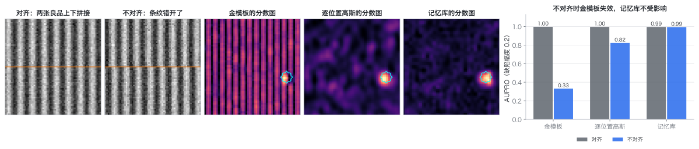
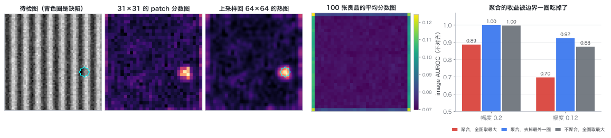
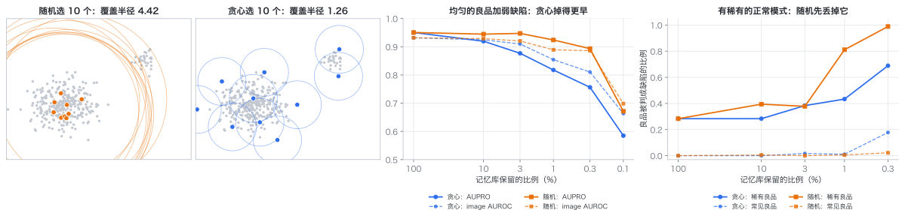
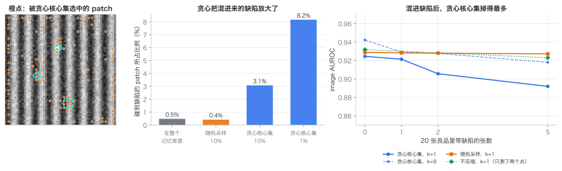
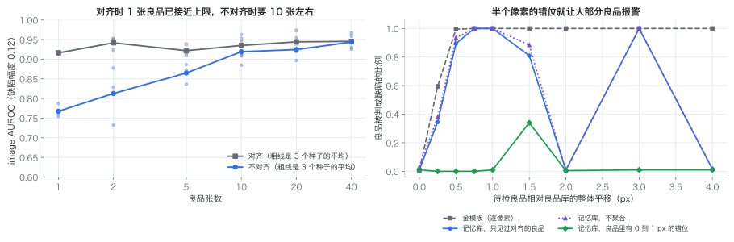
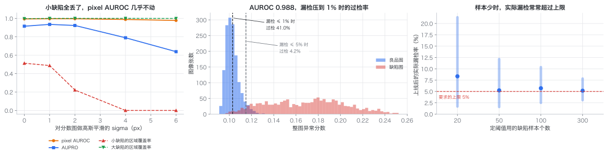

# 教程：异常检测与深度缺陷检测

> [!NOTE]
> 本章所有数字都来自合成条纹纹理上的实测，记录在 [`figures/实测数字.json`](figures/实测数字.json)，由 `solutions` 分支的 `solutions/figures/ch19.py` 生成。特征沿用本章 Notebook 的做法（4×4 像素块加邻域平均，不依赖预训练权重），最后一组对照用 torchvision 的 ResNet-18。脚本在一台 Mac 的 CPU 上几分钟就能跑完，重复运行结果相同。换成真实图像，数值会变，结论的方向要自己再测一遍。讲到 MVTec AD 等公开数据集时，本章不引用任何论文报告的分数。

## 0. 本章怎么学

**应用场景**：只有良品样本时发现未知缺陷，以及有标注时的检测、分割、分类。新产品刚上线、缺陷样本攒不够，或者缺陷种类多到标不过来时，先用良品建一个“正常长什么样”的模型，把不像的地方报出来。它和第 18 章的金模板比对是同一个思路，只是把“和模板逐像素比”换成了“和良品的局部特征比”。

**优先级**：P1，主线能力。前置是第 10 章（预训练特征）和第 18 章（金模板、检出率与误报、工作点）。本章默认你会用第 18 章的方式读检出率和误报。

| 档位 | 累计用时 | 做什么 | 做到什么算完 |
|---|---:|---|---|
| 速通 | 3 小时 | 读第 1、3、4.1、5 节，看懂图 1、3、5、6，把第 6 节演示的五步试一遍，答完 5 道小测 | 能讲清 PatchCore 的五个环节，为什么记忆库方法比金模板更不怕错位却仍然怕半个像素，为什么 AUROC 0.99 不等于能上线 |
| 标准 | 15 小时 | 读完全章，跑 Notebook，完成作业并验收通过，做第 11 节前三个破坏实验，填实验记录 | 五项测试 PASS，实验记录里有漏检不超过 5% 时的过检率、核心集比例的一条曲线和一个失败案例 |
| 深挖 | 22 小时 | 再做其余破坏实验和第 12 节的扩展，在 MVTec AD 或 VisA 的一个类别上用 Anomalib 跑 PatchCore 和 PaDiM | 能在一个公开类别上给出带条件的 image AUROC、AUPRO 和漏检约束下的过检率，并说明阈值在哪个集合上定的 |

> [!TIP]
> 用时超过所选档位的 1.5 倍还没做完，就把卡点写进 `学习进度.md`，先往下一章走。深挖档要下载数据集和装 Anomalib，环境问题最容易卡住，卡超过一小时就先回到合成数据把结论做完。

## 1. 为什么需要：金模板在不对齐的纹理上失效

第 18 章的金模板假设每张良品在同一位置长得一样。纹理、颗粒、拉丝、编织网这类表面不满足这一点：每张图的纹理相位都不同，逐像素的中位数和 MAD 学到的是一片平均的灰，任何一张新图都和它差很多。

下面的实验用 64×64 的条纹纹理（周期 8 px，幅度 0.3，噪声标准差 0.06），缺陷是半径 2 到 3 px 的圆斑。20 张良品建模，200 张待检图里一半有缺陷，3 个种子取平均。“对齐”指良品之间条纹相位只差 0 到 0.3 rad（不到 0.4 px），“不对齐”指相位完全随机。三种方法都不统计图像最外 4 个像素。



| 方法（20 张良品，200 张待检图，3 个种子） | 对齐，幅度 0.2 | 不对齐，幅度 0.2 | 对齐，幅度 0.12 | 不对齐，幅度 0.12 |
|---|---:|---:|---:|---:|
| 金模板（逐像素中位数加 MAD） | 1.000 / 0.997 | 0.743 / 0.330 | 0.948 / 0.950 | 0.616 / 0.229 |
| 逐位置高斯（PaDiM 的思路） | 0.999 / 0.996 | 0.934 / 0.822 | 0.950 / 0.972 | 0.789 / 0.543 |
| 记忆库最近邻（PatchCore 的思路） | 0.999 / 0.995 | 1.000 / 0.993 | 0.944 / 0.941 | 0.924 / 0.919 |

每格两个数是 image AUROC 和 AUPRO（第 5 节解释）。读这张表的三点：

1. **对齐时三种方法差不多**，金模板甚至略好。对齐好、良品稳定的场景，第 18 章的方法就够，不必上深度特征。
2. **不对齐时金模板的 AUPRO 从 0.997 掉到 0.330**。逐位置高斯好一些，因为它用的是局部特征而不是单个像素，但它仍然假设“同一位置的特征来自同一个分布”，不对齐时这个假设不成立。
3. **记忆库方法不关心位置**。它只问“这个局部长得像不像任何一张良品的任何一个位置”，所以条纹相位随机也没关系。这是它适合纹理表面的根本原因。

## 2. 异常检测方法谱系

### 2.1 监督还是无监督

| | 监督（检测、分割、分类） | 无监督异常检测 |
|---|---|---|
| 训练数据 | 良品和缺陷都要有，缺陷要标注 | 只要良品 |
| 能发现新类型缺陷 | 不能，只认识见过的类型 | 能，只要和良品不同 |
| 能告诉你缺陷是什么类型 | 能 | 不能，只给异常分数和热图 |
| 典型问题 | 缺陷样本太少、长尾、标注贵 | 良品本身变化大时误报多 |

工业里常见的组合：**异常检测负责“发现”，监督分类负责“分类”**。传统比对（第 18 章）或异常检测先找出候选，再用分类网络判断是真缺陷还是误报、属于哪一类。

### 2.2 六类方法各自在做什么

| 类别 | 代表方法 | 思路 | 训练时要不要反向传播 |
|---|---|---|---|
| 重建类 | 自编码器、DRAEM | 只学会重建良品，缺陷处重建误差大 | 要 |
| 特征分布类 | PaDiM | 预训练特征在每个位置拟合高斯分布，用马氏距离打分 | 不要，只算均值和协方差 |
| 记忆库类 | PatchCore | 存下良品的局部特征，测试时找最近邻，距离就是异常分数 | 不要，只提特征和选核心集 |
| 师生类 | STFPM、EfficientAD | 学生网络只学会在良品上模仿老师，缺陷处两者输出不一致 | 要（训练学生） |
| 流模型 | FastFlow、CFLOW | 把特征映射成高斯分布，用似然打分 | 要（训练流） |
| 视觉语言 | WinCLIP 等 | 用文本描述“正常”和“异常”，零样本或少样本 | 零样本时不要 |

把它们放在一条线上看会更清楚：**都是在估计“良品的局部长什么样”，区别在于用什么来描述这个分布**。

- **PaDiM** 用参数化的描述：每个位置一个均值和一个协方差矩阵。优点是推理快、内存固定；代价是假设了位置对应（第 1 节表里不对齐时掉分）和单峰分布（同一位置有两种正常外观时会变宽）。
- **PatchCore** 用非参数化的描述：直接存样本，不假设形状，也不按位置分开。代价是内存和推理时间随记忆库变大，所以要核心集。
- **师生类和流模型** 用一个训练出来的网络来描述分布，推理时不用查记忆库，速度可以很快，代价是要训练，训练集里的问题（混进坏图、良品不全）会被学进网络里，比记忆库更难排查。
- **重建类** 不直接描述特征分布，而是学一个“只能画出良品”的生成器。

基于预训练特征的方法（PaDiM、PatchCore）不用训练骨干网络，在 MVTec AD 上效果好，是入门首选。本章不引用它们在公开数据集上的具体分数，深挖档请自己跑。

### 2.3 重建类的容量问题

原讲义说“重建类的问题是网络泛化太好，连缺陷也一起重建出来了”。这句话方向对，但要补一个前提：**这取决于瓶颈有多宽**，瓶颈太窄同样不行。

用主成分分析当一个线性自编码器就能看得很清楚：8×8 像素块共 64 维，只保留前 $k$ 个主成分再重建，残差的范数当异常分数。同一组不对齐的条纹（缺陷幅度 0.12，20 张良品，200 张待检图，3 个种子）：

| 保留的主成分个数 k | 1 | 2 | 4 | 8 | 16 | 32 | 48 | 60 |
|---|---:|---:|---:|---:|---:|---:|---:|---:|
| image AUROC | 0.582 | 0.946 | 0.947 | 0.938 | 0.933 | 0.877 | 0.788 | 0.696 |
| 良品图最大残差的中位数 | 1.817 | 0.598 | 0.589 | 0.576 | 0.544 | 0.470 | 0.375 | 0.259 |
| 缺陷图最大残差的中位数 | 1.838 | 0.716 | 0.712 | 0.693 | 0.642 | 0.538 | 0.415 | 0.285 |

条纹只有正弦和余弦两个自由度，$k = 1$ 连良品都重建不好，良品和缺陷的残差一样大；$k = 2$ 刚好够，AUROC 跳到 0.946；再往上加，缺陷图和良品图最大残差的差距从 0.118（k=2）缩小到 0.026（k=60），因为多出来的维度开始把缺陷也画出来了。真实的深度自编码器没有这么干净的“刚好够”的点，这也是它比基于预训练特征的方法难调的原因。

## 3. PatchCore 的五个环节

```text
良品图 → 预训练 CNN（ImageNet 权重，冻结）
       → 取中间层特征（例如 ResNet 的 layer2 和 layer3）
       → 每个位置在 3x3 邻域内平均池化（局部聚合，增加感受野和抗错位能力）
       → 把 layer3 上采样到 layer2 尺寸后拼接，得到每个 patch 的特征向量
       → 所有良品所有位置的特征放进记忆库
       → 核心集采样，把记忆库压到 1%～10%
测试图 → 同样提取 patch 特征
       → 每个 patch 到记忆库的最近邻距离 = 该位置的异常分数
       → 分数图上采样回原图尺寸并高斯平滑 = 异常热图
       → 热图最大值（或带重加权）= 整图异常分数
```

PatchCore 训练阶段没有反向传播：骨干网络冻结，所谓“训练”只是对良品跑一遍前向、把特征存下来、再选一个核心集。

本章的实验沿用 Notebook 的简化：把“预训练 CNN 的中间层”换成“4×4 像素块（步长 2）展平成 16 维”，其余环节不变。这样不用下载权重，几秒就能跑完一组，而且每个环节的效果都看得清楚。第 3.6 节再换成真正的 ResNet-18 特征做对照。

### 3.1 特征提取：为什么用中间层

**浅层太关注边缘和颜色，深层太偏向 ImageNet 的类别语义，中间层兼顾局部结构和泛化。** 另一个更实际的原因是分辨率：ResNet 每过一个 stage 分辨率减半，layer3 的一个位置对应输入的 16×16 像素，小缺陷在这一层已经被平均掉了。

在本章的 64×64 条纹上（放大 2 倍到 128×128 送进 ResNet-18，不对齐，缺陷幅度 0.2、半径 2 到 3 px，核心集 10%，2 个种子）：

| 用哪一层 | 特征图尺寸 | 维度 | image AUROC | AUPRO |
|---|---:|---:|---:|---:|
| layer1 | 32×32 | 64 | 0.903 | 0.985 |
| layer2 | 16×16 | 128 | 0.885 | 0.899 |
| layer3 | 8×8 | 256 | 0.781 | 0.646 |
| layer2 + layer3 | 16×16 | 384 | 0.922 | 0.918 |

layer3 单独用时 AUPRO 只有 0.646，它的 8×8 特征图对这么小的缺陷太粗了；把 layer2 和 layer3 拼起来，image AUROC 是四种里最高的。这组数字只说明这一组合成数据，真实图像上哪一层最好要自己测。

### 3.2 局部聚合：抗错位，也带来边界问题

局部聚合是把每个位置的特征换成它 3×3 邻域的平均。原讲义说它“增加感受野和抗错位能力”。两点都对，但实测发现了一个原讲义没提的副作用。

图像边界上的 patch 没有完整的 3×3 邻域，Notebook 用复制边缘的方式补齐。补出来的那几个邻居就是它自己，平均时等于自己的权重变大了，噪声被压得没有内部那么低。按 9 个权重的平方和算，内部 patch 平均后的噪声方差是单个 patch 的 0.111 倍，边上是 0.185 倍，角上是 0.309 倍。

后果：良品图上分数最高的位置几乎全在最外一圈。



| 不对齐，3 个种子，核心集 10% | 聚合，全图取最大 | 聚合，去掉最外一圈 | 不聚合，全图取最大 |
|---|---:|---:|---:|
| 缺陷幅度 0.2：image AUROC | 0.887 | 1.000 | 0.998 |
| 缺陷幅度 0.12：image AUROC | 0.697 | 0.924 | 0.875 |
| 良品图最高分落在最外一圈的比例 | 100% | | 11% |

最外一圈只占 patch 总数的 12.5%，聚合后却包揽了 100% 的良品最高分；不聚合时这个比例是 11%，和面积占比相当。聚合后良品 patch 分数的中位数，内部 0.072，边上 0.088，角上 0.117。

所以：

- **只看全图最大值时，聚合反而变差**（幅度 0.12 时 0.697 对 0.875）。
- **去掉最外一圈之后，聚合的好处才显出来**（0.924 对 0.875）。缺陷幅度小、只靠单个 patch 的信噪比不够时，聚合把邻域的证据合在一起，这正是它该起的作用。
- 原 Notebook 的设置（对齐、缺陷幅度 0.2）比较容易，聚合后全图取最大的 image AUROC 仍有 0.990，问题被掩盖了。

本章后面的实验，整图分数一律去掉 patch 分数图的最外一圈。真实系统里对应的做法是：边界用更合理的方式处理（只在有效区域内平均，或者对边界位置单独建记忆库），或者在打分时忽略视场最外的一圈。

> [!WARNING]
> “良品的最高分总在图像边上”是一个很有用的诊断信号。把良品分数图平均一下，如果边上一圈明显亮，先查边界填充，不要急着调核心集和阈值。

<!-- quiz -->
**对同一组不对齐的条纹，把局部聚合去掉，整图分数按全图最大值算，image AUROC 从 0.697 升到 0.875。最可能的原因是什么？**

- A. 局部聚合本身是错的，不该用
- B. 边界上的 patch 聚合时用复制填充，噪声压得不够，良品的最高分全落在最外一圈，盖过了缺陷
- C. 不聚合时特征维度更高，区分能力更强

<details markdown="1"><summary>答案与解释</summary>

**B**。聚合后良品图的最高分 100% 落在最外一圈，而这一圈只占 patch 的 12.5%。去掉这一圈之后，聚合的 image AUROC 是 0.924，比不聚合的 0.875 还高，说明聚合本身是有用的。C 不对，两种做法都是 16 维。

</details>
<!-- /quiz -->

### 3.3 核心集采样

记忆库可能有几十万个向量，最近邻搜索又慢又占内存。核心集采样从中选出一小部分，测试时只和这部分比。

**k-center greedy** 每次挑离已选集合最远的点，目标是让所有点到核心集的最大距离（覆盖半径）尽量小：

$$
\min_{\mathcal{C} \subseteq \mathcal{M},\ |\mathcal{C}| = m}\ \max_{x \in \mathcal{M}}\ \min_{c \in \mathcal{C}} \lVert x - c \rVert
$$

精确求解是 NP 难的，贪心解的覆盖半径不超过最优解的 2 倍。实现时维护每个点到已选集合的最小距离，每加一个点只用它更新一次，复杂度 $O(N \cdot m \cdot D)$。原论文还先做随机投影降维，加速距离计算。

覆盖半径小有什么用？对任何一个良品 patch $x$，设它在全量记忆库里的最近邻距离是 $d(x)$，在核心集里的是 $d_{\mathcal{C}}(x)$，由三角不等式

$$
d(x) \le d_{\mathcal{C}}(x) \le d(x) + r_{\mathcal{C}}
$$

其中 $r_{\mathcal{C}}$ 是覆盖半径。所以核心集最多把良品的分数抬高 $r_{\mathcal{C}}$。这是一个只对良品成立的上界，它不保证缺陷的分数也被同样抬高。



二维示意里，随机抽 10 个点一个都没抽到小团的概率实测是 0.387（理论值 0.380），贪心则一定会去覆盖离得远的小团。

**均匀的良品时，贪心并不比随机好。** 这是本章最反直觉的实测结果。不对齐、缺陷幅度 0.12 的主设置，20 张良品（记忆库 19220 个 patch），3 个种子：

| 保留比例 | 100% | 10% | 3% | 1% | 0.3% | 0.1% |
|---|---:|---:|---:|---:|---:|---:|
| 核心集大小 | 19220 | 1922 | 577 | 192 | 58 | 19 |
| 贪心：image AUROC | 0.932 | 0.924 | 0.910 | 0.854 | 0.810 | 0.663 |
| 随机：image AUROC | 0.932 | 0.929 | 0.920 | 0.889 | 0.886 | 0.698 |
| 贪心：覆盖半径 | 0 | 0.088 | 0.118 | 0.156 | 0.209 | 0.305 |
| 随机：覆盖半径 | 0 | 0.214 | 0.320 | 0.410 | 0.455 | 0.511 |
| 贪心：良品图整图分数中位数 | 0.083 | 0.101 | 0.122 | 0.150 | 0.193 | 0.262 |
| 随机：良品图整图分数中位数 | 0.083 | 0.101 | 0.114 | 0.131 | 0.155 | 0.232 |

贪心的覆盖半径只有随机的 0.4 到 0.6 倍，但 image AUROC 每一档都更低，1% 时差了 0.035。原因在最后两行：贪心偏爱选“离别人远”的点，在噪声主导的均匀纹理里，这些点是噪声最大的 patch，它们离典型的良品 patch 反而远，结果典型良品的分数被抬得更高。覆盖半径管的是最坏的那个良品 patch，image AUROC 看的是整体分布，两者不是一回事。

**有稀有的正常模式时，贪心才显出优势。** 20 张良品里 18 张是竖条纹、2 张是横条纹（横条纹占记忆库的 10%）。阈值在竖条纹上按“漏检不超过 5%”选定，再看同一阈值下横条纹的良品有多少被判成缺陷（3 个种子）：

| 保留比例 | 100% | 10% | 3% | 1% | 0.3% |
|---|---:|---:|---:|---:|---:|
| 贪心：稀有良品被判成缺陷的比例 | 28.3% | 28.3% | 38.3% | 43.3% | 68.9% |
| 随机：稀有良品被判成缺陷的比例 | 28.3% | 39.4% | 37.8% | 81.1% | 98.9% |
| 贪心：核心集里横条纹的占比 | 10% | 15.1% | 18.0% | 22.0% | 24.1% |
| 随机：核心集里横条纹的占比 | 10% | 9.1% | 10.5% | 10.6% | 11.5% |

贪心会主动把稀有模式多留一些（压到 0.3% 时占 24.1%），随机只按原比例留。压到 1% 时，随机采样让 81.1% 的横条纹良品报警，贪心是 43.3%。代价也在表里：0.3% 时贪心让常见良品的过检率升到 17.8%，随机只有 2.2%。

> [!IMPORTANT]
> 原讲义说“压缩到 1% 时性能几乎不掉”。在本章 Notebook 那种对齐、缺陷明显的设置下确实如此（image AUROC 100% 时 0.999，1% 时 1.000）。但在不对齐、缺陷弱的设置下，贪心核心集压到 1% 时 image AUROC 从 0.932 掉到 0.854。比例该取多少要在自己的数据上扫一遍，不能直接套用。

<!-- quiz -->
**在一组纹理均匀、没有稀有正常模式的良品上，把记忆库压到 1%，贪心核心集的覆盖半径是随机采样的约 0.4 倍。哪种的 image AUROC 更高？**

- A. 贪心，因为覆盖半径小，良品分数抬得少
- B. 随机，因为贪心偏爱选噪声最大的离群 patch，典型良品的分数反而被抬得更高
- C. 两者一样，核心集比例相同

<details markdown="1"><summary>答案与解释</summary>

**B**。实测贪心 0.854，随机 0.889。覆盖半径是最坏情况的上界，管的是离群的那几个良品 patch；贪心为了压低它，选进了很多噪声大的点，良品整图分数的中位数从 0.083 升到 0.150，随机只升到 0.131。贪心的优势要在有稀有正常模式时才显出来（压到 1% 时稀有良品的误判 43.3% 对 81.1%）。

</details>
<!-- /quiz -->

**核心集该按比例定还是按个数定？** 原讲义和论文都用比例。但核心集要覆盖的是“良品的局部外观有多少种”，这和良品张数不成正比。在主设置上固定核心集大小、改变良品张数（3 个种子）：

| 核心集大小 | 96 | 384 | 1922 |
|---|---:|---:|---:|
| 10 张良品：image AUROC（占比） | 0.852（1.0%） | 0.916（4.0%） | 0.922（20.0%） |
| 20 张良品 | 0.826（0.5%） | 0.900（2.0%） | 0.924（10.0%） |
| 40 张良品 | 0.830（0.2%） | 0.875（1.0%） | 0.935（5.0%） |

同样 96 个点，三种良品张数下的 image AUROC 在 0.83 到 0.85 之间；同样 1% 的比例，10 张良品时是 96 个点（0.852），40 张时是 384 个点（0.875）。在这组数据里，绝对个数比比例更能预测效果。

### 3.4 最近邻打分

每个待检 patch 到记忆库的最近邻距离就是它的异常分数，整图分数取分数图的最大值。$k = 1$ 是原始 PatchCore 的做法。原论文在取最大值时还会按这个最近邻在记忆库里是否“孤立”做一次重加权，本章作业和实验都不做这一步。

距离计算全部建立在平方距离矩阵上：

$$
\lVert a_i - b_j \rVert^2 = \lVert a_i \rVert^2 + \lVert b_j \rVert^2 - 2\,a_i \cdot b_j
$$

把它写成矩阵乘法，速度比逐对相减快一到两个数量级。代价是浮点误差：一个点到它自己的平方距离应该是 0，展开式算出来可能是很小的负数。500 个 16 维的随机点，float64 下有 141 个点到自己的平方距离小于 0（最小 -1.4e-14），开平方就是 nan。所以要裁剪到 0。

**k 取多大？** $k > 1$ 时分数是 $k$ 个最近邻距离的平均，对单个离群的记忆库点不敏感。干净的良品库上，$k$ 从 1 加到 9，主设置的 image AUROC 变化不到 0.02（下一节的表）。它真正起作用的场景是良品库里混进了坏图。

### 3.5 良品里混进带缺陷的图

产线上收集的“良品”不可能百分之百干净。在主设置上，20 张良品里有 $c$ 张各带 3 个和待检缺陷同类的缺陷（3 个种子，核心集 10%）：

| 20 张里带缺陷的张数 | 0 | 1 | 2 | 5 |
|---|---:|---:|---:|---:|
| 贪心核心集，k=1 | 0.924 | 0.921 | 0.906 | 0.892 |
| 贪心核心集，k=3 | 0.943 | 0.928 | 0.918 | 0.907 |
| 贪心核心集，k=9 | 0.942 | 0.929 | 0.928 | 0.918 |
| 随机采样，k=1 | 0.929 | 0.928 | 0.928 | 0.927 |
| 不压缩，k=1 | 0.932 | | | 0.923 |



贪心核心集掉得最多，原因和上一节一样：缺陷 patch 正是“离别人远”的点。混进 2 张时，碰到缺陷的 patch 只占记忆库的 0.5%，贪心核心集（10%）把其中 64% 选了进去，于是它们在核心集里占 3.1%；压到 1% 时占到 8.2%。随机采样不偏不倚，只占 0.4%，所以几乎不受影响。

一旦缺陷 patch 进了记忆库，待检图上同类的缺陷就能在记忆库里找到很近的邻居，分数被压低。$k$ 取大一点能缓解：混进 5 张时，$k = 9$ 比 $k = 1$ 高 0.026。但 $k$ 再大也只是缓解，根本办法是把良品库筛干净：先用一个初版模型给良品库自己打分，把分数最高的几张拿出来人工看一遍。

<!-- quiz -->
**良品库里混进了几张带缺陷的图。用 k-center greedy 压到 1%，会发生什么？**

- A. 缺陷 patch 只占记忆库的零点几，压缩后基本被丢掉，影响变小
- B. 贪心偏爱选离群的点，缺陷 patch 被优先选进核心集，在核心集里的占比反而变大
- C. 没有影响，核心集只影响速度

<details markdown="1"><summary>答案与解释</summary>

**B**。混进 2 张时，碰到缺陷的 patch 在整个记忆库里占 0.5%，在贪心核心集（1%）里占 8.2%，放大了十几倍。这和随机采样正好相反（0.4%）。A 是对随机采样的直觉，套到贪心上是错的。

</details>
<!-- /quiz -->

### 3.6 分数图上采样

patch 分数图比原图小（本章是 31×31 对 64×64，ResNet 的 layer2 是 1/8），要插值回原图尺寸才能和像素级标注比。两个容易错的细节：

1. **按 patch 中心对齐**。第 $i$ 个 patch 覆盖像素 $2i$ 到 $2i+3$，中心在 $2i + 1.5$，不是 $2i$。插值时坐标偏了，热图整体偏 1.5 px，小缺陷的像素级指标会明显变差。
2. **高斯平滑**。原论文对热图做高斯平滑，具体参数以论文和 Anomalib 的实现为准，而且是在比本章大得多的输入上定的。平滑把小缺陷的峰压平，用热图最大值当整图分数时 image AUROC 也会掉。

主设置（不对齐，缺陷幅度 0.12，3 个种子）：

| 处理方式 | 用热图最大值的 image AUROC | pixel AUROC | AUPRO |
|---|---:|---:|---:|
| 按 patch 中心对齐，不平滑 | 0.927 | 0.977 | 0.919 |
| 没按中心对齐（偏 1.5 px），不平滑 | 0.897 | 0.934 | 0.811 |
| 对齐，高斯平滑 σ=1 | 0.920 | 0.983 | 0.939 |
| 对齐，高斯平滑 σ=2 | 0.854 | 0.983 | 0.933 |
| 对齐，高斯平滑 σ=4 | 0.661 | 0.956 | 0.810 |

坐标偏 1.5 px 让 AUPRO 从 0.919 掉到 0.811。σ=1 的轻度平滑对像素级指标有一点好处，σ=4 对 64×64 的图和半径两三个像素的缺陷太大了，image AUROC 掉到 0.661。整图分数直接用 patch 分数图的最大值（0.924）比用平滑后的热图更稳；热图只用来看缺陷在哪。

### 3.7 预训练特征对照

本章的 16 维像素块在合成条纹上表现很好，这不代表它比预训练特征好，而是因为合成条纹很简单、缺陷又很小。换成 ResNet-18 的 layer2 加 layer3（放大 2 倍到 128×128 输入，不对齐，缺陷幅度 0.2，2 个种子）：

| 缺陷大小 | 16 维像素块 | ResNet-18 layer2 + layer3 |
|---|---:|---:|
| 半径 2 到 3 px | 1.000 | 0.922 |
| 半径 5 px | 1.000 | 0.999 |

缺陷只有两三个像素时，layer2 的一个位置对应 128×128 输入的 8×8 像素，缺陷被稀释了；缺陷半径到 5 px，两者就差不多了。真实工业图像的纹理远比正弦条纹复杂，像素块根本不够用，这时预训练特征的价值才体现出来。本章不对它在真实数据上的效果下任何数字结论，深挖档请在 MVTec AD 或 VisA 上自己测。

## 4. 落地时的真问题

### 4.1 对齐：记忆库也怕半个像素

原讲义说“PatchCore 的局部池化提供了一点平移容忍度，但不够”。实测下来，在这组数据上，这一点容忍度几乎看不出来。

记忆库只见过对齐的 20 张良品（核心集 10%），阈值取 200 张对齐良品分数的 99% 分位，再让待检良品整体平移（每个平移量 100 张，2 个种子）：



| 待检良品的整体平移 | 0 | 0.25 px | 0.5 px | 1 px | 2 px |
|---|---:|---:|---:|---:|---:|
| 金模板 | 0.5% | 59.5% | 99.5% | 100% | 100% |
| 记忆库（聚合），只见过对齐的良品 | 1.0% | 34.5% | 89.5% | 100% | 1.0% |
| 记忆库（不聚合），只见过对齐的良品 | 3.0% | 38% | 93.5% | 100% | 0.5% |
| 记忆库，良品里带 0 到 1 px 的错位 | 1.0% | 0% | 0% | 1.0% | 0.5% |
| ResNet-18 layer2+3，3×3 池化 | 0.5% | 11% | 67% | 100% | 100% |
| ResNet-18 layer2+3，不池化 | 1.5% | 1.5% | 17.5% | 100% | 100% |

几点结论：

1. **记忆库方法也怕错位**。平移 0.5 px，89.5% 的良品报警，比金模板（99.5%）好不了多少。
2. **3×3 池化在这组数据上没有提供可见的平移容忍度**。像素块聚合与否差别不大；ResNet 特征上，池化后反而更敏感（0.5 px 时 67% 对 17.5%）。原讲义“池化提供平移容忍度”这一说法，在本章的实验条件下没有得到支持。平均池化把相邻位置平均，对整体平移并不是不变的。
3. **平移 2 px 时像素块记忆库又不报警了**，因为条纹周期 8 px，像素块步长 2 px，平移 2 px 后每个 patch 都和记忆库里相邻位置的 patch 长得一样（只差噪声）。这正是“记忆库不关心位置”的体现，也提醒你：重复图案上的“容忍度”可能只是巧合。
4. **真正有效的是把错位放进良品库**。良品里带 0 到 1 px 的随机错位，平移 0 到 1 px 的良品几乎都不报警，对齐缺陷图的检出率仍是 98.5%。只在 1.5 px 时过检 34%，因为良品库里没有这么大的错位。

原讲义“先对齐再检测能明显降低误报”这句话在这里得到了量化。工程上的含义：先对齐（第 16 章），把残差压到零点几个像素；再让良品库覆盖对齐残差的范围（多次采图，或者人为加亚像素平移做增强）。

### 4.2 良品要多少张

良品张数决定了记忆库见过多少种“正常”。主设置（缺陷幅度 0.12，核心集 10%，3 个种子）：

| 良品张数 | 1 | 2 | 5 | 10 | 20 | 40 |
|---|---:|---:|---:|---:|---:|---:|
| 对齐：image AUROC | 0.916 | 0.942 | 0.922 | 0.935 | 0.944 | 0.946 |
| 不对齐：image AUROC | 0.768 | 0.813 | 0.865 | 0.919 | 0.924 | 0.944 |
| 不对齐：AUPRO | 0.446 | 0.667 | 0.833 | 0.917 | 0.919 | 0.935 |

对齐时 1 张良品就已经到了 0.916，和 40 张的 0.946 相差不多，因为每张良品长得几乎一样，多看几张没有新信息。不对齐时 1 张只有 0.768，要 10 张左右才接近 0.92。原因是一张图里条纹的相位是固定的，只见过一种相位的 patch（加上 2 px 步长带来的 4 种），新图的相位落在没见过的地方就被当成异常。

种子之间的波动也不小：不对齐、2 张良品时，3 个种子分别是 0.878、0.829、0.732。良品少的时候，换一批良品结果可能差 0.15。

<!-- quiz -->
**同一个记忆库方法，良品从 1 张加到 40 张，对齐的数据 image AUROC 从 0.916 到 0.946，不对齐的数据从 0.768 到 0.944。为什么不对齐的数据更依赖良品张数？**

- A. 不对齐的数据噪声更大
- B. 记忆库要见过足够多种局部外观（这里是条纹的各种相位），不对齐时一张良品只覆盖了一部分
- C. 核心集比例不够

<details markdown="1"><summary>答案与解释</summary>

**B**。两组数据的噪声完全相同，核心集都是 10%。对齐时每张良品的条纹相位几乎一样，1 张就覆盖了所有局部外观；不对齐时每张图的相位随机，要很多张才能把各种相位都收进记忆库。真实产线上，“不同批次、不同机台、不同照明”就是这里的“不同相位”。

</details>
<!-- /quiz -->

### 4.3 其余要注意的事

1. **分辨率**：缺陷可能只有几个像素，网络下采样 8 倍后就看不见了（第 3.7 节的表）。保持高分辨率输入、切图推理，或者先用传统方法定位再在原分辨率上分类。
2. **良品的多样性**：不同批次、不同机台、不同照明下的良品都要收集到记忆库里，否则正常变化会被当成异常（第 3.3 节稀有模式的实验）。
3. **良品库要筛**：混进的坏图会被贪心核心集放大（第 3.5 节）。
4. **数据泄漏**：同一片晶圆相邻 die 的图很像，训练和测试按晶圆或批次划分，不要随机划分。
5. **速度**：PatchCore 推理时间和记忆库大小成正比。部署时用核心集加近似最近邻（FAISS），或者换用 EfficientAD 这类快速模型。
6. **漂移监控**：上线后持续统计分数分布，分布整体右移通常意味着工艺或设备变化。

## 5. 指标与怎样评估

### 5.1 各指标在衡量什么

| 指标 | 衡量什么 | 注意 |
|---|---|---|
| Image AUROC | 整图是否异常的排序能力 | 与阈值无关，但产线要的是某个阈值下的表现 |
| Pixel AUROC | 每个像素是否异常 | 正常像素占绝大多数，数值普遍虚高 |
| PRO / AUPRO | 按缺陷区域平均的覆盖率 | 大小缺陷权重相同，比 pixel AUROC 更公平 |
| F1-max | 最优阈值下的 F1 | 阈值是在测试集上挑的，偏乐观 |
| 漏检约束下的过检率 | 产线真正关心的工作点 | 本章作业实现的就是这个 |

**AUROC** 等于“随机取一个异常样本和一个正常样本，异常的分数更高”的概率：

$$
\text{AUROC} = \frac{1}{n_+ n_-} \sum_{i \in +} \sum_{j \in -} \Big( \mathbb{1}[s_i > s_j] + \tfrac{1}{2}\,\mathbb{1}[s_i = s_j] \Big)
$$

它等价于 Mann-Whitney U 统计量，可以按秩次计算：把所有分数排序，并列的取平均秩，异常样本的秩和减去 $n_+(n_+ + 1)/2$ 再除以 $n_+ n_-$。排序是 $O(n \log n)$，不要写成两重循环。

AUROC 的最小变化量是 $1/(n_+ n_-)$。Notebook 里 20 张良品加 20 张缺陷图，最小变化是 0.0025，0.995 和 1.000 只差两个样本对，不要据此比较方法。

**PRO**（per-region overlap）对每个阈值：先算正常像素的过检率，再对每个缺陷连通区域算“区域内有多少比例的像素超过阈值”，然后按区域取平均。PRO 曲线是“平均区域覆盖率”对“正常像素过检率”的曲线，**AUPRO** 是它在过检率 0 到 0.3 之间的面积除以 0.3。0.3 是 MVTec AD 评测里常用的上限，过检率超过 30% 的工作点在产线上没有意义。

### 5.2 pixel AUROC 为什么会骗人

pixel AUROC 把所有缺陷像素放在一起排序，大缺陷像素多，权重就大。下面的实验里，一半缺陷半径 2 px、一半半径 7 px，大缺陷的像素占全部缺陷像素的 92%。对同一批分数图做越来越强的高斯平滑（主设置，缺陷幅度 0.12，3 个种子）：



| 高斯平滑 σ（px） | 0 | 1 | 2 | 4 | 6 |
|---|---:|---:|---:|---:|---:|
| pixel AUROC | 0.994 | 0.996 | 0.996 | 0.988 | 0.977 |
| AUPRO | 0.915 | 0.935 | 0.923 | 0.789 | 0.638 |
| 小缺陷的区域覆盖率（像素过检率 1%） | 0.513 | 0.488 | 0.222 | 0 | 0 |
| 大缺陷的区域覆盖率 | 1.00 | 1.00 | 1.00 | 1.00 | 1.00 |

σ=4 时小缺陷一个像素都没盖住，pixel AUROC 还有 0.988，AUPRO 掉到 0.789。只看 pixel AUROC 会以为“平滑一下没关系”。

<!-- quiz -->
**对热图做 σ=4 的高斯平滑后，小缺陷的区域覆盖率从 0.513 掉到 0，pixel AUROC 却只从 0.994 降到 0.988。最主要的原因是什么？**

- A. pixel AUROC 按像素统计，大缺陷占了 92% 的缺陷像素，小缺陷几乎不影响它
- B. 平滑对 pixel AUROC 没有影响，因为它与阈值无关
- C. 小缺陷本来就检测不出来

<details markdown="1"><summary>答案与解释</summary>

**A**。pixel AUROC 里每个像素权重相同，半径 7 px 的大缺陷像素数是半径 2 px 的十几倍。AUPRO 按区域平均，大小缺陷各占一半权重，所以它从 0.915 掉到 0.789。C 不对，不平滑时小缺陷的覆盖率是 0.513。

</details>
<!-- /quiz -->

### 5.3 从 AUROC 到产线工作点

**AUROC 高不等于能上线**。99% 的 AUROC 在缺陷率 1% 的产线上，可能意味着大量过检。一定要换算到具体工作点：漏检率不超过多少时，过检率是多少。下面是一组实测：不对齐的主设置、缺陷幅度 0.16，1500 张良品和 1500 张缺陷图，image AUROC 0.988：

| 漏检上限 | 0% | 1% | 5% | 10% |
|---|---:|---:|---:|---:|
| 过检率 | 74.4% | 41.0% | 4.2% | 0.7% |
| 缺陷率 1% 时，报警里真缺陷的比例 | 1.3% | 2.4% | 18.6% | 57.7% |
| 缺陷率 0.1% 时，报警里真缺陷的比例 | 0.1% | 0.2% | 2.2% | 11.9% |

AUROC 0.988 的模型，要求漏检不超过 1% 时，41% 的良品被报警。缺陷率 1% 的产线上，报警里只有 2.4% 是真缺陷，相当于复查员看四十来张报警图才遇到一个真缺陷。AUROC 是整条 ROC 曲线下的面积，而产线只在曲线左下角那一小段工作，两者说的不是一件事。

`threshold_at_escape` 就是把这件事落到代码里：在满足漏检上限的候选阈值里取最大的那个（阈值越大过检越少）。判为缺陷的规则是 `score >= threshold`，候选阈值只取缺陷样本的分数。

### 5.4 阈值在哪个集合上定，用多少样本定

**阈值必须在验证集上定，不能在测试集上调**。否则汇报的数字是乐观的，上线后会下降。

即使在验证集上定，样本少时也不准。用上面同一组分数，每次随机抽 $n$ 个缺陷当验证集，按“漏检不超过 5%”定阈值，再用剩下的缺陷算实际漏检率（重复 2000 次）：

| 验证集里的缺陷个数 | 20 | 50 | 100 | 300 |
|---|---:|---:|---:|---:|
| 实际漏检率的中位数 | 8.3% | 5.2% | 5.7% | 5.2% |
| 实际漏检率的 5% 到 95% 分位 | 1.7% 到 21.4% | 1.6% 到 12.1% | 2.5% 到 10.4% | 3.1% 到 7.8% |
| 实际漏检率超过 5% 的次数比例 | 73.9% | 53.9% | 61.0% | 55.5% |

只用 20 个缺陷定阈值时，“漏检不超过 5%”的承诺有 73.9% 的概率兑现不了，最坏 5% 的情况漏检到 21.4%。20 个样本里允许漏掉 5% 就是允许漏 1 个，阈值实际上取的是第 2 低的缺陷分数，这个数本身就有很大的随机性。样本多了区间变窄，但超过上限的比例仍在一半左右，因为阈值总是贴着上限取的。要真正保证上限，要在定阈值时留余量（按比上限更严的漏检率定阈值，再在另一批样本上验证），或者报告漏检率的置信区间。

### 5.5 怎么报告

- 给出 image AUROC 和 AUPRO，说明 AUPRO 的积分上限。不要只给 pixel AUROC。
- 给出漏检约束下的过检率，写清约束是多少、阈值在哪个集合上定、那个集合有多少缺陷。
- 写清条件：良品张数、核心集比例或大小、$k$、输入分辨率、用了哪些层、整图分数怎么取（是否忽略边界）。
- 训练、验证、测试按批次或晶圆划分。
- 和第 18 章一样，误报用“每张图”或“每片晶圆”多少个来报。

## 6. 交互演示：核心集与近邻打分

把 patch 特征换成平面上的点，其余和作业里的零件一致：从良品特征里选核心集，待检点到核心集里 k 个最近点的平均距离就是异常分数，阈值按“漏检不超过 5%”选。按页面下方“按顺序试”的五步操作，分别对应第 3.3 节的贪心与随机、覆盖半径，第 3.5 节的良品库污染和 k。

<!-- embed: ../demos/核心集与近邻打分.html 1143 -->
[打开交互演示：核心集与近邻打分](../demos/核心集与近邻打分.html)

第 18 章的过检与漏检演示同样适用于本章第 5.3 节：把漏检率压到 1% 以下看过检率，再保持 AUROC 约 0.99、把缺陷率降下来看精确率怎么变。

<!-- embed: ../demos/过检漏检权衡.html 880 -->
[打开交互演示：过检与漏检的权衡](../demos/过检漏检权衡.html)

## 7. 监督方法简述

**检测**（YOLO 系列、Faster R-CNN）：输出缺陷框和类别。小缺陷是难点，要注意输入分辨率、anchor 或 stride 设置，必要时切图（tiling）推理。第 11 章讲 IoU、NMS 和 mAP。

**分割**（U-Net、DeepLab）：输出像素级缺陷区域，适合需要精确面积和形状的场景。缺陷像素极少，损失函数常用 Dice 或 Focal，避免全预测成背景。第 12 章讲 Dice 和跳跃连接。

**分类**：对候选缺陷的小图块分类，是缺陷复查（review）环节的主力。类别不均衡用重采样、类别权重、Focal loss 处理。

和异常检测的分工：异常检测负责召回，宁可多报；监督分类负责把多报的筛掉、给真缺陷分类。第 5.3 节的表说明了为什么需要这第二步：漏检压到 1% 时过检 41%，靠人工复查是复查不过来的。

## 8. 作业里的零件

- `pairwise_sq_dists`：所有距离计算的基础，用 `‖a‖² + ‖b‖² - 2a·b` 展开成矩阵乘法，要注意浮点误差会产生负数（第 3.4 节）。
- `greedy_coreset`：维护每个点到已选集合的最小距离，每加一个点只更新一次，复杂度 O(N·m·D)（第 3.3 节）。
- `knn_scores`：k=1 是原始 PatchCore 的做法。返回的是欧氏距离，不是平方距离。
- `auroc`：等价于 Mann-Whitney U 统计量，按秩次计算，平局记 0.5（第 5.1 节）。
- `threshold_at_escape`：把模型分数变成产线决策（第 5.3 节）。

Notebook 先用局部纹理特征把这些零件串成完整流程，再可选地换成预训练 ResNet。跑 Notebook 时留意两点：它的测试集只有 40 张，AUROC 的最小变化是 0.0025；它的数据是对齐的，第 3.2 节的边界问题和第 3.3 节的核心集问题在那里看不太出来。

## 9. 常见错误

| 现象 | 原因 | 怎么查 |
|---|---|---|
| 分数里出现 nan | 展开式算出的平方距离是负数，开平方得 nan | 用 `pairwise_sq_dists(x, x)` 测，对角线应全为 0，不能有负数 |
| kNN 分数比预期大很多，k=1 和 k=2 的比例不对 | 返回了平方距离，或者先平均平方距离再开方 | 用测试里的三个点手算一遍 |
| 核心集里有重复下标 | 选完一个点后没把它的最小距离更新成 0 | 选 m 等于点数时，结果应是所有下标的一个排列 |
| 核心集很慢，内存爆掉 | 一次算了 N×N 的距离矩阵 | 每加一个点只算一列 N×1 的距离 |
| 分数相同的样本很多时 AUROC 不对 | 并列分数没有取平均秩 | 全部分数相同时 AUROC 应为 0.5 |
| AUROC 在大数据上跑几分钟 | 两重循环逐对比较 | 改成排序加秩次，几十万个样本应该一眨眼就算完 |
| `threshold_at_escape` 选出的阈值让漏检超标 | 判定写成了 `score > threshold`，或者漏检率按“小于等于”算 | 用测试里 max_escape=0 的例子测，阈值应正好等于最小的缺陷分数 |
| 良品的最高分总在图像边上 | 局部聚合时边界填充让边上的噪声没压下去 | 把良品分数图平均一下看最外一圈；整图分数先忽略最外一圈 |
| 热图整体偏一两个像素，小缺陷的 AUPRO 很低 | 上采样没按 patch 中心对齐 | 放一个已知位置的缺陷，看热图峰值是否落在缺陷中心 |
| 上线后过检飙升 | 良品库只有对齐得很好的图，产线图有零点几像素的错位 | 把对齐后的良品再平移 0.25、0.5 px 打分，看分数涨多少 |

## 10. 和第 18 章的关系

| | 第 18 章金模板 | 本章记忆库 |
|---|---|---|
| 比较对象 | 同一位置的良品像素 | 任意位置的良品局部特征 |
| 需要对齐 | 需要，且要亚像素级 | 需要，同样怕半个像素（第 4.1 节），但不需要位置一一对应 |
| 良品张数 | 决定 sigma 估得准不准 | 决定见过多少种局部外观 |
| 混进坏图 | 中位数加 MAD 能扛住少数 | 贪心核心集会放大，靠 k 和筛良品库 |
| 工作点 | k 和面积过滤 | 漏检约束下的阈值 |

两章的评估思路完全相同：先定漏检上限，再报过检；写清条件；小样本报区间。

## 11. 破坏实验

每个实验先写下预测，再运行，把结果和原因记到 `实验记录.md`。前三个是标准档必做。

1. 在 Notebook 里把核心集比例从 5% 改成 0.5% 和 0.1%，AUROC 怎么变？再把数据改成不对齐（相位完全随机），重复一遍。对照第 3.3 节解释两次结果为什么不同。
2. 训练集里混入 2 张带缺陷的图，分别用贪心核心集和随机采样，比较 AUROC；再把 `knn_scores` 的 k 从 1 改成 5。对照图 4 解释。
3. 去掉局部聚合（直接用 16 维 patch），先按全图最大值算整图分数，再改成忽略最外一圈，各比较一次。预测哪种情况下聚合更好。
4. 把 `pairwise_sq_dists` 里的裁剪去掉，用 `x` 和它自己算距离，再接到 `knn_scores` 里。出现了什么？换成 float32 会不会更严重？
5. 让待检良品整体平移 0.25 px 和 0.5 px（用第 16 章的傅里叶平移），统计过检率；再把 20 张良品换成带 0 到 1 px 随机错位的版本重新建库。
6. 只用 20 个缺陷样本按“漏检不超过 5%”定阈值，换 10 组不同的 20 个样本，记下每次的阈值和在其余缺陷上的实际漏检率。

## 12. 扩展（深挖档）

- 下载 MVTec AD 的一个类别（bottle 或 grid），用 Anomalib 跑 PatchCore 和 PaDiM，报告 image AUROC、pixel AUROC、AUPRO 和漏检不超过 1% 时的过检率。把结果和 Anomalib 文档里给的参考值对比，量级一致即可，不要求精确复现。
- 在同一个类别上把 PatchCore 的核心集比例从 10% 扫到 0.1%，同时记录推理时间，画出精度和速度的权衡曲线。比较贪心和随机采样，看第 3.3 节的结论在真实数据上是否成立。
- 实现 PatchCore 原论文里整图分数的重加权：根据测试 patch 的最近邻在记忆库里周围是否稀疏，调整这个 patch 的分数。在合成数据的稀有模式实验上看它有没有帮助。
- 用 VisA 里的 PCB 类别，按批次而不是随机划分训练集和测试集，比较两种划分下的 AUROC。
- 实现一个简化的 PaDiM（每个位置一个均值和协方差），和 PatchCore 在不对齐的数据上对比，复现第 1 节的表。

## 13. 和后续章节的关系

- 第 10 章的迁移学习讲了预训练特征为什么能用在新任务上，本章直接拿冻结的 ResNet 当特征提取器。
- 第 18 章的金模板和本章的记忆库是同一个思路的两种实现，指标和工作点的读法完全相同（第 10 节的表）。
- 第 16 章的对齐精度决定了本章第 4.1 节的错位有多大。
- 第 20 章的合成缺陷可以用来训练第 7 节的监督分类器。注意第 20 章的要求：评估用的测试集必须是真实数据，所以合成缺陷不能拿来解决第 5.4 节的验证集样本量问题。
- 第 24 章的综合项目用金模板串流水线，它的消融、工作点曲线和漏检分析可以原样用在本章的方法上，也可以把本章的方法当成一个替换模块来比较。

## 自测问题

1. 为什么重建类方法有时会“把缺陷也重建出来”？瓶颈太窄会怎样？
2. PatchCore 训练阶段有没有反向传播？
3. 核心集从 10% 压到 1%，速度和精度大概怎么变？什么情况下精度掉得多，什么情况下掉得少？贪心一定比随机好吗？
4. 一个模型 image AUROC 99.5%，你还需要哪些信息才能判断它能不能上线？
5. 为什么按晶圆划分训练集和测试集比随机划分更可信？
6. 良品分数图平均后最外一圈特别亮，可能是什么原因，怎么改？
7. 只有 20 个缺陷样本时，按“漏检不超过 5%”定的阈值上线后会怎样？怎样做才能真正守住上限？
