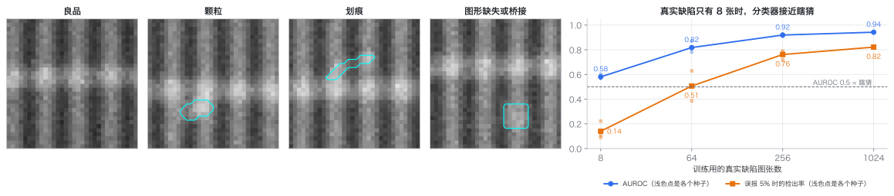
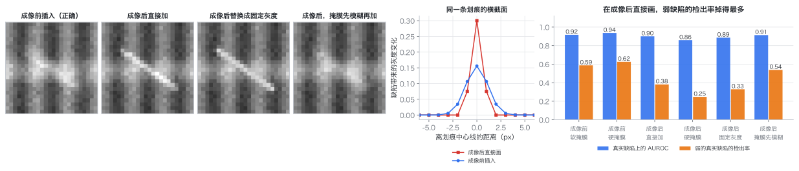
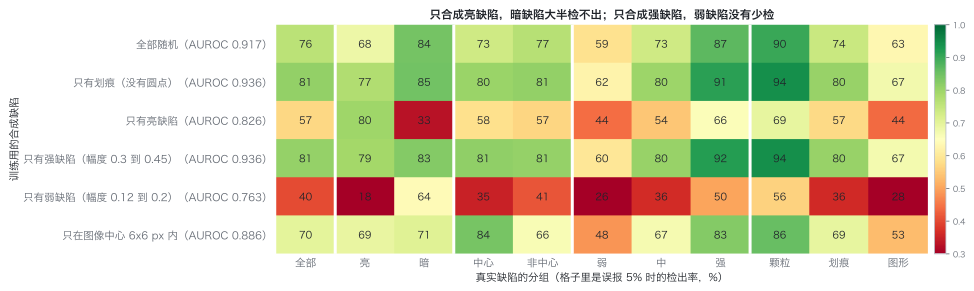
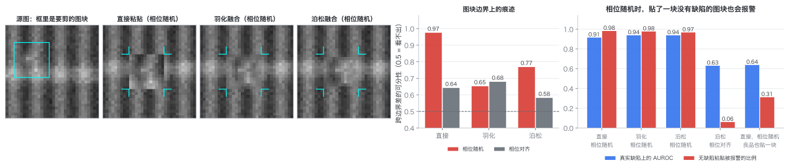
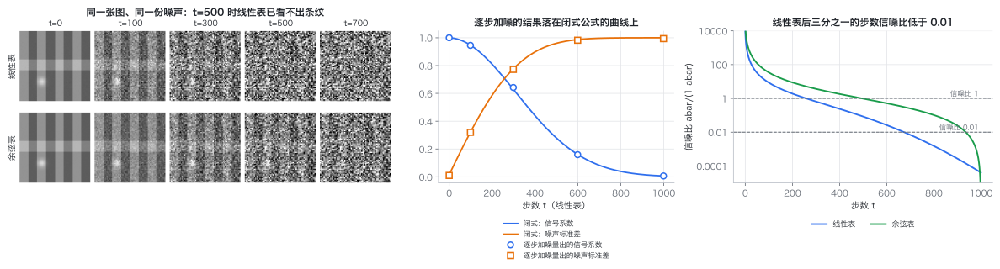
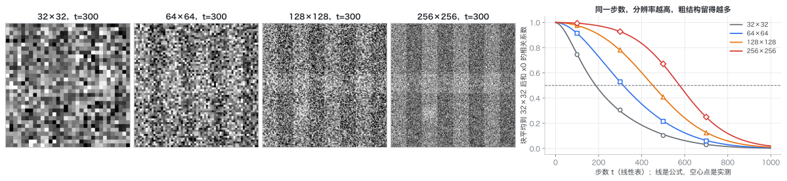
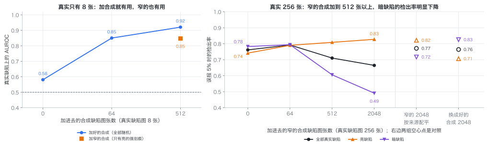

# 教程：合成缺陷与生成模型

> [!NOTE]
> 本章所有数字都来自代码生成的数据上的实测，记录在 [`figures/实测数字.json`](figures/实测数字.json)，由 `solutions` 分支的 `solutions/figures/ch20.py` 生成。“真实”缺陷也是代码生成的，只是和合成缺陷用了两套不同的生成方式；分类器是一个 8161 个参数的小卷积网络，在一台 Mac 的 CPU 上训练，重复运行结果相同。换成真实图像和更大的网络，数值会变，结论的方向要自己再测一遍。本章没有下载任何生成模型的权重，GAN、Stable Diffusion、ControlNet、LoRA 的部分只讲原理，没有实测数字。

## 0. 本章怎么学

**应用场景**：缺陷样本太少时造数据，用于训练和测试。新产品刚上线没有历史缺陷、某类缺陷一年只见几次、想知道算法能检出多弱的缺陷，都要自己造带准确标签的缺陷图。这一章回答的核心问题是：合成缺陷到底有没有用，什么时候会帮倒忙，怎样用实验证明。

**优先级**：P2，按方向，分到做数据合成或图像生成的方向时再学。前置是第 13 章（自编码器、VAE、GAN、扩散模型的入门）。本章默认你会读第 18、19 章的检出率、误报和 AUROC。

| 档位 | 累计用时 | 做什么 | 做到什么算完 |
|---|---:|---|---|
| 速通 | 3 小时 | 读第 1、3.2、3.4、4.3、5.3、8 节，看懂图 2、3、4、5、7，把第 6 节演示的五步试一遍，答完 5 道小测 | 能讲清缺陷该在成像链的哪一步插入，粘贴痕迹怎样骗过分类器，合成数据有没有用该怎样设计对照实验 |
| 标准 | 12 小时 | 读完全章，跑 Notebook，完成作业并验收通过，做第 11 节前三个破坏实验，填实验记录 | 四项测试 PASS，实验记录里有“只用合成缺陷训练分类器或调阈值、在‘真实’缺陷上测试”的一组数字和一个合成数据反而有害的案例 |
| 深挖 | 18 小时 | 再做其余破坏实验和第 12 节的扩展，用第 24 章的数据生成器当“真实”数据复现第 8 节的对照表 | 能报告自己的合成数据在哪几类缺陷上有用、哪几类没用，混合比例是多少，结论在什么条件下成立 |

> [!TIP]
> 用时超过所选档位的 1.5 倍还没做完，就把卡点写进 `学习进度.md`，先往下一章走。深挖档里跑 Stable Diffusion 要下载几个 GB 的权重，环境问题最容易卡住，卡超过一小时就先回到程序化合成把对照实验做完。

## 1. 为什么需要合成数据

- **样本少**：缺陷率低，某些类型一年只见几次。
- **类型不全**：新工艺、新产品刚导入时没有历史缺陷。
- **标注贵**：像素级标注需要专家，复查电镜（SEM）图也有成本。
- **测边界**：想知道算法能检出多小、多弱的缺陷，需要可控地生成不同尺寸和对比度的样本。

样本少到什么程度会出问题，可以量出来。下面的实验用 32×32 的线阵列版图（线周期 8 px，每张图的平移随机），经过光学模糊（高斯 sigma 1 px）、增益波动、散粒噪声和读出噪声得到“相机图”。“真实”缺陷有颗粒、划痕、图形缺失或桥接三类，在成像之前插入，幅度 0.12 到 0.45，亮暗各半。分类器只用 $K$ 张真实缺陷图加 400 张良品图训练，在固定的 1000 张良品和 1500 张真实缺陷图上测试，每个 $K$ 做 3 个种子。



| 训练用的真实缺陷图张数（400 步训练，3 个种子，1500 张真实缺陷图测试） | 8 | 64 | 256 | 1024 |
|---|---:|---:|---:|---:|
| AUROC | 0.581 | 0.818 | 0.919 | 0.942 |
| 误报 5% 时的检出率 | 14.0% | 50.7% | 76.2% | 82.2% |

只有 8 张时 AUROC 是 0.581，检出率 14.0%，比瞎猜（AUROC 0.5、检出率 5%）好不了多少。要到几百张才像样，而产线上某一类缺陷常常连几十张都凑不齐。本章后面所有的实验，都是在问：这个缺口能不能用造出来的数据补上。

1024 张时的 82.2% 是这个小分类器在这组数据上的上限，不是 100%：分组看，颗粒检出 95.1%，划痕 81.9%，图形缺失或桥接 68.7%；幅度 0.3 以上的检出 92.0%，低于 0.2 的只有 64.3%。后面看到“合成数据达到 0.92”这样的数字时，要和这个上限比，不要和 1 比。

合成数据有两种用途，要分清楚：

1. **训练**：扩充训练集。要求合成样本和真实缺陷分布接近，否则模型学到的是合成的特征。
2. **测试和标定灵敏度**：已知真值地评估算法。要求标签精确、参数可控，像不像真实缺陷反而是次要的。

第 24 章的数据生成器就属于第二种。

第二条里“像不像是次要的”要加一个条件，第 3.2 节末尾有实测：对本章的分类器，缺陷画得锐一点还是糊一点，测出的检出率差别不大；但第 22 章第 9.1 节用阈值法检测时，不做光学模糊的测试数据把暗区的检出率报高了很多（数字见那一节的表）。形状像不像可以放宽，成像链对不对不能放宽，放宽多少取决于被测的方法对什么敏感。

## 2. 方法分类

| 方法 | 做法 | 标签精度 | 真实感 | 可控性 |
|---|---|---|---|---|
| 程序化 | 用几何和规则画划痕、颗粒、缺失 | 精确 | 低到中 | 高 |
| 物理仿真 | 在版图或 3D 模型上插入缺陷，再模拟光学成像（第 21、22 章） | 精确 | 高 | 高 |
| 剪贴融合 | 从真实缺陷图上抠下来贴到良品上，泊松融合 | 精确 | 中到高 | 中 |
| 自监督伪异常 | CutPaste、DRAEM：随机切块或加纹理制造“异常”训练判别器 | 精确 | 低 | 中 |
| 生成模型 | GAN、VAE、扩散模型学习缺陷外观再生成 | 依赖方法 | 高 | 低到中 |

经验上，**程序化和物理仿真是基础**，生成模型用来补充真实感，而不是反过来。

本章的实测覆盖程序化合成（第 3 节）和剪贴融合（第 4 节）两行；第 4.3 节会看到，剪贴的痕迹恰好就是自监督伪异常利用的信号。物理仿真的成像部分在第 22 章。生成模型在第 5 节，其中扩散模型只实测前向过程。

## 3. 程序化合成要点

原讲义给了四条要点，先列出来，后面几个小节逐条量：

- **软掩码**：边缘用渐变过渡，而不是硬边，否则检测器会学到“硬边就是缺陷”这种捷径。作业里的 `scratch_mask` 用到线段距离做线性过渡。实测见第 3.3 节，这一条只在成像之后画缺陷时成立。
- **在正确的阶段插入缺陷**：缺陷应该在光学模糊和噪声之前加入，这样它和背景一样被模糊、一样带噪声。在最终图像上直接画，会出现比背景更锐利、没有噪声的“贴纸”，这是很常见的错误。第 24 章生成器就是先加缺陷再模糊和加噪的。实测见第 3.2 节。
- **参数随机化**：位置、大小、方向、对比度、极性都要随机，覆盖真实的分布范围。实测见第 3.4 节，各个维度的重要程度差得很远。
- **标签同步**：每次几何变换（平移、裁剪、缩放）都要同步更新掩码和坐标。

### 3.1 作业里的软掩膜和混合

`scratch_mask` 对每个像素算它到线段的最短距离 $d$，再按下面的式子变成 0 到 1 之间的值：

$$
m = \operatorname{clip}\!\left(\frac{w/2 + s/2 - d}{s},\ 0,\ 1\right)
$$

$w$ 是划痕宽度，$s$ 是过渡带宽度（`softness`）。分子里的 $s/2$ 让 $m = 0.5$ 的位置正好落在 $d = w/2$ 上，所以改变 $s$ 不会改变划痕的名义宽度。一条宽 3 px 的水平划痕，离中心线 0、1、2、3 px 处的取值：

| 过渡带 | 0 px | 1 px | 2 px | 3 px |
|---|---:|---:|---:|---:|
| 1 px | 1 | 1 | 0 | 0 |
| 2 px | 1 | 0.75 | 0.25 | 0 |

距离要按线段算，不是按无限长的直线算：投影参数截到 0 和 1 之间，端点之外按到端点的距离衰减，划痕的两头才是圆的。两端点重合时线段退化成一个点，掩膜是一个圆点，本章实验里的“圆点”缺陷就是这样画的。

`blend` 是 $\text{out} = \text{bg} \cdot (1 - m) + \text{fg} \cdot m$。前景可以是一个固定灰度，也可以是一张图。本章的实验用两种写法：

- **加法**：`blend(bg, bg + a, m)`，等于在背景上加 $a \cdot m$，背景的图形和噪声还在。
- **替换**：`blend(bg, v, m)`，掩膜里的像素被换成固定灰度 $v$，背景的图形和噪声被盖掉。本章 Notebook 用的是这一种。

### 3.2 在成像链的哪一步插入

同一条划痕，可以在成像之前画到版图上，再一起经过模糊和噪声；也可以在成像之后的良品图上直接画。后一种做法在只有真实良品图、没有仿真器的时候很常见。



中间一栏说明了两种做法差在哪。成像前插入的划痕被光学模糊摊开，峰值只剩标称幅度的一部分（过渡带 1 px、无噪声时量的）：

| 缺陷 | 划痕宽 1 px | 划痕宽 1.5 px | 划痕宽 2.5 px | 圆点直径 2 px | 圆点直径 3 px | 圆点直径 4.5 px |
|---|---:|---:|---:|---:|---:|---:|
| 成像前插入时峰值剩下的比例 | 39.8% | 52.0% | 76.2% | 37.2% | 68.3% | 89.8% |

成像后直接画的划痕峰值是 100%，边缘也没有被模糊。同样写着“幅度 0.3”，两种做法造出来的是两种东西。

只用 400 张合成缺陷图训练分类器，在真实缺陷上测试（合成的形状是直线划痕和圆点各半，幅度 0.12 到 0.45，其余条件同图 1，3 个种子）：

| 合成缺陷的做法 | 真实缺陷上的 AUROC | 检出率 | 弱缺陷（幅度低于 0.2）的检出率 | 强缺陷（0.3 以上）的检出率 |
|---|---:|---:|---:|---:|
| 成像前插入，软掩膜 | 0.917 | 76.0% | 58.7% | 86.8% |
| 成像前插入，硬掩膜（过渡带 0.05 px） | 0.936 | 81.7% | 62.5% | 92.5% |
| 成像后，直接加 | 0.900 | 71.5% | 38.1% | 89.8% |
| 成像后，硬掩膜，直接加 | 0.859 | 62.0% | 24.7% | 85.3% |
| 成像后，替换成固定灰度 | 0.886 | 68.2% | 32.9% | 88.5% |
| 成像后，掩膜先按光学模糊的 sigma 模糊再加 | 0.913 | 74.2% | 53.8% | 87.0% |

读这张表的四点：

1. **在成像前插入，只用合成数据就接近 1024 张真实缺陷图的水平**（AUROC 0.917 对 0.942，检出率 76.0% 对 82.2%），尽管合成的形状和真实的并不一样。
2. **在成像后直接画，AUROC 只低了不到 0.02，但弱缺陷的检出率从 58.7% 掉到 38.1%**，强缺陷没有掉（89.8%）。3 个种子里弱缺陷的检出率分别是 24.5%、32.3%、57.4%，每个种子都低于成像前插入的对应值（43.5%、64.1%、68.5%）。种子之间的波动不小，AUROC 上 0.917 和 0.900 的差别在波动范围之内，不能据此下结论；能下结论的是弱缺陷这一组。
3. **问题主要出在锐度，不在噪声**。“直接加”保留了背景噪声，“替换成固定灰度”把噪声也盖掉了，两者差不多（38.1% 对 32.9%）。把掩膜先做一次和光学模糊相同的高斯模糊再加，噪声统计仍然不对，弱缺陷的检出率却回到了 53.8%。原讲义把贴纸感归结为“更锐利、没有噪声”，在这组实验里起作用的是前一半。
4. **只看合成数据上的验证结果会被骗**。成像后直接加训练出的分类器，对同样做法的合成缺陷检出 97.5%，对成像前插入的同形状合成缺陷检出 84.2%，对真实缺陷只有 71.5%。在合成的验证集上越好看，越要怀疑。

第 3 点给了一个实用的补救办法：手上没有仿真器、只能在真实良品图上画缺陷时，先把掩膜按系统的点扩散函数模糊一遍再混合。点扩散函数是什么、用高斯近似它差在哪，见第 22 章第 4 节。

反过来，把合成缺陷当测试集会怎样？分类器固定为 1024 张真实缺陷图训练出的那 3 个，阈值不变，分别在三种合成探针上测检出率：成像前插入 86.2%，成像后直接加 87.6%，成像后替换成固定灰度 85.8%，真实缺陷上是 82.2%。三种插入方式之间差一两个点，都比真实高四五个点（合成的形状里没有最难的图形类缺陷）。对这个分类器，用哪种方式画测试缺陷影响不大。第 22 章的阈值法对峰值敏感，结论就完全不同。

<!-- quiz -->
**只用“成像后直接加”的合成划痕和圆点训练分类器，在真实缺陷上的 AUROC 是 0.900，成像前插入的是 0.917。哪一类真实缺陷的检出率差得最多？**

- A. 强缺陷，因为贴上去的缺陷不够亮
- B. 弱缺陷，从 58.7% 掉到 38.1%
- C. 各类差不多，都掉两三个点

<details markdown="1"><summary>答案与解释</summary>

**B**。成像后画的缺陷峰值是标称幅度的 100%，边缘是锐的；真实缺陷经过光学模糊，宽 1.5 px 的划痕峰值只剩 52.0%。分类器在训练里见到的“幅度 0.12 的缺陷”比真实的同幅度缺陷显眼得多，所以对弱的真实缺陷准备不足。强缺陷的检出率是 89.8% 对 86.8%，没有掉。总的 AUROC 只差不到 0.02，还在种子的波动范围里，单看它发现不了问题。

</details>
<!-- /quiz -->

### 3.3 软掩膜到底管什么用

上一节的表里有两组软硬掩膜的对比，结论相反：

- **成像前插入**：硬掩膜的 AUROC 是 0.936，软掩膜是 0.917；弱缺陷的检出率 62.5% 对 58.7%。硬掩膜没有更差。原因很直接，硬边画上去之后还要经过光学模糊，出来的边缘和软掩膜的几乎一样。
- **成像后画**：硬掩膜的 AUROC 从 0.900 掉到 0.859，弱缺陷的检出率从 38.1% 掉到 24.7%，3 个种子里都不高于软掩膜。这时软掩膜确实有用。

所以原讲义“用软掩膜，否则检测器会学到硬边就是缺陷”这句话，在成像之后画缺陷时成立，在成像之前插入时没有测到差别。而且在成像之后画，光靠软掩膜也不够：过渡带 0.8 到 1.5 px 的软掩膜仍然比成像前插入差 20 个百分点（38.1% 对 58.7%），因为它的过渡带宽度和光学模糊不是一回事。

软掩膜还有一个和捷径无关的用处：亚像素位置。硬掩膜只能落在整数像素上，划痕的端点、宽度一变就整行整列地跳；软掩膜让边缘的灰度随位置连续变化，生成的标签可以带亚像素坐标。

### 3.4 多样性：形状、对比度、位置

“参数都要随机”这句话没有告诉你哪个参数最要紧。下面每次只收窄一个维度，其余保持随机，都在成像前插入，只用 400 张合成缺陷图训练，在真实缺陷上分组看检出率（3 个种子）。



| 训练用的合成缺陷 | AUROC | 全部 | 亮 | 暗 | 中心 | 非中心 | 弱 | 强 |
|---|---:|---:|---:|---:|---:|---:|---:|---:|
| 全部随机 | 0.917 | 76.0% | 68.2% | 84.3% | 73.2% | 76.7% | 58.7% | 86.8% |
| 只有划痕，没有圆点 | 0.936 | 80.9% | 77.5% | 84.5% | 80.2% | 81.1% | 62.3% | 91.3% |
| 只有亮缺陷 | 0.826 | 57.0% | 79.8% | 32.8% | 58.3% | 56.7% | 44.1% | 65.6% |
| 只有强缺陷（幅度 0.3 到 0.45） | 0.936 | 80.8% | 79.0% | 82.7% | 81.4% | 80.7% | 59.7% | 92.0% |
| 只有弱缺陷（幅度 0.12 到 0.2） | 0.763 | 40.2% | 17.8% | 64.1% | 35.1% | 41.5% | 26.3% | 50.0% |
| 只在图像中心 6×6 px 内 | 0.886 | 69.7% | 68.9% | 70.6% | 84.1% | 66.2% | 48.4% | 82.7% |

“中心”指缺陷中心离图像中心不超过 4 px，1500 个测试缺陷里有 294 个；暗缺陷 726 个，弱缺陷 359 个。按这些个数算，分组检出率的抽样标准误差在 1.5 到 2.6 个百分点之间，下面只讨论差了 10 个点以上的地方。

1. **极性必须覆盖**。只合成亮缺陷，暗缺陷的检出率从 84.3% 掉到 32.8%。分类器学到的是“比周围亮”，不是“和周围不一样”。
2. **位置要覆盖**。只在中心合成，中心的检出率 84.1%，非中心的 66.2%，比全部随机时低 10.5 个百分点。卷积加全局最大池化的网络在结构上对平移不敏感，仍然出现了位置依赖；缺陷落在版图的什么结构上、离图像边界多远，都是它见过和没见过的区别。
3. **少一种形状，在这组实验里没有看到下降**。只合成划痕，颗粒的检出率是 94.1%，全部随机时是 89.9%。真实的图形类缺陷两种训练集里都没有，检出率 67.2% 对 63.2%，也没有差别。
4. **只合成强缺陷，弱缺陷没有少检；只合成弱缺陷反而最差**。前者弱缺陷检出 59.7%，和全部随机的 58.7% 一样；后者 AUROC 只有 0.763，连强缺陷也只检出 50.0%。幅度 0.12 到 0.2 的缺陷经过模糊之后和噪声差不多大（灰度 0.5 处噪声的标准差是 0.030），当训练样本用相当于给了一批标签很吵的正样本。

第 3、4 两条和“参数都要覆盖真实分布”的直觉不一致。它们只说明：在这组数据、这个小网络上，分类器从强的、形状单一的样本里学到的东西，能推广到弱的和别的形状；极性和位置推广不过去。换一种数据不一定如此，要用同样的办法分组量一遍，不要凭直觉决定哪个参数可以不随机。

<!-- quiz -->
**两个合成训练集，一个只有强缺陷（幅度 0.3 到 0.45），一个只有弱缺陷（幅度 0.12 到 0.2）。哪一个训练出的分类器，对弱的真实缺陷检出率更高？**

- A. 只有弱缺陷的，因为训练和测试的幅度一致
- B. 只有强缺陷的，59.7% 对 26.3%
- C. 差不多

<details markdown="1"><summary>答案与解释</summary>

**B**。只用弱缺陷训练的分类器 AUROC 只有 0.763，是六种训练集里最低的，对弱的真实缺陷只检出 26.3%。弱缺陷经过光学模糊后和噪声的大小相当，很多样本看上去和良品没有区别，分类器等于在带噪的标签上训练。只用强缺陷训练的分类器学到了干净的“缺陷长什么样”，再推广到弱的。A 是把“训练分布要和测试一致”套用到了它不成立的地方。

</details>
<!-- /quiz -->

## 4. 剪贴融合：三种贴法和它们留下的痕迹

程序化合成的缺陷是画出来的，形状取决于你想得到多少种。剪贴融合换了一个思路：手上有几张真实的缺陷图，把缺陷连同周围一小块抠下来，贴到很多张良品图上。贴的方法有三种，区别在图块的边界怎么处理。

### 4.1 三种贴法各自在做什么

记良品图（目标）为 $t$，从缺陷图上剪下的图块（源）为 $g$，贴上去的区域为 $\Omega$。

**直接粘贴**：区域里的像素全部换成源图块，$f = g$。边界上左边是 $t$、右边是 $g$，两者的亮度和图形对不上就是一道台阶。

**羽化融合**：用一张从边缘向里渐变的掩膜 $\alpha$ 做加权，$f = (1 - \alpha)\,t + \alpha\,g$，就是作业里的 `blend`。本章的实验里 $\alpha$ 从图块边缘向里 4 px 线性升到 1。台阶被摊成了一条过渡带，过渡带里是两张图的加权平均。

**泊松融合**：不直接拷贝像素值，而是拷贝梯度。要求结果在边界上等于目标图，在内部梯度尽量接近源图块：

$$
\min_f \iint_\Omega \lVert \nabla f - \nabla g \rVert^2 \quad \text{满足}\quad f\big|_{\partial\Omega} = t\big|_{\partial\Omega}
$$

它的解满足泊松方程 $\Delta f = \Delta g$。换一个写法更好理解：令 $f = g + u$，则 $u$ 满足 $\Delta u = 0$，在边界上 $u = t - g$。也就是说，泊松融合等于“源图块加上一个调和函数”，这个调和函数把边界上的差值平滑地插值到内部。调和函数没有局部的极值和细节，所以它能改的只有缓慢变化的成分：整体亮度差、照明梯度能被它抹平，细的纹理它动不了。

OpenCV 里对应的函数是 `cv2.seamlessClone`。本章的实验为了看清每一步，对矩形图块自己解了这个方程（离散正弦变换，不用迭代），并核对了三件事：源和目标只差一个常数时结果和目标的最大差是 5e-16，图块内部的拉普拉斯和源图块的最大差是 2.7e-15，最外一圈和目标图完全相同。它和 `cv2.seamlessClone` 的输出没有逐像素比过。

### 4.2 边界上的痕迹有多明显

这里有一个比“贴法”更要紧的变量：**源图和目标图的图形对不对得上**。本章的版图是周期线阵列，每张图的平移随机。分两种情况量：

- **相位随机**：目标良品的平移和粘贴位置都随机。贴上去的线和周围的线一般接不上。
- **相位对齐**：目标良品和源图的版图平移相同，贴回原来的位置。两张图只有增益和噪声不同。真实工作里对应的做法是先把两张图对齐（第 16 章），或者只往版图相同的位置贴。



先不训练任何网络，只量边界。把一块**没有缺陷**的 12×12 图块贴到良品上，在图块的四条边上算相邻像素的平均绝对差，分两处算：图块最外一圈和它外面的邻居，最外一圈和它里面的邻居。再和没动过的良品在同样位置上的值比，用它当分数算 AUROC（各 600 张）。大于 0.5 说明粘贴处的跨边界差更大，小于 0.5 说明更小。

| 贴法 | 相位随机：对外 | 相位随机：对内 | 相位对齐：对外 | 相位对齐：对内 |
|---|---:|---:|---:|---:|
| 直接粘贴 | 0.975 | 0.454 | 0.642 | 0.476 |
| 羽化融合 | 0.563 | 0.348 | 0.500 | 0.321 |
| 泊松融合 | 0.488 | 0.768 | 0.517 | 0.418 |

1. **直接粘贴的台阶最明显**。相位随机时，一个最简单的边界统计量就能以 0.975 的 AUROC 认出粘贴，跨边界的平均绝对差是 0.150，没动过的良品是 0.058。相位对齐后降到 0.642，剩下的是两张图增益不同造成的亮度台阶。
2. **羽化把台阶抹掉了，却留下了另一种痕迹**。它的“对内”一栏是 0.348 和 0.321，明显低于 0.5：过渡带里是两张图的加权平均，噪声被平均掉了一部分，相邻像素的差比正常的还小。比正常更平滑同样是痕迹，而且相位对齐也去不掉。
3. **泊松融合在边界上最干净，痕迹挪到了里面一圈**。最外一圈就是目标图自己，对外是 0.488。相位随机时对内是 0.768，因为调和函数接不上对不齐的线条，差值被压在紧贴边界的一两个像素里。相位对齐时对外 0.517、对内 0.418，是三种贴法里痕迹最轻的。

再看贴进去的背景本身错了多少。在没有噪声的图上贴一块没有缺陷的图块，理想的结果应该和目标图完全一样，实际的均方根误差（图块内，300 对）：

| 贴法 | 相位随机 | 相位对齐（只有增益差） |
|---|---:|---:|
| 直接粘贴 | 0.175 | 0.035 |
| 羽化融合 | 0.116 | 0.023 |
| 泊松融合 | 0.112 | 0.006 |

相位对齐时，泊松融合把误差从 0.035 压到 0.006，增益造成的亮度差正是调和函数能抹平的东西。相位随机时三种贴法的误差都在 0.11 以上，泊松融合也无能为力：贴进去的是另一个相位的线条，这不是边界怎么处理的问题。

### 4.3 分类器学到的是缺陷还是粘贴痕迹

现在训练分类器。手上只有 8 张真实缺陷图（就是图 1 里 $K = 8$ 的那一组），把缺陷所在的图块贴到新的良品图上，造 400 张缺陷图当正样本，400 张没动过的良品当负样本，在真实缺陷上测试。另外准备一组探针：用同一种贴法贴一块**没有缺陷**的图块，看分类器报不报警。

| 训练数据（8 张真实缺陷图剪贴成 400 张，3 个种子） | 真实缺陷上的 AUROC | 检出率 | 无缺陷粘贴被报警的比例 |
|---|---:|---:|---:|
| 只用这 8 张真实缺陷图，不剪贴 | 0.581 | 14.0% | |
| 直接粘贴，相位随机 | 0.915 | 75.7% | 98.2% |
| 羽化融合，相位随机 | 0.938 | 80.7% | 97.7% |
| 泊松融合，相位随机 | 0.937 | 80.6% | 96.7% |
| 泊松融合，相位对齐 | 0.630 | 17.5% | 6.1% |
| 直接粘贴，相位随机，良品也贴一块 | 0.638 | 23.6% | 31.2% |

这张表是本章最反直觉的结果，分三层读。

**第一层：相位随机的三行，分类器学到的是粘贴，不是缺陷。** 贴上去的图块里明明没有缺陷，97% 左右仍然被判成缺陷。换成泊松融合也一样（96.7%），因为第 4.2 节已经看到，相位对不上时痕迹不在边界上，而在图块里那一片接不上的线条里。

**第二层：这个“粘贴探测器”在真实缺陷上的 AUROC 反而很高。** 0.915 到 0.938，和 1024 张真实缺陷图训练的 0.942 差不多。原因是真实缺陷和粘贴有一个共同点：都把局部的图形打断了。分类器学到的是“这一小块和周围接不上”，这正好也能发现真实缺陷。第 2 节表里的自监督伪异常（CutPaste）走的就是这条路，它故意不要真实缺陷，只靠粘贴制造“异常”。

**第三层：把痕迹这条捷径堵上，才看得出分类器从那 8 个缺陷里学到了多少。** 两种堵法：

- 贴得足够干净（泊松融合、相位对齐），无缺陷粘贴的报警比例回到 6.1%，和 5% 的误报设定相当。这时 AUROC 只有 0.630。
- 让负样本也带上同样的痕迹（良品也贴一块没有缺陷的图块），AUROC 是 0.638。

两种堵法给出的数字几乎一样，都只比“8 张真实缺陷图不剪贴”的 0.581 高一点。把 8 个缺陷贴 400 遍，分类器见到的还是那 8 个缺陷。**剪贴能增加的是背景和位置的多样性，增加不了缺陷本身的多样性。**

那么相位随机的剪贴数据算不算“有用”？要看你要的是什么：

- 要一个“发现任何局部异常”的检测器，它有用，但那是第 19 章的任务，应该按异常检测的方式评估，并且知道它对一切图形不连续都会报警，分不出缺陷类型。
- 要一个“认识这类缺陷”的分类器，它是帮倒忙的：真实缺陷上的 AUROC 很好看，掩盖了分类器并不认识缺陷这件事。良品上只要出现一块接不上的图形，它同样报警（探针上是 98.2%）；你后来在负样本里也做同样的粘贴时，AUROC 就掉到 0.638。

> [!IMPORTANT]
> 只看“真实缺陷上的 AUROC”分不清上面两种情况。评估合成数据时要加探针：把合成流程原样走一遍，只是不放缺陷，看分类器报不报警。报警比例远高于误报设定，说明它学到的是合成痕迹。

<!-- quiz -->
**用 8 张真实缺陷图做直接粘贴（相位随机），训练出的分类器在真实缺陷上 AUROC 0.915。把一块没有缺陷的图块用同样的方法贴到良品上，98.2% 被判成缺陷。训练时让良品也贴一块之后，AUROC 掉到 0.638。最合理的解释是什么？**

- A. 让良品也贴一块是错误的做法，把分类器训坏了
- B. 0.915 主要来自粘贴痕迹：分类器学到的是“这一块和周围接不上”，它碰巧也能发现真实缺陷；去掉这条线索后，8 个缺陷本身只够支撑 0.64 左右
- C. 测试集太小，0.915 和 0.638 的差别是随机波动

<details markdown="1"><summary>答案与解释</summary>

**B**。贴得很干净的泊松融合加相位对齐给出 0.630，和 0.638 几乎一样，两种堵住捷径的办法互相印证。A 不对，良品也贴一块正是检验分类器有没有依赖痕迹的标准做法。C 不对，3 个种子的 AUROC 分别是 0.907、0.921、0.917 和 0.641、0.569、0.702，两组完全不重叠。

</details>
<!-- /quiz -->

## 5. 三类生成模型

程序化合成和剪贴都要人来决定缺陷长什么样。生成模型让网络从数据里学缺陷的外观。这一节讲三类模型的原理，实测只做两件不需要大模型的事：VAE 的重参数化，和扩散模型的前向过程。

### 5.1 VAE

编码器输出均值 μ 和对数方差 logσ²，采样 z = μ + σ·ε（重参数化，让采样可导），解码器重建。损失 = 重建误差 + KL(q(z|x) ‖ N(0, I))。

- 优点：训练稳定，潜空间连续，可以插值。
- 缺点：生成结果偏模糊。
- 缺陷场景：学良品分布，用于异常检测（重建误差）；或者在潜空间里做数据增强。

**为什么输出对数方差**。方差必须是正数，让网络直接输出它要加约束；输出 $\log\sigma^2$ 则可以取任意实数。采样写成

$$
z = \mu + \exp\!\left(\tfrac{1}{2}\log\sigma^2\right)\varepsilon,\qquad \varepsilon \sim \mathcal{N}(0, I)
$$

指数里的二分之一最容易漏。用作业的 `reparameterize` 取 $\mu = 2$、$\log\sigma^2 = \log 9$、20 万个样本，$z$ 的标准差是 2.995；把 $\exp(0.5\log\sigma^2)$ 写成 $\exp(\log\sigma^2)$，标准差变成 8.986，把方差当成了标准差。

**KL 项有闭式**。对角高斯和标准正态之间，每一维是

$$
\mathrm{KL} = \tfrac{1}{2}\left(\mu^2 + \sigma^2 - 1 - \log\sigma^2\right)
$$

同一组参数下闭式值是 4.901，用重参数化采出的样本直接估计 $\mathbb{E}[\log q(z) - \log p(z)]$ 得到 4.909。所以训练时 KL 项不用采样。

**重参数化解决了什么问题**。损失里有一项是对 $z \sim q$ 求期望，要对 $\mu$、$\sigma$ 求导，而“从分布里抽一个数”这个操作本身没有导数。重参数化把随机性挪到和参数无关的 $\varepsilon$ 上，$z$ 变成 $\mu$、$\sigma$ 的普通函数，$\partial z/\partial\mu = 1$，$\partial z/\partial\log\sigma^2 = \tfrac{1}{2}\sigma\varepsilon$，反向传播照常进行。

它不是唯一能求这个梯度的办法。打分函数估计（REINFORCE）不需要 $z$ 对参数可导，但方差大。拿 $\mathbb{E}[z^2]$ 对 $\mu$ 的导数做例子（真值是 $2\mu = 4$，同上 20 万个样本）：

| 估计方法 | 均值 | 单个样本的标准差 |
|---|---:|---:|
| 重参数化：$2z$ | 4.020 | 5.991 |
| 打分函数：$z^2 (z - \mu)/\sigma^2$ | 4.013 | 13.878 |

两种都是无偏的，打分函数估计的方差是重参数化的 5.4 倍，也就是要多抽 5.4 倍的样本才能一样准。这只是一维的一个例子，它说明的是重参数化的好处在于方差小，而不只是“让采样可导”。

### 5.2 GAN

生成器和判别器对抗训练。

- 优点：生成清晰。
- 缺点：训练不稳定、模式坍塌（只生成少数几种样子），小数据集上尤其严重。
- 缺陷场景：缺陷到良品的图像翻译（CycleGAN 类），或者在少量缺陷上做风格迁移。

目标函数是一个极小极大问题：

$$
\min_G \max_D\ \mathbb{E}_{x}\big[\log D(x)\big] + \mathbb{E}_{z}\big[\log\big(1 - D(G(z))\big)\big]
$$

判别器 $D$ 做的事和第 4.3 节的探针是同一件：找出合成图和真实图之间的任何差别，不管这个差别是不是缺陷。区别在于 GAN 把判别器的输出反过来拿去改生成器，直到判别器分不出来为止。这也解释了模式坍塌：生成器只要找到几种能骗过判别器的样子就够了，没有任何一项要求它把真实数据的各种样子都覆盖到。对缺陷合成来说，这正是第 3.4 节量过的多样性问题。

本章没有训练 GAN，上面三条优缺点是文献和经验里的说法，没有实测数字。

### 5.3 扩散模型

**前向过程**：逐步加高斯噪声，T 步后变成纯噪声。有闭式解：

```text
x_t = sqrt(ᾱ_t) · x_0 + sqrt(1 - ᾱ_t) · ε,    ᾱ_t = Π_{s≤t} (1 - β_s)
```

**反向过程**：训练网络 ε_θ(x_t, t) 预测加进去的噪声，损失就是 ‖ε - ε_θ(x_t, t)‖²。生成时从纯噪声出发，逐步去噪。

为什么预测噪声：给定 x_t 和预测的 ε，就能估计 x_0 和上一步的均值，而预测噪声的数值尺度稳定、训练效果好（DDPM 论文的实验结论）。

- 优点：质量高、训练稳定、模式覆盖好。
- 缺点：采样慢（DDIM 等方法可以少步采样）。
- **Stable Diffusion**：在 VAE 的潜空间里做扩散，再用文本条件控制，大幅降低计算量。

下面四个小节把前向过程和训练目标量一遍。反向采样和条件生成不在本章范围内。

#### 5.3.1 闭式和逐步加噪是一回事

每一步做的事是把上一步的结果缩小一点，再加一点新噪声：

$$
x_t = \sqrt{1 - \beta_t}\,x_{t-1} + \sqrt{\beta_t}\,\varepsilon_t
$$

把它展开一步：

$$
x_t = \sqrt{(1-\beta_t)(1-\beta_{t-1})}\,x_{t-2} + \sqrt{(1-\beta_t)\beta_{t-1}}\,\varepsilon_{t-1} + \sqrt{\beta_t}\,\varepsilon_t
$$

后两项是两个独立的高斯噪声，合起来还是高斯，方差相加：$(1-\beta_t)\beta_{t-1} + \beta_t = 1 - (1-\beta_t)(1-\beta_{t-1})$。一直展开到 $x_0$，信号的系数是所有 $\sqrt{1-\beta_s}$ 的乘积，噪声的总方差是 1 减去这个乘积的平方。记 $\bar\alpha_t = \prod_{s \le t}(1-\beta_s)$，就是闭式：

$$
x_t = \sqrt{\bar\alpha_t}\,x_0 + \sqrt{1-\bar\alpha_t}\,\varepsilon
$$

信号系数的平方加噪声方差恒等于 1，所以 $x_0$ 的方差是 1 时 $x_t$ 的方差始终是 1，这叫方差保持。

实测：线性噪声表 1000 步，从同一张 32×32 的条纹图出发真的一步一步加噪，100 条独立的链，在几个步数上量“信号系数”（多条链平均之后对 $x_0$ 的回归斜率）和“噪声标准差”，和公式比。

| 步数 t（下标从 0 开始） | 0 | 99 | 299 | 599 | 999 |
|---|---:|---:|---:|---:|---:|
| 公式：信号系数 | 1.000 | 0.947 | 0.630 | 0.161 | 0.006 |
| 逐步加噪量出的信号系数 | 1.000 | 0.945 | 0.642 | 0.159 | 0.006 |
| 公式：噪声标准差 | 0.010 | 0.321 | 0.777 | 0.987 | 1.000 |
| 逐步加噪量出的噪声标准差 | 0.010 | 0.320 | 0.773 | 0.982 | 0.994 |

两者在抽样误差之内一致。不靠抽样也能核对：把 1000 步的系数连乘起来和 $\sqrt{\bar\alpha_t}$ 比，最大差是 1.2e-15；按 $v \leftarrow (1-\beta_t)v + \beta_t$ 递推出的噪声方差和 $1-\bar\alpha_t$ 的最大差是 5.6e-16。闭式的意义在训练上：不用真的走 $t$ 步，随机抽一个 $t$ 就能一步得到 $x_t$。

作业里的下标从 0 开始：`abar[0]` 是 0.9999，也就是下标 0 的那张图已经加过一次噪声；`abar[999]` 是 4e-05。写论文公式时下标从 1 开始，两种约定差一步，对照别人的代码时要先确认。

本章 Notebook 让你预测“t=300 时还能不能认出条纹”。那张图的条纹取值是 -0.4 和 0.4，t=300 时 $\bar\alpha$ 是 0.394，按公式逐像素的相关系数只有 0.307，单看一个像素基本分不出亮暗。但每条条纹有 480 个像素，把一条条纹里的像素平均之后，相关系数是 0.99。眼睛做的就是这种平均，所以条纹仍然看得出来。Notebook 给的判断办法就是这两个数：它对六个 t 各打印一次逐像素的相关系数和按条纹平均后的相关系数。Notebook 用的是一份具体的噪声，打印出来的数和这里的公式值会差在抽样误差上。“某一步还剩多少信息”取决于你问的是多大的结构，第 5.3.3 节专门量这件事。

#### 5.3.2 线性表和余弦表

噪声表决定 $\bar\alpha_t$ 怎样从 1 降到 0。两种常见的选择：

- **线性表**：$\beta_t$ 从 0.0001 到 0.02 等间隔，作业的 `linear_beta_schedule` 就是它。
- **余弦表**：直接规定 $\bar\alpha_t$ 按余弦平方下降，$\bar\alpha_t = f(t)/f(0)$，$f(t) = \cos^2\!\big(\tfrac{t/T + s}{1 + s}\cdot\tfrac{\pi}{2}\big)$，$s = 0.008$，再反推出 $\beta_t$ 并截到 0.999 以下。它是 Nichol 和 Dhariwal（2021）为了改进线性表提出的。式子里 $t$ 从 1 数；按作业从 0 数的约定，下标 $t$ 处取的是 $f(t+1)/f(0)$。

比较两张表最方便的量是信噪比 $\bar\alpha_t/(1-\bar\alpha_t)$，即信号系数和噪声标准差的平方比。



| 都是 1000 步 | 线性表 | 余弦表 |
|---|---:|---:|
| $\bar\alpha$ 在 t=100、300、500、700、900 | 0.8951、0.3940、0.0778、0.0069、0.0003 | 0.9716、0.7856、0.4923、0.2019、0.0236 |
| t=500 时的信噪比 | 0.084 | 0.970 |
| 信噪比第一次低于 1 的步数 | 259 | 496 |
| 信噪比第一次低于 0.01 的步数 | 674 | 936 |
| 信噪比低于 0.01 的步数占比 | 32.6% | 6.4% |
| 最后一步的 $\bar\alpha$ | 4e-05 | 2.4e-09 |

线性表到第 259 步噪声就压过了信号，从第 674 步起信噪比低于 0.01，后面将近三分之一的步数都在处理几乎是纯噪声的图。余弦表把信噪比等于 1 的位置放在正中间附近（第 496 步），低于 0.01 的步数只占 6.4%。图 5 左栏里 t=500 的两张图差别最明显：线性表已经看不出条纹，余弦表还看得出。

**步数少的时候，线性表的 β 范围要跟着改。** 0.0001 到 0.02 这个范围是给 1000 步定的，作业里 `linear_beta_schedule` 的默认值就是它，文档字符串里写了这一点；函数只按传入的起止值生成，不会替你放大。只把步数改小：

| 总步数 T | 100 | 200 | 500 | 1000 |
|---|---:|---:|---:|---:|
| β 范围不变，最后一步的 $\bar\alpha$ | 0.36 | 0.13 | 0.0064 | 4e-05 |
| β 按 1000/T 放大，最后一步的 $\bar\alpha$ | 2e-05 | 3e-05 | 3.8e-05 | 4e-05 |

100 步时最后一步的 $\bar\alpha$ 还有 0.36，$x_T$ 里信号系数是 0.6，远不是纯噪声。“T 步后变成纯噪声”这句话只对配套的 β 范围成立。采样时是从纯噪声出发的，如果训练时最后一步不是纯噪声，训练和采样的起点就对不上。

<!-- quiz -->
**把 `linear_beta_schedule` 的步数从 1000 改成 100，β 的起止值保持 0.0001 和 0.02 不变。最后一步的 x_T 是什么样子？**

- A. 仍然是纯噪声，步数只影响速度
- B. 最后一步的 ᾱ 还有 0.36，x_T 里还留着原图的信号，不是纯噪声
- C. ᾱ 变成负数，程序报错

<details markdown="1"><summary>答案与解释</summary>

**B**。ᾱ 是 100 个 (1 - β) 的乘积，β 最大才 0.02，乘 100 次只降到 0.36，信号系数是它的平方根 0.6。把 β 整体放大 10 倍，最后一步的 ᾱ 才回到 2e-05。C 描述的是另一个错误：把累乘写成 1 减累加，1000 步时在第 312 步变成负数。

</details>
<!-- /quiz -->

#### 5.3.3 同一个步数，不同分辨率下破坏的东西不一样

噪声是逐像素独立加的。一个占很多像素的结构，可以靠平均把噪声压下去；一个只占几个像素的结构不行。所以同样的 $\bar\alpha_t$，图的分辨率越高，粗结构保留得越多。

把 $k \times k$ 个像素平均，信号不变，噪声的标准差除以 $k$。平均之后和 $x_0$ 的相关系数是

$$
\rho = \sqrt{\frac{\bar\alpha_t\,s^2}{\bar\alpha_t\,s^2 + (1-\bar\alpha_t)/k^2}}
$$

$s^2$ 是粗尺度上 $x_0$ 的方差。实测：同一个场景按 32、64、128、256 四种分辨率采样（高分辨率的图块平均后和 32×32 的完全相同），各自用线性表加噪到第 $t$ 步，再块平均回 32×32，和 32×32 的 $x_0$ 算相关系数，20 次平均。



| 分辨率 | t=100 | t=300 | t=500 | t=700 | 相关系数降到 0.5 的步数（线性表） | 同上（余弦表） |
|---|---:|---:|---:|---:|---:|---:|
| 32×32 | 0.745 | 0.305 | 0.103 | 0.030 | 187 | 369 |
| 64×64 | 0.914 | 0.529 | 0.215 | 0.059 | 315 | 587 |
| 128×128 | 0.976 | 0.781 | 0.408 | 0.124 | 453 | 769 |
| 256×256 | 0.994 | 0.927 | 0.671 | 0.250 | 577 | 881 |

实测和公式一致（t=300 时公式给出 0.296、0.527、0.779、0.928）。同样是第 300 步，32×32 的图上条纹已经基本没了，256×256 的图上相关系数还有 0.927。把结构破坏到同样程度所需的步数，从 187 步推迟到 577 步。

这件事有两个后果：

1. **噪声表不能跨分辨率照搬**。在小图上调好的噪声表拿到大图上，前面很长一段步数几乎没有破坏任何粗结构（256×256 时到第 300 步相关系数还有 0.927）。讨论高分辨率扩散模型为什么要调整噪声表的工作，出发点就是这个现象，可以读 Hoogeboom 等人的 simple diffusion（2023）和 Chen 的 On the Importance of Noise Scheduling for Diffusion Models（2023），本章没有复现它们的做法。
2. **小缺陷最先消失**。缺陷只占几个像素，没有多少像素可以平均，它在很早的步数就被噪声淹没，而版图的线条还在。用“加噪到某一步再去噪”的办法改图时，这决定了哪些东西保得住、哪些保不住。具体怎么用属于第 29 章。

#### 5.3.4 训练目标：预测噪声到底在学什么

训练时随机取一张 $x_0$、一个步数 $t$、一份噪声 $\varepsilon$，按闭式得到 $x_t$，让网络从 $x_t$ 和 $t$ 预测 $\varepsilon$：

$$
L = \mathbb{E}_{x_0,\,t,\,\varepsilon}\ \big\lVert \varepsilon - \varepsilon_\theta(x_t, t) \big\rVert^2
$$

知道了 $\varepsilon$ 的预测值，就能从闭式反解出对 $x_0$ 的估计：

$$
\hat{x}_0 = \frac{x_t - \sqrt{1-\bar\alpha_t}\,\hat\varepsilon}{\sqrt{\bar\alpha_t}}
\qquad\Longrightarrow\qquad
\lVert x_0 - \hat{x}_0 \rVert^2 = \frac{1-\bar\alpha_t}{\bar\alpha_t}\,\lVert \varepsilon - \hat\varepsilon \rVert^2
$$

预测噪声和预测原图是同一件事的两种写法，只差一个和 $t$ 有关的倍数。反过来读：对噪声的平方误差，等于对原图的平方误差乘以信噪比。所以“每个步数权重相同的噪声预测损失”，其实是“按信噪比加权的原图预测损失”，$t$ 小的时候权重大，$t$ 大的时候权重小。

这个倍数有多大，用一个很小的去噪网络量一下。三层 3×3 卷积、2769 个参数，在 500 张良品图上训练 300 步，在另外 100 张上按步数评估。同时算一个不用训练的基线：把 $x_t$ 原样当作噪声输出。“输出全 0”的损失恒为 1。

| 步数 t | 10 | 50 | 100 | 200 | 300 | 500 | 700 | 900 |
|---|---:|---:|---:|---:|---:|---:|---:|---:|
| 网络的损失 | 0.799 | 0.303 | 0.137 | 0.0859 | 0.0455 | 0.0173 | 0.0151 | 0.0151 |
| 把 $x_t$ 原样输出的损失 | 0.97 | 0.75 | 0.52 | 0.21 | 0.075 | 0.0066 | 0.00046 | 1.8e-05 |
| 换算倍数 $(1-\bar\alpha_t)/\bar\alpha_t$ | 0.0022 | 0.031 | 0.117 | 0.524 | 1.54 | 11.9 | 145 | 3700 |
| 网络预测换算成 $x_0$ 之后的均方误差 | 0.00176 | 0.00939 | 0.0161 | 0.045 | 0.0699 | 0.205 | 2.18 | 55.9 |

三件事：

1. **不同步数的损失不能直接比**。t=10 时损失 0.799 看起来很差，换算成原图的误差只有 0.00176；t=900 时损失 0.0151 看起来很好，换算成原图的误差是 55.9，而原图的均方才 0.065，这个估计毫无用处。
2. **t 大的时候，损失低不说明学到了东西**。$x_t$ 本身就几乎是噪声，原样输出的损失在 t=700 时只有 0.00046。这个小网络在 t 不小于 500 的那一半步数上，平均损失是 0.015，比原样输出的 0.0011 高一个数量级，它在这一半上还不如把输入原样输出。
3. **只看总的平均损失会漏掉第 2 点**。对 t 均匀取平均，网络是 0.075，原样输出是 0.139，网络明显更好。它的优势全部来自 t 小于 500 的那一半（0.133 对 0.274）。

训练扩散模型时，把损失按 $t$ 分成几段分别记录，并且和“原样输出”比，比盯着一条总的损失曲线有用得多。这个网络很小、训练很短，表里的数字只说明这一个网络，结论是读损失的方法。

## 6. 交互演示：扩散前向过程

拖动步数、切换噪声表和分辨率，看一张小图和信噪比曲线怎么变。计算和作业里的 `linear_beta_schedule`、`alpha_bars`、`q_sample` 相同。按页面下方“按顺序试”的五步操作，分别对应第 5.3.1 节的闭式、第 5.3.2 节的两种噪声表和步数陷阱、第 5.3.3 节的分辨率。

<!-- embed: ../demos/扩散前向过程.html 1193 -->
[打开交互演示：扩散模型的前向过程](../demos/扩散前向过程.html)

## 7. 可控生成：缺陷合成真正需要的

光会“生成一张像缺陷的图”没用，需要控制缺陷在哪、多大、什么类型：

- **Inpainting**：给良品图和掩码，只在掩码区域生成内容。缺陷位置和标签天然对齐。
- **ControlNet**：用边缘图、分割图等额外条件控制结构，比如用版图控制背景、只让模型生成纹理。
- **少样本微调**：DreamBooth、LoRA 用十几张真实缺陷图微调，让模型学会某种缺陷的外观。

风险：生成模型可能在掩码外也修改了内容，或者掩码内什么也没生成，这时标签就错了。生成后要做质量筛选（比如用检测器或差分图确认掩码内确实有变化、掩码外没有变化）。

这三种方法的实际操作属于第 29 章，本章没有跑过，上面是原理层面的说明。但“标签对不对”和“掩码外有没有被改”这两个风险不是生成模型独有的，第 4 节的剪贴已经遇到了：

- 剪贴时改动的是整个图块，而缺陷掩膜只占其中一小部分。本章的 1500 个测试缺陷，以缺陷为中心的 12×12 图块里平均只有 16.1% 的像素属于缺陷掩膜，其余都是“掩膜外被改动的内容”。第 4.3 节的分类器正是从这部分学到了捷径。
- 筛选的办法和第 4.3 节的探针一样：生成前后做差分，掩膜内的差分要明显大于噪声，掩膜外的差分要和噪声相当。阈值可以按第 18 章的做法用良品之间的差分来定。

## 8. 怎样证明合成数据有用（怎样评估）

这是最容易被忽略、也最体现专业度的一步。

### 8.1 FID 等指标不够

**FID 等指标不够**：FID 衡量生成图和真实图整体特征分布的距离，和“训练出来的检测器在真实缺陷上好不好”没有必然关系。

FID 的做法是把两组图各自过一个预训练网络，把特征各拟合成一个高斯分布，再算两个高斯之间的 Fréchet 距离。下面用同样的公式量一遍前面各种合成数据，每组 400 张，和另外 400 张真实缺陷图比。特征用 ResNet-18 的 layer2 输出做全局平均（128 维）。这不是标准的 FID（标准做法用 Inception-v3 的 2048 维特征和上万张图），数值不能和论文里的 FID 比，只看各行之间的相对大小。

| 数据（按距离从小到大） | 到真实缺陷图的 Fréchet 距离 | 只用它当缺陷样本训练，真实缺陷上的 AUROC |
|---|---:|---:|
| 程序化合成，成像前插入，全部随机 | 0.0068 | 0.917 |
| 另一批真实缺陷图（基准） | 0.0076 | |
| 程序化合成，只有亮缺陷 | 0.0082 | 0.826 |
| 程序化合成，只有弱缺陷 | 0.0087 | 0.763 |
| 良品图，一个缺陷都没有 | 0.0123 | 当不了正样本 |
| 剪贴，泊松融合，相位对齐 | 0.0280 | 0.630 |
| 程序化合成，成像后替换成固定灰度 | 0.0378 | 0.886 |
| 剪贴，直接粘贴，相位随机 | 0.1497 | 0.915 |

1. **距离最小的几组，下游结果差得很远**。只有亮缺陷、只有弱缺陷的两组，距离和“另一批真实缺陷图”几乎一样（0.0082、0.0087 对 0.0076），训练出的分类器却只有 0.826 和 0.763。
2. **一个缺陷都没有的良品图，距离是 0.0123**，比后面三组合成数据都小。缺陷只占图像的一小块，整图的特征分布主要由背景决定。
3. **距离最大的一组，下游的 AUROC 是 0.915**，和最好的一组（0.917）几乎一样。它距离大是因为粘贴痕迹明显，而第 4.3 节说过，这个 0.915 本身就来自痕迹。

所以整图特征分布的距离，既不能告诉你合成数据里有没有缺陷，也不能告诉你缺陷的种类够不够，更不能告诉你下游会怎样。它适合用来发现“合成图整体上明显不像真实图”这一类问题，替代不了下面的对照实验。

### 8.2 标准对照实验

**标准对照实验**：

| 训练数据 | 测试数据 | 目的 |
|---|---|---|
| 只用真实 | 真实（留出） | 基线 |
| 只用合成 | 真实 | 合成数据单独能走多远，差距就是域差异 |
| 真实 + 合成 | 真实 | 合成数据的增益 |
| 真实 + 合成（不同比例） | 真实 | 最佳混合比例 |

把这张表在本章的数据上填出来。“好的合成”是成像前插入、全部随机的程序化合成；“窄的合成”也在成像前插入，但只有亮的、幅度 0.3 到 0.45 的划痕。默认把真实和合成的缺陷图放在一起均匀抽样。负样本、训练步数和测试集都和图 1 相同。



**真实缺陷只有 8 张**（3 个种子）：

| 训练用的缺陷图 | AUROC | 检出率 | 亮缺陷 | 暗缺陷 |
|---|---:|---:|---:|---:|
| 真实 8 张 | 0.581 | 14.0% | 9.7% | 18.6% |
| 真实 8 张 + 好的合成 64 张 | 0.850 | 60.2% | 49.5% | 71.5% |
| 真实 8 张 + 好的合成 512 张 | 0.921 | 77.1% | 73.6% | 80.8% |
| 只用好的合成 400 张，没有真实 | 0.917 | 76.0% | 68.2% | 84.3% |
| 真实 8 张 + 窄的合成 512 张 | 0.847 | 61.2% | 81.7% | 39.4% |

真实样本只有几个时，加合成数据的收益很大，加得越多越好，64 张就从 0.581 到了 0.850。即使是窄的合成也比没有强（0.847），只是它没覆盖的暗缺陷只检出 39.4%。这时那 8 张真实缺陷图本身几乎不起作用：加了 512 张好的合成之后是 0.921，完全不用真实、只用 400 张好的合成是 0.917。

**真实缺陷有 256 张**（3 个种子）：

| 训练用的缺陷图 | AUROC | 检出率 | 亮缺陷 | 暗缺陷 |
|---|---:|---:|---:|---:|
| 真实 256 张 | 0.919 | 76.2% | 74.2% | 78.3% |
| + 窄的合成 64 张 | 0.932 | 79.2% | 79.0% | 79.4% |
| + 窄的合成 512 张 | 0.897 | 71.0% | 80.9% | 60.6% |
| + 窄的合成 2048 张 | 0.871 | 66.5% | 82.8% | 49.1% |
| + 窄的合成 2048 张，按来源配平 | 0.923 | 77.1% | 82.2% | 71.7% |
| + 好的合成 2048 张 | 0.920 | 76.4% | 70.6% | 82.6% |

1. **加太多窄的合成会变差**。加 64 张时没有坏处（AUROC 0.932 对 0.919，差别在种子的波动之内），加到 512 张，暗缺陷的检出率从 78.3% 掉到 60.6%，加到 2048 张掉到 49.1%，总检出率从 76.2% 掉到 66.5%。3 个种子里，加 512 张和 2048 张时暗缺陷的检出率都低于不加的时候。合成样本是真实的 8 倍，分类器每个 batch 里见到的几乎全是亮的划痕，256 张真实缺陷图教给它的东西被冲掉了。
2. **变差的地方藏在分组里**。加 512 张时总的 AUROC 只从 0.919 变成 0.897，亮缺陷的检出率还升了（74.2% 到 80.9%），只有把暗缺陷单独拿出来才看得见掉了 18 个点。这正是原讲义“报告每类缺陷的检出率”那一条的理由。
3. **按来源配平能救回大部分**。每个 batch 里真实和合成各占一半，总检出率回到 77.1%，亮缺陷保住了合成带来的提升（82.2%）。暗缺陷是 71.7%，比不加合成时的 78.3% 仍然低一些。
4. **好的合成加 2048 张，没有变好也没有变差**（0.920 对 0.919）。真实样本已经够用时，合成数据的增益趋于零。这时还要不要它，取决于它能不能补上真实数据里缺的类型。

把两张表合起来，就是本章核心问题的答案：**真实样本越少，合成数据越有用，对质量的要求也越低；真实样本多了之后，窄的合成数据如果在数量上压过真实数据，就会帮倒忙。**

<!-- quiz -->
**真实缺陷图有 256 张。又加了 2048 张合成缺陷图，全是亮的强划痕。总的 AUROC 从 0.919 变成 0.871，看上去掉得不多。最该先查什么？**

- A. 训练步数够不够
- B. 按极性、类型、幅度分组看检出率，暗缺陷从 78.3% 掉到了 49.1%
- C. 合成图的 FID

<details markdown="1"><summary>答案与解释</summary>

**B**。合成数据只覆盖了亮缺陷，数量又是真实的 8 倍，分类器被它带偏了。亮缺陷的检出率其实升到了 82.8%，把暗缺陷的损失在总数上抵消了一部分。按来源配平之后暗缺陷回到 71.7%，总检出率 77.1%。C 帮不上忙：第 8.1 节里只有亮缺陷的合成数据，Fréchet 距离和真实数据几乎一样小。

</details>
<!-- /quiz -->

### 8.3 注意事项

注意：

- 测试集必须是真实数据，并且和训练用的真实数据按晶圆或批次严格分开。
- 报告每类缺陷的检出率，合成数据常常只对某几类有用。
- 关注过检：合成数据可能让模型对某些正常纹理更敏感。

本章的实测给这三条各补了一点：

- **加探针**。除了真实测试集，再准备一组“走完合成流程但没放缺陷”的图。它直接回答第三条里的“对正常内容更敏感”：第 4.3 节相位随机的剪贴，在这组探针上的报警比例是 97% 左右。
- **合成的验证集不算数**。第 3.2 节里，成像后直接画的合成数据在自己的验证集上检出 97.5%，在真实缺陷上只有 71.5%。
- **看种子之间的波动**。本章每个条件 3 个种子，同一个条件的 AUROC 在种子之间可以差到 0.07（成像前插入的三个种子是 0.871、0.938、0.941）。两种合成方法的平均 AUROC 差 0.02 时，不要急着下结论，先看是不是每个种子上方向都一样。
- **合成缺陷不能充当验证集**。第 19 章第 5.4 节讲过定阈值需要多少个缺陷样本，那里要的是真实缺陷。

### 8.4 怎么报告

- 四行对照表都填上：只用真实、只用合成、真实加合成、不同比例。只报“加了合成数据之后提升了多少”不够。
- 写清合成的做法：在成像链的哪一步插入，形状、幅度、极性、位置各自的范围，贴法和是否对齐。
- 写清比例和抽样方式：真实和合成各多少张，是混在一起抽还是按来源配平。
- 分组报检出率，至少按缺陷类型和极性分；每组写上缺陷个数。本章 1500 个测试缺陷，全部缺陷检出率的抽样标准误差约 1 个百分点，分到几百个一组时是 1.5 到 2.6 个百分点。
- 报探针的报警比例，说明分类器学到的是缺陷还是合成痕迹。
- 训练有随机性时报多个种子，写出每个种子的值。

## 9. 作业里的零件

- `scratch_mask`：点到线段的距离加线性过渡（第 3.1 节）。注意是线段不是直线，`softness` 必须大于 0，两端点重合时退化成圆点。线段可以是任意方向，验收里有水平、竖直和斜向三种。
- `blend`：$\text{bg}(1-m) + \text{fg}\,m$，前景可以是标量或数组，掩膜超出 0 到 1（小于 0 或大于 1）要报错。返回新的 float64 数组，不取整不裁剪，背景是 uint8 图像时也一样，不转回原来的类型。第 4.1 节的直接粘贴和羽化融合都是它。
- `linear_beta_schedule`：等间隔，首尾分别等于给定的起止值。默认的起止值是给 1000 步配的（第 5.3.2 节）。
- `alpha_bars`：累乘，不是累加（第 5.3.1 节）。
- `q_sample`：闭式加噪，$t$ 是从 0 开始的下标，越界要抛 `IndexError`。负数也算越界：只判断 `t >= len(abar)` 的话，传 -1 会悄悄取到最后一步，验收会查 $t$ 为负数的情况。
- `reparameterize`：$\mu + \exp(0.5\log\sigma^2)\,\varepsilon$（第 5.1 节）。

所有函数都不能改动传入的数组，结果写到新数组里返回，验收会查。

Notebook 分三部分。实验 1 把同一条划痕按五种做法各画一遍：成像前插入；成像后替换成固定灰度 0.95，这是最常见的“贴纸”，它同时改了锐度、噪声和峰值三件事；另外三种各改回其中一件（把噪声补回去、把灰度降到成像前插入的峰值、掩膜先模糊再贴）。它打印每种做法的边缘梯度、划痕上的噪声和划痕中心的灰度，告诉你每种做法改了图像的哪些统计量；哪一件真的影响检测器，是第 3.2 节用分类器量出来的，Notebook 量不了。第二部分把前向加噪的六个步数画出来，并打印第 5.3.1 节说的两个相关系数。最后一个单元是破坏实验 2 的起步代码，不依赖本章作业。

## 10. 常见错误

| 现象 | 原因 | 怎么查 |
|---|---|---|
| 划痕两头是方的，线段端点之外还有值 | 按无限长的直线算距离，没有把投影参数截到 0 和 1 之间 | 20×30 的图上从 (10, 5) 到 (10, 25)、宽 3 px 的划痕，掩膜取值之和应为 67.343，按直线算是 90；端点外 3 px 处应为 0 |
| 划痕比设定的窄，紧挨中心线的像素只有 0.5 | 分子里漏了 `softness / 2` | 宽 3 px、过渡带 1 px 时，离中心线 1 px 处应为 1 |
| 两端点重合时出现 nan | 除以线段长度的平方，分母是 0 | 单独处理退化成点的情况 |
| 竖直的划痕报除零错误，或者画出来是空的 | 用斜率求垂足，竖直线没有斜率；或者 (y, x) 的顺序弄反 | 竖直划痕的掩膜应等于同样参数的水平划痕的转置 |
| 调用 `blend` 之后，原来的良品图也变了 | 在传入的背景数组上原地做了乘和加 | 调用前复制一份背景，调用后比较；结果应该是新数组 |
| 背景是 uint8 图像时，`blend` 的结果全是整数 | 把结果转回了背景的数据类型，小数被截掉 | 拿一张 uint8 的背景、掩膜取一半试一次，结果的数据类型应是 float64，奇偶不同的背景和前景混出来应带小数 |
| 混合后的图存成 8 位出现异常的灰度 | `blend` 的结果超出位深范围，没有裁剪就转换类型 | 先裁剪到合法范围再转换；第 18 章的常见错误表里有同类问题 |
| 合成的验证集上接近满分，真实数据上差很多 | 缺陷画在了成像之后，或者分类器学到了粘贴痕迹 | 画一条横截面和真实缺陷比宽度和峰值（图 2 中栏）；做第 4.3 节的无缺陷粘贴探针 |
| 最后一步的 $x_T$ 里还看得见原图 | 把 $\bar\alpha_t$ 写成了 $1-\beta_t$ 没有累乘，或者步数改小了但 β 范围没有放大 | 算 $x_T$ 和噪声的相关系数，正确时接近 1；没有累乘时是 0.352，和 $x_0$ 的相关系数是 0.941 |
| $\bar\alpha$ 出现负数，开方得到 nan | 把累乘写成了 1 减累加 | 1000 步的线性表，这样写在第 312 步变负，最后一步是 -9.05 |
| $x_t$ 的方差在中间的步数变小 | 系数忘了开方，写成 $\bar\alpha\,x_0 + (1-\bar\alpha)\,\varepsilon$ | 方差为 1 的数据，t=500 时方差应为 1，这样写是 0.857 |
| 逐步加噪的结果越来越大 | 每一步用了同一份噪声，各步的噪声相加而不是方差相加 | 1000 步后标准差应约为 1，这样写是 14.826 |
| $t$ 传了负数没有报错 | Python 的负下标悄悄取到了数组末尾 | 显式检查 $t$ 的范围；验收会用负数的 $t$ 试 |
| 改了 `beta_start`、`beta_end`，调度没有变 | 函数里把起止值写死了 | 传一组和默认值不同的起止值，首尾应等于传入的值，中间等间隔 |
| VAE 采样的标准差大得离谱 | 把 $\exp(0.5\log\sigma^2)$ 写成了 $\exp(\log\sigma^2)$ | $\log\sigma^2 = \log 9$ 时标准差应为 3，这样写是 8.986 |
| 加了合成数据之后，某一类缺陷的检出率反而下降 | 合成数据没覆盖这一类，数量又压过了真实数据 | 按类型和极性分组看；按来源配平再训一次（第 8.2 节） |
| 标签框和缺陷对不上 | 做了平移、裁剪、缩放，掩膜和坐标没有同步变换 | 把掩膜叠在图上逐张看几十张 |

## 11. 破坏实验

每个实验先写下预测，再运行，把结果和原因记到 `实验记录.md`。前三个是标准档必做。

1. 在 Notebook 的实验 1 里把 `softness` 改成 0.05（接近硬边），分别看 A（成像前插入）和 B（成像后替换成固定灰度）两张图，以及打印出来的“边缘最大梯度”。哪一张变了，哪一张几乎没变？对照第 3.3 节解释。
2. 用第 24 章的 `数据生成.py` 生成数据。只在带划痕的 die 上调一个差值阈值，再用这个阈值测颗粒和图形缺失，检出率差多少？这就是第 3.4 节“只合成一种”的翻版，换成了阈值法。Notebook 最后一个单元是起步代码：三种缺陷和良品的分数已经算好，选阈值和统计检出率由你来写。
3. 把 `linear_beta_schedule` 的步数改成 100，β 的起止值不变，画出最后一步的 $x_T$。先按第 5.3.2 节预测 $\bar\alpha$ 是多少，再运行。然后把 β 的起止值都乘 10 重画。
4. 自己写一个直接粘贴：把一张良品图上的 12×12 图块贴到另一张良品图的随机位置，不放任何缺陷。用第 18 章的金模板 z 图去检，会不会报警？报在哪里？再换成 `blend` 加一张渐变的掩膜做羽化，重复一遍。
5. 从 $x_0$ 出发写一个循环真的加 300 次噪声，和 `q_sample(x0, 299, ...)` 比较均值和标准差。再故意让每一步用同一份噪声，看标准差变成多少。
6. 用 `reparameterize` 采 10 万个样本，分别用重参数化和打分函数估计 $\mathbb{E}[z^2]$ 对 $\mu$ 的导数，比较两种估计的标准差。把 $\sigma$ 从 3 改成 0.5 和 10，方差之比怎么变？

## 12. 扩展（深挖档）

- **复现第 8.2 节的对照表**。用第 24 章的 `数据生成.py` 当“真实”数据，本章作业的 `scratch_mask` 和 `blend` 造合成缺陷，自己写一个小分类器（本章用的是三层卷积加全局最大池化，8161 个参数，训练 400 步；在一台 Mac 的 CPU 上、同时还有别的任务在跑时测过一次，训练一次约 1.9 秒，全章 84 次训练几分钟跑完）。填出四行对照表，并按缺陷类型分组。
- **加探针**。在上一题里加一组“走完合成流程但不放缺陷”的图，报告报警比例。
- **实现泊松融合**。用雅可比迭代解第 4.1 节的方程，或者直接用 `cv2.seamlessClone`，和直接粘贴、羽化比较第 4.2 节的边界统计量。本章自己写的求解器没有和 `cv2.seamlessClone` 逐像素比过，这一步可以由你来补。
- **实现余弦噪声表**，画出和线性表的信噪比曲线，复现第 5.3.2 节的表。
- **训练一个小去噪网络**（第 5.3.4 节），把损失按步数分成四段记录，和“原样输出”的基线画在一张图上。
- **（选做，需要 GPU 或耐心）** 用 diffusers 跑一次 Stable Diffusion inpainting，在良品图上指定区域生成缺陷，再按第 7 节的办法做差分筛选，统计有多少张“掩膜内没变化”或“掩膜外被改了”。模型权重有几个 GB，放在默认缓存目录，不要放进仓库。

最后一题要用显卡。本章的数字都是在没有 CUDA 的 Mac 上测的，没有任何显卡上的耗时和显存数字。在你自己的机器上按通用做法确认：

- 显卡能不能用：`python -c "import torch; print(torch.cuda.is_available(), torch.cuda.get_device_name(0))"`。输出 False 时先查 PyTorch 是不是装成了只支持 CPU 的版本。
- 显存占了多少：另开一个终端运行 `nvidia-smi`，或者在代码里打印 `torch.cuda.max_memory_allocated()`。
- 显存不够时：先减小批大小和图像分辨率，再换半精度（加载模型时指定 `torch_dtype=torch.float16`）。diffusers 还提供了按需把子模块挪到显卡上的开关，名称以它当前的文档为准。

## 13. 和其他章节的关系（和后续章节的关系）

- 第 13 章是本章的前置，那里讲了自编码器、VAE、GAN 和 DDPM 的基本形式，本章第 5 节在它的基础上量了重参数化和前向过程。
- 第 21、22 章的渲染和成像仿真，是物理仿真式合成的基础。第 22 章第 9.1 节量了仿真和真实图的差距怎样影响检出率的预测，和本章第 3.2 节是同一个问题的两面：那里是测试数据不对，这里是训练数据不对。
- 第 24 章的数据生成器就是一个程序化合成加成像仿真的例子，读它的源码是很好的练习。它是先加缺陷、再模糊、再加噪声的，符合第 3.2 节的要求。
- 第 19 章的异常检测只用良品。它的第 3.5 节量了良品库里混进带缺陷的图的后果；用生成模型扩充良品库时，生成图里带了瑕疵就是同一种情况。第 4.3 节相位随机的剪贴训练出来的，其实是那一章的异常检测器。
- 第 18、19 章的检出率、误报和 AUROC 是本章所有实验的评估工具。
- 第 29 章是扩散模型实战：Stable Diffusion、ControlNet、LoRA，包括反向采样和条件生成。本章的前向过程、噪声表和训练目标是它的预备知识。

## 自测问题

1. 为什么要在加噪声之前插入缺陷？
2. VAE 的重参数化解决了什么问题？
3. ᾱ_t 接近 0 时 x_t 是什么样子？
4. 用 inpainting 生成缺陷，怎样确认标签是对的？
5. 一个合成数据集 FID 很低，但加进训练后检出率没变，可能是什么原因？
6. 一个分类器在真实缺陷上的 AUROC 很高，但对“贴了一块没有缺陷的图块”的良品也报警。这说明什么？用什么实验确认它到底认不认识缺陷？
7. 真实缺陷图已经有几百张，又加进几千张只含一种缺陷的合成图，总的 AUROC 几乎没变。哪里可能已经变差了？怎么查，怎么补救？
