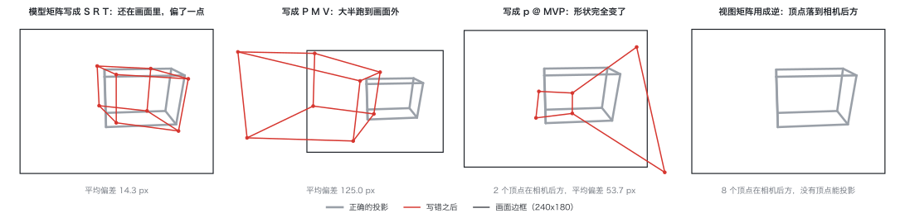
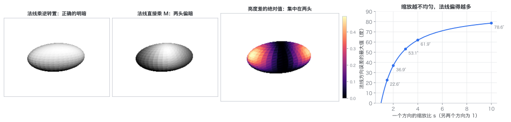
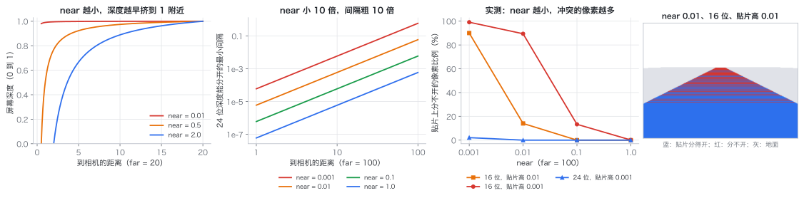
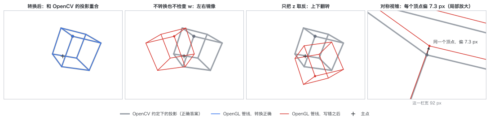
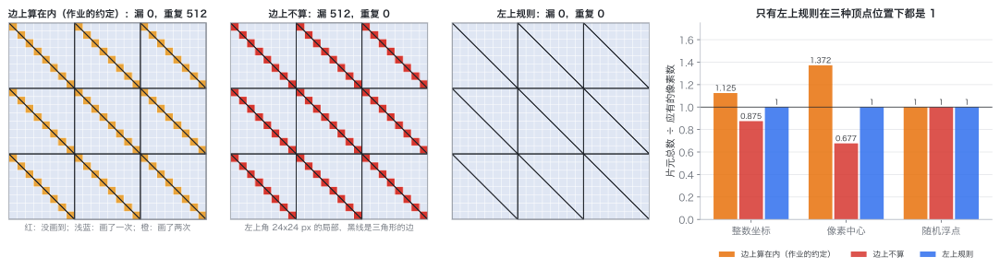
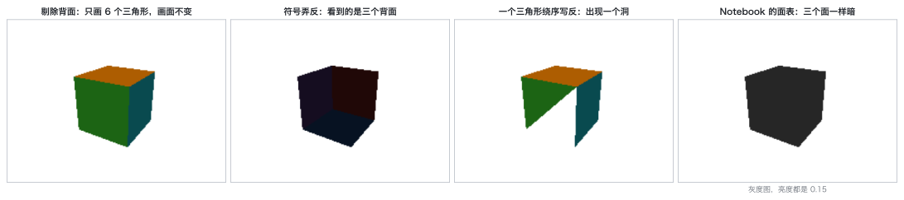
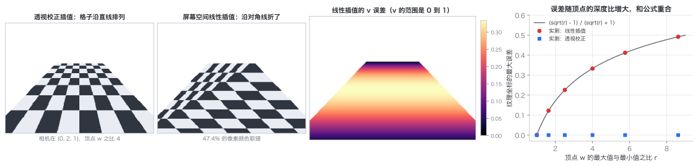

# 教程：3D 数学与渲染管线

> [!NOTE]
> 本章所有数字都记录在 [`figures/实测数字.json`](figures/实测数字.json)，由 `solutions` 分支的 `solutions/figures/ch21.py` 生成。视图矩阵、透视矩阵、屏幕映射和 z-buffer 用本章作业的参考实现；共享边规则、背面剔除这些作业里没有的功能，用配图脚本里另写的光栅器，它的“边上算在内”规则和参考实现逐像素核对过。本机没有运行真正的 OpenGL：第 6 节讲的是通用知识，没有在显卡上验证；深度缓冲位数的数字是按整数深度缓冲的量化规则算的。耗时是在一台 Apple 芯片 Mac 的 CPU 上测的一次结果。换成自己的场景和机器，数值会变，结论的方向要自己再测一遍。

## 0. 本章怎么学

**应用场景**：渲染设计数据做参考图、三维仿真、OpenGL 和 Shader。具体是三件事：把设计版图或三维结构渲染成“理想图像”，作为比对的参考；批量生成带标签的仿真图像，用来训练和测试算法；把标定好的相机搬进渲染器，让仿真图和真实图在几何上对齐。岗位要求里的“3D 数学”“OpenGL 渲染管线和 Shader 编程”从这一章入门。

**优先级**：P2，分到渲染或仿真方向再学。前置是第 7 章（针孔相机模型），齐次坐标在第 4 章。后面第 22 章在本章渲染出的图上加光学模糊和传感器噪声。

| 档位 | 累计用时 | 做什么 | 做到什么算完 |
|---|---:|---|---|
| 速通 | 3 小时 | 读第 1 节的“先看一个实验”、第 3 节全部、第 4 节到“绕序和背面剔除”为止，看懂图 1、图 3 到图 6，按第 8 节的五步玩一遍演示，答完 5 道小测 | 能讲清一个顶点从模型坐标到像素经过哪几步，OpenGL 和 OpenCV 两种相机约定怎样互相转换、不转换是什么症状，near 为什么不能设得太小 |
| 标准 | 15 小时 | 读完全章，跑 Notebook，完成作业 `21-1_软光栅.py` 并验收通过，做前三个破坏实验，填实验记录 | 3 项验收全部 PASS，实验记录里有两种相机约定的对照和一个渲染错误的案例，能回答自测问题 |
| 深挖 | 24 小时 | 再做后三个破坏实验和第 12 节的扩展，其中 LearnOpenGL 的部分要在自己的机器上写真正的 OpenGL 程序 | 能在自己的光栅器上报告一项改进前后的数字（透视校正、左上规则、包围盒三选一），或者写出带着色器的旋转立方体 |

> [!TIP]
> 用时超过所选档位的 1.5 倍还没做完，就把卡点写进 `学习进度.md`，先往下一章走。第 2 节的旋转表示和第 5 节的 PBR，速通档只看表格和结论就够。

## 1. 必备 3D 数学

### 先看一个实验：矩阵顺序写错，顶点落到哪里

渲染一个顶点要连乘三个矩阵：模型矩阵 $M$ 把物体摆到世界里，视图矩阵 $V$ 把世界变到相机坐标，投影矩阵 $P$ 做透视。列向量约定下写成

$$
p_{\text{clip}} = P\,V\,M\,p
$$

模型矩阵自己通常又是“先缩放、再旋转、再平移”，即 $M = T\,R\,S$。这些矩阵都是 4×4，谁和谁都能相乘，顺序写错了程序不会报错。

把每种错法量一遍。画面 240×180，垂直视场角 50°，near 0.5，far 20，物体是边长 2 的立方体。随机取 300 个场景：相机在距原点 5 到 8 的球面上看向原点，模型矩阵的平移在 ±1 以内、绕 y 轴旋转在 ±90° 以内、三个方向的缩放在 0.5 到 1.5 之间。每种写法都用参考实现的 `to_screen` 投影 8 个顶点，和正确写法比较。



| 写法（300 个随机场景） | 落到相机后方的顶点 | 留在视锥内的顶点 | 顶点偏差的中位数 |
|---|---:|---:|---:|
| 正确：P V M，其中 M = T R S | 0% | 98.8% | 0 px |
| 模型矩阵写成 S R T | 0% | 96.8% | 15.6 px |
| 模型矩阵写成 R T S | 0% | 98.9% | 12.0 px |
| 视图和模型换位，写成 P M V | 6.2% | 32.4% | 238.2 px |
| 投影和视图换位，写成 V P M | 50.3% | 0% | 339.2 px |
| 整个顺序倒过来，写成 M V P | 50.0% | 0% | 511.5 px |
| 按行向量的习惯写成 `p @ MVP` | 16.3% | 59.4% | 112.0 px |
| 视图矩阵用成了它的逆 | 52.9% | 8.5% | 449.0 px |

“留在视锥内”指像素坐标在画面内并且深度在 0 到 1 之间。偏差先在一个场景里对能投影的顶点取平均，再对 300 个场景取中位数。

读表的结论：

1. **三个大矩阵之间的顺序写错，结果很夸张**。把投影矩阵放错位置的两种写法，没有一个顶点留在视锥内，一半的顶点落到相机后方。画面全空或者满屏乱线，一眼能看出有问题。
2. **模型矩阵内部的顺序写错最难发现**。写成 S R T 之后，96.8% 的顶点仍然在视锥内，偏差的中位数只有 15.6 px，物体还在差不多的位置，只是歪了一点（图 1 第一栏）。这类错误常常被当成“参数没调好”。
3. **行向量和列向量的习惯不能混用**。NumPy 里 `p @ MVP` 等于用 MVP 的转置去乘列向量，59.4% 的顶点还在画面里，形状却完全不对。把 NumPy 的矩阵传给 OpenGL 时也有同一个问题，见第 6 节。
4. 排查时不要直接看最后的像素，逐级打印：模型变换后的世界坐标对不对，相机坐标的 $z$ 是不是负的（OpenGL 约定下相机看向 -Z），裁剪坐标的 $w$ 是不是正的。

<!-- quiz -->
**把模型矩阵里的 T R S 写成了 S R T，其他都对。渲染出来最可能是什么样？**

- A. 物体大半飞出画面，或者画面全空
- B. 物体还在画面里，位置和形状差十几个像素
- C. 程序抛出异常

<details markdown="1"><summary>答案与解释</summary>

**B**。实测 300 个随机场景里 96.8% 的顶点仍在视锥内，偏差中位数 15.6 px（画面宽 240 px）。A 是 P、V、M 三个大矩阵之间弄错顺序时的现象，例如写成 P M V 时偏差中位数 238.2 px，只有 32.4% 的顶点留在视锥内。矩阵都是 4×4，怎么乘都不会报错。

</details>
<!-- /quiz -->

### 向量、齐次坐标和变换顺序

**点积** a·b = |a||b|cosθ：投影长度、夹角、判断朝向（法线和光线方向的点积就是 Lambert 光照）。

**叉积** a×b：垂直于两者的向量，长度等于平行四边形面积。用来求法线、构造坐标系、判断三角形绕序（正负号）。

**齐次坐标**：3D 点写成 (x, y, z, 1)，方向写成 (x, y, z, 0)。好处是平移也能写成矩阵乘法，多个变换可以合并成一个 4x4 矩阵。方向的 w=0，所以不受平移影响。

用一组数看 w 的作用。法线 (0, 1, 0) 是方向，按 w = 0 乘一个平移 (5, 0, 0) 的矩阵，结果还是 (0, 1, 0)。如果错当成点、按 w = 1 去乘，结果变成 (5, 1, 0)，方向偏了 78.7°。齐次坐标的基础在第 4 章“齐次坐标：为什么平移也能乘矩阵”一节。

**变换顺序**：列向量约定下 p' = M3 M2 M1 p，最右边的先作用。“先缩放再旋转再平移”写成 T R S。顺序错了是最常见的 bug。

上面的实验量了这个 bug 有多大：模型矩阵内部写错是十几个像素，三个大矩阵之间写错是几百个像素。

### 法线变换

**法线变换**：物体做非均匀缩放时，法线要用模型矩阵的逆转置变换，否则不再垂直于表面。

推导只要一行。设 $t$ 是表面上的一个切向量，法线 $n$ 和它垂直，$n^\top t = 0$。切向量是表面上两点之差，跟着模型矩阵变成 $M t$（这里 $M$ 指模型矩阵左上角的 3×3 部分）。变换后的法线 $n'$ 要满足 $n'^\top M t = 0$，取 $n' = M^{-\top} n$ 就有

$$
(M^{-\top} n)^\top (M t) = n^\top M^{-1} M\,t = n^\top t = 0
$$

如果直接用 $M n$，在非均匀缩放下会错多少？先看方向。缩放取 $\operatorname{diag}(s, 1, 1)$，让法线在 xy 平面内扫过所有方向，记录 $M n$ 和 $M^{-\top} n$ 归一化之后的最大夹角：

| 缩放比 s : 1 : 1 | 1.5 | 2 | 3 | 4 | 10 |
|---|---:|---:|---:|---:|---:|
| 法线方向误差的最大值 | 22.62° | 36.87° | 53.13° | 61.93° | 78.58° |

最大误差出现在法线和缩放轴成 45° 的地方，数值等于 $\arctan s - \arctan(1/s)$。

再看它对光照的影响。把单位球用 $M = R_y(30^\circ)\,S(2, 1, 1)$ 变成椭球，画面 240×180，逐面计算 Lambert 亮度 $\max(0, n \cdot l)$，光的方向是 (0.4, 0.8, 0.6) 归一化，不加环境光。球面切成 1520 个三角形，椭球在画面上占 6733 个像素。



| 椭球（缩放 2 : 1 : 1）上的可见像素 | 数值 |
|---|---:|
| 法线方向误差的平均 | 24.0° |
| 法线方向误差的最大值 | 36.9° |
| 亮度绝对误差的平均（亮度范围 0 到 1） | 0.166 |
| 亮度绝对误差的最大值 | 0.495 |
| 亮度误差超过 0.1 的像素 | 55.9% |
| 平均亮度：正确的算法 | 0.718 |
| 平均亮度：法线直接乘 M | 0.552 |

1. 直接乘 $M$ 的法线被拉向缩放的方向。椭球沿长轴拉长之后，表面本来应该更“平”，法线更接近垂直于长轴；错误的算法却让法线朝长轴倒过去。在这个光照下的结果是两头变暗，整体平均亮度低了 23.1%。
2. 受光和背光判断反了的像素只有 0.6%。画面不会出现明显的黑白颠倒，只是明暗分布不对，这类错误靠肉眼不容易看出来。
3. 只有旋转和均匀缩放时两种算法没有差别：均匀缩放 1.7 倍加旋转 30° 时，两者的最大夹角是 1.5e-06°，属于数值误差。所以模型矩阵只含旋转、平移和均匀缩放时，直接用 $M$ 的 3×3 部分是可以的。

## 2. 旋转的几种表示

| 表示 | 参数 | 优点 | 缺点 |
|---|---|---|---|
| 旋转矩阵 | 9 个（3 个自由度） | 直接相乘 | 冗余，数值误差累积后不再正交 |
| 欧拉角 | 3 个 | 直观 | 顺序约定繁多，万向锁 |
| 轴角 / 旋转向量 | 3 个 | OpenCV 的 rvec 就是这个 | 插值不方便 |
| 四元数 | 4 个（单位） | 插值平滑（slerp），无万向锁 | 不直观 |

工程里：存储和插值用四元数，计算用矩阵，和 OpenCV 交互用旋转向量（`cv2.Rodrigues` 互转）。读别人的代码时，先确认欧拉角的轴顺序和内旋外旋约定。

### 把表里的说法量一下

下面的欧拉角都按 $R = R_z(\text{yaw})\,R_y(\text{pitch})\,R_x(\text{roll})$ 合成。

**连乘之后不再正交**。从单位阵出发，反复右乘同一个小旋转（绕 z 轴 1°、绕 x 轴 0.7°、绕 y 轴 0.3° 的合成），不做任何修正，看 $R^\top R$ 和单位阵差多少：

| 连乘次数 | 1000 | 100000 | 1000000 |
|---|---:|---:|---:|
| float32：$R^\top R$ 与单位阵的最大差 | 5e-06 | 0.00061 | 0.0061 |
| float64：$R^\top R$ 与单位阵的最大差 | 7.3e-14 | 6.7e-12 | 6.7e-11 |

float32 连乘一百万次之后偏了 0.0061，行列式和 1 差 0.0074，物体会被轻微地拉伸。float64 在这个次数下的误差是 6.7e-11，可以不管。所以“会不会不正交”取决于精度和连乘的次数：每帧在上一帧的矩阵上累乘、又用 float32 的程序才需要定期重新正交化，或者改成每帧从角度重新构造矩阵。

**万向锁**。俯仰角是 90° 时，(yaw 30°, roll 10°)、(yaw 20°, roll 0°)、(yaw 50°, roll 30°) 三组角度给出的旋转矩阵完全相同，元素之差不超过 1.1e-16。这时偏航和滚转绕的是同一根轴，只有两者之差起作用，三个角度只剩两个自由度。俯仰 89° 时前两组的矩阵只差 0.003，已经接近退化：偏航和滚转各差了 10°，旋转矩阵几乎没变，反过来从矩阵解欧拉角时，这两个角就很不稳定。

**旋转矩阵不能直接取平均**。单位阵和“绕 z 轴转 θ”的旋转矩阵逐元素取平均，得到的矩阵的行列式（旋转矩阵应该是 1）：

| 两个旋转相差 θ | 30° | 90° | 120° | 180° |
|---|---:|---:|---:|---:|
| 平均矩阵的行列式 | 0.933 | 0.5 | 0.25 | 0 |

相差 90° 时行列式只剩 0.5，物体被压扁；相差 180° 时矩阵退化。

**插值**。从欧拉角 (0°, 0°, 0°) 插值到 (yaw 90°, pitch 60°, roll 90°)，两个姿态之间的转角是 93.8°，把 $t$ 从 0 到 1 分成 100 步：

| 插值方式 | 每一步的转角 | 走过的总转角 | 中途偏离 slerp 最多 |
|---|---:|---:|---:|
| 四元数 slerp | 都是 0.938° | 93.8° | 基准 |
| 欧拉角逐分量线性插值 | 0.762° 到 1.404° | 108.2° | 25.2° |
| 四元数线性插值再归一化 | 0.840° 到 0.995° | 93.8° | 1.04° |

欧拉角插值走了弯路（108.2° 对 93.8°），速度忽快忽慢，中途的姿态和最短路径差了 25.2°。四元数线性插值再归一化走的是同一条路径，只是速度不完全均匀，最多偏 1.04°，实时程序里常用它代替 slerp。

顺带验证第 7 章讲过的一点：旋转向量的三个分量不是欧拉角。上面的终点姿态换成旋转向量是 (23.5°, 87.8°, 23.5°)（三个分量换算成度），模长 93.8° 才是总转角，和 (90°, 60°, 90°) 对不上。

## 3. 渲染管线：从顶点到像素

```text
模型坐标 --M--> 世界坐标 --V--> 相机坐标 --P--> 裁剪坐标 --÷w--> NDC --视口变换--> 屏幕像素
```

- **模型矩阵 M**：物体自身的摆放。
- **视图矩阵 V**：世界到相机，作业里的 `look_at` 构造它。OpenGL 约定相机看向 -Z、y 向上、x 向右。
- **投影矩阵 P**：透视投影把视锥（near 到 far 之间的棱台）映射成 [-1, 1]³ 的立方体。
- **透视除法**：裁剪坐标除以 w 得到 NDC（归一化设备坐标）。透视投影后 w = -z_camera，所以除以 w 就是“近大远小”。
- **视口变换**：NDC 映射到像素坐标。屏幕 y 向下，所以要翻转 y。

### 跟着一个顶点走一遍

用 Notebook 的场景：立方体的顶点 (1, 1, 1)，没有模型变换；相机在 (3, 2.5, 5) 看向原点；垂直视场角 50°，画面 240×180，near 0.5，far 20。

| 阶段 | 坐标 | 说明 |
|---|---|---|
| 世界坐标 | (1, 1, 1) | |
| 相机坐标 | (0.343, 0.378, -4.689) | $z$ 是负的，在相机前方 4.689 处 |
| 裁剪坐标 | (0.552, 0.812, 3.904, 4.689) | $w$ 等于 $-z_{\text{camera}}$ |
| NDC | (0.1176, 0.1731, 0.8326) | 前三个分量各除以 $w$ |
| 屏幕坐标 | (134.1, 74.4)，深度 0.9163 | 落在第 74 行、第 134 列的像素里 |

几个可以自己核对的地方：$f = 1/\tan(25^\circ) = 2.1445$，除以宽高比得 1.6084，乘相机坐标的 $x$ 就是裁剪坐标的 $x$。NDC 的 $y$ 是正的（在画面上半部），翻转之后 $y_{\text{pix}} = 74.4$ 小于画面高度的一半。深度已经到了 0.9163，而这个顶点沿视线方向离相机只有 4.689，far 是 20：深度不是按距离均匀分配的，下一小节专门讲。

**视图矩阵的直觉**。`look_at` 先算出相机的三根轴在世界坐标里的方向：向右的 $s$、向上的 $u$、视线方向 $f$。把世界点变到相机坐标，就是求它在这三根轴上的分量，所以旋转部分的三行是 $s$、$u$、$-f$（OpenGL 相机看向 -Z，所以第三行取负）；平移部分要保证相机自己落在原点，是 $-R\,\text{eye}$，不是 $-\text{eye}$。验收里“相机应在原点，目标点应在 -Z 轴上”查的就是这两件事。up 和视线平行时 $s$ 算不出来，作业要求抛出 `ValueError`。

**投影矩阵的前两行**。相机坐标里的点 $(x, y, z)$，$z$ 为负。垂直视场角是 fovy 时，画面上边缘对应 $y / (-z) = \tan(\text{fovy}/2)$，所以 $y_{\text{ndc}} = f\,y / (-z)$，$f = 1/\tan(\text{fovy}/2)$。水平方向的视野是垂直方向的 aspect 倍，所以 $x_{\text{ndc}} = (f/\text{aspect})\,x / (-z)$。矩阵乘法做不了除法，于是让最后一行输出 $w = -z$，把除法留给后面的透视除法。

### 透视矩阵的第三行

```text
z_ndc = ((f+n)/(n-f) · z + 2fn/(n-f)) / (-z)
```

z = -n 时 z_ndc = -1，z = -f 时 z_ndc = 1。这个映射是**非线性**的（和 1/z 成线性关系），近处精度高、远处精度低。near 设得太小，远处深度会挤在一起，出现 z-fighting（两个面闪烁交替）。

第三行为什么是这个形式：$x$、$y$ 都除以了 $-z$，深度也只能写成 $(A z + B)/(-z)$。两个未知数用两个条件定出来，就是上面两个端点。

把它换成到相机的距离 $d = -z$，再映射到 0 到 1 的屏幕深度（作业的约定，近平面 0，远平面 1）：

$$
\text{depth}(d) = \frac{f}{f - n}\left(1 - \frac{n}{d}\right)
$$

深度缓冲只能存有限个等级。$b$ 位的整数深度缓冲有 $2^b - 1$ 个台阶，一个台阶对应的距离变化是

$$
\Delta d \approx \frac{d^2\,(f - n)}{f\,n}\cdot\frac{1}{2^b - 1}
$$

两个面的距离差小于 $\Delta d$，它们的深度就落在同一个台阶里，分不出前后。$f \gg n$ 时这个式子约等于 $d^2 / (n\,2^b)$：**和距离的平方成正比，和 near 成反比，far 几乎不起作用**。

far 固定为 100，改变 near：

| near | 深度到 0.5 时的距离 | 距离 10 处的深度 | 距离 10 以外占用的深度范围 | 24 位：距离 10 处的最小间隔 | 24 位：距离 50 处的最小间隔 | 16 位：距离 10 处的最小间隔 |
|---|---:|---:|---:|---:|---:|---:|
| 0.001 | 0.002 | 0.99991 | 0.009% | 0.006 | 0.15 | 1.5 |
| 0.01 | 0.02 | 0.9991 | 0.09% | 0.0006 | 0.015 | 0.15 |
| 0.1 | 0.1998 | 0.990991 | 0.9% | 6e-05 | 0.0015 | 0.015 |
| 1.0 | 1.98 | 0.909091 | 9.1% | 5.9e-06 | 0.00015 | 0.0015 |

“最小间隔”是按上面的公式算出的理论值，不是在显卡上实测的。

1. **一半的深度值花在 near 到 2 倍 near 之间**。near 是 0.1 时，距离 0.1998 处深度就到了 0.5；距离 10 以外、占了视锥九成长度的那一段，只分到 0.9% 的深度范围。near 是 0.001 时只剩 0.009%。
2. **near 每小 10 倍，远处的深度分辨率就粗 10 倍**。24 位深度缓冲在距离 50 处，near 取 1.0 时能分开相距 0.00015 的两个面，取 0.001 时要相距 0.15 才分得开。原讲义自测问题里“near 从 0.1 改成 0.001”的答案是：各处的最小间隔都变成 100 倍。
3. **far 几乎没有影响**。near 是 0.1 时，把 far 从 100 加到 1000 再加到 10000，24 位深度缓冲在距离 50 处的最小间隔是 0.001489、0.00149、0.00149。想改善远处的精度，把 far 调小没有用，要把 near 推远。

上面是公式。下面用参考实现实测一次深度冲突。画面 320×240，far 100，相机在 (0, 1.5, 0) 斜着看地面；地面上方很近的地方平放一块贴片（宽 6，从距离 2 铺到 80）。地面和贴片各用 `render_depth` 画一次，再把深度量化成 16 位或 24 位整数。贴片的量化深度不小于地面的，就算“分不开”：用“更近才写入”的深度测试时，这样的像素谁先画谁赢。



| 贴片上分不开的像素比例 | near 0.001 | near 0.01 | near 0.1 | near 1.0 |
|---|---:|---:|---:|---:|
| 贴片高 0.01，16 位 | 90.0% | 14.0% | 0% | 0% |
| 贴片高 0.001，16 位 | 99.1% | 89.4% | 13.3% | 0.1% |
| 贴片高 0.01，24 位 | 0% | 0% | 0% | 0% |
| 贴片高 0.001，24 位 | 2.1% | 0% | 0% | 0% |

1. 同一个场景、同样 16 位的深度，near 从 0.1 改成 0.001，贴片高 0.01 时分不开的像素从 0% 变成 90.0%。
2. 冲突从远处开始。贴片高 0.01、16 位时，near 0.01 下最近的一处冲突在距离 5.0，near 0.001 下提前到距离 2.5，贴片从距离 2 才开始铺，几乎一上来就分不开。图 3 右边的红色集中在画面上方（远处），并且和蓝色交替成条纹，这就是 z-fighting 在静态图里的样子；相机一动条纹就跟着跳，看上去是闪烁。
3. 位数多能缓解，不能根除。24 位下只有 near 0.001、贴片高 0.001 这一格出现了 2.1% 的冲突，最近的一处在距离 14。

Notebook 最后一个实验画的就是图 3 左边这三条线。far 是 20 时，距离 5 处的深度在 near 取 0.01、0.5、2.0 时分别是 0.9985、0.9231、0.6667。

工程上的做法：near 在不切到物体的前提下尽量大；两个面确实要贴在一起时（贴花、阴影贴图），用 OpenGL 的 `glPolygonOffset` 给其中一个加一点深度偏移；视距范围很大的场景常用浮点深度缓冲配合“反向深度”（近平面映射到 1、远平面映射到 0）。后两项是通用做法，本章没有实测。

<!-- quiz -->
**near 是 0.1，far 是 10000，远处的两个面出现了深度冲突。把 far 减小到 100，远处（距离 50）的深度分辨率能改善多少？**

- A. 大约 100 倍
- B. 大约 10 倍
- C. 几乎不变

<details markdown="1"><summary>答案与解释</summary>

**C**。24 位深度缓冲在距离 50 处能分开的最小间隔，far 取 10000 时是 0.00149，取 100 时是 0.001489，到第四位有效数字才有差别。深度和 $1/d$ 成线性关系，绝大部分深度值都花在 near 附近，far 那一头本来就没占多少。有用的是把 near 推远：near 从 0.1 改成 1.0，同一位置的最小间隔从 0.0015 变成 0.00015。

</details>
<!-- /quiz -->

### 和视觉的相机约定对照

| | OpenGL | OpenCV |
|---|---|---|
| 相机看向 | -Z | +Z |
| y 轴 | 向上 | 向下 |
| 投影 | 投影矩阵到 NDC | 内参 K 直接到像素 |

两者之间相当于绕 x 轴转 180°（y、z 取反）。把标定得到的 K、R、t 用于 OpenGL 渲染时，要转换坐标系，并且根据 fx、fy、cx、cy 和图像尺寸构造对应的投影矩阵（注意主点偏移会让视锥不对称）。这是做“仿真图和真实图对齐”时的必经步骤。

下面把这段话写成能直接用的矩阵，并量一下每一步漏掉时的症状。相机用第 7、17 章那台合成相机：640×480，$f_x = 820$，$f_y = 790$，主点 (318, 247)，长度单位毫米。符号和那两章一致：OpenCV 约定下 $P_c = R\,P_w + t$。

**坐标轴的转换**。同一个点在两种相机坐标系里只差 y、z 的符号，所以

```math
V_{\text{GL}} = F \begin{bmatrix} R & t \\ 0 & 1 \end{bmatrix},
\qquad
F = \begin{bmatrix} 1 & 0 & 0 & 0 \\ 0 & -1 & 0 & 0 \\ 0 & 0 & -1 & 0 \\ 0 & 0 & 0 & 1 \end{bmatrix}
```

$F$ 乘自己等于单位阵，所以反方向也是同一个式子：把 OpenGL 的视图矩阵左乘 $F$，就得到 OpenCV 约定的 $[R \mid t]$。

**由 K 构造投影矩阵**。要求 OpenGL 管线算出的像素和 $u = f_x X_c / Z_c + c_x$、$v = f_y Y_c / Z_c + c_y$ 一致，按作业的视口约定（屏幕 y 向下）倒推回去，得到

```math
P = \begin{bmatrix}
\dfrac{2 f_x}{W} & 0 & 1 - \dfrac{2 c_x}{W} & 0 \\
0 & \dfrac{2 f_y}{H} & \dfrac{2 c_y}{H} - 1 & 0 \\
0 & 0 & \dfrac{f + n}{n - f} & \dfrac{2 f n}{n - f} \\
0 & 0 & -1 & 0
\end{bmatrix}
```

这里第三行的 $f$、$n$ 是远、近平面。这个式子假设倾斜系数 $\gamma = 0$，不含畸变。代入这台相机，$P_{00} = 2.5625$，$P_{11} = 3.2917$，第三列的两个偏移项是 0.00625 和 0.02917。主点正好在画面中心时这两项为 0，矩阵退化成作业里的 `perspective`；这台相机的主点离中心 (-2, 7) px，所以视锥是不对称的。

用边长 100 mm 的立方体和 300 个随机位姿来量。位姿和第 7 章图 1 用的是同一批，正确答案是 OpenCV 约定下的针孔投影，被比较的是参考实现的 `to_screen` 在各种写法下给出的像素坐标。



| 写法（300 个随机位姿） | 症状 | 顶点偏差的中位数 |
|---|---|---:|
| 视图矩阵左乘 F，投影矩阵由 K 构造 | 和 OpenCV 的投影重合 | 最大 1.27e-13 px |
| 不转换，直接把 R、t 拼成的外参矩阵当视图矩阵 | 300 个位姿里 8 个顶点全部在相机后方，`to_screen` 全部输出 NaN | 画不出来 |
| 不转换，也不检查 w，照样做除法 | 绕主点左右镜像 | 157.1 px |
| 只把 z 取反，y 没有取反 | 绕主点上下翻转 | 150.0 px |
| 坐标轴转换了，投影用对称视锥（不管主点） | 整体平移 | 7.28 px |
| 同上，并且宽高比直接取 W/H | 平移之外水平方向还差一个比例 | 7.884 px，最大 11.2 px |

读表的结论：

1. **不转换的症状取决于程序检不检查深度**。检查的话什么都画不出来，不检查就是左右镜像。镜像那一行的 157.1 px 和第 7 章表里“OpenGL 约定的位姿不转换就交给 `cv2.projectPoints`”的 157.1 px 是同一个数：那边是 OpenGL 的位姿进了 OpenCV，这边是 OpenCV 的位姿进了 OpenGL，方向相反，症状相同。图 4 用的位姿上，不转换的结果和“绕主点左右镜像”的差不超过 5.7e-14 px。
2. **只改一个轴是另一种错**。只把 z 取反，点回到了相机前方，画面却上下颠倒。y、z 必须一起取反，合起来才是一个旋转（绕 x 轴 180°）；只取反一个轴是镜像，物体的左右手性会变。
3. **主点不在中心时不能用对称视锥**。用 `perspective(fovy, aspect)` 代替上面的矩阵，每个顶点都偏 7.28 px，正好是主点到画面中心的距离。这时等效的垂直视场角是 33.8°。
4. **$f_x \ne f_y$ 时宽高比不是 W/H**。等效的宽高比是 $(W / f_x) / (H / f_y) = 1.2846$，图像的宽高比是 1.3333。直接用后者，偏差从 7.28 px 涨到 7.884 px，最大 11.2 px，而且离主点越远偏得越多。

还有一个半像素的坑。OpenCV 的像素坐标里，整数落在像素中心；本章作业和 OpenGL 的屏幕坐标里，像素中心在整数加 0.5 的位置。直接把标定得到的 $c_x$、$c_y$ 填进上面的矩阵，渲染出来的图会整体偏半个像素。取 200 个正对相机的随机矩形，用由 K 构造的投影矩阵和 `render_depth` 光栅化，比较被覆盖像素的下标的质心和 OpenCV 投影出的角点的质心：直接用 $c_x$、$c_y$ 时，两者平均差 (-0.5, -0.49) px；改用 $c_x + 0.5$、$c_y + 0.5$ 之后是 (0.05, 0.0) px。第 16 章第 1 节的结论是错位要压到 0.1 px 左右才不产生误报，仿真图要和真实图逐像素比较时，这半个像素不能忽略。

<!-- quiz -->
**把 OpenCV 标定得到的 [R|t] 不做转换，直接当成视图矩阵交给本章作业的 `to_screen`。结果是什么？**

- A. 画面左右镜像
- B. 所有顶点都输出 NaN
- C. 画面上下颠倒

<details markdown="1"><summary>答案与解释</summary>

**B**。OpenCV 约定下物体在相机的 +Z 方向，OpenGL 的相机看向 -Z，不转换的话所有点都在相机后方，裁剪坐标的 $w$ 为负。作业的 `to_screen` 对 $w \le 0$ 的点输出 NaN，实测 300 个位姿里 8 个顶点全部如此。A 是不检查 $w$、照样做除法时的症状（偏差中位数 157.1 px，和第 7 章的实测相同）；C 是只把 z 取反、忘了 y 的症状（150.0 px）。

</details>
<!-- /quiz -->

### 正交投影

把二维的版图渲染成俯视的参考图时用不着透视，合适的是正交投影：没有近大远小，$x$、$y$ 只做平移和缩放。把 $x \in [l, r]$、$y \in [b, t]$、$-z \in [n, f]$ 的长方体映射到 NDC 的矩阵是

```math
P_{\text{ortho}} = \begin{bmatrix}
\dfrac{2}{r - l} & 0 & 0 & -\dfrac{r + l}{r - l} \\
0 & \dfrac{2}{t - b} & 0 & -\dfrac{t + b}{t - b} \\
0 & 0 & -\dfrac{2}{f - n} & -\dfrac{f + n}{f - n} \\
0 & 0 & 0 & 1
\end{bmatrix}
```

最后一行是 (0, 0, 0, 1)，所以 $w$ 恒为 1，透视除法什么也不做；深度是 $z$ 的线性函数，上一小节的非线性问题不存在。第 17 章讲过远心镜头的投影更接近正交投影，仿真这类镜头时用它。

### 相机后方的顶点和裁剪

透视除法只对相机前方的点有意义。作业的约定是：裁剪坐标 $w \le 0$ 的点由 `to_screen` 输出 NaN，含 NaN 顶点的三角形在 `render_depth` 里画不出任何像素。这等于把“有顶点在相机后方”的三角形整个丢掉。

它的代价可以量出来。把相机放进边长 2 的立方体内部（位置和朝向随机，100 次，near 0.1）。相机在封闭的盒子里，每个像素都应该看到内壁，真值用视线和内壁求交算出。

| 相机在立方体内部（100 次） | 数值 |
|---|---:|
| 8 个顶点里在相机后方的平均个数 | 4.01 |
| 12 个三角形里含后方顶点的平均个数 | 10.11 |
| 作业的做法：没有画出来的像素（平均） | 39.8% |
| 作业的做法：画面完整的次数 | 17 |
| 作业的做法：画出来的像素与真值的最大深度差 | 3.6e-14 |
| 不检查 w：画上了但深度不对的像素（平均） | 38.5% |
| 不检查 w：没有画出来的像素（平均） | 1.4% |

1. 作业的做法画出来的像素都是对的，但平均缺了 39.8% 的画面，100 次里只有 17 次是完整的，最差的一次整幅图都是空的。
2. 不检查 $w$ 更糟：画面看上去是满的，其中平均 38.5% 的像素深度是错的。相机后方的顶点除以负的 $w$ 之后被翻到了画面另一侧，三角形被拉成了完全不同的形状。空着的洞看得见，填错的像素看不出来。
3. 真正的渲染器两样都不做。它在透视除法之前、在裁剪空间里把三角形沿近平面切开，只留下前面的那一部分，可能变成一个或两个新的三角形。OpenGL 里这一步由硬件完成，自己写光栅器时要实现它才能把相机放到物体附近或内部。这是第 12 节的一个扩展题。

## 4. 光栅化

把投影后的三角形变成像素：

1. 计算三角形的包围盒，只遍历盒内的像素。
2. 对每个像素中心 (x+0.5, y+0.5)，用**重心坐标**判断是否在三角形内：三个坐标都非负就在内部（边上的点可以算在内）。
3. 用重心坐标插值深度、颜色、纹理坐标、法线。
4. **深度测试（z-buffer）**：维护每个像素当前最近的深度，新片元更近才写入。这样绘制顺序就无关紧要了。

**重心坐标**用有向面积计算：

```text
area = (x1-x0)(y2-y0) - (x2-x0)(y1-y0)
w0 = ((x1-px)(y2-py) - (x2-px)(y1-py)) / area
w1 = ((x2-px)(y0-py) - (x0-px)(y2-py)) / area
w2 = 1 - w0 - w1
```

area 的正负表示绕序，除以 area 后两种绕序都能得到正的重心坐标。area 为 0 是退化三角形，直接跳过。

**透视校正插值**：严格来说，颜色和纹理坐标应该在 1/w 空间插值才正确，屏幕空间直接线性插值会在顶点深度相差大的三角形上产生纹理扭曲。深度如果用 NDC 的 z，在屏幕空间线性插值是正确的。作业只要求深度。

第 4 步说的“绘制顺序无关紧要”可以直接验证：把图 2 那个椭球的 1520 个三角形随机打乱顺序画 20 次，20 次的深度图都和原来逐像素相同。反过来，第 8 节的演示里关掉深度测试，立方体的像素有 54.5% 变了颜色。

下面四个小节把这四步里容易出问题的地方各量一遍：第 2 步括号里那句“边上的点可以算在内”，area 的正负号，上面那段透视校正插值，以及第 1 步的包围盒。

### 共享边上的像素归谁

两个三角形共享一条边，某个像素中心正好落在这条边上。按“边上算在内”，两个三角形都会画它；按“边上不算”，两个都不画。

用一块网格来数。8×8 个边长 8 px 的方格，每格沿对角线切成两个三角形，共 128 个三角形，铺成一块 64×64 px 的平面。比较三种规则：边上算在内（作业的约定，参考实现也是这样）；边上不算；左上规则（像素中心正好在边上时，只有这条边是三角形的左边或上边才算，下面解释）。顶点的位置取三种：整数坐标、像素中心（整数加 0.5）、随机的浮点坐标。



| 顶点位置（统计区域的像素数） | 规则 | 没画到的像素 | 画了两次以上的像素 | 片元总数 ÷ 应有像素数 |
|---|---|---:|---:|---:|
| 整数坐标（4096） | 边上算在内 | 0 | 512 | 1.125 |
| | 边上不算 | 512 | 0 | 0.875 |
| | 左上规则 | 0 | 0 | 1 |
| 像素中心（3969） | 边上算在内 | 0 | 1281 | 1.372 |
| | 边上不算 | 1281 | 0 | 0.677 |
| | 左上规则 | 0 | 0 | 1 |
| 随机浮点坐标（50 个网格共 156800） | 三种规则 | 0 | 0 | 1 |

1. **顶点在整数坐标时，对角线正好穿过像素中心**。每个方格的对角线经过 8 个像素中心，64 个方格共 512 个，占 12.5%。“边上算在内”把它们画了两次，“边上不算”把它们漏掉。顶点在像素中心时更糟：水平边、竖直边和顶点本身都压在像素中心上，一个像素最多被 6 个三角形同时画到。
2. **顶点是随机浮点坐标时，三种规则没有差别**。50 个网格、156800 个像素里，没有一个像素中心正好落在边上。所以这个问题在随便摆的三维模型上很少露面，它专门出现在顶点落在整数或半整数坐标的场合：按网格对齐的版图多边形、界面上的矩形、手写的测试用例。
3. **只写深度时，画两次没有后果**，两个三角形在公共边上的深度相同。一旦像素的值是累加出来的（半透明混合、统计覆盖次数、把多边形的面积累加成灰度），画两次就是多算一次，接缝处会出现一条比两边亮或暗的线。漏画则会从接缝里露出背景。
4. **左上规则**让每个像素正好属于一个三角形。屏幕 y 向下时，“上边”是水平并且三角形在它下方的边，“左边”是三角形在它右侧的边。像素中心落在边上时，只有这条边是上边或左边才算在三角形内。共享边对一个三角形是左边，对另一个就是右边，所以不会两边都算、也不会两边都不算。Direct3D 的规范里明确写的是这条规则；OpenGL 的规范要求的是结果：共享一条边的两个三角形，对落在边上的像素中心恰好产生一个片元。
5. **作业要按“边上算在内”实现**。验收用的三角形 (0,0)、(8,0)、(0,8) 在这条规则下覆盖 36 个像素中心，其中 8 个在斜边上；换成“边上不算”或左上规则都是 28 个，验收会判错。左上规则留到第 12 节当扩展题。

<!-- quiz -->
**一块三角形网格，顶点都是随机的浮点坐标。把规则从“边上算在内”改成“边上不算”，网格内部会漏掉多少像素？**

- A. 大约八分之一
- B. 一个也不漏
- C. 每条边漏一行

<details markdown="1"><summary>答案与解释</summary>

**B**。实测 50 个随机网格、156800 个像素里，三种规则都是每个像素正好画一次，因为没有像素中心正好落在边上。A 是顶点在整数坐标时的情况：4096 个像素里漏 512 个（12.5%），因为对角线正好穿过像素中心。这类问题在顶点对齐到像素网格时才出现。

</details>
<!-- /quiz -->

### 绕序和背面剔除

封闭的不透明物体，背对相机的面永远被朝向相机的面挡住，画了也白画。渲染器可以在光栅化之前把它们丢掉，这叫背面剔除。判断一个三角形朝哪边，用的就是上面的 area：建模时约定“从物体外面看，顶点按逆时针排列”（OpenGL 默认把这样的面当正面），投影之后朝向相机的面和背对相机的面，area 的符号相反。

容易弄错的是符号。数学书里逆时针对应正的有向面积，那是在 y 向上的坐标系里；屏幕坐标 y 向下，符号正好反过来。用演示页的立方体（12 个三角形，从外面看都是逆时针）在 200 个随机视点上量，画面 240×180：

| 200 个随机视点 | 结果 |
|---|---:|
| 朝向相机的三角形，屏幕上的 area 为负的视点比例 | 全部 |
| 朝向相机的三角形数：2 个、4 个、6 个的视点数 | 4、77、119 |
| 朝向相机的三角形数的平均（共 12 个） | 5.15 |
| 只画 area 为负的三角形，深度图和全画逐像素相同的视点比例 | 全部 |
| 符号弄反（只画 area 为正的）：轮廓不变的视点比例 | 全部 |
| 符号弄反：轮廓内深度变大的像素比例 | 全部 |
| 一个朝前的三角形绕序写反，开着剔除：缺掉的像素占轮廓的比例（中位数） | 19.0% |
| 同上，不开剔除：覆盖不变、深度差小于 1e-12 的视点比例 | 全部 |



1. **剔除不改变画面，只省计算**。对封闭的凸物体，丢掉背面之后深度图逐像素不变，要光栅化的三角形从 12 个降到平均 5.15 个。
2. **符号弄反时轮廓不变**。画出来的是立方体的三个背面，占的像素和正确结果一样，只是每个像素的深度都变大了（平均大 0.0221），颜色和明暗是背面的（图 6 第二栏）。只看轮廓或者只看有没有画出东西，发现不了这个错误。
3. **一个三角形的绕序写反，开着剔除就是一个洞**。图 6 的视点下立方体占 6220 个像素，洞有 1807 个。不开剔除时深度图不变，因为按作业的写法两种绕序都能画。所以模型里绕序不一致的毛病，在自己的软光栅里看不出来，换到开着剔除的 OpenGL 里才会暴露。
4. 作业不做剔除：验收要求“顺时针和逆时针绕序应得到同样的覆盖”。

> [!WARNING]
> Notebook 里“逐面 Lambert”那个单元画出来的三个面一样暗，这是 Notebook 的面表造成的，不是你的光栅器有错。Notebook 的 `FACES` 从外面看是顺时针的，按 `n = cross(V[b] - V[a], V[c] - V[a])` 算出的 12 条法线全部指向立方体内部。三个可见面的法线都背对光源，$\max(0, n \cdot l)$ 都是 0，可见的 6220 个像素亮度全是 0.15（图 6 最右）。在那一行后面加一句 `n = -n`，三个面的亮度变成 0.466、0.624、0.781。深度图不受影响。这件事已经报给课程的维护者。

### 透视校正插值

三角形内部的属性（纹理坐标、颜色、法线）在三维空间里是线性变化的，投影到屏幕之后就不再是屏幕坐标的线性函数了，因为中间除了一个各顶点不同的 $w$。正确的做法是先把每个顶点的属性除以自己的 $w$，在屏幕上线性插值 $a/w$ 和 $1/w$，再相除：

$$
a = \frac{\lambda_0\,a_0 / w_0 + \lambda_1\,a_1 / w_1 + \lambda_2\,a_2 / w_2}{\lambda_0 / w_0 + \lambda_1 / w_1 + \lambda_2 / w_2}
$$

$\lambda_i$ 是屏幕上的重心坐标，也就是上面的 w0、w1、w2（名字撞了，这里换个字母）。

实验：地面上一块矩形（x 从 -2 到 2，z 从 -1 到 -9），切成两个三角形，四个角的纹理坐标 $(u, v)$ 是 (0,0)、(1,0)、(1,1)、(0,1)，画面 320×240。真值用每个像素中心的视线和地面求交得到。相机都看向 (0, 0, -5)，从正上方一路降到贴近地面。



| 相机位置 | 顶点 w 的最大值与最小值之比 r | 矩形占的像素数 | 线性插值：v 的最大误差 | 公式值 | 线性插值：棋盘格取错的像素 | 透视校正：最大误差 |
|---|---:|---:|---:|---:|---:|---:|
| 正上方俯视 | 1.0 | 14792 | 2.8e-15 | 0 | 0% | 2.8e-15 |
| (0, 8, 1) | 1.63 | 19002 | 0.122 | 0.122 | 45.9% | 1.1e-14 |
| (0, 4, 2) | 2.51 | 24298 | 0.226 | 0.226 | 44.8% | 8.2e-15 |
| (0, 2, 1) | 4.0 | 36118 | 0.333 | 0.333 | 47.4% | 2.2e-14 |
| (0, 1, 0.5) | 5.76 | 35962 | 0.412 | 0.412 | 46.0% | 3.8e-15 |
| (0, 0.5, 0) | 8.62 | 32294 | 0.492 | 0.492 | 47.7% | 4.7e-15 |

“公式值”是 $(\sqrt{r} - 1)/(\sqrt{r} + 1)$，沿一条边把属性从近端线性插到远端时的最大误差。

1. **误差由顶点的深度比决定，和三角形在屏幕上有多大无关**。正上方俯视时矩形占了 14792 个像素，四个顶点的 $w$ 相同，线性插值的误差是 2.8e-15。原讲义写的是“在大三角形上产生纹理扭曲”，本节开头已经改成“在顶点深度相差大的三角形上”：正对相机的三角形再大也没有误差，斜着看的小三角形也有。
2. **深度比不用很大，误差就很可观**。$r = 1.63$ 时 $v$ 的最大误差已经是 0.122，纹理坐标的整个范围才是 1。8×8 的棋盘格每格宽 0.125，所以从这一行往下，接近一半的像素颜色都取错了。
3. **实测和公式吻合**，表里六行的两列数字到三位有效数字都相同。
4. 透视校正之后，六个位置的最大误差都不超过 2.2e-14。

那句“深度如果用 NDC 的 z，在屏幕空间线性插值是正确的”也验证了：同一组实验里，屏幕深度线性插值和真值的差，六个位置都不超过 4.4e-16。原因是屏幕深度是 $1/w$ 的线性函数，而 $1/w$ 在屏幕上本来就是线性的。相机坐标的 $z$ 就不行：相机在 (0, 2, 1) 时四个顶点的 $z$ 跨度是 7.59，线性插值最多错 2.53。所以 z-buffer 里存的是投影之后的深度，作业只插值深度，不需要透视校正；想要线性的深度（例如导出深度图给后面的算法用），要从屏幕深度反算回去，不能直接插值相机坐标的 $z$。

OpenGL 的着色器之间传递的变量默认就是透视校正插值的；GLSL 里给变量加 `noperspective` 限定符得到的是屏幕空间线性插值，加 `flat` 则不插值。

<!-- quiz -->
**一个四边形正对相机，在画面上占了一万多个像素。用屏幕空间线性插值算它的纹理坐标，不做透视校正，误差有多大？**

- A. 没有误差
- B. 三角形越大误差越大，这么大的四边形误差很明显
- C. 误差是纹理范围的三分之一左右

<details markdown="1"><summary>答案与解释</summary>

**A**。实测正上方俯视的矩形占 14792 个像素，线性插值的最大误差是 2.8e-15。误差只取决于顶点 $w$ 的最大值与最小值之比 $r$，正对相机时所有顶点的 $w$ 相同。C 是 $r = 4.0$ 时的数字（0.333），那是相机在 (0, 2, 1) 斜着看地面的情况。

</details>
<!-- /quiz -->

### 耗时：每个三角形要看多少像素

本节开头第 1 步说“计算三角形的包围盒，只遍历盒内的像素”。作业不要求这一步，参考实现也没有做：它对每个三角形都算整幅图的重心坐标，写法最短，代价是耗时正比于“三角形数 × 画面像素数”，和三角形多大无关。

下面的耗时是在一台 Apple 芯片 Mac 的 CPU 上测的一次结果，每项取 3 次里最快的一次，测的时候机器上还有别的任务，只看量级和倍数。随机三角形的顶点离各自中心不超过画面宽度的 6%。

| 画面 | 三角形数 | 参考实现 | 包围盒版本 |
|---|---:|---:|---:|
| 160×120 | 12 | 1.1 ms | 0.19 ms |
| 160×120 | 1000 | 92 ms | 16 ms |
| 320×240 | 12 | 3.9 ms | 0.21 ms |
| 320×240 | 1000 | 310 ms | 18 ms |
| 640×480 | 12 | 15 ms | 0.31 ms |
| 640×480 | 1000 | 1200 ms | 27 ms |

1. 参考实现的耗时跟着“三角形数 × 像素数”走。320×240 下 1000 个三角形是 12 个的 79 倍（三角形数之比是 83.3）；100 个三角形时 640×480 是 160×120 的 13 倍（像素数之比是 16）。
2. 三角形小的时候包围盒省得多：1000 个小三角形，640×480 下两者差 44 倍，160×120 下差 5.8 倍。画面越大，一个小三角形的包围盒占画面的比例越小。
3. 包围盒不是白拿的。100 个各盖住半个画面的大三角形（320×240），参考实现 30 ms，包围盒版本 43 ms，没有变快。
4. 不要写逐像素的 Python 循环。160×120、12 个三角形，纯 Python 的两层循环是 16 ms，参考实现是 1.1 ms，差 14 倍，而参考实现本身还远不是最快的写法。

作业的验收只用 10×10 的图，怎么写都很快。Notebook 里渲染 240×180、12 个三角形也在几毫秒的量级。想渲染几千个三角形的模型时，再加包围盒。

## 5. 着色

**Lambert 漫反射**：亮度 = 反射率 × max(0, n·l)，n 是法线，l 是指向光源的方向。和视线方向无关。

用图 6 的立方体算一下。光的方向是 (0.4, 0.8, 0.6) 归一化，按 Notebook 的写法加 0.15 的环境光，亮度是 $0.15 + 0.85 \max(0, n \cdot l)$。从 (3, 2.5, 5) 能看到的三个面，法线分别朝 +x、+y、+z，亮度是 0.466、0.781、0.624：朝上的面最亮，因为光主要从上方来。相机挪到别的位置，这三个数不变。

**Phong / Blinn-Phong 高光**：在漫反射之外加一个高光项。Blinn-Phong 加的是 (n·h)^shininess，h 是光线和视线的半程向量；Phong 加的是 (r·v)^shininess，r 是光线关于法线的反射方向，v 是指向眼睛的方向。金属、抛光晶圆表面有强镜面反射，检测里的明场和暗场照明效果都和这个有关（第 22 章）。

> [!NOTE]
> 原讲义把两个模型写成了同一个式子 (n·h)^shininess，这里分开了。两者用同一个指数时高光的大小不一样，照着一个模型调好的指数不能直接搬到另一个模型里。

光线、法线、视线在同一个平面内时，$n$ 和 $h$ 的夹角正好是 $r$ 和 $v$ 的夹角的一半。按公式算高光项降到一半时的角度：

| 指数 s | 8 | 32 | 128 |
|---|---:|---:|---:|
| 高光项降到 0.5 时的夹角 | 23.51° | 11.88° | 5.96° |
| Blinn-Phong 用同样的指数，换算成 r 和 v 的夹角 | 47.02° | 23.76° | 11.91° |
| 要让 Blinn-Phong 和 Phong 一样宽，指数要取 | 32.7 | 128.7 | 512.7 |

同样的指数，Blinn-Phong 的高光按角度算宽一倍；要一样宽，指数大约取 4 倍（表里是 4.09、4.02、4.01 倍）。这是纯公式的结果。

**PBR（基于物理的渲染）**：用微表面模型（粗糙度、金属度）描述材质，能量守恒，现代引擎的标准。做高保真仿真时会用到。

**插值之后的法线要重新归一化**。逐像素着色时，法线是从三个顶点的法线插值来的。两个单位向量取平均，长度会变短：

| 两个顶点法线的夹角 | 10° | 30° | 60° | 90° | 120° |
|---|---:|---:|---:|---:|---:|
| 正中间插值出的向量长度 | 0.9962 | 0.9659 | 0.866 | 0.7071 | 0.5 |

不归一化就去算 $n \cdot l$，亮度会按这个比例变暗，三角形中间比顶点附近暗，网格越粗越明显。这就是第 6 节的片元着色器里要写 `normalize(vNormal)` 的原因。

## 6. OpenGL 管线和 GLSL

这一节是 OpenGL 的通用知识。本章没有在显卡上运行 OpenGL，下面的内容都没有在本机验证，具体的函数签名和默认值以 OpenGL 的文档和 LearnOpenGL 为准。

可编程阶段：

```text
顶点数据（VBO） → 顶点着色器 → 图元装配 → 光栅化 → 片元着色器 → 深度测试和混合 → 帧缓冲
```

一个最小的着色器对：

```glsl
// 顶点着色器：每个顶点执行一次
#version 330 core
layout(location = 0) in vec3 aPos;
layout(location = 1) in vec3 aNormal;
uniform mat4 model, view, projection;
out vec3 vNormal;
void main() {
    vNormal = mat3(transpose(inverse(model))) * aNormal;   // 法线用逆转置
    gl_Position = projection * view * model * vec4(aPos, 1.0);
}
```

```glsl
// 片元着色器：每个像素执行一次
#version 330 core
in vec3 vNormal;
uniform vec3 lightDir;
out vec4 FragColor;
void main() {
    float diff = max(dot(normalize(vNormal), normalize(lightDir)), 0.0);
    FragColor = vec4(vec3(diff), 1.0);
}
```

要点：

- `uniform` 是一次绘制里所有顶点共用的参数（矩阵、光源），`in`/`out` 在阶段之间传递并自动插值。
- `gl_Position` 输出裁剪坐标，透视除法和视口变换由硬件完成。
- 你在作业里手写的就是光栅化和深度测试这两个固定功能阶段。

### 把管线的每个阶段和本章的实验对上

| 阶段 | 做什么 | 本章对应的内容 |
|---|---|---|
| 顶点着色器 | 每个顶点执行一次，输出裁剪坐标 `gl_Position` 和要传下去的属性 | `projection * view * model` 就是第 1 节的 P V M；法线那一行是逆转置 |
| 图元装配和裁剪 | 把顶点连成三角形，在裁剪空间里沿视锥的边界切开 | 第 3 节“相机后方的顶点和裁剪”，作业用丢弃代替了裁剪 |
| 透视除法和视口变换 | 除以 w，映射到窗口坐标和深度范围 | 作业的 `to_screen` |
| 背面剔除 | 按绕序丢掉背面 | 第 4 节“绕序和背面剔除” |
| 光栅化 | 找出三角形覆盖的像素，插值属性 | 作业的 `render_depth`，第 4 节的共享边规则和透视校正 |
| 片元着色器 | 每个片元执行一次，输出颜色 | 第 5 节的着色公式 |
| 深度测试和混合 | 和深度缓冲比较，决定写不写；半透明时和已有颜色混合 | z-buffer，第 3 节的深度精度 |

顶点着色器和光栅化之间还可以有曲面细分着色器和几何着色器，入门阶段用不到。

### 第一次写 OpenGL 程序时和本章有关的几个默认值

- **矩阵的存储顺序**。GLSL 的矩阵按列存储，`glUniformMatrix4fv` 默认把传入的 16 个数按列填进去。NumPy 的数组按行存储，直接传过去等于传了转置，症状就是第 1 节表里 `p @ MVP` 那一行。传之前转置一下，或者把这个函数的 transpose 参数设为 `GL_TRUE`。
- **背面剔除默认是关的**。`glEnable(GL_CULL_FACE)` 打开之后，默认逆时针是正面（`glFrontFace(GL_CCW)`），丢掉背面（`glCullFace(GL_BACK)`）。打开之后模型缺面，先查绕序。
- **深度测试默认也是关的**。`glEnable(GL_DEPTH_TEST)` 打开，默认的比较方式是“更近才通过”（`GL_LESS`），每帧开始要清深度缓冲。忘了打开，画面就是第 8 节演示里“关闭深度测试”的样子。
- **深度范围**。NDC 的 z 在 -1 到 1，再由 `glDepthRange` 映射到窗口深度，默认是 0 到 1，和作业的约定相同。
- **窗口坐标的原点在左下角，y 向上**。作业为了和图像数组一致，把 y 翻成了向下；真正的 OpenGL 里 `glReadPixels` 读回来的第一行是画面最下面一行，存成图像前要上下翻转。忘了翻，画面就是上下颠倒的，和图 4 第三栏类似。
- **像素中心在半整数**。片元着色器里的 `gl_FragCoord` 在左下角第一个像素的中心取值 (0.5, 0.5)，和第 3 节说的半像素约定一致。
- **着色器之间传递的变量默认做透视校正插值**，对应第 4 节。
- **深度缓冲的位数**由创建窗口或帧缓冲时申请的格式决定，常见的是 24 位整数或 32 位浮点。第 3 节的表按 16 位和 24 位算了两档。

**离屏渲染**：检测仿真不需要窗口，渲染到帧缓冲对象（FBO）后读回像素（`glReadPixels`），可以批量生成数据。macOS 的 OpenGL 已停留在 4.1 并被标记为弃用，学习阶段够用；工程上可能会遇到 Vulkan、Metal 或者 EGL 无头渲染，概念相通。

在自己的 Windows 笔记本上做 LearnOpenGL 的练习时，显卡和驱动支持到哪个 OpenGL 版本，程序创建上下文之后用 `glGetString(GL_VERSION)` 打印出来看。本章没有在那台机器上验证过任何东西。

## 7. 渲染在检测里的用途

1. **参考图生成**：把版图多边形渲染成图，再经过第 22 章的光学模糊和噪声模型，作为 die-to-database 比对的参考。
2. **合成数据**：在 3D 结构上放缺陷（颗粒、凹坑、桥接），渲染出带精确掩码的图像。
3. **成像条件研究**：改变照明角度、焦距、倾斜，研究它们对缺陷可见性的影响，指导光学设计。
4. **仿真到真实的对齐**：用标定得到的相机参数构造投影矩阵，让仿真图和真实图在几何上对齐（第 3 节的约定转换）。

本章的实验和这四条的对应关系：

- 第 1 条。版图的坐标通常对齐到网格，多边形切成三角形之后共享边很多，正是图 5 里“顶点在整数坐标”的情况。参考图如果是把多边形的覆盖累加出来的，共享边上多画或漏画的像素会直接变成参考图上的细线，比对时整条线报警。二维版图用正交投影，$w$ 恒为 1，不需要透视校正，深度也是线性的。
- 第 2 条。掩码要和渲染图逐像素对应，两者必须用同一套光栅化规则生成。缺陷贴在表面上方很近的地方时，就是图 3 的贴片实验。
- 第 3 条。改变照明角度研究的是第 5 节的 $n \cdot l$ 和高光项，法线算错（图 2）会让结论跟着错。
- 第 4 条。第 3 节量了三处会让仿真图和真实图错位的地方：坐标轴没转换（镜像或全空），主点偏移没进投影矩阵（这台合成相机上是 7.28 px），像素中心的约定（0.5 px）。第 18 章第 2 节的表里把 die-to-database 的难点写成“渲染要模拟光学成像”，几何对齐是它的前一步。

具体到某台设备怎样生成参考图、用什么渲染器，以设备和公司的资料为准。

## 8. 交互演示

页面左图是逐像素的软光栅（重心坐标、深度测试、逐面 Lambert），右图是深度缓冲，画面 320×240，共 76800 个像素。滑块对应 M、V、P 三个矩阵的参数。这个页面没有“载入”按钮，按下面的顺序手动拖滑块；默认值是自转角 30、方位角 35、仰角 25、相机距离 6、fovy 50、near 0.5、far 20，每一步做完把滑块拖回默认值再做下一步。

<!-- embed: ../demos/渲染管线.html 760 -->
[打开交互演示：渲染管线，MVP 与 z-buffer](../demos/渲染管线.html)

按顺序试：

1. 什么都不动，读画面下方的信息：可见深度范围是 [0.9142, 0.9474]。立方体离相机只有 6，far 是 20，深度却只用了 3.3% 的范围，而且都挤在靠近 1 的一头。右边的深度图越亮越近，这时立方体的灰度只有 13 到 22（满刻度 255），几乎全黑。这是第 3 节“一半的深度值花在 near 到 2 倍 near 之间”的直接后果。
2. 把 near 从 0.5 拖到 3。可见深度范围变成 [0.4094, 0.6382]，占了 22.9%，深度图的灰度是 92 到 151，三个面的深浅能分出来了。再把 near 拖到 0.05、far 拖到 30：范围缩到 [0.9908, 0.994]，整个立方体在深度图上是同一个灰度 2。near 越小，深度越挤。
3. 回到默认值，勾选“关闭深度测试”。立方体占 11431 个像素，其中 6228 个（54.5%）变了颜色：后画的面盖住了先画的面，不管谁在前。页面上“覆盖像素”这个数从 16634 变成 22862。它数的是写入的次数，不是不同像素的个数：关掉深度测试之后正好是 11431 的两倍，因为每个像素被正面和背面各写了一次。
4. 取消勾选，把相机距离拖到 1.5。画面 76800 个像素全部被立方体占满，可见深度范围的下限到了 0：离相机最近的那部分表面落在近平面以内，被逐像素丢掉，能直接看到内壁。再拖到 1：页面显示“被近平面裁掉的三角形 8/12”，只有 62640 个像素（81.6%）有颜色，其余是露出背景的洞。页面的这个计数实际数的是“含相机后方顶点的三角形”，它们被整个丢掉了，对应第 3 节“相机后方的顶点和裁剪”。
5. 回到默认值，把 fovy 拖到 120。$f = 1/\tan(\text{fovy}/2)$ 变小，立方体从 11431 个像素缩到 824 个。再把相机距离拖到 2.5 让它重新变大（7086 个像素）：相机离得近，立方体近处和远处到相机的距离之比变大，近大远小比默认值下更明显，像广角镜头。

页面的说明里写“算法和第 21 章作业完全一致”，有两处小差别：页面只遍历包围盒，并且会丢掉深度不在 0 到 1 之间的像素（第 4 步靠的就是这一条），作业的 `render_depth` 不做这两件事。

## 9. 怎样评估一个渲染器

渲染器没有“精度”这一个数，要分几项查，每一项都找一个独立算出来的真值。

| 查什么 | 怎么查 | 本章量到的水平 |
|---|---|---|
| 顶点位置 | 和另一套独立实现的投影逐点比较，例如 OpenCV 约定的针孔投影 | 约定转换正确时，300 个位姿的最大差 1.27e-13 px |
| 覆盖 | 已知答案的三角形数像素；平铺的网格数每个像素被画了几次 | 验收三角形 36 个像素；左上规则下 4096 个像素各画一次 |
| 深度 | 每个像素的视线和几何体求交，换算成屏幕深度再比 | 相机在立方体内部时，画出来的像素与真值最大差 3.6e-14 |
| 顺序无关 | 打乱三角形顺序重画，深度图应逐像素相同 | 1520 个三角形打乱 20 次，20 次相同 |
| 属性插值 | 同样用视线求交得到真值 | 透视校正后最大误差 2.2e-14 |
| 深度精度 | 按场景的 near、far 和缓冲位数算最小间隔，和场景里最近的两个面的距离比 | 见第 3 节的表 |
| 速度 | 报告三角形数、画面尺寸、三角形大小和机器 | 见第 4 节的表 |

做仿真和真实图的对齐时，再加一项：渲染一张已知几何的图（例如第 17 章的标定板），用第 16 章的方法量它和真实图之间的位移，残差按位置画出来。报告结果时写清用的约定：相机看向哪边、y 朝哪边、深度范围、像素中心在整数还是半整数。本章遇到的错位，大半出在这四项没有对齐上。

## 10. 常见错误

| 现象 | 可能原因 | 怎么查 |
|---|---|---|
| 所有顶点都是 NaN，画面全空 | 位姿来自 OpenCV 约定，没有把 y、z 取反；或者 `look_at` 的视线方向算反了 | 打印相机坐标，OpenGL 约定下物体的 $z$ 应为负；对照第 3 节的约定表 |
| 画面左右镜像 | 约定没转换，同时程序没有检查 $w$ 的符号 | 打印裁剪坐标的 $w$，应为正 |
| 画面上下颠倒 | 视口变换没有翻转 y；或者只把 z 取反、忘了 y；OpenGL 里读回像素后没有上下翻转 | 验收里“右上角视锥边缘应映射到屏幕 (W, 0)”查的就是 y 的方向 |
| 物体位置差十几个像素，形状有点歪 | 模型矩阵内部 T R S 的顺序写错 | 单独打印 M 乘顶点之后的世界坐标 |
| 顶点大半飞出画面 | P、V、M 的顺序写错；或者按行向量的习惯乘了列向量约定的矩阵 | 逐级打印世界坐标、相机坐标、裁剪坐标 |
| `look_at` 验收提示旋转部分必须正交且行列式为 +1 | 叉乘的顺序写反，或者 $s$ 没有归一化 | 打印 `R @ R.T` 和 `np.linalg.det(R)` |
| `look_at` 验收提示相机应在原点 | 平移写成了 -eye，没有乘旋转 | 把 eye 自己变换一次，应得到零向量 |
| 透视矩阵的元素不对 | 角度没有换成弧度，或者用了 fovy 而不是它的一半 | fovy 取 90° 时 $f$ 应为 1 |
| 近平面中心的深度是 -1 而不是 0 | 忘了把 NDC 的 z 映射到 0 到 1 | 作业要求 depth = (ndc_z + 1) / 2 |
| 验收说应覆盖 36 个像素，实际 28 个 | 边上的像素没有算在内（用了严格大于，或者实现了左上规则） | 作业的约定是三个重心坐标都大于等于 0 |
| 顺时针的三角形画不出来 | 判断在不在三角形内时没有除以带符号的 area，或者做了背面剔除 | 把三角形的两个顶点对调再画一次，覆盖应相同 |
| 深度图里混进了 NaN 或者除零警告 | 退化三角形（area 为 0）没有跳过；含 NaN 顶点的三角形参与了比较 | 先判断 area，再做除法 |
| 远处的面闪烁，或者出现条纹 | near 太小，深度分辨率不够 | 按第 3 节的公式算最小间隔 |
| 纹理或颜色沿三角形的公共边折断 | 属性在屏幕空间直接线性插值 | 改成插值 $a/w$ 和 $1/w$ 再相除 |
| 非均匀缩放之后明暗不对 | 法线直接乘了模型矩阵 | 换成逆转置；只有旋转和均匀缩放时两者相同 |
| 三角形中间比顶点附近暗 | 插值之后的法线没有重新归一化 | 片元着色器里先 `normalize` |
| Notebook 里三个面一样暗 | Notebook 的面表从外面看是顺时针的，法线朝里 | 见第 4 节的提示框 |
| 相机靠近或进入物体之后缺一大块 | 含相机后方顶点的三角形被整个丢掉 | 数一下有多少个顶点是 NaN；要画全需要实现近平面裁剪 |
| 接缝处有一条亮线或暗线 | 共享边上的像素被画了两次或者漏画 | 数每个像素被覆盖的次数，改用左上规则 |
| 仿真图和真实图差半个像素 | OpenCV 和 OpenGL 的像素中心约定不同 | 投影矩阵里用 $c_x + 0.5$、$c_y + 0.5$ |
| 把 NumPy 的矩阵传给着色器之后画面错乱 | 行、列存储顺序不同，相当于传了转置 | 传之前转置 |
| 三角形一多就很慢 | 每个三角形都遍历了整幅图 | 只遍历包围盒 |

## 11. 破坏实验

每个实验先写下预测，再运行，把结果和原因记到 `实验记录.md`。前三个是标准档必做，它们对应实验记录模板里的三行。

1. 在 Notebook 的 `render` 里把 up 从 (0, 1, 0) 改成 (0, -1, 0)。预测深度图怎样变。再把 up 改成和视线平行（例如相机在 (0, 5, 0) 看原点），你的 `look_at` 做了什么？
2. 把相机放到立方体内部，例如 `render([0.3, 0.2, 0.5])`。预测有多少个顶点是 NaN、多少个三角形画不出来、画面缺多大一块。`to_screen` 的 NaN 处理在哪一步起了作用？如果去掉它会怎样？
3. 把 `render` 里的 near 从 0.5 改成 0.01，再改成 3，各打印一次深度图里被覆盖像素的最小值和最大值。预测三次的范围，和第 8 节演示的第 1、2 步对照。
4. 把自己的 `render_depth` 里“边上算在内”改成“边上不算”，运行 `tests/check_progress.py`。预测覆盖的像素数从 36 变成多少，哪一条检查先报错。
5. 在 Notebook 的“逐面 Lambert”单元里把法线取反（见第 4 节的提示框）。预测三个面的亮度，哪个面最亮？再把光的方向改成从相机一侧照过来，重新预测。
6. 取第 7 章作业的 `project_points`（OpenCV 约定）和本章的 `to_screen`，投影同一组点。先不转换，再按第 3 节的两个矩阵转换，最后把主点加 0.5。预测三次的差各是多少。

## 12. 扩展（深挖档）

- 给自己的光栅器加上属性插值：输出一张纹理坐标图，先用屏幕空间线性插值，再改成透视校正，复现图 7 左边两栏和右边的曲线。
- 实现左上规则，用图 5 的网格验证每个像素正好被画一次；再把像素的值改成累加，比较三种规则下接缝处的亮度。
- 加上包围盒和背面剔除，量一下渲染一个几千个三角形的球要多久，和第 4 节的表对照。
- 实现近平面裁剪：在裁剪空间里把三角形沿 $w = \text{near}$ 切开，再重做破坏实验 2，画面应该是完整的。
- 跟着 LearnOpenGL 的 Getting Started 部分，在自己的机器上写出第一个带着色器的三角形和立方体，再加上第 5 节的 Lambert 光照。把第 6 节列的几个默认值逐个试一遍：关掉深度测试、打开背面剔除后把一个面的绕序写反、不转置就传矩阵。
- 用 tinyrenderer 的思路把本章作业用 C++ 重写一遍，顺便练第 15 章的内容。
- 用第 17 章标定出的 K、R、t 渲染标定板，叠到真实照片上，按第 9 节的做法报告残差。

## 13. 和后续章节的关系

- 第 4 章的齐次坐标和变换矩阵是本章的前置，本章把它们从二维的 3×3 推到三维的 4×4。
- 第 7 章的针孔模型和本章的透视投影是同一件事的两种写法。那一章图 1 的“左右镜像”和本章图 4 第二栏是同一个错误从两个方向看。
- 第 17 章标定出的 K、R、t，经过第 3 节的两个矩阵才能用在渲染器里。
- 第 20 章讲合成缺陷，那里把本章和第 22 章的渲染、成像仿真列为物理仿真式合成的基础。
- 第 22 章的成像仿真器第一步就是“版图到反射率图”的渲染，后面再加光学模糊和传感器噪声；明场、暗场照明在那一章第 3 节。
- 规划中的第三部分有神经渲染（NeRF 和 3D Gaussian Splatting），它们要用到本章的投影和坐标约定。

## 自测问题

1. 为什么方向向量的齐次坐标 w=0？
2. 先旋转再平移和先平移再旋转，矩阵怎么写？结果有什么区别？
3. near 从 0.1 改成 0.001，深度精度会怎样？
4. 片元着色器里 `vNormal` 为什么要重新 normalize？
5. 用 OpenCV 标定的 K 渲染时，主点不在图像中心会对投影矩阵产生什么影响？
6. OpenCV 约定的 R、t 怎样变成 OpenGL 的视图矩阵？不转换时，检查深度和不检查深度的程序各会看到什么？
7. 两个三角形共享一条边，“边上算在内”“边上不算”和左上规则各会怎样？什么样的顶点坐标才会出问题？屏幕空间线性插值的误差由什么决定，深度为什么可以直接线性插值？
