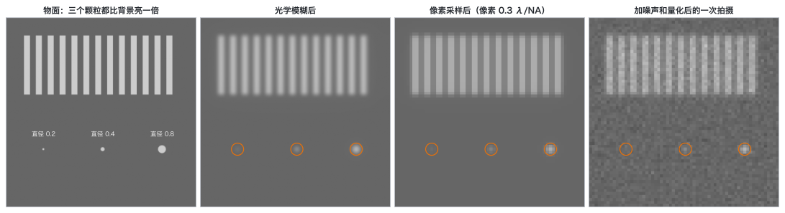
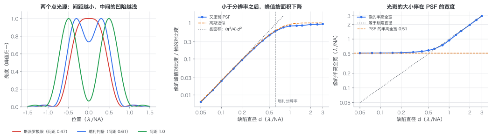
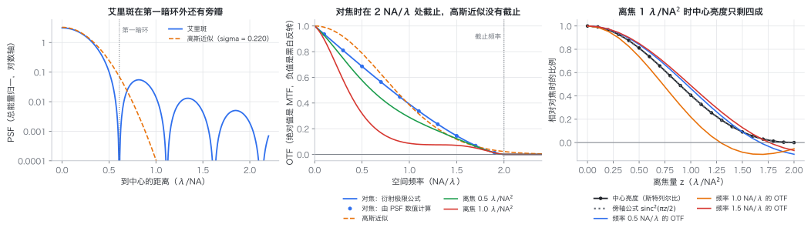
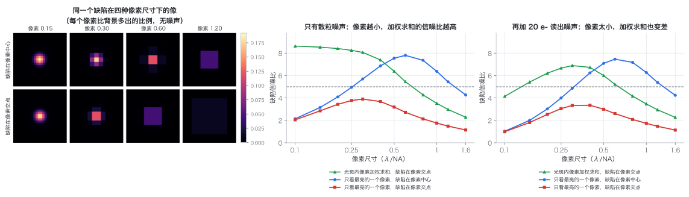
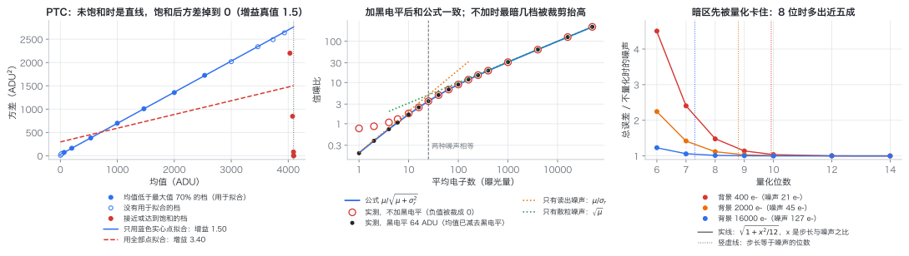
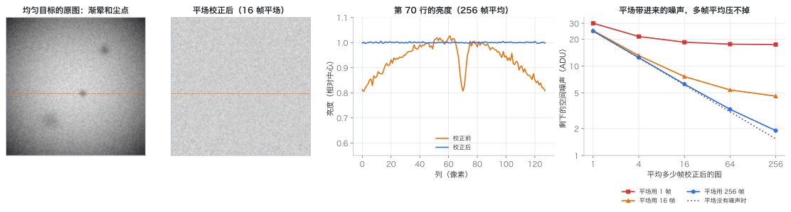
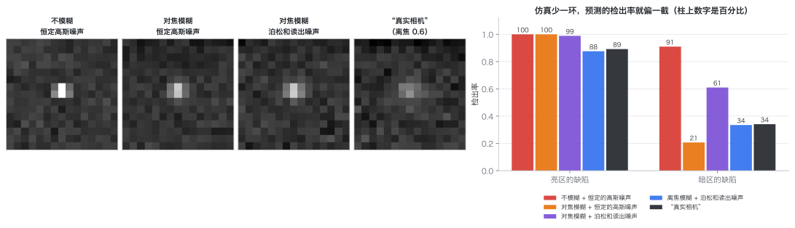

# 教程：成像与设备仿真

> [!NOTE]
> 本章所有数字都来自仿真，记录在 [`figures/实测数字.json`](figures/实测数字.json)，由 `solutions` 分支的 `solutions/figures/ch22.py` 生成。光学部分用标量、傍轴、非相干的成像模型，长度以 λ/NA 为单位；传感器部分调用本章作业的参考实现。换成真实的镜头和相机，数值会变，结论的方向要自己再测一遍。

## 0. 本章怎么学

**应用场景**：判断一台设备能不能看见某种缺陷（检出上限在哪里），给算法生成仿真测试数据，和光学、硬件工程师讨论像素尺寸、曝光量、位深这些参数该怎么选。

**优先级**：P1。前置是第 2 章（卷积）。第 17 章的像素尺寸标定给出本章要用的“每个像素对应多少微米”，第 18 章里“亮区噪声大”和“平场校正”两处的原因在本章。后面第 24 章的数据生成器走的就是本章的链路。

| 档位 | 累计用时 | 做什么 | 做到什么算完 |
|---|---:|---|---|
| 速通 | 3 小时 | 读第 1、2、5、6 节和第 9.1 节，看懂图 1、2、4、5、7，按第 11 节演示页的五步操作一遍，答完 5 道小测 | 能讲清分辨率和灵敏度为什么是两回事，像素尺寸怎样影响小缺陷，曝光量乘 4 时信噪比怎么变 |
| 标准 | 12 小时 | 读完全章，跑 Notebook，完成作业并验收通过，做第 13 节前三个破坏实验，填实验记录 | 4 项测试 PASS，实验记录里有“最小可检出缺陷”的结论和依据，以及 PTC 的拟合结果 |
| 深挖 | 18 小时 | 再做第 13 节剩下的破坏实验和第 14 节的扩展 | 用一台真实相机测出增益和读出噪声，或者给自己的仿真器写出一份验证报告 |

> [!TIP]
> 用时超过所选档位的 1.5 倍还没做完，就把卡点写进 `学习进度.md`，先往下一章走。第 4.2 节的 MTF 公式和第 4.3 节的离焦公式，速通档只记结论。

**本章的长度单位**。衍射决定的长度都和 $\lambda/\mathrm{NA}$ 成正比，所以图表统一用它做单位，结论不依赖具体的波长和物镜。换算成微米时乘上自己系统的 $\lambda/\mathrm{NA}$：波长 266 nm、NA 0.9 时 1 个单位是 0.296 µm，波长 532 nm、NA 0.5 时是 1.064 µm。离焦量的单位是 $\lambda/\mathrm{NA}^2$，空间频率的单位是 $\mathrm{NA}/\lambda$。

## 1. 成像链路

```text
物体（反射率、形貌） × 照明 → 光学系统（PSF） → 传感器采样（像素尺寸） → 光电转换（量子效率） → 噪声 → 增益和量化 → 像素值
```

每一环都会丢信息或引入噪声。仿真就是按这个顺序一步步算。

先看每一环各丢掉多少。下面的实验在物面上放三个圆形颗粒和一组线条，反射率都是背景的两倍（比背景亮 100%），然后按链路逐级算下去。条件：物面 19.2×19.2 λ/NA，对焦的艾里斑 PSF，像素 0.3 λ/NA（64×64 像素），背景每像素 360 e-，读出噪声 5 e-，10 位量化；信噪比的实测值来自 4000 次拍摄。



| 颗粒直径（λ/NA） | 物面上比背景亮 | 光学模糊后（峰值） | 像素采样后（最亮像素） | 最亮像素多出的电子数 | 单像素信噪比：实测（公式） |
|---:|---:|---:|---:|---:|---:|
| 0.2 | 100% | 9.4% | 8.3% | 29.9 | 1.51（1.52） |
| 0.4 | 100% | 32.2% | 28.8% | 103.8 | 5.30（5.29） |
| 0.8 | 100% | 74.9% | 70.4% | 253.5 | 12.94（12.92） |

三个颗粒在物面上一样亮，到了像素值，直径 0.8 的还剩七成对比度，直径 0.2 的只剩 8.3%，信噪比 1.5，在最右一栏里已经找不到了。线条也一样：对比度（最大减最小，除以最大加最小）从物面的 0.333 降到光学模糊后的 0.207，采样后只剩 0.134。线条每个周期正好 4 个像素、边缘对齐像素边界，亮度的峰值落在两个像素之间，所以采样这一步又降了约 35%。

这张表说明三件事：

1. 对小于分辨率的缺陷，损失最大的一环是光学模糊，而且缺陷越小损失越大（第 2 节）。
2. 最后看不看得见由信噪比决定，同一个缺陷多给光就能从看不见变成看得见（第 6 节）。
3. 如果做合成数据时直接把缺陷“贴”在图上，三个颗粒会一样显眼。用这样的数据测算法，得到的检出率是虚高的。第 9.1 节量了虚高多少：暗区的缺陷，不做光学模糊的仿真预测检出率 91%，“真实相机”上是 34%。

## 2. 光学分辨率

光的衍射让一个点成像后变成一个光斑（艾里斑），两个点靠得太近就分不开。圆形孔径、没有像差时，点光源的像是

$$
I(r) = I_0\left[\frac{2J_1(v)}{v}\right]^2,\qquad v = \frac{2\pi\,\mathrm{NA}}{\lambda}\,r
$$

$J_1$ 是一阶贝塞尔函数，它的第一个零点在 $v = 3.8317$，对应第一暗环的半径 $r = 0.6098\,\lambda/\mathrm{NA}$。**瑞利判据**取这个半径作为分辨率：

$$
r = 0.61\,\frac{\lambda}{\mathrm{NA}}
$$

- $\lambda$：波长。波长越短分辨率越高，这就是检测设备从可见光走向深紫外（DUV，例如 266 nm）的原因。
- NA：数值孔径，$\mathrm{NA} = n\sin\theta$，物镜能收集的光锥越大，分辨率越高。干物镜 NA 小于 1。

例子：λ = 266 nm、NA = 0.9 时 r ≈ 0.18 µm。Notebook 第一格算了四组，都只是算例：

| 波长、NA | λ/NA（µm） | 瑞利分辨率（µm） | λ/NA²（µm） |
|---|---:|---:|---:|
| 532 nm、0.5 | 1.064 | 0.649 | 2.128 |
| 532 nm、0.9 | 0.591 | 0.361 | 0.657 |
| 266 nm、0.9 | 0.296 | 0.180 | 0.328 |
| 193 nm、0.95 | 0.203 | 0.124 | 0.214 |

### 2.1 瑞利判据是一个约定



图 2 左栏把两个等亮的点光源放在三种间距上。间距正好是瑞利分辨率时，两个峰之间的凹陷是峰值的 73.5%，还能看出是两个点。间距缩到 0.474 λ/NA 时凹陷刚好消失（这个间距叫斯派罗极限）。间距 1.0 λ/NA 时凹陷只有峰值的 6.5%，分得很开。

所以瑞利判据是“凹陷还比较明显”的一个约定，不是一道硬墙。噪声小的时候比它更近的两个点也能分开，噪声大的时候在瑞利间距上也可能分不开。

### 2.2 景深

**景深**大约正比于 $\lambda/\mathrm{NA}^2$。NA 越大分辨率越高，但景深越浅，对晶圆高度起伏和倾斜越敏感，需要自动对焦。上表最后一列就是这个量：波长不变，NA 从 0.5 提到 0.9，分辨率的数值变为原来的 0.56 倍，$\lambda/\mathrm{NA}^2$ 变为原来的 0.31 倍。分辨率是一次方的好处，景深是二次方的代价。离焦多少算“出了景深”，第 4.3 节用仿真给出数字。

### 2.3 比分辨率小的缺陷还能不能检测

能“检测到存在”，但看不清形状。一个 50 nm 的颗粒在 0.18 µm 分辨率的系统里成像为一个 PSF 大小的光斑，只要它散射或反射的光足够强、和背景有对比，就能检出。所以检测灵敏度和分辨率是两回事，前者更多取决于信噪比。这也是暗场检测能找到远小于分辨率的颗粒的原因。

图 2 的中栏和右栏把这段话量化了。条件：均匀背景上一个圆形缺陷，对焦的艾里斑 PSF，细网格间距 0.05 λ/NA。

| 缺陷直径（λ/NA） | 0.05 | 0.1 | 0.2 | 0.3 | 0.61 | 1.0 | 2.0 | 3.0 |
|---|---:|---:|---:|---:|---:|---:|---:|---:|
| 像的峰值对比度 ÷ 物的对比度 | 0.6% | 2.4% | 9.4% | 19.8% | 58.7% | 82.6% | 90.6% | 93.6% |
| 像的半高全宽（λ/NA） | 0.515 | 0.519 | 0.526 | 0.539 | 0.630 | 0.938 | 1.961 | 2.970 |

- **光斑的大小停在 PSF 的宽度**。PSF 自己的半高全宽是 0.515 λ/NA。直径 0.2 以下的缺陷，像的宽度都在 0.515 到 0.526 之间，从图像上量不出它们谁大谁小。
- **峰值对比度按面积下降**。缺陷中心的对比度等于 PSF 落在缺陷范围内的能量比例，对艾里斑有解析式

$$
\frac{C_\text{image}}{C_\text{object}} = 1 - J_0^2(u) - J_1^2(u),\qquad u = \frac{\pi\,d\,\mathrm{NA}}{\lambda}
$$

  数值卷积的结果和它最多相差 0.0021。$d$ 很小时它近似为 $(\pi^2/4)\,(d\,\mathrm{NA}/\lambda)^2$，系数 2.467，也就是和面积成正比：直径从 0.2 减到 0.1，峰值对比度降到原来的 1/3.84。
- 原讲义的例子可以算出来：50 nm 的颗粒在 266 nm、NA 0.9 下直径是 0.169 λ/NA，峰值对比度只剩物面对比度的 6.8%。它“还在”，但能不能检出取决于这 6.8% 相对噪声有多大。
- 大缺陷也到不了 100%。直径 3.0 λ/NA 时峰值对比度是 93.6%，因为艾里斑有旁瓣，半径 2.0 λ/NA 以外还有 4.9% 的能量（第 4.1 节）。

> [!WARNING]
> 上面的模型是“反射率图卷积 PSF”，对应非相干的明场成像。它说明的是“像的大小不再变、对比度按面积降”这个规律。真实的小颗粒靠散射成像，明场照明通常是部分相干的，对比度的具体数值要用更完整的光学模型或者实测，本章没有仿真这两点。

<!-- quiz -->
**一个圆形缺陷的直径从 0.2 λ/NA 缩小到 0.1 λ/NA，两者都小于瑞利分辨率。它的像会怎样变？**

- A. 光斑缩小一半，亮度不变
- B. 光斑大小基本不变，峰值对比度降到原来的四分之一左右
- C. 彻底消失，因为小于分辨率的东西成不了像

<details markdown="1"><summary>答案与解释</summary>

**B**。像的半高全宽从 0.526 变成 0.519 λ/NA，几乎没动，因为它已经停在 PSF 的宽度 0.515 上。峰值对比度从 9.4% 降到 2.4%，是原来的 1/3.84，和面积成正比。A 把像当成了物的缩小版；C 混淆了“分不清形状”和“看不见”，看不看得见要拿这 2.4% 去和噪声比。

</details>
<!-- /quiz -->

## 3. 照明方式

| 照明 | 原理 | 对什么敏感 |
|---|---|---|
| 明场（bright field） | 照明光沿光轴入射，收集镜面反射光 | 图形缺陷、反射率变化、缺失和桥接 |
| 暗场（dark field） | 斜入射，镜面反射光不进物镜，只收集散射光 | 颗粒、划痕、表面粗糙，背景暗所以对比度高 |
| 偏振、相衬等 | 利用偏振或相位信息 | 透明薄膜、微小高度差 |

不同缺陷在不同照明下可见性差别很大，实际设备通常有多个通道或多种模式。

**背景暗为什么有利**，可以用第 6 节的噪声公式算一笔账。图 1 里直径 0.2 的颗粒在最亮像素多出 29.9 e-。明场下它叠在 360 e- 的背景上，背景的散粒噪声加读出噪声是 19.62 e-，信噪比 1.52。假设暗场下这个颗粒散射进来同样多的电子，而背景是 0，噪声只剩信号自己的散粒噪声和 5 e- 的读出噪声，信噪比是 4.04。信号没变，背景带来的噪声没了。

这笔账有一个前提：暗场下真的能收到这么多散射光。远小于波长的颗粒，散射光强按教科书上的瑞利散射规律 $I_s \propto d^6/\lambda^4$ 变化，直径减半，散射光只剩 1/64，比上一节“按面积”降得快得多。所以暗场能看到多小的颗粒，取决于照明功率、收集角和背景的散射有多干净。本章的仿真只覆盖明场这一种，暗场需要散射模型，没有做。

## 4. PSF、MTF 和卷积

光学系统对一个点的响应是**点扩散函数 PSF**。对线性、空间不变的系统，成像就是理想图像和 PSF 的卷积：

$$
\text{image}(x, y) = \iint \text{object}(x', y')\,\mathrm{PSF}(x - x',\,y - y')\,\mathrm{d}x'\,\mathrm{d}y'
$$

写成一行就是 `image = object ⊛ PSF`。这个关系对强度成立的前提是照明非相干。PSF 要归一化（总和为 1），这样均匀的物成像后亮度不变。

真实的衍射受限 PSF 是艾里斑，作业里用高斯近似（工程上常用，计算方便）。离焦会让 PSF 变宽。

### 4.1 艾里斑和高斯近似差在哪



按二维最小二乘，最接近对焦艾里斑的高斯是 sigma = 0.220 λ/NA。两者的中心部分很像，差别在外围：

| 比较的量 | 艾里斑 | 高斯近似 |
|---|---:|---:|
| 第一暗环（半径 0.61）以内的能量 | 83.8% | 97.9% |
| 半径 1.0 以内的能量 | 90.6% | 超过 99.99% |
| 半径 2.0 以内的能量 | 95.1% | 100% |
| 直径 0.2 的缺陷的峰值对比度 | 0.094 | 0.098 |
| 直径 1.0 的缺陷的峰值对比度 | 0.826 | 0.924 |
| 截止频率 2 NA/λ 处的 MTF | 0 | 0.022 |

读这张表：

- **小缺陷用高斯近似问题不大**。直径 0.2 时两者的峰值对比度是 0.094 对 0.098。
- **大结构和亮暗交界处高斯偏乐观**。艾里斑有 9.4% 的能量落在半径 1.0 以外，高斯几乎没有。直径 1.0 的缺陷，高斯近似给出的峰值比艾里斑高 11.9%。亮区旁边的暗区会被旁瓣“照亮”一点，高斯近似仿不出这个效果。
- Notebook 实验 1 用的 `psf_sigma=1.5`（单位是像素）。按 sigma = 0.220 λ/NA 折算，相当于像素尺寸 0.147 λ/NA，是一个采样很密的系统。把它换成自己的参数时，先算 sigma 等于多少个像素。

### 4.2 MTF

**MTF**（调制传递函数）是 PSF 傅里叶变换的模，表示系统对每个空间频率的对比度传递能力。高频（细节）被衰减得最厉害。读镜头和物镜规格书时，MTF 曲线是关键指标。

圆形孔径、非相干照明、没有像差时，MTF 有解析式：

$$
\mathrm{MTF}(\nu) = \frac{2}{\pi}\left[\arccos s - s\sqrt{1 - s^2}\right],\qquad s = \frac{\nu}{2\,\mathrm{NA}/\lambda}
$$

$\nu$ 超过截止频率 $2\,\mathrm{NA}/\lambda$ 之后 MTF 恒为 0。周期比 $\lambda/(2\,\mathrm{NA})$ 更小的图案，这个系统完全传不过去，后面的算法无从恢复。

| 空间频率（NA/λ） | 0.5 | 1.0 | 1.5 | 2.0 |
|---|---:|---:|---:|---:|
| 衍射极限公式 | 0.685 | 0.391 | 0.144 | 0 |
| 由仿真的 PSF 做傅里叶变换 | 0.685 | 0.391 | 0.144 | 0.000 |
| 高斯近似 | 0.788 | 0.385 | 0.117 | 0.022 |

仿真的 PSF 和公式在三位小数上一致，这本身就是对仿真器的一次验证（第 8、10 节）。高斯的 MTF 是 $\exp(-2\pi^2\sigma^2\nu^2)$，没有截止频率，在低频偏高、在截止频率之外还留着一点响应。

### 4.3 离焦

离焦量 $z$ 在光瞳边缘造成的波像差，傍轴近似下是

$$
W = \frac{\mathrm{NA}^2}{2\lambda}\,z\ \ \text{（单位：波长）},\qquad \frac{I_\text{center}(z)}{I_\text{center}(0)} = \left[\frac{\sin(\pi W)}{\pi W}\right]^2
$$

$z$ 以 $\lambda/\mathrm{NA}^2$ 为单位时 $W = z/2$。这就是景深正比于 $\lambda/\mathrm{NA}^2$ 的来历。图 3 右栏是仿真结果，PSF 由 1600×1600 的光瞳函数加上离焦相位再做 FFT 得到。

PSF 对称时它的傅里叶变换（光学传递函数 OTF）是实数，MTF 是它的绝对值。离焦后 OTF 会变成负数，所以下表和图 3 写的是 OTF：

| 离焦量（λ/NA²） | 0 | 0.5 | 1.0 | 1.5 | 2.0 |
|---|---:|---:|---:|---:|---:|
| 中心亮度（相对对焦时） | 1 | 0.811 | 0.406 | 0.091 | 0.000 |
| 频率 0.5 NA/λ 的 OTF | 0.685 | 0.576 | 0.318 | 0.062 | -0.069 |
| 频率 1.0 NA/λ 的 OTF | 0.391 | 0.288 | 0.086 | -0.033 | -0.021 |
| 频率 1.5 NA/λ 的 OTF | 0.144 | 0.122 | 0.070 | 0.018 | -0.010 |

1. **离焦 0.5 λ/NA² 是常用的景深边界**。这时 $W$ 是四分之一个波长，中心亮度剩 81.1%，三个频率的 OTF 剩对焦时的 84.1%、73.7%、84.9%。波长 266 nm、NA 0.9 时它只有 0.164 µm。
2. **离焦 1 λ/NA² 时中心亮度只剩 40.6%**，小缺陷的峰值信号跟着掉到四成。
3. **最先垮掉的是中频**。离焦 1.0 时，频率 0.5、1.0、1.5 的 OTF 分别剩对焦时的 46.4%、21.9%、49.0%，在这三个频率里中间那个损失最大。
4. **OTF 会变成负数**。离焦 1.5 时频率 1.0 的 OTF 是 -0.033，意思是这个周期的线条黑白反转了。离焦的图不只是“糊”，还可能出现假的图案。

这些公式都是傍轴近似。NA 接近 1 时光线和光轴的夹角很大，误差变大，高 NA 物镜的实际景深要以非傍轴的计算或物镜资料为准。

用高斯近似时，离焦就是把 sigma 调大。最接近离焦 PSF 的高斯，离焦 0.5 时 sigma 是 0.253 λ/NA（对焦时的 1.15 倍），离焦 1.0 时是 0.455（2.07 倍）。Notebook 的破坏实验“把 PSF sigma 从 1.5 改成 3”，大致相当于离焦 1 λ/NA²。高斯仿不出上面第 3、4 两条。


### 4.4 卷积方向和实现

**卷积方向**：卷积要把核翻转，相关不翻转。对称核两者一样，非对称核（离焦、运动模糊）一定要分清。作业里专门用一个非对称核测试了这一点。

实现时还有三个细节：

- **边界**。作业要求用 `reflect` 填充。用 FFT 做卷积是周期边界，图像左边缘会混进右边缘的内容，和 `reflect` 的结果在边界一圈不同。
- **归一化**。PSF 的和必须是 1。验收里有一条“常数图像卷积后不变”，就是查这个。
- **顺序**。模糊发生在光学系统里，噪声发生在传感器上，所以先模糊、后加噪声。写反了的后果见第 12 节。

## 5. 采样：像素多大合适

**奈奎斯特**：要不丢失光学系统传过来的信息，采样频率至少是最高频率的两倍。经验法则是像素尺寸（折算到物面）不大于光学分辨率的一半。

这两句话说的不是同一个数。按第 4.2 节，光学系统能传过来的最高频率是 $2\,\mathrm{NA}/\lambda$，严格满足奈奎斯特需要

$$
p \le \frac{\lambda}{4\,\mathrm{NA}} = 0.25\,\frac{\lambda}{\mathrm{NA}}
$$

这是瑞利分辨率的 0.41 倍。经验法则的“分辨率的一半”是 0.305 λ/NA，采样的奈奎斯特频率只有 1.64 NA/λ，比截止频率低。这个频率上衍射极限的 MTF 还剩 0.089，所以按经验法则选像素，会丢掉或混叠掉最高频那一段，只是那一段本来就很弱。经验法则是在数据量和信息之间做的折中，不等于奈奎斯特条件。

- 像素太大（欠采样）：小缺陷被平均掉，还会产生混叠。周期图案会出现莫尔纹。
- 像素太小（过采样）：数据量和处理时间暴增，每个像素收到的光子少，噪声变大。

检测设备的设计是在灵敏度、速度（每小时检测多少片晶圆）、成本之间权衡。像素尺寸翻倍，数据量减为四分之一。

**混叠量出来是这样的**。一维线条，周期 0.7 λ/NA（空间频率 1.43 NA/λ），反射率在 0.1 和 0.9 之间，经过衍射极限的 MTF 之后对比度是 0.18，再用不同的像素尺寸采样：

| 像素尺寸（λ/NA） | 0.10 | 0.20 | 0.30 | 0.35 | 0.40 | 0.50 | 0.60 |
|---|---:|---:|---:|---:|---:|---:|---:|
| 每个周期的像素数 | 7.0 | 3.5 | 2.33 | 2.0 | 1.75 | 1.4 | 1.17 |
| 采样后测到的周期（λ/NA） | 0.70 | 0.70 | 0.70 | 0.70 | 0.93 | 1.75 | 4.20 |
| 采样后的对比度 | 0.171 | 0.154 | 0.128 | 0.116 | 0.096 | 0.062 | 0.029 |

每个周期不到 2 个像素之后，图像里出现的是一个不存在的周期：像素 0.5 时，周期 0.7 的线条被看成了周期 1.75。这就是莫尔纹。它不是噪声，重复拍多少次都一样，比对类的算法会把它当成真实的图形。

### 5.1 像素尺寸对小缺陷的影响

上面两条里，“每个像素收到的光子少，噪声变大”这一句需要拆开看。下面的实验固定一个直径 0.3 λ/NA、比背景亮 100% 的缺陷，固定曝光量（背景每 (λ/NA)² 面积 12000 e-，所以像素越大每像素的电子越多），只改像素尺寸。缺陷相对像素网格的位置取 8×8 共 64 种。噪声取背景处的散粒噪声加读出噪声。



读出噪声 5 e- 时：

| 像素尺寸（λ/NA） | 0.1 | 0.2 | 0.3 | 0.5 | 0.6 | 1.0 | 1.6 |
|---|---:|---:|---:|---:|---:|---:|---:|
| 背景每像素电子数 | 120 | 480 | 1080 | 3000 | 4320 | 12000 | 30720 |
| 单像素信噪比，缺陷在像素中心 | 1.95 | 3.99 | 5.63 | 7.52 | 7.78 | 6.37 | 4.26 |
| 单像素信噪比，缺陷在像素交点 | 1.86 | 3.34 | 3.86 | 3.17 | 2.71 | 1.76 | 1.14 |
| 单像素信噪比，64 个位置的平均 | 1.92 | 3.76 | 4.97 | 5.71 | 5.59 | 4.54 | 3.36 |
| 光斑内像素加权求和，缺陷在像素交点 | 7.85 | 8.20 | 7.97 | 6.36 | 5.44 | 3.52 | 2.28 |

表里“按公式”算的信噪比用 `simulate_capture` 抽查过四个像素尺寸（各 6000 次），例如像素 0.3 时公式 5.63、实测 5.64。

1. **只看一个像素时，像素和光斑差不多大最好**。缺陷在像素中心时，信噪比在像素 0.6 λ/NA 处最高（7.78）。这时一个像素装下了光斑的大部分能量，又没有多装背景。
2. **但大像素对位置很敏感**。像素 0.6 时，缺陷从像素中心挪到四个像素的交点，信噪比从 7.78 掉到 2.71，剩 35%；像素 0.3 时从 5.63 到 3.86，剩 69%。缺陷落在哪里是随机的，设计时要看最差位置或平均值，不能只看最好位置。
3. **过采样丢的不是信息**。像素 0.1 时单像素信噪比只有 1.95，看上去很差。可是把光斑内的像素按光斑形状加权求和（匹配滤波，权重正比于各像素的期望信号），信噪比是 7.85，和像素 0.3 时的 7.97 几乎一样。光子总数没变，只是分到了更多像素里。
4. **过采样真正的代价是读出噪声和数据量**。每多一个像素就多一份读出噪声：

| 加权求和的信噪比（缺陷在像素交点） | 像素 0.1 | 像素 0.2 | 像素 0.3 | 像素 0.6 |
|---|---:|---:|---:|---:|
| 读出噪声 0 e- | 8.63 | 8.41 | 8.07 | 5.45 |
| 读出噪声 5 e- | 7.85 | 8.20 | 7.97 | 5.44 |
| 读出噪声 20 e- | 4.15 | 6.21 | 6.89 | 5.22 |

   只有散粒噪声时，像素越小加权求和的信噪比越高（8.63）。读出噪声 20 e- 时，像素 0.1 的信噪比掉到 4.15，不如像素 0.3 的 6.89。所以原讲义那句“每个像素收到的光子少，噪声变大”要补上条件：单个像素的信噪比确实变低，但整个缺陷的可检出性只在读出噪声不可忽略时才变差。
5. **欠采样两头都吃亏**。像素 1.0 时最好位置的单像素信噪比 6.37，交点位置只有 1.76，加权求和也救不回来（3.52），因为信号已经和大片背景的噪声混在一个像素里了。

<!-- quiz -->
**只有散粒噪声、曝光量不变，把像素从 0.3 λ/NA 缩小到 0.1 λ/NA。每个像素收到的光子只剩九分之一。把光斑内的像素加权求和之后，缺陷的信噪比怎么变？**

- A. 降到原来的三分之一左右
- B. 基本不变，还略高一点
- C. 升到原来的 3 倍

<details markdown="1"><summary>答案与解释</summary>

**B**。实测从 8.07 变成 8.63。落在缺陷光斑里的光子总数没有变，小像素只是把它们分得更细，求和之后信噪比不降；略高是因为小像素能更贴合光斑的形状。A 是“只看一个像素”时的结论（单像素信噪比从 5.70 降到 2.14）。把读出噪声加到 20 e-，结论才反过来：4.15 对 6.89。

</details>
<!-- /quiz -->

## 6. 传感器噪声模型

单个像素的信号链：

```text
光子数 → ×量子效率 → 电子数（满阱封顶） → +读出噪声 → ÷增益 → 量化成 ADU（数字值）
```

作业的 `simulate_capture` 从“平均电子数”开始算，量子效率已经乘进去了；它没有单独的满阱参数，饱和只发生在 ADU 超过位深上限的时候。

**散粒噪声**：光子到达是泊松过程，电子数的方差等于均值。均值 1000 e⁻ 时标准差约 31.6 e⁻。这一条可以直接验证。把读出噪声设为 0、增益设为 1，拍 400×400 的均匀场：

| 平均电子数 | 10 | 100 | 1000 | 10000 |
|---|---:|---:|---:|---:|
| 实测方差 | 10.0 | 100.9 | 1000.9 | 10011.1 |
| 实测标准差 | 3.16 | 10.05 | 31.64 | 100.06 |

方差和均值相等，标准差按平方根增长。第 18 章图 2 里“亮区的 sigma 更大”就是这个原因。

**读出噪声**：电路噪声，和信号无关，常见几个电子。

**暗电流**：没光也会产生电子，和温度、曝光时间有关。

**总方差**（以电子为单位）：

$$
\sigma_e^2 = \mu_e + \sigma_\text{read}^2\ \ (+\ \text{暗电流项})
$$

换算到 ADU：方差除以增益 $g$（单位 e⁻/ADU）的平方。所以 ADU 下：

$$
\sigma_\text{ADU}^2 = \frac{\mu_\text{ADU}}{g} + \frac{\sigma_\text{read}^2}{g^2} + \frac{1}{12}
$$

最后的 1/12 是四舍五入到整数带来的量化噪声，原讲义的公式里没有写，验收脚本的期望值里有（1000 e-、读出噪声 5 e-、增益 2 时方差是 256.33 ADU²）。它什么时候不能忽略，见第 6.3 节。

### 6.1 信噪比和曝光量

$$
\mathrm{SNR} = \frac{\mu}{\sqrt{\mu + \sigma_\text{read}^2}}
$$

亮信号下约等于 $\sqrt{\mu}$，曝光量翻 4 倍，SNR 翻 2 倍。暗信号下读出噪声主导。分界在 $\mu = \sigma_\text{read}^2$，两种噪声一样大。



图 5 中栏：读出噪声 5 e-、增益 1、16 位，每档 300×300 像素。

| 平均电子数 | 1 | 4 | 25 | 100 | 400 | 1000 | 4000 | 16000 |
|---|---:|---:|---:|---:|---:|---:|---:|---:|
| 公式 | 0.20 | 0.74 | 3.54 | 8.94 | 19.40 | 31.23 | 63.05 | 126.39 |
| 实测（均值 ÷ 标准差） | 0.77 | 1.08 | 3.53 | 8.96 | 19.39 | 31.10 | 62.75 | 126.62 |

- 亮处和公式吻合。曝光量从 1000 e- 乘 4 到 4000 e-，信噪比是原来的 2.02 倍。
- 越暗，乘 4 的收益越大：100 到 400 e- 实测是 2.16 倍，按公式 4 到 16 e- 是 3.36 倍。读出噪声主导时信噪比接近和曝光量成正比。
- **最暗的两档实测比公式高得多**（1 e- 时 0.77 对 0.20）。这不是相机变好了。作业的模型没有黑电平，读出噪声带来的负值被裁成 0，均值被抬高到 2.58，标准差被压小。真实相机会加一个黑电平来避免这种裁剪。用这个仿真器研究很暗的区域时，要么自己在输入上加一个基底，要么不要相信比 3 倍读出噪声还暗的那几档统计量。

### 6.2 光子转移曲线（PTC）

未饱和时，ADU 的方差对均值是一条直线。**光子转移曲线（PTC）**：拍不同亮度的均匀场，画方差对均值，斜率是 1/g，截距给出读出噪声。这是 EMVA 1288 标准测相机性能的基本方法，作业最后一题就是它。

图 5 左栏：读出噪声 8 e-、增益 1.5 e-/ADU、12 位（最大 4095 ADU，对应 6142 e-），每档 200×200 像素。

**饱和**：超过满阱或者 ADC 最大值就被截断，饱和区信息丢失，检测高反射区域时要注意。在 PTC 上，饱和表现为高亮度端向下弯：平均 5900 e- 的一档方差还有 2635.9，6150 e- 的一档只剩 846.8，6400 e- 以上基本是 0。所有像素都顶在 4095 上，自然没有起伏。

把饱和的点放进拟合，直线被拉平，增益被高估：

| 拟合用的点 | 估出的增益（真值 1.5） | 估出的读出噪声（真值 8） |
|---|---:|---:|
| 图 5 左：只用均值低于最大值 70% 的档 | 1.498 | 7.86 |
| 图 5 左：全部点 | 3.40 | 58.5 |
| Notebook 实验 2 的 10 档，只用未饱和点（50 次平均） | 1.503 | 8.08 |
| Notebook 实验 2 的 10 档，全部点（50 次平均） | 5.53 | 85.4 |

**斜率很准，截距不准**。同一条直线给出两个量，精度差很多。按验收脚本的设置（电子数 50 到 4000 共 6 档，每档 200×200 像素，增益 1.5）各重复 200 次：

| 设置 | 增益的标准差 ÷ 真值 | 读出噪声的平均值 | 读出噪声的标准差 ÷ 真值 |
|---|---:|---:|---:|
| 读出噪声 8 e-（验收脚本的设置） | 0.7% | 7.99 | 4% |
| 读出噪声 3 e- | 0.6% | 3.04 | 26% |
| 读出噪声 3 e-，改成按方差的倒数加权拟合 | 0.4% | 3.03 | 3% |
| 读出噪声 8 e-，多加一档全暗（0 e-） | 0.6% | 7.30 | 3% |

- 截距是从几百到几千的方差外推到 0 得到的一个小数，亮的几档方差本身的统计起伏就比它大。读出噪声 3 e- 时，200 次里有 28% 的估计偏离真值超过 25%。验收脚本给增益 5% 的容差、给读出噪声 25% 的容差，原因就在这里。
- 亮档的方差起伏大，拟合时应该给它们小一点的权重。按方差的倒数加权之后，读出噪声的离散度从 26% 降到 3%。
- 多加一档全暗反而让读出噪声偏低到 7.30。全暗时负值被裁成 0（上一节），这一档的方差是假的：读出噪声 8 e-、增益 1.5 的暗帧，标准差本该是 5.34 ADU，仿真出来只有 3.12。
- 截距里还混着量化噪声。读出噪声 2 e-、增益 8 e-/ADU 时，按截距换算出的“读出噪声”是 3.04 e-，和 $\sqrt{\sigma_\text{read}^2 + g^2/12}$ 算的 3.06 一致，比真值 2 大了一半。

<!-- quiz -->
**按验收脚本的 6 档亮度做 PTC，读出噪声的真值换成 3 e-，重复 200 次。增益的估计很稳，标准差只有真值的 0.6%。读出噪声的估计呢？**

- A. 也在 1% 以内，因为它们来自同一条直线
- B. 标准差是真值的 26% 左右
- C. 大约 5%，比增益差一点

<details markdown="1"><summary>答案与解释</summary>

**B**。增益来自斜率，由所有点共同决定。读出噪声来自截距，是把亮档的大方差外推到 0 剩下的一个小数，亮档方差的统计起伏直接压在它上面。读出噪声 8 e- 时离散度是 4%，3 e- 时是 26%，越小越测不准。改成按方差倒数加权后降到 3%。

</details>
<!-- /quiz -->

### 6.3 量化位数什么时候成为瓶颈

量化把电子数四舍五入到步长 $g$ 的整数倍，相当于加了一份方差 $g^2/12$ 的噪声。总误差相对不量化时的倍数是

$$
\sqrt{1 + \frac{1}{12}\left(\frac{g}{\sigma}\right)^2}
$$

$\sigma$ 是量化之前的噪声。步长等于噪声时只多 4.1%，等于 2 倍噪声时多 15.5%。所以判断位数够不够，是拿步长和**最暗处**的噪声比，不是和满量程比。

图 5 右栏：满量程 20000 e-，步长等于满量程除以 2 的位数次方，读出噪声 5 e-，每个条件 20 万个像素。

| 量化位数 | 6 | 8 | 10 | 12 |
|---|---:|---:|---:|---:|
| 量化步长（e-） | 312.5 | 78.1 | 19.5 | 4.9 |
| 背景 16000 e-（噪声约 127 e-）：总误差的倍数 | 1.231 | 1.013 | 1.000 | 1.002 |
| 背景 2000 e-（噪声约 45 e-） | 2.246 | 1.121 | 1.008 | 1.000 |
| 背景 400 e-（噪声约 21 e-） | 4.505 | 1.478 | 1.037 | 1.006 |

同样是 8 位，亮区的噪声只多 1.3%，暗区多了 47.8%。亮区自己的散粒噪声大，把量化台阶“抹平”了；暗区噪声小，台阶露了出来。

步长远大于噪声时，问题不只是多一点噪声。让一块 400 e- 左右的均匀区和另一块亮 3% 的区域各取 40 万个像素求平均再相减，在 5 个略有不同的背景亮度下看测到的亮度差是真值的多少倍：

| 量化位数 | 6 | 7 | 8 | 9 | 10 |
|---|---:|---:|---:|---:|---:|
| 步长 ÷ 噪声 | 15.16 | 7.58 | 3.79 | 1.89 | 0.95 |
| 测到的亮度差 ÷ 真值（最小到最大） | 0.00 到 5.09 | 0.03 到 2.26 | 0.71 到 1.38 | 1.00 到 1.01 | 0.99 到 1.00 |

6 位时，这 3% 的亮度差有时完全测不到，有时被放大成 5 倍，取决于背景亮度正好落在台阶的哪个位置。平均再多像素也没用，因为这是偏差不是噪声。步长降到噪声的 2 倍以内（9 位）之后，响应才回到 1。

### 6.4 暗电流、暗场和平场校正

暗电流和其他固定的偏置可以拍一张“暗场”（盖上镜头或关掉照明，用同样的曝光时间）减掉。视场内的亮度不均匀要靠平场校正。这一节是原讲义没有的，第 18 章第 4 节提到过它，这里把它讲清楚并用仿真验证。

**亮度为什么不均匀**。同一个均匀的目标，图像中心和角落的亮度可以差很多。来源有三类：镜头的渐晕（视场边缘收到的光少），照明本身不均匀，以及每个像素的响应略有不同、光路上的灰尘在图像里留下暗斑。它们都可以写成一个乘在真实亮度上的响应图 $V(x, y)$。

**做法**。拍一组均匀目标的图求平均得到平场 $F$，拍一组暗场求平均得到 $D$，然后

$$
\text{corrected} = \frac{\text{raw} - D}{F - D}\cdot\overline{F - D}
$$

分母除掉响应图，乘上平均值是为了让校正后的亮度还在原来的量级上。

下面的仿真用 128×128 像素：响应图是渐晕（角落约为中心的 0.6）乘 1% 的像素响应不一致，再乘 3 个尘点（最深处暗 20%）。平场帧在响应为 1 处是 6000 e-，均匀目标是 3000 e-，暗信号 100 e-，读出噪声 5 e-，增益 2，12 位。



| 均匀目标（256 帧平均） | 8×8 块均值的标准差 ÷ 平均值 | 角落 ÷ 中心 | 最深的尘点 ÷ 周围 |
|---|---:|---:|---:|
| 校正前 | 9.7% | 0.698 | 0.835 |
| 校正后（平场 256 帧、暗场 64 帧） | 0.02% | 1.000 | 0.999 |

亮度不均匀被消掉了，但还有三件事要知道。

**一、平场自己有噪声，会变成固定的花纹**。平场帧也是拍出来的，带着散粒噪声。除以它，等于给每个像素乘上一个固定的随机系数，这份噪声在每一帧里都一样。中间 64×64 像素上，单帧的空间噪声相对“平场没有噪声”时的倍数：

| 平场帧数 | 1 | 4 | 16 | 64 |
|---|---:|---:|---:|---:|
| 目标和平场一样亮：实测（公式） | 1.408（1.414） | 1.121（1.118） | 1.029（1.031） | 1.009（1.008） |
| 目标亮度是平场的一半：实测（公式） | 1.224（1.220） | 1.061（1.059） | 1.014（1.015） | 1.002（1.004） |

只用 1 帧平场，噪声变成 1.41 倍，等于白扔了一半的光。公式是把平场的相对方差除以帧数，加到目标的相对方差上。

更麻烦的是这份噪声不随时间变，多帧平均压不掉。目标亮度是平场的一半，把 256 帧校正后的图求平均：平场只用 1 帧时剩下 17.37 ADU 的空间噪声，用 256 帧平场时是 1.90 ADU，差 9.2 倍。图 6 右栏的红线在平均到 16 帧以后就基本平了。

**二、校正后亮度平了，噪声没有平**。角落收到的光少，校正时被放大，噪声也一起放大。校正后均值的角落 ÷ 中心是 1.000，时间噪声的角落 ÷ 中心是 1.203。角落的相对照度是 0.698，按 $1/\sqrt{0.698}$ 估算是 1.197，对得上。所以第 18 章里按像素估 sigma 的做法，在校正后的图上依然必要。

**三、忘了减暗场，校正会过头**。暗信号在原图和平场里都有，不减掉它，除法里分子分母都多了一个常数，渐晕就除不干净。平场 64 帧时，校正后角落 ÷ 中心：

| 条件 | 减了暗场 | 没减暗场 |
|---|---:|---:|
| 暗信号 100 e-，目标 3000 e- | 1.000 | 1.007 |
| 暗信号 100 e-，目标 600 e- | 1.001 | 1.055 |
| 暗信号 400 e-，目标 3000 e- | 1.000 | 1.023 |
| 暗信号 400 e-，目标 600 e- | 0.999 | 1.143 |

目标越暗、暗信号越大，误差越大。暗信号 400 e-、目标 600 e- 时角落比中心亮了 14%。

**对比较类检测的影响**。把同一个均匀目标的左右两半相减（相距 64 像素，模拟 die-to-die 比较的两个 die 落在视场不同位置），64 帧里差值超过 5 sigma 的像素比例：只减暗场时是 0.39，平场校正后是 0。高斯噪声下的理论值是 5.7e-7。不做平场校正，比较类方法在视场边缘会大片报警，第 18 章第 4 节讲的“整片报警”在视场内不均匀时就是这样来的。

<!-- quiz -->
**平场只拍了 1 帧，用它校正后，把 256 帧校正后的图求平均，剩下的空间噪声是 17.37 ADU。换成 256 帧平场，同样求平均后剩多少？**

- A. 也差不多，因为目标已经平均了 256 帧
- B. 1.90 ADU，小了 9 倍多
- C. 0，因为平场把一切不均匀都除掉了

<details markdown="1"><summary>答案与解释</summary>

**B**。平场的噪声在每一帧校正后的图里都一样，是固定花纹，目标再怎么平均也压不掉，所以 A 错。平场用 256 帧时，这份固定花纹小到和目标自己的随机噪声（256 帧平均后的理论值 1.54 ADU）相当。C 错在平场只能除掉乘性的响应不均匀，除不掉随机噪声。

</details>
<!-- /quiz -->

## 7. 运动和线扫

检测设备为了速度，常用**线扫相机**加连续运动的平台。还有**TDI**（时间延迟积分）传感器：多行像素依次对同一位置曝光并累加，在不降速的前提下提高信噪比。需要建模的误差有：平台速度不均导致的扫描方向拉伸，振动导致的行间错位，以及运动模糊。

**TDI 的收益和代价**。N 级累加，信号乘 N，散粒噪声乘 $\sqrt{N}$，读出噪声只在最后加一次，所以信噪比约乘 $\sqrt{N}$。前提是电荷移动的速度和像在传感器上移动的速度一致。速度差一个比例 $\varepsilon$ 时，N 级累加相当于沿扫描方向做了长度 $N\varepsilon$ 个像素的拖影。

下面用图 4 的缺陷（直径 0.3 λ/NA，在像素中心），像素 0.3 λ/NA，每级背景 1080 e-，读出噪声 5 e-。单级的缺陷信噪比是 5.63。只算速度失配造成的拖影，没有算级间转移和振动：

| 速度失配 | 16 级 | 64 级 | 256 级 |
|---|---:|---:|---:|
| 级数的平方根 | 4.0 | 8.0 | 16.0 |
| 0%：信噪比相对单级的倍数 | 4.04 | 8.09 | 16.18 |
| 0.5% | 4.04 | 8.04 | 14.67 |
| 1% | 4.04 | 7.89 | 11.33 |
| 2% | 4.02 | 7.33 | 6.27 |

没有失配时收益和 $\sqrt{N}$ 一致（倍数略高于 $\sqrt{N}$，是因为读出噪声只加一次），64 级的结果用 `simulate_capture` 核对过，是 8.07 倍。有 2% 的失配时，256 级的拖影长达 5.12 个像素，缺陷最亮像素的信号只剩 38.8%，信噪比反而不如 64 级（6.27 对 7.33）。级数越多，对速度同步的要求越严。

## 8. 一个成像仿真器的结构

```python
def simulate(layout, defects, optics, sensor, rng):
    scene = render(layout)                 # 第 21 章：版图到反射率图
    scene = insert_defects(scene, defects) # 第 20 章：在模糊之前插入缺陷
    irradiance = convolve(scene * illumination, psf(optics))
    sampled = resample(irradiance, pixel_size)
    electrons = irradiance_to_electrons(sampled, exposure, qe)
    adu = sensor_noise_and_quantize(electrons, sensor, rng)
    return adu, labels
```

几个实现上的要点：

- `insert_defects` 必须在 `convolve` 之前。缺陷也是物面上的东西，要和图形一起经过光学模糊。先模糊再贴缺陷，缺陷会比周围的图形锐利得多，等于第 9.1 节表里的第一行。
- `resample` 是像素积分，不是在像素中心点取一个值。像素会把落在自己面积上的光全部收下，这本身就是一次低通（本章配图用的是细网格按块求和）。
- 卷积的网格要比像素细。艾里斑的半高全宽是 0.515 λ/NA，网格至少要比它细几倍，本章用 0.05 λ/NA。
- 照明不均匀和渐晕乘在 `illumination` 上，暗电流加在 `electrons` 上，这样第 6.4 节的平场校正就有东西可以校。
- 所有随机数都来自同一个传入的 `rng`，验收里专门检查了相同种子结果相同。

**验证仿真器**本身同样重要：

- 用 PTC 检查噪声模型（作业已做）。
- 用刃边图像测 MTF，和设定的 PSF 对比。本章第 4.2 节做的是更直接的版本：对仿真的 PSF 做傅里叶变换，和衍射极限公式在三位小数上一致。
- 把仿真图和真实图的统计量（灰度直方图、噪声功率谱、边缘轮廓）对比，差异就是域差距，需要在报告里说明。

## 9. 用仿真回答设计问题

仿真最有价值的用法是回答“如果……会怎样”：

- 缺陷尺寸从 1 µm 减到 0.3 µm，在当前光学下信噪比降多少，还能不能检出？
- 像素尺寸从 0.5 µm 放大到 1 µm 换取 4 倍速度，检出率损失多少？
- 照明亮度下降 30%（灯老化），误报会不会上升？

把这类问题量化，是算法工程师和设备工程师沟通的重要方式。

前两个问题本章已经有答案的框架：第一个看第 2.3 节，峰值对比度大致按面积下降，再按第 6 节换算成信噪比；第二个看第 5.1 节的表，要同时看最好位置、最差位置和加权求和三种情况。下面回答第三个，再看仿真本身的误差会把答案带偏多少。

### 9.1 仿真和“真实图”的差距怎样影响检测结果

在这个实验里，“真实相机”是一台离焦 0.6 λ/NA² 的相机的完整仿真（艾里斑加离焦、像素积分、泊松噪声、读出噪声 5 e-、12 位）。然后用四种逐步完整的仿真器分别生成测试数据，预测同一个检测方法的检出率，再和“真实相机”上的检出率比较。

条件：64×64 像素，像素 0.3 λ/NA；上半是亮区（约 3200 e-），下半是暗区（约 800 e-）；缺陷是直径 0.3 到 0.6 λ/NA 的圆，比所在区域亮 60%；400 张图，每张亮区、暗区各 2 个缺陷，每个区域共 800 个。检测方法固定：100 张良品求均值和标准差，z 超过 5 的连通域算一个报警，质心离真值 2 像素内算命中。“恒定高斯噪声”的标准差取“真实相机”全图方差的平均，45.0 e-。



| 用什么数据测 | 亮区检出率 | 暗区检出率 | 全部缺陷的检出率 | 每张图误报 |
|---|---:|---:|---:|---:|
| 不模糊 + 恒定的高斯噪声 | 100% | 91.0% | 95.5% | 0.01 |
| 对焦模糊 + 恒定的高斯噪声 | 100% | 20.7% | 60.4% | 0.01 |
| 对焦模糊 + 泊松和读出噪声 | 98.9% | 61.0% | 79.9% | 0.003 |
| 离焦模糊 + 泊松和读出噪声 | 87.6% | 33.5% | 60.6% | 0.003 |
| “真实相机” | 89.2% | 34.1% | 61.7% | 0.013 |

“真实相机”检出率的标准误差，亮区 1.1 个百分点，暗区 1.7 个百分点。

1. **少了光学模糊，检出率虚高最多**。暗区的缺陷，不模糊的仿真预测 91.0%，实际是 34.1%。缺陷最亮像素多出的电子数，不模糊时暗区平均 422 e-，对焦模糊后 178 e-，离焦后 133 e-。
2. **噪声模型错了，误差的方向会反过来**。“对焦模糊 + 恒定高斯噪声”在全部缺陷上预测 60.4%，和真实的 61.7% 很接近，看起来很准。拆开看，亮区预测 100%（实际 89.2%），暗区预测 20.7%（实际 34.1%），两个方向的错误正好抵消了。原因是恒定的高斯噪声把亮区和暗区的 sigma 都设成 45 e-，而真实的散粒噪声下亮区是 56.5 e-、暗区是 29.0 e-。只看一个总数会把这种仿真器当成合格的。
3. **最后一环是离焦**。对焦模糊加正确的噪声模型，暗区还是高估了 27 个百分点（61.0% 对 34.1%）。0.6 λ/NA² 的离焦，按第 4.3 节只让中心亮度降到七成多，却让暗区的检出率掉了将近一半，因为暗区的缺陷本来就在阈值附近。
4. **补齐之后预测在误差范围内**。“离焦模糊 + 泊松和读出噪声”与“真实相机”只差随机数，亮区 87.6% 对 89.2%，暗区 33.5% 对 34.1%，都在两个标准误差以内。

这个实验里“真实相机”也是仿真出来的，所以第 4 条是必然的，它说明的是方法：一环一环地补，看哪一环让预测偏得最多。换成真正的相机时，没有一个仿真器能和它只差随机数，要按第 10 节的办法逐项对比统计量。

<!-- quiz -->
**用“对焦模糊 + 恒定高斯噪声”的仿真数据测出的总检出率是 60.4%，真实相机上是 61.7%。能不能说这个仿真器的噪声模型没问题？**

- A. 能，两个数只差 1.3 个百分点
- B. 不能，拆开看亮区高估约 11 个点、暗区低估约 13 个点，两个错误抵消了
- C. 不能，因为误报数不一样

<details markdown="1"><summary>答案与解释</summary>

**B**。亮区预测 100%、实际 89.2%，暗区预测 20.7%、实际 34.1%。恒定高斯噪声把两个区域的 sigma 都设成 45 e-，亮区被低估（真实 56.5），暗区被高估（真实 29.0）。换一批亮区缺陷多的图，这个仿真器的总检出率就会偏高很多。C 提到的误报数都在每张图 0.01 左右，差别不足以说明问题。

</details>
<!-- /quiz -->

### 9.2 灯变暗 30%，误报会不会上升

同一台“真实相机”和同一批缺陷的前 200 张图，阈值 k = 4。良品图上的超限像素在 200 张图上统计，每张图参与统计的像素是 3016 个。“归一化”指用最小二乘求一个整体增益，把待检图除回模板的亮度（第 18 章第 4 节的做法）。

| 条件 | 良品图上每张图超过 k=4 的像素数 | 亮区检出率 | 暗区检出率 |
|---|---:|---:|---:|
| 灯没有变暗 | 0.38 | 98.8% | 59.3% |
| 变暗 30%，不做亮度归一化 | 3016 | 0.3% | 1.5% |
| 变暗 30%，归一化，sigma 沿用原来的 | 3.99 | 98.8% | 66.2% |
| 变暗 30%，在新亮度下重建模板和 sigma | 0.43 | 92.2% | 50.0% |

- 不归一化，所有像素都超限，检测完全失效。这一条第 18 章已经讲过。
- 归一化之后误报还是多了 10 倍（3.99 对 0.38），暗区的检出率反而从 59.3% 升到 66.2%。原因是散粒噪声：光少了 30%，图像的相对噪声变大，除回原来的亮度后噪声被放大了约 $1/\sqrt{0.7}$ = 1.195 倍，而 sigma 还是按原来的亮度估的。阈值等于被悄悄降低了，所以误报和检出一起上升。
- 在新亮度下重新估 sigma，误报回到 0.43，但检出率下降（亮区 92.2%，暗区 50.0%），因为信号真的变少了。

所以“灯老化之后误报会不会上升”的答案是：只做亮度归一化会，而且检出率同时虚高；重新建模板可以把误报压回去，代价是检出率下降。这是两个都要报给设备工程师的数字。

## 10. 怎样评估一个成像仿真器

仿真器的价值在于预测，评估它就是看它的预测和真实图像差多少。按从底层到顶层的顺序：

| 层次 | 测什么 | 本章的对照 |
|---|---|---|
| 噪声模型 | 均匀场的 PTC：斜率（增益）、截距（读出噪声）、饱和点 | 第 6.2 节 |
| 光学模型 | 刃边或点目标测出的 MTF，和模型的 MTF 比较 | 第 4.2 节 |
| 亮度分布 | 平场的响应图、暗场的均值和方差 | 第 6.4 节 |
| 图像统计 | 分区域的灰度直方图、噪声功率谱、边缘轮廓 | 第 9.1 节的分区 sigma |
| 任务指标 | 同一个检测方法在仿真图和真实图上的检出率和误报，按区域、缺陷尺寸分开报 | 第 9.1 节的表 |

报告时注意：

- 任务指标一定要分组报，不要只报一个总数。第 9.1 节里一个错误的噪声模型在总检出率上只差 1.3 个百分点。
- 每个检出率附上样本数和标准误差。800 个缺陷、检出率 34% 时，标准误差约 1.7 个百分点，两个仿真器差 2 个百分点说明不了什么。
- 写清仿真器省略了什么（本章省略了相干照明、散射、偏振、像差、振动），读者才知道哪些结论可能不成立。

## 11. 交互演示

把成像链路降到一个缺陷：调缺陷直径、模糊尺度、像素尺寸、曝光量和读出噪声，看光学模糊后、像素采样后和一次拍摄的图像，以及“只看最亮像素”和“光斑内像素加权求和”两种信噪比怎么变。演示页的 PSF 用高斯近似、不做量化，数值和本章用艾里斑算的表略有出入，趋势一致。按页面下方“按顺序试”的五步操作，分别对应第 2.3、5.1、5.1、6.1、4.3 节的结论。

<!-- embed: ../demos/成像链路.html 1176 -->
[打开交互演示：成像链路](../demos/成像链路.html)

## 12. 常见错误

| 现象 | 原因 | 怎么查 |
|---|---|---|
| `rayleigh_resolution_um(500, 0.5)` 得到 610 | 波长的纳米没有换算成微米 | 500 nm、NA 0.5 应为 0.61 µm |
| 非对称核的结果左右颠倒，验收报“卷积方向不对” | 写成了相关，没有翻转核 | 用只有一个 1 的偏心核测，输出应整体平移到核翻转后的方向 |
| 卷积后图像整体变亮或变暗 | PSF 没有归一化 | 常数图卷积后应不变 |
| 图像边缘一圈的值不对 | 用 FFT 卷积，得到的是周期边界 | 和 `np.pad(..., mode="reflect")` 后直接求和的结果比较边界 |
| 1000 e-、增益 2 的均值是 2000 ADU 而不是 500 | 增益的方向弄反了，乘了增益 | 增益的单位是 e-/ADU，电子数除以它才是 ADU |
| 方差比期望小很多，PTC 估出的增益大好几十倍 | 先加噪声再模糊，模糊把噪声也平均掉了 | 只对均匀场加噪声，不经过卷积，方差应约等于均值除以增益 |
| 相同种子两次结果不同 | 用了 `np.random.poisson` 这类全局随机数 | 所有随机数都从传入的 `rng` 取 |
| 饱和值是 4096，或者有负的 ADU | 裁剪的上限写成了 `2**bit_depth`，或者忘了裁下限 | 极亮输入的最大值应为 4095，全暗输入的最小值应为 0 |
| PTC 估出的增益偏大很多 | 饱和的档被放进了拟合 | 画方差对均值的图，高端向下弯的点要去掉 |
| PTC 估出的读出噪声每次都差很多 | 截距本身不准，亮档的方差起伏压在它上面 | 重复多次看离散度；改用按方差倒数加权的拟合，或者单独用暗帧估读出噪声（注意第 6.1 节的裁剪问题） |
| 平场校正后角落仍然偏亮或偏暗 | 原图和平场都没有减暗场 | 目标越暗误差越大，对照第 6.4 节的表 |

“先加噪声再模糊”那一行可以量出来：按验收脚本的 PTC 设置，对加完噪声的图再做 sigma 1.5 像素的高斯模糊，方差缩小到原来的 0.0354（PSF 各元素的平方和），估出的增益是 44.3，是真值 1.5 的 30 倍。

### 12.1 Notebook 实验 1 的一个细节

Notebook 实验 1 用 `((y - 20) ** 2 + (x - 20) ** 2) <= (diam_px / 2) ** 2` 画缺陷，只看像素中心在不在圆里。直径 0.5、1、1.5 像素时都只有中心 1 个像素被置亮，直径 2 时是 5 个，3 时是 9 个，4 时是 13 个，6 时是 29 个。所以曲线的前三个点完全相同，之后在 1.5 到 2 之间跳一下。这不是物理规律，是画法的问题。想看到第 2.3 节那种平滑的面积规律，要按覆盖比例画圆（把一个像素切成很多小格，数有多少小格在圆里），本章配图就是这样做的。

## 13. 破坏实验

每个实验先写下预测，再运行，把结果和原因记到 `实验记录.md`。前三个是标准档必做。

1. 用全部点（含饱和点）拟合 PTC，增益估计偏向哪边？用 Notebook 实验 2 的设置跑一遍，和第 6.2 节的表对照（全部点拟合时平均是 5.53）。
2. 把 Notebook 实验 1 的 PSF sigma 从 1.5 改成 3（大致相当于离焦 1 λ/NA²），曲线怎样？先按第 4.3 节预测小缺陷的信噪比会剩几成，再运行。
3. 在 `simulate_capture` 之前先对均匀场做一次 sigma 1.5 的模糊，再在之后做一次，比较两种顺序下 PTC 估出的增益。哪一个对？差多少倍？
4. 把量化位数从 12 改成 8，固定满量程，对一块暗的均匀区和一块比它亮 3% 的区域求平均再相减，在几个不同的背景亮度下重复。测到的差稳定吗？对照第 6.3 节的表。
5. 用 1 帧平场和 64 帧平场分别校正同一组图，各平均 64 帧，比较剩下的空间噪声。
6. 在第 9.1 节的实验里只把读出噪声从 5 e- 改成 30 e-，先猜哪个区域的检出率掉得多，再运行。

## 14. 扩展（深挖档）

- 用真实相机做一次 PTC：按 `data/README.md` 的方法拍 8 到 10 档、每档两张，两张相减求方差再除以 2。分别用普通拟合和按方差倒数加权的拟合，比较读出噪声的估计。
- 实现光瞳函数加 FFT 的 PSF（圆孔径乘离焦相位，FFT 后取模的平方），复现第 4.3 节的中心亮度表，再加一个像差（例如在光瞳上加一项和 $\rho^4$ 成正比的相位）看 PSF 怎样变。
- 用刃边法测 MTF：仿真一个略微倾斜的刃边，把边缘附近的像素按到边缘的距离排序，得到超采样的边缘轮廓，求导再做傅里叶变换，和第 4.2 节的公式比较。
- 给第 9.1 节的实验加上渐晕，比较做和不做平场校正时的检出率和误报。
- 读第 24 章的 `数据生成.py`，对照第 8 节的结构，找出它省略了哪些环节（例如它用高斯模糊、没有像素积分），估计每一处省略会让第 24 章的检出率偏高还是偏低。

## 15. 和后续章节的关系

- 第 2 章的卷积是本章光学模糊的计算工具，第 17 章的像素尺寸标定给出本章的“每个像素对应物面上多大”。
- 第 18 章里“亮区的 sigma 更大”是第 6 节的散粒噪声，“整片报警”和平场校正在第 6.4 节和第 9.2 节。
- 第 23 章第 5 节的设备分类（明场、暗场、电子束）和本章第 3 节的照明方式对应。
- 第 24 章的数据生成器就是一个简化的成像仿真器，扩展里的最后一题要求你用本章的方法评估它。

## 自测问题

1. 波长从 532 nm 换成 266 nm，分辨率提高多少？景深会怎样？
2. 为什么暗场能检测到远小于分辨率的颗粒？
3. 均值 400 e⁻、读出噪声 5 e⁻，SNR 大约是多少？
4. PTC 曲线在高亮度端向下弯，说明什么？
5. 仿真数据训练的模型在真实数据上效果差，你会先比较仿真图和真实图的哪些统计量？
6. 像素从 0.3 λ/NA 缩小到 0.1 λ/NA，单个像素的信噪比降到原来的三分之一左右。什么条件下这并不影响缺陷的可检出性，什么条件下会影响？
7. 灯变暗 30% 之后做了亮度归一化，为什么误报还是会上升？怎样处理，代价是什么？
