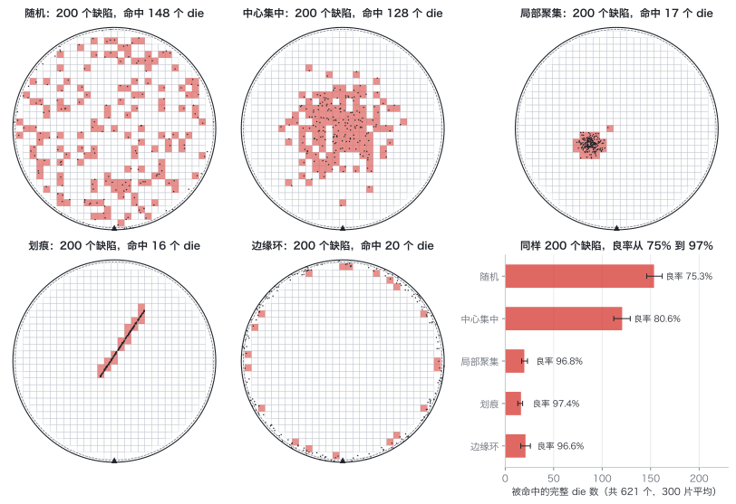
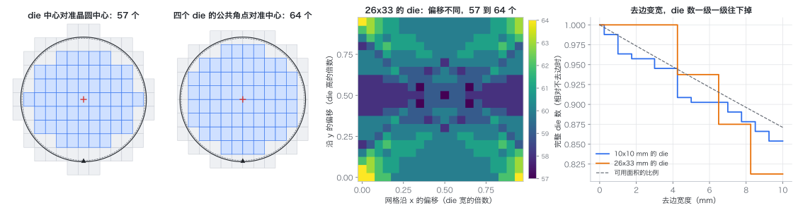
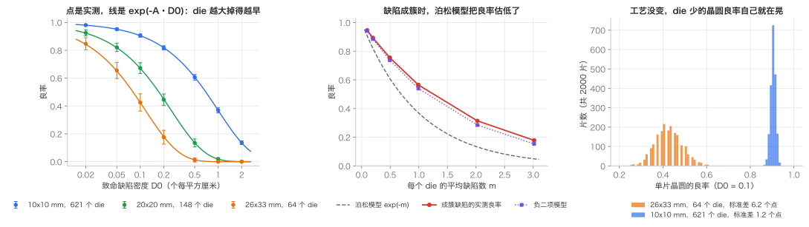
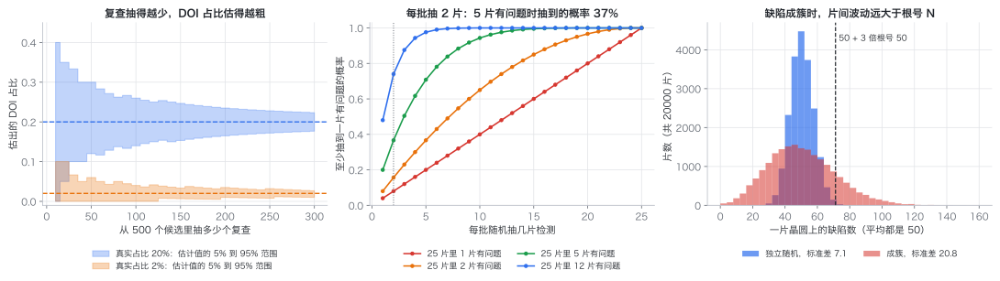
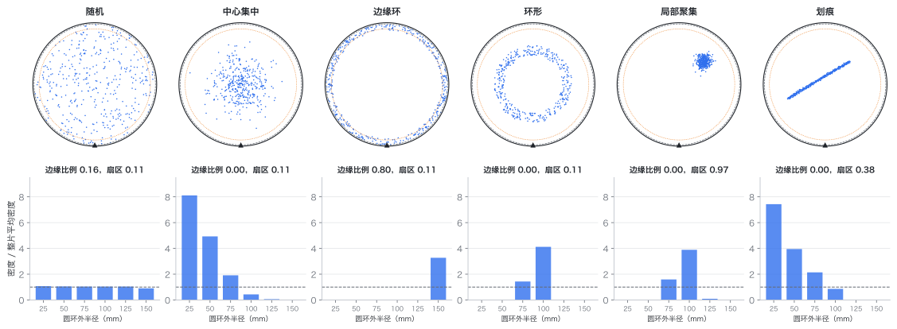
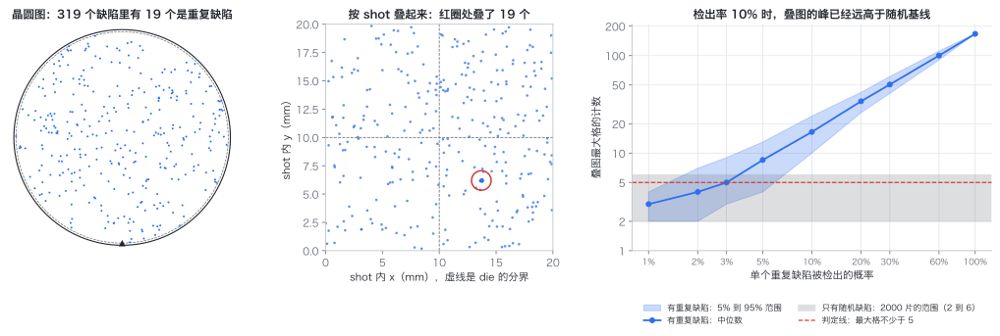

# 教程：半导体检测领域知识

> [!NOTE]
> 本章的内容分两类。能量化的部分（die 数、良率、空间特征、抽样波动）都来自合成缺陷坐标上的实测，数字记录在 [`figures/实测数字.json`](figures/实测数字.json)，由 `solutions` 分支的 `solutions/figures/ch23.py` 调用本章作业的参考实现生成。换成真实的晶圆数据，数值会变，结论的方向要自己再测一遍。行业事实的部分（工序、设备、术语）是给入职前的算法新人建立整体概念，写的是通用说法，数字是量级参考，以公司内部资料和具体设备为准。

## 0. 本章怎么学

**应用场景**：听懂会议里的术语，判断一个算法改进的业务价值。产线上没有人问“你的 F1 是多少”，问的是“这一层的 DOI 检出率多少、误报多少、对良率有什么影响”。这一章让你知道这些词指什么，知道图像算法在整条链路里的位置，也知道一张晶圆图该怎么读、哪些数字要带着条件看。

**优先级**：P0。没有前置章节，任何时候都可以读。它和第 18 章互相参照：第 18 章讲比对算法怎么做，这一章讲算法的输出在产线上怎么被使用。

| 档位 | 累计用时 | 做什么 | 做到什么算完 |
|---|---:|---|---|
| 速通 | 3 小时 | 读第 1 节，再读第 2 到 8 节里的概念和表格（带图的小节先看图和表下面的结论），过一遍第 15 节的术语表，按第 9 节的五步玩演示，答完 5 道小测 | 能讲清检测、复查、量测的分工，能解释为什么缺陷个数相同良率可以差很多，看到一张晶圆图知道先看什么 |
| 标准 | 8 小时 | 读完全章，跑 Notebook，完成作业并验收通过，做第 12 节前三个破坏实验，填实验记录和入职前术语清单 | 四项测试 PASS，实验记录里有四种模式的径向密度和边缘比例、一对只靠径向特征分不开的模式，以及一份标了把握程度的术语清单 |
| 深挖 | 12 小时 | 再做第 12 节其余的破坏实验和第 13 节的扩展 | 能在一组自己生成或下载的晶圆图上给出带条件的良率估计和空间模式判断，并说明哪些结论受样本量限制 |

> [!TIP]
> 用时超过所选档位的 1.5 倍还没做完，就把卡点写进 `学习进度.md`，先往下一章走。这一章的术语不需要一次背下来，入职后天天听，自然会熟。先保证第 1 节和第 7 节的几个量化结论看懂了。

## 1. 为什么要学领域知识：同样 200 个缺陷，良率能差 20 多个点

检测算法的输出是一张表：每个缺陷的坐标、尺寸和一些属性。只看这张表有多少行，得不出业务上关心的结论。下面的实验在一片晶圆上放 200 个缺陷，只改变它们的空间分布，然后数有多少个 die 被缺陷命中。

实验条件：300 mm 晶圆，10×10 mm 的 die，去边 3 mm，共 621 个完整 die。每片 200 个缺陷，每种分布重复 300 片。假设每个缺陷都致命，落在完整 die 之外的缺陷不计。



| 分布 | 被命中的完整 die（300 片平均） | 5% 到 95% 分位 | 良率 |
|---|---:|---:|---:|
| 随机 | 153.6 | 145 到 162 | 75.3% |
| 中心集中 | 120.7 | 112 到 129 | 80.6% |
| 局部聚集 | 19.8 | 17 到 23 | 96.8% |
| 划痕 | 16.3 | 13 到 18 | 97.4% |
| 边缘环 | 21.0 | 16 到 26 | 96.6% |

缺陷个数完全相同，随机分布时的良率比局部聚集时低 21.5 个百分点。原因很直接：聚在一起的缺陷反复砸在同一批 die 上，一个 die 坏一次和坏十次没有区别。边缘环还有另一层原因，有一部分缺陷落在去边区和不完整的 die 上，本来就不算产品。

这个实验说明三件事，也是这一章的主线：

1. **缺陷个数不是业务指标**。同样的个数，要结合 die 的大小和缺陷的空间分布才能换算成良率（第 7 节）。
2. **空间分布本身是信息**。随机、聚集、划痕、边缘环指向完全不同的原因（第 8 节），所以检测结果不只是一个计数，坐标必须准，坐标系必须对（第 3 节）。
3. **数字都带着统计波动**。同一种分布，300 片的命中 die 数也有一个范围。产线上的每个数字都来自抽样，要知道它能信到什么程度（第 7.5 节）。

### 1.1 图像算法在整条链路里的位置

```text
工艺步骤 → 抽片送检 → 检测设备扫描采图 → 图像算法（对齐、比对、阈值、过滤）→ 缺陷坐标和属性表
        → 晶圆图、叠图、空间模式分析 → 抽样复查（高倍成像）→ 缺陷分类 → 良率和根因分析 → 调整工艺或设备
```

这是一个示意，各家产线的系统划分和叫法不同，以公司内部资料为准。你写的代码主要在“图像算法”这一步（第 16、18、19 章），复查之后的自动分类也常用图像算法。它上游的成像条件决定了算法能拿到什么样的图（第 22 章），下游的每一步都在用算法输出的那张表。算法多报了误报，复查的时间就被浪费；算法给的坐标偏了，叠图和空间分析就会出错。

## 2. 芯片怎么造出来

一片硅晶圆要经过几百道工序，大致可以归为几类，反复循环几十次，一层一层往上叠：

| 工序 | 做什么 | 可能产生的缺陷 |
|---|---|---|
| 薄膜沉积（CVD、PVD、ALD） | 在晶圆表面长一层材料 | 颗粒、膜厚不均、空洞 |
| 光刻（lithography） | 涂光刻胶，用光罩曝光，显影出图形 | 图形变形、桥接、断线、离焦、光罩缺陷导致的重复缺陷 |
| 刻蚀（etch） | 把图形转移到下面的材料上 | 残留、过刻、欠刻 |
| 离子注入 | 改变局部材料的电学性质 | 一般光学不可见 |
| 化学机械抛光（CMP） | 把表面磨平 | 划痕、凹陷（dishing）、残留浆料 |
| 清洗 | 去除颗粒和残留 | 水痕、残留 |

前段（FEOL）做晶体管，后段（BEOL）做金属互连。检测穿插在这些工序之间，目的是尽早发现问题，因为越往后发现，浪费的工序越多。

## 3. 晶圆、die、光罩

- **晶圆（wafer）**：主流直径 300 mm（12 英寸），也有 200 mm。边缘有一圈不能用的区域（edge exclusion），通常几毫米。
- **die**：晶圆上重复排列的单个芯片，切割后就是一颗芯片。尺寸从几毫米到二三十毫米。
- **划片道（scribe line）**：die 之间的间隔，切割用，上面常放测试结构和对位标记。
- **光罩（reticle / mask）**：带图形的石英板，光刻机每次曝光一个光罩视场（shot），一个 shot 里可能有一个或几个 die。光罩上的缺陷会在每个 shot 同一位置重复出现。
- **notch**：晶圆边缘的小缺口，定义晶圆的方向。

**晶圆坐标**：检测结果用晶圆坐标（以中心为原点，单位毫米或微米）和 die 坐标（第几行第几列 die，加上 die 内的相对位置）两套坐标描述。作业里的 `die_grid` 和 `assign_to_die` 就是这两套坐标的换算。

两套坐标各有用处。晶圆坐标用来看整片的空间模式（第 8 节）。die 坐标用来回答“这个缺陷在哪个 die 的什么位置”，良率统计按 die 算，重复缺陷要按 die 内或 shot 内的位置叠起来才看得见（第 8.3 节）。作业的约定是 x 向右、y 向上，这和图像的行列坐标（行号向下增大）方向相反，画图和换算时最容易在这里出错。

### 3.1 一片晶圆能放多少个 die

最直接的估计是拿可用面积除以 die 面积。它总是偏多，因为圆的边缘放不下完整的矩形。作业里“完整 die”的定义是四个角点都落在可用圆内，下面用参考实现直接数。



实验条件：300 mm 晶圆，去边 3 mm。偏移扫描把网格在一个 die 的宽和高内各移 20 档，共 400 种位置。

| die 尺寸（mm） | 按面积估计 | die 中心对准晶圆中心 | 角点对准晶圆中心 | 400 种偏移的最少到最多 | 最多比最少多 | 面积估计比最多值高 |
|---|---:|---:|---:|---:|---:|---:|
| 5×5 | 2715.5 | 2593 | 2592 | 2592 到 2606 | 0.5% | 4.2% |
| 10×10 | 678.9 | 621 | 616 | 616 到 625 | 1.5% | 8.6% |
| 20×20 | 169.7 | 137 | 148 | 137 到 148 | 8.0% | 14.7% |
| 26×33 | 79.1 | 57 | 64 | 57 到 64 | 12.3% | 23.6% |

读这张表的三个结论：

1. **面积估计总是偏多，die 越大偏得越多**。5×5 mm 时高 4.2%，26×33 mm 时高 23.6%。
2. **网格怎么摆会改变 die 数**。26×33 mm 的 die，只把网格整体平移，完整 die 数在 57 到 64 之间变化，差 7 个，也就是 12.3%。die 的尺寸、晶圆的大小、去边宽度都没变。
3. **哪种对齐更好没有固定答案**。10×10 mm 时 die 中心对准更多（621 对 616），20×20 和 26×33 mm 时角点对准更多。要数了才知道。

有一个常见的近似公式，在面积估计上扣掉一项和周长成正比的边缘损失，其中 $d$ 是可用直径，$S$ 是 die 面积：

$$
N \approx \frac{\pi d^2}{4S} - \frac{\pi d}{\sqrt{2S}}
$$

对上面四种 die，它给出 2584.8、613.6、137.1、56.8，都落在实测范围的下沿附近。它适合心算量级，精确的数要用网格去数。

**去边宽度的影响是一级一级的**（图 2 最右）。10×10 mm、die 中心对准时，去边取 0、1、2、3、4、5 mm，完整 die 数依次是 657、633、629、621、621、593。从 3 mm 到 4 mm 一个都没少，从 4 mm 到 5 mm 少了 28 个。26×33 mm、角点对准时，去边从 0 到 4 mm 都是 64 个，5 mm 时变成 60 个。原因是 die 数只在某一圈 die 的角点被圆弧切到的那一刻才变。所以“去边多 1 mm 损失多少 die”没有通用答案，要对着具体的排布数。

<!-- quiz -->
**300 mm 晶圆，26×33 mm 的 die，去边 3 mm。die 的尺寸不变，只把 die 网格整体平移，完整 die 的个数最多能差多少？**

- A. 不会变，可用面积和 die 面积都没变
- B. 差 1 个，只有最边上那一个受影响
- C. 差 7 个，超过 10%

<details markdown="1"><summary>答案与解释</summary>

**C**。实测 400 种偏移里最少 57 个，最多 64 个，相差 12.3%。面积没变，但圆的边缘能塞进多少个完整矩形取决于网格和圆心的相对位置，一整圈 die 会一起进出。die 越小这个效应越弱，5×5 mm 时只差 0.5%。

</details>
<!-- /quiz -->

### 3.2 边缘 die 和不完整 die

图 2 里灰色的格子是只压到晶圆一部分的不完整 die（partial die）。300 mm 晶圆、去边 3 mm 时，10×10 mm 的 die 有 156 个这样的格子，26×33 mm 的 die 在两种对齐下分别有 50 个和 40 个。它们做不成产品。这些位置要不要曝光、要不要检测，取决于产线的做法。

对比对类算法来说，更要紧的是完整 die 里靠边的那一圈。第 18 章第 2.1 节的三比仲裁需要左右各一个邻居。数一下左右至少缺一个完整邻居的 die：

| 排布 | 完整 die | 左右至少缺一个完整邻居 | 占比 |
|---|---:|---:|---:|
| 10×10 mm，die 中心对准 | 621 | 58 | 9.3% |
| 26×33 mm，die 中心对准 | 57 | 14 | 24.6% |
| 26×33 mm，角点对准 | 64 | 16 | 25.0% |

die 越大，这一类 die 占的比例越高。它们得换一种参考（换比对方向、用别的 die、或者用金模板），具体怎么处理以设备资料为准。晶圆边缘同时也是工艺最不稳定的地方（第 8 节的边缘环），所以边缘 die 往往既难比对，又缺陷多。

## 4. 缺陷类型

| 缺陷 | 描述 | 常见来源 |
|---|---|---|
| 颗粒（particle） | 表面的外来微粒 | 设备、环境、材料 |
| 划痕（scratch） | 线状损伤 | CMP、搬运 |
| 桥接（bridge） | 本该分开的图形连在一起，造成短路 | 光刻、刻蚀 |
| 断线（open / break） | 本该连通的线断开，造成开路 | 光刻、刻蚀、颗粒遮挡 |
| 缺失图形（missing pattern） | 整块图形没有形成 | 光刻 |
| 残留（residue） | 该去掉的材料没去干净 | 刻蚀、清洗 |
| 凹坑和空洞（pit、void） | 材料中的空缺 | 沉积、CMP |
| 颜色差（color variation） | 膜厚变化引起干涉颜色不同 | 沉积、CMP，常常是误报来源 |

**致命缺陷（killer defect）**：会导致芯片功能失效的缺陷，比如关键位置的桥接和断线。很多缺陷不致命（落在空白区的小颗粒）。检测和分类的终极目标是找出致命缺陷，并控制工艺让它们不再出现。

第 1 节的实验假设每个缺陷都致命，这是最坏的情况。真实情况下只有一部分缺陷致命，这个比例随缺陷类型、尺寸和所在区域变化，要靠良率分析的数据确定。所以第 7 节的良率公式里用的是“致命缺陷密度”，它比检测报出的缺陷密度小。

## 5. 检测设备分类

| 类别 | 原理 | 特点 |
|---|---|---|
| 明场光学图形检测 | 高 NA、短波长成像，图像比对 | 灵敏度高，用于图形缺陷，速度中等 |
| 暗场光学检测 | 收集散射光 | 速度快，对颗粒敏感 |
| 无图形晶圆检测 | 激光扫描裸片或膜片表面 | 监控设备洁净度，非常快 |
| 电子束检测（EBI） | 扫描电子束成像 | 分辨率极高，能看到电压对比缺陷，速度慢 |
| 缺陷复查（review SEM） | 对检测报出的位置拍高倍电镜图 | 确认和分类，不负责找缺陷 |
| 宏观检测（macro） | 低倍大视场 | 看整片的大面积异常 |
| 光罩检测 | 检测光罩本身 | 防止重复缺陷 |

**检测（inspection）**负责在整片晶圆上找“哪里可能有缺陷”，**复查（review）**负责在报出的位置拍高清图确认“是什么缺陷”，**量测（metrology）**负责测量尺寸、膜厚、套刻误差等数值。你的岗位 JD 涉及的主要是检测和与之配套的图像生成和仿真。

明场和暗场的成像原理、分辨率和像素尺寸的关系在第 22 章。表里“图像比对”的几种做法（die-to-die、金模板、die-to-database）在第 18 章第 2 节。

## 6. 检测流程里的关键概念

- **配方（recipe）**：一份针对某个产品某一层的检测设置，包括光学模式、像素尺寸、检测区域分区、各区阈值、比对方式、缺陷过滤规则。调配方是检测工程师的核心工作，算法往往以“配方里的一个模块”的形式交付。
- **DOI（defect of interest）**：这一层关心的缺陷类型。配方的灵敏度围绕 DOI 调。
- **误报（nuisance）**：报出来但不关心或者不是真缺陷的。误报太多会淹没 DOI，让复查成本暴涨。
- **抽样**：不是每片晶圆、每一层都检测，按工艺风险抽样。
- **KLARF**：缺陷结果的常用文件格式之一，记录每个缺陷的坐标、尺寸、类别等，供良率分析系统使用。

配方里“分区、各区阈值”为什么有用，第 18 章第 3.5 节有统计上的解释。抽样会带来多大的不确定性，第 7.5 节用数字说明。

对算法工程师来说，“以配方里的一个模块交付”意味着两件事。一是算法要暴露出少量含义清楚的参数，让检测工程师能按层调。二是同一个算法会在很多产品、很多层上跑，在一组图上调出来的固定数值很可能在另一层失效，这也是第 18 章强调阈值要按统计量来定的原因。

## 7. 指标和它们之间的关系

| 指标 | 含义 |
|---|---|
| 灵敏度 | 能检出的最小缺陷尺寸 |
| 检出率（capture rate） | DOI 被检出的比例 |
| 误报率（nuisance rate） | 报出结果中误报的比例 |
| 产能（throughput） | 每小时检测多少片晶圆 |
| 良率（yield） | 好芯片的比例，最终的业务目标 |

这几个指标互相制约：提高灵敏度（更小像素、更低阈值）会提高检出率，但误报增加、产能下降。算法的价值在于**让这条权衡曲线整体往好的方向移动**，比如同样产能下检出率更高，或者同样检出率下误报更少。汇报算法改进时，用这些指标说话。

注意误报率的分母是报出的总数。例如一片晶圆报出 500 个候选，复查后 50 个是 DOI，误报率就是 90%。第 18 章建议的“每张图多少个误报”是另一种口径，分母是图像数。两种都有人用，汇报时要说明是哪一种。

### 7.1 一个量级概念：整片晶圆有多少像素

灵敏度和产能为什么互相制约，算一下像素数就明白。300 mm 晶圆的面积是 70686 mm²。像素折算到晶圆面是 1 微米时，整片约 707 亿个像素；缩小到 0.5 微米，变成约 2830 亿个，是 4 倍。这两个像素尺寸只是举例，取的是第 22 章举例时用过的数值，不代表任何具体设备。

再看误报。第 18 章第 3.1 节算过，噪声是高斯分布、sigma 准确已知时，一个良品像素超过 5 sigma 的概率是 5.7e-7。按 1 微米像素算，整片晶圆上期望有约 4.1 万个像素只因为噪声就超过阈值。这还是理想情况，第 18 章第 3.3 节的实测说明 sigma 估不准时会多得多。所以面积过滤、分区阈值和各种误报过滤规则是检测流程的必需品，把阈值调低一点的代价会被几百亿个像素放大。

### 7.2 良率和缺陷密度：泊松模型

如果致命缺陷在晶圆上随机、互相独立地出现，面密度是 $D_0$（个每平方厘米），那么面积为 $A$ 的 die 上的致命缺陷个数服从均值为 $A D_0$ 的泊松分布，一个都没有的概率就是良率：

$$
Y = e^{-A D_0}
$$

下面用作业的 `die_grid` 和 `assign_to_die` 直接模拟来验证。



实验条件：300 mm 晶圆，去边 3 mm。致命缺陷在整片晶圆上按面积均匀随机，每片的个数服从泊松分布。完整 die 上只要有一个缺陷就算坏。每个缺陷密度做 200 片。表里的缺陷密度是为了扫出整条曲线取的，不代表任何实际工艺的水平。

| 致命缺陷密度（个每平方厘米） | 0.02 | 0.05 | 0.1 | 0.2 | 0.5 | 1.0 | 2.0 |
|---|---:|---:|---:|---:|---:|---:|---:|
| 10×10 mm（1 cm²，621 个 die）实测 | 98.1% | 95.1% | 90.6% | 81.8% | 60.6% | 36.9% | 13.6% |
| 20×20 mm（4 cm²，148 个 die）实测 | 92.5% | 82.1% | 67.2% | 44.5% | 13.5% | 1.8% | 0.0% |
| 26×33 mm（8.58 cm²，64 个 die）实测 | 84.7% | 65.5% | 42.5% | 17.6% | 1.2% | 0.0% | 0.0% |
| 26×33 mm 的泊松模型 | 84.2% | 65.1% | 42.4% | 18.0% | 1.4% | 0.0% | 0.0% |

缺陷随机分布时，实测和泊松模型在全部 21 个点上最多差 0.5 个百分点。

最值得记住的是同一列里的差别。缺陷密度同样是 0.1，1 cm² 的 die 良率 90.6%，8.58 cm² 的 die 只有 42.5%。良率由 $A D_0$ 这个乘积决定，die 大一倍和缺陷密度高一倍效果相同。所以听到一个良率数字，先问 die 多大；听到“缺陷数降了一半”，要换算成 $A D_0$ 才知道对良率意味着什么。

### 7.3 缺陷成簇时，泊松模型偏悲观

第 1 节已经看到，聚在一起的缺陷命中的 die 少。把它放进良率模型：让缺陷成簇出现，保持每个 die 的平均缺陷数 $m$ 不变，再和泊松模型比。

实验条件：10×10 mm 的 die。簇的中心均匀随机，每簇的缺陷数服从均值 8 的泊松分布，簇内按标准差 6 mm 的高斯散开。每档 100 片。

| 每个 die 的平均缺陷数 m | 0.097 | 0.198 | 0.493 | 0.992 | 2.024 | 3.016 |
|---|---:|---:|---:|---:|---:|---:|
| 实测良率 | 94.6% | 89.3% | 75.5% | 56.5% | 31.4% | 17.8% |
| 泊松模型 | 90.8% | 82.0% | 61.1% | 37.1% | 13.2% | 4.9% |
| 负二项模型 | 94.2% | 88.5% | 73.8% | 54.0% | 28.5% | 15.3% |
| 按数据估出的聚集参数 | 0.066 | 0.137 | 0.338 | 0.694 | 1.41 | 2.12 |

$m$ 接近 1 时，泊松模型说良率是 37.1%，实测是 56.5%，差了 19.4 个百分点。平均数相同，成簇意味着一部分 die 挨了很多个缺陷，另一部分 die 一个都没有，没被命中的 die 反而更多。

良率工程里处理成簇的常用模型是负二项模型，多一个聚集参数 $\alpha$：

$$
Y = \left(1 + \frac{A D_0}{\alpha}\right)^{-\alpha}
$$

$\alpha$ 越小聚集越强，$\alpha$ 很大时回到泊松模型。表里的 $\alpha$ 是用全部 die 的缺陷数的均值 $m$ 和方差 $v$ 按 $m^2/(v-m)$ 估出来的。在这组实验里，负二项模型和实测最多差 2.9 个百分点，比泊松模型好得多。同时注意 $\alpha$ 随缺陷密度从 0.066 变到了 2.12，它是从数据里拟合出来的量，不能从别处抄一个数来用。

<!-- quiz -->
**每个 die 上平均有 1 个致命缺陷。泊松模型给出的良率约 37%。如果缺陷是成簇出现的，平均数不变，实际良率和 37% 相比会怎样？**

- A. 更低，成簇的缺陷破坏力更集中
- B. 一样，良率只取决于平均缺陷数
- C. 更高，成簇的缺陷重复砸在同一批 die 上

<details markdown="1"><summary>答案与解释</summary>

**C**。实测 m 为 0.992 时良率 56.5%，泊松模型是 37.1%。一个 die 坏一次和坏十次是一样的，缺陷越集中，被“浪费”在已经坏掉的 die 上的缺陷越多。B 只在缺陷互相独立时成立。

</details>
<!-- /quiz -->

### 7.4 单片良率自己就在晃

图 3 右栏是工艺完全不变（缺陷密度固定为 0.1）时，2000 片晶圆各自的良率。

| die 尺寸 | 完整 die 数 | 平均良率 | 单片良率的标准差 | 5% 到 95% 分位 |
|---|---:|---:|---:|---:|
| 26×33 mm | 64 | 42.6% | 6.2 个百分点 | 32.8% 到 53.1% |
| 10×10 mm | 621 | 90.5% | 1.2 个百分点 | 88.6% 到 92.4% |

64 个 die 的晶圆，这一片 33%、下一片 53% 都属于正常波动。标准差可以按二项分布估：$\sqrt{Y(1-Y)/K}$，其中 $K$ 是 die 数，算出来正好是 6.2 和 1.2 个百分点，和模拟一致。

落到一句具体的话上：一片 64 个 die 的晶圆有 27 个好 die，良率 42.2%，Wilson 95% 置信区间是 30.9% 到 54.4%；另一片有 32 个好 die，良率 50.0%，区间是 38.1% 到 61.9%。两个区间大部分重叠，只凭这两片不能说工艺变好了。

### 7.5 抽样：每个数字能信到什么程度

第 6 节说过，检测是抽样的。复查更慢，通常也只能从报出的候选里抽一部分看。下面三组数字说明抽样会带来多大的不确定性。



**复查抽样**。检测报出 500 个候选，随机抽 $n$ 个复查，用抽到的 DOI 比例乘以 500 来估计 DOI 的总数。下表是超几何分布的精确值。

| 复查个数 | 20 | 50 | 100 | 200 |
|---|---:|---:|---:|---:|
| 真有 100 个 DOI：估出的个数（5% 到 95% 分位） | 25 到 175 | 60 到 150 | 70 到 130 | 82 到 118 |
| 真有 10 个 DOI：估出的个数（5% 到 95% 分位） | 0 到 50 | 0 到 30 | 0 到 20 | 5 到 18 |
| 真有 10 个 DOI：一个都没抽到的概率 | 66.2% | 34.5% | 10.5% | 0.6% |

DOI 占两成时，复查 50 个得到的估计在 60 到 150 之间，上下差一倍多。DOI 只占 2% 时，复查 50 个有 34.5% 的概率一个都看不到（用 20000 次随机抽样核对，结果同样是 34.5%）。这时“复查没发现 DOI”和“没有 DOI”是两回事。报告复查结果时带上置信区间：复查 50 个里 10 个是 DOI，占比 20%，Wilson 95% 置信区间是 11.2% 到 33.0%。

**按批抽片**。假设一批 25 片，其中 $k$ 片有问题，每批随机抽 $n$ 片检测。一批多少片、怎么抽，实际以产线为准，这里只算最简单的随机抽样。

| 有问题的片数 | 抽 1 片 | 抽 2 片 | 抽 3 片 | 抽 5 片 | 抽 13 片 |
|---|---:|---:|---:|---:|---:|
| 1 | 4% | 8% | 12% | 20% | 52% |
| 2 | 8% | 15.7% | 23% | 36.7% | 78% |
| 5 | 20% | 36.7% | 50.4% | 70.8% | 98.5% |
| 12 | 48% | 74% | 87.6% | 97.6% | 100% |

每批抽 2 片，25 片里有 5 片出问题时，抽到的概率只有 36.7%，平均要到第 2.7 批才第一次抽到。影响一小部分晶圆的问题，靠稀疏的随机抽样发现得很慢。影响接近一半晶圆的问题（表里 12 片那一行）就快得多，抽 2 片有 74% 的概率抽到。

**片间缺陷数的波动**。监控一道工序时，常见的做法是画每片缺陷数的趋势图，超出控制线就报警。如果缺陷互相独立，单片缺陷数服从泊松分布，标准差是均值的平方根。

| 每片平均 50 个缺陷，各 20000 片 | 标准差 | 5% 到 95% 分位 | 超过 50 + 3√50 = 71.2 的片 |
|---|---:|---:|---:|
| 缺陷独立随机 | 7.1 | 39 到 62 | 0.17% |
| 缺陷成簇（每簇平均 8 个） | 20.8 | 19 到 87 | 15.2% |

缺陷成簇时，标准差是独立随机时的 2.9 倍。按根号 N 画的控制线在这种数据上会有 15.2% 的片超线，而工艺其实没有变化。原因是统计上独立的单位是“簇”而不是“缺陷”：一道划痕可能报出几十个缺陷，但它只是一个事件。一种常见的处理思路是先把聚在一起的缺陷合并成一个事件再做统计，具体规则以公司的做法为准。

<!-- quiz -->
**检测报出 500 个候选，其中真有 10 个 DOI。随机抽 50 个去复查，一个 DOI 都没抽到的概率大约是多少？**

- A. 不到 1%，抽了一成，10 个里总能碰上一个
- B. 约 10%
- C. 约 35%

<details markdown="1"><summary>答案与解释</summary>

**C**。超几何分布的精确值是 34.5%。每抽一个，碰不上 DOI 的概率是 98%，连抽 50 个都碰不上的概率仍然有三分之一。要把这个概率压到 10.5% 需要复查 100 个，压到 0.6% 需要 200 个。

</details>
<!-- /quiz -->

## 8. 晶圆图的空间模式

把一片晶圆上所有缺陷的位置画出来，空间分布往往能指向根因：

| 模式 | 可能原因 |
|---|---|
| 随机分布 | 环境颗粒，基线水平 |
| 中心集中 | 旋涂、气流、温度不均 |
| 边缘环（edge ring） | 边缘工艺控制、夹持 |
| 局部聚集（cluster） | 局部污染、设备异常 |
| 划痕状（直线或弧线） | 搬运、CMP |
| 环形（donut） | 沉积或刻蚀的径向不均 |
| 重复（每个 shot 同一位置） | 光罩缺陷 |

作业里的径向密度和边缘比例就是最简单的空间特征。WM-811K 数据集上，这类模式分类常用 CNN 做。

表里的“可能原因”是排查的起点，不是结论。同一种模式可以有多种来源，实际的根因要结合工序、设备和历史数据来定。

### 8.1 两个径向特征能分开什么，分不开什么

径向密度把晶圆分成若干个等宽的圆环，数每个环里的缺陷再除以环的面积。边缘比例是落在最外一圈里的缺陷占比。下面对六种合成模式各算一遍，另外加一个作业里没有的特征做对照：把晶圆按角度切成 12 个 30 度的扇区，看最密的那个扇区里有多少缺陷。



实验条件：统计半径 150 mm，6 个等宽圆环，边缘比例取外圈 15 mm。每种模式 400 个缺陷，重复 200 次取平均。特征用作业的参考实现计算。

| 模式 | 六个圆环的密度（由内到外，整片平均为 1） | 边缘比例 | 最密扇区的占比 |
|---|---|---:|---:|
| 随机 | 1.07、1.05、1.04、1.04、1.04、0.90 | 0.156 | 0.108 |
| 中心集中 | 8.11、4.93、1.91、0.43、0.06、0.00 | 0.000 | 0.108 |
| 边缘环 | 0、0、0、0、0、3.27 | 0.800 | 0.108 |
| 环形 | 0、0、1.43、4.12、0、0 | 0.000 | 0.107 |
| 局部聚集 | 0、0、1.59、3.89、0.09、0 | 0.000 | 0.971 |
| 划痕 | 7.43、3.95、2.14、0.86、0、0 | 0.000 | 0.378 |

三个结论：

1. **随机、中心集中、边缘环、环形这四种，径向密度的形状各不相同，分得开**。这是径向特征擅长的事。
2. **中心集中和划痕分不开，环形和局部聚集也分不开**。这条经过中心附近的划痕，径向密度从内到外是 7.43、3.95、2.14，和中心集中的 8.11、4.93、1.91 几乎一样，边缘比例都是 0。环形和局部聚集的情况相同。径向特征把一整圈的缺陷加在一起，角度方向的信息全丢了。扇区占比能把它们分开：划痕 0.378 对中心集中 0.108，局部聚集 0.971 对环形 0.107。
3. **随机分布的最外环密度是 0.90，边缘比例是 0.156 而不是 0.19**。这不是工艺现象。Notebook 里随机缺陷只撒到半径 147 mm（去边以内），统计半径却用了 150 mm，最外面 3 mm 没有缺陷。按面积算，缺陷铺满 150 mm 时均匀分布的边缘比例应该是 0.19，只铺到 147 mm 时是 0.157。撒点范围和统计范围不一致，就会凭空造出一个“边缘偏少”的假象。

第 2 条还有一层：划痕的径向密度取决于它的位置。图 5 的划痕离圆心最近约 17 mm，所以看起来像中心集中。换一条离圆心远的划痕，径向密度会变成中间高两头低，看起来像环形。第 9 节的演示可以直接试。

<!-- quiz -->
**只用径向密度和边缘比例这两个特征，下面哪一对模式最难分开？**

- A. 中心集中和边缘环
- B. 中心集中和一条经过中心附近的划痕
- C. 随机分布和环形

<details markdown="1"><summary>答案与解释</summary>

**B**。实测两者的径向密度分别是 8.11、4.93、1.91 和 7.43、3.95、2.14，边缘比例都是 0。A 的两种模式一个只有内圈有、一个只有外圈有；C 的随机分布各环接近 1，环形只有中间两环有。要分开 B，需要带角度信息的特征，例如最密扇区的占比（0.108 对 0.378）。

</details>
<!-- /quiz -->

### 8.2 缺陷少的时候，“模式”可能只是噪声

径向密度的每个环里只有一部分缺陷。最内环的面积只占整片的 2.8%，总共 30 个缺陷时，它里面期望只有 0.83 个。下面让缺陷完全均匀随机（没有任何模式），看这两个特征自己会晃多少。

实验条件：缺陷在半径 150 mm 内按面积均匀随机，每种个数重复 2000 片。

| 一片上的缺陷个数 | 30 | 100 | 400 | 2000 |
|---|---:|---:|---:|---:|
| 最内环密度与平均密度之比（5% 到 95% 分位） | 0 到 3.6 | 0 到 1.8 | 0.54 到 1.53 | 0.77 到 1.22 |
| 最内环一个缺陷都没有的概率 | 42.3% | 5.9% | 0% | 0% |
| 最内环密度达到平均 2 倍以上的概率 | 21% | 4.9% | 0.15% | 0% |
| 边缘比例（5% 到 95% 分位，理论值 0.19） | 0.07 到 0.30 | 0.13 到 0.26 | 0.16 到 0.22 | 0.18 到 0.20 |

一片只有 30 个缺陷的晶圆，“中心密度是平均的两倍以上”有 21% 的概率纯属偶然，同时有 42.3% 的概率中心一个缺陷都没有。只凭这样一片晶圆图就下“中心集中”或“中心偏少”的结论，很不可靠。应对的办法有三个：把多片晶圆叠起来看，减少圆环的个数，或者在下结论之前先算一下每个环里期望有几个缺陷。

### 8.3 重复缺陷：晶圆图上看不出来，按 shot 叠起来才看得见

光罩上的缺陷会印到每个 shot 的同一位置。它的个数可能很少，混在随机缺陷里，晶圆图上完全看不出来。

实验设置：300 mm 晶圆，10×10 mm 的 die，一个 shot 是 2×2 个 die（20×20 mm）。光罩上有一个缺陷，只要它对应的位置落在可用半径 147 mm 以内就印上，一共 167 处（这里假设边缘不完整的 shot 也曝光）。坐标带标准差 0.05 mm 的定位误差。每一处按一个固定的检出率独立决定是否被检测报出。另有 300 个随机缺陷作为背景。

这里的光罩缺陷只在 shot 里四个 die 中的一个上，所以相邻 die 互相比对能看到它。如果一个 shot 只有一个 die，每个 die 上都有同样的缺陷，相邻 die 比对就完全看不到，那是第 18 章第 2.2 节讲的盲区。



图 6 左栏的示例晶圆上，重复缺陷的检出率是 10%，319 个缺陷里有 19 个是重复缺陷。它的六环径向密度是 1.02、1.20、1.15、1.03、0.97、0.88，边缘比例是 0.160。同样个数的纯随机缺陷，六环是 0.45、1.24、1.15、0.95、0.92、1.02，边缘比例 0.172。从这两组数里看不出哪一片有问题。

把每个缺陷的坐标换算成 shot 内的位置，再把所有 shot 叠在一起（图 6 中栏），19 个重复缺陷落在同一个点上。按 0.5 mm 的格子计数，最密的一格有 19 个。只有随机缺陷时，2000 片晶圆的最大格计数在 2 到 6 之间，中位数是 3，达到 5 的只有 0.55%。

| 单个重复缺陷的检出率 | 1% | 2% | 3% | 5% | 10% | 20% |
|---|---:|---:|---:|---:|---:|---:|
| 叠图最密一格的计数（中位数） | 3 | 4 | 5 | 8.5 | 16.5 | 34 |
| 按“最密一格不少于 5”认出重复缺陷的概率（各 300 片） | 3.7% | 30.3% | 60.0% | 92.7% | 100% | 100% |

两个结论：

1. **叠图把很弱的检出能力放大了**。单个位置的检出率只有 10%，也就是十次里漏九次，叠图之后 300 片全部认得出来。因为同一个位置在一片晶圆上重复了一百多次，漏掉大部分也还剩十几个。这和第 18 章里“单张图检不出就是检不出”的直觉不一样，利用的是领域知识：光罩缺陷一定在每个 shot 的同一位置。
2. **重复缺陷值得专门去找**。这个例子里含重复缺陷的完整 die 有 158 个，占全部 621 个的 25.4%。如果它是致命的，良率直接少四分之一，对应 2×2 的 shot 里每四个 die 坏一个。

叠图要求坐标准。作业里 `assign_to_die` 的 offset 如果差了半个 die，或者 shot 的大小设错了，叠出来的点就散开了。

<!-- quiz -->
**光罩上有一个很弱的缺陷，在每个 shot 上被检出的概率只有 10%。晶圆上还有 300 个随机缺陷。把所有缺陷按 shot 叠起来，用“最密的一格不少于 5 个”作判据，认出这个重复缺陷的概率大约是多少？**

- A. 约 10%，和单个位置的检出率一样
- B. 约 50%
- C. 接近 100%

<details markdown="1"><summary>答案与解释</summary>

**C**。实测 300 片全部认出。这片晶圆上有 167 处重复缺陷，检出 10% 也有十几个落在同一格里（中位数 16.5），而纯随机缺陷的最密一格在 2000 片里最多只有 6 个。检出率降到 3% 时认出的概率是 60.0%，降到 1% 时只有 3.7%。

</details>
<!-- /quiz -->

## 9. 交互演示

演示页画一片晶圆，可以改晶圆直径、die 的宽和高、去边宽度和网格对齐方式，看完整 die 数怎么变；也可以放上七种分布的缺陷，看被命中的 die、良率、径向密度和按 shot 的叠图。几何和统计的口径与作业一致。页面下方“按顺序试”有五步，每步对应上面的一个结论：

1. 26×33 mm 的 die，在“die 中心对准”和“角点对准”之间切换，完整 die 数在 57 和 64 之间变，“按面积估计”一直是 79.1。再把 die 的宽和高都拖到 10，结果反过来，die 中心对准的 621 个比角点对准的 616 个多（第 3.1 节）。
2. 10×10 mm 的 die、die 中心对准，把去边宽度从 3 拖到 4、4.5、5，完整 die 数依次是 621、621、597、593。从 3 到 4 一个没少，从 4 到 4.5 一下少了 24 个（第 3.1 节）。
3. 放 200 个随机缺陷，良率在 75% 上下，和它下面的泊松预测接近。切到“局部聚集”，缺陷个数不变，良率回到 96% 以上（第 1 节和第 7.3 节）。
4. 切到“划痕”，只看径向密度，再切到“中心集中”对比。多点几次“换一组随机数”，划痕的径向密度有时像中心集中，有时像环形（第 8.1 节）。
5. 切到“重复缺陷”，晶圆图和径向密度看不出异常，右下的叠图里有一格被红圈标出（第 8.3 节）。

<!-- embed: ../demos/晶圆图.html 1273 -->
[打开交互演示：晶圆图：die 数、缺陷分布与良率](../demos/晶圆图.html)

演示里的缺陷是浏览器现场生成的，和配图用的不是同一组随机数，具体数值会和上面的表略有出入，结论的方向相同。

## 10. 怎样评估和汇报

这一章没有一个可以打分的算法，要评估的是“一个和晶圆有关的数字说得对不对、全不全”。产线上的每个数字都有分母和条件，缺了就没法比较。

| 要报的量 | 必须带上的条件 | 为什么 |
|---|---|---|
| 缺陷个数或缺陷密度 | 检测面积（去边多少、是否包含不完整 die）、哪一层、哪个配方 | 配方一变，报出的个数就变；面积不同，个数没法比 |
| 检出率 | 针对哪种 DOI、真值从哪来、匹配规则 | 同第 18 章第 6.1 节，规则不同，数字可以差几倍 |
| 误报率 | 分母是报出的总数还是图像数，复查了多少个 | 第 7 节的例子里是 90%，换一种口径就是另一个数 |
| 良率或良率影响 | die 尺寸、完整 die 数、是否假设缺陷都致命 | 64 个 die 的晶圆，单片良率的标准差有 6.2 个百分点 |
| 空间模式 | 这片晶圆上的缺陷个数、是单片还是多片叠加 | 30 个缺陷时径向特征基本是噪声 |
| 复查结论 | 从多少候选里抽了多少个、怎么抽的 | 抽 50 个时，2% 的 DOI 有 34.5% 的概率一个都看不到 |

汇报一个算法改进时，按下面的顺序把它翻译成业务语言：

1. 先说工作点的变化：同样的误报下检出率提高多少，或者同样的检出率下误报减少多少（第 18 章图 6 那样的曲线）。
2. 再说它影响的是哪种缺陷、哪些层。只对一种非致命的缺陷有效的改进，对良率的意义有限。
3. 样本少时给置信区间。第 7.4 和 7.5 节的三个例子可以直接套用。
4. 没有测过的不要外推。在合成数据上的结论，说明是合成数据。

## 11. 常见错误

前半是做本章作业时最容易犯的实现错误，后半是读晶圆图时的错误。表里的个数都是 300 mm 晶圆、10×10 mm 的 die、去边 3 mm、die 中心对准这一组条件下的，正确的完整 die 数是 621。

| 现象 | 原因 | 怎么查 |
|---|---|---|
| 完整 die 数是 673，比正确值多 52 个 | 只判断了 die 的中心在不在可用圆内 | 画出来看最外一圈 die 有没有角伸出虚线圆 |
| 完整 die 数是 741 | 有一个角点在圆内就算了，应该是四个角点都在 | 同上 |
| 完整 die 数是 657 | 忘了扣去边，按整片晶圆的半径判断了 | 把去边改成 0 和 10 各跑一次，个数应该不同 |
| 角点正好落在圆上的 die 被漏掉 | 把“距离不超过半径”写成了严格小于 | 验收的两组参数里没有这种 die，查不出来。用 300 mm、不去边、角点对准（offset 为 0）测，应为 648 个，写成严格小于会得到 640 个 |
| 坐标为负的缺陷归错了 die，(-0.001, -0.001) 被归到 (0, 0) | 用截断取整代替了向下取整 | 测一个坐标略小于 0 的点，应归到 (-1, -1) |
| offset 不为 0 时所有缺陷的归属整体偏一格 | 换算前没有先减去 offset | 用 offset 为 (-5, -5) 测原点，应归到 (0, 0) |
| 均匀分布的径向密度从内到外一路升高，最外环是最内环的 11 倍 | 只数了个数，没有除以圆环面积 | 用面积均匀的点测，各环应近似相等 |
| 自己生成的“均匀”缺陷在中心明显偏密 | 半径直接取了均匀随机数，没有开平方 | 画径向密度，面积均匀时各环应接近 1 |
| 边缘比例偏小 | 分母里算进了半径以外的点 | 加一个半径以外的点，结果不应该变 |
| 随机缺陷的最外环密度偏低一成，边缘比例是 0.157 而不是 0.19 | 撒点范围（147 mm）和统计半径（150 mm）不一致 | 把两个半径统一后再比（第 8.1 节） |
| 晶圆图上下颠倒，或者和别人的图对不上 | 晶圆坐标 y 向上，图像行号向下；或者没有约定 notch 的朝向 | 在已知位置放一个缺陷，确认它画在预期的一侧 |
| 叠图里重复缺陷散成一片，没有尖峰 | offset 或 shot 尺寸设错，折叠后的位置对不齐 | 用自己构造的重复缺陷先验证折叠代码 |
| 看到一片晶圆“中心偏高”就下结论 | 缺陷太少，最内环里期望不到一个缺陷 | 先算每个环里期望的缺陷个数（第 8.2 节） |
| 用缺陷个数直接推良率 | 没有考虑 die 面积和成簇 | 把缺陷归到 die，数被命中的 die（第 1 节） |

## 12. 破坏实验

每个实验先写下预测，再运行，把结果和原因记到 `实验记录.md`。前三个是标准档必做，都在 Notebook 里改几行就能做。

1. Notebook 里随机缺陷用 `sample_disk(400)` 撒到半径 147 mm，统计半径是 150 mm。把撒点半径改成 150，最外环的径向密度和边缘比例各变成多少？对照第 8.1 节的第 3 条结论。
2. 把 die 网格的 offset 从 `(-6.0, -7.0)` 改成 `(0.0, 0.0)`，完整 die 数会变吗？变多还是变少？再试两三个别的 offset。
3. Notebook 最后一格用 150 个随机缺陷加 200 个边缘环缺陷算良率上限。换成 350 个全是随机的缺陷，良率上限是多少？再换成 350 个全在一个簇里的缺陷。对照图 1。
4. 把每种模式的缺陷数从 400 降到 30，每种重复 20 次，看径向密度的柱状图有多不稳定。哪种模式在 30 个缺陷时仍然认得出来？
5. 自己构造重复缺陷：取 2×2 个 die 为一个 shot，在每个 shot 的同一位置放一个缺陷，再随机删掉九成，混进 300 个随机缺陷。先看晶圆图和径向密度，再用 `assign_to_die` 把坐标折叠到 shot 内画散点图。
6. 把 `die_grid` 里“四个角点都在圆内”的判断临时换成“中心在圆内”，完整 die 数多了多少？多出来的 die 在哪里？做完改回去。

## 13. 扩展（深挖档）

- 下载 `data/README.md` 里列的 WM-811K 数据集，每种模式挑几张，对照第 8 节的表看真实的晶圆图长什么样。注意它记录的是每个 die 的好坏，不是缺陷坐标，径向特征要按 die 的中心位置来算。
- 给作业加一个角度方向的特征（例如图 5 用的最密扇区占比），在六种合成模式上验证它能分开第 8.1 节里分不开的两对。
- 写一个搜索：给定晶圆直径、die 尺寸和去边宽度，扫描 offset，找出完整 die 数最多的排布，复现图 2 左三栏。再试一下不同的 die 长宽比。
- 复现第 7.3 节：生成成簇的缺陷，用每个 die 缺陷数的均值和方差估计聚集参数，比较泊松模型和负二项模型的良率预测。改变簇的大小，看聚集参数怎么变。
- 入职后找一份真实的缺陷结果文件，弄清每个字段的含义，重点看它的坐标是晶圆坐标还是 die 坐标、原点和方向怎么定义。

## 14. 和后续章节的关系

- 第 16 章的对齐精度和第 17 章的标定决定了缺陷坐标准不准，本章的叠图和空间分析都建立在坐标之上。
- 第 18 章讲比对方式和检出率、误报的定义，本章给这些指标补上业务语境。第 18 章第 2.2 节的重复缺陷盲区，和本章第 8.3 节是同一件事的两面。
- 第 19 章的分类模型用在复查之后，它“按晶圆或批次划分数据”的要求，原因就是本章讲的同一片晶圆上的 die 和缺陷高度相关。
- 第 22 章解释明场、暗场和像素尺寸的选择，对应本章第 5 节的设备分类和第 7.1 节的像素数。
- 第 24 章的综合项目是一条 die-to-die 流水线，写项目报告时可以按本章第 10 节的方式带上条件来报数字。

## 15. 术语速查

| 英文 | 中文 | 一句话 |
|---|---|---|
| wafer | 晶圆 | 制造芯片的硅片 |
| die | 晶粒 / 芯片 | 晶圆上重复的单个芯片 |
| reticle / mask | 光罩 | 光刻用的图形模板 |
| shot / field | 曝光场 | 光刻机一次曝光的区域 |
| scribe line | 划片道 | die 之间的切割道 |
| edge exclusion | 去边 | 晶圆边缘不可用区域 |
| inspection | 检测 | 找可能的缺陷位置 |
| review | 复查 | 高倍确认缺陷 |
| metrology | 量测 | 测尺寸、膜厚等数值 |
| overlay | 套刻 | 上下层图形的对准误差 |
| CD (critical dimension) | 关键尺寸 | 最关键的线宽 |
| DOI | 关注缺陷 | 这一层要抓的缺陷类型 |
| nuisance | 误报 | 不关心或不是缺陷的报警 |
| killer defect | 致命缺陷 | 导致芯片失效的缺陷 |
| recipe | 配方 | 一套检测设置 |
| throughput | 产能 | 每小时检测片数 |
| yield | 良率 | 好芯片比例 |
| die-to-die / D2D | 晶粒比对 | 和相邻 die 比 |
| die-to-database / D2DB | 设计比对 | 和设计版图比 |
| bright field / dark field | 明场 / 暗场 | 两种照明方式 |
| FEOL / BEOL | 前段 / 后段 | 晶体管和互连 |
| CMP | 化学机械抛光 | 把表面磨平 |
| SEM | 扫描电镜 | 高分辨率成像 |

本章新增的几个词：

| 英文 | 中文 | 一句话 |
|---|---|---|
| wafer map | 晶圆图 | 把缺陷位置或 die 的好坏画在晶圆上 |
| partial die | 不完整 die | 只有一部分落在晶圆上的 die |
| notch | 缺口 | 晶圆边缘定义方向的小缺口 |
| repeater | 重复缺陷 | 每个 shot 同一位置都出现的缺陷 |
| defect density（D0） | 缺陷密度 | 单位面积上的缺陷个数 |
| capture rate | 检出率 | DOI 被检出的比例 |
| EBI | 电子束检测 | 用扫描电子束成像的检测 |
| KLARF | 缺陷结果文件 | 记录缺陷坐标、尺寸、类别的常用格式之一 |

## 自测问题

1. 为什么检测要穿插在工序之间，而不是只在最后测一次？
2. 光罩上一个缺陷，在晶圆图上会表现成什么样？
3. 检测和复查的分工是什么？为什么不全用电子束检测？
4. 把阈值调低能提高检出率，为什么产线不总是这么做？
5. 一张晶圆图上缺陷集中在边缘一圈，你会先怀疑哪些工序？
6. 两片晶圆的缺陷个数相同，良率却差了 20 个百分点，可能是什么原因？要看哪两样东西才能判断？
7. 一片晶圆有 64 个 die，这一片良率 42%，上一片 50%。能说工艺变差了吗？你会怎么回答？
