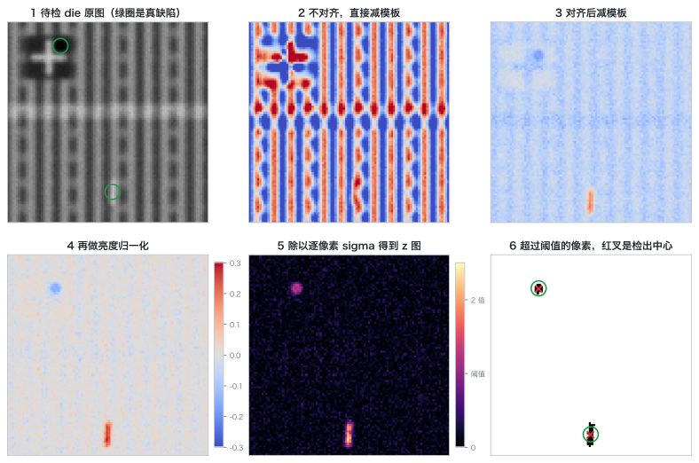
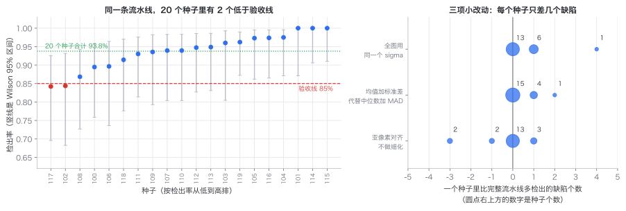
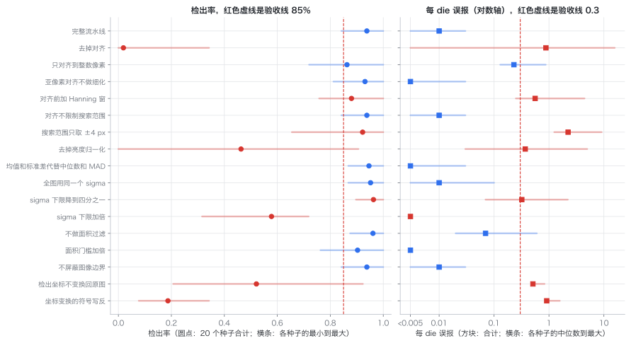
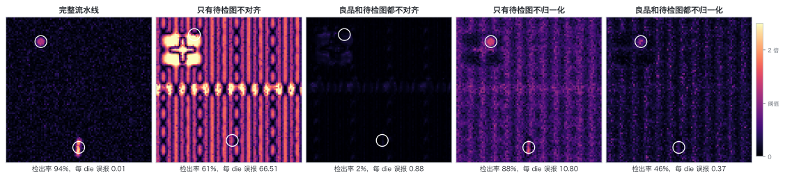
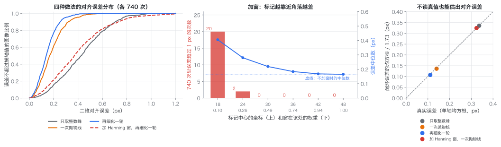
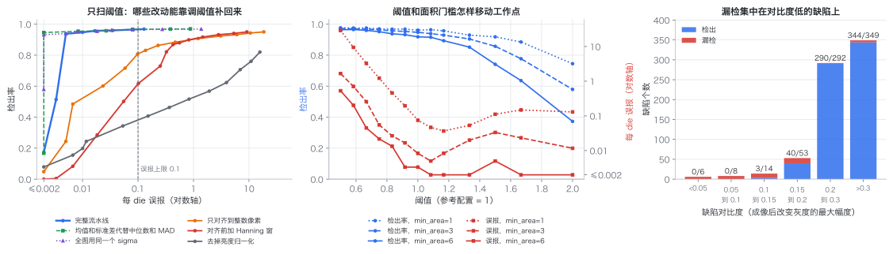

# 教程：综合项目，晶圆检测流水线

> [!NOTE]
> 本章所有数字都来自合成数据上的实测，记录在 [`figures/实测数字.json`](figures/实测数字.json)，由 `solutions` 分支的 `solutions/figures/ch24.py` 生成。它用本章的 `数据生成.py` 造数据，用参考实现当“完整流水线”，再逐项拆掉。有两点是故意的：实验全部用种子 100 起的数据，不用验收种子；参考实现调好的参数（k、min_area、sigma 下限、搜索范围）不出现在讲义和 JSON 里，扫描类实验用“参考配置的几倍”来描述。那些是你在项目报告里要自己量、自己定的东西。换成你自己的实现或者真实图像，数值会变，结论的方向要自己再测一遍。

## 0. 本章怎么学

**应用场景**：把对齐、亮度归一化、金模板、阈值和连通域串成一条完整的 die-to-die 检测流水线，在带真值的数据上验收，再写成一份可以拿出来讲的项目报告。入职后接手一条现成的检测流水线，或者要回答“这一步能不能去掉”，用的是同一套做法。

**优先级**：P1。前置是第 16 章（对齐）、第 18 章（金模板和阈值）和第 23 章（领域知识里的检出率、误报这些指标）。本章不引入新算法，新的内容是怎样量出每一步的贡献，以及怎样把结果讲清楚。

| 档位 | 累计用时 | 做什么 | 做到什么算完 |
|---|---:|---|---|
| 速通 | 4 小时 | 读第 1、4、5、6、8 节和第 11 节，第 7 节只读 7.2，看懂图 1 到图 4，做第 10 节演示的五步，答完 5 道小测 | 能讲清流水线有哪六步，哪几步去掉就不能用，消融表该怎么列 |
| 标准 | 15 小时 | 读完全章，跑 `数据生成.py` 和 Notebook，实现 `run_pipeline` 并验收通过，按 `项目报告模板.md` 写完 `项目报告.md`，做第 13 节前三个破坏实验 | 两个验收种子 PASS，报告里有消融表、阈值曲线和逐个分析过的漏检样本 |
| 深挖 | 24 小时 | 再做第 13 节其余的破坏实验和第 14 节的扩展 | 能在 5 分钟内把项目讲完，并且用自己的实验数据回答“换一个条件会怎样” |

> [!TIP]
> 用时超过所选档位的 1.5 倍还没做完，就把卡点写进 `学习进度.md`，先往下走。标准档最容易卡在对齐和坐标变换上，卡住时先对照第 12 节的常见错误表，再去 Notebook 里逐步看中间结果。

## 1. 为什么要把流水线从头到尾做一遍

对齐在第 16 章做过，金模板和阈值在第 18 章做过，每一步单独验收都通过了。把它们接起来之后，前一步的误差会变成后一步的输入，问题往往出在接缝上。图 1 是一张待检 die 走完全程的中间结果。

这张 die 相对参考良品错开 5.1 px，增益是 0.91。第 2 栏里缺陷完全被版图的重影盖住，第 3 栏里整张图比模板暗，到第 4 栏缺陷才成为图上唯一的东西。

把这件事量出来：取 20 个种子里全部 231 张没有缺陷的待检 die，模板和 sigma 固定用完整流水线算出来的，只改待检图的处理方式，数超过阈值的像素。

| 待检图的处理 | 无缺陷的 die 上超过阈值的像素比例 |
|---|---:|
| 原样拿来比 | 49.4% |
| 只做对齐 | 4.17% |
| 对齐后再做亮度归一化 | 0.0019% |

一张没有缺陷的图，有一半像素被判成异常。下面这张表是整条流水线少做一步的结果（96×96 的合成 die，每个种子 8 张良品、30 张待检，20 个种子共 722 个缺陷、600 张待检 die，匹配半径 4 px）：

| 配置 | 检出率 | 每 die 误报 |
|---|---:|---:|
| 完整流水线 | 93.8% | 0.01 |
| 去掉对齐 | 1.9% | 0.88 |
| 去掉亮度归一化 | 46.3% | 0.37 |
| 检出坐标不变换回原图 | 52.1% | 0.51 |

最后一行值得多看一眼：检测本身完全正确，只是最后报出的坐标差了一个错位量，检出率就只剩一半。这种错误在单章作业里遇不到，只有把整条流水线接起来、用独立的真值验收时才会暴露。

本章接下来做的事，就是把这张表做细：每一步、每一个不起眼的常数，各值多少。

## 2. 任务、数据和验收

场景和文件说明在本章 `README.md`，这里只补充做实验要用到的事实。

**数据从哪来**。`数据生成.py` 按下面的顺序造一张图，每一行对应一种真实的干扰：

| 生成器里的一步 | 模拟的是什么 | 参数 |
|---|---|---|
| 版图循环平移 | 机台定位误差 | 每轴 ±3.5 px 内均匀分布 |
| 加缺陷 | 颗粒、划痕、图形缺失 | 约六成待检 die 带 1 到 3 个 |
| 高斯模糊 | 光学系统的点扩散函数 | sigma 为 1.0 px |
| 乘增益、加偏置 | 照明和曝光的漂移 | 增益 0.85 到 1.15，偏置 ±0.05 |
| 泊松噪声加高斯噪声 | 散粒噪声和读出噪声 | 满量程 2000 个电子，读出噪声 6 个电子 |

缺陷是在模糊和加噪声之前放进去的，所以它和背景一样被模糊、一样带噪声。这是程序化合成加成像仿真的标准写法（第 20 章讲合成缺陷，第 22 章讲成像和噪声模型），建议把源码读一遍。

**三个容易忽略的事实**，后面的实验都会用到：

1. **相对错位是单张的两倍**。每张图相对版图最多错开 3.5 px，但流水线量的是它相对参考良品的错位，单轴最大可以到 7 px。实测 20 个种子里，相对错位（二维）的中位数是 3.66 px，最大 9.02 px，有 43.7% 的 die 超过 4 px。
2. **噪声随亮度变化，但变化不大**。按成像模型算，暗区（灰度 0.15）的噪声标准差是 0.0092，竖线上（灰度 0.70）是 0.0189，最亮的对位标记上是 0.022，前后相差约 2.4 倍。
3. **版图是周期的，只有一个对位标记不是**。竖线在 x 方向的周期是 8 px，接触孔在两个方向的周期都是 12 px，合起来 x 方向每 24 px 重复一次。唯一的非周期结构是左上角的十字标记，中心在第 18 行第 18 列。

**验收怎么算**。`tests/check_progress.py` 用种子 11 和 23 各生成一份数据，调用你的 `run_pipeline`，再用真值独立算指标：预测和真值按距离从小到大做一对一匹配，4 px 以内算命中。要求检出率不低于 85%，每 die 误报不超过 0.3，单次运行不超过 30 秒。流水线只能读 `golden` 和 `test`。

> [!IMPORTANT]
> 调参和做消融时用验收种子以外的数据，`data/README.md` 里也是这样要求的。第 4 节会看到，同一条流水线在不同种子上的检出率能差十几个百分点，对着两个种子调出来的参数很可能只是碰巧。

## 3. 流水线的六步

作业文件的说明里已经给了建议流程，这里把每一步和前面章节对上，并指出出问题时最先会看到什么。

| 步骤 | 做什么 | 用到哪里 | 这一步有问题时最先看到的现象 |
|---|---|---|---|
| 1. 估计错位 | 选一张良品当参考，估计每张图相对它的亚像素错位 | 第 16 章第 5、6、8 节 | 差分图上沿图形边缘成对的正负条纹 |
| 2. 重采样 | 按估计值把每张图移到参考坐标系 | 第 16 章第 5.1 节 | 同上 |
| 3. 亮度归一化 | 把每张图线性拟合到模板 | 第 18 章第 4 节 | 差分图整体偏亮或偏暗（图 1 第 3 栏） |
| 4. 金模板 | 逐像素的中位数和 1.4826 倍 MAD，sigma 设下限 | 第 18 章第 3.2、3.4 节 | z 图上散落的孤立高值，或者出现 inf |
| 5. 阈值和连通域 | z 超过 k 的像素连成块，去掉太小的，算中心 | 第 18 章第 5 节 | 误报个数对 k 和面积门槛很敏感 |
| 6. 坐标变换 | 把中心从参考坐标系换回这张 die 自己的坐标系 | 本章 | 检出位置和真值差一个固定的偏移 |

**顺序为什么是这样**。亮度归一化是逐像素的线性拟合，

$$
\text{img} \approx a \cdot \text{template} + b
$$

它要求两张图的同一个像素对应版图上的同一个位置，所以必须排在对齐之后。第 6.1 节会看到，两张图没有对准就做拟合，斜率会从接近 1 掉到接近 0。反过来，对齐不需要先做归一化：相位相关对整体的增益和偏置不敏感（第 16 章第 5.2 节）。

**坐标系**。全部图都对齐到同一张参考良品。参考良品自己相对版图也有错位，所以“对齐后的坐标系”既不是版图坐标系，也不是任何一张待检 die 的坐标系。设第 $i$ 张待检 die 相对参考的错位是 $\mathbf{d}_i$，在对齐坐标系里找到的缺陷中心是 $\mathbf{p}$，它在这张 die 自己的图像里的位置是

$$
\mathbf{p}_i = \mathbf{p} + \mathbf{d}_i
$$

验收用的真值就在这个坐标系里。坐标的顺序是（行，列），也就是 $(y, x)$。

**没写在流程里的决定**。除了 k 和 min_area，流水线里还有几个要你自己定的东西：选哪张良品当参考，搜索范围取多大，sigma 的下限取多少，图像边界留不留。它们通常以一个常数的形式写在代码里，容易被当成细节。第 5 节会看到，其中有的比“用不用鲁棒统计”影响大得多。

## 4. 先量尺子：一次验收的数字能信到几位

做消融之前先要知道，同一条流水线换一份数据，指标会动多少。否则分不清一个改动带来的 2 个百分点是真的，还是换个种子就没了。

参考流水线不做任何改动，在种子 100 到 119 上各跑一次（每个种子 30 张待检 die，缺陷 25 到 53 个，平均 36.1 个）：

| 统计量 | 数值 |
|---|---:|
| 20 个种子合计的检出率 | 93.8%（677/722），Wilson 95% 区间 91.8% 到 95.3% |
| 各种子检出率的最小、中位数、最大 | 84.2%、94.3%、100% |
| 各种子检出率的标准差 | 4.8 个百分点 |
| 检出率低于 85% 的种子 | 2 个 |
| 20 个种子合计的误报 | 600 张 die 上共 3 个 |

把种子扩大到 100 到 199 共 100 个，检出率从 80.5% 到 100%，低于 85% 的有 8 个，没有一个种子的误报超过 0.3。

读这组数字的三个结论：

1. **参考实现自己也会“不通过”**。它的合计检出率是 93.8%，但 100 个种子里有 8 个低于验收线。验收种子上通过，说明的是实现大体正确，不是参数已经调到最好。
2. **一个种子的置信区间很宽**。检出率最低的种子 117 检出 32/38，区间是 69.6% 到 92.6%。每个种子只有 36 个左右的缺陷，多检出或者少检出一个，检出率就变约 2.8 个百分点。
3. **实际的波动比二项分布估的还大**。假设每个缺陷独立、被检出的概率都是 93.8%，一个种子（按 36 个缺陷算）低于 85% 的概率只有 2.3%，实测 100 个种子里是 8 个。这组实验没有去拆分原因；第 9 节会看到不同缺陷被检出的难度差得很远，每个种子抽到的难例个数不一样，是一个可能的来源。

**小改动要成对地比**。图 2 右栏把三项小改动和完整流水线放在同一份数据上逐个种子相减。以“均值加标准差代替中位数加 MAD”为例，20 个种子里有 15 个一个缺陷都不差，其余多检出 1 到 2 个，合计多 6 个，折合 0.8 个百分点。如果两种配置各用各的种子去测，这样大小的差别会完全淹没在 4.8 个百分点的种子波动里。

<!-- quiz -->
**参考实现在两个验收种子上都通过了。换 100 个没见过的种子，其他条件不变，检出率低于 85% 验收线的种子大约有几个？**

- A. 0 个，参考实现的参数是调好的
- B. 8 个左右
- C. 一半左右

答案与解释

**B**。实测种子 100 到 199 里有 8 个低于 85%，最低 80.5%。合计检出率是 92.7%，离验收线有距离，但每个种子只有 30 多个缺陷，单个种子的结果上下浮动好几个百分点是正常的。所以调参要用验收种子以外的多份数据，报告里要写 x/n 和区间。

<!-- /quiz -->

## 5. 逐项消融：每一步值多少

### 5.1 做法

消融（ablation）是每次只去掉或者换掉流水线里的一样东西，其余不动，看指标怎么变。几条规则：

- **一次只改一处**。同时改两处，就分不清变化来自谁。
- **同一份数据**。所有配置用同一批种子，按上一节的做法成对地比。
- **两个指标都看**。只看检出率会漏掉“检出没变、误报翻了十倍”的情况，反过来也一样。
- **常数也是消融对象**。sigma 下限、搜索范围、边界宽度和“用不用某个算法”一样要列进去。
- **先不重调阈值，再重调一遍**。第一遍回答“直接去掉会怎样”，第二遍回答“去掉之后重新调参还能不能用”。两个答案可能很不一样，第 8 节专门讲。

### 5.2 一组参考结果

条件同第 4 节：种子 100 到 119，共 722 个缺陷、600 张待检 die，匹配半径 4 px。“达不到验收线的种子数”指 20 个种子里检出率低于 85% 或者每 die 误报超过 0.3 的个数。

| 配置（只改这一处） | 检出率 | 每 die 误报 | 各种子检出率 | 达不到验收线的种子数 |
|---|---:|---:|---:|---:|
| 完整流水线 | 93.8% | 0.01 | 84.2% 到 100% | 2 |
| 去掉对齐 | 1.9% | 0.88 | 0% 到 34.2% | 20 |
| 只对齐到整数像素 | 86.3% | 0.23 | 72.0% 到 100% | 14 |
| 亚像素对齐不做细化 | 93.1% | 0.00 | 81.2% 到 100% | 2 |
| 对齐前加 Hanning 窗 | 88.0% | 0.56 | 75.8% 到 100% | 13 |
| 对齐不限制搜索范围 | 93.8% | 0.01 | 84.2% 到 100% | 2 |
| 搜索范围只取 ±4 px | 92.2% | 2.23 | 65.5% 到 100% | 13 |
| 去掉亮度归一化 | 46.3% | 0.37 | 0% 到 90.6% | 20 |
| 均值和标准差代替中位数和 MAD | 94.6% | 0.00 | 86.8% 到 100% | 0 |
| 全图用同一个 sigma | 95.2% | 0.01 | 86.8% 到 100% | 0 |
| sigma 下限降到四分之一 | 96.3% | 0.32 | 89.7% 到 100% | 4 |
| sigma 下限加倍 | 57.8% | 0.00 | 31.6% 到 71.8% | 20 |
| 不做面积过滤 | 96.1% | 0.07 | 87.5% 到 100% | 1 |
| 面积门槛加倍 | 90.3% | 0.00 | 76.3% 到 100% | 4 |
| 不屏蔽图像边界 | 93.8% | 0.01 | 84.2% 到 100% | 2 |
| 检出坐标不变换回原图 | 52.1% | 0.51 | 20.7% 到 92.3% | 19 |
| 坐标变换的符号写反 | 18.7% | 0.91 | 7.7% 到 34.2% | 20 |

按影响大小，这些行可以分成三类。

**少了就不能用**：对齐、亮度归一化、坐标变换。这三项任何一项出错，20 个种子里至少 19 个达不到验收线。对齐只做到整数像素也不够，14 个种子不通过。

**在检出和误报之间做交换**：面积过滤和 sigma 下限。不做面积过滤，检出率从 93.8% 升到 96.1%，误报从 0.01 升到 0.07。sigma 下限是这张表里最敏感的常数：降到四分之一，误报升到 0.32；加倍，检出率掉到 57.8%。它只是代码里的一个数字，影响却比换一种统计量大一个量级。

**改了几乎没有差别**：亚像素对齐做不做细化、用不用鲁棒统计、sigma 是逐像素估还是全图一个值、限不限制搜索范围、屏不屏蔽边界。其中后两项的结果和完整流水线逐个种子完全相同。

第三类最容易写错结论。“没有差别”有两种可能：这一步确实多余，或者这份数据里没有它要防的那种情况。第 7 节和第 8 节会逐项把后一种可能找出来。

> [!WARNING]
> 这张表是参考实现在种子 100 到 119 上的结果。你的实现不一样，验收种子也不一样，数字不能搬进你的报告。有用的是表的形状：哪些行应该有，每行要报哪几个量。

## 6. 同一步，对良品做和对待检图做，管的不是一件事

对齐和亮度归一化都要做两遍：一遍对良品，用来建模板和 sigma；一遍对待检图，用来和模板比。上一节是两遍一起去掉。把它们拆开，现象完全不同。

条件同上一节，阈值不重调。最后两列用来解释原因：sigma 一列是 8 张良品估出的 1.4826 倍 MAD 的中位数（套下限之前），最后一列是待检图上 z 超过阈值的像素比例。

| 配置 | 检出率 | 每 die 误报 | 估出的 sigma 中位数 | 超过阈值的像素 |
|---|---:|---:|---:|---:|
| 完整流水线 | 93.8% | 0.01 | 0.0152 | 0.26% |
| 良品对齐，待检图不对齐 | 61.2% | 66.51 | 0.0152 | 29.6% |
| 良品不对齐，待检图对齐 | 1.1% | 0.07 | 0.0405 | 0.013% |
| 良品和待检图都不对齐 | 1.9% | 0.88 | 0.0405 | 0.18% |
| 良品归一化，待检图不归一化 | 88.1% | 10.80 | 0.0152 | 4.8% |
| 良品不归一化，待检图归一化 | 44.5% | 0.01 | 0.0495 | 0.072% |
| 良品和待检图都不归一化 | 46.3% | 0.37 | 0.0495 | 0.33% |
| 不对齐也不归一化 | 8.0% | 2.08 | 0.1316 | 0.71% |

### 6.1 不对齐：大家以为的样子和实际的样子

第二行是第 16 章图 1 的场景：模板是好的，待检图没对准，沿每条边缘都是假缺陷，每张 die 报 66.51 个，近三成像素超过阈值。这是“没对齐”在多数人脑子里的样子。

实际把对齐从流水线里去掉，得到的是第四行：检出率 1.9%，误报 0.88，而且这 0.88 主要来自个别种子，20 个种子里有 16 个的误报是 0。图 4 第三栏的 z 图几乎是全黑的。流水线没有报错，也没有满屏误报，只是什么都检不出来。

原因在良品这一侧，有两层：

1. **模板被抹平了**。8 张错开的良品取中位数，线条互相抵消，模板的对比度（全图标准差）从 0.142 掉到 0.040。同时各张良品在同一个像素上的取值差得很远，估出的 sigma 从 0.0152 涨到 0.0405。
2. **亮度归一化把待检图也压平了**。归一化是把待检图线性拟合到模板。对齐正确时拟合出的斜率中位数是 0.942（5% 到 95% 分位是 0.815 到 1.121）。不对齐时两张图几乎不相关，最小二乘给出的斜率中位数只有 0.065（分位区间 -0.146 到 0.354）。待检图乘上这个斜率，线条和缺陷一起被缩到原来的十几分之一。

第三行（只有良品不对齐）单独就让检出率掉到 1.1%，说明主因是模板这一侧。最后一行把归一化也去掉，压平的效果消失，检出率回到 8.0%，误报也回到 2.08。

> [!IMPORTANT]
> “误报为 0”不能当作流水线正常的证据。一条什么都检不出来的流水线，误报也是 0。上线之后只监控报警数量是不够的，至少还要看一个不依赖真值、能反映流水线自身状态的量。这一节用到的三个都可以：亮度归一化的斜率是否接近 1，模板的对比度是否和单张图接近，超过阈值的像素比例是否在正常范围。

<!-- quiz -->
**把对齐从完整流水线里整个去掉（良品和待检图都不对齐，其余步骤照常），20 个种子上的误报会怎样？**

- A. 大幅上升，每张 die 几十个，沿图形边缘分布
- B. 多数种子的误报是 0
- C. 和完整流水线一样

答案与解释

**B**。20 个种子里 16 个的误报是 0，检出率合计 1.9%。A 描述的是“模板对齐了、只有待检图没对齐”的情况，那时每张 die 报 66.51 个。两者的区别在于良品没对齐时模板被抹平、sigma 被撑大，随后的亮度归一化又把待检图压平（斜率中位数 0.065），z 图几乎全黑。

<!-- /quiz -->

### 6.2 亮度归一化：良品那一遍保检出，待检图那一遍保误报

只有待检图不归一化时，模板和 sigma 都是好的，检出率还有 88.1%，但每张 die 报 10.80 个：待检图比模板整体亮或暗一些，整张图的 z 都被抬高（图 4 第四栏），4.8% 的像素超过阈值。这是第 18 章第 4 节讲的现象。

只有良品不归一化时正好相反：误报 0.01，检出率 44.5%。8 张良品的增益各不相同，同一个像素在 8 张图上的取值散得很开，估出的 sigma 中位数从 0.0152 涨到 0.0495，是原来的 3.3 倍。缺陷除以这样的 sigma，z 值过不了阈值。

两遍都去掉，结果接近第二种：检出率 46.3%，误报 0.37。也就是说，去掉亮度归一化之后首先看到的是检出率减半，不是误报暴涨。被撑大的 sigma 把本该出现的成片误报压了下去。各个种子之间差别很大，检出率从 0% 到 90.6%，误报的中位数只有 0.03，最大的一个种子是 4.97。是什么让个别种子特别好或者特别差，这组实验没有去拆分。

本章 `README.md` 的“参考水平”里给了不做亮度归一化时的检出率和误报，那是两个验收种子上的结果。换到种子 100 到 119 上，检出率从 0% 到 90.6% 都有。所以去掉归一化“掉多少”不是一个稳定的数，报告里要给范围。

## 7. 对齐细看

对齐是整条流水线里最要紧的一步，值得单独量一遍。这一节的误差都用数据生成器记录的真实错位来算，只用于分析；你的流水线不能读它，第 7.4 节讲不读真值时怎么办。

### 7.1 残差有多大

每个种子除参考良品外有 7 张良品和 30 张待检图，20 个种子共 740 次对齐：

| 做法 | 单轴均方根误差（px） | 二维误差中位数（px） | 二维误差最大值（px） | 超过 1 px 的次数 |
|---|---:|---:|---:|---:|
| 只取整数峰 | 0.336 | 0.426 | 1.03 | 1 |
| 相位相关加一次抛物线 | 0.150 | 0.166 | 0.60 | 0 |
| 再细化一轮 | 0.121 | 0.138 | 0.62 | 0 |
| 加 Hanning 窗，再细化一轮 | 0.446 | 0.369 | 11.48 | 18 |

第 16 章第 1 节给过一个参照：在那一章的对比度和噪声下，错位要压到零点一像素量级才不产生误报，到零点几像素时已经成片超限。这里的数字和第 5 节的消融对得上：只取整数峰时单轴均方根误差是 0.336 px，14 个种子不通过；亚像素做到 0.121 到 0.150 px，就够用了。细化一轮把单轴误差从 0.150 降到 0.121，在指标上换来的是 5 个缺陷（图 2 右栏），属于“有，但不大”。

另一个常见的担心是缺陷会不会把对齐带偏。在这份数据上没有：带缺陷的待检 die 单轴均方根误差是 0.123 px，不带缺陷的是 0.125 px。缺陷只占图像很小的面积。

### 7.2 加窗为什么反而变差

图 5 左栏里，加窗之后的误差分布和只取整数峰差不多，另外还有 18 次误差超过 1 px。误差最大的那一次是 (11.47, -0.38) px，y 方向差不多正好是接触孔的一个周期（12 px）。

第 16 章第 7 节解释过循环平移的数据上加窗会变差。但在这份数据上，那不是主要原因。对位标记的中心在第 18 行第 18 列，二维 Hanning 窗在这个位置的权重只有 0.099，唯一的非周期结构被压到了原来的十分之一，剩下的周期图案主导了相关面。

验证办法是利用数据的循环性，把参考图和待检图一起循环滚动，让标记往图像中心移，其他都不变（一次抛物线，各 740 次）：

| 标记中心的坐标（行和列） | 18 | 24 | 30 | 36 | 42 | 48 |
|---|---:|---:|---:|---:|---:|---:|
| 窗在标记中心的权重 | 0.099 | 0.258 | 0.491 | 0.743 | 0.936 | 0.999 |
| 误差超过 1 px 的次数 | 20 | 2 | 0 | 0 | 0 | 0 |
| 二维误差中位数（px） | 0.405 | 0.280 | 0.219 | 0.184 | 0.168 | 0.165 |

标记移到中心之后，加窗的误差中位数是 0.165 px，和不加窗的 0.166 px 一样，也不再有对错周期的情况。所以结论要说得更准确：**加不加窗，除了看数据是不是循环的，还要看图里用来定位的结构在哪里**。真实图像的边界不连续，通常需要加窗，这时对位标记或者其他非周期结构靠近视场边缘就是一个风险。

本章 `README.md` 的“已知的坑”第 2 条说加窗会让残差变大，原因归于数据是循环平移的。方向和这里一致：按这一节的实验，单轴均方根误差从 0.150 px 变成 0.466 px。但主要原因是标记被压在窗的边缘。

<!-- quiz -->
**这份数据上，对齐前加 Hanning 窗让误差中位数从 0.166 px 变成 0.405 px，还出现了差一个周期的错误。把参考图和待检图一起循环滚动 30 px 之后再加窗，误差中位数回到 0.165 px。这说明主要原因是什么？**

- A. 数据是循环平移生成的，加窗破坏了循环关系
- B. 对位标记原来在角落，被窗压到了原来的十分之一
- C. Hanning 窗让图像变模糊了

答案与解释

**B**。滚动前后数据同样是循环平移的，窗也是同一个，唯一变了的是标记的位置：窗在标记中心的权重从 0.099 变成 0.999。A 是第 16 章随机纹理实验里的原因，在这份带噪声的数据上它的影响小到看不出来。C 不对，乘窗函数不改变图像的清晰程度。

<!-- /quiz -->

### 7.3 搜索范围：这份数据上量不出差别，原因是有标记

消融表里“对齐不限制搜索范围”一行和完整流水线完全相同。不只是指标相同：740 次对齐的估计值逐张相同，没有一次对到别的周期上。

这不表示限制搜索范围没有用。把对位标记从版图里去掉，其余不变，再做同样的 740 次对齐：

| 版图 | 搜索范围 | 误差超过 1 px 的次数 | 二维误差中位数（px） |
|---|---|---:|---:|
| 有对位标记 | 限制 | 0/740 | 0.138 |
| 有对位标记 | 不限制 | 0/740 | 0.138 |
| 去掉对位标记 | 限制 | 656/740 | 6.1 |
| 去掉对位标记 | 不限制 | 730/740 | 36.1 |

没有标记时，限制搜索范围把误差中位数从 36.1 px 压到 6.1 px，但绝大多数仍然是错的。这正是第 16 章第 8 节讲的两种失败：周期图案有多个等高的峰，限制范围能排除远处的；白化把只有噪声的频率拉到同样的权重，相关面被淹没，限制范围救不了。标记的频谱是宽带的，两种失败它都能解决，所以有了标记之后搜索范围就量不出贡献。

本章 `README.md` 的“已知的坑”第 1 条说，相位相关不加约束时可能对到整周期之外，误差接近一个 x 方向的整周期。在这份带标记的数据上，按参考实现的对齐方式（不加窗、细化一轮）这一条没有复现，740 次里一次都没有对错周期。它在去掉标记、或者加窗把标记压掉时才出现（上一节最大的一次差了约 12 px）。所以写报告时，“限制搜索范围”这一行的意义要用无标记的实验来说明，不能用这份数据的消融。

搜索范围取得太小则是实打实的错误。把它设成 ±4 px（比单张图的错位上限 3.5 px 大，看起来够了），每张 die 的误报升到 2.23。原因是第 2 节说的：两张图之间的相对错位可以到 7 px。

### 7.4 不读真值怎么评估对齐：闭环误差

流水线拿不到真实错位，项目报告里又要求给出对齐精度。可以用的是良品之间的一致性。任取三张良品 A、B、C，分别估计 A 到 B、B 到 C、A 到 C 的错位，理想情况下

$$
\mathbf{e} = \hat{\mathbf{d}}_{AB} + \hat{\mathbf{d}}_{BC} - \hat{\mathbf{d}}_{AC} = \mathbf{0}
$$

$\mathbf{e}$ 叫闭环误差。如果三次估计的误差互相独立、标准差都是 $\sigma$，三项相加减之后方差是 $3\sigma^2$，所以

$$
\sigma \approx \frac{\operatorname{rms}(\mathbf{e})}{\sqrt{3}} = \frac{\operatorname{rms}(\mathbf{e})}{1.732}
$$

每个种子 8 张良品可以组成 56 个三元组，20 个种子共 1120 个：

| 做法 | 闭环误差的单轴均方根（px） | 除以 1.732 | 用真值算出的两两对齐误差（px） |
|---|---:|---:|---:|
| 只取整数峰 | 0.579 | 0.335 | 0.336 |
| 一次抛物线 | 0.235 | 0.136 | 0.140 |
| 再细化一轮 | 0.185 | 0.107 | 0.111 |
| 加 Hanning 窗，一次抛物线 | 0.562 | 0.324 | 0.324 |

四种做法都落在图 5 右栏的对角线上，包括会对错周期的加窗版本。在这组实验里，闭环误差除以 $\sqrt{3}$ 是对齐误差的一个很好的估计，不需要任何真值。

用的时候要注意两点：

- **看均方根，不要看中位数**。只取整数峰时，67% 的三元组闭环误差恰好是 0（三个整数相加减），中位数是 0，但均方根是 0.579 px。
- **闭环查不出三次估计共有的偏差**。假设估计值整体偏小一个比例，$\hat{\mathbf{d}} = (1-\varepsilon)\,\mathbf{d}$，代进去 $\mathbf{e} = (1-\varepsilon)(\mathbf{d}_{AB} + \mathbf{d}_{BC} - \mathbf{d}_{AC}) = \mathbf{0}$，闭环误差仍然是 0。闭环检查的是自洽，不是正确，它是必要条件。

## 8. 工作点：重调阈值之后再比

### 8.1 哪些改动能靠调阈值补回来

第 5 节的消融没有重调阈值。这对某些行不公平：把 sigma 下限降到四分之一，所有像素的 z 值都变大，原来的阈值自然就偏低了，误报升高不一定说明这个改动不好。公平的比法是让每种配置都把阈值扫一遍，比较整条曲线。

条件同第 5 节。面积门槛保持参考配置不动，阈值从参考配置的 0.5 倍扫到 5 倍，共 16 档，取每 die 误报不超过 0.1 时能达到的最高检出率：

| 配置 | 阈值不动：检出率，每 die 误报 | 重调阈值后，误报不超过 0.1 时的最高检出率 |
|---|---:|---:|
| 完整流水线 | 93.8%，0.01 | 96.0% |
| 均值和标准差代替中位数和 MAD | 94.6%，0.00 | 96.7% |
| 全图用同一个 sigma | 95.2%，0.01 | 96.4% |
| sigma 下限降到四分之一 | 96.3%，0.32 | 95.6% |
| 亚像素对齐不做细化 | 93.1%，0.00 | 95.7% |
| 只对齐到整数像素 | 86.3%，0.23 | 80.7% |
| 对齐前加 Hanning 窗 | 88.0%，0.56 | 50.1% |
| 去掉亮度归一化 | 46.3%，0.37 | 34.3% |
| 去掉对齐 | 1.9%，0.88 | 0.1% |

重调之后，前五行都在 95.6% 到 96.7% 之间，图 6 左栏里前三条线几乎叠在一起。后四行调阈值也救不回来，而且有的比不调时看起来更差：整数像素对齐在阈值不动时还有 86.3%，要求误报不超过 0.1 之后只剩 80.7%。

这张表顺带说明了一件事：参考配置的工作点并不在曲线最好的位置上，同样的误报上限下检出率还能高两个百分点左右。工作点怎么选，是你报告里要回答的问题。

### 8.2 “值 0”的步骤在防什么

按上一节的表，鲁棒统计、逐像素 sigma、细化和搜索范围在这份数据上的贡献都接近 0。写报告时不能停在这里，要接着问：它是真的没用，还是数据里没有它要防的情况。合成数据是自己造的，第二种可能性尤其大。

**鲁棒统计防的是良品不干净**。这份数据的 8 张良品都是好的。构造一个它没有的情况：让 8 张良品里有 m 张在同一位置带一个幅度 0.4 的斑，再在无缺陷的待检 die 的同一位置放一个幅度 0.3 的探针缺陷，看能不能检出（种子 100 到 109，每个种子 6 张，共 60 个探针，其余同完整流水线）：

| 8 张良品里混进的张数 | 0 | 1 | 2 | 3 | 4 |
|---|---:|---:|---:|---:|---:|
| 中位数 + MAD 检出的探针 | 60 | 60 | 56 | 25 | 0 |
| 均值 + 标准差检出的探针 | 60 | 0 | 0 | 0 | 0 |
| 该位置的 sigma，中位数 + MAD | 0.022 | 0.024 | 0.028 | 0.041 | 0.104 |
| 该位置的 sigma，均值 + 标准差 | 0.022 | 0.055 | 0.071 | 0.079 | 0.082 |

只混进 1 张，均值加标准差在那个位置就一个都检不出来了，sigma 从 0.022 被撑到 0.055。中位数加 MAD 到混进 2 张还能检出 56/60，3 张时掉到 25/60，4 张（一半）时完全失效。这和第 18 章第 3.2 节的结论一致，也给出了这条流水线在这组条件下的边界：8 张良品里有 2 张在同一处有问题时基本还能用，3 张就不行了。

**逐像素 sigma 防的是各区域噪声差得很多**。第 2 节算过，这份数据的噪声从暗区到亮区只差约 2.4 倍。而且完整流水线里，8 张良品估出的 sigma 中位数是 0.0152，有 73% 的像素低于下限，实际用的是下限这个常数。换句话说，参考流水线的大部分像素本来就在用同一个 sigma，再把剩下的也换掉，量不出差别并不奇怪。这个结论只在这份数据上成立：噪声随区域变化更大、或者 sigma 下限取得更低时，要重新量。

**搜索范围防的是没有对位标记**，上一节已经量过。**屏蔽边界防的是对齐后边界没有数据**。这份数据是循环平移生成的，移出去的部分会从另一边回来，没有无效区；真实图像不会这样（第 18 章第 8 节的误报来源表里有这一项）。

<!-- quiz -->
**消融表里，“均值和标准差代替中位数和 MAD”的检出率是 94.6%，比完整流水线的 93.8% 还高一点。据此可以得出什么结论？**

- A. 中位数加 MAD 是多余的，应该删掉
- B. 在良品全部干净的这份数据上，两种统计量没有可测的差别；鲁棒统计值多少要另外构造良品被污染的情况来量
- C. 均值加标准差更好，因为它估计 sigma 的效率更高

答案与解释

**B**。成对比较的差别是 20 个种子共 6 个缺陷，重调阈值后两者在 96.0% 和 96.7%，属于同一水平。把 1 张良品换成同位置带缺陷的，均值加标准差在该位置的检出立刻从 60/60 变成 0/60，中位数加 MAD 仍是 60/60。C 说的效率优势确实存在（第 18 章第 3.3 节），但在这里被 sigma 下限盖住了，不足以支持“更好”。

<!-- /quiz -->

### 8.3 阈值和面积门槛

图 6 中栏是完整流水线只改阈值和面积门槛的结果。阈值写成参考配置的倍数，面积门槛取报告模板里列的 1、3、6：

| 阈值（参考配置 = 1） | 0.5 | 0.75 | 1 | 1.17 | 1.33 | 1.67 | 2 |
|---|---:|---:|---:|---:|---:|---:|---:|
| min_area=1：检出率 | 97.6% | 97.0% | 96.1% | 95.7% | 92.9% | 88.5% | 74.5% |
| min_area=1：每 die 误报 | 29.08 | 1.22 | 0.075 | 0.037 | 0.053 | 0.148 | 0.130 |
| min_area=3：检出率 | 97.2% | 96.4% | 94.7% | 92.9% | 90.4% | 77.7% | 57.9% |
| min_area=3：每 die 误报 | 1.66 | 0.055 | 0.008 | 0.008 | 0.020 | 0.023 | 0.012 |
| min_area=6：检出率 | 96.4% | 95.2% | 91.8% | 89.3% | 85.2% | 63.6% | 37.3% |
| min_area=6：每 die 误报 | 0.53 | 0.022 | 0.003 | 0.002 | 0.002 | 0.000 | 0.000 |

低阈值一端和第 18 章第 5.1 节一样：面积过滤把误报压下去一到两个量级（阈值 0.5 倍时从 29.08 到 1.66 再到 0.53），代价是几个百分点的检出。

高阈值一端有一个第 18 章没出现的现象。不做面积过滤时，误报在 1.17 倍处降到最低的 0.037，再往上反而增加，1.67 倍时是 0.148。把这些误报按位置分开数：

| 阈值 | 误报总数（600 张 die） | 离某个真缺陷 10 px 以内 | 其余 |
|---|---:|---:|---:|
| 参考配置的 1 倍 | 45 | 6 | 39 |
| 参考配置的 1.67 倍 | 89 | 89 | 0 |

阈值低时，误报是散落的噪声点。阈值高时噪声点没有了，89 个误报全部紧挨着真缺陷：一个缺陷内部的 z 值有高有低，阈值切得高，它就断成几块，一对一匹配只认其中一块，其余的被记成误报。

所以“提高阈值就能压误报”只对噪声引起的误报成立。碎块引起的误报要用别的办法：比如先把相邻的块合并，或者做一次闭运算再标连通域（第 3 章、第 18 章第 5 节）。

<!-- quiz -->
**不做面积过滤，把阈值从参考配置的 1.17 倍提高到 1.67 倍，每 die 误报从 0.037 变成 0.148。多出来的误报是什么？**

- A. 噪声点，阈值高了 sigma 估计不准
- B. 真缺陷断成了几块，没配上真值的那几块被记成误报
- C. 对齐残差在边缘上造成的条纹

答案与解释

**B**。1.67 倍时的 89 个误报全部在某个真缺陷 10 px 以内，远离缺陷的一个都没有。阈值越高，噪声点和边缘条纹只会越少，A 和 C 都解释不了误报增加。

<!-- /quiz -->

## 9. 漏检分析

指标只说漏了多少，改进要靠知道漏的是哪些、为什么。完整流水线在 20 个种子上漏了 45 个缺陷（722 个里）。

**先按类型分**。数据生成器不返回缺陷类型，分析时可以在自己的分析脚本里给它的 `_add_defect` 包一层，把每个缺陷的类型和注入前后的图记下来。这只用于分析，流水线不能读。

| 类型 | 缺陷数 | 检出数 | 检出率 | 对比度低于 0.15 的个数 |
|---|---:|---:|---:|---:|
| 颗粒 | 253 | 252 | 99.6% | 0 |
| 划痕 | 240 | 237 | 98.8% | 0 |
| 图形缺失 | 229 | 188 | 82.1% | 28 |

45 个漏检里有 41 个是图形缺失。这里的对比度指缺陷在成像之后（模糊、乘增益之后，加噪声之前）改变图像灰度的最大幅度，版图的灰度范围大约是 0.15 到 0.95。

**再按信号强弱分**（图 6 右栏）：

| 对比度 | 0.05 以下 | 0.05 到 0.1 | 0.1 到 0.15 | 0.15 到 0.2 | 0.2 到 0.3 | 0.3 以上 |
|---|---:|---:|---:|---:|---:|---:|
| 检出数 / 缺陷数 | 0/6 | 0/8 | 3/14 | 40/53 | 290/292 | 344/349 |

对比度 0.2 以上的 641 个缺陷只漏了 7 个，0.1 以下的 14 个一个都没检出。图形缺失之所以难，看生成器的公式就明白：它把一小块区域的灰度变成原来的 0.2 倍再加 0.1，改变量是 $0.1 - 0.8v$。落在竖线上（$v = 0.70$）改变 -0.46，很明显；落在线条之间的背景上（$v = 0.25$）只改变 -0.10；落在对位标记周围的暗区里（$v = 0.15$）只有 -0.02，模糊之后比噪声还小。

**最后按流水线里卡在哪一步分**。对每个漏检的缺陷，在它周围 4 px 内看 z 图和连通域：

| 漏检的原因 | 个数 |
|---|---:|
| 没有任何像素超过阈值 | 21 |
| 有像素超过阈值，但连成的块不到面积门槛 | 17 |
| 有够大的块，但没有和这个真值配上 | 7 |

三类的对策完全不同。第一类是信号不够，其中对比度接近 0 的那些，任何基于这张图的方法都检不出来，它们给检出率设了一个上限。第二类可以用降低面积门槛换回来，代价见上一节。第三类的 7 个缺陷，每一个在 8 px 之内都有另一个缺陷：两个缺陷连成了一块，只报出一个中心。全部 722 个缺陷里，8 px 内有邻居的共 28 个，漏了 7 个。

这三张表是参考实现的结果，给的是分析的形状。你的报告要求的是逐个样本的分析：哪张 die、什么位置、属于哪一类、证据是什么。第 11.3 节讲怎么写。

## 10. 交互演示

把 die 换成一行 128 个像素，流水线的每一步都可以单独关掉，指标实时重算。页面下方“按顺序试”有五步，分别对应第 6.1 节（去掉对齐后检出和误报一起掉）、第 5 节和第 8.1 节（整数像素对齐靠调阈值补不回来）、第 6.2 节（不做归一化掉的是检出率）、第 8.2 节（良品里混进坏 die）和第 5.2 节（sigma 下限和最小长度）。每一步先预测再点“载入”。

一维的行只有 128 个采样点，数值和讲义里的二维实验不同，方向一致。有两处和二维不完全一样：第一步去掉对齐后，演示里并不是每一批数据的误报都是 0；演示的对齐用了第 16 章第 6.3 节的幅度掩膜，否则一行像素太少，对不准。页面里的默认参数是为这个一维玩具调的，和作业的参数没有对应关系。

<!-- embed: ../demos/流水线消融.html 1180 -->
[打开交互演示：流水线消融](../demos/流水线消融.html)

## 11. 怎样评估，怎样把项目讲成作品

### 11.1 评估

- **指标由独立的脚本按真值计算**，不用流水线自己报告的数字。验收脚本就是这样做的。
- **写清匹配规则**。同一份检测结果，匹配半径从 4 px 改成 2 px，检出率从 93.8% 变成 91.3%，改成 1 px 变成 79.8%；半径在 3 px 以上时不再变化。这是因为检出中心到真值的距离中位数是 0.26 px，95% 分位是 1.48 px。
- **用多份数据，报 x/n 和区间**。只报“检出率 91%”，读的人不知道它是 30/33 还是 3000/3300。
- **调参和报告用不同的数据**。在验收种子上调参，再在验收种子上报告，数字是偏乐观的。
- **对齐精度单独报**，方法见第 7.4 节，同时写清它不能发现的偏差。

### 11.2 报告的结构

`项目报告模板.md` 已经给了八节，它的顺序本身就是一种讲法：结论在前，证据在后，局限放最后。

| 模板里的小节 | 读的人想从这里得到什么 | 常见的写法问题 |
|---|---|---|
| 一句话结果 | 条件和数字：什么数据、多少缺陷、两个指标、耗时 | 只有百分比，没有 x/n 和数据规模 |
| 流水线 | 每一步为什么需要 | “为什么需要”一栏写成了“做了什么” |
| 对齐精度 | 不依赖真值的评估方法和结果 | 直接读真实错位算残差，没说明这只是分析 |
| 消融实验 | 每一步值多少 | 见下一小节 |
| 阈值曲线 | 工作点为什么选在这里 | 只标了点，没写理由和选的时候用的是哪份数据 |
| 漏检和误报分析 | 剩下的问题是什么性质 | 写成“阈值太高所以漏检” |
| 局限 | 结论在什么范围内成立 | 泛泛而谈，没有对应到实验里的具体条件 |
| 放到真实产线 | 知道差距在哪 | 罗列名词，没有优先级 |

### 11.3 消融表怎么列，失败案例怎么写

**消融表**：

1. 第一行是完整流水线，之后每行只改一处，行名写清“去掉”还是“换成什么”。
2. 两个指标、每个种子分开列，给 x/n。缺陷只有三十几个时，一个缺陷就是约 2.8 个百分点，只列百分比会让人高估差别。
3. 注明阈值有没有重调。最好两种都给：一列“直接去掉”，一列“重调之后”。
4. 代码里的常数也占一行。第 5.2 节里影响最大的几行里就有它们。
5. 没有差别的行留着，并写一句原因：是这一步多余，还是数据里没有它要防的情况。能构造出那个情况就补一个实验（第 8.2 节）。
6. 表下面写清数据、匹配半径、哪些东西是固定的。

**失败案例**。一条合格的记录有四样东西：

- **现象**：哪张 die、什么位置，最好配一张原图和 z 图的局部。
- **证据**：能定位到流水线某一步的中间量。例如缺陷附近的最大 z 是阈值的几倍，超过阈值的像素有几个，最近的另一个缺陷多远，对齐的闭环误差正常不正常。
- **归因**：属于哪一类。信号本身不够，被面积门槛滤掉，和邻近的缺陷合并，坐标偏了，还是对齐错了。
- **能不能修、代价是什么**：例如“降低面积门槛可以检出，但按阈值曲线，误报会从多少升到多少”。

对比两种写法。“die 12 漏检一个缺陷，原因是阈值太高，可以降低阈值”只有猜测。“die 12 的 (y, x) 处漏检；该处最大 z 是阈值的 1.3 倍，但只有 2 个像素超过阈值，被面积门槛滤掉；这是一个落在暗背景上的图形缺失缺陷；把面积门槛降到 2 可以检出，同时每 die 误报增加多少”才是分析。数字要填你自己量到的。

写清楚一个“检不出来而且说得清为什么”的案例，比多报一个百分点的检出率更能说明你理解这条流水线。

### 11.4 五分钟怎么讲

下面是讲一个工程项目的通用结构，不针对某一家公司或者某一种面试。时间只是比例。

| 时间 | 讲什么 | 要点 |
|---|---|---|
| 30 秒 | 问题和结果 | 一句话说清输入输出，接着是两个指标和它们的条件 |
| 1 分钟 | 流水线 | 一张图六步，每步一句“为什么需要”，不讲实现 |
| 1 分半 | 两个消融 | 一个“少了就不能用”的，一个结果出乎意料的 |
| 1 分钟 | 一个失败案例 | 现象、证据、归因，按上一小节 |
| 1 分钟 | 局限和下一步 | 合成数据和真实数据差在哪，上线要补什么，先补哪个 |

准备的时候，把“换一个条件会怎样”的问题先自己问一遍，并且尽量用实验而不是猜测来回答。这一章的实验对应了其中几个：版图上没有对位标记怎么办（第 7.3 节），良品里混进了坏的怎么办（第 8.2 节），怎么知道流水线上线后还在正常工作（第 6.1 节），没有真值怎么评估对齐（第 7.4 节）。没做过实验的问题，如实说没验证过，再说你打算怎么验证。

## 12. 常见错误

| 现象 | 原因 | 怎么查 |
|---|---|---|
| 检出率接近 0，误报也接近 0 | 良品没有对齐（或者对齐方向反了），模板被抹平，归一化又把待检图压平 | 打印亮度归一化的斜率，正常应接近 1；实测不对齐时中位数只有 0.065。再把对齐后的良品两两相减，应该只剩噪声 |
| 检出率五成左右，漏检集中在错位大的 die 上 | 检出坐标没有变换回这张 die 自己的坐标系 | 按估计出的错位大小分组算检出率。实测不变换时，错位小于 4 px 的 die 上是 352/390，不小于 4 px 的是 24/332 |
| 检出率不到两成，每张 die 约 1 个误报 | 坐标变换的符号写反 | 在一张错位已知的 die 上放一个缺陷，对比检出位置和真值差的是 1 倍还是 2 倍错位 |
| 每张 die 几个误报，个别 die 整片超限 | 搜索范围按单张图的错位上限设，比两张图的相对错位小 | 统计估计出的错位，看是不是有很多正好卡在搜索范围的边界上 |
| 沿图形边缘成对的细长误报 | 只对齐到了整数像素，或者亚像素部分没生效 | 打印估计值的小数部分，应该不全是 0 |
| 加窗之后偶尔有一张图差出十来个像素 | 窗把角落里的对位标记压掉了 | 比较加窗和不加窗的闭环误差 |
| 检出率在不同种子之间从接近 0 到九成 | 良品没有做亮度归一化，sigma 被增益差异撑大 | 比较归一化前后 sigma 的中位数，实测相差 3.3 倍 |
| z 图里有 inf 或 nan | sigma 为 0，没有设下限 | 第 18 章第 3.4 节 |
| 位置都对，就是配不上真值 | 把 (x, y) 当成了 (y, x) | 测一个明显不在对角线上的缺陷 |
| 阈值越高误报越多 | 缺陷断成了几块 | 数一数误报离最近的真缺陷多远（第 8.3 节） |
| 验收种子上很好，换种子就不通过 | 对着验收种子调参 | 换 10 个以上的种子重测，报范围 |

## 13. 破坏实验

每个实验先写下预测，再运行，把结果和原因写进 `项目报告.md` 的消融部分。用你自己的流水线和验收种子以外的数据。前三个是标准档必做。

1. 把对齐整个去掉，同时记录检出率、误报和亮度归一化的斜率。再把归一化也去掉。两次的误报哪次多，为什么？
2. 分别只对良品、只对待检图去掉亮度归一化，你的流水线上是不是也像图 4 那样一个掉检出、一个涨误报？
3. 把 1 张良品换成带缺陷的待检 die，再在待检图的同一位置放一个缺陷，比较中位数加 MAD 和均值加标准差。换 2 张、3 张呢？
4. 亮度归一化现在拟合两个参数。只除以均值（一个系数）够不够？只减均值（一个偏置）呢？先按第 2 节的增益和偏置范围估一下残留的误差有多大，再测。
5. 把良品从 8 张减到 4 张、3 张（`make_dataset` 的 `n_golden` 参数），再把 sigma 下限调低，误报怎么变？对照第 18 章图 4 解释，下限在这里替你挡住了什么。
6. 换一张良品当参考（例如错位最大的那张），指标变不变？对齐的闭环误差变不变？

## 14. 扩展（深挖档）

- **C++ 重写一步**（第 15 章）。先用计时把流水线各步的耗时量出来，再决定重写哪一步，不要凭感觉选。重写之后和 Python 版逐个缺陷对拍，结果要一致，再比较耗时。
- **去掉良品**：只用相邻的待检 die 互相比，按第 18 章第 2.1 节的三比仲裁判定缺陷归属。和金模板方案比检出率和误报。
- **加一个小角度旋转**：在数据生成之后给每张图加 ±0.5 度以内的旋转，看只做平移对齐的流水线哪里先坏，再考虑怎样估计旋转。
- **缺陷分类**：用第 18 章第 5.3 节的特征（面积、长宽比、极性）把检出结果分成颗粒、划痕、图形缺失三类，用第 9 节的办法拿到类型真值来评估。
- **提高检出上限**：第 9 节里对比度 0.1 到 0.2 的缺陷检出了 43/67。试一种办法把它提上去（例如在 z 图上先做小窗口的平均再阈值），并用阈值曲线证明它不是靠增加误报换来的。

## 15. 和后续章节的关系

- 第 16 章的对齐精度决定了这条流水线能不能用（第 5、7 节），第 18 章的金模板和阈值决定了它的工作点（第 8 节）。
- 第 23 章讲检测指标之间的权衡，这是第 8.1 节比较整条曲线而不是比较单个工作点的理由。
- 第 19 章的异常检测把“和模板逐像素比”换成“和良品特征比”。本章的消融、工作点曲线和漏检分析可以原样用在那类方法上。
- 第 20 章和第 22 章分别讲合成缺陷和成像仿真，本章的数据生成器是两者合起来的一个小例子。第 8.2 节的教训也适用于它们：合成数据里没有的情况，在上面做的实验量不出来。
- 第 15 章的 C++ 是第 14 节第一个扩展的前置。

## 自测问题

1. 流水线有哪六步？哪三步去掉任何一步都不能通过验收？
2. 把对齐去掉之后，检出率和误报都接近 0。为什么不是满屏误报？
3. 亮度归一化对良品做和对待检图做，各自保住的是哪个指标？
4. 消融表里一行“没有差别”，可能有哪两种解释？怎样区分？
5. 参考实现在验收种子上通过了，为什么不能说它的参数对任何种子都够用？
6. 没有真值时怎样估计对齐误差？这个办法查不出哪种错误？
7. 用 5 分钟把这条流水线讲给别人听：每一步为什么需要，最有信息量的一个消融，一个说得清原因的失败案例。
