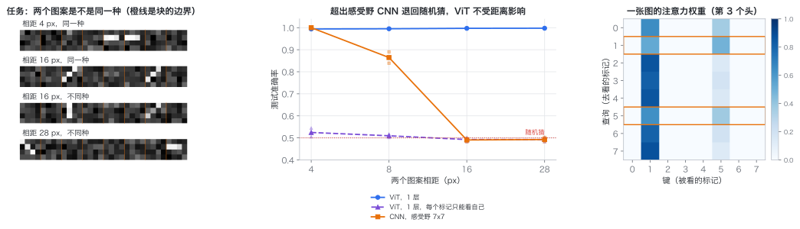
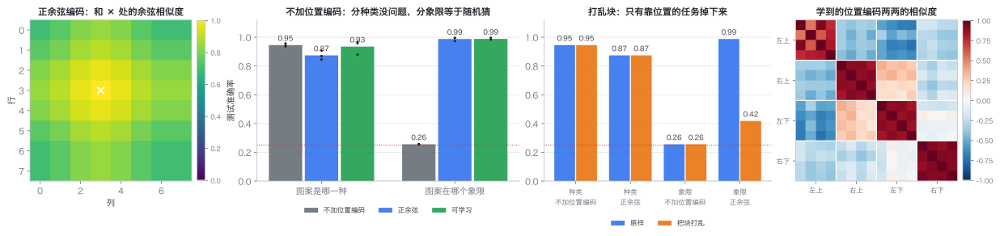
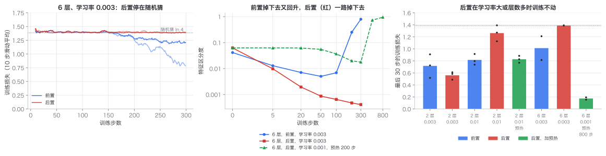
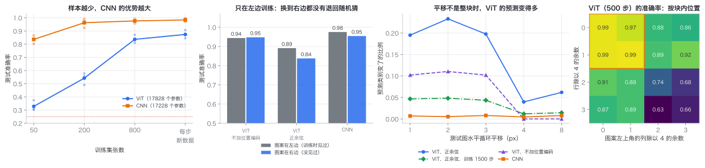
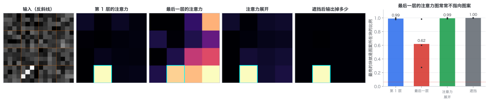
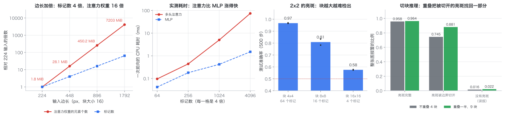

# 教程：Transformer 与 ViT

> [!NOTE]
> 本章所有数字都来自代码生成的小图（噪声背景上的 3×3 图案或 2×2 亮斑）和从零训练的很小的 ViT、CNN，记录在 [`figures/实测数字.json`](figures/实测数字.json)，由 `solutions` 分支的 `solutions/figures/ch25.py` 生成。切块、多头注意力和位置编码调用本章作业的参考实现。脚本在一台 Apple 芯片的 Mac 上用 CPU 跑（PyTorch 2.15.0，torchvision 0.29.2），不下载任何数据和权重，重复运行结果相同。耗时只有第 8 节的一组，是机器上还有别的任务时测的一次结果，只写两位有效数字，脚本默认沿用这一次的值，设置 `CH25_RETIME=1` 才重测。模型只有一万多个参数、训练只有几百步，结论只说这组条件下测到了什么；换成真实图像和大模型，数值会变，方向要自己再测。本章没有任何公开数据集上的精度，也没有任何“在某块显卡上要多久、占多少显存”的数字。

## 0. 本章怎么学

**应用场景**：读懂 2020 年以后大多数视觉模型的前提。第 26 章的 MAE 和 DINOv2、第 27 章的 SAM、第 28 章的视觉语言模型，图像一侧常用的骨干都是 ViT 或它的变体。它们的论文和代码默认你已经知道标记、注意力、位置编码、类别标记这些词是什么意思，也默认你知道把图像切成块、让所有块两两交互，代价是什么。

**优先级**：P2，分到对应方向再学。前置是第 9 章（卷积、感受野、平移等变、残差连接、显存怎么量）。本章会反复拿第 9 章的结论做对照，建议先把那一章的图 1、图 3 和 9.9 节过一遍。

| 档位 | 累计用时 | 做什么 | 做到什么算完 |
|---|---:|---|---|
| 速通 | 3 小时 | 读第 1、3、4、6、8、9 节，看懂图 1 到图 6，把 3.4 节演示的五步试一遍，答完 5 道小测 | 能讲清一层注意力和一层卷积各让哪些位置发生关系，去掉位置编码后哪类任务退回随机猜，样本少时小 CNN 为什么比小 ViT 好，输入边长加倍时标记数和注意力权重各变成几倍 |
| 标准 | 10 小时 | 读完全章，完成作业并验收通过，跑 Notebook，做第 14 节前三个破坏实验，填实验记录 | 五项测试 PASS；实验记录里有不同训练样本数下小 ViT 和小 CNN 的准确率、打乱块前后的对照和一个失败案例；自测问题都能答 |
| 深挖 | 16 小时 | 再做其余破坏实验，从第 15 节的扩展里选一个，按第 10 节在自己的机器上加载预训练的 ViT，取出特征和注意力 | 能在自己的图上给出带条件的结果：输入多大、块多大、缺陷占几个块、显存峰值多少，注意力图有没有用遮挡核对过 |

> [!TIP]
> 用时超过所选档位的 1.5 倍还没做完，就把卡点写进 `学习进度.md`，先往下一章走。作业里最费时间的通常是多头注意力里几次 reshape 和换轴的顺序，卡住时先在纸上把每一步的形状写出来。深挖档要联网下载权重，环境问题卡超过一小时就先回到小模型把结论做完。

## 1. 为什么需要：相距很远的两处要合在一起判断

第 9 章讲过，卷积一层只让相邻的像素发生关系。要让相距很远的两处一起决定输出，得靠堆层数和下采样把感受野撑大。自注意力换了一种做法：每一层里，任何两个位置都能直接交换信息，不管它们离多远。

检测里有不少判断要把相隔很远的两处放在一起看：这个单元和旁边那个重复单元一样吗，这块区域和参考图的对应区域一样吗。下面用一个最小的版本把这件事量出来。

任务：4×32 的窄条切成 8 个 4×4 的块，其中两个块里各放一个 3×3 的图案（横线、竖线、斜线、反斜线四种之一），判断两个图案是不是同一种，随机猜是 0.5。单看任何一个图案都答不了，必须把两处的信息合起来。三个模型最后都是全局平均加一个线性层，各训练 500 步（Adam，学习率 0.003，批 32，每步新生成数据），每个间距单独训练、单独测试，2 个种子，测试集 1000 张。



| 两个图案相距（px） | 4 | 8 | 16 | 28 |
|---|---:|---:|---:|---:|
| ViT，1 层（9218 个参数） | 0.994 | 0.995 | 0.997 | 0.998 |
| 同一个 ViT，每个标记只能看自己 | 0.525 | 0.509 | 0.492 | 0.492 |
| CNN，感受野 7×7（7202 个参数） | 1.0 | 0.864 | 0.491 | 0.492 |

CNN 是一层 7×7 卷积加两层 1×1 卷积（48 通道），一个输出位置只依赖输入的 7×7 区域。选这个结构，是因为两个图案都落在窗口里时它学得起来；探索时试过感受野同样是 7×7 的三层 3×3 卷积，在同样的 500 步里连相距 4 px 的情况都没有稳定学会，那组结果没有放进本章的脚本，这里也不引用它的数字。读这张表的四点：

1. **两个图案都落在一个窗口里时，CNN 没有问题**。相距 4 px 时两个图案一共占 7 列，准确率 1.0。
2. **超出感受野之后，CNN 退回随机猜**。相距 16 px 和 28 px 时准确率是 0.491 和 0.492，训练损失停在 0.694 和 0.693，就是随机猜的 ln 2（0.693）。任何一个窗口都只能看到其中一个图案，全局平均把各个窗口的结果加起来，后面只有一个线性层，“左边是横线”和“右边是横线”只能相加，表达不了“两边一样”。
3. **相距 8 px 是中间状态**：0.864（两个种子是 0.839 和 0.89）。这时一个窗口最多同时看到左边图案的最后一列和右边图案的第一列，横线、斜线、反斜线的这一列各不相同，竖线的这一列是空的，所以能答对一部分。这是按几何关系做的解释，没有按图案种类分开验证。
4. **ViT 的准确率不随距离变**，四个间距都不低于 0.994。把同一个 ViT 的注意力限制成“每个标记只能看自己”（一个只有对角线为真的掩码），它就退回 0.49 到 0.53。所以起作用的正是注意力这一步。

注意力确实落在了该看的地方。间距 16 px 的那个 ViT（种子 0，1000 张测试图）里，一个图案所在的标记给另一个图案所在标记的权重，4 个头平均是 0.426，每张图里最大的那个头平均是 0.534，给自己的是 0.439；8 个标记平均分的话每个只有 0.125。背景标记当查询时，把 0.893 的权重给了这两个图案标记。图 1 右栏就是这个样子：权重几乎全落在第 1 列和第 5 列上，其余各列接近 0。

> [!IMPORTANT]
> 这个实验说明的是机制，不是“CNN 做不了远距离的判断”。真实的 CNN 靠堆层数和下采样把感受野撑到很大，第 9 章 9.4 节的表里 ResNet-18 最后一个阶段的理论感受野已经超过了输入边长。差别在于：卷积要让相距 d 的两处发生关系，感受野得先盖住 d；注意力一层就可以，和 d 无关。这个能力不是白来的，代价是后面三节的内容：它对训练样本的需求（第 6 节）、它不知道位置（第 4 节）、它的计算量随标记数的平方增长（第 8 节）。

## 2. 从图像到标记：切块和线性嵌入

Transformer 处理的是一串向量，叫标记（token）。ViT 把图像变成标记的办法很直接：

1. **切块**。把 $C \times H \times W$ 的图像切成不重叠的 $P \times P$ 小块，共 $N = (H/P)(W/P)$ 块，每块展平成一个长 $C P^2$ 的向量。
2. **线性嵌入**。每个向量乘同一个矩阵，变成 $D$ 维。所有块共用这一个矩阵。

```text
图像 (B, C, H, W) → 切块 (B, N, C*P*P) → 线性层 (B, N, D) → 加位置编码 → 编码块 × L → 汇聚 → 分类头
```

“切块后接线性层”和“步长等于核大小的卷积”是同一件事。4 张 3×32×48 的随机图，块大小 8，得到 24 个长 192 的标记；先切块再乘权重，和 `nn.Conv2d(3, 20, 8, stride=8)` 的输出比，最大差 8.9e-16（float64）。切块再还原，和原图的最大差是 0。torchvision 的 ViT 里这一步就是一个卷积（`conv_proj`）。

两个数帮助建立尺度感。torchvision 的 `vit_b_16` 块大小是 16，一个彩色块有 768 个数，嵌入维数也是 768；224×224 的输入切成 196 个块，加上一个类别标记是 197 个标记。本章的小 ViT 块大小是 4，一个块 16 个数，嵌入 32 维，16×16 的输入是 16 个标记。

这一步有两件事后面会反复用到：

- **块内的展平顺序是约定，不是细节**。作业规定按 (C, P, P) 展平，这样才和卷积的权重排列一致。顺序错了，切块再还原仍然能对上（两边错得一样），但和卷积对不上，加载别人的权重时也对不上。
- **切块是一次步长为 P 的下采样**。每个像素只被读到一次，块和块之间没有重叠。第 9 章图 3 说过，步长为 s 的下采样只对 s 整数倍的平移等变。ViT 在第一步就把这个步长用到了 P，6.3 节会量出后果。

## 3. 自注意力

### 3.1 缩放点积注意力

每个标记同时扮演三个角色，各由一个线性层从标记本身算出来：查询 $q$（我要找什么）、键 $k$（我有什么）、值 $v$（被选中时我提供什么）。第 $i$ 个标记的输出是所有值的加权平均，权重由它的查询和各个键的点积决定：

$$
\text{Attention}(Q, K, V) = \text{softmax}\!\left(\frac{Q K^\top}{\sqrt{d}}\right) V
$$

$Q$ 是 $L_q \times d$，$K$ 是 $L_k \times d$，$QK^\top$ 就是 $L_q \times L_k$ 的分数表。softmax 对每一行做，所以每个查询的权重非负、和为 1。输出的每一行是 $V$ 各行的加权平均，落在值的凸包里。

**为什么除以 $\sqrt{d}$**。两个 $d$ 维随机向量的点积，标准差是 $\sqrt{d}$。维数越高，分数的起伏越大，softmax 越接近只选一个。查询和 16 个键都取标准正态的随机向量，2000 次取平均：

| 维数 d（16 个键，2000 次平均） | 4 | 16 | 64 | 256 | 1024 |
|---|---:|---:|---:|---:|---:|
| 不缩放：分数的标准差 | 2.0 | 3.949 | 8.04 | 16.144 | 32.144 |
| 不缩放：最大的权重 | 0.427 | 0.684 | 0.843 | 0.918 | 0.962 |
| 除以根号 d：最大的权重 | 0.235 | 0.24 | 0.245 | 0.246 | 0.249 |
| 除以 d：最大的权重 | 0.134 | 0.094 | 0.077 | 0.07 | 0.066 |
| 不缩放：1 减权重平方和 | 0.709 | 0.431 | 0.222 | 0.117 | 0.056 |
| 除以根号 d：1 减权重平方和 | 0.868 | 0.87 | 0.867 | 0.867 | 0.866 |

不缩放时，1024 维下最大的权重已经是 0.962，注意力几乎变成了“只看一个”。最后两行是 softmax 雅可比矩阵的迹，权重集中到一个键上时它趋于 0，梯度也就传不回查询和键：不缩放时它从 0.709 掉到 0.056。除以 $\sqrt{d}$ 之后，分数的标准差回到 1 左右，最大权重稳定在 0.24 附近，和维数无关。除以 $d$ 又缩过头了，1024 维时最大权重 0.066，和均匀的 0.0625 几乎没有区别，等于没有选择。

### 3.2 掩码

有时要规定“这个查询不能看那个键”：批里长度不齐时补出来的空位、只能看前面不能看后面的生成模型、把注意力限制在一个窗口里（第 9 节）。做法是在 softmax 之前把不允许的位置的分数设成负无穷，这样它们的权重正好是 0，剩下的权重仍然和为 1。

三个容易错的地方：

- **True 的含义有两套**。本章作业和 `torch.nn.functional.scaled_dot_product_attention` 的 bool 掩码里，True 表示允许关注。`torch.nn.MultiheadAttention` 的 `attn_mask` 相反，True 表示屏蔽。用反了不会报错，只是结果不对。
- **屏蔽要在 softmax 之前做**。softmax 之后再把权重乘 0，剩下的权重和不再是 1。
- **一行全部被屏蔽**时，softmax 的输入全是负无穷，结果是 nan，而且会沿着后面的计算扩散。作业规定这种情况下这一行的权重和输出都是 0。

### 3.3 多头

一个头在一层里只能给每个查询一种权重分布。多头注意力把 $D$ 维切成 $H$ 段，每段 $D/H$ 维，各做各的注意力，再拼回 $D$ 维过一个输出线性层。每个头的缩放用的是自己的维数 $D/H$。

头数不改变参数量。$D = 32$ 时，q、k、v 的投影加输出投影一共 4224 个参数，切成几个头都是这个数。改变的是“同时能有几种看法”。在“分图案种类”的任务上（16×16 的图里放一个图案，位置随机；小 ViT 嵌入 32 维、2 层，训练 500 步，3 个种子），只改头数：

| 头数（嵌入 32 维，参数量都是 17828） | 1 | 2 | 4 | 8 |
|---|---:|---:|---:|---:|
| 每个头的维数 | 32 | 16 | 8 | 4 |
| 测试准确率（3 个种子的平均） | 0.721 | 0.761 | 0.874 | 0.892 |
| 各种子 | 0.69、0.668、0.805 | 0.794、0.871、0.617 | 0.869、0.907、0.845 | 0.904、0.885、0.888 |

在这组实验里头多的学得快，4 个头和 8 个头的三个种子都高于 1 个头的三个种子。但 2 个头的种子之间差了 0.25，这张表只能说明“同样的步数下，头多的更好”，说明不了多到几个为止，也说明不了训练更久之后还差多少。

### 3.4 交互演示：自注意力

演示页把 6 个标记画成平面上的 6 个点，点的坐标就是它的向量，同时当查询、键和值。分数是点积除以 $\sqrt{d}$ 再除以温度，温度为 1 时和作业里的函数完全一样。点一下换查询，拖动改向量。页面下方“按顺序试”的五步各对应一个结论：

- 第 1 步：A、B、C 在同一个方向上，一个比一个离原点远，查询是最近的 A。A 给 C 的权重最大（0.287），其次是 B（0.223），给自己的只排第三（0.173）。**点积看的是方向和长度，不是距离**，离原点远的键天然占便宜。
- 第 2 步：查询换成 C。温度 1 时它的权重相当于平均分给 2.68 个键；温度降到 0.1，相当于 1.0 个，变成只选一个；温度升到 10，相当于 5.9 个，接近平均分给 6 个。不动温度、把 C 往外拖到 (2.2, 0)，相当于 1.71 个键。**把向量整体放大，和把温度调低是一回事**，这就是 3.1 节要缩放的原因。
- 第 3 步：查询在原点。它和谁的点积都是 0，每个键的权重都是 0.167，改温度也不变，输出是 6 个点的平均。
- 第 4 步：A 在右上，B 在右下，C 在左上。一个头时 A 把 0.818 的权重给自己，B 和 C 各只有 0.052。切成 2 个头，第 1 个头只看横坐标，最关注的是 B（0.475）；第 2 个头只看纵坐标，最关注的是 C（0.468）。**多头就是让同一个查询同时按几种标准去找**。
- 第 5 步：回到第 1 步的摆法，把 C 屏蔽。C 的权重变成 0，其余的重新归一化，A 给 B 的变成 0.313，给自己的变成 0.242。把 6 个键全部屏蔽，权重和输出都是 0。

<!-- embed: ../demos/自注意力.html 1040 -->
[打开交互演示：自注意力](../demos/自注意力.html)

<!-- quiz -->
**三个标记的向量指向同一个方向，长度一个比一个长；另外还有三个指向别的方向的标记。让最短的那个当查询做自注意力，它给谁的权重最大？**

- A. 给自己，因为自己和自己最像
- B. 给同方向上最长的那个
- C. 同方向的三个一样多，因为方向相同

<details markdown="1"><summary>答案与解释</summary>

**B**。演示第 1 步的实测：给最长的那个是 0.287，给中间的是 0.223，给自己只有 0.173，排第三。点积等于两个向量的长度相乘再乘夹角的余弦，方向相同时谁长谁的分数高。“最像自己”是按距离想的直觉，点积注意力不看距离。这也是为什么编码块里要有 LayerNorm 把向量的长度管住（第 5 节）。

</details>
<!-- /quiz -->

## 4. 位置编码

### 4.1 自注意力不知道顺序

上面的公式里没有任何一处用到“第几个”。把标记的顺序打乱，每个标记算出来的输出不变，只是跟着换了位置。2 组 16 个 32 维的随机标记过一层多头自注意力，打乱再算和算完再按同样方式打乱，最大差 6.7e-16；对所有标记取平均之后，打乱前后的最大差是 2.2e-16。

对图像来说，这意味着不加别的东西时，ViT 把图像看成“一袋块”，不知道哪个块在左上角。位置信息要另外加进去。

### 4.2 两种常用的位置编码

**可学习的**。每个位置一个 $D$ 维向量，随机初始化，和网络一起训练，加在块嵌入上。ViT 原论文和 torchvision 的实现用的是这种。它和网格大小绑定：`vit_b_16` 的位置编码形状是 [1, 197, 768]，换成 384 的输入就要 [1, 577, 768]，原来的参数用不上，得先插值（第 10 节）。

**固定的二维正余弦**。不训练，按公式算。把 $D$ 维分成四段，每段 $m = D/4$ 维，位置（行 $r$，列 $c$）的编码是：

```math
\begin{aligned}
\omega_t &= T^{-t/m}, \qquad t = 0, 1, \dots, m-1 \\
\text{PE}(r, c) &= \big[\, \sin(r\,\omega),\ \cos(r\,\omega),\ \sin(c\,\omega),\ \cos(c\,\omega) \,\big]
\end{aligned}
```

$T$ 取 10000。前一半只管行，后一半只管列；每一半里是一组从快到慢的正弦和余弦。MAE 用的是这一类（MAE 本身见第 13 章 5.2 节和第 26 章）。它有三个性质，都可以直接验证：

- 每个位置编码的平方和都等于 $D/2$（32 维时是 16.0），因为每一对 sin、cos 的平方和是 1。
- 两个位置编码的相似度只取决于行差和列差，和绝对位置无关。32 维、8×8 网格里，和某个位置左右相邻、上下相邻的余弦相似度都是 0.968，隔 2 格是 0.898，隔 4 格是 0.847，斜对角相邻是 0.936，整张网格里最小的是 0.693。离得近的更像，行和列对称（图 2 左栏）。
- 没有参数，换一个网格大小重新算一遍就行。

### 4.3 实测：位置编码管什么

16×16 的图里放一个图案，位置随机，不对齐块的网格，切成 16 个 4×4 的块。两个任务：分图案的种类（和位置无关）；分图案在哪个象限（只和位置有关）。小 ViT（块大小 4，嵌入 32 维，2 层，4 个头，全局平均汇聚）训练 500 步，3 个种子，测试集 1000 张，随机猜是 0.25。“打乱块”指测试时把 16 个块按同一个固定的随机顺序重排，位置编码不跟着动；训练时没有打乱。



| 位置编码（3 个种子的平均） | 分种类 | 分种类，打乱块 | 分象限 | 分象限，打乱块 |
|---|---:|---:|---:|---:|
| 不加 | 0.945 | 0.945 | 0.256 | 0.256 |
| 正余弦 | 0.874 | 0.874 | 0.988 | 0.418 |
| 可学习 | 0.935 | 0.934 | 0.988 | 0.406 |

1. **不加位置编码，分象限就是随机猜**：0.256，三个种子是 0.254、0.256、0.257，训练损失 1.391，停在 ln 4（1.386）。图案在哪个块里，模型根本看不到。
2. **不加位置编码，分种类一点不吃亏**：0.945，和可学习的 0.935 分不出高下（种子之间的差比这大）。这个任务本来就不需要位置。
3. **不加位置编码的模型对打乱完全无感**。打乱前后输出的最大差是 3.5e-06（float32 的舍入），预测一个都没变。这就是 4.1 节的性质在整个网络上的体现。
4. **加了位置编码，打乱只伤到需要位置的任务**。分象限从 0.988 掉到 0.418，没有掉到 0.25，是因为这个固定的打乱顺序里有 0.438 的块还留在原来的象限。分种类几乎不变（0.874 对 0.874），虽然输出确实变了，有 0.051 的图预测变了。
5. **两种位置编码在分象限上一样好**，都是 0.988。可学习的那一种学到了任务需要的结构：训练后同一象限的位置编码两两的余弦相似度平均 0.854，不同象限的是 -0.231（图 2 最右，三个种子都是这样）。看起来它学到的是这个任务用得上的那部分结构（哪个象限），而不是完整的二维坐标。

第 4 条里藏着一件容易忽略的事：图案的位置是随机的，经常被块的边界切成两三片；把块打乱之后这几片不再相邻，分种类的准确率却没有掉。这说明这个小模型并没有把相邻块里的碎片拼起来认，它是各认各的。6.3 节会从另一个方向看到同一件事。

### 4.4 位置编码的幅度

上表里正余弦在分种类上是 0.874，比可学习的 0.935 和不加的 0.945 都低。原因不在“正余弦”，在幅度。正余弦编码每一行的范数是 4.0，初始化时块嵌入的平均范数是 0.999，位置编码是内容的 4.005 倍。可学习的位置编码从标准差 0.02 的小随机数开始，几乎不干扰内容。

把正余弦编码整体乘 0.1 再加上去，其余不变：分种类的准确率是 0.937（三个种子 0.931、0.95、0.931），每个种子都比不缩小时高，和可学习的持平。不缩小的版本训练到 1500 步是 0.979 和 0.976（2 个种子），所以它差的是学得快慢，不是学不会。

真实的 ViT 嵌入维数大得多、训练也长得多，这个差别还在不在，本章没有测。能确定的是：**把两样东西直接相加时，先看一眼它们的范数**。

<!-- quiz -->
**一个不加位置编码、全局平均汇聚的小 ViT，在“分图案种类”上的测试准确率是 0.945。测试时把每张图的 16 个块按随机顺序重排再送进去，准确率最接近哪个？**

- A. 0.25，图像被打乱成了噪声
- B. 0.6 左右，被块边界切开的图案认不出来了
- C. 还是 0.945，一张图的预测都不会变

<details markdown="1"><summary>答案与解释</summary>

**C**。实测打乱前后都是 0.945，输出的最大差只有 3.5e-06，预测变了的比例是 0。自注意力对标记的顺序没有感觉，全局平均也没有，整个网络里没有任何一处知道块原来在哪。B 是按“模型会把相邻的碎片拼起来”想的，但这个模型从来不知道谁和谁相邻。同一个模型去分象限只有 0.256，原因相同。

</details>
<!-- /quiz -->

### 4.5 类别标记和全局平均

编码块输出的是 $N$ 个标记，分类需要一个向量。两种汇聚方式：

- **类别标记**（class token）。在序列最前面加一个可学习的标记，它不对应任何块，经过各层注意力从别的标记那里收集信息，最后只取它的输出。ViT 原论文和 torchvision 的实现用这种。
- **全局平均**。对所有块标记的输出取平均，和第 9 章的全局平均池化是一回事。

| 汇聚方式（正余弦位置编码，500 步，3 个种子的平均） | 参数量 | 分种类 | 分象限 | 分种类最后 30 步的训练损失 |
|---|---:|---:|---:|---:|
| 全局平均 | 17828 | 0.874 | 0.988 | 0.306 |
| 类别标记 | 17860 | 0.861 | 0.983 | 0.418 |

两者差 0.013 和 0.005，而全局平均自己的三个种子就从 0.845 到 0.907。在这组实验里分不出高下。类别标记多 32 个参数、多一个标记。选哪种更多是看后面怎么用：类别标记的输出常被当成整张图的特征，块标记的输出是一张 $H/P \times W/P$ 的特征图，可以像 CNN 的特征图那样用（本章 9.3 节）。第 7 节的注意力图用的是类别标记那一行。

## 5. 编码块：LayerNorm 放前面还是后面

一个编码块由两个子层组成：多头自注意力，和一个逐标记作用的两层 MLP。每个子层外面有残差连接（第 9 章 9.7 节），再配一个 LayerNorm。LayerNorm 对每个标记自己的 $D$ 个数做标准化，不依赖批里的其他样本，所以没有第 9 章 9.5 节 BatchNorm 那种训练和推理不一致的问题。

LayerNorm 放在哪有两种写法：

```text
前置（Pre-LN，ViT 用的）              后置（Post-LN，2017 年原始 Transformer 用的）
x = x + Attn(LN(x))                  x = LN(x + Attn(x))
x = x + MLP(LN(x))                   x = LN(x + MLP(x))
所有块之后再过一次 LN
```

前置时，残差的直通路径上什么都不经过；后置时，每个块的输出都要过一次 LN。本章小 ViT 的参数分布：合计 17828 个，切块嵌入 544 个，每个编码块 8544 个（注意力 4224，MLP 4192，两个 LayerNorm 128），最后的 LayerNorm 和分类头 196 个。

**实测**。分图案种类的任务，小 ViT 只改层数和 LayerNorm 的位置，Adam，批 32，每步新数据。2 层的设置 3 个种子，6 层的 2 个种子。随机猜的损失是 ln 4，即 1.386。



| 设置（没写的都是不预热、300 步） | 最后 30 步的训练损失（各种子） | 测试准确率（各种子） |
|---|---|---|
| 2 层，学习率 0.003，前置 | 0.909、0.517、0.724 | 0.621、0.81、0.786 |
| 2 层，学习率 0.003，后置 | 0.584、0.487、0.61 | 0.827、0.785、0.731 |
| 2 层，学习率 0.01，前置 | 0.797、0.738、0.915 | 0.705、0.728、0.569 |
| 2 层，学习率 0.01，后置 | 1.126、1.271、1.391 | 0.426、0.414、0.256 |
| 2 层，学习率 0.01，后置，预热 100 步 | 0.884、0.827、0.769 | 0.68、0.644、0.7 |
| 6 层，学习率 0.003，前置 | 1.21、0.815 | 0.45、0.674 |
| 6 层，学习率 0.003，后置 | 1.39、1.388 | 0.264、0.24 |
| 6 层，学习率 0.001，后置，预热 200 步，800 步 | 0.193、0.154 | 0.928、0.958 |

1. **层数少、学习率不大时，后置并不差**。2 层、学习率 0.003，后置三个种子的损失是 0.584、0.487、0.61，前置是 0.909、0.517、0.724。“前置一定更好”在这里不成立。
2. **学习率调大，后置先出问题**。2 层、学习率 0.01，前置的损失还在 0.74 到 0.92，后置是 1.126、1.271、1.391，最后一个种子完全停在随机猜。
3. **层数加深，后置在同样的学习率下训练不动**。6 层、学习率 0.003，后置两个种子的损失是 1.39 和 1.388，测试准确率 0.264 和 0.24。前置在同样的设置下虽然也慢（1.21 和 0.815），但在往下走。
4. **后置不是不能训练，是要更小的学习率加预热**。学习率降到 0.001、前 200 步线性预热、训练 800 步，6 层后置的损失是 0.193 和 0.154，准确率 0.928 和 0.958。注意这一行训练了 800 步，和上面 300 步的各行不能直接比高低，它只说明“这样能训练起来”。6 层前置训练 800 步是多少，本章没有测。

**训练不动的时候发生了什么**。量一个“特征区分度”：256 张测试图的汇聚特征到它们平均值的距离，除以特征的范数。它接近 0 表示不管输入什么，输出都一样。

| 训练步数（6 层，种子 0） | 0 | 5 | 20 | 50 | 100 | 200 | 300 |
|---|---:|---:|---:|---:|---:|---:|---:|
| 前置，学习率 0.003 | 0.0414 | 0.0129 | 0.0071 | 0.005 | 0.0069 | 0.2506 | 0.7942 |
| 后置，学习率 0.003 | 0.0624 | 0.0098 | 0.0019 | 0.0009 | 0.0006 | 0.0005 | 0.0004 |
| 后置，学习率 0.001，预热 200 步 | 0.0624 | 0.0625 | 0.0619 | 0.0549 | 0.0367 | 0.0198 | 0.0177 |

三种设置一开始区分度都在下降，看起来网络先学会的是输出一个和输入无关的常数（四类均衡时，这已经能把损失降到 ln 4）。前置降到 0.005 之后掉头回升，到 300 步是 0.7942。后置在学习率 0.003 下一路掉到 0.0004，300 步之内没有回来，输出已经和输入无关。加了预热的后置降得慢，在 300 步时是 0.0177，之后回升，500 步时 0.7306，800 步时 0.9505。

初始化时的梯度看不出这个差别。6 层网络第一层和最后一层注意力权重的梯度范数之比，前置是 1.765，后置是 1.379（5 组初始化的几何平均），都不大。所以这里的问题不是“初始化时梯度传不到前面”，而是训练头几十步里网络塌到了常数输出，后置更容易塌下去、塌下去之后更难回来。为什么后置更容易塌，本章只量了现象，没有验证机制。

> [!WARNING]
> 损失停在 ln(类别数) 不动时，先量一下不同输入的输出是不是几乎一样。如果是，问题多半在学习率和预热，不在数据和标签。先把学习率降到三分之一、加上预热再试，不要急着改模型。

<!-- quiz -->
**6 层的小 ViT，LayerNorm 后置，Adam 学习率 0.003，不预热，训练 300 步后损失停在 1.39（随机猜是 1.386）。刚初始化时，它第一层和最后一层注意力权重的梯度范数之比最接近哪个？**

- A. 上千倍，梯度传到前面已经消失或者爆炸了
- B. 1.4 倍左右，初始化时的梯度看不出问题
- C. 第一层的梯度是 0

<details markdown="1"><summary>答案与解释</summary>

**B**。实测是 1.379，同样深度的前置是 1.765，后置的比例反而更小。问题出在训练过程里：后置的特征区分度从 0.0624 一路掉到 0.0004，网络塌成了不管输入什么都输出同一个值。A 是从第 9 章“深网络梯度消失”类推来的，在这个深度上没有发生。把学习率降到 0.001、加 200 步预热、训练 800 步，同一个后置网络的损失是 0.193 和 0.154。

</details>
<!-- /quiz -->

## 6. 小 ViT 对小 CNN：归纳偏置

卷积把两条关于图像的假设写进了结构：相邻的像素更相关（局部连接），同一种图案出现在哪里都该用同一组权重去认（权重共享）。这类写死在结构里的假设叫归纳偏置。ViT 写进去的少得多：切块之后，哪个块和哪个块相邻、图案挪一个像素还是不是同一个图案，都要从数据里学。

下面把参数量相近的两个小模型放在同一个任务上比。任务是分图案的种类（16×16 的图，图案位置随机）。小 ViT 同前（17828 个参数）；小 CNN 是 3×3 卷积 16 通道、2×2 平均池化、两层 3×3 卷积 36 通道、全局平均、线性层（17228 个参数）。都用 Adam（学习率 0.003，批 32）训练 500 步，3 个种子，测试集 1000 张。



### 6.1 训练样本从少到多

固定训练集时，反复用同样的 n 张图训练 500 步；“每步新数据”相当于 16000 张不重复的图。

| 训练集张数（3 个种子的平均） | 50 | 200 | 800 | 每步新数据 |
|---|---:|---:|---:|---:|
| 小 ViT：测试准确率 | 0.328 | 0.542 | 0.837 | 0.874 |
| 小 CNN：测试准确率 | 0.836 | 0.963 | 0.976 | 0.984 |
| CNN 减 ViT | 0.508 | 0.421 | 0.14 | 0.11 |
| 小 ViT：最后 30 步的训练损失 | 0.001 | 0.002 | 0.126 | |
| 小 CNN：最后 30 步的训练损失 | 0.004 | 0.042 | 0.096 | |

1. **样本越少，差距越大**。50 张图时 CNN 是 0.836，ViT 是 0.328（三个种子 0.308、0.302、0.374），比随机猜的 0.25 高不了多少。差距从 0.508 缩到每步新数据时的 0.11。
2. **ViT 在小训练集上是把训练图背下来了**。50 张图时它的训练损失是 0.001，测试准确率 0.328。训练损失和 CNN 的 0.004 一样低，区别全在泛化上。同一个图案放在另一个位置，CNN 的卷积核照样认得，ViT 要重新学，而 50 张图里每种图案在每个位置上平均不到一张。
3. **样本够多时差距缩小，但这组实验里 ViT 没有追上**。每步新数据训练 500 步是 0.874 对 0.984；ViT 训练到 1500 步是 0.979 和 0.976（2 个种子），和 CNN 500 步的水平相当。

ViT 的论文和后续工作报告过，在足够大的数据集上预训练之后 ViT 能超过同期的 CNN。这一点本章的小实验复现不了，也没有试图复现。这里能确定的只是方向：**数据少的时候，结构里的假设能顶替一部分数据**。检测场景里缺陷样本通常很少，这正是第 9 节说“直接从头训练 ViT 很难”的原因，也是第 26 章要讲预训练的原因。

### 6.2 没见过的位置

第 9 章图 1 做过一个实验：训练时图案只出现在左半边，测试时挪到右半边。全连接网络和“卷积后展平”的网络都退回了随机水平，只有“卷积加全局平均”的网络不受影响。ViT 属于哪一边？

同样的设置：训练时图案的左上角只出现在第 0 到 5 列，测试时分两组，仍在第 0 到 5 列，或者在第 8 到 13 列。

| 模型（500 步，3 个种子的平均） | 图案在左边（见过） | 图案在右边（没见过） | 右边的各种子 |
|---|---:|---:|---|
| ViT，不加位置编码 | 0.944 | 0.948 | 0.958、0.94、0.945 |
| ViT，正余弦位置编码 | 0.891 | 0.838 | 0.784、0.854、0.875 |
| CNN | 0.975 | 0.954 | 0.878、0.988、0.997 |

**ViT 更接近“卷积加全局平均”的那一边**。不加位置编码的 ViT 在没见过的位置上一点不掉（0.944 对 0.948）。加了位置编码的掉了一些（0.891 到 0.838），但远没有回到随机猜的 0.25。原因是 ViT 里绝大部分权重是所有位置共用的：切块嵌入是同一个矩阵，注意力和 MLP 对每个标记用的也是同一组权重。和位置绑定的只有位置编码这一项。

所以“ViT 没有平移方面的归纳偏置”这句话说得太粗。它在**块这一级**是权重共享的，和卷积一样；它缺的是块以下的那一级，见下一小节。

### 6.3 平移和块的网格

把测试图沿水平方向循环平移 t 个像素，看预测类别变不变。用的是 6.1 节“每步新数据”训练出来的模型，测试图里图案在左边，向右平移 8 px 以内不会绕到另一边。块大小是 4，所以平移 4 px 和 8 px 相当于图案整块整块地挪。

| 水平平移（px） | 1 | 2 | 3 | 4 | 8 | 平移前的准确率 |
|---|---:|---:|---:|---:|---:|---:|
| ViT，正余弦，500 步 | 0.195 | 0.233 | 0.198 | 0.04 | 0.062 | 0.892 |
| ViT，不加位置编码，500 步 | 0.102 | 0.11 | 0.102 | 0 | 0 | 0.953 |
| ViT，正余弦，1500 步 | 0.047 | 0.048 | 0.043 | 0.012 | 0.015 | 0.976 |
| CNN，500 步 | 0.007 | 0.005 | 0.008 | 0.005 | 0.008 | 0.988 |

表里是预测类别变了的图所占的比例。

1. **不加位置编码的 ViT，平移整数个块时预测一张都不变**（表里的 0 是严格的 0）。平移 4 px 只是把标记换了个顺序，4.1 节说过它对顺序没有感觉。平移 1 到 3 px 时有 0.10 到 0.11 的图变了预测：块的内容变了，这不是换顺序。
2. **加了位置编码，整块平移也会变一点**（0.04 和 0.062），因为同样的内容配上了不同的位置编码。但仍然比平移 1 到 3 px 时的 0.195 到 0.233 小得多。
3. **CNN 在所有平移量下都不到 0.01**。
4. 准确率低的模型本来就容易变预测，所以四行之间不能只比绝对值。更干净的证据是每一行内部的对比：ViT 的三行都是“整块平移”明显小于“不是整块的平移”，CNN 那一行没有这个区别。训练到 1500 步的 ViT 准确率和 CNN 接近了（0.976 对 0.988），平移 1 px 时变预测的比例仍是 CNN 的好几倍（0.047 对 0.007）。

换一个角度看同一件事：把 6000 张测试图按图案左上角除以 4 的余数分组。余数是 0 或 1 时，3×3 的图案完整地落在一个块里；是 2 或 3 时被块的边界切开。

| 准确率（3 个种子的平均，1500 步的是 2 个种子） | 图案完整落在一个块里 | 行和列都被块边界切开 | 16 种位置里最低的 |
|---|---:|---:|---:|
| ViT，正余弦，500 步 | 0.983 | 0.678 | 0.628 |
| ViT，不加位置编码，500 步 | 0.987 | 0.844 | 0.804 |
| ViT，正余弦，1500 步 | 0.998 | 0.944 | 0.914 |
| CNN，500 步 | 0.985 | 0.992 | 0.983 |

图案完整落在块里时，ViT 和 CNN 一样好（0.983 对 0.985）。被切成四片时，训练 500 步的 ViT 只有 0.678。CNN 没有“块的网格”这回事，两种情况是 0.985 和 0.992。训练更久，ViT 把切开的情况也学会了一大半（0.944），但这是用数据和步数换来的。4.3 节看到“打乱块之后分种类不掉”，也是同一个意思：这个小模型认的是单个块里的内容。

对检测来说，这一条比“ViT 需要更多数据”更具体：**缺陷和块的网格怎么对齐是随机的**。本章的设置里，3×3 的图案只有四分之一的位置能完整落在一个 4×4 的块里，其余都会被切开。

<!-- quiz -->
**小 ViT（块大小 4，正余弦位置编码，训练 500 步）在一组测试图上的准确率是 0.892。把这组图水平循环平移，平移几个像素时预测变得最少？**

- A. 1 px，位移最小
- B. 4 px，正好一个块
- C. 1 到 4 px 都差不多

<details markdown="1"><summary>答案与解释</summary>

**B**。实测平移 1、2、3 px 时有 0.195、0.233、0.198 的图预测变了，平移 4 px 时只有 0.04。平移一整块，每个块里的内容原封不动，只是换了位置；平移 1 px，每个块的内容都变了。不加位置编码时更极端，平移 4 px 和 8 px 预测一张都不变。同样的测试，CNN 在所有平移量下都不到 0.01。这和第 9 章图 3 “只对总步长整数倍的平移等变”是同一个现象，ViT 的步长就是块大小。

</details>
<!-- /quiz -->

## 7. 注意力图怎么看，注意力展开

注意力权重是现成的、和输入一样有空间结构的数，很自然会被拿来回答“模型在看哪”。常见的做法是取类别标记那一行：它给每个块多少权重，画成一张 $H/P \times W/P$ 的图。问题是取哪一层。

**注意力展开**（attention rollout，Abnar 和 Zuidema 2020 年提出）试图把各层合起来看。每层先对头取平均得到 $\bar{A}_l$，和单位阵各占一半（代表残差连接让每个标记保留一半自己），然后逐层相乘：

$$
\tilde{A}_l = \tfrac{1}{2}\bar{A}_l + \tfrac{1}{2} I, \qquad R = \tilde{A}_L \cdots \tilde{A}_2\, \tilde{A}_1
$$

$R$ 的第 $i$ 行第 $j$ 列可以读成“最后一层的第 $i$ 个标记里，有多少来自输入的第 $j$ 个标记”。它把注意力当成信息流的比例来乘，忽略了 MLP 和值向量的大小，是一个近似。

**实测**。分图案种类的任务，这次把图案对齐到块的网格上，每张图只有一个块里有图案，其余 15 个块是噪声，这样“该看哪”有标准答案。ViT 用类别标记汇聚，3 层，训练 500 步，测试准确率 1.0。对每张图看最亮的块是不是图案所在的块（命中率，随机猜是 0.0625）。遮挡是对照：把 16 个块逐个换成噪声，看正确类别的输出掉得最多的是哪一块。3 个种子，每个 1000 张测试图。



| 看法（3 层 ViT，3 个种子） | 命中率 | 各种子的命中率 | 图案所在块占的权重 |
|---|---:|---|---:|
| 第 1 层的注意力 | 0.99 | 0.994、0.976、1.0 | 0.839 |
| 最后一层的注意力 | 0.619 | 0.6、0.276、0.982 | 0.116 |
| 注意力展开 | 0.995 | 0.998、0.986、1.0 | 0.378 |
| 遮挡（对照） | 1.0 | 1.0、0.999、1.0 | |

1. **最后一层的注意力图不可靠**。平均命中率 0.619，三个种子从 0.276 到 0.982。同一个结构、同一个任务、准确率都是 1.0，换一个随机种子，最后一层的注意力图就从“几乎都对”变成“大半指错”。图案所在的块平均只拿到 0.116 的权重，比均匀的 0.0625 高不了多少。
2. **第 1 层的注意力图是对的**（0.99）。在这个模型里，类别标记在第 1 层就把图案所在的块找到并读了进来，之后几层它看哪里已经不重要了。
3. **注意力展开把各层合起来之后和遮挡基本一致**（0.995 对 1.0）。
4. 类别标记给自己的权重很小，三层分别是 0.138、0.073、0.06，它主要在读别的标记。

这是一个 3 层的模型和一个刻意造得很干净的任务。在很深的预训练 ViT 上，哪一层的注意力图有意义、注意力展开还准不准，本章没有测，不能从这里外推。能带走的是做法：**单独一层的注意力图不等于“模型在看哪”；要拿它当解释用，先用遮挡这类直接改输入的办法核对一遍**。第 10 章 10.5 节给 Grad-CAM 做的“把权重随机化，热图变不变”是同一类检查。

<!-- quiz -->
**一个 3 层的 ViT 分类准确率是 1.0。取最后一层类别标记的注意力画成图，最亮的块正好是图案所在块的比例是多少？**

- A. 接近 1，模型全答对了，说明它看对了地方
- B. 0.62 左右，而且三个种子从 0.276 到 0.982 都有
- C. 0.0625，和随机猜一样

<details markdown="1"><summary>答案与解释</summary>

**B**。实测平均 0.619，三个种子是 0.6、0.276、0.982。A 把“答对了”和“这一层的注意力落在对的地方”当成了一回事。这个模型的类别标记在第 1 层就读到了图案（第 1 层的命中率 0.99），后面几层的注意力落在哪不影响结果。把各层合起来的注意力展开是 0.995，和遮挡的 1.0 基本一致。

</details>
<!-- /quiz -->

## 8. 代价：标记数的平方

$N$ 个标记做自注意力，要算一张 $N \times N$ 的分数表，每个头一张。输入边长加倍，标记数变成 4 倍，这张表变成 16 倍。

一个编码块里的乘加次数（只数矩阵乘法，$D$ 是嵌入维数，MLP 隐藏层是 $4D$）分两类：

- **和 $N^2$ 成正比**：$Q K^\top$ 和权重乘 $V$ 两步，合计 $2N^2 D$。
- **和 $N$ 成正比**：q、k、v 三个投影、输出投影和 MLP，合计 $12 N D^2$。

两项相等时 $N = 6D$。标记数比这个少时，计算量主要花在线性项上；多了以后平方项才占大头。

按 `vit_b_16` 的形状（块大小 16、嵌入 768 维、12 个头、12 层）把这些量数出来。下表是按公式数的张量大小和乘加次数，每张图、不计类别标记，**不是在任何显卡上量到的显存或耗时**：



| 输入边长（px，块大小 16） | 224 | 448 | 896 | 1792 |
|---|---:|---:|---:|---:|
| 标记数 | 196 | 784 | 3136 | 12544 |
| 相对 224：标记数的倍数 | 1 | 4 | 16 | 64 |
| 相对 224：注意力权重的倍数 | 1 | 16 | 256 | 4096 |
| 一层注意力权重（MiB，float32） | 1.8 | 28.1 | 450.2 | 7203.0 |
| 12 层都留着时（MiB，float32） | 21.1 | 337.6 | 5402.2 | 86436.0 |
| 每层乘加：平方项（十亿） | 0.059 | 0.944 | 15.106 | 241.693 |
| 每层乘加：线性项（十亿） | 1.387 | 5.549 | 22.196 | 88.785 |
| 平方项占每层乘加的比例 | 0.041 | 0.145 | 0.405 | 0.731 |
| 相对 224：每层乘加合计的倍数 | 1.0 | 4.5 | 25.8 | 228.5 |

1. **内存先撑不住**。注意力权重是 (头数, N, N) 的张量。224 的输入一层只有 1.8 MiB；896 时一层 450.2 MiB，12 层都留着（训练时反向传播要用）是 5402.2 MiB；1792 时单单一层就是 7203.0 MiB，而 8 GiB 一共只有 8192 MiB。这还没算参数、标记本身和别的中间结果。
2. **“分辨率加倍，计算量变成 16 倍”在常用的尺寸上并不成立**。224 时平方项只占每层乘加的 0.041，从 224 到 448 每层乘加合计是 4.5 倍，不是 16 倍。平方项和线性项相等要到 4608 个标记，对应边长 1086 px。到 1792 时平方项占 0.731，合计是 224 时的 228.5 倍。
3. 所以分辨率往上加时，先碰到的是显存，然后才是时间。

**实测耗时**。一层多头自注意力（参考实现，64 维，4 个头）和一个 MLP（64 到 256 到 64），批大小 1，不求梯度，在一台 Mac 的 CPU 上（2 线程）测的一次结果，取多次的中位数；测的时候机器上还有别的任务，只看量级和倍数：

| 标记数 | 64 | 256 | 1024 | 4096 |
|---|---:|---:|---:|---:|
| 多头注意力（ms） | 0.096 | 0.44 | 5.0 | 74.0 |
| MLP（ms） | 0.042 | 0.18 | 0.42 | 1.5 |

标记数从 1024 到 4096（4 倍），注意力的耗时变成 15 倍，MLP 变成 3.6 倍；4096 个标记时注意力是 MLP 的 49 倍。标记少的时候看不出平方：从 64 到 256，注意力只变成 4.6 倍。这个小模型只有 64 维，$6D$ 是 384 个标记，比 ViT-B 早得多进入平方项主导的区间。

> [!NOTE]
> 上面数的是把整张注意力权重存下来的朴素算法。有的实现不显式保存这张表（PyTorch 的 `scaled_dot_product_attention` 在部分后端上是这样，具体以它的文档为准），实际显存会比这里数的少。要知道自己的机器上到底占多少，按第 9 章 9.9 节的办法量峰值，Notebook 第 8 节有现成的代码。

## 9. 工业检测：图很大，缺陷很小

检测图的特点是分辨率高、缺陷只占很少的像素。这和 ViT 的两个特点正面相撞。

### 9.1 直接用 ViT 的三个困难

**块大小和小缺陷**。32×32 的噪声图里有没有一个 2×2 像素、幅度 0.6 的亮斑（噪声标准差 0.15，位置随机），随机猜是 0.5。ViT 嵌入 32 维、2 层、4 个头、不加位置编码、全局平均，只改块大小，每步新数据，2 个种子，测试集 1000 张：

| 块大小 | 4 | 8 | 16 |
|---|---:|---:|---:|
| 标记数 | 64 | 16 | 4 |
| 亮斑占一个块的面积比例 | 0.25 | 0.062 | 0.016 |
| 只看整块像素之和时的信噪比 | 4.0 | 2.0 | 1.0 |
| 500 步的测试准确率 | 0.968 | 0.808 | 0.576 |
| 1500 步的测试准确率 | 没有测 | 0.914 | 0.574 |

块越大越难检出（图 6 左三）。块大小 16 时准确率 0.576，训练步数加到 3 倍还是 0.574。块大小 8 时多训练有用（0.808 到 0.914），但仍不如块大小 4 训练 500 步的 0.968。

原因至少有两层，本章没有把它们分开。一是稀释：亮斑的 4 个像素一共只多出 2.4 的亮度，块里像素越多，噪声加起来越大，“整块求和”这个最简单的线索信噪比从 4.0 降到 1.0。线性嵌入原则上可以学出只盯着某几个像素的权重，但亮斑可能出现在块里的任何位置，要学的模板个数随块的面积增长。二是压缩：块大小 16 时一个块有 256 个数，嵌入只有 32 维。

把块调小就能解决吗？块大小减半，标记数变成 4 倍，注意力权重变成 16 倍，回到了第 8 节。**块大小同时决定了能看见多小的东西和要付多少代价**，这是把 ViT 用到检测图上的核心矛盾。

**分辨率的代价**。第 8 节的表：按 ViT-B/16 的形状，1792×1792 的输入单层注意力权重就接近 8 GiB。检测图比这大得多的情况很常见。

**数据**。第 6 节：样本少时从头训练的小 ViT 远不如同样大小的小 CNN。缺陷样本正是最缺的东西。

### 9.2 常见的折中

**切块推理**。把大图切成模型训练时那么大的小图，逐块推理，再把结果拼起来。按 ViT-B/16 的形状，把 1792×1792 的图切成 64 块 224×224，每块一层注意力权重 1.8 MiB，64 块加起来 112.5 MiB，是整图一次算的 64 分之一，而且可以一块一块地算。代价是块和块之间不再有注意力，以及边界。

在 16×16 的图上训练“有没有亮斑”（块大小 4，500 步），再拿去判断 32×32 的图：切成若干个 16×16 的小图分别推理，任何一块报警就算整张图报警（阈值 0.5）。3 个种子，每个 4000 张测试图。单张 16×16 小图上的检出率是 0.953，误报率 0.003。

| 切法 | 亮斑完整时的检出率 | 亮斑被块边界切开时的检出率 | 没有亮斑的图报警的比例 |
|---|---:|---:|---:|
| 不重叠，4 块 | 0.958 | 0.745 | 0.016 |
| 重叠一半（步长 8），9 块 | 0.964 | 0.881 | 0.022 |
| 整张 32×32 直接送进去（64 个标记） | 0.885（不分是否切开） | | 0.002 |

1. **不重叠时，跨在边界上的亮斑检出率从 0.958 掉到 0.745**。2×2 的亮斑被切成两半，每一块只看到一半。这类亮斑占有亮斑的图的 0.062，比例不大，但它们是系统性地漏。
2. **重叠一半把它们找回一部分**：0.745 到 0.881，没有回到 0.964。这批亮斑跨在第 15 和第 16 个像素之间，小图的起点都是 4 的倍数，所以它们在任何一张小图里都还跨在模型自己的 4×4 块网格线上。重叠解决的是“被小图的边界切开”，解决不了“被块切开”（6.3 节）。这是按几何关系做的解释，没有单独验证。
3. **块数多了，误报跟着涨**：0.016 到 0.022。每一块都有一次误报的机会。按每块独立、单块误报率 0.003 估计，4 块是 0.013，9 块是 0.03，和实测在同一个量级。切块之后的阈值要在整图这一级重新定，不能沿用单块的。推理的块数是 2.25 倍，计算量也是这个倍数。
4. **不切、直接把大图送进去也不行**。这个模型不加位置编码、用全局平均，结构上可以直接吃 64 个标记，但检出率掉到 0.885。训练时亮斑是 16 个标记里的一个，现在是 64 个里的一个，全局平均把它冲淡了。

分割任务的切块还要处理“多读多少上下文、重叠处怎么拼、起点怎么对齐”，第 12 章 12.9 节有完整的实测，这里不重复。

**窗口注意力和分层结构**。Swin Transformer 的思路是不让所有标记两两交互，只在固定大小的窗口里做注意力。窗口里的标记数固定，注意力权重的总量就只和标记数成正比。按上面 1792 的例子，12544 个标记做全局注意力，每个头的权重是 157.352 百万个元素；换成 7×7 个标记的窗口（Swin 论文里的窗口大小），是 0.615 百万个，差 256 倍。

窗口之间怎么交换信息？Swin 用两招：相邻两层的窗口错开半个窗口；每隔几层把相邻的 2×2 个标记合并成一个，分辨率减半、通道加倍，像 CNN 一样形成分层的特征图。合并之后同样大小的窗口盖住的原图范围就大了一倍。

窗口注意力可以用作业里的掩码直接模拟。回到图 1 的窄条任务（8 个标记），ViT 改成 2 层，每个标记只能看自己所在的 2 个标记（8 px）的窗口：

| 设置（2 层，2 个种子） | 两个图案相距 | 准确率 | 两个图案在第一层的同一个窗口里 | 在不同窗口里 |
|---|---:|---:|---:|---:|
| 两层都用同样的窗口 | 4 px | 0.804 | 0.997 | 0.51 |
| 第二层把窗口错开一个标记 | 4 px | 0.984 | 0.993 | 0.971 |
| 第二层把窗口错开一个标记 | 8 px | 0.954 | 没有这种情况 | 0.954 |
| 第二层把窗口错开一个标记 | 16 px | 0.492 | 没有这种情况 | 0.492 |

这里的“错开”是把窗口整体挪一个标记，窄条两头的两个标记也算一组；真正的 Swin 会用掩码把这种本不相邻的拼接挡掉。两层都用同样的窗口时，两个图案恰好在同一个窗口里就能答对（0.997），不在就是随机猜（0.51），窗口之间完全不通。第二层把窗口错开之后，信息可以接力：相距 4 px 和 8 px 都能答对。但相距 16 px（4 个标记）又回到了随机猜，两层 2 个标记的窗口最远只能把相距 3 个标记的信息接到一起。**窗口注意力把平方换成了线性，代价是远处的信息要靠层数接力或者靠合并标记把窗口撑大**，这又是第 9 章感受野那一套。图 1 里全局注意力“一层够到任何距离”的好处，在这里被换掉了一部分。

### 9.3 用预训练 ViT 的特征

第三条路是不训练 ViT，只拿预训练好的 ViT 当特征提取器。第 19 章的 PatchCore 需要的是“每个位置一个特征向量”的特征图，它实测用的是 ResNet-18 的中间层。ViT 的块标记正好是这个形状：$H/P \times W/P$ 个位置，每个位置一个 $D$ 维向量。把 PatchCore 里的骨干换成冻结的 ViT，后面的记忆库、核心集、最近邻打分都不用改。第 26 章讲这类特征是怎么预训练出来的，以及接到异常检测上时的限制。

换骨干之前先算清楚分辨率。块大小 16 的 ViT，一个位置对应输入的 16×16 像素，和第 19 章 3.1 节说的 ResNet 的 layer3 一样粗。那一章 3.7 节测到：缺陷只有两三个像素时，特征图的一个位置对应 8×8 像素就已经把缺陷稀释了。本章 9.1 节的表是同一件事在 ViT 上的版本。常见的应对和 9.2 节一样：把图放大或者切块，让缺陷在输入里占更多像素。

预训练的 ViT 在真实检测图上效果怎样，本章没有任何数字，要你在自己的数据上按第 19 章第 5 节的办法评估。

## 10. 在自己的机器上用真模型

> [!CAUTION]
> 这一节的代码没有在写课程的机器上带着预训练权重运行过：那台机器不下载权重，也没有 CUDA。库的接口可能已经变化，以官方文档为准。能保证的只有一点：除了加载权重和 `torch.cuda`、`torch.autocast` 那几行，其余取特征、取注意力的写法在 torchvision 0.29.2 上用随机初始化的同一个结构（`vit_b_16(weights=None)`）核对过张量的形状。这一节不给任何显存、耗时和精度的数字，这些要你自己量。

本节只需要课程环境里已有的 torch 和 torchvision，第一次加载权重时要联网。环境问题见 `docs/环境安装.md`。

**加载模型和预处理**。torchvision 把权重和配套的预处理绑在一起，用权重自带的 `transforms()`，不要自己写归一化的均值和标准差：

```python
import torch
from torchvision.models import vit_b_16, ViT_B_16_Weights

device = torch.device("cuda" if torch.cuda.is_available() else "cpu")
weights = ViT_B_16_Weights.IMAGENET1K_V1
model = vit_b_16(weights=weights).eval().to(device)   # 第一次运行会下载权重
preprocess = weights.transforms()                      # 缩放、中心裁剪、归一化

# img 是一张 PIL 图像；灰度的检测图先 img.convert("RGB")
x = preprocess(img).unsqueeze(0).to(device)            # (1, 3, 224, 224)
```

**取块特征**。在最后一个编码块上挂一个前向钩子，拿到所有标记的输出：

```python
feats = {}
hook = model.encoder.layers[-1].register_forward_hook(lambda m, inp, out: feats.update(tokens=out))
with torch.inference_mode():
    logits = model(x)                                  # (1, 1000)
hook.remove()

tokens = feats["tokens"]                               # (1, 197, 768)，第 0 个是类别标记
cls_feature = tokens[:, 0]                             # (1, 768)
patch_map = tokens[:, 1:].reshape(-1, 14, 14, 768).permute(0, 3, 1, 2)   # (1, 768, 14, 14)
```

钩子拿到的是最后一个编码块的输出，还没有经过编码器末尾的那一次 LayerNorm（`model.encoder.ln`）。要 LayerNorm 之后的，用 `torchvision.models.feature_extraction.create_feature_extractor(model, return_nodes={"encoder.ln": "tokens"})`；节点的名字用同一个模块里的 `get_graph_node_names(model)` 查。想取中间某一层，把 `layers[-1]` 换成别的下标。

**取注意力**。torchvision 的编码块调用注意力时不返回权重，钩子直接拿不到。办法是钩住每个块里注意力前面的那个 LayerNorm（`ln_1`），用它的输出自己再调用一次注意力：

```python
attn = []

def grab(block):
    def hook(module, inp, out):
        _, w = block.self_attention(out, out, out, need_weights=True, average_attn_weights=False)
        attn.append(w)                                 # (1, 12, 197, 197)
    return hook

hooks = [blk.ln_1.register_forward_hook(grab(blk)) for blk in model.encoder.layers]
with torch.inference_mode():
    model(x)
for h in hooks:
    h.remove()

last_cls = attn[-1].mean(1)[0, 0, 1:].reshape(14, 14)  # 最后一层，类别标记对 196 个块
```

12 层的权重都在 `attn` 里，第 7 节的注意力展开可以直接套上去。

**你应该看到什么**。`logits` 是 (1, 1000)，`tokens` 是 (1, 197, 768)，每层注意力是 (1, 12, 197, 197) 且每一行的和为 1。把第 1 层、最后一层和注意力展开三张图并排画出来，看它们是否一致；再挑图上的一块区域遮掉，看输出变不变，和注意力图对照（第 7 节）。具体长什么样因图而异，这里不描述。

**输入不是 224 怎么办**。`vit_b_16` 会检查输入尺寸，不是 224 就报错。两条路：

- 切成 224 的小图分别推理（9.2 节），最简单。
- 建一个别的输入尺寸的模型（`vit_b_16(weights=None, image_size=448)`），再用 `torchvision.models.vision_transformer.interpolate_embeddings` 把预训练的位置编码插值过去后加载。细节见 torchvision 文档；插值之后效果会不会掉，要在自己的数据上测。

**8 GB 显存上的通用做法**（下面带 `torch.cuda` 和 `torch.autocast` 的代码没有运行过）：

1. 推理一律放在 `torch.inference_mode()` 里，不保留反向传播要用的中间结果。
2. 先用批大小 1 跑通，按第 9 章 9.9 节的办法量峰值（`torch.cuda.reset_peak_memory_stats()` 和 `torch.cuda.max_memory_allocated()`），再决定批大小。
3. 分辨率往上加之前先算标记数。第 8 节的表告诉你注意力权重随它的平方涨。大图优先切块。
4. 半精度：`with torch.inference_mode(), torch.autocast(device_type="cuda", dtype=torch.float16):`，这些张量的每个元素从 4 字节变成 2 字节。结果和 float32 会有小的数值差别，用到分数和阈值的地方要重新核对。
5. 取注意力时，`attn` 列表里存着 12 层的权重，用完及时 `del`，交互环境里再调用一次 `torch.cuda.empty_cache()`。只想看某一层就只钩那一层。
6. 显存不够时报的是 `torch.cuda.OutOfMemoryError`，先减批、减分辨率，再考虑别的。

**timm（可选）**。timm 里 ViT 的变体和预训练权重比 torchvision 多得多。基本用法是 `timm.create_model("vit_base_patch16_224", pretrained=True)` 建模型，`model.forward_features(x)` 取特征。模型名、返回值的形状、怎样取中间层和改输入尺寸，在不同版本之间变过，写课程的机器上也没有装 timm，这些请以 timm 的官方文档为准。参数量和权重大小以各模型的模型卡为准。

## 11. 怎样评估

本章的实验反复在回答两类问题：这个结构学到了什么，以及它要付多少代价。

**比较两个结构**

- 参数量可比，训练步数相同，并且把两个数都写出来。第 5 节的最后一行训练了 800 步，就不能和 300 步的各行比高低。
- 给一条随训练样本数变化的曲线，不要只给一个点。6.1 节里两个模型的差距从 0.508 到 0.11，只测一个点会得出很不一样的印象。
- 至少 3 个种子，报告每个种子的数。3.3 节 2 个头的三个种子是 0.794、0.871、0.617，第 7 节最后一层的命中率是 0.6、0.276、0.982。
- 训练损失和测试指标分开看。6.1 节 50 张图时两个模型的训练损失都接近 0，差别全在测试上。
- 损失停在 ln(类别数) 时，先量输出是不是和输入无关（第 5 节），再判断是结构不行还是没训练起来。

**位置和平移**

- 测一次“把块打乱”，可以直接看出模型有没有用到位置（4.3 节）。
- 平移测试要包含不是块大小整数倍的平移量（6.3 节）。只测整块的平移会漏掉最敏感的情况。
- 按目标和块网格的相对位置分组报告准确率，看最差的那一组。

**注意力图**

- 写清是哪一层、对头怎么处理（平均还是取某个头）、取的是哪一行。
- 当解释用之前，用遮挡核对（第 7 节）。

**代价**

- 报告标记数、注意力权重的元素个数，以及目标设备上实测的耗时和显存峰值，写明设备、批大小、精度。
- 切块推理时，在整图这一级报告检出和误报，并且单独报告缺陷落在块边界上的那一部分（9.2 节）。

## 12. 作业里的零件

`25-1_ViT核心零件.py` 里有五个函数，都是纯函数，文档字符串里写了形状和约定。验收：`python tests/check_progress.py`（macOS 和 Linux 上是 `python3`）。

- `patchify`：切块。难点只有顺序：块按行优先排，块内按 (C, P, P) 展平（第 2 节）。验收会拿它和步长等于核大小的卷积比。
- `unpatchify`：切块的逆运算。注意高和宽可以不相等。
- `scaled_dot_product_attention`：3.1 节的公式加 3.2 节的掩码。验收用手算的小例子和逐个查询算的 softmax 核对。
- `multi_head_attention`：3.3 节。权重的排列方式和 `torch.nn.MultiheadAttention` 相同，验收直接拿它核对。做的时候把每一步张量的形状写在注释里。
- `sincos_2d_position_embedding`：4.2 节的公式。四段的先后顺序和频率的指数是规定好的。

Notebook 用这五个函数拼出第 5 节的编码块和小 ViT，重做第 3、4、6、7、8 节的一部分实验。Notebook 的数字和讲义不会完全一样（种子和数据的生成顺序不同），结论的方向应该一致。

## 13. 常见错误

| 现象 | 原因 | 怎么查 |
|---|---|---|
| 切块再还原能对上，但和卷积的结果对不上 | 块内展平的顺序不是 (C, P, P)，`patchify` 和 `unpatchify` 错得一样 | 用一张 `arange` 填的小图，第 0 个标记的前几个数应是左上角那一块第 0 个通道的第一行 |
| 方图没问题，高宽不等的图切出来是乱的 | reshape 时把行数和列数用反了 | 用 4×6 的图、块大小 2 测，一行应有 3 个块 |
| 只 reshape 就返回了 | 没有调整维度的顺序，块里混进了别的块的像素 | 同上，逐块和切片的结果比 |
| 注意力权重每一列的和是 1，每一行不是 | softmax 作用在了查询那一维 | `weights.sum(-1)` 应全为 1 |
| 维数一大，注意力就只盯着一个标记，训练很慢 | 没有除以根号 d，或者多头时除的是 $D$ 而不是每个头的 $D/H$ | 用 3.1 节的随机向量量最大权重，应在 0.24 左右，和维数无关 |
| 被屏蔽的位置权重不是 0，或者权重的和不是 1 | 屏蔽在 softmax 之后做，或者把分数乘 0 当成屏蔽 | 屏蔽位置应严格为 0，其余的和为 1 |
| 掩码的效果正好反过来 | True 和 False 的含义用反。`nn.MultiheadAttention` 的约定和本章作业相反 | 用下三角掩码测，第 0 个查询应只看第 0 个键 |
| 输出里出现 nan，而且越传越多 | 某个查询的键全部被屏蔽，softmax 的输入全是负无穷 | 检查掩码有没有整行为 False；按作业的约定把这种行的权重规定为 0 |
| 多头注意力的形状对，数值和 `nn.MultiheadAttention` 对不上 | 切头时直接 reshape 成 (B, H, L, D/H)，没有先 reshape 成 (B, L, H, D/H) 再换轴；或者拼回去时忘了换回来 | 头数取 1 时应和单头的结果完全一样；再和 `nn.MultiheadAttention` 比 |
| 多头注意力的权重矩阵像是转置了 | q 和 k 取反了 | `attn[b, h, i, j]` 是第 i 个标记对第 j 个标记的权重 |
| 位置编码在方形网格上对，非方形网格上错 | 行和列用反，或者网格展开成了列优先 | 用 3×5 的网格，查第 2 行第 3 列那个位置 |
| 位置编码各维变化都很快，远处的位置和近处一样像 | 频率的指数分母写成了 $D$ 而不是 $D/4$ | 32 维时最慢的频率应是 $T^{-7/8}$ |
| 需要位置的任务准确率停在随机猜 | 没加位置编码，或者加在了打乱之后 | 测试时把块打乱，输出一点不变就说明模型里没有位置信息 |
| 加了正余弦位置编码，不需要位置的任务反而学得慢 | 位置编码的范数比块嵌入大好几倍（4.4 节） | 打印两者的范数；把位置编码乘一个小于 1 的系数再试 |
| 损失停在 ln(类别数)，不同输入的输出几乎一样 | 学习率太大或者没有预热，后置 LayerNorm 时更容易出现（第 5 节） | 量特征区分度；学习率降到三分之一、加预热 |
| 图案和块对齐时准确率高，稍微挪一点就掉 | 模型只学会了认单个块里的内容（6.3 节） | 按目标在块内的位置分组看准确率；训练时加随机平移 |
| 换一个输入尺寸就报错或者精度大掉 | 可学习的位置编码和网格大小绑定 | 看位置编码的形状；按第 10 节插值或者切块 |
| 分辨率加一点显存就不够 | 注意力权重随标记数的平方增长（第 8 节） | 先算标记数和 (头数, N, N) 的大小，再决定切块还是降分辨率 |
| 切块推理漏掉了一批缺陷，或者误报比单块时高 | 缺陷跨在块的边界上；块数多了误报机会也多（9.2 节） | 单独统计落在边界上的缺陷；阈值在整图这一级重新定 |

## 14. 破坏实验

每个实验先写下预测，再运行，把结果和原因记到 `实验记录.md`。前三个是标准档必做，都在 Notebook 里改几行就能做。

1. Notebook 第 6 节：把位置编码换成 `"learned"`，重跑两个任务和打乱。预测分象限的准确率和打乱后的准确率。训练后把 `m.pos` 取出来，算同一象限和不同象限的位置编码的余弦相似度，和 4.3 节的 0.854、-0.231 对照。
2. Notebook 第 5 节：把 `TinyViT` 换成 `lambda: TinyViT(pos="none")` 重跑。预测 50 张图时它和 CNN 的差距变大还是变小，说出理由，再和 4.3 节第 2 条对照。
3. 用 `TinyViT(depth=6, pre=False)` 和 `TinyViT(depth=6, pre=True)` 各训练 300 步（学习率 0.003）。先预测哪个的损失会停在 1.386。再给后置的那个把学习率降到 0.001、加 `warmup=200`、训练 800 步。
4. 在自己的作业文件旁边另存一份，把 `scaled_dot_product_attention` 里的缩放去掉，运行验收，看是哪一条检查报的错。再用这一份跑 Notebook 第 2 节，看“除以根号 d”那一列变成了什么。
5. Notebook 第 7 节：把 `depth` 改成 1。这时最后一层就是第 1 层，三种看法的命中率各是多少？再改成 5，最后一层的命中率是变高还是变低？
6. 把测试图循环平移 1 px 和 4 px，分别统计小 ViT 和小 CNN 预测变了的比例。然后训练时给每张图加一个 0 到 3 px 的随机循环平移，重新训练小 ViT，再测一次。预测平移 1 px 时的比例会降到多少。

## 15. 扩展（深挖档）

这一节的内容本章都没有测过，结论要你自己得出。

- **用真模型**。按第 10 节加载 `vit_b_16`，在几张自己的图上画第 1 层、最后一层和注意力展开三张图，用遮挡核对哪一张更可信。把显存峰值和批大小填进实验记录。
- **预训练 ViT 的块特征接 PatchCore**。把第 19 章 Notebook 选做单元里的 ResNet-18 换成 `vit_b_16` 的块特征（第 10 节的 `patch_map`），在同一组合成纹理上比较 image AUROC 和 AUPRO。注意输入要变成 224×224、三通道。缺陷半径两三个像素时结果怎样，对照第 19 章 3.7 节。
- **相对位置**。本章的两种位置编码都是绝对位置。查一下相对位置偏置的做法（Swin 论文里有一种），在小 ViT 的注意力分数上加一个只依赖两个标记行差和列差的可学习偏置，重做 6.2 节“没见过的位置”的实验。
- **重叠的切块嵌入**。把切块嵌入换成步长小于核大小的卷积（例如核 4、步长 2），标记数变成 4 倍。重做 6.3 节按块内位置分组的表，看被切开的那一组能回升多少，代价是多少。
- **窗口注意力加合并**。在 9.2 节的掩码实验上加一步“相邻两个标记合并成一个”，看两层能不能够到相距 16 px 的两个图案。
- **让小 ViT 在小数据上好一些**。DeiT 的论文讲了只用 ImageNet 训练 ViT 的一套做法（更强的数据增强、正则化和蒸馏）。在 6.1 节 200 张图的设置上加随机平移增强，看和 CNN 的差距能缩小多少。
- **后置 LayerNorm 为什么更容易塌**。Xiong 等人 2020 年的论文 On Layer Normalization in the Transformer Architecture 分析过前置和后置的梯度。读一遍，再在第 5 节的 6 层网络上量各层梯度随训练步数的变化，看论文的解释和你量到的是否一致。

## 16. 和后续章节的关系

- **第 9 章**是前置。本章图 1 是它 9.4 节感受野的反面：注意力一层就能连到任何距离。6.2 节接着它图 1 的位置泛化实验，6.3 节接着它图 3 的平移等变实验，结论是 ViT 的“步长”就是块大小。残差连接（9.7 节）在编码块里原样使用，显存的量法（9.9 节）在第 8 和第 10 节原样使用。
- **第 10 章** 10.5 节给 Grad-CAM 做了合理性检查，本章第 7 节对注意力图做的是同一类检查。
- **第 12 章** 12.9 节是分割任务切块推理的完整版本，本章 9.2 节只做了整图报警这一级。
- **第 13 章** 5.2 节提到 MAE 遮住大部分块之后编码器只处理剩下的，计算量按块数的平方降。本章第 8 节把这个平方关系数了出来，也说明了它在标记不多时并不占大头。
- **第 19 章**的 PatchCore 可以把骨干换成 ViT，块标记当成特征图用（9.3 节）；它 3.7 节关于特征图太粗看不见小缺陷的结论，在块大小 16 的 ViT 上同样适用。
- **第 26 章**讲 MAE 和 DINOv2：不用标签怎样把 ViT 预训练好，冻结的块特征怎样接到分类、检索和异常检测上。本章 6.1 节“数据少时 ViT 学不好”是它要解决的问题。
- **第 27、28 章**的 SAM 和视觉语言模型，图像编码器通常是 ViT。读它们之前，本章的切块、位置编码、类别标记和第 8 节的代价是默认知识。

## 自测问题

速通档答小测，标准档把下面的问题答一遍。

1. 一层 3×3 卷积和一层自注意力，各让哪些位置之间发生关系？图 1 里感受野 7×7 的 CNN 在相距 16 px 时为什么正好是随机猜，而不是“差一点”？
2. 缩放点积注意力为什么除以根号 d？不除、除以 d 各会怎样？多头时这个 d 是多少？
3. 不加位置编码的 ViT，在哪类任务上不受影响，在哪类任务上退回随机猜？怎样用一次测试判断一个训练好的模型有没有用到位置信息？
4. 正余弦位置编码在“分种类”上比可学习的差，本章给的解释是什么，用什么实验支持的？
5. 小 ViT 在 50 张训练图上训练损失接近 0、测试准确率只有 0.328，小 CNN 是 0.836。差别从哪来？6.2 节又说明 ViT 并不是完全没有平移方面的归纳偏置，它有的是哪一级，缺的是哪一级？
6. 一个准确率 1.0 的模型，最后一层的注意力图为什么可能大半指错地方？你会怎样核对一张注意力图可不可信？
7. 输入边长从 224 加到 448，按 ViT-B/16 的形状，标记数、一层注意力权重、每层乘加各变成几倍？为什么乘加不是 16 倍？一张 1792×1792 的检测图里有两三个像素大的缺陷，直接用块大小 16 的 ViT 会遇到哪些问题，有哪些折中，各自的代价是什么？
