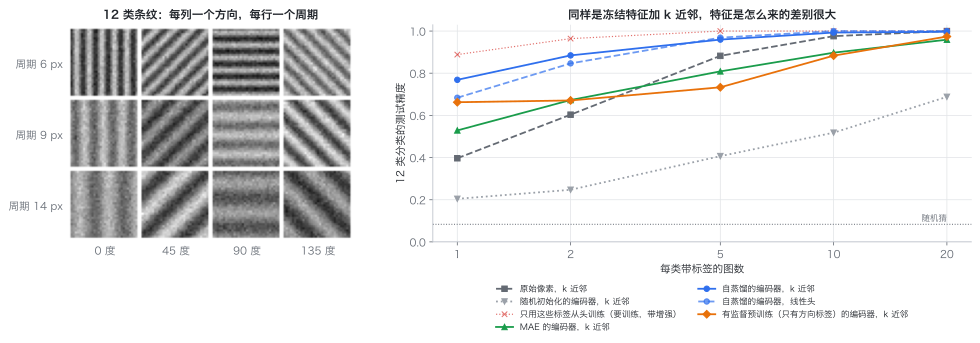
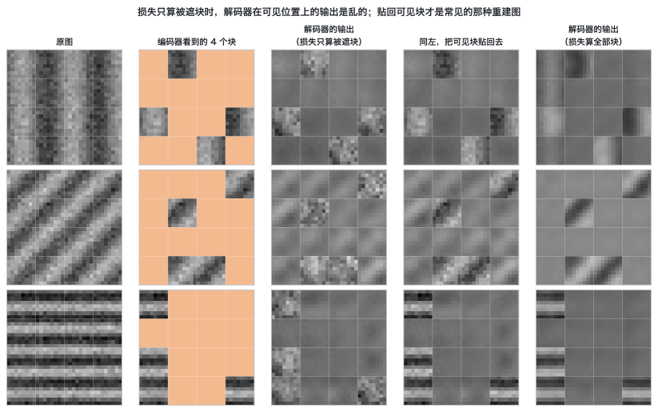
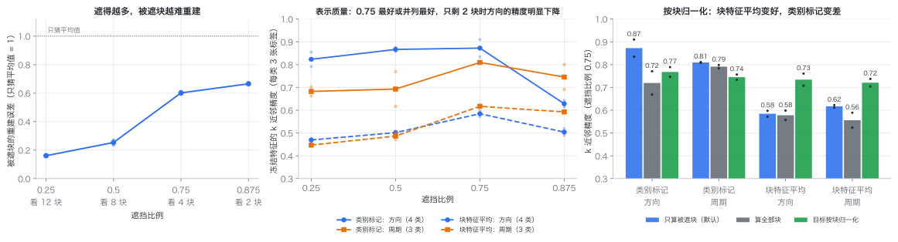
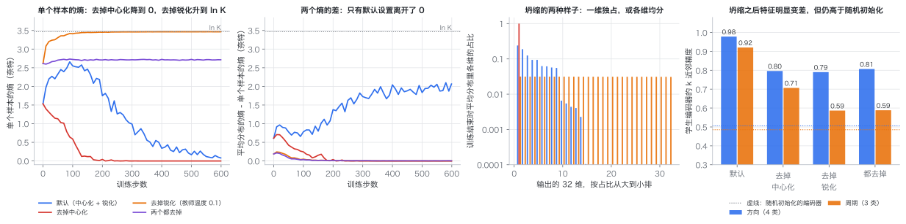
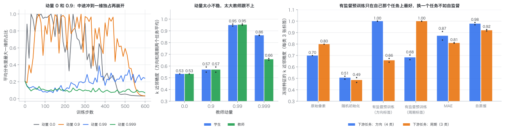
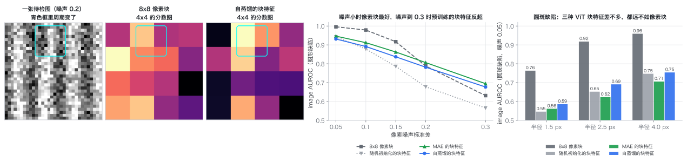

# 教程：自监督基础模型，MAE 与 DINOv2

> [!NOTE]
> 本章所有数字都来自代码生成的 32×32 条纹小图和一个很小的 ViT 上的实测，记录在 [`figures/实测数字.json`](figures/实测数字.json)，由 `solutions` 分支的 `solutions/figures/ch26.py` 生成。随机遮挡、重建损失、教师的滑动平均、自蒸馏损失和 k 近邻分类用的是本章作业的参考实现。脚本在一台 Mac 的 CPU 上两三分钟跑完，重复运行结果相同。这个小模型的编码器只有 71296 个参数，比真正的 MAE 和 DINOv2 小好几个数量级，数据也只有 12 种条纹，结论只在所写的条件下成立；换成真实图像和大模型，数值会变，方向要自己再测一遍。讲到论文和公开数据集时，本章不引用任何没有跑过的成绩；第 6 节用预训练权重的代码没有在写课程的机器上运行过。

## 0. 本章怎么学

**应用场景**：标注很少时直接拿通用特征做分类、检索和异常检测。新产品刚上线，缺陷每类只攒得出几张图，训练不了一个像样的网络。这时常见的起点是拿一个在大量无标签图像上预训练好的 ViT，冻结它，后面只接 k 近邻或者一个线性头。第 19 章的 PatchCore 就是这样用预训练特征的，本章讲这类特征是怎么训练出来的、怎样判断它靠不靠得住。

**优先级**：P1，主线能力。前置是第 25 章（Transformer 与 ViT），本章默认你知道图像怎样切成块、位置编码和类别标记是什么。对比学习和自编码器在第 13 章 5.1、5.2 节和第 1 节讲过，线性探测和微调在第 10 章讲过，本章直接用，不重复。

| 档位 | 累计用时 | 做什么 | 做到什么算完 |
|---|---:|---|---|
| 速通 | 3 小时 | 读第 1 节、2.2 节、2.3 节、3.2 节、4.2 节、5.2 节，看懂图 1 到图 6，把第 7 节演示的五步试一遍，答完 5 道小测 | 能讲清 MAE 的损失为什么只算被遮住的块，自蒸馏去掉中心化和去掉锐化各坍缩成什么样、用哪两个量区分，有监督预训练的特征换一个任务为什么可能不如自监督的，块特征做缺陷检测时小缺陷为什么吃亏 |
| 标准 | 10 小时 | 读完全章（第 6 节只读不跑），跑 Notebook，完成作业并验收通过，做第 10 节前三个破坏实验，填实验记录 | 五项测试 PASS，实验记录里有两种坍缩各自的两个熵、冻结特征的 k 近邻和线性探测结果（写明每类几张标签）和一个失败案例 |
| 深挖 | 16 小时 | 再做其余破坏实验，按第 6 节在自己的显卡上加载 DINOv2 的预训练权重，做第 11 节的扩展（选一个） | 能在自己的图像或一个公开类别上给出带条件的结果：用的是哪个权重、类别标记还是块特征、输入多大、每类几张标签或几张良品，并说明显存峰值是怎么量的 |

> [!TIP]
> 用时超过所选档位的 1.5 倍还没做完，就把卡点写进 `学习进度.md`，先往下一章走。标准档不需要下载任何东西。深挖档要联网下载权重，网络和环境问题最容易卡住，卡超过一小时就先回到 Notebook 的小模型把结论做完。

## 1. 为什么需要：标签只有几张时，特征从哪里来

先看一个能量化的问题。数据是 32×32 的条纹小图：方向 4 种（0、45、90、135 度），周期 3 种（6、9、14 px），一共 12 类；每张图的相位随机，条纹幅度在 0.15 到 0.3、平均亮度在 0.4 到 0.6 之间随机取，像素噪声标准差 0.05。任务是 12 类分类，每类只给 1 到 20 张带标签的图，测试图 600 张，随机猜的精度是 0.083。

编码器是一个很小的 ViT：8×8 的块（一张图 16 个），宽 64，2 层，带一个类别标记。比较七种做法。前六种都不在带标签的图上训练网络，只在冻结的特征上放一个分类器；k 近邻用本章作业的 `knn_classify`，k 取 5 和带标签图数里较小的那个。

- **原始像素，k 近邻**：不用任何网络。
- **随机初始化的编码器**：网络结构相同，没有训练过。
- **有监督预训练（只有方向标签）**：编码器先在不限量的带标签新图上训练 400 步，但标签只有 4 种方向，然后冻结。这相当于第 10 章“有监督预训练再迁移”，只是预训练的任务和下游任务不完全一样。
- **MAE 的编码器**、**自蒸馏的编码器**：预训练只用无标签的图，分别训练 800 步和 600 步，第 2、3 节讲。自蒸馏的特征再多比一种分类器：**线性头**（标准化后带 L2 的最小二乘）。
- **只用这些标签从头训练**：同样的 ViT 加线性头，只在这几张带标签的图上训练 300 步，带增强（整体平移 2 px 以内、亮度加减 0.1 以内）。



| 每类带标签的图数（12 类，测试 600 张；冻结特征是 2 个预训练种子乘 2 套标签的平均） | 1 | 2 | 5 | 10 | 20 |
|---|---:|---:|---:|---:|---:|
| 原始像素，k 近邻 | 0.397 | 0.603 | 0.882 | 0.976 | 1.000 |
| 随机初始化的编码器，k 近邻 | 0.204 | 0.247 | 0.407 | 0.518 | 0.688 |
| 有监督预训练（只有方向标签），k 近邻 | 0.662 | 0.671 | 0.733 | 0.883 | 0.974 |
| MAE 的编码器，k 近邻 | 0.529 | 0.673 | 0.809 | 0.897 | 0.959 |
| 自蒸馏的编码器，k 近邻 | 0.769 | 0.885 | 0.960 | 0.993 | 0.997 |
| 自蒸馏的编码器，线性头 | 0.684 | 0.847 | 0.969 | 1.000 | 1.000 |
| 只用这些标签从头训练（要训练，带增强） | 0.888 | 0.964 | 1.000 | 1.000 | 1.000 |

读这张表的五点：

1. **同样是冻结特征加 k 近邻，特征从哪里来差别很大**。每类 1 张标签时，随机初始化的编码器是 0.204，原始像素 0.397，MAE 0.529，只用方向标签的有监督预训练 0.662，自蒸馏 0.769。没训练过的网络比原始像素还差：网络结构本身不带来好特征。
2. **有监督预训练的特征只留下了它的标签用得着的信息**。预训练只见过方向标签，下游却要同时分方向和周期。它在每类 1 张时是 0.662，加到每类 5 张也只到 0.733，自蒸馏每类 2 张就到了 0.885。4.2 节把这件事拆开量。
3. **两种自监督方法差得也不少**。MAE 的编码器配 k 近邻，每类 1 张时只有 0.529，每类 20 张才到 0.959。重建像素学到的特征和“拿来直接比相似度”之间还隔着一段，第 2 节和第 4 节会看到线性探测下它的表现好一些。
4. **标签极少时线性头不如 k 近邻**。自蒸馏的特征每类 1 张时，线性头 0.684，k 近邻 0.769；每类 5 张以上线性头才追上并略微超过。分类器怎么放也是结果的一部分，报告时要写清楚。
5. **在这组数据上，带合适增强从头训练在每一档都是最高或并列最高的**，每类 1 张就有 0.888。这个结果不能跳过：数据只有 12 种条纹，平移和亮度抖动恰好把该忽略的东西都告诉了网络，第 13 章 5.1 节得到过同样的结论。冻结特征换来的是别的东西：不用为每个新任务训练一次网络，不用知道哪些增强是对的，同一个编码器可以同时服务分类、检索和第 5 节的异常检测。本章不下“自监督一定比监督好”的结论。

所以本章要回答的问题是：这些不用标签的预训练各靠什么机制学到特征，机制在什么条件下失效，以及拿到一个现成的特征之后怎样判断它够不够用。

## 2. 掩码图像建模（MAE）

MAE 出自 He 等人 2022 年的论文 Masked Autoencoders Are Scalable Vision Learners。它的思路在第 13 章 5.2 节讲过：遮住大部分块，让网络重建被遮住的像素。那里没有训练，这一节把它做出来。

### 2.1 数据流

```text
图像 32x32 → 切成 16 个 8x8 的块，每块展平成 64 维，线性嵌入，加位置编码
          → 每张图各自随机遮住 12 个块（75%）
          → 编码器（2 层 Transformer）只处理剩下的 4 个可见块，外加一个类别标记
          → 线性层换到解码器的宽度（48 维）
          → 在被遮住的 12 个位置补上同一个可学习的“掩码标记”，按原来的顺序排好，加位置编码
          → 解码器（1 层 Transformer）处理全部 16 个块
          → 线性层输出每个块的 64 个像素
损失       → 只在被遮住的 12 个块上算均方误差
预训练完成  → 解码器丢掉，只留编码器；使用时不遮挡，16 个块全部送进编码器
```

三处设计决定了它和普通自编码器（第 13 章第 1 节）的区别：

- **编码器看不到被遮住的块，连“这里被遮住了”的占位符都看不到**。掩码标记只在解码器里出现。这样预训练时编码器的输入和使用时一样，都是真实的图像块，而且编码器的计算量随可见块的数量减少。
- **解码器很轻**。它只在预训练时用，任务是把编码器给出的表示翻译回像素。本章的小模型里解码器部分是 25360 个参数，占 MAE 全部 96656 个参数的 26.2%。
- **随机遮挡要能还原顺序**。可见块被抽出来送进编码器之后，顺序已经打乱，解码之前要把它们和掩码标记放回各自原来的位置。做法是给每个块一个随机数，按随机数排序：最小的若干个保留，其余遮住；再记下“每个块排第几”，这就是还原下标。这是作业的第一个函数 `random_masking`，最容易错的也是这一步，见第 9 节。

损失写成公式：记 $\mathcal{M}$ 是一个批里所有被遮住的块，$x_i$ 是第 $i$ 个块的 $P$ 个真实像素，$\hat{x}_i$ 是解码器的预测，

$$
\mathcal{L}_{\text{MAE}} = \frac{1}{\lvert \mathcal{M} \rvert} \sum_{i \in \mathcal{M}} \frac{1}{P} \lVert \hat{x}_i - x_i \rVert^2
$$

论文里还有一个可选项：先把每个块的真实像素各自减去均值、除以标准差，再当作目标（官方实现里叫 `norm_pix_loss`）。2.4 节测它。

### 2.2 损失只算被遮住的块：可见位置上的输出不受约束

损失只统计被遮住的块，意味着解码器在可见位置上输出什么都不会被惩罚。这带来一个第一次看重建图时容易吓一跳的现象。

遮挡比例 0.75，训练 800 步，2 个种子。重建误差在 1000 张新图上量，单位是“每个像素都预测成全体像素的平均值”时的误差的倍数：1 表示和只猜平均值一样，0 表示完全重建。



| 损失算在哪些块上（遮挡 0.75，800 步，2 个种子） | 被遮块的重建误差 | 可见块位置上的输出误差 |
|---|---:|---:|
| 只算被遮住的块（MAE 的做法） | 0.602 | 1.373 |
| 算全部块 | 0.629 | 0.078 |

1. **损失只算被遮块时，解码器在可见位置上的输出比“只猜平均值”还差**（1.373，大于 1）。图 2 第三列里，正好是编码器看过的那 4 个块最乱。这不是程序错了，是没有任何损失项要求这些位置对。论文和各种教程里的重建图，都是第四列那样把可见块贴回去之后的样子。
2. **两种算法在被遮块上的重建误差几乎一样**（0.602 对 0.629）。把可见块也算进损失，只是让网络多学会了“把看到的东西原样抄出来”（0.078），对补全被遮住的部分没有帮助。
3. **被遮块的误差还有 0.6**，图 2 里重建出来的条纹明显比原图淡。只看 4 个块、训练 800 步的小模型做不到更好；像素噪声本身也是重建不出来的。这一点提醒你：MAE 的目的不是把图补得多漂亮，而是借这个任务训练编码器。表示学得怎样要另外量，见 2.3 节。

至于表示质量，MAE 的论文说在全部块上算损失会让精度略有下降。本章的小实验没有得到一致的方向：类别标记的 k 近邻精度（每类 3 张标签，评价方式见第 4 节）在方向上是 0.872 对 0.720，只算被遮块的更好，但两个种子分别是 0.910、0.835 和 0.668、0.771，波动不小；周期上是 0.810 对 0.791，几乎一样；换成线性探测，周期上反而是算全部块的更高（0.876 对 0.829）。两个种子的小模型分辨不出零点几个百分点量级的差别，这一条以论文为准。

<!-- quiz -->
**一个训练好的 MAE，损失只算被遮住的块。把解码器的原始输出直接画出来，不贴回可见块。编码器看过的那几个块的位置上会是什么样？**

- A. 和原图几乎一样，因为编码器看过它们，照抄最容易
- B. 比被遮住的位置重建得好一些，但有点模糊
- C. 很乱，误差比每个像素都猜成平均值还大

<details markdown="1"><summary>答案与解释</summary>

**C**。实测可见位置上的输出误差是“只猜平均值”的 1.373 倍，被遮块是 0.602 倍。损失不统计可见块，解码器在这些位置上输出什么都不受惩罚。把损失改成算全部块，这个数才降到 0.078，而被遮块的误差几乎不变（0.629）。A 是对“损失算在全部块上”的直觉。

</details>
<!-- /quiz -->

### 2.3 遮挡比例：重建越来越难，表示不是越来越差

把遮挡比例从 0.25 扫到 0.875，其余不变（800 步，2 个种子）。表示质量这样量：冻结编码器，每个“方向 × 周期”组合给 3 张带标签的图（共 36 张），在 600 张测试图上分别做方向 4 类和周期 3 类的分类。



| 遮挡比例（16 个块，800 步，2 个种子） | 0.25 | 0.5 | 0.75 | 0.875 |
|---|---:|---:|---:|---:|
| 编码器处理的块数 | 12 | 8 | 4 | 2 |
| 被遮块的重建误差（只猜平均值为 1） | 0.161 | 0.253 | 0.602 | 0.665 |
| 类别标记，k 近邻：方向 | 0.823 | 0.867 | 0.872 | 0.628 |
| 类别标记，k 近邻：周期 | 0.682 | 0.693 | 0.810 | 0.745 |
| 类别标记，线性探测：方向 | 0.875 | 0.871 | 0.881 | 0.825 |
| 类别标记，线性探测：周期 | 0.807 | 0.802 | 0.829 | 0.838 |
| 块特征平均，k 近邻：方向 | 0.470 | 0.502 | 0.585 | 0.504 |
| 块特征平均，k 近邻：周期 | 0.447 | 0.487 | 0.617 | 0.593 |

1. **遮得越多，被遮块越难重建**，误差从 0.161 升到 0.665。这符合直觉。
2. **重建得最好的那一档，表示不是最好的**。遮挡 0.25 时重建误差最低，但类别标记的 k 近邻在周期上只有 0.682，遮挡 0.75 时是 0.810；块特征平均在两个任务上也都是 0.75 最高。只遮四分之一时，被遮住的块几乎总有紧挨着的可见块，从邻居把条纹延伸过来就能补得不错，不必弄清整张图是哪一种条纹。这个解释和第 13 章“重建好不等于表示好”是同一件事，但本章没有单独验证这条因果。
3. **遮得太多也不行**。遮挡 0.875 时编码器只看 2 个块，方向的 k 近邻掉到 0.628。
4. **用线性探测看，四档几乎没有差别**（方向 0.825 到 0.881，周期 0.802 到 0.838）。k 近邻对特征空间的几何更挑剔，线性探测只要求类别线性可分。两种评价给出的结论强弱不同，这是第 4 节的话题。
5. **种子之间的波动不小**。遮挡 0.5、类别标记、周期这一格，两个种子分别是 0.617 和 0.769。所以这里只说：用 k 近邻看，0.75 在图 3 中栏的四条曲线上都是最高的一档；不说它比 0.5 好多少。

MAE 论文默认的遮挡比例是 0.75，本章的小实验和它不矛盾，但 16 个块的条纹和 ImageNet 的照片差得太远，不能当作对论文结论的验证。

**编码器只看可见块，省了多少计算？** 第 13 章 5.2 节按自注意力的计算量和块数的平方成正比，算出遮挡 0.75 时编码器的注意力降到十六分之一。本章的 16 个块遮掉 12 个，按同样的算法是 0.062。实测每步训练的耗时（前向加反向加参数更新，批大小 32）却是：

| 遮挡比例 | 0（不遮挡） | 0.25 | 0.5 | 0.75 | 0.875 |
|---|---:|---:|---:|---:|---:|
| 每步耗时（毫秒） | 8.2 | 7.6 | 6.8 | 7.0 | 6.2 |
| 相对不遮挡 | 1.0 | 0.93 | 0.83 | 0.86 | 0.76 |

这是在一台 Mac 的 CPU 上（2 个线程，同时还有别的程序在跑）测的一次结果，只看量级。遮挡 0.75 只省了一成多，远不是十六分之一。可以想到的原因有三个，本章没有逐项验证：解码器不管遮多少都要处理全部 16 个块；16 个块的注意力矩阵太小，耗时可能主要花在和块数无关的开销上；线性层的计算量和块数只是一次方的关系。“降到十六分之一”说的只是编码器里注意力那一项，它在块数成百上千的大模型上占多大比重，本章没有量过，也没有在任何显卡上量过。

<!-- quiz -->
**同一个小 MAE，遮挡比例分别取 0.25 和 0.75 各训练一次。0.25 那一个在被遮块上的重建误差低得多（0.161 对 0.602）。拿两个编码器的类别标记做 k 近邻分周期，哪个更好？**

- A. 0.25 的，重建得好说明编码器理解得好
- B. 0.75 的
- C. 一样，遮挡比例只影响解码器

<details markdown="1"><summary>答案与解释</summary>

**B**。实测 0.75 的是 0.810，0.25 的是 0.682。遮得少的时候，补全靠相邻的可见块就够了，重建误差低不代表编码器学到了整张图的信息。但也不是遮得越多越好：0.875 时方向的 k 近邻掉到 0.628。C 不对，遮挡决定了编码器在预训练时看到什么。

</details>
<!-- /quiz -->

### 2.4 重建目标要不要按块归一化

按块归一化的目标是

$$
\tilde{x}_i = \frac{x_i - \mu_i}{\sqrt{\sigma_i^2 + \epsilon}}
$$

其中 $\mu_i$、$\sigma_i^2$ 是第 $i$ 个块自己的像素均值和方差。它去掉了每个块的平均亮度和对比度，只留下块内的图形。只归一化目标，解码器的输出不动。

遮挡 0.75，其余不变（2 个种子，k 近邻，每类 3 张标签）：

| 重建目标 | 类别标记：方向 | 类别标记：周期 | 块特征平均：方向 | 块特征平均：周期 |
|---|---:|---:|---:|---:|
| 原始像素（上面各节的默认） | 0.872 | 0.810 | 0.585 | 0.617 |
| 按块归一化 | 0.768 | 0.745 | 0.734 | 0.721 |

在这个小模型上，按块归一化让块特征的平均明显变好（方向从 0.585 到 0.734，周期从 0.617 到 0.721，图 3 右栏里两个种子都在同一侧），类别标记却变差了（0.872 到 0.768，0.810 到 0.745）。MAE 的论文报告的是归一化的目标能提高表示质量。本章的结果只能说：这个选项会改变特征，而且对不同的取法影响的方向可以不同，原因本章没有验证。用别人预训练好的权重时，这个选项已经定了；自己预训练时，它是一个要在下游任务上验证的开关，不是白拿的提升。

这一节顺带说明了一件事：**从 ViT 里取特征有两种常见的取法，类别标记和块特征的平均，它们可以差很多**。上表默认设置下，同一个编码器在方向上是 0.872 对 0.585。真模型该取哪一种以各自的论文和模型卡为准，自己的数据上最好两种都试。

## 3. 自蒸馏（DINO）

DINO 出自 Caron 等人 2021 年的论文 Emerging Properties in Self-Supervised Vision Transformers。第 13 章 5.1 节的对比学习靠负样本撑开表示：把同一张图的两个视图拉近，同时把别的图推开；如果所有向量都挤到一起，损失会停在一个不低的值上。自蒸馏没有负样本，只有“让两个视图的输出一致”这一条要求。光有这一条，最省事的解是不管输入是什么都输出同一个东西。这一节讲 DINO 靠什么避开这个解，并把避不开时的样子量出来。

### 3.1 两个网络，一个损失

学生和教师是结构相同的两个网络（编码器加投影头），输出都是 $K$ 维的打分。同一张图做两次增强得到 $x_1$、$x_2$。教师看一个视图，给出目标分布；学生看另一个视图，去拟合它：

$$
q = \operatorname{softmax}\left(\frac{g_{t}(x_1) - c}{\tau_t}\right),\qquad
p = \operatorname{softmax}\left(\frac{g_{s}(x_2)}{\tau_s}\right),\qquad
\mathcal{L} = -\sum_{k=1}^{K} q_k \log p_k
$$

再把两个视图对调算一次，取平均。四个部件各管一件事：

- **教师不接收梯度**。梯度只更新学生，教师的参数 $\theta_t$ 是学生参数 $\theta_s$ 的指数滑动平均：$\theta_t \leftarrow m\,\theta_t + (1-m)\,\theta_s$。$m$ 叫动量，接近 1。这是作业的 `ema_update`。
- **锐化**：教师的温度 $\tau_t$ 比学生的 $\tau_s$ 低，教师给出的目标分布比学生自己的更尖。学生被拉向更确定的输出。
- **中心化**：$c$ 是教师输出在最近若干个批上的平均（$c \leftarrow m_c\,c + (1-m_c)\,\bar{z}_t$，$\bar{z}_t$ 是当前批教师输出的平均）。从教师的输出里减掉它，就是减掉“所有样本共有的那一部分打分”，哪一维都别想靠着对谁都打高分而胜出。
- **损失是交叉熵**，不是 KL 散度。学生和教师的分布完全相同时，损失等于这个分布的熵，不是 0。

锐化和中心化的作用方向正好相反，DINO 的论文就是这样解释的：只有锐化，输出会被越拉越尖，最后所有样本都落在同一维上；只有中心化，输出会被越抹越平，最后所有样本都是均匀分布。两个一起用才停在中间。这是作业的 `dino_loss`。

本章的小实验和论文有两处不同，读数字时要记着。一是视图：论文用多裁剪（两个大的全局视图加若干小的局部视图，教师只看全局视图），本章只用两个同样大小的视图，增强是整体平移 2 px 以内、亮度加减 0.1 以内、各自的噪声。二是规模：官方实现的输出维数是 65536，教师动量从 0.996 起按余弦规律升到 1，教师温度从 0.04 起步，学生温度 0.1（这几个数出自官方仓库，以仓库为准）；本章输出 32 维，动量固定 0.99，教师温度固定 0.04，学生温度 0.1，训练 600 步。

### 3.2 两种坍缩，怎样量出来

“坍缩”指输出不再随输入变化。它有两种样子，要用两个量才能分开。对一个批里每个样本的目标分布 $q_b$：

$$
H = -\frac{1}{B}\sum_{b}\sum_{k} q_{bk}\log q_{bk},\qquad
\bar{H} = -\sum_{k} \bar{q}_k \log \bar{q}_k,\qquad \bar{q} = \frac{1}{B}\sum_b q_b
$$

$H$ 是单个样本的熵的平均，说的是每个样本的输出尖不尖。$\bar{H}$ 是平均分布的熵，说的是整个批合起来有没有把各维都用上。两者的上限都是 $\ln K$，本章 $K = 32$，$\ln 32$ 是 3.466。$\bar{H} - H$ 是输出里含有多少关于“这是哪个样本”的信息，坍缩就是它等于 0。



| 设置（输出 32 维，600 步，最后约 50 步的平均；前三行 2 个种子，最后一行 1 个） | 单个样本的熵 | 平均分布的熵 | 两者之差 | 平均分布里最大的一维 | 训练结束时的损失 | k 近邻：方向 / 周期 |
|---|---:|---:|---:|---:|---:|---:|
| 默认（中心化加锐化） | 0.117 | 2.093 | 1.976 | 0.245 | 0.183 | 0.978 / 0.920 |
| 去掉中心化 | 0.000 | 0.096 | 0.096 | 0.975 | 0.002 | 0.796 / 0.707 |
| 去掉锐化（教师温度调到 0.1） | 3.462 | 3.466 | 0.003 | 0.032 | 3.463 | 0.790 / 0.587 |
| 两个都去掉 | 2.713 | 2.718 | 0.005 | 0.191 | 2.713 | 0.807 / 0.588 |

作为参照，随机初始化的编码器的 k 近邻是 0.506 和 0.485。

1. **去掉中心化：所有样本落到同一维**。单个样本的熵是 0，平均分布里最大的一维占 0.975。两个种子里一个彻底只剩一维，另一个的平均分布的熵还有 0.192。
2. **去掉锐化：所有样本都是均匀分布**。两个熵都贴着 $\ln 32$，平均分布里最大的一维是 0.032，也就是三十二分之一。
3. **两个都去掉：既不尖也不均匀，但仍然坍缩**。两个熵都在 2.7 左右，差只有 0.005：所有样本给出同一个不尖不平的分布。所以判断坍缩不能只看熵是不是到了 0 或者 $\ln K$，要看两个熵的差。
4. **损失不能用来判断**。去掉中心化时损失降到 0.002，是四种里最低的，输出里却没有任何关于输入的信息。去掉锐化时损失停在 3.463，正好是 $\ln 32$。默认设置的损失 0.183 夹在中间，单看它分不出好坏。
5. **只看输出的方差也不够**。教师输出各维在批内的标准差，默认是 0.204，去掉中心化是 0.043，去掉锐化和两个都去掉是 0.008。去掉中心化时方差并没有到 0，各个样本的打分还有差别，但除以 0.04 的温度之后，最大的始终是同一维。
6. **坍缩的是投影头的输出，编码器的特征变差了，但没有回到随机初始化的水平**。三种坍缩的 k 近邻在 0.587 到 0.807 之间，默认是 0.920 以上，随机初始化是 0.5 左右。坍缩发生之前的那几十上百步里编码器可能已经学到了一些东西，这个解释本章没有验证。能确定的是：不能因为下游精度“还行”就认为训练没出问题，熵要单独看。

<!-- quiz -->
**自蒸馏训练时把中心化去掉，其余不变。训练结束时损失是 0.002，比正常训练的 0.183 低得多。这说明什么？**

- A. 去掉中心化之后优化更容易，模型学得更好
- B. 输出坍缩了：所有样本都落在同一维上，学生拟合一个不变的目标当然容易
- C. 学习率太大，应该调小

<details markdown="1"><summary>答案与解释</summary>

**B**。实测单个样本的熵是 0，平均分布里最大的一维占 0.975，学生编码器的 k 近邻从 0.978 和 0.920 掉到 0.796 和 0.707。交叉熵的下限是目标分布的熵，目标变成同一个独热向量之后，损失可以一直降到 0。损失最低的那一组是坏掉的一组，这和第 13 章对比学习里“损失最低的设置精度最差”是同一类现象。

</details>
<!-- /quiz -->

### 3.3 教师温度要比学生低多少

锐化不是开和关两个状态，是教师温度相对学生温度有多低。学生温度固定 0.1，中心化开着，只改教师温度（600 步；0.04 和 0.1 是 2 个种子的平均，0.02 和 0.07 只跑了 1 个种子）：

| 教师温度 | 0.02 | 0.04 | 0.07 | 0.1 |
|---|---:|---:|---:|---:|
| 单个样本的熵 | 0.004 | 0.117 | 2.844 | 3.462 |
| 平均分布的熵 | 2.165 | 2.093 | 3.349 | 3.466 |
| 学生的 k 近邻：方向 | 0.973 | 0.978 | 0.953 | 0.790 |
| 学生的 k 近邻：周期 | 0.876 | 0.920 | 0.812 | 0.587 |

读这张表要小心一点：每一列的熵是在那一列自己的教师温度下算的，温度高本身就会把同一组打分读得更平，所以不同列的熵不能直接比大小，要看的是同一列里两个熵的差（第 7 节演示的第五步专门演示这件事）。教师温度 0.07 时两个熵还相差 0.5 左右，输出里仍然有关于输入的信息，但周期的 k 近邻已经从 0.920 掉到 0.812；升到和学生相等的 0.1，两个熵几乎相等，就是 3.2 节的均匀坍缩。往低处走，0.02 时每个样本的目标几乎是独热的（熵 0.004），精度和 0.04 差不多或略低。在这个小实验里，教师温度是学生的四成（0.04 对 0.1）时正常，到七成精度已经下降。0.02 和 0.07 两列各只有 1 个种子，这里只说方向。真模型用的数值以官方实现为准。

### 3.4 教师的动量

动量 $m$ 决定教师跟学生跟得多紧。滑动平均大致相当于对最近 $1/(1-m)$ 步的学生取平均：0.9 是 10 步，0.99 是 100 步，0.999 是 1000 步。只改动量，其余同默认设置（600 步；动量 0 只跑了 1 个种子，其余 2 个）：



| 教师动量 | 0 | 0.9 | 0.99 | 0.999 |
|---|---:|---:|---:|---:|
| 训练过程中平均分布里最大一维的峰值 | 1.000 | 1.000 | 0.394 | 0.234 |
| 训练结束时的损失 | 4.286 | 7.309 | 0.183 | 2.934 |
| 学生的 k 近邻（方向和周期平均） | 0.533 | 0.570 | 0.949 | 0.862 |
| 教师的 k 近邻（方向和周期平均） | 0.533 | 0.570 | 0.953 | 0.658 |
| 训练结束时教师里初始权重还剩的比例 | 0 | 3.5e-28 | 0.0024 | 0.55 |

1. **动量太小，有中心化和锐化也照样出事**。动量 0 就是教师每一步都直接等于学生。图 5 左栏里，它和动量 0.9 都在训练中途冲到一维独占（峰值 1.000），后来又散成均匀分布，最后的 k 近邻只有 0.533 和 0.570，和随机初始化的 0.5 左右差不多。一种解释是教师跟得太紧时，学生在追一个每一步都在变的目标，按 0.9 的动量更新的中心来不及跟上；这个解释本章没有验证。
2. **损失比 $\ln K$ 还高是一个信号**。动量 0 和 0.9 结束时的损失是 4.286 和 7.309，都超过了 $\ln 32$ 的 3.466。学生输出均匀分布时损失正好是 $\ln K$，比它还高说明在教师看重的那些维上，学生给的概率比均匀分布还低，两个网络对不上。
3. **动量太大，教师跟不上**。0.999 时训练结束，教师里还有 0.55 是初始化时的随机权重。学生的 k 近邻有 0.862，教师只有 0.658。训练只有 600 步，对 0.999 来说太短了。
4. **动量合适时教师和学生差不多**（0.99 时 0.953 对 0.949）。DINO 的论文报告教师在训练过程中一直比学生好，最后用的也是教师；本章 600 步的小实验里看不出这个差别。

动量该取多少和训练总步数有关：要让 $1/(1-m)$ 远小于总步数，又远大于 1。官方实现让动量随训练逐渐升到 1，就是在训练早期让教师跟得上，后期让它稳下来。

### 3.5 DINOv2 在此基础上加了什么

DINOv2 出自 Oquab 等人 2023 年的论文 DINOv2: Learning Robust Visual Features without Supervision。它没有换思路，是把已有的几样东西合在一起并做到了很大的规模。下面只列本章确定的设计要点，细节和各项的效果以论文为准：

- **图像级和块级两个自蒸馏损失一起用**。图像级的就是上面的 DINO 损失，作用在类别标记上。块级的来自 iBOT（Zhou 等，2022）：把学生输入里的一部分块遮住，让学生在这些位置上的输出去拟合教师在同一位置上的输出，教师看到的是没有遮挡的图。这是第 2 节的“遮挡”和本节的“自蒸馏”的结合：遮住一部分块，但预测的目标不是像素，而是教师给出的分布。它直接训练了块特征，第 5 节用的就是块特征。
- **中心化的做法换了**。教师输出的归一化改用 Sinkhorn-Knopp 迭代（SwAV 里的做法），代替 3.1 节那种减去滑动平均的中心。
- **加了一个让特征在批内铺开的正则项**（KoLeo），鼓励一个批里的特征彼此不要挤在一起。
- **训练快结束时提高输入分辨率**训练一小段，让块特征在高分辨率下也好用。
- **训练数据是筛选过的**。从大量未标注的网络图像里，用一批已有的精选数据集做检索，挑出相近的图，去重后得到论文里称为 LVD-142M 的数据集。这些数据以自然图像为主，和晶圆、显微图像不是一个域，这一点第 5 节会用到。
- **小模型是蒸馏出来的**。先训练最大的 ViT-g，再把它当教师蒸馏出 ViT-S、ViT-B、ViT-L。官方权重的块大小是 14 px。

后来的 Vision Transformers Need Registers（Darcet 等，2024）发现这类模型的块特征图上会出现少数范数异常大的块，在输入序列里加几个不对应任何图像位置的“寄存器”标记可以消掉它们，官方仓库因此另外提供了带寄存器的权重。做块特征的可视化和异常检测时，这两套权重的差别值得自己看一眼。

和 MAE 的定位也不同：MAE 的论文主要靠微调之后的结果说话，线性探测不是它的强项；DINOv2 的目标就是冻结之后直接能用的特征。本章图 1 里两者配 k 近邻的差距方向和这个定位一致，但一个 7 万参数的小模型说明不了真模型之间的高下。

## 4. 怎样评价一个通用特征（怎样评估）

预训练的损失不能当成结果：3.2 节里损失最低的是坍缩的那一组，2.3 节里重建误差最低的那一档表示不是最好的。评价一个准备“冻结了直接用”的特征，要在冻结的状态下测它。

### 4.1 三种评价方式

- **线性探测**：冻结编码器，在特征上训练一个线性分类器（第 10 章“特征缓存”一小节、第 13 章第 11 节）。它问的是“类别在这个特征空间里是不是线性可分”。本章用标准化后带 L2 的最小二乘。
- **k 近邻**：不训练任何东西。把带标签样本的特征当成图库，待分类的特征和它们算余弦相似度，取最相似的 k 个加权投票。这是作业的 `knn_classify`，权重是 $\exp(s/T)$，$s$ 是余弦相似度；DINO 的论文就用这种带权 k 近邻评价特征（论文取 k = 20、温度 0.07，以论文为准）。它问的是“同类的样本是不是彼此挨着”，比线性可分更苛刻，也更接近第 5 节记忆库的用法。
- **检索**：拿一张图去图库里找最像的几张，看其中同类的比例（P@5 是前 5 张）。缺陷复查时“找出历史上长得像的缺陷”就是这个用法。

### 4.2 和有监督预训练放在一起比

同一批数据、同一个编码器结构，比较六种特征。有监督预训练分两种：标签只有方向，或者只有周期；都是在不限量的带标签新图上训练 400 步，用和自蒸馏相同的增强。下游任务也分两个：分方向（4 类）和分周期（3 类）。每个“方向 × 周期”组合给 3 张带标签的图（共 36 张），测试 600 张，特征取类别标记，预训练 2 个种子、带标签的图换 2 套。检索是每张测试图在其余 599 张里找最像的 5 张。随机猜分别是 0.25 和 0.333。

| 特征（冻结，每类 3 张标签） | 方向：线性探测 | 方向：k 近邻 | 方向：P@5 | 周期：线性探测 | 周期：k 近邻 | 周期：P@5 |
|---|---:|---:|---:|---:|---:|---:|
| 原始像素 | 0.451 | 0.699 | 1.000 | 0.454 | 0.799 | 1.000 |
| 随机初始化的编码器 | 0.693 | 0.506 | 0.842 | 0.665 | 0.485 | 0.788 |
| 有监督预训练（方向标签） | 1.000 | 1.000 | 1.000 | 0.791 | 0.658 | 0.994 |
| 有监督预训练（周期标签） | 0.802 | 0.684 | 0.995 | 1.000 | 1.000 | 1.000 |
| MAE | 0.881 | 0.872 | 0.987 | 0.829 | 0.810 | 0.988 |
| 自蒸馏 | 0.971 | 0.978 | 1.000 | 0.935 | 0.920 | 1.000 |

图 5 右栏画的是这张表里 k 近邻的两列。

1. **有监督预训练只在自己那个任务上最好**。用方向标签预训练，分方向是 1.000；拿同一个特征去分周期，k 近邻只有 0.658，比原始像素的 0.799 还低，也低于 MAE 的 0.810 和自蒸馏的 0.920。反过来也一样（0.684 对 0.699、0.872、0.978）。分类损失只要求把标签分开，标签用不上的信息没有理由留在特征里。自监督预训练不知道下游要什么，两种因素都留着。
2. **这不等于“有监督预训练不好”**。把两种标签都用上（12 类）做有监督预训练，方向和周期的线性探测、k 近邻全部是 1.000，比两种自监督都高。有监督预训练好不好，取决于它的标签覆盖了多少下游需要的信息。这个小实验故意把标签取得很窄；ImageNet 有上千个类别，学到的特征宽得多，第 10 章的实测里它迁移到和自然照片一点都不像的缺陷小图上是有用的。真正的风险是你不知道预训练的标签漏掉了什么。
3. **线性探测和 k 近邻可以给出相反的排序**。原始像素的线性探测只有 0.451 和 0.454，k 近邻却有 0.699 和 0.799；随机初始化的编码器正好反过来，线性探测 0.693 和 0.665，k 近邻 0.506 和 0.485。原始像素上线性分类器不行，原因和第 13 章 5.1 节说的一样：相位随机，每一类的平均图都是一片灰；但图库里只要有相位接近的同类图，k 近邻就找得到。只报一种评价会漏掉这类差别，所以两种都要看。
4. **检索指标在图库够密时会饱和**。原始像素的 P@5 是 1.000；用方向标签预训练的特征去检索周期，P@5 也有 0.994，而它在同一个任务上的 k 近邻只有 0.658。区别在图库：检索的图库是 599 张测试图，每个方向、每种周期都有一两百张，几乎总能找到一张相位都差不多的同类图；k 近邻的图库只有 36 张带标签的图。报检索结果时要写清图库多大、每类多少张，否则数字没法比。
5. **取哪个标记、取学生还是教师，也要写**。自蒸馏的块特征平均在方向和周期上的 k 近邻是 0.891 和 0.728，类别标记是 0.978 和 0.920；教师和学生几乎一样（0.979 和 0.927）。

<!-- quiz -->
**一个编码器用“方向”标签做了充分的有监督预训练，分方向的精度是 1.000。把它冻结，每类给 3 张带标签的图，用 k 近邻去分“周期”。结果和直接在原始像素上做 k 近邻比，哪个高？**

- A. 预训练的特征高得多，预训练总比不预训练好
- B. 差不多
- C. 原始像素更高

<details markdown="1"><summary>答案与解释</summary>

**C**。实测预训练特征是 0.658，原始像素是 0.799，自蒸馏的特征是 0.920。方向的标签用不上周期的信息，分类损失没有理由把它留在特征里。如果预训练时两种标签都用上，这个数是 1.000。所以问题不在“有监督”，而在预训练的标签有没有覆盖下游需要的信息。

</details>
<!-- /quiz -->

### 4.3 怎么报告

- 用的是哪个权重，取的是类别标记还是块特征的平均，取学生还是教师，输入多大、怎样预处理。
- 用的是哪种评价：线性探测要写分类器和正则，k 近邻要写 k 和温度，检索要写图库的大小和每类张数。
- 每类多少张带标签的图。图 1 里同一个特征，每类 1 张和每类 20 张能相差二十到四十多个点。
- 几个预训练种子、几套带标签的图，种子之间差多少。本章每个设置只有 2 个种子，2.3 节里同一格两个种子能差 0.15。
- 至少放两个参照：原始像素，和随机初始化的同一个网络。没有它们，看不出预训练到底带来了多少。
- 和有监督的做法比时，写清它用的是什么标签；和“从头训练”比时，给它用上同样的增强（第 13 章第 11 节）。

## 5. 工业检测：冻结的通用特征怎么用，限制在哪

### 5.1 三种常见的用法，以及和 PatchCore 的关系

缺陷样本少的时候，冻结的通用特征有三种直接的用法：

- **少样本分类**。缺陷复查里每类只有几张图：取类别标记，配 k 近邻或者一个线性头。这就是第 10 章“只训练分类头”加特征缓存的做法，只是骨干换了。先用 k 近邻，每类攒到十张以上再试线性头（图 1）。
- **检索**。拿一张新缺陷去历史库里找相似的，帮人判断是不是见过的类型。
- **只有良品时做异常检测**。把良品的块特征存进记忆库，待检图的每个块到记忆库的最近邻距离就是它的异常分数。

第三种就是第 19 章的 PatchCore，只是换了骨干。对照第 19 章第 3 节的五个环节：

| PatchCore 的环节（第 19 章） | 骨干换成自监督的 ViT 之后 |
|---|---|
| 预训练 CNN 的中间层特征（3.1 节） | ViT 的块特征，每个块一个向量 |
| 3×3 邻域平均做局部聚合（3.2 节） | 自注意力已经让每个块看过全图；还要不要再做邻域平均，要自己测 |
| 特征图是输入的八分之一或十六分之一 | 特征图每边是输入边长除以块的大小 |
| 记忆库、核心集采样、最近邻打分、上采样成热图（3.3 到 3.6 节） | 不变 |
| 指标和阈值（第 5 节） | 不变 |

所以第 19 章关于核心集、良品库污染、对齐、指标的结论，换了骨干之后仍然是要逐条检查的事项，不会因为特征更“通用”就自动消失。公开文献里已经有直接用 DINOv2 的块特征加最近邻做少样本异常检测的工作（例如 AnomalyDINO），做法和这里说的一致，细节以论文为准。

### 5.2 实验：冻结的块特征加最近邻

用本章的小模型把这件事做一遍，流程尽量和第 19 章对上：打分直接调用第 19 章作业的 `knn_scores`（k = 1），image AUROC 用第 19 章作业的 `auroc`。

- 良品是同一种条纹：方向 0 度、周期 9 px，相位、幅度、亮度随机。20 张良品，每张 16 个块，记忆库一共 320 个块特征，不做核心集采样。
- 待检图 200 张，一半有缺陷。每个块的分数是它到记忆库的最近邻距离，整图分数取 16 个块的最大值。
- 比较四种块特征：8×8 的像素块直接展平（64 维，不用网络）；随机初始化的编码器的块特征；MAE 和自蒸馏的编码器的块特征。后两个是在第 1 节那 12 类条纹上预训练的，没见过任何缺陷。
- 每个数是 3 套数据的平均，ViT 的三种特征再对 2 个预训练种子取平均。

和第 19 章的设置有几处不同：这里的块是不重叠的 8×8，第 19 章是 4×4、步长 2 再做邻域平均；图是 32×32，不是 64×64；没有核心集，也没有去掉最外一圈。所以两章的数字不能直接比，能比的是做法。

缺陷有两种。**圆斑**和第 19 章相同：一个圆形区域整体加亮或减暗 0.2，像素噪声 0.05。**图形缺陷**是一个 10×10 px 的方块里条纹的周期从 9 px 变成 6 px，幅度和亮度不变：灰度的统计量没有变，变的是图形。



| 圆斑缺陷，像素噪声 0.05（20 张良品，200 张待检图） | 半径 1.5 px | 半径 2.5 px | 半径 4 px |
|---|---:|---:|---:|
| 缺陷面积占一个 8×8 块的比例 | 11.0% | 30.7% | 78.5% |
| 8×8 像素块 | 0.763 | 0.918 | 0.959 |
| 随机初始化的块特征 | 0.546 | 0.652 | 0.747 |
| MAE 的块特征 | 0.561 | 0.623 | 0.706 |
| 自蒸馏的块特征 | 0.586 | 0.691 | 0.754 |

| 图形缺陷（10×10 px 的方块），像素噪声 | 0.05 | 0.1 | 0.15 | 0.2 | 0.3 |
|---|---:|---:|---:|---:|---:|
| 8×8 像素块 | 0.996 | 0.979 | 0.917 | 0.788 | 0.631 |
| 随机初始化的块特征 | 0.943 | 0.878 | 0.786 | 0.678 | 0.566 |
| MAE 的块特征 | 0.946 | 0.912 | 0.862 | 0.806 | 0.694 |
| 自蒸馏的块特征 | 0.931 | 0.891 | 0.837 | 0.782 | 0.677 |

1. **圆斑缺陷上，三种 ViT 的块特征都远不如直接用像素块**，而且预训练过的并不比随机初始化的好（半径 2.5 px 时 0.623、0.691 对 0.652，像素块是 0.918）。连没训练过的编码器也这样，说明问题不全在预训练学了什么。可能的原因有两个：块特征经过两层自注意力，每个块的向量里混进了其他块的信息，局部的亮度变化被冲淡；自蒸馏的增强里还特意加了亮度抖动，要求特征忽略亮度，而圆斑改的恰好是局部亮度。这两条本章都没有单独验证，能确定的只是现象：三种半径下都是这样。
2. **缺陷比一个块小得多时，谁都不行**。半径 1.5 px 的圆斑只占一个块面积的 11.0%，ViT 的三种特征是 0.546 到 0.586，接近随机的 0.5；像素块也只有 0.763。
3. **图形缺陷、噪声小的时候，像素块仍然最好**（0.996），预训练的块特征是 0.946 和 0.931，和随机初始化的 0.943 没有区别。条纹很干净时，直接比像素就够了。
4. **噪声变大之后，预训练的块特征掉得最慢**。像素噪声 0.2 时，像素块 0.788，MAE 0.806，自蒸馏 0.782，随机初始化 0.678；到 0.3 时是 0.631、0.694、0.677、0.566，两种预训练的特征都超过了像素块。预训练学到的是“从带噪声的像素里读出这是哪一种条纹”，噪声大到像素之间的距离不可靠时，这个能力才显出价值。预训练时的噪声只有 0.05。
5. **良品多了，学到的特征还能继续涨，像素块不涨**。图形缺陷、噪声 0.2，良品从 5 张加到 20 张再到 80 张：像素块是 0.755、0.788、0.780，MAE 的块特征是 0.726、0.806、0.831，自蒸馏是 0.687、0.782、0.796。
6. **缺陷区域越大越容易**。图形缺陷、噪声 0.05，方块边长取 6、10、16 px：像素块 0.954、0.996、1.000，自蒸馏的块特征 0.832、0.931、0.970。

把这几条放在一起，结论是朴素的：**先放一个最简单的基线（像素块，或者第 18 章的金模板），再看学到的特征比它多带来了什么**。在这组实验里，学到的特征只在噪声大、缺陷是图形变化的时候占优。真实的工业图像纹理复杂得多，像素块多半不够用（第 19 章 3.7 节也是这样说的），但这要靠基线测出来，不能默认。

<!-- quiz -->
**良品是干净的条纹（像素噪声 0.05），缺陷是一个 10×10 px 的方块里条纹周期变了。把 20 张良品的块特征放进记忆库做最近邻打分。8×8 的原始像素块和自蒸馏预训练的块特征，哪个的 image AUROC 高？**

- A. 自蒸馏的块特征，学到的特征总比原始像素好
- B. 原始像素块
- C. 一样

<details markdown="1"><summary>答案与解释</summary>

**B**。实测像素块 0.996，自蒸馏的块特征 0.931，而随机初始化、没训练过的编码器的块特征也有 0.943。图像干净时直接比像素就很准，编码器反而丢了一些细节。噪声加到 0.3 之后才反过来：像素块 0.631，自蒸馏 0.677，MAE 0.694。所以上学到的特征之前，先放一个像素级的基线。

</details>
<!-- /quiz -->

### 5.3 用块特征做检测和粗分割的限制

**域差异**。通用特征的“通用”是相对它的预训练数据说的。同样是图形缺陷、噪声 0.2，把良品换成预训练没见过的条纹（预训练只见过 0、45、90、135 度和 6、9、14 px 三种周期）：

| 良品的纹理（图形缺陷，噪声 0.2） | 8×8 像素块 | 随机初始化 | MAE | 自蒸馏 |
|---|---:|---:|---:|---:|
| 见过：0 度，周期 9 px | 0.788 | 0.678 | 0.806 | 0.782 |
| 没见过的周期：0 度，周期 20 px | 0.695 | 0.634 | 0.696 | 0.657 |
| 没见过的方向：22.5 度，周期 9 px | 0.814 | 0.729 | 0.829 | 0.775 |

在见过的纹理上，自蒸馏的块特征比随机初始化高出不少（0.782 对 0.678）；换成没见过的周期，这个差距缩到 0.657 对 0.634，也落到了像素块（0.695）后面。MAE 的块特征在三种纹理上都和像素块持平或略高，但它相对随机初始化的优势同样是在没见过的周期上最小（0.696 对 0.634）。DINOv2 的预训练数据是自然图像，晶圆的明场、暗场图像和电镜图像离它有多远，要像这样用自己的数据测：和像素级的基线比，和第 19 章用的 ImageNet 预训练 CNN 比。差距大到通用特征不够用时，才考虑在自己的无标签图像上继续做自监督预训练，那是另一个量级的工作。

**分辨率**。块特征的网格很粗。DINOv2 的块是 14 px，一个块特征对应输入上 196 个像素；输入 224 px 时每边只有 16 个块，一共 256 个。想把网格加密一倍，输入要放大到 448 px，块数变成 1024 个，自注意力的计算量是原来的 16 倍。大图通常切成小块分别送进去（第 19 章 4.3 节的第 1 条），或者只在传统方法给出的候选区域上提特征。

**小缺陷**。上面的表已经量过：缺陷只占一个块的 11.0% 时，块特征基本看不见它。几个像素大的缺陷，要么把图放大到让它占满一个块以上，要么交给第 18 章的像素级比对，通用特征只用来给候选做分类。

**对齐**。第 19 章 4.1 节的结论是记忆库方法同样怕半个像素的错位，办法是先对齐、再让良品库覆盖对齐的残差。不重叠的块对平移同样不是不变的，本章没有在 ViT 的块特征上重做这组实验，换骨干之后这一条要自己测一遍。

**粗分割**。把块的分数图插值回原图大小就是一张热图（按块的中心对齐，第 19 章 3.6 节）。它能指出缺陷在哪个块附近：图形缺陷、噪声 0.2 时，分数最高的块碰到缺陷的比例，像素块是 0.753，MAE 是 0.763，自蒸馏是 0.795。但它的分辨率就是块的大小，图 6 的分数图只有 4×4，画不出缺陷的轮廓。要精确的面积和边界，得在热图圈出的区域里再用像素级的方法，或者用第 27 章（可提示分割 SAM）那一类模型细化。

具体到某条产线、某类设备上用哪个骨干、多大的输入、怎样切图，课程里没有依据，以公司和设备的资料为准。

## 6. 在自己的机器上用真模型

> [!WARNING]
> 这一节的代码没有在写课程的机器上运行过，库的接口可能已经变化，以官方文档为准。写课程的机器没有下载过任何预训练权重，所以这一节没有任何实测数字：显存占用、耗时、精度都要你自己量。真模型的参数量和权重文件大小以模型卡为准。

### 6.1 取得权重：两条路

本章的作业、验收和 Notebook 的必做部分不需要额外的包。用预训练权重有两条路，任选其一。环境安装见 `docs/环境安装.md`。

**用 `torch.hub`**。不需要装新的包，第一次运行会联网下载官方仓库 `facebookresearch/dinov2` 的代码和权重，存在用户目录下 `.cache` 里的 `torch` 文件夹中（可以用环境变量 `TORCH_HOME` 改位置）。

```python
import torch

device = torch.device("cuda" if torch.cuda.is_available() else "cpu")
model = torch.hub.load("facebookresearch/dinov2", "dinov2_vits14")   # 最小的一个；还有 vitb14、vitl14、vitg14
model = model.to(device).eval()

# x: (B, 3, H, W)，H 和 W 都是 14 的倍数，已经按 ImageNet 的均值和标准差归一化
with torch.inference_mode():
    out = model.forward_features(x.to(device))
cls = out["x_norm_clstoken"]            # (B, D)，类别标记
patches = out["x_norm_patchtokens"]     # (B, H/14 * W/14, D)，块特征
```

带寄存器的权重在名字后面加 `_reg`（例如 `dinov2_vits14_reg`）。加载时可能会看到 xFormers 不可用的警告，一般不影响结果，以仓库的说明为准。

**用 Hugging Face `transformers`**。要先 `pip install transformers`，第一次运行同样要联网下载权重（缓存位置可以用环境变量 `HF_HOME` 改）。

```python
import torch
from transformers import AutoImageProcessor, AutoModel

device = torch.device("cuda" if torch.cuda.is_available() else "cpu")
processor = AutoImageProcessor.from_pretrained("facebook/dinov2-small")
model = AutoModel.from_pretrained("facebook/dinov2-small").to(device).eval()

inputs = processor(images=pil_images, return_tensors="pt").to(device)   # pil_images: 一组 RGB 的 PIL 图像
with torch.inference_mode():
    out = model(**inputs)
cls = out.last_hidden_state[:, 0]       # (B, D)
patches = out.last_hidden_state[:, 1:]  # (B, 块数, D)
```

`processor` 默认会缩放并裁剪图像，具体尺寸把它打印出来看；检测任务通常不希望被裁掉一圈，要按文档改它的参数，或者自己做预处理。带寄存器的权重在类别标记后面还有几个寄存器标记，取块特征时要跳过，个数看模型的配置。

两条路都要注意的预处理：

- 灰度图要复制成 3 通道（PIL 里 `img.convert("RGB")`）。
- 归一化用 ImageNet 的均值 (0.485, 0.456, 0.406) 和标准差 (0.229, 0.224, 0.225)，和第 10 章 10.2 节相同。预处理和预训练时不一致会掉多少，第 10 章量过。
- 输入的边长要是 14 的倍数，否则 `torch.hub` 的模型会报错或者悄悄丢掉边上的像素，以仓库的说明为准。先把块特征的形状打印出来，确认块数等于（高除以 14）乘（宽除以 14）。

拿到的两样东西和本章小模型的输出一一对应：`cls` 就是 Notebook 里 `enc(img)[:, 0]`，`patches` 就是 `enc(img)[:, 1:]`。最小的 ViT-S/14 的特征是 384 维，ViT-B/14 是 768 维，ViT-L/14 是 1024 维，ViT-g/14 是 1536 维（以模型卡为准，打印形状核对）。

### 6.2 做两件事：k 近邻和块特征的主成分图

**k 近邻**。准备两组自己的图：每类几张带标签的，和一批待分类的。各自提出 `cls`，转成 NumPy，直接交给你写的 `knn_classify`。按 4.3 节的清单报告，并且放上两个参照：原始像素（缩小后展平）的 k 近邻，和第 10 章那个 ImageNet 预训练 ResNet-18 的特征。

```python
feats = cls.float().cpu().numpy()        # 半精度下算出来的特征先转回 float32 再离开显卡
pred = mod.knn_classify(train_feats, train_labels, feats, k=5, num_classes=n_classes)
```

**块特征的主成分图**。把一批图的块特征放在一起做主成分分析，取前三个主成分当成红绿蓝三个通道，按块的网格摆回去，就是一张低分辨率的彩色图。它不用任何标签，能直接看出特征把图像分成了哪些区域。

```python
import numpy as np

b, n, d = patches.shape
side = int(round(n ** 0.5))              # 输入是正方形时，每边的块数
f = patches.float().cpu().numpy().reshape(-1, d)
f = f - f.mean(axis=0)
_, _, vt = np.linalg.svd(f, full_matrices=False)
pc = f @ vt[:3].T                        # 每个块在前三个主成分上的坐标
pc = (pc - pc.min(axis=0)) / (pc.max(axis=0) - pc.min(axis=0))
rgb = pc.reshape(b, side, side, 3)       # 用 plt.imshow(rgb[i]) 看第 i 张图
```

你应该看到什么：

- 形状对得上。输入 224×224 时块特征是 256 个；输入 518×518 时每边 37 个块，一共 1369 个。
- 按 DINOv2 的论文和官方仓库展示的结果，自然图像上同一类物体的相同部位在主成分图里颜色一致，前景和背景常常被第一个主成分分开。你的工业图像上是不是这样，正是要看的：如果良品图的主成分图乱成一片，或者只反映出照明的明暗渐变，说明域差异不小，5.3 节的限制要认真对待。
- 在良品图里放一个已知位置的缺陷，看它所在的块在主成分图上是否和周围不同，再按 5.2 节的做法用记忆库打分。缺陷小于一个块时看不出来是正常的。
- 不带寄存器的权重，主成分图或者块特征的范数图上可能有零星几个和周围毫无关系的块（3.5 节）。换成带 `_reg` 的权重对比一下。

### 6.3 在 8 GB 显存上的注意事项

确认显卡可用、看显存、批大小放不下时怎么办，通用做法在第 10 章“在自己的显卡上微调”一小节和第 13 章第 7 节，这里只补充和 ViT 提特征有关的几条。

1. **只提特征，关掉梯度**。用 `torch.inference_mode()`（或者 `torch.no_grad()`）包住前向，模型 `eval()`。不存反向传播用的中间激活，显存主要花在权重和当前这一批的激活上。
2. **先用最小的模型**。从 ViT-S/14 开始，够用就不换大的。更大的模型在 8 GB 上能不能放下、放多大的批，自己量。
3. **半精度**。`model.half()` 之后把输入也 `.half()`，或者用 `torch.autocast(device_type="cuda", dtype=torch.float16)` 包住前向，权重和激活占的显存大约减半。取出来的特征先 `.float()` 再做距离计算。
4. **分辨率是最贵的旋钮**。块数和输入的像素数成正比，自注意力的计算量和块数的平方成正比：边长加倍，块数变成 4 倍，注意力的计算量变成 16 倍。放不下时先减小批大小（提特征时批大小 1 也不影响结果），再考虑把大图切成小块分别送进去。
5. **及时把特征搬下显卡**。每一批算完就 `.float().cpu()`，不要把整个数据集的块特征留在显卡上。一张 224×224 的图就有 256 个块特征，图一多记忆库就很大，最近邻放在内存里用 NumPy 算，或者按第 19 章的做法先做核心集。
6. **量峰值而不是猜**。`torch.cuda.reset_peak_memory_stats()` 之后跑一批，再读 `torch.cuda.max_memory_allocated()`。改模型大小、分辨率、批大小、精度之前和之后各量一次。
7. **需要重新加载模型时**，先 `del model`，再 `torch.cuda.empty_cache()`。它只是把 PyTorch 预留的显存还给系统，不会让一个放不下的模型变得放得下（第 10 章说过）。

联网受限时，在能联网的机器上运行一次加载的代码，把缓存目录整个拷到笔记本的同一位置。权重的许可以官方仓库和模型卡为准。

## 7. 交互演示：自蒸馏为什么不坍缩

把样本换成单位圆上的 24 个点（分成 4 团），把网络换成 6 个“原型”：每个原型对一个样本的打分，是一个和输入无关的偏置加上两者夹角的余弦乘一个小系数。偏置就是 3.1 节说的“所有样本共有的那一部分”。学生、教师、滑动平均、中心化、温度的用法和作业的 `dino_loss`、`ema_update` 相同，熵的上限是 ln 6，也就是 1.792。按页面下方“按顺序试”的五步操作：前三步对应 3.2 节的正常训练和两种坍缩，第四步对应 3.4 节的动量，第五步对应 3.2 节的“判断坍缩要看两个熵的差”。

<!-- embed: ../demos/自蒸馏与坍缩.html 1429 -->
[打开交互演示：自蒸馏与坍缩](../demos/自蒸馏与坍缩.html)

演示里的模型只有 12 个参数，数值和上面各节的表对不上是正常的，要对上的是方向。和 3.2 节有一处不同：演示的初始状态就是坍缩的（中心从 0 开始，所有样本都落在偏置最大的那个原型上），所以看到的是“有中心化，二三十步就散开；没有中心化，一直散不开”，而不是 3.2 节那样从正常状态慢慢塌下去。其余方向一致：教师温度高过学生，两个熵一起升到上限；动量太小，分配来回跳。

## 8. 作业里的零件

作业文件是 `26-1_掩码建模与自蒸馏.py`，五个函数，只用 NumPy 和 PyTorch。每个函数的输入输出、约定和异常都写在文档字符串里，验收只检查那里写明的行为。

- `random_masking`：按传入的随机数遮挡，返回可见块、掩码和还原下标（2.1 节）。掩码里 1 表示被遮住。自己检查的办法：把可见块和一组占位向量拼起来，用还原下标取回原来的顺序，可见位置应该正好是原来的块。
- `masked_mse_loss`：只在被遮住的块上算均方误差，可选按块归一化（2.2、2.4 节）。除数是被遮住的块数，不是全部块数，也不是先逐图平均。
- `ema_update`：教师参数的指数滑动平均（3.1 节）。原地更新，不进计算图，学生不变。
- `dino_loss`：带中心化和温度的交叉熵（3.1 节）。两个可以自己核对的性质：学生的输出各维相同时，不管教师输出什么，损失都等于 $\ln K$（32 维时是 3.466）；学生的分布和教师的目标分布相同时，损失等于这个分布的熵，不是 0。
- `knn_classify`：L2 归一化、余弦相似度、取最相似的 k 个、按 $\exp(s/T)$ 加权投票（4.1 节）。

运行验收：

```text
python 26_自监督基础模型\tests\check_progress.py        （Windows）
python 26_自监督基础模型/tests/check_progress.py        （macOS、Linux）
```

Notebook `实验_自监督基础模型.ipynb` 把这些零件接到小 ViT 上：实验 1 看遮挡和还原，实验 2 训练迷你 MAE，实验 3 训练三次自蒸馏（默认、去掉中心化、去掉锐化），实验 4 用 k 近邻评价，实验 5 用你在第 19 章写的 `knn_scores` 和 `auroc` 做异常检测。为了跑得快，Notebook 的训练步数比配图脚本少，只用一个种子，数值和本章的表不会完全一样，方向应该一致。代码在有 CUDA 时会自动用显卡，但这么小的模型放到显卡上未必更快；在一台 Mac 的 CPU 上（2 个线程，同时有别的程序在跑）测的一次结果是 MAE 每步 7 毫秒左右、自蒸馏每步 14 毫秒左右，整个配图脚本训练了几十个这样的模型，用时 170 秒左右。本章没有在任何 NVIDIA 显卡上测过耗时和显存。

## 9. 常见错误

| 现象 | 原因 | 怎么查 |
|---|---|---|
| MAE 的重建图里，编码器看过的块反而最乱 | 不是错误：损失只算被遮块，可见位置上的输出不受约束（2.2 节） | 把可见块贴回去再看；或者单独量被遮块上的误差 |
| MAE 能训练，损失只比别人高一点，特征却差一截 | 还原下标用错了：返回的是排序下标本身，而不是每个块的名次，可见块被放回了错误的位置。实测这样训练，损失是 0.646（正确的是 0.602），方向的 k 近邻从 0.872 掉到 0.762，从损失曲线上几乎看不出来 | 用文档字符串里的办法把可见块和占位向量还原，可见位置应该等于原来的块 |
| MAE 的损失低得反常，被遮住的位置却重建不出来 | 掩码反了，1 和 0 的含义弄颠倒，损失其实算在可见块上。实测这样训练，显示的损失是 0.039，真正被遮住的块上误差是 1.356，k 近邻掉到 0.525 和 0.472，和随机初始化的编码器一个水平 | 小例子里手算：被遮住的应该是随机数较大的那些块；显示的损失只有别人的十几分之一时先怀疑这一条 |
| 一个批里每张图遮住的位置完全相同 | 随机数只生成了一行，或者排序时没有按行 | 打印掩码的前几行，应该各不相同 |
| 重建损失比预期小好几倍，而且随遮挡比例变化很怪 | 除数用了全部块数，或者先对每张图平均再对图平均 | 用两张图被遮块数不同的小例子手算 |
| 打开按块归一化之后损失出现 nan | 有像素完全相同的块，方差是 0，没有加 eps | 用一个常数块测，归一化后应该是 0 |
| `RuntimeError: a leaf Variable that requires grad is being used in an in-place operation` | 教师的滑动平均没有放在 `torch.no_grad()` 里 | 更新之后教师参数的 `grad_fn` 应该是 `None` |
| 学生在变好，教师的精度却一直和随机初始化差不多 | 动量对训练步数来说太大（3.4 节），或者教师根本没有被更新 | 打印教师和学生参数的差；算一下动量的“总步数”次方还剩多少 |
| 自蒸馏的损失很快降到接近 0 | 没有减中心，或者中心一直是 0 没有更新，输出坍缩到一维（3.2 节） | 记录单个样本的熵和平均分布里最大的一维 |
| 自蒸馏的损失停在 $\ln K$ | 教师温度不比学生低，或者两个温度用反了，输出坍缩成均匀分布 | 记录单个样本的熵，看是否贴着 $\ln K$ |
| 自蒸馏的损失比 $\ln K$ 还高，上下乱跳 | 教师动量太小，或者滑动平均里动量乘反了，教师几乎每一步都等于学生（3.4 节） | 看平均分布里最大一维随步数的曲线；手算一步滑动平均核对 |
| 教师的输出或者中心收到了梯度 | `dino_loss` 里教师的目标分布没有从计算图里断开 | 让教师输出和中心 `requires_grad=True` 再反传，它们的梯度应该是空的 |
| k 近邻的预测随特征的长度变，范数大的带标签样本总被选成邻居 | 特征没有做 L2 归一化，或者用了欧氏距离 | 把每个特征乘上各不相同的正数再算，预测应该不变 |
| 真模型报尺寸错误，或者块特征的个数和预期不符 | 输入边长不是 14 的倍数；带寄存器的权重没有跳过寄存器标记；`processor` 把图裁剪过 | 打印输入和块特征的形状，按 6.1 节核对 |
| 真模型在自己的图上 k 近邻还不如原始像素 | 预处理不对（没归一化、灰度图没转 3 通道、通道顺序），或者域差异确实太大 | 先在几张自然照片上确认流程是对的，再换自己的图 |
| 提特征时显存不够 | 没关梯度；分辨率太大；把所有特征留在了显卡上 | 按 6.3 节的顺序逐项排查，每一步都量峰值 |

## 10. 破坏实验

每个实验先写下预测，再运行，把结果和原因记到 `实验记录.md`。前三个是标准档必做。

1. Notebook 实验 2 里给 `train_mae` 传 `loss_all=True` 重新训练。先预测“解码器的原始输出”那一行在可见块上会变成什么样，被遮块上的损失会不会明显变化，再运行。对照图 2 和 2.2 节的表。
2. Notebook 实验 3 里把教师动量改成 0 和 0.9 各训练一次（`train_dino(momentum=0.0)`）。先预测两条熵的曲线各自的走向，再运行，接着看实验 4 里这个编码器的 k 近邻。对照图 5 和 3.4 节的表。
3. 作业通过验收之后，把你的 `dino_loss` 故意改错三次：不减中心、两个温度用反、教师的输出不断开梯度。每次先预测验收的哪一条检查会报错、报什么，再运行 `tests/check_progress.py`。然后用“不减中心”的版本跑一次 Notebook 实验 3 的默认设置，看它和“去掉中心化”那一次是不是同一种坍缩。
4. Notebook 实验 2 里把遮挡比例改成 0.25 和 0.875 各训练一次，比较最后的损失和实验 4 的 k 近邻。哪个损失最低，哪个 k 近邻最好？对照图 3。
5. Notebook 实验 5 里把 `NOISE_AD` 从 0.2 改成 0.05 和 0.3，再把缺陷方块的边长从 10 改成 6。先预测每种情况下原始像素块和自蒸馏的块特征谁高，再运行。对照图 6 和 5.2 节的表。
6. 把你的 `knn_classify` 里的 L2 归一化去掉，或者把 k 从 5 改成 1 和 20，重跑 Notebook 实验 4。带标签的图只有 36 张、每类 3 张时，k 取 20 会发生什么？再比较“原始像素”和“随机初始化的编码器”两行，对照 4.2 节解释它们在 k 近邻和线性探测下为什么排序相反。

## 11. 扩展（深挖档）

- **在自己的图上评价 DINOv2**。按第 6 节加载权重，准备每类 3 到 10 张带标签的图，报告类别标记的 k 近邻和线性探测，放上原始像素和 ImageNet 预训练 ResNet-18（第 10 章）两个参照，按 4.3 节的清单写清条件。
- **把第 19 章的骨干换掉**。在 MVTec AD 或 VisA 的一个类别上，先用 Anomalib 的 PatchCore 得到一个基线，再用 DINOv2 的块特征加你在第 19 章写的记忆库零件做一遍，报告 image AUROC、AUPRO 和漏检约束下的过检率（第 19 章第 5 节）。注意两者的输入分辨率和特征图大小不同，写清楚。
- **分辨率和显存**。同一张图分别用 224 和 448 的边长送进 DINOv2，量显存峰值和耗时，和“块数 4 倍、注意力 16 倍”的估算比一比；再看半精度能省多少。
- **寄存器**。分别加载带和不带寄存器的权重，画出同一张图的块特征范数图和主成分图，看有没有零星的异常块，再看它们对最近邻异常分数的影响。
- **给迷你自蒸馏加多裁剪**。在 Notebook 的 `train_dino` 里加两个只截取图像一部分的局部视图，学生看全部视图，教师只看两个全局视图。看 k 近邻有没有变化。
- **给小模型加块级的自蒸馏损失**。照 3.5 节 iBOT 的思路：用你的 `random_masking` 的掩码把学生输入的一部分块换成掩码标记，让学生在这些位置上的块输出去拟合教师在同一位置上的输出。看块特征平均的 k 近邻和第 5 节的异常检测有没有变好。
- **在自己的无标签图像上继续预训练**。只有在确认通用特征不够用、手里又有大量无标签图像时才值得做。先在 Notebook 的规模上练习：把预训练数据换成一种新的纹理，看 5.3 节域差异那张表怎么变。

## 12. 和后续章节的关系

- **第 25 章**（Transformer 与 ViT）是前置：本章的编码器就是一个很小的 ViT。
- **第 13 章** 5.1 节的对比学习靠负样本防止坍缩，坍缩时损失停在一个和批大小有关的常数上；本章的自蒸馏没有负样本，靠中心化和锐化，坍缩时损失可以降到 0 或者停在 $\ln K$。5.2 节讲了 MAE 的思路，本章把它做了出来。两章的共同教训是训练损失不能当成结果。
- **第 10 章**讲有监督预训练之后怎样迁移：只训练分类头、特征缓存、微调。本章的线性探测和 k 近邻是同一套做法，只是特征换成了不用标签训练出来的。4.2 节补了一条：有监督预训练的特征好不好用，要看预训练的标签覆盖了什么。
- **第 19 章**的 PatchCore 把冻结的预训练特征用在异常检测上。本章第 5 节把骨干换成自监督的 ViT，核心集、对齐、指标和阈值仍然按第 19 章做。
- **第 18 章**的金模板和像素级比对是本章反复提到的基线，小缺陷仍然要靠它。
- **第 27 章**（可提示分割 SAM）可以接在块特征给出的粗热图后面做细化。SAM 的图像编码器本身就是用 MAE 预训练的 ViT（以 SAM 的论文为准）。
- **第 28 章**（视觉语言模型）是另一类通用特征：预训练用的是图文配对而不是纯图像，第 13 章 5.3 节讲过 CLIP 的损失。
- **第 31 章**（部署与加速）是把这类模型放到产线上之前要看的一章，本章 6.3 节只写了提特征时最基本的几条。

## 自测问题

速通档答小测，标准档把下面的问题答一遍。

1. MAE 的损失为什么只算被遮住的块？这样训练出来的解码器在可见位置上输出什么，为什么常见的重建图看不出这一点？
2. 遮挡比例从 0.25 加到 0.875，被遮块的重建误差和冻结特征的 k 近邻各怎么变？“重建误差最低”和“表示最好”为什么不是同一档？
3. 自蒸馏里教师的参数从哪里来？中心化和锐化各防止哪一种坍缩？只留一个会怎样？
4. 训练日志里只有损失一个数。损失接近 0、等于 $\ln K$、比 $\ln K$ 还高，分别最可能是什么情况？还应该记录哪两个量？
5. 教师动量取 0、0.99、0.999，训练几百步，结果各是什么样？动量该怎样和训练总步数配合？
6. 同一个特征，线性探测 0.69、k 近邻 0.51；另一个特征，线性探测 0.45、k 近邻 0.70。这两种情况各说明特征空间是什么样的？检索的 P@5 为什么可能两个都很高？
7. 把 PatchCore 的骨干换成 DINOv2 的块特征，哪些环节不用变？要重新检查哪三个限制？为什么仍然要先放一个像素级的基线？
