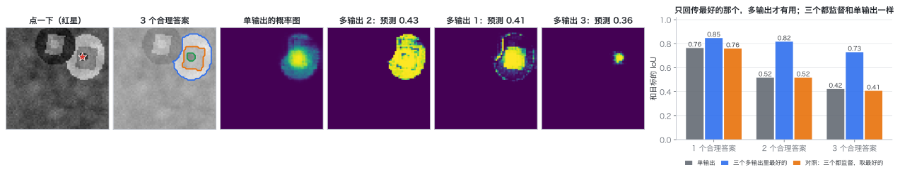
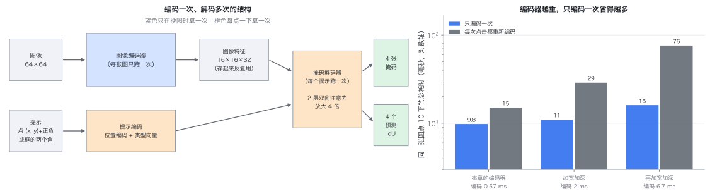
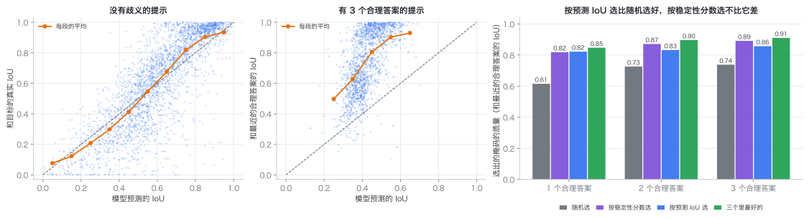
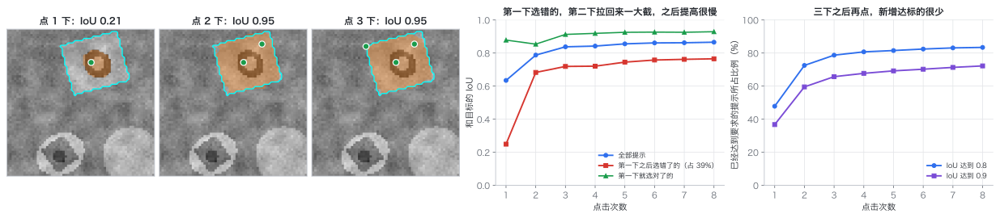
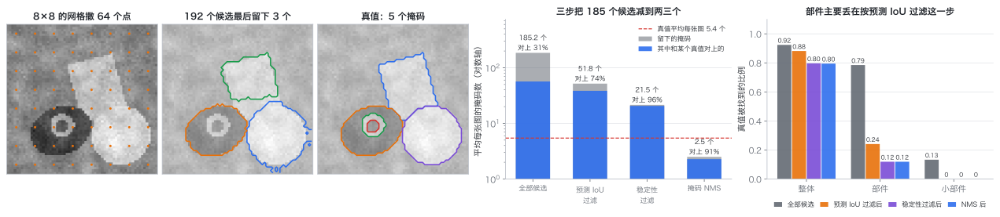
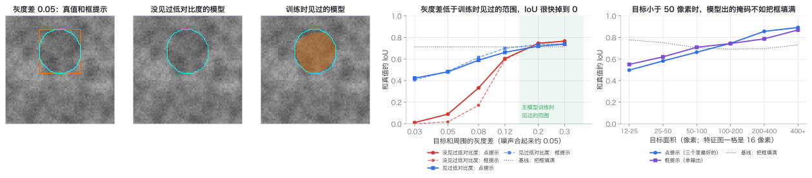

# 教程：可提示分割 SAM

> [!NOTE]
> 本章所有数字都来自一个从零训练的小模型在合成图上的实测，记录在 [`figures/实测数字.json`](figures/实测数字.json)，由 `solutions` 分支的 `solutions/figures/ch27.py` 生成。小模型和数据生成器在本章目录的 [`迷你SAM.py`](迷你SAM.py) 里（不是作业，可以直接读）。脚本在一台 Mac 的 CPU 上同时训练几个小模型，每个约 110 秒，整个脚本几分钟跑完，重复运行结果相同。这些数字说明的是“可提示分割这套机制”在一个可控的小问题上的行为，不是官方 SAM 的成绩。本章不引用任何论文报告的分数，也不对官方 SAM 在工业图像上的表现下结论；第 11 节告诉你怎样在自己的机器上测。

## 0. 本章怎么学

**应用场景**：半自动标注缺陷掩码、交互式分割。训练第 12 章那样的分割网络需要像素级的掩码当标签，一个一个描边很慢。可提示分割把描边换成“点一下或框一下，模型出掩码，人再修”。它还能接在别的模块后面：检测框、第 19 章异常热图的峰值都可以当提示。

**优先级**：P2，分到对应方向再学。前置是第 12 章（图像分割；Dice、IoU 和小目标的指标问题在那里讲过，本章直接用，不重复）和第 25 章（Transformer 与 ViT）。本章的非极大值抑制沿用第 11 章 11.6 节的贪心做法，只是把框换成了掩码。

| 档位 | 累计用时 | 做什么 | 做到什么算完 |
|---|---:|---|---|
| 速通 | 2 小时 | 读第 1、2、3、8 节，看懂图 1、2、7，把第 9 节演示的五步试一遍，答完 5 道小测 | 能讲清一个点为什么有几个合理答案，只输出一个掩码会怎样，为什么图像只编码一次，以及它在缺陷标注里帮不上的三种情况 |
| 标准 | 8 小时 | 读完全章，完成作业并验收通过，跑 Notebook，做第 14 节前三个破坏实验，填实验记录 | 五项测试 PASS，实验记录里有按合理答案个数分组的 IoU、一条点击次数曲线和一次全图自动分割每一步留下的掩码数 |
| 深挖 | 14 小时 | 再做其余破坏实验和第 15 节的扩展，按第 11 节在自己的显卡上跑官方 SAM | 能在自己的图像上给出带条件的结果：用的是哪个规模的权重、点提示还是框提示、几次点击、目标多大、对比度怎样，并说明哪些目标它分不出来 |

> [!TIP]
> 用时超过所选档位的 1.5 倍还没做完，就把卡点写进 `学习进度.md`，先往下一章走。深挖档要装包和下载权重，环境问题最容易卡住，卡超过一小时就先回到小模型把结论做完。

## 1. 为什么需要：点一下，答案不止一个

第 12 章的分割网络回答的是固定的问题：这张图里哪些像素是缺陷。可提示分割回答的问题由用户当场给出：我点的这个东西，它的掩码是什么。麻烦在于“这个东西”常常有歧义。点在一颗焊球上的划痕里，你要的可能是划痕，可能是这颗焊球，也可能是整个器件。

本章的合成数据就是为了把这件事做出来：64×64 的灰度图，每张 2 到 3 个物体（圆、旋转的矩形或椭圆，半径 10 到 15 px），75% 的物体里套一个部件，65% 的部件里再套一个小部件，相邻两级灰度差 0.15 到 0.4，叠加标准差 0.04 的平滑纹理和标准差 0.03 的白噪声，后画的物体会挡住先画的。整体的掩码包含它的部件，部件的掩码包含它的小部件。所以点在小部件里时，小部件、部件、整体三张掩码都包含这个点，都是**合理答案**。

下面的实验里，测试集 300 张图，每张抽 8 个正点，共 2400 个提示。每个点从包含它的掩码里等概率抽一个当**目标**：被 3 个掩码包含的点，三个答案各有三分之一的机会是“用户想要的那个”。模型只看到点，不知道抽中了哪个。小模型有一个“单输出”和三个“多输出”（结构见第 2 节），训练 1500 步。



| 300 张测试图，2400 个单点提示，和目标的 IoU | 1 个合理答案 | 2 个合理答案 | 3 个合理答案 |
|---|---:|---:|---:|
| 提示个数 | 961 | 823 | 616 |
| 单输出 | 0.764 | 0.517 | 0.422 |
| 三个多输出里最好的 | 0.847 | 0.817 | 0.729 |
| 换一个随机种子再训练：单输出 | 0.772 | 0.523 | 0.434 |
| 换一个随机种子再训练：三个多输出里最好的 | 0.823 | 0.807 | 0.764 |

读这张表的三点：

1. **没有歧义时，单输出和多输出差得不多**（0.764 对 0.847）。
2. **有歧义时单输出掉得很快**，3 个合理答案时只有 0.422。这不是模型没训练好：目标是从三个答案里随机抽的，任何只给一个答案的做法，平均下来都会被另外两个答案拉低。
3. **三个多输出里总有一个对得上目标**，3 个合理答案时还有 0.729。代价是多出来一个问题：三个里给用户看哪一个。这是第 4 节的内容。

图 1 左边的例子里，单输出最像部件（IoU 0.727），和整体、小部件的 IoU 只有 0.365 和 0.121；三个多输出各自最像的合理答案，IoU 是 0.783、0.924 和 0.786。

## 2. 结构：图像编码一次，提示解码多次

### 2.1 三个部件



SAM（Segment Anything，Kirillov 等，2023 年）把模型拆成三块：

| 部件 | 输入和输出 | 什么时候跑 |
|---|---|---|
| 图像编码器 | 一张图 → 一张特征图 | 每张图一次，和提示无关 |
| 提示编码器 | 点（坐标加正负标签）、框（两个角点）→ 几个向量 | 每个提示一次，几乎不花时间 |
| 掩码解码器 | 特征图加提示向量 → 几张掩码，每张带一个预测的 IoU | 每个提示一次，很轻 |

官方 SAM 的图像编码器是一个 ViT（第 25 章），用掩码图像建模的方式预训练（第 26 章）；输入图像的长边缩放到 1024 像素，输出 64×64、每个位置 256 维的特征图。掩码解码器只有两层注意力。重的部分全在编码器里。

本章的小模型按同样的思路缩小：

| | 本章的小模型 | 官方 SAM（公开的设计，不是本章实测） |
|---|---|---|
| 输入 | 64×64 灰度图 | 长边缩放到 1024 的彩色图 |
| 图像编码器 | 几层卷积，95576 个参数 | ViT，参数量以模型卡为准 |
| 特征图 | 16×16，每个位置 32 维 | 64×64，每个位置 256 维 |
| 掩码解码器 | 两层双向注意力，放大 4 倍；42873 个参数（其中预测 IoU 的分支 2433 个） | 两层双向注意力，放大 4 倍 |
| 一个提示的输出 | 1 个单输出加 3 个多输出，各带一个预测 IoU | 相同 |

小模型为了在一千多步里学会，有三处和官方 SAM 不同，`迷你SAM.py` 开头的说明里写了：点提示的向量里直接加上了点击位置的图像特征；预测 IoU 的分支除了输出向量还能看到掩码本身的几个统计量（第 4 节有对照）；没有“把上一轮的掩码当提示”这条路。本章的结论只对这个小模型和这组合成数据成立。

### 2.2 点怎样变成向量

提示编码要回答：位置 $(x, y)$ 怎样变成一个网络能用的向量。直接把两个坐标喂进去不行，网络很难从两个数里分辨出相差一两个像素的位置。SAM 的做法是把坐标乘上一组固定的随机频率，再取正弦和余弦：

$$
u = \frac{2(x + 0.5)}{W} - 1, \qquad v = \frac{2(y + 0.5)}{H} - 1
$$

$$
\gamma(x, y) = \big[\sin\big(2\pi (u\,\mathbf{f}_x + v\,\mathbf{f}_y)\big),\ \cos\big(2\pi (u\,\mathbf{f}_x + v\,\mathbf{f}_y)\big)\big]
$$

$\mathbf{f}_x$、$\mathbf{f}_y$ 各是 $F$ 个频率（小模型里 $F$ 是 16，从标准正态分布里抽一次，之后不训练），输出是 $2F$ 维。这就是作业的第一个函数 `point_position_encoding`。三个容易错的细节：

1. **加 0.5**。整数坐标 $k$ 指第 $k$ 个像素的中心。64 像素宽的图上，$x = 0$ 归一化之后是 -0.984，不是 -1；$x = 31.5$ 才是正中间的 0。只有一个频率（x 方向 1，y 方向 0）时，$x$ 为 0、31.5、63 的编码（sin, cos）分别是 (0.098, 0.995)、(0, 1)、(-0.098, 0.995)。
2. **x 除以宽，y 除以高**。函数的参数 `image_size` 是先高后宽，点是先 x 后 y，两个顺序相反。
3. **先放全部 sin，再放全部 cos**，不是交错排列。

位置编码只说了“在哪”。点是正点还是负点、是不是框的角，由另一个可学习的类型向量表示，两者相加就是这个提示的向量。图像特征图上的每个格子也用同一个函数编码自己中心的位置，这样解码器里的注意力才能把“提示在哪”和“特征在哪”对上。第 25 章（Transformer 与 ViT）的作业里有固定频率的二维正余弦位置编码，这里换成了随机频率，思路相同。

### 2.3 掩码解码器

解码器的输入是图像特征（16×16 个向量）和一小串“令牌”：1 个用来预测 IoU 的输出向量、4 个用来出掩码的输出向量、若干个提示向量。每一层做四件事：令牌之间做自注意力，令牌去查图像特征，过一个小的全连接网络，图像特征反过来查令牌。两层之后：

- 图像特征用两次转置卷积放大 4 倍，回到 64×64，每个像素 8 维；放大时加上编码器浅层的特征，用来找回边界。
- 每个掩码输出向量过一个小网络，变成 8 个权重，和每个像素的 8 维特征做内积，得到这张掩码的 logit。也就是说，四张掩码共用同一张放大后的特征图，只是各用各的一组权重。
- 预测 IoU 的输出向量过另一个小网络，给四张掩码各打一个分。

提示个数不固定（点一下是 1 个，框是 2 个，交互几轮之后是好几个），注意力天然能处理变长的输入，这是解码器用注意力的直接原因。

### 2.4 两部分各花多少时间

下表是在一台 Mac 的 CPU 上测的一次结果（PyTorch 2 线程，批大小 1，输入 64×64，预热后取多次的中位数），只保留两位有效数字。机器忙的时候数值会变，只看量级和倍数。后两行的编码器只是把卷积加宽加深，权重是随机的，没有训练，用来看编码器变重之后比例怎么变；解码器不变，解码一个提示 0.92 毫秒。

| 编码器 | 参数量 | 编码一次（毫秒） | 点 10 下：只编码一次（毫秒） | 点 10 下：每次都重新编码（毫秒） | 省下的比例 |
|---|---:|---:|---:|---:|---:|
| 本章的编码器 | 95576 | 0.57 | 9.8 | 15 | 34% |
| 加宽加深（宽 128，8 层） | 1207272 | 2.0 | 11 | 29 | 62% |
| 再加宽加深（宽 256，12 层） | 7130216 | 6.7 | 16 | 76 | 79% |

1. **小模型里解码器比编码器还慢**（0.92 对 0.57 毫秒）。它的编码器只有几层卷积，这一点和官方 SAM 正好相反，所以在小模型上“只编码一次”只省 34%。
2. **编码器越重，省得越多**。编码一次要 6.7 毫秒时，点 10 下只编码一次是 16 毫秒，每次都重新编码是 76 毫秒。官方 SAM 的编码器比解码器重得多，这个结构的好处在它身上才充分体现；具体差多少本章没有测，第 11 节告诉你怎样在自己的机器上量。
3. **一批提示可以一起解码**。64 个提示一次解码是 18 毫秒，约是逐个解码的 31%。第 7 节的全图自动分割就是这样做的。

对交互标注的含义：打开一张图时等一次编码，之后每点一下只跑解码器，响应时间和编码器多大无关。反过来，要是标注工具每次点击都把图重新编码一遍，重的模型就没法交互。

## 3. 歧义和多输出：只回传最好的那个

### 3.1 训练时怎样处理歧义

同一个点、同一张图，训练集里有时标的是小部件，有时标的是整体。只有一个输出时，网络被两种标签来回拉，损失最小的解是停在中间。SAM 的办法是输出三张掩码，训练时三张各算一个损失，**只回传最小的那一个**：

$$
L_{\text{mask}} = \min_{m \in \{1, 2, 3\}} \ell(M_m, G)
$$

$\ell$ 是第 12 章 12.5 节的那类掩码损失（小模型用交叉熵加 Dice），$G$ 是这一次抽中的目标。这样，目标是整体时由最像整体的那个输出去学，目标是小部件时由最像小部件的那个输出去学，三个输出不再互相拉扯。

小模型另有一个单输出，任何时候都被监督。官方 SAM 也有这样一个输出，在提示已经足够明确（比如给了好几个点）时用。

### 3.2 对照：三个都监督会怎样

把“只回传最小的”改成“三个都回传”，其余完全相同，重新训练。测试条件同第 1 节的表。

| 300 张测试图，2400 个单点提示，和目标的 IoU | 1 个合理答案 | 2 个合理答案 | 3 个合理答案 |
|---|---:|---:|---:|
| 只回传最好的：三个多输出里最好的 | 0.847 | 0.817 | 0.729 |
| 三个都监督：三个多输出里最好的 | 0.759 | 0.517 | 0.407 |
| 三个都监督：它的单输出 | 0.754 | 0.505 | 0.399 |

三个都监督时，三个输出学成了同一个东西，取其中最好的也只和单输出一样（3 个合理答案时 0.407 对 0.399）。多输出本身不解决歧义，解决歧义的是“只回传最好的那个”这条训练规则。

另一个角度是看“每个合理答案有没有被某个候选对上”。把“对上”定为 IoU 不低于 0.7：

| 合理答案被对上的比例 | 1 个合理答案 | 2 个合理答案 | 3 个合理答案 |
|---|---:|---:|---:|
| 三个多输出（只回传最好的） | 82.8% | 78.9% | 56.3% |
| 单输出 | 74.8% | 17.1% | 17.9% |
| 三个多输出（三个都监督） | 73.2% | 18.4% | 12.3% |

有 3 个合理答案时，三个候选也只对上了 56.3%，没有做到每个答案都有一个候选。换一个随机种子是 69.6%。

### 3.3 单输出学到的是几个答案的平均

“停在中间”可以直接量出来。只看有歧义的提示，把像素按“被几个合理答案包含”分区，统计输出概率在每个区里的平均值。如果输出正好是几个合理答案的逐像素平均，被 $c$ 个答案包含的区里概率应该是 $c/k$。

| 输出概率的平均值 | 3 个答案都包含 | 2 个答案包含 | 只有 1 个答案包含 | 都不包含 |
|---|---:|---:|---:|---:|
| 逐像素平均的理论值 | 1 | 0.667 | 0.333 | 0 |
| 单输出 | 0.976 | 0.801 | 0.309 | 0.005 |
| 三个多输出（把三张的概率取平均） | 0.964 | 0.688 | 0.328 | 0.006 |

上表是有 3 个合理答案的提示。有 2 个合理答案时，理论值是 1、0.5、0，单输出实测 0.922、0.432、0.008。

1. **单输出的概率大致跟着“被几个答案包含”走**，只属于整体的那一圈像素概率是 0.309，接近三分之一。它不等于理论值（中间那一档是 0.801，理论 0.667），但方向一致：它在三个答案之间和稀泥。
2. **三个多输出取平均之后也接近理论值**（0.688 和 0.328）。区别在于它们是三张各自干脆的掩码平均出来的，单输出是一张处处犹豫的掩码。
3. **犹豫可以数出来**。在至少属于一个合理答案的像素里，概率落在 0.2 到 0.8 之间的比例：单输出 58.5%，三个多输出平均 11%，三个都监督的对照模型 59.5%。

所以图 1 左三那张单输出的概率图是糊的，这不是分辨率不够，而是它在几个答案之间拿不定主意。

### 3.4 三个输出怎样分工

没有人规定哪个输出管整体、哪个管部件，分工是训练中自己形成的。同一组 2400 个提示里，目标是整体、部件、小部件的各有 1577、635、188 个，平均面积 451、120、28 像素。

| 输出掩码的平均面积（像素），以及它是三个里最好的那个时目标的分布 | 平均面积 | 整体 | 部件 | 小部件 |
|---|---:|---:|---:|---:|
| 种子 0：第 1 个多输出 | 357 | 665 | 175 | 0 |
| 种子 0：第 2 个多输出 | 340 | 789 | 231 | 2 |
| 种子 0：第 3 个多输出 | 161 | 123 | 229 | 186 |
| 种子 1：第 1 个多输出 | 234 | 256 | 493 | 1 |
| 种子 1：第 2 个多输出 | 147 | 70 | 137 | 187 |
| 种子 1：第 3 个多输出 | 484 | 1251 | 5 | 0 |

种子 1 分成了大、中、小三档：第 3 个输出几乎只管整体，第 1 个主要管部件，第 2 个管小的。种子 0 有两个输出都偏大，只有一个管小的。两个种子只差随机初始化和抽样顺序。所以：

- 不能假设“第几个输出就是整体”。要哪个粒度，得看掩码本身（面积、和其他候选的包含关系），或者靠预测的 IoU 选。
- 分工不均匀时，某些粒度的答案会缺候选。种子 0 在 3 个合理答案时对上的比例（56.3%）比种子 1（69.6%）低，和它有两个输出挤在同一档是一致的。只有两个种子，这一条只能算观察。

<!-- quiz -->
**把训练规则从“三个多输出只回传损失最小的那个”改成“三个都回传”，其余不变。有 3 个合理答案的提示上，三个候选里最好的那个和目标的 IoU 会怎样？**

- A. 基本不变，因为输出还是三个，总有一个更接近
- B. 掉到和单输出差不多，因为三个输出被同样的标签监督，学成了同一个东西
- C. 变得更好，因为每个输出得到的梯度更多

<details markdown="1"><summary>答案与解释</summary>

**B**。实测只回传最好的是 0.729，三个都监督是 0.407，它自己的单输出是 0.399。三个输出收到的监督完全一样，没有理由学出不同的东西；概率落在 0.2 到 0.8 之间的像素占 59.5%，和单输出的 58.5% 一样犹豫。A 错在把“有三个输出”当成了原因，起作用的是训练规则。C 的直觉在没有歧义的任务上才成立。

</details>
<!-- /quiz -->

## 4. 预测掩码质量的分支

### 4.1 它在学什么

三个候选只能给用户看一个。SAM 让模型自己给每张掩码估一个分数：解码器里有一个专门的输出向量，过一个小网络，回归“这张掩码和目标的 IoU”。训练目标就是当时算出来的真实 IoU，用均方误差。推理时没有目标，就按这个预测的 IoU 排序，这是作业的第二个函数 `select_by_predicted_iou`。

先看没有歧义的提示（只有 1 个合理答案，961 个提示，每个 3 个候选）：



| 预测 IoU 的范围（没有歧义的提示） | 小于 0.3 | 0.3 到 0.5 | 0.5 到 0.7 | 0.7 到 0.85 | 不小于 0.85 |
|---|---:|---:|---:|---:|---:|
| 候选个数 | 222 | 616 | 1047 | 633 | 365 |
| 真实 IoU 的平均 | 0.167 | 0.374 | 0.606 | 0.841 | 0.924 |
| 真实 IoU 不到 0.5 的比例 | 99.1% | 76.9% | 26.4% | 4.3% | 2.2% |

预测值和真实值的相关系数是 0.816（换一个种子是 0.732），平均绝对误差 0.129。预测 IoU 不小于 0.85 的候选里，只有 2.2% 其实不到 0.5。作为“这张掩码能不能用”的粗筛，它是可靠的。

### 4.2 按它选，比随机选好多少

为了把“选得好不好”和“用户想要哪个”分开，这里用**质量**来衡量一个候选：它和最近的合理答案的 IoU。一张完美的整体掩码质量是 1，不管用户这次想要的是不是整体。

| 选出的掩码的质量（种子 0） | 1 个合理答案 | 2 个合理答案 | 3 个合理答案 |
|---|---:|---:|---:|
| 随机选一个 | 0.615 | 0.726 | 0.738 |
| 按稳定性分数选（第 7 节） | 0.818 | 0.871 | 0.891 |
| 按预测 IoU 选 | 0.822 | 0.832 | 0.857 |
| 三个里最好的 | 0.847 | 0.896 | 0.91 |

| 换一个种子（种子 1） | 1 个合理答案 | 2 个合理答案 | 3 个合理答案 |
|---|---:|---:|---:|
| 随机选一个 | 0.684 | 0.72 | 0.77 |
| 按稳定性分数选 | 0.802 | 0.836 | 0.865 |
| 按预测 IoU 选 | 0.761 | 0.784 | 0.813 |
| 三个里最好的 | 0.823 | 0.865 | 0.889 |

1. **按预测 IoU 选明显比随机好**。种子 0 没有歧义时从 0.615 到 0.822，补上了“随机到最好”这段差距的 89.5%。
2. **但它不稳**。种子 1 同样的条件只补上了 55.2%。有 3 个合理答案时，两个种子分别补上 69.3% 和 35.9%。
3. **一个不用训练的量和它差不多，甚至更好**。稳定性分数只看掩码的 logit（把二值化阈值上下挪一点，掩码变不变），在这组实验的六个格子里有五个不比预测 IoU 差。这只说明这个小模型的预测 IoU 分支不强，不说明官方 SAM 也这样。能确定的是：预测 IoU 是一个学出来的量，它有多准要测，不能当成真实 IoU 用。

预测 IoU 的分支怎样设计影响很大。小模型默认让它看到掩码本身的几个统计量。把它改成官方 SAM 的写法（只看那一个输出向量），其余不变重新训练：没有歧义时相关系数从 0.816 掉到 0.478，按它选出的掩码质量是 0.698（随机选 0.616，按稳定性分数选 0.812），它选中的正好是三个里最好的那个的比例只有 28.1%，三选一随机选中的概率是 33.3%。官方 SAM 的训练量比这里大好几个数量级，这个对照只说明：一千多步的训练不足以让一个向量学会给掩码排序。

### 4.3 歧义把预测 IoU 压低了

图 3 中间那张图里，点全在对角线上方：有 3 个合理答案时，候选本身的质量很高，预测 IoU 却都很低。只看质量不低于 0.9 的好候选：

| 质量不低于 0.9 的候选 | 个数 | 预测 IoU 的平均 | 预测 IoU 不到 0.7 的比例 |
|---|---:|---:|---:|
| 没有歧义的提示 | 672 | 0.822 | 10.6% |
| 有 3 个合理答案的提示 | 589 | 0.476 | 100% |

原因在训练目标里。预测 IoU 拟合的是“和这次抽中的目标的 IoU”，而目标是从几个答案里随机抽的。均方误差下，它能学到的最好结果是这个量的期望：

$$
\mathbb{E}\big[\mathrm{IoU}\big] = \frac{1}{k} \sum_{j=1}^{k} \mathrm{IoU}(M, G_j)
$$

举一个由脚本算出的例子：同心的整体（半径 12 px）和部件（半径 6 px），两者的 IoU 是 0.256。点在部件里，两个都是合理答案。一张完美的整体掩码，对上整体是 1，对上部件是 0.256，期望 0.628。一张半径 9 px、哪个答案都不是的掩码，期望是 0.51。两者只差 0.118；没有歧义时它们是 1 对 0.574。

所以：

- **预测 IoU 的绝对值不能跨提示比较**。同样是 0.5，在没有歧义的点上是一张差掩码，在有三个答案的点上可能是一张完美的掩码。
- **拿它当阈值过滤时，有歧义的点上的好掩码会被成批丢掉**。第 7 节的全图自动分割正好踩到这一点。
- 它在同一个提示的几个候选之间排序仍然有用（上一节的表），因为几个候选面对的是同一组合理答案。

<!-- quiz -->
**点落在小部件里，有 3 个合理答案。某个候选是一张几乎完美的整体掩码（质量 0.95）。模型给它的预测 IoU 最可能是多少？**

- A. 0.9 以上，因为掩码本身很好
- B. 0.5 左右，因为它只有三分之一的机会对上这次抽中的目标
- C. 接近 0，因为点不在整体独有的区域里

<details markdown="1"><summary>答案与解释</summary>

**B**。实测 3 个合理答案的提示上，质量不低于 0.9 的 589 个候选，预测 IoU 平均只有 0.476，全部低于 0.7；没有歧义时同样质量的候选平均是 0.822。预测 IoU 拟合的是“和随机抽中的目标的 IoU”的期望，另外两个答案把期望拉低了。A 是把预测 IoU 当成了掩码质量，这正是用它做全局阈值时会出错的地方。

</details>
<!-- /quiz -->

## 5. 交互：加正点和负点

第一下点完，模型给出预测 IoU 最高的候选。它错了怎么办？再点：掩码漏掉的地方补一个**正点**，多出来的地方补一个**负点**。所有点一起重新送进解码器，图像特征不重算。训练时也是这样模拟的：先解码一次，在当前掩码和目标不一致的地方抽点，再解码。

下面的模拟里，“用户”每次点在当前掩码错得最大的那一块连通区域里离区域边缘最远的像素。1200 个提示（测试集前 150 张图），最多点 8 下。“第一下之后选错了”指第 1 下之后给用户看的掩码和目标的 IoU 不到 0.5，占 38.8%。



| 点击次数（1200 个提示） | 1 | 2 | 3 | 4 | 5 | 6 | 7 | 8 |
|---|---:|---:|---:|---:|---:|---:|---:|---:|
| 全部提示：和目标的 IoU | 0.634 | 0.787 | 0.838 | 0.842 | 0.855 | 0.861 | 0.862 | 0.865 |
| 第一下之后选错了的 | 0.249 | 0.683 | 0.719 | 0.72 | 0.745 | 0.758 | 0.762 | 0.765 |
| 第一下就选对了的 | 0.878 | 0.854 | 0.913 | 0.919 | 0.925 | 0.927 | 0.926 | 0.929 |
| IoU 曾达到 0.8 的比例 | 47.8% | 72.5% | 78.7% | 80.7% | 81.5% | 82.4% | 83.1% | 83.4% |
| IoU 曾达到 0.9 的比例 | 36.7% | 59.5% | 65.7% | 67.7% | 69.2% | 70.2% | 71.3% | 72.2% |

1. **第二下最值钱**。全部提示的平均 IoU 从 0.634 到 0.787，提高 0.153；第三下再提高 0.05；之后每一下最多 0.013。
2. **第一下选错的，九成是歧义造成的**。选错的提示里，点被 1、2、3 个掩码包含的各占 9.5%、49.7%、40.9%。图 4 左边的例子就是这样：第一下选中的是整体里面的一小块（IoU 0.206），在整体上补一个正点之后是 0.946。第二下起的作用主要是告诉模型“我要的是哪一层”。
3. **正点和负点的作用不对称**。第 2 下是负点的占 59.5%，平均提高 0.084；是正点的占 38.8%，平均提高 0.266。补正点通常意味着“我要的比你给的大”，一下就能跳到另一个候选；补负点是往里收。
4. **多点一下不保证更好**。第一下就选对了的提示，第二下之后平均 IoU 从 0.878 降到 0.854；补了第二个点的提示里，16.3% 的 IoU 下降超过 0.02。模型只训练过带一到三个修正点的提示，新加的点有时把本来对的地方带偏。
5. **三四下之后基本饱和，但饱和在 0.86 左右，不是 1**。8 下之内 IoU 从没到过 0.8 的提示占 16.6%，其中小部件最难：小部件有 65.5% 从没到过 0.8，部件 17.7%，整体 11.1%。这些要靠人手工修。

两组对照。把“给用户看的掩码”从第 2 下起换成单输出：第 2 下之后是 0.734，8 下之后是 0.836，都比按预测 IoU 选候选低。把补点的位置从“错误区域的中心”换成“错误区域里随机一个像素”：第 2 下之后 0.775，8 下之后 0.864，差别很小。换一个随机种子训练的模型，同样的做法 8 下的曲线是 0.601、0.769、0.815、0.832、0.841、0.847、0.848、0.851，形状相同。

官方 SAM 支持把上一轮的低分辨率掩码作为提示送回去，小模型没有这条路，所以这里的曲线只说明“只靠点”能走多远。

<!-- quiz -->
**第一下点完，模型给的掩码已经很好（和目标的 IoU 平均 0.878）。这时再按“错得最大的地方补一个点”多点一下，平均 IoU 会怎样？**

- A. 继续提高，点越多信息越多
- B. 略有下降，第三下才回升
- C. 完全不变，因为掩码已经对了

<details markdown="1"><summary>答案与解释</summary>

**B**。实测这部分提示第 2 下之后是 0.854，第 3 下之后才到 0.913。全部补了第二个点的提示里，有 16.3% 的 IoU 下降超过 0.02。新加的点有时会让模型换到另一个候选，或者把本来对的边界带偏。对标注流程的含义：掩码已经够好就停手，不要为了修一两个像素再加点；修小瑕疵用画笔更可靠。A 对第一下选错了的那部分提示才成立（0.249 到 0.683）。

</details>
<!-- /quiz -->

## 6. 点的位置，框和点

### 6.1 点在边缘还是中心

把测试集全部 1651 个掩码各当一次目标，只点一下，改变点到目标边缘的距离。目标太小就没有“离边缘 5 px 以上”的像素，各段里的目标不是同一批，直接比会把目标大小和点的位置混在一起。所以下表只取每一段都有像素的 1121 个大目标（整体 708 个，部件 413 个）。


| 点的位置（1121 个大目标） | 目标外面 1 px | 贴着边缘 | 离边缘约 2 px | 3 到 4 px | 5 px 以上 | 正中心 |
|---|---:|---:|---:|---:|---:|---:|
| 三个候选里最好的 | 0.744 | 0.803 | 0.819 | 0.837 | 0.841 | 0.836 |
| 按预测 IoU 选 | 0.545 | 0.687 | 0.731 | 0.761 | 0.709 | 0.63 |
| 点落在目标的下一级里面的比例 | 1.4% | 1.2% | 4.1% | 19.1% | 51.7% | 68.3% |

1. **贴着边缘只差一点**。三个候选里最好的那个，贴着边缘是 0.803，离边缘 5 px 以上是 0.841。候选里有没有好掩码，对点的位置不敏感。
2. **点出界就不一样了**。落在目标外面 1 px，最好的候选是 0.744，按预测 IoU 选只有 0.545。标注时手一抖点到了隔壁，模型就去分隔壁。
3. **正中心反而容易选错**。按预测 IoU 选的结果在离边缘 3 到 4 px 时最高（0.761），正中心掉到 0.63。原因在最后一行：这组数据里部件大多在物体中间，点在正中心有 68.3% 落进了下一级（目标是整体，点却在它的部件里），歧义最大。点没落在下一级里时按预测 IoU 选是 0.731，落进去了是 0.584。

第 3 条取决于数据：这里的部件放在物体中间附近。它说明的是，点的位置好不好，要看这个位置有没有歧义，不只看它离边缘多远。想要整体，就点在只属于整体的地方。

### 6.2 框提示

框提示把目标外接框的左上角和右下角当成两个带各自类型向量的点。作业的 `mask_to_box` 就是由掩码求这个框。框同时给了位置和大小，歧义比点小得多。

| 全部 1651 个目标（整体 760，部件 548，小部件 343），和目标的 IoU | 全部 | 整体 | 部件 | 小部件 | IoU 不到 0.5 的比例 |
|---|---:|---:|---:|---:|---:|
| 目标里随机一个点，按预测 IoU 选 | 0.554 | 0.752 | 0.513 | 0.179 | 48.3% |
| 目标里随机一个点，三个候选里最好的 | 0.734 | 0.827 | 0.726 | 0.54 | |
| 紧贴目标的框，单输出 | 0.742 | 0.795 | 0.736 | 0.635 | 11.5% |
| 框的四条边各有 10% 边长的随机误差 | 0.712 | 0.76 | 0.703 | 0.619 | 13.4% |
| 框每边外扩 25% | 0.574 | 0.741 | 0.427 | 0.439 | 46.5% |
| 基线：把框填满 | 0.72 | 0.689 | 0.716 | 0.795 | |

1. **框比单点稳得多**。IoU 不到 0.5 的比例，单点是 48.3%，紧框是 11.5%；IoU 的标准差是 0.342 对 0.201。单点在部件和小部件上吃亏（0.513 和 0.179），因为模型倾向于选大的那个答案；框直接告诉了它要多大。
2. **框有 10% 的误差影响不大**（0.742 到 0.712），外扩 25% 就不行了，部件掉到 0.427：框里装进了太多不属于目标的东西。
3. **一定要和“把框填满”比**。把整个框当成掩码，什么模型都不用，IoU 就有 0.72。小模型的框提示是 0.742，只高一点；在小部件上是 0.635，还不如把框填满的 0.795。它只在整体上明显赢（0.795 对 0.689）。

第 3 条是这一节最重要的。接近圆形或方形的目标，外接框本身就是一张不差的掩码；报告框提示的效果时不带这条基线，数字看起来会比实际有用得多。小目标上模型输给这条基线，原因在第 8.2 节。

<!-- quiz -->
**小部件上，给模型一个紧贴目标的框提示，输出掩码和真值的 IoU 是 0.635。不用模型，直接把框涂满当掩码，IoU 是多少？**

- A. 0.3 左右，框比目标大得多
- B. 0.5 左右
- C. 0.8 左右，比模型的输出还高

<details markdown="1"><summary>答案与解释</summary>

**C**。实测 0.795。小部件是圆，圆占它外接正方形的面积接近八成，把框涂满就已经是一张不错的掩码；小模型在这么小的目标上边界不准，反而输了。在整体上情况相反：模型 0.795，把框填满 0.689。结论不是“框提示没用”，而是评价框提示时必须带上这条基线，并且按目标大小分开看。

</details>
<!-- /quiz -->

## 7. 全图自动分割

不给人工提示，让模型自己把图里的东西都分出来，做法是把“提示”换成一张网格：

1. **网格撒点**。在图上均匀放 $g \times g$ 个正点，每个点取三个多输出。小模型用 8×8 的网格，64 个点，共 192 个候选。64 个提示一起解码（第 2.4 节）。
2. **按预测 IoU 过滤**，去掉模型自己都觉得不好的。
3. **按稳定性分数过滤**，去掉边界不干脆的。
4. **非极大值抑制**，去掉重复的。相邻的网格点常常落在同一个物体里，给出几乎相同的掩码。

### 7.1 稳定性分数

作业的第三个函数。把二值化的阈值上下各挪 $\delta$，看掩码变化有多大：

$$
s = \frac{\big|\{z > t + \delta\}\big|}{\big|\{z > t - \delta\}\big|}
$$

$z$ 是掩码的 logit，$t$ 是阈值。高阈值的掩码一定包含在低阈值的掩码里，所以这个比值就是两者的 IoU。边界清楚的掩码，logit 在边界两侧跳得很快，阈值挪一点像素数几乎不变。举一个由脚本算出的例子：半径 12 px 的圆，logit 取“半径减去到圆心的距离”乘一个斜率，阈值 0、偏移 1。斜率 4 时分数是 0.909；斜率 0.4 时高阈值掩码 293 个像素、低阈值掩码 665 个像素，分数 0.441。

第 3.3 节里犹豫的单输出，稳定性分数就低。它不用训练，不看目标，只看掩码自己，所以可以和预测 IoU 互相补充。

### 7.2 每一步去掉多少

测试集前 150 张图，平均每张 5.4 个真值掩码。预测 IoU 阈值 0.6，稳定性阈值 0.85（偏移 1），NMS 的 IoU 阈值 0.7。“对上”指和某个真值掩码的 IoU 不低于 0.7；“重复”指同一个真值被对上多次时多出来的那些。空的候选（一个前景像素都没有）不计，所以“全部候选”平均是 185.2 个，不到 192。



| 平均每张图（150 张） | 全部候选 | 按预测 IoU 过滤后 | 再按稳定性过滤后 | 再做 NMS 后 |
|---|---:|---:|---:|---:|
| 掩码数 | 185.2 | 51.8 | 21.5 | 2.5 |
| 其中和某个真值对上的比例 | 30.6% | 74.3% | 95.8% | 91% |
| 重复的掩码数 | 52.7 | 35.8 | 18.4 | 0 |
| 整体被找到的比例 | 92.4% | 88.2% | 79.7% | 79.5% |
| 部件被找到的比例 | 78.5% | 24.1% | 11.9% | 11.9% |
| 小部件被找到的比例 | 13.3% | 0% | 0% | 0% |

1. **三步各管一件事**。预测 IoU 过滤去掉 133.4 个，主要是烂掩码，对上的比例从 30.6% 升到 74.3%；稳定性过滤再去掉 30.3 个，对上的比例到 95.8%；NMS 去掉 19 个重复的，留下 2.5 个。
2. **NMS 不丢目标**。NMS 前后，三种真值被找到的比例几乎不变。它去掉的确实是重复。
3. **部件几乎全丢在第一步**。候选里本来有 78.5% 的部件，按预测 IoU 过滤后只剩 24.1%。和真值对上的好候选里，被这一步去掉的比例：整体 24.8%，部件 82%，小部件 100%。这正是第 4.3 节说的：落在部件里的点有歧义，好掩码的预测 IoU 被压到了阈值以下。
4. **小部件在撒点时就没出来**。192 个候选里只有 13.3% 的小部件被对上。8 px 的网格间距比小部件大，很多小部件上根本没有点；有点的，候选质量也不够。

最后留下的 2.5 个掩码大多是对的（91%），但只找回了 79.5% 的整体和 11.9% 的部件。这个小模型的“全图自动分割”实际上是“把大的物体分出来”。

### 7.3 阈值和网格怎么影响结果

每次只改一个设置，其余保持默认，看最后留下的结果。

| 改动 | 留下的掩码数 | 对上的比例 | 整体被找到 | 部件被找到 |
|---|---:|---:|---:|---:|
| 默认 | 2.5 | 91% | 79.5% | 11.9% |
| 不按预测 IoU 过滤 | 2.9 | 89.3% | 81.3% | 25.9% |
| 预测 IoU 阈值提到 0.8 | 1.8 | 97% | 69.2% | 0% |
| 不按稳定性过滤 | 7.2 | 41.5% | 87.4% | 21.5% |
| 稳定性阈值提到 0.95 | 1.1 | 98.2% | 42.4% | 2.2% |
| NMS 阈值提到 0.9 | 4.1 | 90.2% | 79.5% | 11.9% |
| 只做 NMS，不做前两步过滤 | 79.5 | 6.5% | 91.6% | 73.7% |
| 网格加密到 16×16（60 张图） | 2.8 | 85.6% | 79.9% | 20.6% |

1. **在这个模型上，稳定性过滤比预测 IoU 过滤更值得留**。去掉预测 IoU 过滤，留下 2.9 个、对上 89.3%，部件还多找回一倍；去掉稳定性过滤，留下 7.2 个，只有 41.5% 是对的。这和第 4.2 节“按稳定性分数选不比按预测 IoU 选差”是同一件事的两面。
2. **阈值越严，留下的越准，也越少**。两个阈值都是查准和查全之间的旋钮，没有免费的。
3. **NMS 阈值太高会留下重复**。0.9 时留下 4.1 个，其中 1.5 个是重复的。
4. **只做 NMS 不行**。烂掩码之间互相不重叠，NMS 去不掉它们，留下 79.5 个，只有 6.5% 是对的。
5. **网格加密能让候选里多出小目标，但过滤照样把它们去掉**。16×16 的网格下，候选里的小部件从 13.3% 升到 42.5%，最后留下的仍然是 0%。

NMS 用掩码的 IoU 还是外接框的 IoU？作业的 `mask_nms` 用掩码。两者在嵌套的目标上差别很大。30×30 的方块里套一个 10×10 的方块：整体和部件的掩码 IoU 只有 0.111，不会被当成重复；“整体去掉部件剩下的环”和整体，掩码 IoU 是 0.889，外接框却完全相同。在这组实验里，把 NMS 换成按外接框的 IoU，留下 3.2 个掩码，其中 0.8 个是重复的，按掩码做是 2.5 个和 0 个：两张几乎相同的掩码只要有一张多出几个零散的像素，外接框就差很多，框的 IoU 低于阈值，重复就留下来了。

<!-- quiz -->
**全图自动分割里，候选中本来有 78.5% 的部件被某个候选对上了。按预测 IoU 不低于 0.6 过滤之后，只剩 24.1%。最主要的原因是什么？**

- A. 部件的候选掩码质量差，本来就该去掉
- B. 落在部件里的点有两三个合理答案，好掩码的预测 IoU 被歧义压低了，过不了全局阈值
- C. 网格太稀，部件上没有点

<details markdown="1"><summary>答案与解释</summary>

**B**。和真值对上的好候选里，部件的有 82% 被这一步去掉，整体的只有 24.8%。第 4.3 节量过：有 3 个合理答案时，质量不低于 0.9 的候选预测 IoU 平均只有 0.476。A 不对，这里统计的就是和真值 IoU 不低于 0.7 的候选。C 说的是小部件的问题（候选里只有 13.3%），部件在候选里是有的。把这一步去掉，部件被找到的比例是 25.9%，比默认的 11.9% 高一倍。

</details>
<!-- /quiz -->

## 8. 工业检测：半自动标注缺陷掩码

### 8.1 流程，以及它省的是什么

训练第 12 章的分割网络、评估第 19 章的像素级指标，都要真实缺陷的像素级掩码。半自动标注的流程是：

```text
打开一张图 → 图像编码器跑一次，特征存起来
对每个缺陷：
    人点一下（或拉一个框）      → 解码器出三个候选，显示预测 IoU 最高的
    不对：切换到另一个候选，或者补正点、负点 → 解码器重跑，图像特征不重算
    还差一点：用画笔手工修边
    保存掩码，记下这个缺陷用了几次点击、有没有手工修
```

它省的是描边的时间，换来的是“看一眼对不对”的时间。值不值，取决于多少缺陷能在一两下之内出一张可用的掩码。用第 5 节的数字做一个量级的估计：在这组合成数据上，两下之内 IoU 达到 0.8 的提示是 72.5%，8 下之内始终达不到的是 16.6%。后面这一部分点得越多越亏，应该早点改用手工。

三条在任何模型上都适用的做法：

- **记录每个掩码用了几次点击、是否手工修过**。这是评价这个工具在你的数据上值不值的唯一依据，也是第 10 节要报的数字。
- **点击超过三四下还不对就停手**。第 5 节的曲线三四下之后就平了。
- **标注规范要先定“标到哪一层”**。同一个点有几个合理答案，两个标注员一个标划痕、一个标划痕所在的焊盘，都不算错，但混在一起训练出来的分割网络就像第 3.3 节的单输出。可提示分割把这个歧义摆到了明面上，规范必须回答它。

### 8.2 帮不上的地方

下面四种情况，工业检测里都常见。每一种都用小模型在合成数据上做了一个能说明问题的实验。**这些实验说明的是“一个可提示分割模型在超出训练分布时会怎样坏”，不说明官方 SAM 在你的图像上会不会坏**；后者只能在你自己的图像上测（第 11 节）。



**低对比度的缺陷。** 主模型训练时，相邻两级的灰度差在 0.15 到 0.4 之间。测试时把灰度差固定成更小的值（每个值 120 张图，全部掩码各当一次目标；点提示点在目标正中心、取三个候选里最好的，框提示取单输出）。图里纹理和噪声合起来的标准差约 0.05。另一个模型训练时灰度差在 0.03 到 0.4 之间，其余完全相同。

| 目标和周围的灰度差 | 0.03 | 0.05 | 0.08 | 0.12 | 0.2 | 0.3 |
|---|---:|---:|---:|---:|---:|---:|
| 没见过低对比度：点提示 | 0.011 | 0.09 | 0.332 | 0.604 | 0.745 | 0.766 |
| 没见过低对比度：框提示 | 0.001 | 0.018 | 0.172 | 0.595 | 0.749 | 0.766 |
| 训练时见过：点提示 | 0.423 | 0.481 | 0.589 | 0.662 | 0.719 | 0.738 |
| 训练时见过：框提示 | 0.407 | 0.486 | 0.615 | 0.699 | 0.735 | 0.739 |
| 基线：把框填满 | 0.713 | 0.713 | 0.713 | 0.713 | 0.713 | 0.713 |

1. **一出训练时见过的范围，就掉到接近 0**。灰度差 0.12（只比训练下限低一点）时还有 0.604，到 0.08 是 0.332，到 0.05 是 0.09。它不是输出一张差一点的掩码，而是输出空的：图 7 左二的例子 IoU 是 0.002。给了框也没用，框提示掉得更彻底（0.018）。
2. **训练时见过就好得多，但也救不回来**。灰度差 0.05 时见过的模型是 0.481，比没见过的 0.09 高得多，可还是不如把框填满的 0.713。目标和周围只差 1 倍噪声标准差时，边界本身就看不清。
3. **见过低对比度有代价**。在正常对比度的测试集上，它的点提示是 0.719，主模型是 0.746。

对真模型的含义只有一条可以确定：模型有没有见过“像你的缺陷这样弱的边界”，决定了它是能用还是完全不能用，中间地带很窄。官方 SAM 见没见过，要拿你的图去试；试的时候按对比度从高到低排一批缺陷，看它在哪里开始输出空掩码或者把背景一起圈进来。

**极小的目标。** 同一个主模型、正常对比度的测试集，按目标面积分组。特征图一个格子对应 16 个像素（4×4）。

| 目标面积（像素） | 12 到 25 | 25 到 50 | 50 到 100 | 100 到 200 | 200 到 400 | 400 以上 |
|---|---:|---:|---:|---:|---:|---:|
| 目标个数 | 165 | 213 | 210 | 344 | 327 | 392 |
| 点提示（三个候选里最好的） | 0.497 | 0.582 | 0.663 | 0.745 | 0.856 | 0.892 |
| 框提示（单输出） | 0.55 | 0.62 | 0.709 | 0.743 | 0.787 | 0.869 |
| 基线：把框填满 | 0.777 | 0.752 | 0.705 | 0.691 | 0.696 | 0.73 |
| 点提示 IoU 不到 0.5 的比例 | 47.3% | 23.5% | 18.1% | 16.6% | 5.2% | 1.8% |

面积 200 像素以上，点一下取最好的候选就有 0.856 以上。面积不到 50 像素（三个特征格子以内），无论点还是框，都不如把框填满。目标越小，模型出的掩码越不可信，这时候它帮不上忙，直接手工画或者用框更快。小目标上 IoU 本身有多苛刻，第 12 章 12.6 节讲过，这里不重复。

官方 SAM 的特征图比输入小 16 倍，这是公开的结构。一张很大的检测图整张缩放到长边 1024 再送进去，只有几个像素的缺陷在特征图上连一个格子都占不满。要在小缺陷上用，得先把大图切成块（第 12 章 12.9 节），让缺陷在送进模型的那一块里占够像素。

**只靠纹理区分的缺陷。** 有些缺陷和周围平均亮度一样，只是更粗糙。合成一组这样的目标：平均灰度和背景完全相同，里面每个像素随机加或减一个幅度；每张图 2 个，100 张图。模型训练时只见过靠灰度区分的目标。多加一条不看图的基线：以点击位置为圆心画一个半径 12 px 的圆（训练数据里整体的半径在 10 到 15 px 之间）。

| 100 张图，每张 2 个目标 | 点提示 | 框提示 | 基线：点击处画一个圆 | 基线：把框填满 |
|---|---:|---:|---:|---:|
| 纹理幅度 0.05 | 0.586 | 0.596 | 0.724 | 0.706 |
| 纹理幅度 0.1 | 0.674 | 0.751 | 0.724 | 0.706 |
| 纹理幅度 0.2 | 0.604 | 0.751 | 0.724 | 0.706 |
| 对照：靠灰度区分的整体 | 0.841 | 0.795 | 0.692 | 0.689 |

点提示的三行都低于“点击处画一个圆”的 0.724，也就是说模型对这类目标的边界没有任何有效的判断，不如一个不看图的猜测。框提示在幅度 0.1 和 0.2 时是 0.751，比把框填满的 0.706 高一点。这和靠灰度区分的整体（点提示 0.841，比画圆的 0.692 高得多）是两回事。

**成像方式不同。** 最后一组模拟另一种成像：物体内部和背景一样亮，只有最外一圈像素比周围亮，像只有边缘散射光的暗场图。模型训练时没见过这种图。

| 100 张图，每张 2 个目标 | 点提示 | 框提示 | 基线：点击处画一个圆 | 基线：把框填满 |
|---|---:|---:|---:|---:|
| 轮廓比周围亮 0.15 | 0.836 | 0.814 | 0.721 | 0.716 |
| 轮廓比周围亮 0.3 | 0.855 | 0.86 | 0.721 | 0.716 |

这一组没有坏：点提示 0.836 和 0.855，和正常图上的整体（0.841）差不多。图看起来和训练图完全不一样，但模型依赖的线索（一条闭合的灰度边界）还在。

把后两组放在一起看，结论比“和训练数据差别大就不行”要具体：**决定成败的是模型学会依赖的那个线索在新图上还在不在**。只有轮廓亮的图上边界还在，所以能用；只靠纹理区分的图上没有灰度边界，所以不能用；低对比度的图上边界弱到训练时没见过的程度，所以不能用。小模型只学了灰度边界这一种线索。官方 SAM 在大量自然图像上训练，学到的线索多得多，但电子束图像、暗场、干涉条纹这些成像方式的缺陷长什么样、它认不认，课程里没有依据下结论，只能自己测。

| 情况 | 小模型上的现象 | 在自己的图像上怎么查 |
|---|---|---|
| 低对比度 | 低于训练见过的范围就输出空掩码 | 按对比度排一批缺陷，找出它开始失败的位置 |
| 极小的目标 | 小于三个特征格子时不如把框填满 | 按面积分组报 IoU，带上“把框填满”的基线 |
| 只靠纹理区分 | 点提示不如一个不看图的圆 | 挑几个平均亮度和背景相同的缺陷单独试 |
| 成像方式不同 | 边界线索还在时没有变差 | 不要凭图像“像不像自然图像”下判断，逐类缺陷试 |

### 8.3 和第 19 章的异常热图配合

第 19 章的方法给出一张异常热图：哪里不像良品。热图知道缺陷大概在哪，但边界是糊的（第 19 章 3.6 节：分数图比原图小，要插值放大）。可提示分割正好相反：不知道哪里是缺陷，但给了位置就能出一张边界清楚的掩码。接起来的思路是：

```text
异常热图 → 取峰值的位置当正点（或把热图二值化后的外接框当框提示）
        → 可提示分割出候选掩码
        → 用热图本身来挑候选：和二值化的热图重叠最大的那个
```

小模型上的实验：把测试集里 891 个部件和小部件各当一次“缺陷”。热图是模拟的，不是第 19 章的方法算出来的：把缺陷掩码缩成每格 4 px 或 8 px 的小图，加噪声，放大回原尺寸再做高斯平滑，代表“位置大致对、边界糊”的热图。

| 和真值的 IoU | 细热图（每格 4 px）：全部 | 面积 60 像素以上 | 粗热图（每格 8 px）：全部 | 面积 60 像素以上 |
|---|---:|---:|---:|---:|
| 直接把热图按峰值的一半二值化 | 0.771 | 0.856 | 0.475 | 0.658 |
| 峰值当点提示，按预测 IoU 选 | 0.422 | 0.604 | 0.412 | 0.599 |
| 峰值当点提示，挑和二值化热图最像的候选 | 0.664 | 0.745 | 0.494 | 0.691 |
| 二值化热图的外接框当框提示 | 0.658 | 0.754 | 0.495 | 0.692 |
| 峰值当点提示，三个候选里最好的（要人来挑） | 0.67 | 0.753 | 0.637 | 0.752 |

1. **热图够细时，接上可提示分割反而变差**。直接二值化是 0.771，接上之后就算让人来挑候选也只有 0.67。小模型出的边界还不如一张每格 4 px 的热图。
2. **热图粗时，在大一些的缺陷上有一点帮助**。面积 60 像素以上的 508 个缺陷，直接二值化是 0.658，挑和热图最像的候选是 0.691，人来挑是 0.752。面积不到 60 像素的 383 个缺陷没有帮助（0.233 对 0.232）。
3. **不能按预测 IoU 选**。缺陷在一个更大的物体里面，峰值那个点有歧义，按预测 IoU 选只有 0.412，模型多半把缺陷所在的整个物体圈了出来。热图已经知道缺陷大概多大，应该用它来挑候选。
4. **峰值不一定落在缺陷里**。粗热图下峰值落在缺陷里面的比例是 90.7%。

所以这个思路成立的前提是：可提示分割出的边界比热图的边界准。小模型在这组数据上只在热图很粗时勉强满足。换成官方 SAM 和真实的热图，要做的是同一张表：直接二值化热图是基线，接上之后有没有超过它。这张表本章没有在真实数据上做。

## 9. 交互演示：点提示的歧义

演示页里装的就是讲义用的那个小模型（主模型，种子 0）的全部权重，共 138481 个数，存成半精度。换图时在浏览器里跑一次图像编码器，之后每点一下只跑一次解码器，右上角显示两者各花了多少毫秒。右边四张小图是解码器的四个输出，蓝框是预测 IoU 最高的候选；每张下面有预测 IoU、稳定性分数、面积和质量（和最像的真值掩码的 IoU）。按页面下方“按顺序试”的五步操作：

- 第 1 步：在小部件上点一下，3 个合理答案。三个候选分别最像部件（质量 0.93）、整体（0.89）、小部件（0.80），都对上了；但三个预测 IoU 最高只有 0.49（第 4.3 节）。单输出的稳定性分数只有 0.34（第 3.3 节）。
- 第 2 步：点在部件上，2 个合理答案。候选里有整体（质量 0.97）也有部件（0.72），单输出的质量只有 0.61。
- 第 3 步：在第 1 步的基础上，往整体上加一个正点。模型选的变成最像整体的候选，质量 0.96，预测 IoU 升到 0.89（第 5 节）。
- 第 4 步：在第 1 步的基础上，往部件上加一个负点。模型选的变成最像小部件的候选，质量 0.75。
- 第 5 步：换到灰度差只有 0.05 的同一张图，在整体上点一下，四个输出面积最大的只有 18 个像素（第 8.2 节）。

<!-- embed: ../demos/点提示的歧义.html 1400 -->
[打开交互演示：点提示的歧义](../demos/点提示的歧义.html)

页面里的 JavaScript 把编码器和解码器重新实现了一遍，五步的数字和 PyTorch 的结果用 node 逐项核对过。耗时是你的浏览器里的一次测量，只看量级。

## 10. 怎样评估

可提示分割的数字比普通分割更容易被条件左右。同一个模型，“点一下的 IoU”可以是 0.847，也可以是 0.422（第 1 节的表），差别只在点落在哪、和谁比。报告时至少写清下面几项。

| 要写清的条件 | 为什么 | 本章的例子 |
|---|---|---|
| 提示怎么来的 | 点在目标里随机抽、在中心、还是人点的；框有没有误差 | 第 6.1 节：正中心和离边缘 3 到 4 px，按预测 IoU 选差 0.13 |
| 和谁算 IoU | 和指定的目标，还是和最近的合理答案 | 第 4.2 节的“质量”和第 1 节的“和目标的 IoU” |
| 取哪个输出 | 单输出、按预测 IoU 选、三个里最好的（要人挑） | 第 6.2 节的表 |
| 几次点击 | 一下的结果和三下的结果不是一回事 | 第 5 节的曲线 |
| 目标多大、对比度多少 | 小目标和弱目标上结论可能反过来 | 第 8.2 节的两张表 |
| 基线 | 把框填满、点击处画一个圆 | 第 6.2 节：框提示 0.742 对把框填满 0.72 |

交互式分割常用的两个指标：

- **达到给定 IoU 所需的点击次数**，以及在点击上限内达不到的比例。第 5 节的表报的就是这个：两下之内达到 0.8 的占 72.5%，8 下之内达不到的占 16.6%。要写清模拟用户的点法（本章是点在最大错误区域的中心）。
- **固定点击次数下的 IoU**，例如一下和三下。

全图自动分割没有“目标”，要报的是：每张图留下多少掩码，其中多少和真值对得上，真值里多少被找到（按大小分组），重复多少。只报其中一个没有意义：第 7.3 节里把稳定性阈值提到 0.95，对上的比例是 98.2%，可是整体只找回 42.4%。

用作标注工具时，最终要比的是人的时间：同一批缺陷，纯手工描和半自动各花多久，两种方式标出来的掩码之间的 IoU 是多少（标注一致性的上限见第 12 章 12.6 节）。这一项只能找人实际标一批来测，本章没有做。

耗时按第 2.4 节的写法报：哪台机器、什么输入尺寸、批大小、是否预热、取中位数，编码和解码分开。

## 11. 在自己的机器上用真模型

> [!WARNING]
> 这一节的代码没有在写课程的机器上运行过，库的接口可能已经变化，以官方文档为准。写课程的机器没有装 `segment-anything`，也没有下载任何权重。这一节不给任何显存占用、耗时和精度的数字，这些要在你自己的机器上量。

### 11.1 要装什么

环境安装见 `docs/环境安装.md`。本章额外需要的只有官方仓库 `segment-anything`（GitHub 上 `facebookresearch/segment-anything`），按它的 README 安装，并从 README 给的链接下载权重。README 里的安装命令是：

```text
pip install git+https://github.com/facebookresearch/segment-anything.git
```

官方提供三种规模的权重，对应三种大小的图像编码器，在代码里的名字是 `vit_b`、`vit_l`、`vit_h`，从小到大。参数量和文件大小以仓库的模型卡为准。

8 GB 显存下怎么选，只有通用的考虑：

- **先用最小的 `vit_b` 把流程跑通**。显存和耗时几乎全花在图像编码器上，三种规模差的就是它。跑通之后再换大的，看质量有没有提高、显存够不够。
- **质量差别要在你自己的缺陷上比**，不要假设越大越好到值得换。按第 10 节的条件各跑一遍。
- 提示编码器和掩码解码器三种规模基本相同，很轻。

### 11.2 先确认显卡

```python
import torch

print(torch.__version__, torch.cuda.is_available())
if torch.cuda.is_available():
    print(torch.cuda.get_device_name(0))
    torch.cuda.reset_peak_memory_stats()
    # ...... 在这里跑一次你要量的操作 ......
    print("显存峰值（MB）：", torch.cuda.max_memory_allocated() / 1024 ** 2)
```

`torch.cuda.is_available()` 是 `False` 时，先回到 `docs/环境安装.md` 检查装的是不是带 CUDA 的 PyTorch。另开一个终端运行 `nvidia-smi` 可以看到整块显卡的占用，包括别的程序占的部分。

### 11.3 点提示和框提示

```python
from pathlib import Path

import cv2
import numpy as np
import torch
from segment_anything import SamPredictor, sam_model_registry

device = torch.device("cuda" if torch.cuda.is_available() else "cpu")
checkpoint = Path("data") / "external" / "这里换成你下载的 vit_b 权重文件名"
sam = sam_model_registry["vit_b"](checkpoint=str(checkpoint)).to(device).eval()

# 中文 Windows 上 cv2.imread 读不了带中文的路径，用 np.fromfile 加 cv2.imdecode
gray = cv2.imdecode(np.fromfile(str(Path("data") / "external" / "你的图像.png"), dtype=np.uint8), cv2.IMREAD_GRAYSCALE)
image = np.stack([gray, gray, gray], axis=-1)          # SAM 要 (H, W, 3) 的 uint8，RGB 顺序；灰度图复制成三个通道

predictor = SamPredictor(sam)
predictor.set_image(image)                             # 图像编码器只在这里跑一次

x, y = 320, 240                                        # 原图上的像素坐标，先 x 后 y
masks, scores, low_res = predictor.predict(
    point_coords=np.array([[x, y]], dtype=np.float32),
    point_labels=np.array([1]),                        # 1 是正点，0 是负点
    multimask_output=True,                             # True 返回三个候选，False 只返回一个
)
best = int(scores.argmax())                            # scores 就是模型预测的 IoU

# 加一个负点，并把上一轮选中的低分辨率结果送回去当掩码提示
masks2, scores2, _ = predictor.predict(
    point_coords=np.array([[x, y], [x + 40, y]], dtype=np.float32),
    point_labels=np.array([1, 0]),
    mask_input=low_res[best][None],
    multimask_output=False,
)

# 框提示：[x0, y0, x1, y1]
masks3, scores3, _ = predictor.predict(box=np.array([280, 200, 360, 280], dtype=np.float32), multimask_output=False)
```

和本章小模型的对应关系：`set_image` 是第 2 节的“编码一次”；`predict` 是“解码一次”，可以对同一张图反复调用；`multimask_output=True` 返回的三张掩码和三个分数就是第 3、4 节的三个多输出和它们的预测 IoU；`mask_input` 是小模型没有的那条“把上一轮掩码当提示”的路。

应该看到的现象（定性的，以你实际跑出来的为准）：

- 点在一个有内部结构的物体上，三个候选的大小明显不同。把它们叠在原图上看，各对应哪一层。
- 第二次调用 `predict` 比 `set_image` 快得多。分别计时，按第 2.4 节的写法记下来。
- 对比度低的缺陷、只有几个像素的缺陷，三个候选可能都不对。这正是第 8.2 节要你自己测的。

### 11.4 全图自动分割

```python
from segment_anything import SamAutomaticMaskGenerator

generator = SamAutomaticMaskGenerator(sam)             # 网格密度、两个过滤阈值、NMS 阈值都是构造参数，名字和默认值见它的文档字符串
results = generator.generate(image)                    # 一个列表，每个元素是一个字典
for r in results[:5]:
    print(r["area"], r["bbox"], r["predicted_iou"], r["stability_score"])   # r["segmentation"] 是布尔掩码
```

它做的就是第 7 节的四步：网格撒点、按预测 IoU 过滤、按稳定性分数过滤、非极大值抑制。读一遍 `SamAutomaticMaskGenerator` 的源码，把每个参数和第 7 节的步骤对上。两点和本章作业不同，以源码为准：它的 NMS 是按外接框的 IoU 做的；它还可以把图切成几块分别处理再合并。它的默认阈值是给自然图像定的，用在自己的图像上要像第 7.3 节那样扫一遍。

### 11.5 8 GB 显存下的通用注意事项

- **推理不要算梯度**。`SamPredictor` 和 `SamAutomaticMaskGenerator` 内部已经关了梯度；自己直接调用模型时，放在 `with torch.no_grad():` 里。
- **一次只放一张图的特征**。处理完一张图再 `set_image` 下一张。不用了就 `predictor.reset_image()`，换模型前 `del sam, predictor` 再 `torch.cuda.empty_cache()`。
- **自动分割显存不够时，先减小每批解码的点数**（构造参数里有控制它的一项，名字见文档字符串），再考虑把网格调稀。
- **大图先切块**。SAM 会把长边缩放到 1024，几千像素宽的检测图里的小缺陷缩完就没了。按第 12 章 12.9 节的办法切成带重叠的块，每块单独 `set_image`，提示的坐标换算到块内。
- **半精度可以试，但要验证**。把 `set_image` 放在 `torch.autocast(device_type="cuda", dtype=torch.float16)` 里通常能省显存，但这个库没有专门为半精度写过说明。试之前先用单精度存一份结果，比较两者的掩码 IoU，不一致就不用。
- **显存不够又必须用大权重时，把图像编码放到 CPU 上跑**也是一条路：慢，但每张图只跑一次，之后的交互仍然快。

### 11.6 SAM 2

SAM 2（Ravi 等，2024 年）把可提示分割从单张图扩展到视频。只讲确定的两点：

- **带记忆**。模型处理一帧时，除了这一帧的图像特征，还能看到前面若干帧的特征和已经得到的掩码。在某一帧上点一下，掩码会沿着视频传下去；传偏了，可以在任意一帧补点纠正。
- **单张图是视频的特例**。只有一帧时它就是一个图像上的可提示分割模型，用法和 SAM 相近。

官方仓库是 `facebookresearch/sam2`，接口和权重以它的 README 为准，本章不写它的代码。对检测工作的意义：同一个位置的连续多帧（调焦序列、扫描方向上相邻的图、同一缺陷的多次复查）可以只标一帧，其余靠传播。这条路课程里没有试过。

## 12. 作业里的零件

- `point_position_encoding`：第 2.2 节的公式。唯一用 PyTorch 的函数，因为 `迷你SAM.py` 的模型在前向计算里直接调用它。注意 `image_size` 是先高后宽，点是先 x 后 y；整数坐标要加 0.5；输出的数据类型跟着 `freqs`。
- `select_by_predicted_iou`：每个提示在自己的几个候选里选分数最高的。预测 IoU 是网络的原始输出，可以是负数，也可以大于 1（演示页第 5 步里就有负的）。并列时取下标小的。
- `stability_score`：第 7.1 节的公式。两个阈值是 `threshold` 加减 `offset`，比较用严格大于。低阈值掩码为空时记 0。输入可以有任意多个前置维度，每张掩码各算各的。
- `mask_to_box`：返回 `[x0, y0, x1, y1]`，四个数都是包含在内的像素下标；x 是列号。空掩码返回四个 0。
- `mask_nms`：和第 11 章 11.6 节的贪心 NMS 相同，重叠换成掩码的 IoU。被丢掉的掩码不能再去抑制别人；返回的是输入里的下标，按分数从高到低。

Notebook 写完 `point_position_encoding` 和 `mask_to_box` 就能训练小模型（训练时的框提示由 `mask_to_box` 从目标掩码算出来），其余三个在后面的实验里逐个用到，没写完的单元会打印提示并跳过。

## 13. 常见错误

| 现象 | 原因 | 怎么查 |
|---|---|---|
| 位置编码的验收不过，但用它训练出来的模型效果正常 | 忘了加 0.5，或者把宽高用反了（方图上看不出来）。模型里特征格子的位置也用同一个函数编码，点和格子一起偏，自己是自洽的 | 只能靠单元测试：实测没加 0.5 训练出来的模型，三组 IoU 是 0.846、0.814、0.733，和正确的 0.847、0.817、0.729 没有区别。换成别人训练好的权重时这种错才会暴露 |
| 点提示的结果像是点在了转置的位置 | 坐标写成了（行，列）。本章和 SAM 的点都是 (x, y)，x 是列 | 在非方形的图上点一个靠右上角的点，看掩码出在哪 |
| 三个候选长得一模一样 | 训练时三个输出都回传了损失，没有取最小 | 统计三个候选两两之间的 IoU；对照第 3.2 节的表 |
| 某个候选总是空的或者总是整张图 | 只回传最好的那个时，初始化不走运的输出可能一次都赢不到，一直得不到梯度（设计这个小模型的过程中遇到过） | 统计每个输出“是三个里最好的”的次数（第 3.4 节的表），长期是 0 就是它 |
| 按预测 IoU 选，选出来的常常不是最好的 | 预测 IoU 分支没训练好，或者拿不同提示之间的预测 IoU 互相比 | 在没有歧义的提示上看预测和真实 IoU 的相关系数；和按稳定性分数选做对照 |
| 自动分割把嵌套在里面的小目标全丢了 | 用了全局的预测 IoU 阈值，歧义把好掩码的预测值压低了 | 统计和真值对上的候选里各类被过滤掉的比例（第 7.2 节） |
| 自动分割留下一堆重复的掩码 | NMS 阈值太高；或者按外接框做 NMS，零散像素把框撑大了 | 数一数留下的掩码里两两 IoU 超过 0.7 的有几对 |
| NMS 之后链式重叠的掩码少了一个 | 让已经被丢掉的掩码继续去抑制别人 | 用验收里三个掩码链式重叠的例子手算一遍 |
| 稳定性分数出现 nan 或者大于 1 | 低阈值掩码为空时除以了 0；或者分子分母放反了 | 用全是很小的负数的 logit 测，应得 0 |
| 外接框比掩码大一圈 | 右下角加了 1。本章约定四个数都是包含在内的下标 | 只有一个像素的掩码，框应是 `[c, r, c, r]` |
| 框提示的 IoU 看起来不错，换成细长或不规则的目标就不行了 | 模型其实只是把框填满了 | 每次都带上“把框填满”的基线（第 6.2 节） |
| 真模型在大图上找不到小缺陷 | 整张图被缩放到长边 1024，缺陷缩没了 | 算一下缺陷缩放后剩几个像素；切块再试 |
| 真模型读进来的图全黑或者报形状错误 | 灰度图没有复制成三个通道，或者数据类型不是 uint8；中文路径下 `cv2.imread` 返回了 None | 打印 `image.shape`、`image.dtype` 和最大最小值 |

## 14. 破坏实验

每个实验先写下预测，再运行，把结果和原因记到 `实验记录.md`。前三个是标准档必做。

1. 在 Notebook 里把训练改成 `ms.train_mini_sam(..., multimask=False)`，重跑实验 3 和实验 4。三个候选还不一样吗？有 3 个合理答案时“三个候选里最好的”是多少？对照第 3.2 节。
2. 在 Notebook 的实验 7 里把预测 IoU 的阈值改成 0（不过滤），再把稳定性阈值改成 0（不过滤），各看一次留下的掩码。哪一个阈值去掉之后结果更糟？对照第 7.3 节的表解释。
3. 用 `ms.SceneSet(2, 100, contrast=(0.05, 0.05))` 生成一组低对比度的测试图，把实验 4 重做一遍。再把训练集换成 `ms.SceneSet(0, 1500, contrast=(0.03, 0.4))` 重新训练，同一组测试图上是多少？对照图 7。
4. 把你的 `point_position_encoding` 里的“加 0.5”去掉，先跑验收，再重新训练并重做实验 4。验收和训练结果哪个发现了这个错误？为什么？
5. 在 Notebook 的实验 6 里，把给用户看的掩码从“预测 IoU 最高的候选”换成单输出（`lg[:, 0] > 0`），点击曲线怎么变？再把点击次数加到 10，看 IoU 还涨不涨。
6. 把 `mask_nms` 换成按外接框的 IoU（用你写的 `mask_to_box` 算框，再算框的 IoU），在实验 7 里比较两种 NMS 留下的掩码数。自己构造一个“环和它的外接框相同”的例子，看两种做法各留下什么。

## 15. 扩展（深挖档）

- 按第 11 节装官方 `segment-anything`，在自己的图像（或第 19 章数据说明里的 MVTec AD、VisA 的一个类别）上做三件事：点提示看三个候选；框提示和“把框填满”比；全图自动分割，把留下的掩码数和你认为该有的目标数比一比。按第 10 节的条件记录。
- 在同一批图像上比较 `vit_b` 和更大的权重：同样的提示，掩码差多少；`set_image` 和 `predict` 各花多久；显存峰值多少（第 11.2 节的量法）。写清输入尺寸。
- 给小模型加上“把上一轮的掩码当提示”：把上一轮选中的掩码缩到 16×16，过一层卷积，加到图像特征上，再训练。第 5 节的点击曲线后半段会不会更高、“多点一下反而变差”的比例会不会降？
- 给小模型的损失换成只回传最好的两个，或者按损失加权回传三个，看三个输出的分工（第 3.4 节的表）怎么变。
- 用第 19 章作业里的零件在一组合成纹理上算出真实的异常热图，代替第 8.3 节模拟的热图，把那张表重做一遍。
- 社区里有把图像编码器换成更小网络的 SAM 变体（例如 MobileSAM），接口和权重以各自的仓库为准，课程没有试过。有兴趣可以和 `vit_b` 比一比速度和掩码质量。

## 16. 和后续章节的关系

- 第 11 章 11.6 节的 NMS 和本章的 `mask_nms` 是同一个贪心算法，链式重叠的坑也相同。
- 第 12 章讲了分割的损失、指标和大图切块，本章的掩码损失、IoU 和第 11.5 节的切块都直接用它。第 12 章的网络每个像素只有一个答案；本章的模型同一个像素可以属于几个合理答案，由提示决定要哪个。
- 第 25 章（Transformer 与 ViT）是官方 SAM 的图像编码器和本章解码器里注意力的基础。
- 第 26 章（自监督基础模型）讲的掩码图像建模，是官方 SAM 的图像编码器的预训练方式。
- 第 19 章的异常热图可以给本章的模型当提示（第 8.3 节）；本章标出来的掩码可以用来算第 19 章的像素级指标。
- 第 20 章的合成缺陷是按掩膜画上去的，掩膜就是真值，不需要标注；真实缺陷的掩码才需要本章的工具。
- 第 28 章（视觉语言模型与开放词汇检测）的模型能按文字描述给出框，框可以接到本章的模型上当提示，得到“按文字找目标并分割”的流程。
- 第 31 章（部署与加速）讨论怎样把模型的推理时间压进产线节拍；本章“编码一次、解码多次”的结构决定了要优化的主要是编码器。

## 自测问题

1. 一个点为什么会有几个合理答案？只输出一个掩码时，模型学到的是什么？怎样从输出的概率图上看出来？
2. 多输出训练时为什么只回传损失最小的那一个？三个都回传会怎样？
3. 预测 IoU 的分支拟合的是什么量？为什么同样质量的掩码，在有歧义的点上预测 IoU 更低？这对全图自动分割有什么后果？
4. 为什么图像只编码一次？编码器和解码器的耗时比例怎样影响这个结构的好处？在小模型上这个比例是多少，和官方 SAM 相比方向一样吗？
5. 稳定性分数在量什么？它和预测 IoU 相比，各有什么优点？
6. 报告“框提示的 IoU”时为什么一定要带上“把框填满”的基线？在哪种目标上模型会输给它？
7. 列出可提示分割在缺陷标注里帮不上的三种情况，并说明每一种在自己的图像上怎么查。“图像看起来不像自然图像”是不是判断它能不能用的好依据？
