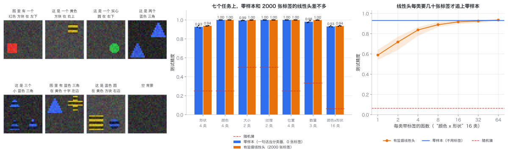
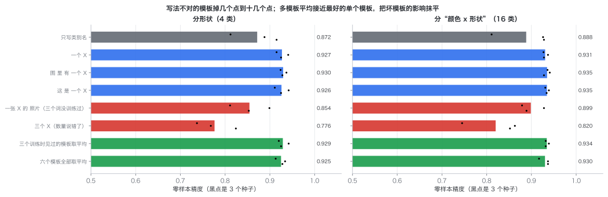
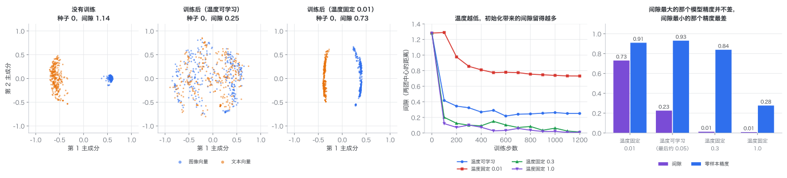
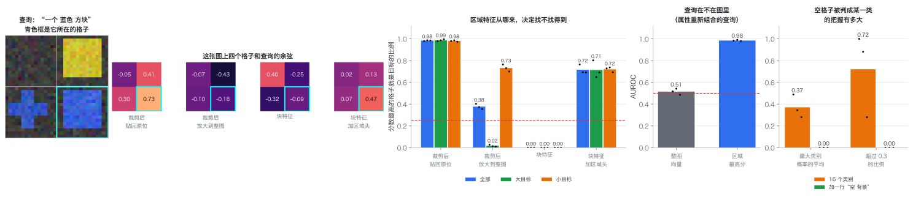

# 教程：视觉语言模型与开放词汇检测

> [!NOTE]
> 本章所有数字都来自代码生成的 32×32 彩色小图、由图的属性拼成的短句，和一个从零训练的很小的图文双塔模型，记录在 [`figures/实测数字.json`](figures/实测数字.json)，由 `solutions` 分支的 `solutions/figures/ch28.py` 生成。零样本分类器、零样本预测、Recall@K、模态间隙和区域打分用的是本章作业的参考实现。脚本在一台 Mac 的 CPU 上 150 秒左右跑完，重复运行结果相同。这个小模型两个塔合起来只有 153537 个参数，词表 34 个词，比真正的 CLIP 小好几个数量级，句子和图像又是严格对应的，结论只在所写的条件下成立；换成真实图像和大模型，数值会变，方向要自己再测一遍。讲到论文和公开数据集时，本章不引用任何没有跑过的成绩；第 9 节用预训练权重的代码没有在写课程的机器上运行过。

## 0. 本章怎么学

**应用场景**：零样本分类，用文字描述找目标，辅助缺陷复查。分类的类别经常变、新类别一开始一张标注都没有时，有监督的分类器要等攒够标签重新训练。视觉语言模型把“类别”换成了“一句话”：换一句话就换了一个分类器，把这句话拿去给图像里的各个区域打分，就是按文字找目标。本章讲这件事靠什么成立、在哪些地方不成立，以及它在缺陷复查里能帮上什么。

**优先级**：P2，分到对应方向再学。前置是第 25 章（Transformer 与 ViT）。对比损失、温度和 CLIP 的损失函数在第 13 章 5.1 节和 5.3 节讲过，线性探测在第 10 章和第 26 章讲过，本章直接用，不重复推导。

| 档位 | 累计用时 | 做什么 | 做到什么算完 |
|---|---:|---|---|
| 速通 | 3 小时 | 读第 1 节、3.2 节、第 4 节、5.2 节、6.2 节、8.2 节，看懂图 1 到图 6，把第 10 节演示的五步试一遍，答完 5 道小测 | 能讲清零样本分类器是怎样由句子得到的，提示词写错会掉多少，模型为什么会分不开词相同、意思不同的两句话，区域特征的来源为什么决定找不找得到目标，训练文字里没写过的属性会怎样 |
| 标准 | 10 小时 | 读完全章（第 9 节只读不跑），完成作业并验收通过，跑 Notebook，做第 14 节前三个破坏实验，填实验记录 | 五项测试 PASS，实验记录里有几种提示词模板的精度、没见过的组合上的精度、属性绑定的二选一结果、三种区域特征的定位精度和一个失败案例 |
| 深挖 | 16 小时 | 再做其余破坏实验，按第 9 节在自己的显卡上加载 CLIP 的预训练权重，做第 15 节的扩展（选一个） | 能在自己的图像上给出带条件的结果：用的是哪个权重、哪些提示词、几个模板取平均、每类几张标签，和一个有监督的基线比了没有，并说明显存峰值是怎么量的 |

> [!TIP]
> 用时超过所选档位的 1.5 倍还没做完，就把卡点写进 `学习进度.md`，先往下一章走。标准档不需要下载任何东西。深挖档要装包、联网下载权重，网络和环境问题最容易卡住，卡超过一小时就先回到 Notebook 的小模型把结论做完。

## 1. 为什么需要：写一句话就是一个分类器

先看一个能量化的问题。数据是 32×32 的彩色小图，分成 2×2 个 16×16 的格子，每格至多一个目标。目标有 4 种形状（方块、圆、三角、十字）、4 种颜色（红、绿、蓝、黄）、2 种大小（边长 12 px 和 8 px）、2 种纹理（实心，或者每隔 2 行压暗的条纹），背景是带噪声的深灰色。每张图配一句由这些属性拼出来的话，例如“图 里 有 一个 红色 方块 在 左下”“这 是 两个 蓝色 三角”“蓝色 三角 在 黄色 十字 左边”，每次随机省略一些属性。这就是“图文对”，没有任何类别标签。

模型是两个很小的编码器：图像塔是一个 2 层的小 ViT，文本塔是一个 2 层的小 Transformer，各自输出一个 32 维的向量。训练的目标只有一条：配对的图和句子，向量要比不配对的更像（第 2 节）。每个模型训练 1200 步，每步 64 对新生成的图文，3 个种子。

训练完之后，不再训练任何东西，直接问它七个问题。问法是把每个候选答案写成一句话，例如分形状就写“一个 方块”“一个 圆”“一个 三角”“一个 十字”四句，哪一句的文本向量和图像向量最像，就选哪一个。这叫**零样本分类**：没有用到任何一张为这个任务标注的图。对照组是常规做法：图像塔冻结，用 2000 张带标签的图在图像向量上训练一个线性分类头。测试图 1000 张，每张只有一个目标（“数量”一项用 900 张含 1 到 3 个相同目标的图）。



| 任务（测试 1000 张，3 个种子的平均） | 形状 | 颜色 | 大小 | 纹理 | 位置 | 数量 | 颜色 x 形状 |
|---|---:|---:|---:|---:|---:|---:|---:|
| 类别数 | 4 | 4 | 2 | 2 | 4 | 3 | 16 |
| 随机猜 | 0.25 | 0.25 | 0.5 | 0.5 | 0.25 | 0.333 | 0.062 |
| 零样本（0 张标签） | 0.927 | 1.0 | 0.994 | 1.0 | 1.0 | 0.981 | 0.931 |
| 线性头（2000 张标签） | 0.938 | 1.0 | 0.999 | 1.0 | 1.0 | 0.999 | 0.936 |

把线性头的标签数减下来，在“颜色 x 形状”16 类上看它什么时候追上零样本（3 个模型各抽 3 次标签，9 次的平均）：

| 每类带标签的图数 | 1 | 2 | 4 | 8 | 16 | 32 | 64 |
|---|---:|---:|---:|---:|---:|---:|---:|
| 线性头 | 0.589 | 0.718 | 0.838 | 0.89 | 0.917 | 0.925 | 0.935 |
| 零样本 | 0.931 | 0.931 | 0.931 | 0.931 | 0.931 | 0.931 | 0.931 |

读这两张表的五点：

1. **七个任务上，零样本和 2000 张标签的线性头差不多**。差得最多的是数量（0.981 对 0.999）和形状（0.927 对 0.938），其余几乎相同。
2. **线性头每类要几十张标签才追上零样本**。每类 1 张时是 0.589，每类 32 张（512 张图）时 0.925 还略低于零样本的 0.931，每类 64 张（1024 张图）才到 0.935。
3. **换一个任务不用重新训练**。同一个模型回答了七个问题，换的只是那几句话。一个为“颜色 x 形状”训练的 16 类分类器，没办法拿去回答“在哪个格子里”“有几个”。
4. **零样本不等于没有监督**。这个模型训练时见过 76800 对图文，句子里写着颜色、形状、位置。监督没有消失，只是从“每张图一个类别编号”换成了“每张图一句话”。拿同样结构的图像塔，按同样的步数和批大小（只用单目标的图），直接用“颜色 x 形状”的标签端到端训练（2 个种子），精度是 0.965，比零样本的 0.931 高。零样本换来的是第 3 条，不是更高的精度。
5. **小目标是难点，而且难在图像这一侧**。零样本分形状，大目标 0.994，小目标只有 0.858；端到端有监督训练的那个网络也一样，大目标 0.999，小目标 0.93。8 px 的小目标和图像塔的一个块一样大，这是第 25 章 9.1 节讲过的事，和用不用文字无关。

> [!IMPORTANT]
> 这组实验里，测试图和训练图来自同一个生成程序，句子也是程序按属性拼的，一个词不多、一个词不错。真正的图文模型是在网上抓来的图文对上训练的，你的图和你的类别名在不在它的训练分布里，是另一回事。第 4 节和第 8 节用同一个小模型把“不在分布里”的几种情形各量一遍。

所以本章要回答的问题是：由一句话得到的分类器靠什么成立，句子怎么写会影响多少；模型到底读懂了句子的多少；把同样的办法用到“在图里找目标”上还缺什么；以及它在工业检测里能做什么、不能做什么。

## 2. 双塔模型：两个编码器，一个共同的空间

### 2.1 数据流

```text
图像 32x32x3 → 切成 16 个 8x8 的块 → 线性嵌入，加位置编码 → 2 层编码块 → 16 个块的输出取平均 → 线性投影到 32 维 → 除以自己的长度 → u
句子（最多 12 个词）→ 词嵌入，加位置编码 → 2 层编码块 → 有效词的输出取平均 → 线性投影到 32 维 → 除以自己的长度 → v
一批 64 对       → 64x64 的相似度矩阵 S = u v^T / τ → 每一行做一次交叉熵（图找文），每一列做一次（文找图），正确答案都在对角线上
```

两个塔互相看不到对方的输入，只在最后通过内积相遇，所以叫双塔。损失函数就是第 13 章 5.3 节写出来的对称交叉熵，那里把它和 NT-Xent 逐项对照过，这里不再推导。用到的只有三件事：

- 两边的向量都先做 L2 归一化，内积就是余弦相似度。
- 一批 64 对里，每张图面对 1 句配对的话和 63 句别的图的话。什么都没学到时，损失是 ln 64，也就是 4.159；本章的模型训练结束时（最后 50 步的平均，3 个种子）是 0.632。
- 温度 $\tau$ 是和网络一起学的参数。实现里学的是它的倒数，叫相似度的放大倍数（logit scale）。本章按 CLIP 论文的做法，初值取 0.07（放大倍数 14.29），放大倍数的上限设为 100。训练结束时三个种子的温度是 0.05、0.051、0.049，放大倍数在 20 左右。

图像塔 81472 个参数，文本塔 72064 个，合起来 153537 个。在一台 Mac 的 CPU 上（3 个进程同时训练，机器上还有别的程序在跑）测的一次结果是每步 12 毫秒左右，训练一个模型 14 秒左右。代码在有 CUDA 时会自动用显卡，但本章没有在任何 NVIDIA 显卡上测过耗时和显存。

### 2.2 和真正的 CLIP 差在哪

CLIP 出自 Radford 等人 2021 年的论文 Learning Transferable Visual Models From Natural Language Supervision。结构和上面的数据流是同一个：一个图像编码器（论文里有 ResNet 和 ViT 两个系列），一个 Transformer 文本编码器，各自投影到共同空间后算余弦相似度，损失是同一个对称交叉熵，温度可学习。下面几处不同，读本章数字时要记着：

- **数据**。论文用的是从网上收集的 4 亿对图文，句子是人写的，和图的对应关系有松有紧。本章每个模型只见过 76800 对，句子由程序生成，和图严格对应。
- **规模**。本章的词表只有 34 个词，句子最长 12 个词；CLIP 的官方实现里一段文本最多 77 个标记（含起止标记），词表是几万个子词。
- **取哪个输出当整体的向量**。本章两边都取平均。CLIP 的 ViT 取类别标记（第 25 章 4.5 节），文本一侧取句末标记位置上的输出。
- **类别名怎样变成句子**。论文的默认写法是 “a photo of a {类别名}.”，并且报告把许多种写法的文本向量取平均能提高精度。3.2 节用小模型看这件事。

还有一点要交代：数据的设置是为了让这么小的模型在一两千步里学得会而调过的。目标在格子里的位置只抖动正负 1 px；探索时试过抖动更大、小目标更小的设置，同样的步数下形状基本学不会，那组结果没有放进本章的脚本，这里不引用它的数字。所以这个小模型认形状对位置和尺寸很敏感，第 1 节的“小目标难”和 6.2 节的“裁剪放大后认不出”都和这一点有关。

后面每一节的结论，都只是这个小模型在这份合成数据上的表现。它的用处是把机制摆出来，让你知道拿到真模型之后该量什么。

## 3. 零样本分类

### 3.1 做法

设类别 $c$ 套进第 $t$ 个模板之后的句子，经过文本塔得到 $v_{c,t}$。分类器的第 $c$ 行是

$$
w_c = \frac{m_c}{\lVert m_c \rVert},\qquad m_c = \frac{1}{T}\sum_{t=1}^{T} \frac{v_{c,t}}{\lVert v_{c,t} \rVert}
$$

只有一个模板时，它就是那句话的文本向量归一化的结果。图像 $x$ 的向量是 $u$，预测是

$$
p(c \mid x) = \frac{\exp\left(s\, \hat{u} \cdot w_c\right)}{\sum_{c'} \exp\left(s\, \hat{u} \cdot w_{c'}\right)},\qquad \hat{u} = \frac{u}{\lVert u \rVert}
$$

$s$ 是放大倍数，用模型自己学到的那个。这两步是作业的 `build_zeroshot_classifier` 和 `zeroshot_predict`。三点说明：

- **它就是一个线性分类器**，只是权重不是用带标签的图训练出来的，而是文本塔给的。第 13 章 5.3 节说过同一件事：类中心从“每类几张带标签图的平均”换成了“一句话”。
- **归一化做两次**。每个模板先各自归一化，是为了让每种写法的权重相同；平均之后再归一化，是为了让各个类别的分类器向量一样长。少做一次会怎样，见第 13 节的表。
- **放大倍数只改变概率有多尖，不改变选哪一类**。两个类别的余弦相差 0.1 时，放大倍数 20 给出的概率比是 e 的 2 次方，也就是 7.39 倍；放大倍数 100 给出的是 e 的 10 次方，大约 22000 倍。所以这类模型输出的“概率”主要由温度决定，不是它有多大把握。第 10 章“置信度不等于正确概率”一小节的提醒在这里同样适用。

### 3.2 提示词模板和多模板平均

同一批图，同一个模型，只改句子的写法。X 是类别名：形状任务是“方块”这样一个词，“颜色 x 形状”任务是“红色 方块”这样两个词。训练句子里出现过的写法有三种：“一个 X”“图 里 有 一个 X”“这 是 一个 X”。另外三种是：

- **只写类别名**。训练句子里的单目标描述都带数量词，没有这种光秃秃的写法。
- **一张 X 的 照片**。“一张”“的”“照片”三个词在词表里，但训练句子里从来没出现过，它们的词嵌入还是随机初始化的值。
- **三个 X**。写法见过，但测试图里只有一个目标，数量说错了。



| 提示词的写法（1000 张单目标图，3 个种子的平均） | 分形状 | 分“颜色 x 形状” | 分形状时最大概率的平均 |
|---|---:|---:|---:|
| 只写类别名 | 0.872 | 0.888 | 0.929 |
| 一个 X | 0.927 | 0.931 | 0.896 |
| 图 里 有 一个 X | 0.93 | 0.935 | 0.899 |
| 这 是 一个 X | 0.926 | 0.935 | 0.899 |
| 一张 X 的 照片 | 0.854 | 0.899 | 0.863 |
| 三个 X | 0.776 | 0.82 | 0.892 |
| 三个见过的模板取平均 | 0.929 | 0.934 | 0.899 |
| 六个模板全部取平均 | 0.925 | 0.93 | 0.927 |

1. **训练时见过的三种写法没有区别**，分形状都在 0.926 到 0.93 之间。
2. **写法不在训练分布里，就要掉点**。只写类别名掉到 0.872，三个种子是 0.915、0.888、0.812，有的种子几乎不受影响，有的掉了十个点。带三个没训练过的词的那种写法掉到 0.854。六种写法里最好和最差的相差 0.153（形状）和 0.115（颜色 x 形状）。
3. **句子里的每个词都算数**。“三个 X”把精度拉到 0.776，比少写一个词的“只写类别名”（0.872）掉得还多。一种解释是文本向量被“三个”拉向了有三个目标的图，这个解释没有单独验证。
4. **在这个小模型上，多模板平均没有超过最好的单个模板**。三个见过的模板取平均是 0.929，其中最好的单个是 0.93。把另外三种写法也放进去，六个模板一起平均，是 0.925，仍然贴着最好的那一档，高于那三种写法自己的 0.872、0.854 和 0.776。所以平均在这里的作用是保险：不用事先知道哪个模板好。CLIP 的论文报告多模板平均在 ImageNet 上有提升（论文用了 80 个模板），本章没有复现出“提升”，只复现了“不怕混进坏模板”。原因可能是这里三个好模板的文本向量本来就几乎一样，这个解释没有验证。
5. **把不关心的属性各写一遍再平均，同样没有带来提升**。分形状时，把四种颜色各写一遍再平均是 0.93，把颜色、大小、纹理的 16 种写法都写一遍再平均是 0.926，和“一个 X”的 0.927 没有区别。
6. **模板还会改变置信度**。只写类别名时精度是 0.872，低于三种见过的写法，最大概率的平均却是八行里最高的 0.929。置信度高低和对错在这里对不上。

对真模型的启示只有方向：提示词要写成它训练数据里常见的句子的样子，不同写法之间的差距要在自己的数据上量，量的时候把每种写法单独的精度和平均之后的精度都列出来。

<!-- quiz -->
**测试图里都只有一个目标。分形状时，把提示词从“一个 方块”这一组换成“三个 方块”这一组，其余不变。精度会怎样？**

- A. 不变，数量词和形状没有关系
- B. 降不到 1 个点，模型会自动忽略不相关的词
- C. 掉十几个点

<details markdown="1"><summary>答案与解释</summary>

**C**。实测从 0.927 掉到 0.776。文本塔把整句话变成一个向量，句子里的每个词都会挪动它，没有哪个词是“不参与”的。同一张表里，带三个没训练过的词的写法是 0.854，只写类别名是 0.872。A 和 B 都假设模型会把句子拆成“相关的词”和“不相关的词”，它没有这个机制。

</details>
<!-- /quiz -->

## 4. 模型到底读懂了多少

零样本分类的结果容易让人以为模型“理解”了句子。这一节用三组实验量它理解到哪一步：见过“红色”也见过“圆”，认不认得没见过的“红色 圆”；用的词完全相同、意思不同的两句话，它分不分得开；把一句话里的词打乱，它在不在乎。

### 4.1 没见过的属性组合

再训练一组模型，训练时把 4 种（颜色，形状）组合从所有场景里拿掉：红色圆、绿色三角、蓝色十字、黄色方块。每种颜色、每种形状仍然各在另外 3 种组合里出现，所以每个词模型都见过，只是这 4 种搭配没见过。2 个种子。测试时分两批：1200 张见过的 12 种组合的单目标图，600 张没见过的 4 种组合的单目标图，都在 16 句“一个 颜色 形状”里选，随机猜是 0.062。

对照组有三个。两种线性头都在冻结的图像向量上用 2400 张带标签的图训练，这些图当然也只有见过的 12 种组合：一个是平铺的 16 类头；另一个是颜色 4 类、形状 4 类各一个头，预测时拼起来。第三个对照是图 1 的模型（训练时 16 种组合都有），用同样的测试图。


| 16 选 1 的精度（2 个种子的平均） | 见过的 12 种组合 | 没见过的 4 种组合 |
|---|---:|---:|
| 零样本，训练时缺这 4 种组合 | 0.96 | 0.138 |
| 平铺的 16 类线性头，同一个模型的图像向量 | 0.965 | 0.0 |
| 颜色、形状各一个线性头，同一个模型的图像向量 | 0.965 | 0.035 |
| 零样本，训练时 16 种组合都有（对照） | 0.93 | 0.942 |
| 颜色、形状各一个线性头，对照模型的图像向量 | 0.961 | 0.698 |

1. **没见过的组合上，零样本精度从 0.96 掉到 0.138**（两个种子是 0.208 和 0.067），只比随机猜的 0.062 高一点。同样这批图，交给训练时 16 种组合都有的模型，是 0.942。
2. **错的是形状，不是颜色**。没见过的组合上，颜色判对的比例是 1.0，形状判对的只有 0.138；有 0.863 的图被判成了某个见过的组合，也就是同一种颜色配上另一种形状。只问形状（4 句“一个 圆”这样的话）更能说明问题：见过的组合上是 0.959，没见过的组合上是 0.059，比 4 选 1 的随机猜 0.25 还低。模型不是不确定，是系统性地认错：在它的经验里，红色的东西从来不是圆。
3. **图像塔这一侧肯定有问题**。绕开文本塔，直接在图像向量上给颜色和形状各训练一个线性头：在这个模型上，没见过的组合只有 0.035；同样的做法放到对照模型的图像向量上有 0.698。也就是说，这个图像塔没有学到一个和颜色无关的“形状”表示，对每种颜色只学会了区分它见过的那 3 种形状。文本塔那一侧把“红色”和“圆”拼得怎么样，这个实验没有单独分离出来。能看到的只有：第 1 名虽然只对了 0.138，正确答案排进前 3 的比例却有 0.883（16 句里随便挑 3 句是 0.188），而且前 4 名并不都是同色的句子（只有 0.305 的图是这样）。正确的那句话离这些图不算远，只是总被某一句见过的同色组合压过。
4. **平铺的线性头在没见过的类别上是 0.0**。这是定义决定的：一个类别没有任何带标签的样本，线性头永远不会预测它。零样本至少还有一条路（0.138），常规分类器连路都没有。

这组实验的条件很苛刻：属性只有 4×4，每种颜色只见过 3 种形状。它说明的只是一件事：**由见过的词组合出没见过的概念，不是双塔结构白送的，取决于训练数据把组合覆盖到了什么程度**。真模型见过的组合多得多，你关心的那种组合它认不认得，要像这样单独拿出来测，不能从“每个词它都认识”推出来。

<!-- quiz -->
**训练时所有图里都没有“红色的圆”，但红色的方块、三角、十字和别的颜色的圆都有。测试时给它红色的圆，在 16 句“一个 颜色 形状”里选。最常见的结果是什么？**

- A. 选对，“红色”和“圆”它都认识
- B. 形状对、颜色错，选成别的颜色的圆
- C. 颜色对、形状错，选成红色的别的形状

<details markdown="1"><summary>答案与解释</summary>

**C**。实测没见过的 4 种组合上，颜色判对的比例是 1.0，形状判对的只有 0.138，0.863 的图被判成了某个见过的组合。只问形状时精度是 0.059，低于随机猜的 0.25，说明是系统性的错。对照模型（训练时见过全部 16 种组合）在同一批图上是 0.942，所以不是这些图本身难认。A 是“每个词都认识就能组合”的直觉，这个实验里不成立。

</details>
<!-- /quiz -->

### 4.2 属性绑定：词相同、意思不同的两句话

训练数据里有一类场景是同一行左右两个目标，颜色和形状都不同，句子写成“红色 方块 在 蓝色 圆 左边”。取 600 张这样的图，每张图让模型在两句话之间二选一，随机猜是 0.5：

- 正确的句子，和**两个颜色词对调**的句子（“蓝色 方块 在 红色 圆 左边”）。
- 正确的句子，和**两个目标的先后对调**的句子（“蓝色 圆 在 红色 方块 左边”）。
- 正确的句子，和**只把“左边”换成“右边”**的句子。

前两种改法用的词和正确句子一模一样，只是搭配或者顺序变了。一个只数“句子里有哪些词”的模型分不开它们，这种模型叫词袋（bag of words）。把哪个颜色归给哪个形状，叫**属性绑定**。

比较五组模型。词袋文本塔是特意做的对照：词嵌入取平均后过一个小 MLP，结构上就不含词序。加难负样本是指训练时给每个“左右两个目标”的场景额外配一句词相同、意思不同的句子，当作这张图要推开的负样本。2400 步的两组是从头重新训练的（学习率同样先升后降），不是在 1200 步的模型上接着训练。

| 模型（二选一的精度，随机猜 0.5） | 两个颜色词对调 | 两个目标的先后对调 | 只把左边换成右边 | 单目标“颜色 x 形状”零样本 |
|---|---:|---:|---:|---:|
| 词袋文本塔，1200 步（2 个种子） | 0.5 | 0.5 | 0.473 | 0.94 |
| Transformer 文本塔，1200 步（图 1 的模型，3 个种子） | 0.537 | 0.486 | 0.571 | 0.931 |
| 同上，加难负样本，1200 步（3 个种子） | 0.715 | 0.678 | 0.766 | 0.935 |
| Transformer 文本塔，2400 步（3 个种子） | 0.954 | 0.837 | 0.846 | 0.955 |
| 同上，加难负样本，2400 步（3 个种子） | 1.0 | 1.0 | 1.0 | 0.955 |

1. **图 1 的那个模型就是一个词袋**。它单目标的零样本精度有 0.931，但两种“词相同”的改法上是 0.537 和 0.486，和抛硬币一样。它的文本塔有位置编码、有自注意力，结构上完全能区分词序，只是没有用：正确句子和颜色词对调的句子，与图像的平均余弦都是 0.845。结构上真的不含词序的词袋文本塔，两项正好是 0.5（两句话的向量完全相同，记半对），单目标精度 0.94，一点不比它差。
2. **原因在损失要求什么**。按训练时的场景分布统计，一批 64 个场景里平均有 19.06 个“左右两个目标”的场景，其中只有 0.318 的场景能在同一批里碰到一句“词相同、意思不同”的话；这种图文对只占一个批里全部负样本对的 0.0018。其余的负样本，只要知道句子里有哪些词就能推开。对比损失奖励的是把这一批分对，不是读懂句子。Yuksekgonul 等人 2023 年的论文 When and why vision-language models behave like bags-of-words, and what to do about it? 对真模型给出的就是这个解释。
3. **训练得更久，绑定会出现，但出现得晚，早晚看种子**。图 3 右二栏：单目标的零样本精度在 600 步时三个种子已经是 0.871、0.84、0.854，二选一的精度到 1000 步还在 0.56 到 0.59 之间，之后才往上走；训练满 2400 步时三个种子是 0.983、1.0、0.88。“两个目标的先后对调”这一项，第三个种子到最后还是 0.512。
4. **加难负样本让绑定来得更早、更齐**。2400 步的三个种子全部到 1.0；其中两个在 1000 步时就到了 0.995 和 1.0，第三个那时还是 0.523，到 1800 步才是 0.997。只训练 1200 步的那一组，三个种子是 0.963、0.616、0.565，同样是有的学会了、有的没有。
5. **“只把左边换成右边”在 1200 步的模型上是噪声**。平均 0.571，三个种子是 0.775、0.537、0.402，一个明显高于 0.5，一个明显低于 0.5。只看平均值会以为模型学到了一点点。

这组实验的语言很小，“左右两个目标”一共只有 144 种写法，真实的句子复杂得多。它和文献的方向一致（Winoground、ARO 这些测评专门考这类句子，上面那篇论文也是用加难负样本的办法改进），但数值没有可比性。能带走的结论是：**一个图文模型在分类和检索上表现好，不说明它会绑定属性；要知道它会不会，就要拿“词相同、意思不同”的成对句子去测**。

### 4.3 图文检索，和把句子里的词打乱

检索是这类模型最直接的用法：拿一张图找最匹配的句子（图找文），或者拿一句话找最匹配的图（文找图）。指标是 Recall@K：排在前 K 个的候选里有正确答案的查询所占的比例，作业的 `recall_at_k`。

取 500 个场景（单个目标 247 个、多个相同目标 101 个、左右两个不同目标 152 个），每个场景配一句把全部属性都写出来的话，例如“一个 大 条纹 红色 方块 在 左上”“两个 小 实心 蓝色 圆”“红色 方块 在 蓝色 圆 左边”。两个场景的句子完全相同时，它们互为正确答案；这样的场景占 0.618，所以正确答案常常不止一个，也不在相似度矩阵的对角线上。

| 500 个场景的检索（3 个种子的平均） | 1200 步（图 1 的模型） | 2400 步 | 2400 步，加难负样本 |
|---|---:|---:|---:|
| 图找文 R@1 | 0.785 | 0.885 | 0.904 |
| 图找文 R@5 | 0.957 | 0.992 | 0.996 |
| 文找图 R@1 | 0.786 | 0.891 | 0.919 |
| 把每句话的词随机打乱后，图找文 R@1 | 0.784 | 0.797 | 0.776 |
| 原句和打乱后的句子的余弦 | 0.99 | 0.973 | 0.958 |
| 只认对角线时算出来的图找文 R@1（错误的算法） | 0.515 | 0.572 | 0.584 |

按场景类型拆开看图找文的 R@1（图 3 最右一栏画了其中四组）：

| 图找文 R@1：原句 / 打乱 | 单个目标 | 多个相同目标 | 左右两个不同目标 |
|---|---:|---:|---:|
| 1200 步（图 1 的模型） | 0.965 / 0.954 | 0.977 / 0.96 | 0.366 / 0.39 |
| 2400 步 | 0.972 / 0.977 | 0.983 / 0.977 | 0.678 / 0.386 |
| 2400 步，加难负样本 | 0.977 / 0.966 | 0.987 / 0.987 | 0.73 / 0.327 |

1. **图 1 的模型，把句子里的词全部打乱，检索几乎不变**：R@1 从 0.785 到 0.784，原句和打乱后的句子的余弦是 0.99。它没有在用词序。
2. **学会绑定之后，打乱才有代价，而且只发生在需要绑定的场景上**。2400 步的模型，左右两个目标的场景从 0.678 掉到 0.386；单个目标的场景是 0.972 和 0.977，没有变化。描述一个目标的句子，词的顺序本来就不携带信息。
3. **总的检索指标会把这件事盖住**。1200 步的模型在单目标和多个相同目标的场景上 R@1 是 0.965 和 0.977，需要绑定的那一类只有 0.366，合在一起是 0.785。如果测试集里需要绑定的句子很少，一个词袋也能拿到很高的 Recall。
4. **正确答案不止一个时，算法写错会把指标压低一大截**。只把第 i 句当成第 i 张图的正确答案，R@1 会被算成 0.515，实际是 0.785。公开的图文检索数据集里一张图通常配几句话，也是同一个问题。

<!-- quiz -->
**图 1 的模型做图找文检索，R@1 是 0.785。把 500 句话里的词各自随机打乱（“一个 大 红色 方块 在 左上”变成“左上 红色 一个 在 方块 大”之类），图像不动，再检索一次。R@1 大约是多少？**

- A. 接近 0，句子已经不通了
- B. 掉一半左右
- C. 几乎不变

<details markdown="1"><summary>答案与解释</summary>

**C**。实测是 0.784，原句和打乱后的句子的余弦有 0.99。这个模型在二选一的绑定测试上是 0.537 和 0.486，本来就没有用词序。训练到 2400 步、学会绑定之后，打乱才让“左右两个目标”的场景从 0.678 掉到 0.386，单目标的场景仍然不受影响（0.972 和 0.977）。所以“检索指标不错”和“读懂了句子”是两回事。

</details>
<!-- /quiz -->

## 5. 模态间隙

### 5.1 是什么，怎么量

图像向量和文本向量都在同一个单位球面上，训练又要求配对的图文靠近，直觉上两种向量应该混在一起。实际常常不是：图像向量挤在球面的一块，文本向量挤在另一块，中间隔着一段。这叫**模态间隙**（modality gap），出自 Liang 等人 2022 年的论文 Mind the Gap: Understanding the Modality Gap in Multi-modal Contrastive Representation Learning。

量法很简单。$N$ 个图像向量和 $M$ 个文本向量各自归一化，记它们的平均（中心）是 $\bar{u}$ 和 $\bar{v}$：

$$
\Delta = \lVert \bar{u} - \bar{v} \rVert,\qquad
\sigma_u = \sqrt{\frac{1}{N}\sum_{i} \lVert \hat{u}_i - \bar{u} \rVert^2} = \sqrt{1 - \lVert \bar{u} \rVert^2}
$$

$\Delta$ 是间隙，$\sigma_u$ 是图像这一团的散布（文本一侧同理）。向量全部重合时散布是 0，在球面上铺得很开时接近 1；两团方向相反、各自挤成一点时间隙是 2.0。这是作业的 `modality_gap`。

### 5.2 实测：间隙从哪来，说明什么

1000 个随机场景的图像向量，和它们各自句子的文本向量。比较没有训练的模型、图 1 的模型（温度可学习），和三个把温度固定住训练的模型。



| 模型（1000 对图文；前两行 3 个种子，其余 1 个） | 间隙 | 图像向量的散布 | 文本向量的散布 | 配对的图文余弦 | 不配对的图文余弦 | 零样本精度 | 两边各自减去中心后的零样本精度 |
|---|---:|---:|---:|---:|---:|---:|---:|
| 没有训练 | 1.209 | 0.213 | 0.609 | 0.052 | 0.053 | 0.067 | 0.055 |
| 温度可学习（最后约 0.05） | 0.226 | 0.961 | 0.988 | 0.815 | 0.024 | 0.931 | 0.927 |
| 温度固定 0.01 | 0.731 | 0.542 | 0.549 | 0.648 | 0.435 | 0.91 | 0.916 |
| 温度固定 0.3 | 0.013 | 0.999 | 0.999 | 0.927 | 0.002 | 0.839 | 0.838 |
| 温度固定 1.0 | 0.009 | 0.998 | 0.998 | 0.973 | 0.004 | 0.277 | 0.274 |

1. **间隙在训练之前就有**。随机初始化的图像塔把所有图都映到球面上很窄的一块（散布只有 0.213），文本塔也一样，两块各在一处，相距 1.209，是两个散布平均值的 2.979 倍。图 4 左一栏就是这个样子。那篇论文把这叫锥形效应。
2. **训练把间隙缩小，缩到多少看温度**。温度可学习时剩 0.226；固定在 0.01 时还剩 0.731；固定在 0.3 和 1.0 时几乎为 0。图 4 右二栏：温度 0.01 的那条线在第 100 步还是 1.29，没有动，之后才慢慢下降；温度可学习的那条在第 100 步已经降到 0.417。
3. **温度低时，损失不需要两团靠拢就能降下去**。温度 0.01 的模型，配对的图文余弦只有 0.648，不配对的也有 0.435，两者只差 0.2 左右，但除以 0.01 之后这个差足够把配对的那一句挑出来：它最后的损失是 0.678，和温度可学习的 0.632 差不多。对比损失只管一行里谁比谁大，不管整体挪到哪里。这和那篇论文的结论方向一致。
4. **间隙的大小不能用来判断模型好坏**。间隙最大的那个训练好的模型（0.731）零样本精度是 0.91；间隙最小的那个（0.009）只有 0.277。图 4 最右一栏。
5. **把间隙平移掉，精度不变**。图像向量减去图像团的中心、分类器的文本向量减去文本团的中心，各自重新归一化，再做零样本分类：0.931 变成 0.927，0.91 变成 0.916。零样本分类比的是一张图和几句话谁近谁远，两团整体相距多远不影响这个排序。

间隙不影响排序，为什么还要知道它？因为它影响所有用到余弦**绝对值**的地方：

- **阈值不能跨模型照搬**。温度 0.01 的模型里，随便一张图和随便一句话的余弦平均就有 0.435；温度可学习的模型里，这个数是 0.024。“余弦大于某个数就算匹配”这种规则，换一个模型就失效。
- **图和图的相似度、图和文的相似度不在一个刻度上**。同一个库里既按图找图又按文找图时，两种分数不能直接比较，也不能共用一个阈值。
- **图像向量和文本向量不能随手互换**。把几张图的图像向量平均起来当类中心，和文本向量给的类中心，落在球面的不同地方。第 7 节的少样本适配要处理这件事。

本章的小模型在温度可学习时间隙只有散布的 0.232 倍，图 4 左二栏里两团基本混在一起。真模型上文献报告的间隙要明显得多，配对图文的余弦也远小于 1。这里没有可比性，要知道你手里的模型是什么样，用 `modality_gap` 在自己的图文对上量一次，再顺手看一下配对和不配对的余弦各是多少。

<!-- quiz -->
**两个训练好的双塔模型，结构和数据相同，只有温度不同。模型甲的图像向量和文本向量相距很远（间隙 0.731），模型乙的两团几乎重合（间隙 0.009）。哪个的零样本精度高？**

- A. 乙，两种向量对齐得好，分类自然准
- B. 甲
- C. 一样，间隙和精度无关所以必然相同

<details markdown="1"><summary>答案与解释</summary>

**B**。实测甲（温度固定 0.01）是 0.91，乙（温度固定 1.0）只有 0.277。间隙小不等于学得好：乙的温度太高，第 13 章 5.1 节说过这时所有负样本被一视同仁地推开，学不到细的区别，它的损失还停在 3.314。零样本分类只看相对远近，把甲的间隙平移掉，精度是 0.916，几乎不变。C 的前半句对，后半句不对：间隙不决定精度，不等于两个模型精度相同。

</details>
<!-- /quiz -->

## 6. 开放词汇检测的原理：用文本向量给区域打分

### 6.1 从分类到检测

第 11 章 11.2 节的两阶段检测器分两步：先给出一批候选区域，再给每个区域分类。分类那一步的最后一层是一个固定的线性层，每个类别一行权重，类别表在训练时就定死了。**开放词汇检测**把这一行行权重换成文本向量：类别不再是训练时定好的编号，而是推理时现写的一句话。打分的规则和零样本分类一样，只是对象从整张图换成了一个区域：

$$
\text{score}(r, q) = \frac{f_r \cdot v_q}{\lVert f_r \rVert\, \lVert v_q \rVert}
$$

$f_r$ 是第 $r$ 个区域的特征，$v_q$ 是第 $q$ 个查询的文本向量。每个查询在所有区域里取分数最高的，就是“按这句话找目标”。这是作业的 `score_regions`。

公式里唯一没有着落的是 $f_r$：**一个区域的特征从哪来，才能和文本向量放在一起比**。双塔模型训练时只保证了“整张图的向量”和“整句话的向量”对得上，没有任何一项损失管过区域。

### 6.2 区域特征从哪来

用小模型做一个“文字查询找目标”的实验。每张图有 3 个目标和 1 个空格：要找的目标、一个同色不同形状的干扰、一个同形状不同色的干扰，大小和纹理随机。查询是“一个 颜色 形状”。候选区域就是 4 个格子，取分数最高的格子，随机猜是 0.25。图 1 的 3 个模型，每个 600 张图。区域特征比较四种来源：

- **裁剪后贴回原位**。把这一格的像素贴到一张填了背景灰度的空图的同一位置，再过图像塔。目标的大小、位置都和原图一样。
- **裁剪后放大到整图**。把 16×16 的格子双线性放大到 32×32 再过图像塔，这是“按框裁出来、缩放到模型的输入尺寸”的常规做法。目标变成了原来的 2 倍大。
- **块特征**。整图只过一次图像塔，把这一格的 2×2 个块标记各自投影到共同空间后取平均。
- **块特征加区域头**。双塔冻结，另外训练一个作用在块标记上的线性头，用 19200 张带格子标注的图，让每个格子的特征和这一格目标的句子对上、空格子和“空 背景”对上。



| 区域特征的来源（3 个种子的平均） | 定位精度 | 大目标 | 小目标 | 最高分落在空格子上的比例 | 图像塔要算几次 |
|---|---:|---:|---:|---:|---|
| 裁剪后贴回原位 | 0.984 | 0.988 | 0.98 | 0.0 | 每个区域一次 |
| 裁剪后放大到整图 | 0.377 | 0.017 | 0.732 | 0.211 | 每个区域一次 |
| 块特征 | 0.0 | 0.0 | 0.0 | 1.0 | 整图一次 |
| 块特征加区域头 | 0.717 | 0.714 | 0.72 | 0.055 | 整图一次，另需带框的标注来训练 |

1. **裁剪后贴回原位几乎全对**（0.984）。送进图像塔的每一张小图，看起来都像训练时的“单个目标”场景，整图向量的那套对齐直接可用。代价是每个区域过一次图像塔。
2. **裁剪后放大到整图只有 0.377，大目标几乎全错（0.017）**。训练图里目标的边长只有 12 px 和 8 px 两种。放大 2 倍后，大目标变成 24 px，是见过的最大尺寸的 2 倍；小目标变成 16 px，离见过的 12 px 近一些，还有 0.732。这是按尺寸做的解释，没有单独验证，但现象很清楚：**把区域裁出来缩放，改变了目标在图里的大小和周围的上下文，图像塔是在整图上训练的，不保证认得**。
3. **直接用块特征，定位精度是 0.0，而且最高分全部落在空格子上**。查询和目标所在格子的平均余弦是 -0.148，和空格子的是 0.544。训练只约束了 16 个块标记的平均，没有任何一项要求单个块标记和文本对齐，它们各自长成什么样是自由的。在这个模型上它们长反了；换一个模型会是什么样本章不知道，但“没人要求它对齐”这一点是一样的。
4. **给块特征加一个区域头，回到 0.717**，整图只算一次。但它要用带框的标注来训练，这已经不是“只有图文对”了；而且只训练一个线性层、图像塔冻结，还到不了裁剪那条路的 0.984。本章没有试过把图像塔也放开一起训练。

区域特征的四种来源，对应着真模型的几条路线，6.5 节再说。

### 6.3 整图向量回答不了“这个东西在不在图里”

另取 600 张图，3 个目标的颜色各不相同、形状也各不相同。给两种查询：一种是图里确实有的目标；另一种把一个目标的颜色和另一个目标的形状拼在一起，两个词图里都有，但没有一个目标同时是这个颜色和这个形状。看分数能不能把这两种查询分开（AUROC，0.5 是分不开）：

| 用什么打分（3 个种子的平均） | AUROC |
|---|---:|
| 整张图的图像向量和查询的余弦 | 0.515 |
| 4 个区域里最高的余弦（裁剪后贴回原位） | 0.985 |

整图向量是 0.515，完全分不开。这就是 4.2 节的词袋问题换了一个问法：整图向量里记着“有红色、有蓝色、有方块、有圆”，没记着谁配谁。按区域打分是 0.985，因为每个区域里只有一个目标，颜色和形状在空间上已经被分开了，不需要模型自己去绑定。**检测把绑定的难题交给了区域**，这是按区域打分比整图打分多出来的东西。

### 6.4 背景提示

检测里大多数候选区域是背景。把每个格子当成一张小图做 16 类零样本分类（区域特征用裁剪后贴回原位），有目标的格子精度是 0.928，其中大目标 0.995，小目标 0.862。问题出在空格子：

| 空格子上的表现（3 个种子的平均） | 16 个类别 | 再加一行“空 背景” |
|---|---:|---:|
| 最大类别概率的平均 | 0.371 | 0.0 |
| 最大类别概率超过 0.3 的比例 | 0.721 | 0.0 |
| 有目标的格子的精度 | 0.928 | 0.928 |

空格子里什么都没有，但 softmax 要求 16 个类别的概率加起来是 1，总得有一个类别拿走最大的一份：平均 0.371，三个种子是 0.489、0.344、0.28；最大概率超过 0.3 的空格子占 0.721，三个种子是 1.0、0.882、0.28，有的种子全部超过，有的种子只有不到三成。在分类器里加一行“空 背景”的文本向量，让“什么都不是”也有一句话可选，空格子上的类别概率全部降到 0.0，有目标的格子不受影响。

这里有一个便利条件：训练数据里有 5% 的场景是空图，句子就是“空 背景”，模型学过这句话。真模型没有一句现成的话能概括“除了我要找的东西以外的一切”，背景提示写什么、写几句，要针对自己的图试，并且在没有目标的区域上单独统计误报。

### 6.5 真正的开放词汇检测模型是怎么做的

下面只讲定位，名字和论文题目是确定的，细节以论文和官方仓库为准。

- **裁剪后过图像塔**这条路最直接，贵在每个区域一次前向，并且有 6.2 节第 2 条的问题。ViLD（Gu 等，2022，Open-vocabulary Object Detection via Vision and Language Knowledge Distillation）把这个代价挪到了训练时：让检测器的区域特征去拟合 CLIP 图像编码器在裁剪区域上给出的向量，推理时检测器自己一次算完。
- **块特征加区域头**对应 OWL-ViT（Minderer 等，2022，Simple Open-Vocabulary Object Detection with Vision Transformers）。它从图文对比预训练的 ViT 和文本编码器出发，去掉最后的汇聚，在每个输出标记上接轻量的分类头和框回归头，分类头的输出和查询的文本向量比较，然后在检测数据上整体微调。和本章小实验的差别是：它微调了整个模型，并且同时回归框的坐标；本章的候选区域是固定的 4 个格子，只训练了一个线性层。
- **Grounding DINO**（Liu 等，2023，Grounding DINO: Marrying DINO with Grounded Pre-Training for Open-Set Object Detection）走的是另一条路：不是最后才拿文本向量去比，而是在检测器内部的多个阶段让图像特征和文本特征互相融合，输入是图像和一段文字，输出是框和它对应的词。名字里的 DINO 是一个 DETR 系列的检测器，和第 26 章自蒸馏的 DINO 只是重名。

三点共同之处值得记住。一，它们都用了带框的数据（检测数据或者图文定位数据）来训练，“开放词汇”说的是推理时类别可以现写，不是训练不要框。二，输出仍然是框和分数，阈值、NMS 和 AP 的算法照第 11 章 11.5 节和 11.6 节做。三，小目标和背景是它们和普通检测器共有的难点，6.2 节和 6.4 节的两个问题不会因为模型大了就消失，要在自己的图上量。

<!-- quiz -->
**一个双塔模型的零样本分类精度是 0.93。现在要按文字找目标：整图过一次图像塔，取出 16 个块标记，各自投影到共同空间，和查询的文本向量算余弦，分数最高的格子算找到的位置。4 个格子里选 1 个，定位精度大约是多少？**

- A. 0.98 左右，分类都能做对，定位只是换个位置算
- B. 0.25 左右，和随机猜差不多
- C. 0，分数最高的总是空格子

<details markdown="1"><summary>答案与解释</summary>

**C**。实测 3 个种子都是 0.0，最高分落在空格子上的比例是 1.0：查询和目标所在格子的平均余弦是 -0.148，和空格子的是 0.544。训练只要求 16 个块标记的平均和文本对齐，单个块标记没有被约束。A 的 0.984 是“裁剪后贴回原位”那种区域特征的结果，要每个区域过一次图像塔；在块标记上另训练一个线性头是 0.717，要带框的标注。

</details>
<!-- /quiz -->

## 7. 少样本适配

零样本分类器是现成的，但你的图常常和模型训练时见过的不一样。手里有几张带标签的图时，怎样用上它们？

### 7.1 三种做法

- **零样本**：不用标签。
- **线性探测**：图像塔冻结，在图像向量上训练一个线性分类头，权重从 0 开始（第 10 章“特征缓存”一小节、第 26 章 4.1 节）。它完全不用文本塔。
- **从零样本分类器出发微调**：同样是训练线性分类头，但权重的初值取零样本分类器（每个类别那一行文本向量），并且在损失里惩罚它离开初值的距离：

$$
\mathcal{L} = \text{交叉熵}(W) + \lambda\, \lVert W - W_{\text{文本}} \rVert^2
$$

样本少时，文本向量给的先验把权重拉住；样本多了，数据说了算。用零样本分类器初始化分类头是常见的做法（例如 Wortsman 等人 2022 年的 Robust fine-tuning of zero-shot models）。训练好的 $W$ 不再是单位向量，这就是 `zeroshot_predict` 规定“分类器原样使用、不再归一化”的原因。

### 7.2 实测：每类 1 到 16 个样本

制造一个模型没见过的成像条件：把图的对比度减半（每个像素换成 0.4 加上原值减 0.4 的一半）。“颜色 x 形状”16 类的零样本精度从 0.931 掉到 0.751。现在每类给 1 到 16 张对比度减半的带标签图，双塔都冻结。图 1 的 3 个模型，每个模型抽 4 次标签，12 次的平均；惩罚系数 $\lambda$ 固定取 0.3，没有针对每一档调。这个值是探索时在几个候选里挑的，挑的时候看的就是这批测试图，所以下面两种做法在样本多的那几档谁略高谁略低，不要当成结论。


| 每类带标签的图数（对比度减半的图，16 类） | 1 | 2 | 4 | 8 | 16 |
|---|---:|---:|---:|---:|---:|
| 线性探测（从 0 开始） | 0.382 | 0.559 | 0.722 | 0.83 | 0.873 |
| 从零样本分类器出发微调 | 0.796 | 0.81 | 0.833 | 0.854 | 0.867 |
| 零样本（不用标签） | 0.751 | 0.751 | 0.751 | 0.751 | 0.751 |

作为参照，每类 100 张标签的线性探测是 0.912。

1. **每类只有 1 张时，线性探测（0.382）远不如什么都不做的零样本（0.751）**。16 张图定不出 16 个类别的方向。每类 4 张时它还是低于零样本（0.722），到 8 张才超过（0.83）。
2. **从零样本分类器出发，每一档的平均都高于零样本**，每类 1 张就从 0.751 涨到 0.796。12 次里最差的一次是 0.768（图 6 左栏的浅色带是各次的范围）。
3. **样本多了之后两者汇合，线性探测略微超出**：每类 16 张时是 0.873 对 0.867。$\lambda$ 固定时，拉住权重的那一项在数据多了以后变成了拖累。实际使用时 $\lambda$ 要在验证集上选，或者随样本数减小。
4. **离每类 100 张的 0.912 还有距离**。少样本适配补的是“分类器的方向”，图像塔在新成像条件下提出来的特征变差了多少，它补不了。那要靠微调图像塔，是第 10 章 10.3 节的话题。

### 7.3 提示学习（只讲原理）

上面调的是共同空间里的分类器向量，每个类别一行。**提示学习**调的是另一头：文本塔的输入。CoOp（Zhou 等，2022，Learning to Prompt for Vision-Language Models）的做法是把模板里那几个词的词嵌入换成可以学习的向量，后面接上类别名，两个塔都冻结，用少量带标签的图通过文本塔把梯度传回这几个向量。学到的不再是人能读的词，而是一段“连续的提示”。

和 7.2 节的做法比：可学习的参数从“每个类别一个向量”变成了“所有类别共用的几个词向量”，分类器仍然由文本塔生成，所以文本塔学到的结构还在起约束作用。原作者后续的工作指出，这样学到的提示在训练时没见过的类别上会变差，并为此做了改进（CoCoOp）。本章没有实现提示学习，上面只是原理，效果以论文为准。

## 8. 工业检测：能做什么，不能指望什么

### 8.1 思路：用文字描述“正常”和“异常”

把零样本分类搬到异常检测上，做法很自然：写一组描述正常的句子、一组描述异常的句子，一张图（或者图上的一个窗口）和哪一组更像，就判成哪一种，分数取两边相似度之差。WinCLIP（Jeong 等，2023，WinCLIP: Zero-/Few-Shot Anomaly Classification and Segmentation）是这条路上有代表性的工作：把许多描述状态的词和许多模板组合起来取平均，在滑动窗口上打分来定位；有几张良品时，再加上和良品特征比较的一路。之后还有学习提示词的做法（例如 AnomalyCLIP）。细节和效果以论文为准。

这个思路能不能用在你的数据上，取决于两件事：模型的训练数据里有没有“这种异常长什么样、叫什么”的图文对；异常在图像向量里留没留下痕迹。下面用小模型把这两件事各量一遍。

### 8.2 用小模型能验证的部分：训练文字里没有的属性

**实验一：图里有，句子里从来不写**。再训练一组模型，训练图像和图 1 的模型完全一样，一半目标是条纹的，只改句子：永远不出现“实心”“条纹”这两个词。然后问它纹理（1000 张单目标图，随机猜 0.5，2 个种子）。

| 模型 | 零样本分纹理 | 零样本分形状（对照） | 图像向量上的线性头分纹理：4 / 16 / 64 / 256 张标签 | 投影之前的 64 维特征上的线性头，256 张标签 |
|---|---:|---:|---|---:|
| 句子里写纹理（图 1 的模型） | 1.0 | 0.933 | 0.688 / 0.935 / 1.0 / 1.0 | 1.0 |
| 句子里从不写纹理 | 0.495 | 0.942 | 0.513 / 0.513 / 0.619 / 0.705 | 0.876 |
| 没有训练（随机初始化） | 0.5 | 0.26 | 0.61 / 0.733 / 0.813 / 0.85 | 0.896 |

1. **没写过的词问不出来**：零样本分纹理是 0.495，就是随机猜。这在意料之中，“条纹”的词嵌入从来没被训练过。它分形状的能力不受影响（0.942）。
2. **更要紧的是，这个属性在图像向量里也留不住**。绕开文本，直接在冻结的图像向量上用带标签的图训练线性头：256 张标签只有 0.705，而一个完全没训练过的图像塔有 0.85。图 6 中栏里红线一直在灰线下面。退到投影之前的 64 维特征，是 0.876 对 0.896，仍然不如没训练的。训练不但没有让图像塔学会表示纹理，还把初始化时带着的那点信息丢掉了一部分。
3. **这和第 26 章 4.2 节是同一类现象**。那里的结论是有监督预训练只留下标签用得着的信息；这里句子扮演了标签的角色。一种解释是：对比损失奖励的是把配对的句子挑出来，条纹这个属性对挑句子没有帮助，还会让同一句话对应的图看起来不一样，丢掉它反而有利。这个解释没有单独验证，量到的只是上面那几个数。

**实验二：模拟缺陷检测**。把“同一种产品”定义成形状、颜色、位置都固定的一个大的实心目标。缺陷有两类：整个目标变成条纹；目标中心有一个 2、4、6 px 见方的暗坑。暗坑在任何训练图像和句子里都没有出现过，词表里也没有描述它的词。每种产品 50 张良品对 50 张缺陷图，算 image AUROC（用第 19 章作业的 `auroc`），12 种产品、2 个种子取平均。两种打分：用文字（图像向量和“一个 条纹 颜色 形状”的余弦，减去和“一个 实心 颜色 形状”的余弦，不用任何参考图）；用 8 张良品做近邻（1 减去和 8 张良品图像向量的最大余弦）。

| 缺陷 | 文字，句子里写纹理的模型 | 文字，句子里从不写纹理的模型 | 8 张良品近邻，写纹理的模型 | 8 张良品近邻，不写纹理的模型 | 8 张良品近邻，没训练的模型 | 8 张良品近邻，原始像素 |
|---|---:|---:|---:|---:|---:|---:|
| 整个目标变成条纹 | 1.0 | 0.481 | 1.0 | 0.691 | 0.763 | 0.973 |
| 暗坑 2 px | 没有词 | 没有词 | 0.671 | 0.674 | 0.536 | 0.62 |
| 暗坑 4 px | 没有词 | 没有词 | 0.982 | 0.985 | 0.644 | 0.891 |
| 暗坑 6 px | 没有词 | 没有词 | 1.0 | 1.0 | 0.661 | 0.99 |

1. **文字只认训练句子里写过的那种变化**。同样是“变成条纹”，句子里写过纹理的模型是 1.0，没写过的是 0.481。
2. **句子里没写过的变化，连用良品做近邻也吃亏**：不写纹理的模型用 8 张良品做近邻只有 0.691，原始像素有 0.973。这是实验一第 2 条的直接后果。
3. **暗坑没有词可用，只能靠参考图**。它够大时（4 px，16 个像素），训练过的图像向量做近邻是 0.982 和 0.985，比原始像素的 0.891 好，也远好于没训练的 0.644。一种解释是：图像塔没见过暗坑，但暗坑改变了它学过的东西（目标的形状和亮度分布），痕迹留在了向量里。这个解释没有单独验证。
4. **暗坑只有 2 px（4 个像素，占一个 8×8 块的 0.062）时，谁都不行**：0.671、0.674、0.62。

合起来：**文字这条路要求异常既在训练图像里出现过，又在训练句子里被写出来过；参考图这条路只要求异常改变了模型在意的东西，而且大到在一个块里留得下痕迹。两条路都要和原始像素的基线比**。

### 8.3 为什么通用图文模型对工业图像里的细微缺陷和专业术语不敏感

下面四条是机制上的原因，每条后面注明本章用小模型量过的对应实验。本章没有在任何真实的工业数据上运行过任何真模型，所以这里不对真模型在工业数据上的表现下结论。

- **训练数据里没有这类图文对**。通用模型的训练数据是网上的图和配文，配文描述的是画面里有什么物体、什么场景。显微镜下的线路、晶圆表面的颗粒，以及“桥接”“划伤”这些术语在这种图上指的是什么，很少有人配着图写出来。8.2 节的实验一：句子里没写过的属性问不出来（0.495），图像向量里也留不住（0.705 对没训练的 0.85）。3.2 节：带着没训练过的词的提示词让精度从 0.927 掉到 0.854。
- **分辨率**。图像塔先把图缩放到固定的输入尺寸，再切成块。以块大小 32 px、输入 224 px 的 ViT 为例，一张图只有 49 个块，每个块 1024 个像素，一个 3×3 px 的缺陷占一个块的 0.0088。一张边长 2048 px 的检测图缩到 224 px 是缩小 9.14 倍，原图上 10 px 的缺陷缩完只剩 1.09 px。这是第 25 章 9.1 节和第 26 章 5.3 节讲过的同一件事。8.2 节实验二：2 px 的暗坑谁都检不出来。
- **属性绑定**。缺陷的描述经常是关系型的：哪条线和哪条线连在了一起、哪一层压在哪一层上面。4.2 节：只训练到分类精度很高的模型，分不开词相同、搭配不同的两句话（0.537 和 0.486）。
- **分数的刻度**。零样本的概率主要由温度决定（3.1 节），余弦的绝对值随模型而变（5.2 节），空白区域也会被以不低的概率判成某一类（6.4 节）。直接拿它的输出当“缺陷的置信度”去卡阈值，没有依据。

### 8.4 实际可行的用法，和不能指望它做的事

第 23 章讲过，检测设备报出候选位置之后，要抽一部分去复查、分类。视觉语言模型能帮上忙的地方主要在这一段，而且都是“给人提供候选”，不是“替人下结论”。下面每一条都要在自己的数据上验证之后才能用。

- **检索相似的历史缺陷**。拿一张新缺陷的图，在历史库里按图像向量找最像的几张，连同它们当时的分类和处置一起给复查的人看。这条路只用图像塔，不依赖模型认不认识术语。库里的图有文字备注时，也可以按文字找图，但要先确认备注里的说法模型分得开。评价方法是 4.3 节的 Recall@K，注意一个查询可以有多个正确答案。
- **给复查人员提供候选类别**。零样本或者少样本分类器给出前几个最可能的类别，人来确认。当候选用和当结论用，要求不一样：4.1 节没见过的组合上，第 1 名只对了 0.138，正确答案排进前 3 的有 0.883。新类别刚出现、每类只有一两张图时，按 7.2 节从文本向量出发做少样本适配（每类 1 张时 0.796，线性探测 0.382）。
- **多模态大模型写缺陷描述**。让能看图的大模型给复查图片写一段描述的初稿，或者把自由文本的备注整理成固定的字段，人再改。它省的是打字的时间。写出来的内容可能和图不符，必须有人看过；怎样评价见第 11 节。
- **整理和清洗数据**。按文字或者按图把大量未标注的图粗分成几堆，挑出明显不相干的，再交给人标。

不能指望它做的事：

- **代替像素级的比对去找小缺陷**。几个像素的缺陷靠第 18 章的参考图比对和第 19 章的方法，分辨率的限制是结构性的。
- **做量测**。尺寸、套刻这类要数值的结果，一个整图向量给不出来；亚像素的定位是第 16 章的内容。
- **凭一句话认出它没学过的概念**。8.2 节实验一。
- **把输出的概率当成可以卡阈值的置信度**。8.3 节最后一条。
- **可靠地数个数、判断相对位置**。本章的小模型数量和位置都很准（0.981 和 1.0），那是因为训练句子里写了数量和位置；CLIP 的论文自己指出它在数物体个数这类任务上表现差。真模型在你的任务上行不行，照 4.2 节的办法测。

具体到某条产线的复查流程怎样接入这类模型、哪些环节允许用，课程里没有依据，以公司和设备的资料为准。

## 9. 在自己的机器上用真模型

> [!WARNING]
> 这一节的代码没有在写课程的机器上运行过，库的接口可能已经变化，以官方文档为准。写课程的机器没有装 `open_clip_torch` 和 `transformers`，也没有下载任何预训练权重，所以这一节没有任何实测数字：显存占用、耗时、精度都要你自己量。真模型的参数量和权重文件大小以模型卡为准。

### 9.1 要装什么

本章的作业、验收和 Notebook 的必做部分不需要额外的包。用预训练的 CLIP 有两条路，任选其一，第一次运行都要联网下载权重。环境安装见 `docs/环境安装.md`。

- **OpenCLIP**：`pip install open_clip_torch`。官方仓库是 `mlfoundations/open_clip`，收了很多种结构和很多套权重。
- **Hugging Face transformers**：`pip install transformers`。

OpenAI 发布的权重主要是在英文图文对上训练的，提示词用英文写。中文提示词的效果要自己测；专门的中文图文模型（例如 Chinese-CLIP）以各自仓库的说明为准。

### 9.2 OpenCLIP：加载，零样本分类

```python
import torch
import open_clip
from PIL import Image

device = torch.device("cuda" if torch.cuda.is_available() else "cpu")
model, _, preprocess = open_clip.create_model_and_transforms("ViT-B-32", pretrained="laion2b_s34b_b79k")
model = model.to(device).eval()
tokenizer = open_clip.get_tokenizer("ViT-B-32")

names = ["cat", "dog", "car"]                                    # 换成你的类别
templates = ["a photo of a {}.", "a close-up photo of a {}."]    # 换成适合你的图像的句式
image = preprocess(Image.open("example.png").convert("RGB")).unsqueeze(0).to(device)

with torch.inference_mode():
    bank = torch.stack([model.encode_text(tokenizer([t.format(n) for n in names]).to(device)) for t in templates], dim=1)   # (类别数, 模板数, D)
    feats = model.encode_image(image)                            # (1, D)，没有归一化
```

有哪些结构和权重可选，用 `open_clip.list_pretrained()` 列出来，名字以它的输出为准。灰度的检测图要像上面那样先转成 RGB；缩放、裁剪和归一化交给模型自带的 `preprocess`，不要自己写均值和标准差。

`bank` 和 `feats` 的形状，正好是本章作业两个函数的输入。把真模型的向量直接交给你自己写的函数：

```python
clf = mod.build_zeroshot_classifier(bank.float().cpu().numpy())
probs, pred = mod.zeroshot_predict(feats.float().cpu().numpy(), clf, logit_scale=100.0)
```

放大倍数可以从模型里读出来（`model.logit_scale.exp()`），CLIP 论文把它的上限设为 100。Notebook 最后的选做单元就是这段代码。

你应该看到什么、应该量什么：

- 形状对得上：`bank` 是（类别数，模板数，D），`feats` 是（图像数，D），D 以模型卡为准，先打印出来看。
- 在几张普通照片上，类别和模板写得合理时，预测应该大体是对的。先确认这一步，再换自己的图；一上来就用工业图，分不清是流程错了还是模型不认识。
- 把 3.2 节的实验照做一遍：每个模板单独的精度、平均之后的精度、把一个明显不合适的模板混进去之后的精度。
- 用 `modality_gap` 量间隙和两个散布，再看配对和不配对的图文余弦各是多少（5.2 节）。
- 拿一个有监督的基线做参照：在同一个图像塔的 `feats` 上，用每类几张带标签的图做线性探测或者 k 近邻（第 26 章 4.1 节）。零样本比它差多少、每类几张标签时被追上，是决定用哪一种的依据。

### 9.3 transformers 的写法

```python
import torch
from transformers import CLIPModel, CLIPProcessor

device = torch.device("cuda" if torch.cuda.is_available() else "cpu")
model = CLIPModel.from_pretrained("openai/clip-vit-base-patch32").to(device).eval()
processor = CLIPProcessor.from_pretrained("openai/clip-vit-base-patch32")

inputs = processor(text=["a photo of a cat", "a photo of a dog"], images=pil_image, return_tensors="pt", padding=True).to(device)
with torch.inference_mode():
    out = model(**inputs)
probs = out.logits_per_image.softmax(dim=-1)                     # (图像数, 句子数)
```

`logits_per_image` 已经乘过模型学到的放大倍数。要分别取两边的向量来做多模板平均，用 `model.get_text_features` 和 `model.get_image_features`，它们的参数和返回值的形式在不同版本之间有过变化，以 transformers 文档里 CLIP 那一页为准。

### 9.4 开放词汇检测模型

这里只给定位和官方名称，接口不写：这几个模型的后处理函数在不同版本里改过名字，照文档来。

- **OWL-ViT** 和它的后续 **OWLv2**（Minderer 等，2023，Scaling Open-Vocabulary Object Detection）。Google Research 发布，transformers 里有对应的实现，文档里各有一页。输入是图像和一组文字查询，输出每个查询的框和分数。
- **Grounding DINO**。官方仓库是 `IDEA-Research/GroundingDINO`，transformers 里也有实现。输入是图像和一段用句号隔开各个类别的文字，输出框、分数和对应的词。

在自己的图上要做的检查和第 6 节对得上：先在几张普通照片上确认流程；分数阈值按查询分别看，不要所有类别共用一个；专门准备一批没有目标的图统计误报（6.4 节）；目标小的时候先算清楚它在模型的输入分辨率下还剩几个像素（8.3 节）；最后在一小批带框标注的图上按第 11 章 11.5 节算 AP，不要只看几张可视化。把检测框交给第 27 章的 SAM 当框提示，可以得到掩码，那一章 6.2 节讲了框提示。

### 9.5 多模态大模型

能看图回答问题、看图写描述的那一类模型，结构上是三段：一个视觉编码器把图像变成一串向量（常常就是 CLIP 这一类图文对比预训练的 ViT），一个投影模块把它们换到语言模型的输入空间，后面接一个语言模型逐词生成回答。LLaVA（Liu 等，2023，Visual Instruction Tuning）是这种结构的一个有代表性的例子。

对你有用的几点通用结论：

- **显存主要花在语言模型上**。完整精度的大模型在 8 GB 显存上放不下，这台笔记本只能跑规模小的，或者量化过的版本。哪个型号在你的机器上占多少显存、多快，以模型卡为准，并且自己量。
- **它看图用的还是那个视觉编码器**，所以 8.3 节关于分辨率和训练数据的限制它都有。很多模型把一张图压成几百个标记再交给语言模型，细小的缺陷在这一步之前可能已经没了。
- **输出是自由文本，会写出图里没有的东西**。用来写描述的初稿可以，用来下判断不行（8.4 节）。
- **评价不能靠挑几张看着不错的例子**。准备一批有标准答案的图，把它的回答整理成固定的字段再和答案比（第 11 节）。

### 9.6 在 8 GB 显存上的注意事项

确认显卡可用、看显存、批大小放不下时怎么办，通用做法在第 10 章“在自己的显卡上微调”一小节，提特征时的做法在第 26 章 6.3 节。这里补充和图文模型有关的几条。

1. **只做推理，关掉梯度**。用 `torch.inference_mode()` 包住前向，模型 `eval()`。
2. **先用最小的结构把流程跑通**，够用就不换大的。更大的结构能不能放下、放多大的批，自己量。
3. **文本向量只算一次**。类别和模板定下来之后，分类器就是一个（类别数，D）的矩阵，算好存成文件。之后每张图只过图像塔，文本塔可以不留在显卡上。
4. **半精度**。用 `torch.autocast(device_type="cuda", dtype=torch.float16)` 包住前向，取出来的向量先 `.float()` 再交给 NumPy 算相似度。
5. **图像向量及时搬下显卡**。每一批算完就 `.float().cpu()`，不要把整个库的向量留在显卡上。检索时的相似度矩阵在内存里用 NumPy 算。
6. **大图切块，不要直接缩小**。按第 12 章 12.9 节的办法切成带重叠的小图分别送进去，每块一个向量，或者只在第 18、19 章给出的候选位置上裁图。裁出来的图和模型训练时见过的整图是不是一回事，要按 6.2 节的思路验证。
7. **量峰值而不是猜**。`torch.cuda.reset_peak_memory_stats()` 之后跑一批，再读 `torch.cuda.max_memory_allocated()`。改结构、分辨率、批大小、精度之前和之后各量一次。
8. **换模型之前释放显存**：先 `del model`，再 `torch.cuda.empty_cache()`。检测模型和多模态大模型放不下时，先把批大小降到 1、减小输入尺寸，再考虑量化的版本；多模态大模型还可以限制一次输入的图片数和生成的最大长度。

联网受限时，在能联网的机器上运行一次加载的代码，把缓存目录整个拷到笔记本的同一位置。缓存放在哪里以各自的文档为准；从 Hugging Face 下载的权重，位置可以用环境变量 `HF_HOME` 改。权重的许可以官方仓库和模型卡为准。

## 10. 交互演示：零样本分类与提示词

把共同空间压到二维：120 个点是三类图（方块、圆、三角，每类 40 张）的图像向量，从原点出发的箭头是文本向量，每个类别有 A、B、C 三个模板各一个。分类规则和作业的 `build_zeroshot_classifier`、`zeroshot_predict` 相同，页面上的箭头尖可以拖动，放大倍数默认是 20。另有 20 个不属于任何类别的“空区域”点，可以放上来。按页面下方“按顺序试”的五步操作：第一步对应 3.1 节（只看方向，决策边界是角平分线），第二、三步对应 3.2 节（一个写偏了的模板，和多模板平均），第四步对应 3.1 节的放大倍数，第五步对应 6.4 节的背景提示。

<!-- embed: ../demos/零样本分类与提示词.html 1241 -->
[打开交互演示：零样本分类与提示词](../demos/零样本分类与提示词.html)

演示是一个手工摆出来的二维例子，没有训练任何模型，模板 C 的偏差是特意设的，页面上的数值和上面各节的表对不上是正常的，要对上的是方向。和 3.2 节一致的一点是：多模板平均没有超过最好的单个模板，只是把写偏的那个拉了回来。

## 11. 怎样评估

这类模型的结果对“怎么问”很敏感，报告时要把问法写清楚，否则数字没法复现，也没法比。

**零样本和少样本分类**：

- 用的是哪个结构、哪套权重，图像怎样预处理。
- 提示词的原文：每个类别的名字怎么写的、用了哪些模板、是不是多模板平均。3.2 节里同一个模型换一种写法能差十几个点。
- 类别数和随机猜的精度；测试图有多少张、和选提示词用的图是不是分开的。在测试集上试出最好的提示词再报这个精度，和在测试集上调参是一回事。
- 少样本时：每类几张、抽了几次、各次的最小和最大（图 6 左栏的浅色带）、$\lambda$ 这类超参数是怎么定的。
- 至少一个有监督的参照：同一个图像塔上的线性探测或 k 近邻，写明用了多少标签（图 1 右栏）。
- 概率不要当置信度报。要用它卡阈值，就在留出的数据上按第 19 章 5.3 节的办法定工作点。

**检索**：图库多大、每个查询有几个正确答案、Recall 取的 K 是多少、图找文还是文找图。正确答案不止一个时按 4.3 节的定义算。

**读懂了多少**：分类和检索的指标不回答这个问题。按 4.1 节留出没见过的组合，按 4.2 节准备“词相同、意思不同”的成对句子，按 4.3 节把词打乱再测一遍。

**按文字找目标**：区域特征是怎么来的（6.2 节的表里四种来源差得很远）；有目标的图上的定位精度或 AP，和没有目标的区域上的误报，分开报；小目标单列。

**多模态大模型的文字输出**：准备一批有标准答案的图，把模型的回答整理成固定的字段（有没有缺陷、哪一类、在哪个位置）再逐项和答案比，统计每个字段的正确率，以及“图里没有但它写了”的比例。只读几段写得通顺的描述，判断不了它对不对。

## 12. 作业里的零件

作业文件是 `28-1_零样本分类与图文检索.py`，五个函数，只用 NumPy。每个函数的输入输出、约定和异常都写在文档字符串里，验收只检查那里写明的行为。

- `build_zeroshot_classifier`：多个模板先各自归一化，再平均，再归一化（3.1 节）。自己检查的办法：把每个模板的向量各自乘上不同的正数，结果不应该变；每一行的长度应该是 1。
- `zeroshot_predict`：图像向量归一化，乘放大倍数，softmax，取最大（3.1 节）。分类器原样使用，不在这里归一化（7.1 节说了为什么）。放大倍数很大时指数会溢出，要先减去每行的最大值。
- `recall_at_k`：前 K 个候选里有一个正确答案就算命中（4.3 节）。正确答案从传进来的布尔矩阵里读，不要假设在对角线上；相似度相同时下标小的排前面。
- `modality_gap`：两团向量的中心的距离，和各自的散布（5.1 节）。两个可以自己核对的性质：单位向量的散布的平方等于 1 减去中心长度的平方；同一组向量和它自己的 3 倍之间，间隙是 0。
- `score_regions`：区域特征和查询向量的余弦，每个查询取分数最高的区域（6.1 节）。全 0 的区域分数是 0，不能出现 nan。

运行验收：

```text
python 28_视觉语言模型\tests\check_progress.py        （Windows）
python 28_视觉语言模型/tests/check_progress.py        （macOS、Linux）
```

Notebook `实验_视觉语言模型.ipynb` 把这些零件接到从零训练的双塔模型上，八个实验依次对应图 1 到图 6：零样本对线性头、提示词模板、没见过的组合和属性绑定、检索和打乱词序、模态间隙、文字查询找目标、少样本适配、训练句子里没有的属性。为了跑得快，Notebook 只用一个种子、一共训练三个模型，数值和本章的表不会完全一样，方向应该一致。双塔模型的训练损失直接写在 Notebook 的训练函数里，不属于作业。

## 13. 常见错误

表里带数字的条目，是把作业函数的那一步故意写错之后，在图 1 的 3 个模型上量出来的。

| 现象 | 原因 | 怎么查 |
|---|---|---|
| 多模板平均之后精度反而比单个好模板低，换一组模板结果变化很大 | 各个模板的文本向量没有先各自归一化就平均，长的向量说了算。本章的小模型里各模板文本向量的长度最多差 2.227 倍，六个模板不归一化直接平均，形状精度从 0.925 变成 0.917 | 把每个模板的向量各自乘上不同的正数，分类器不应该变 |
| 某几个类别总是更容易被选中 | 平均之后没有再归一化，各个类别的分类器向量长短不一，长的占便宜（同一个类别的几个模板方向越不一致，平均出来越短） | 打印分类器每一行的长度，应该都是 1 |
| 零样本的预测是对的，概率却都在三四成 | 没有乘放大倍数。实测最大概率的平均从 0.896 变成 0.311，预测一个都没变 | 两个类别的余弦差 0.1 时，手算概率比应该是多少（3.1 节） |
| 不同的图，概率有的很尖有的很平，和对错对不上 | 图像向量没有归一化，向量长的图概率更尖。实测预测的类别不变，但最大概率的平均从 0.896 变成 0.966；图像向量的长度本来就相差 1.503 倍 | 把图像向量整体乘 3，概率不应该变 |
| 放大倍数调大之后概率里出现 nan | softmax 没有先减去每行的最大值，指数溢出 | 用放大倍数 2000 测一次 |
| 少样本训练出来的分类头，放进预测函数之后和训练时算的精度对不上 | 在预测函数里又把分类器归一化了，训练出来的各行长度被抹掉 | 文档字符串写明分类器原样使用；用各行长度不同的分类器手算一个例子 |
| Recall@K 低得不合理，而且和图库里重复的句子有多少有关 | 只把对角线当正确答案。实测图找文的 R@1 被算成 0.515，实际是 0.785 | 构造一个正确答案不在对角线上的小例子手算 |
| Recall@1 高得不合理 | 相似度并列时把并列的都算成命中 | 用三个相似度完全相同的候选测，正确答案在不同位置时结果应该不同 |
| 间隙大得出奇，而且换一批图变化很大 | 没有先归一化就求中心。实测间隙被算成 0.724，实际是 0.226 | 把每个向量各自乘上一个正数，三个返回值都不应该变 |
| 按文字找目标时，总是选中面积大或者亮的区域 | 区域特征或者查询向量没有归一化，长的特征占便宜。实测定位精度从 0.984 降到 0.961；同一张图里区域特征的长度平均相差 1.658 倍 | 两个方向相同、长度不同的区域应该并列 |
| 有空白区域时结果里出现 nan | 全 0 的特征除以 0 | 用一个全 0 的区域测，分数应该是 0 |
| 用块特征找目标，分数最高的总是背景 | 不是程序错了：没有区域头时，单个块标记和文本不保证对齐（6.2 节）。实测最高分落在空格子上的比例是 1.0 | 换成裁剪后过图像塔的区域特征对照 |
| 把框裁出来缩放到输入尺寸再打分，大目标反而找不到 | 裁剪和缩放改变了目标的大小和上下文（6.2 节，大目标 0.017） | 比较“裁剪后放大”和“保持原来大小贴回原位” |
| 没有目标的图上，模型仍然以不低的概率报出某一类 | softmax 没有“以上都不是”（6.4 节） | 加背景提示，或者改用不归一到 1 的分数加阈值；专门拿空图统计误报 |
| 零样本精度随提示词的写法大起大落 | 提示词不在训练分布里（3.2 节：0.927 对 0.854 和 0.776） | 把每个模板单独的精度列出来，去掉明显差的，或者取平均 |
| 模型分类很准，却分不开“甲在乙左边”和“乙在甲左边” | 属性绑定没学会（4.2 节） | 用词相同、意思不同的成对句子做二选一 |
| 在一个模型上调好的余弦阈值，换一个模型全错 | 余弦的绝对值随模型和温度变（5.2 节：不配对的图文余弦 0.435 对 0.024） | 换模型之后重新统计配对和不配对的余弦分布，再定阈值 |
| 真模型在自己的图上零样本很差 | 流程错了（预处理、灰度图没转 RGB、提示词语言不对），或者域差异确实大（8.3 节） | 先在几张普通照片上确认流程，再放一个同一图像塔上的少样本线性探测作参照 |

## 14. 破坏实验

每个实验先写下预测，再运行，把结果和原因记到 `实验记录.md`。前三个是标准档必做。

1. Notebook 实验 2 里，自己再写两个模板加进 `TEMPLATE_SET`（只能用词表里的词）：一个你认为不会掉点的，一个你认为会掉得最多的。先写下预测的精度，再运行。然后把它们和三个见过的模板一起取平均，看平均值被拖下来多少。对照图 2。
2. 作业通过验收之后，把你的函数故意改错三次：`build_zeroshot_classifier` 里去掉各模板各自的归一化；`zeroshot_predict` 里去掉图像向量的归一化；`recall_at_k` 里只把对角线当正确答案。每次先预测验收的哪一条检查会报错、报什么，再运行 `tests/check_progress.py`。然后各用错误的版本重跑 Notebook 的实验 2 和实验 4，把数字和第 13 节的表对照。
3. Notebook 实验 6 里，把背景提示从“空 背景”换成“一个 图形”，再换成“图 里 有 三个 图形”。先预测空格子上的误报和有目标的格子的精度各怎么变，再运行。对照 6.4 节。
4. Notebook 实验 3 里把 `TRAIN_LONG` 改成 `True`，训练一个 2400 步、加难负样本的模型。先预测二选一的精度，再运行；然后用这个模型重跑实验 4 的打乱词序，看哪一类场景开始受影响。对照图 3 的右两栏和 4.3 节的表。
5. Notebook 实验 5 里用 `train_two_tower(temp=0.01, learn_temp=False, quiet=True)` 和 `temp=1.0` 各训练一个模型，量间隙、两个散布和零样本精度。先预测哪个间隙大、哪个精度高。对照图 4。
6. Notebook 实验 8 里把暗坑的边长改成 3 和 5，把参考的良品从 8 张改成 2 张和 32 张。先预测图像向量近邻的 AUROC 怎么变，再运行。再自己加一行原始像素的近邻作基线，和 8.2 节的表对照。

## 15. 扩展（深挖档）

- **在自己的图上做零样本和少样本分类**。按第 9 节加载 CLIP，准备每类 10 张以上带标签的图，报告几种提示词各自的零样本精度、多模板平均的精度、每类 1 到 16 张时线性探测和从零样本分类器出发微调的精度，按第 11 节的清单写清条件。
- **在真模型上量绑定**。准备二三十对“词相同、意思不同”的英文句子和对应的图（可以自己摆几个彩色积木拍照），按 4.2 节做二选一。读一读 Winoground 和 ARO 两个测评的论文，看它们是怎样构造这类句子的。
- **在真模型上量模态间隙**。取几百对图文，用你的 `modality_gap` 量间隙和散布，画出前两个主成分；再统计配对和不配对的图文余弦的分布，看两者重叠多少。
- **开放词汇检测加 SAM**。用 OWL-ViT 或 Grounding DINO 按文字出框，再把框交给第 27 章的 SAM 出掩码。在一小批带标注的图上分别报告框的 AP 和掩码的 IoU，并统计没有目标的图上的误报。
- **在小模型上实现提示学习**。照 7.3 节的思路：冻结双塔，把“一个 X”里“一个”的词嵌入换成 2 个可学习的向量，用每类 1 到 16 张对比度减半的图训练，和 7.2 节的两种做法画在一张图上。再看学到的提示在训练时没用到的类别上表现如何。
- **读 WinCLIP 的论文**，对照 8.1 节整理它的三件事：正常和异常的句子是怎样组合出来的、窗口特征怎样得到、少样本时参考图怎样用。然后在 Notebook 实验 8 上加一个滑动窗口的版本：把 4 个格子各自当窗口，看暗坑的检出有没有变化。
- **让小模型学会组合**。4.1 节里每种颜色只见过 3 种形状。把颜色和形状各加到 6 种，仍然拿掉每种颜色的一种形状，看没见过的组合上的精度怎么变；再试试把目标的颜色在训练时随机抖动。

## 16. 和后续章节的关系

- **第 25 章**（Transformer 与 ViT）是前置：两个塔都是很小的 Transformer。它 9.1 节“块大小决定能看见多小的东西”在本章第 1 节、6.4 节和 8.3 节又出现了一次。
- **第 13 章** 5.1 节讲了对比损失和温度，5.3 节写出了 CLIP 的损失并说明它没有训练过任何 CLIP 模型。本章把它训练了出来。本章 5.2 节关于温度的结论接着那一章：温度太高学不到细的区别，损失不能跨温度比较。
- **第 26 章**讲的是另一类通用特征：预训练只用图像，不用文字。它 4.2 节“有监督预训练只留下标签用得着的信息”，在本章 8.2 节换成了“图文预训练只留下句子里写到的信息”。那一章的线性探测、k 近邻和检索，在本章原样用作参照。
- **第 10 章**的线性探测和“置信度不等于正确概率”是本章 7.1 节和 3.1 节的基础；真要在新的成像条件下把特征也调好，是它 10.3 节的微调。
- **第 11 章**的两阶段检测、NMS 和 AP 是第 6 节的背景。开放词汇检测只换了分类那一步的权重从哪来。
- **第 18、19 章**的像素级比对和记忆库方法，仍然是找小缺陷的主力，也是本章 8.2 节反复对照的基线。
- **第 23 章**讲了检测、复查、分类在产线上的分工，本章 8.4 节的几种用法都落在复查之后的那一段。
- **第 27 章**（可提示分割 SAM）可以接在开放词汇检测后面：文字给框，框给掩码。
- **第 29 章**（扩散模型实战）讲文生图模型。这类模型的文字条件来自一个文本编码器，Stable Diffusion 最早公开的版本用的就是 CLIP 的文本塔（以它的论文和模型卡为准）。
- **第 31 章**（部署与加速）是把这类模型放到产线上之前要看的一章，本章 9.6 节只写了推理时最基本的几条。

## 自测问题

速通档答小测，标准档把下面的问题答一遍。

1. 零样本分类器的每一行是怎样由句子得到的？为什么说它“不等于没有监督”？图 1 里线性头每类要多少张标签才追上它，这个比较在什么前提下才有意义？
2. 提示词里多写一个和图不符的词，精度掉了十几个点，为什么？多模板平均在本章的实验里起了什么作用、没起什么作用？为什么平均之前要先各自归一化？
3. 训练时没见过“红色的圆”的模型，在红色的圆上错在哪里？为什么说问题主要在图像塔？平铺的线性头在这些类别上为什么正好是 0？
4. 一个模型单目标的零样本精度是 0.93，却分不开“红色 方块 在 蓝色 圆 左边”和“蓝色 方块 在 红色 圆 左边”。本章给出的原因是什么，用哪个统计量支持的？训练加长和加难负样本各改变了什么？
5. 模态间隙是训练出来的还是训练之前就有的？它和温度是什么关系？为什么间隙大小不能用来判断模型好坏，它又在哪些场合真的有影响？
6. 按文字找目标时，区域特征有哪几种来源，各自的代价和失败方式是什么？为什么整图向量判断不了“红色的圆在不在图里”，按区域打分却可以？背景提示解决的是什么问题？
7. 你拿到一个通用的图文模型，想用它帮忙做缺陷复查。按本章的结论，哪几种用法值得试、各自要怎样验证？哪几件事不能指望它？“训练句子里从来不写的属性”这个实验对你选方案有什么提醒？
