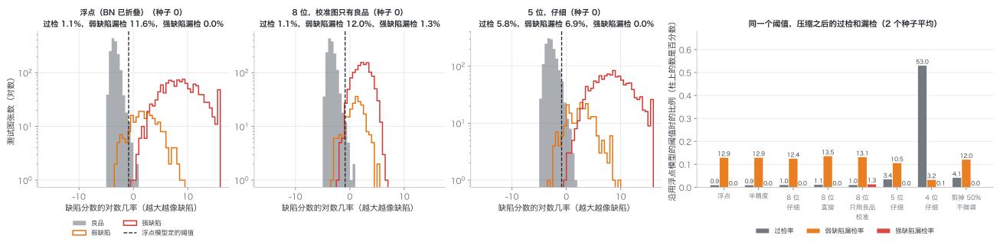
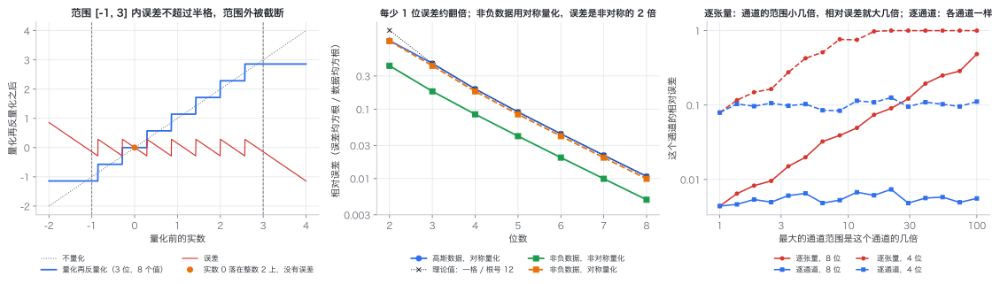
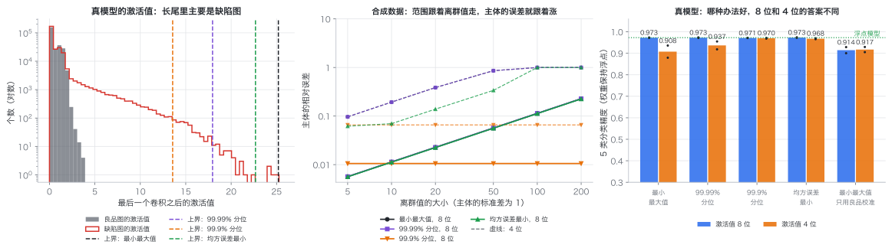
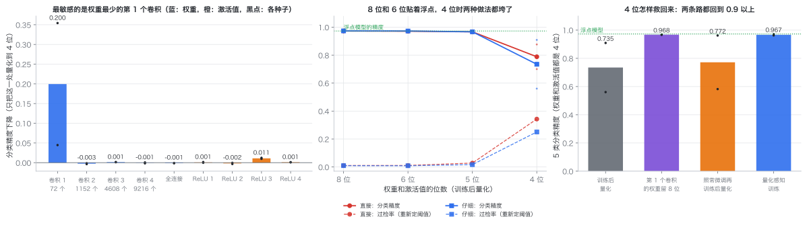
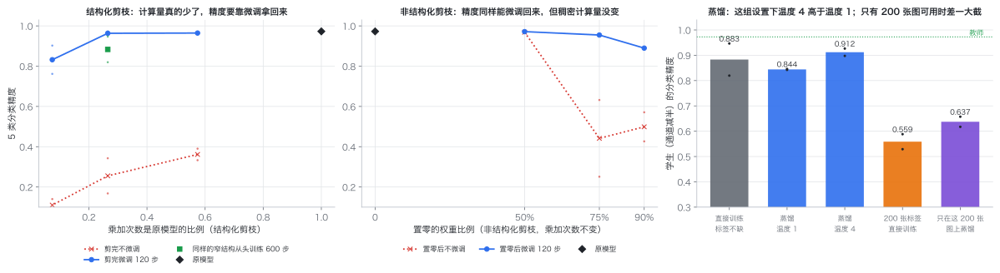
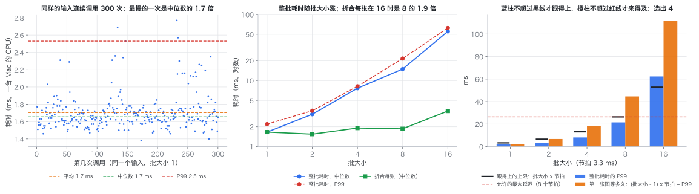

# 教程：部署与加速，ONNX、TensorRT、量化

> [!NOTE]
> 本章所有数字都来自代码生成的 32×32 缺陷小图和一个 15389 个参数的小卷积网络上的实测，记录在 [`figures/实测数字.json`](figures/实测数字.json)，由 `solutions` 分支的 `solutions/figures/ch31.py` 生成。量化参数、量化与反量化、逐通道量化、BatchNorm 折叠、按节拍选批大小用的是本章作业的参考实现。整数量化是用“量化再反量化”在浮点里模拟的，不是真的整数推理引擎。写课程的机器是一台 Apple 芯片的 Mac：没有 CUDA，没有 TensorRT，也没有装 onnx 和 onnxruntime，所以本章没有任何显卡上的数字，也没有任何 ONNX 和 TensorRT 的实测数字；第 8 节的命令和代码没有在这台机器上运行过。耗时是在这台 Mac 的 CPU 上限制 2 个线程、机器上同时跑着别的任务时测的一次结果，只保留两位有效数字，只看量级和明显的倍数。换成真实数据、真模型、别的机器，都要自己再测一遍。

## 0. 本章怎么学

**应用场景**：把模型的推理时间压进产线节拍。模型在 PyTorch 里验证过了，接下来要把它交给 C++ 的推理程序，放到带显卡的工控机上，在设备规定的时间里出结果。这中间要过三关：导出（PyTorch 的图变成推理引擎认识的图）、加速（融合算子、换精度、量化、剪枝、蒸馏），以及验收（加速之后漏检和过检有没有变）。本章讲这三关各自的原理、会在哪里出错、怎样量出来。

**优先级**：P1，主线能力。前置是第 14 章（综合项目与部署）。预处理契约、`eval()`、TorchScript 导出、动态量化和静态量化在 ResNet-18 上的实测、推理耗时怎样量才可信，第 14 章都讲过并且量过，本章直接用，不重复。本章还用到第 9 章 9.5 节的 BatchNorm、第 19 章第 5 节的漏检约束阈值，C++ 那一侧接第 15 章第 10 节和第 12 节的对拍方法。

| 档位 | 累计用时 | 做什么 | 做到什么算完 |
|---|---:|---|---|
| 速通 | 3 小时 | 读第 1 节、2.1 节、3.1 到 3.3 节、3.5 节、4.2 节、6.3 节、9.2 节，看懂图 1 到图 6，把第 10 节演示的五步试一遍，答完 5 道小测 | 能写出缩放系数和零点的公式；能说出校准图只放良品时哪些指标变了、哪些看不出来，以及为什么分类精度几乎不变时过检率可以变成几倍；能把节拍换算成对单批延迟和批大小的要求 |
| 标准 | 10 小时 | 读完全章（第 8 节只读不跑），跑 Notebook，完成作业并验收通过，做第 14 节前三个破坏实验，填实验记录 | 五项测试 PASS；实验记录里有折叠前后的最大误差、8 位和 4 位量化后沿用原阈值的过检率和弱缺陷漏检率、自己机器上各批大小的中位数和 P99，以及一个失败案例 |
| 深挖 | 16 小时 | 再做其余破坏实验，按第 8 节在自己的显卡上导出 ONNX、用 ONNX Runtime 对拍、用 TensorRT 构建引擎，做第 15 节的扩展（选一个） | 能给出带条件的结果：哪个模型、哪种精度、哪个批大小、导出前后的最大误差和容差、P50 和 P99、显存峰值是怎么量的，以及加速前后漏检和过检各是多少 |

> [!TIP]
> 用时超过所选档位的 1.5 倍还没做完，就把卡点写进 `学习进度.md`，先往下一章走。标准档不需要装任何新的包。深挖档要装 onnx、onnxruntime 和 TensorRT，版本之间互相有要求，环境问题最容易卡住；卡超过一小时就先回到 Notebook，把量化和延迟这两部分的结论做完，TensorRT 留到入职后在公司的环境里做也不迟。

## 1. 为什么需要：精度没掉，过检和漏检却变了

加速一个模型，最常见的验收方式是“精度掉了多少”。先看一个能量化的例子，说明只看这一个数会漏掉什么。

数据是 32×32 的 8 位灰度小图：背景是竖直的线条，像素噪声标准差 0.02。一半是良品，另一半带一个缺陷，4 种缺陷各占四分之一：亮点、暗点、横划痕、竖划痕。缺陷幅度在 0.06 到 0.30 之间均匀取，幅度小于 0.10 的叫**弱缺陷**，占缺陷的六分之一左右。模型是 4 个 Conv-BN-ReLU（通道数 8、16、32、32）加全局平均池化和全连接，输出 5 类，训练 600 步，2 个随机种子各训练一个。

检测流程和第 19 章一样：缺陷分数取 1 减去“良品”这一类的概率，用第 19 章作业的 `threshold_at_escape` 在验证集（1500 张）上定阈值，要求漏检率不超过 2%。然后在测试集（3000 张，其中良品 1514 张、弱缺陷 233 张、强缺陷 1253 张）上量。这样定出的阈值，浮点模型的过检率是 0.89%，弱缺陷漏检率 12.9%，强缺陷一张不漏。

现在把同一个模型用几种办法压缩，不重新训练，**阈值也不动**，再量一遍。



| 做法（2 个种子的平均；阈值沿用浮点模型的） | 5 类分类精度 | AUROC | 过检率 | 弱缺陷漏检率 | 强缺陷漏检率 | 重新定阈值后的过检率 |
|---|---:|---:|---:|---:|---:|---:|
| 浮点（BN 已折叠） | 0.9727 | 0.9982 | 0.89% | 12.9% | 0.0% | 0.89% |
| 半精度（FP16） | 0.9728 | 0.9982 | 0.89% | 12.9% | 0.0% | 0.89% |
| 8 位，仔细 | 0.9735 | 0.9982 | 0.99% | 12.4% | 0.0% | 0.96% |
| 8 位，直接 | 0.9727 | 0.9981 | 1.09% | 13.5% | 0.0% | 1.06% |
| 8 位，校准图只有良品 | 0.9153 | 0.9977 | 0.99% | 13.1% | 1.28% | 2.08% |
| 5 位，仔细 | 0.967 | 0.9972 | 3.43% | 10.5% | 0.0% | 1.68% |
| 4 位，仔细 | 0.7348 | 0.9624 | 53.0% | 3.2% | 0.08% | 25.1% |
| 非结构化剪掉 50% 的权重，不微调 | 0.9685 | 0.9966 | 4.13% | 12.0% | 0.0% | 2.38% |

“仔细”指权重逐通道量化、激活值按均方误差最小定范围，“直接”指权重逐张量量化、激活值按最小最大值定范围，这些词第 3 节逐个解释。读这张表之前先记住分辨率：测试集里 1 张良品对应过检率 0.07 个百分点，1 张弱缺陷对应弱缺陷漏检率 0.43 个百分点，所以前四行之间的差别只是一到三张图，不能当成差别。

1. **半精度和认真做的 8 位量化，在这个模型上没有可见的代价**。前四行的每一列都只差一到三张图。这是常见的情形，也是 FP16 和 INT8 被广泛使用的原因。
2. **校准图只有良品时，出问题的是强缺陷这一头，而 AUROC 看不出来**。8 位量化要先知道每一层激活值的范围，这个范围是从一批校准图上统计出来的。如果校准图里只有良品，范围就按良品定，而缺陷图的激活值比良品大得多（图 3 左栏），超出范围的部分被截断在上沿。测到的结果是分类精度从 0.9727 掉到 0.9153，强缺陷的漏检率从 0 变成 1.28%（两个种子都是 1.28%，也就是各自 1253 张里的 16 张）。弱缺陷几乎没变（12.9% 对 13.1%）。AUROC 是 0.9982 对 0.9977，看不出问题。强缺陷漏掉多少不要当成规律：Notebook 里训练得更短的那个模型，在写课程的机器上按同样的做法跑，分类精度同样明显下降，强缺陷的漏检只多了零星几张。
3. **精度几乎没变，过检率可以变成几倍**。5 位量化的分类精度只掉了 0.6 个百分点，AUROC 掉了 0.001，沿用原阈值时过检率却从 0.89% 变成 3.43%，是原来的 3.9 倍；剪掉一半权重不微调，是 4.6 倍。图 1 第三栏能看到原因：良品分布右侧越过阈值线的那一截，比第一栏多。分类精度看的是 5 类里谁最大，对分数的小幅挪动不敏感；阈值卡在分布的尾巴上，挪一点就是几倍。
4. **往哪边挪没有规律**。5 位量化两个种子的过检率是 5.81% 和 1.06%（浮点时是 1.06% 和 0.73%），方向相同，幅度差了好几倍。第 3.7 节的量化感知训练则是往另一边挪：过检率降到 0.3%，弱缺陷漏检率升到 19.3%。所以不能凭经验预留余量，只能量。
5. **重新定阈值能补回一部分，补不回全部**。5 位量化在验证集上重定阈值之后，过检率是 1.68%，仍然是浮点的两倍左右；4 位是 25.1%。分布不只是平移，良品和缺陷的重叠也变多了。

所以本章的主线是两个问题：这些加速手段各自改变了什么、在什么条件下出问题；以及加速之后怎样验收才不会漏掉第 2、3 条这样的变化。先把结论放在这里：**压缩后的模型要在同一批数据上，按漏检和过检重新验收，阈值要重新定，弱缺陷和强缺陷要分开看**。第 9 节展开。

<!-- quiz -->
**一个缺陷检测模型做 8 位量化，校准用的图里只放了良品。量化后 AUROC 是 0.9977，原来是 0.9982。5 类分类精度原来是 0.9727，现在最接近哪个？**

- A. 0.97，AUROC 没变，精度也不会变
- B. 0.92 左右
- C. 0.5 左右，范围定错了模型就不能用了

<details markdown="1"><summary>答案与解释</summary>

**B**。实测 0.9153（两个种子是 0.9013 和 0.9293）。量化范围按良品的激活值定，缺陷图里远超这个范围的激活值被截断在上沿。良品和缺陷大体还分得开，所以 AUROC 几乎不变；但这两个模型的强缺陷各有 16 张掉到了阈值以下，漏检率从 0 变成 1.28%，弱缺陷的漏检率只差半张图（12.9% 对 13.1%）。强缺陷漏多少换一个模型会不同，Notebook 里的模型就少得多；AUROC 看不出问题这一点是一样的。C 是 4 位量化才有的量级。

</details>
<!-- /quiz -->

## 2. 从训练图到推理图：BatchNorm 折叠与算子融合

### 2.1 把 BatchNorm 折叠进卷积

训练时的网络里，卷积后面跟着 BatchNorm（第 9 章 9.5 节）。推理模式下 BatchNorm 不再看当前这一批，用的是训练时累积的运行均值 $\mu$ 和运行方差 $\sigma^2$，对每个通道做的是一次固定的缩放加平移：

$$
y = \gamma \cdot \frac{z - \mu}{\sqrt{\sigma^2 + \epsilon}} + \beta
$$

$z$ 是卷积的输出，$\gamma$、$\beta$ 是 BatchNorm 自己的缩放和偏移。卷积本身也是线性的，$z = W * x + b$。两个线性运算连在一起，可以合成一个。记每个输出通道的系数 $k = \gamma / \sqrt{\sigma^2 + \epsilon}$，

$$
W' = k \cdot W,\qquad b' = k\,(b - \mu) + \beta
$$

$k$ 是每个输出通道一个数，乘在权重的第 0 维上。新的卷积 $W' * x + b'$ 和原来的“卷积接 BatchNorm”对任何输入都给出相同的输出，BatchNorm 这一层就可以删掉。这是作业的 `fold_bn_into_conv`。三个容易错的地方：除的是标准差不是方差；$\epsilon$ 加在方差上、在根号里面；卷积原来没有偏置（接 BatchNorm 时通常不带，第 9 章量过它是多余的）时，折叠后也一定有偏置。

推理引擎都这么做，原因有三个。第一，少一个算子。每个算子都要把整张特征图读一遍、写一遍，BatchNorm 的乘加次数不多，访存却一点不少。第二，后面要做的事需要它：整数量化的卷积中间不能夹着一个浮点的 BatchNorm；卷积、BatchNorm、ReLU 合成一个算子之后，引擎才能给这个合成的算子选一个专门的实现。第三，训练专用的状态（运行均值、运行方差、更新次数）从图里消失，推理图里只剩权重。

这类“把相邻的算子合成一个”的改写叫**算子融合**，再加上常量折叠（能在导出时算出来的子图直接算成常数）、删掉推理时不起作用的节点（Dropout、恒等），统称**图优化**。ONNX Runtime 加载模型时默认会做一轮，TensorRT 构建引擎时做得更多。它们改变的是计算的组织方式，不改变数学上的函数，但会改变浮点运算的顺序，所以输出不是逐位相同。

### 2.2 实测：折叠前后差多少

用第 1 节种子 0 的模型，3000 张测试图。

| 比较（种子 0，3000 张测试图） | 结果 |
|---|---:|
| 折叠前后输出的最大差，float32 | 9.7e-05 |
| 折叠前后输出的最大差，全部换成 float64 再算 | 1.2e-14 |
| 折叠前后预测类别一致的比例 | 1.0 |
| 作业的参考实现和 `torch.nn.utils.fusion.fuse_conv_bn_eval` 比，权重的最大差 | 4.8e-07 |
| 用 `torch.fx.experimental.optimization.fuse` 自动融合后，输出的最大差 | 7.7e-05 |

1. **折叠是精确的，剩下的差是 float32 的舍入**。换成 float64 之后差是 1.2e-14，说明公式没有近似；float32 下的 9.7e-05 来自乘法顺序变了。这个模型 logits 的绝对值平均是 2.249，最大 11.997，所以 1e-4 量级的差相对于输出是十万分之几。第 14 章测到同一个框架里换一种卷积实现，差是 1e-5 量级。导出、融合、换引擎之后的对拍容差不能定成 0，定成多少要像这样先量一个基准。
2. **PyTorch 自带融合的工具**。`torch.fx` 能把模型变成一张可以改写的图，上表最后一行的 `fuse` 把图里相邻的卷积和 BatchNorm 合掉，图里的模块调用从 13 个变成 9 个（4 个 BatchNorm 没了）。部署时不需要自己写折叠，推理引擎会做；作业让你写一遍，是为了知道引擎做了什么、对拍时差从哪来。
3. **参数的变化**。原模型 15389 个参数，其中 BatchNorm 的缩放和偏移 176 个，另有 176 个运行均值和运行方差。折叠后是 15301 个：少了 176 个，多了 4 个卷积的偏置。

三种写错的折叠，在同一个模型上各差多少：

| 写错的地方（种子 0，3000 张测试图） | 和原模型输出的最大差 | 分类精度（正确时 0.9713） |
|---|---:|---:|
| 方差当成了标准差 | 715.0 | 0.5047 |
| 偏置里漏了减运行均值 | 15.0 | 0.5047 |
| $\epsilon$ 加在根号外面 | 0.0285 | 0.972 |

前两种把模型彻底弄坏，精度 0.5047 正好是测试集里良品的比例，也就是全部判成了同一类。第三种几乎看不出来，因为这个模型的运行方差在 0.00353 到 3.01 之间，都比 $\epsilon$（1e-5）大得多。但它是真的错：某个通道的方差小到 1e-6 时，两种写法的系数相差 3.284 倍。验收里专门放了一个方差是 1e-7 的通道来抓它。

**折叠能快多少？** 输入换成 256×256（网络是全卷积加全局平均池化，可以直接换尺寸），批大小 1，在这台 Mac 的 CPU 上轮流测：原模型 2.2 ms，折叠之后 2.1 ms，差别在测量波动之内。这不奇怪：BatchNorm 的乘加次数只有卷积和全连接的 1.31%。在 PyTorch 的 CPU 推理里，折叠本身省不了多少时间；它的价值在上面说的第二条，是量化和引擎做专门优化的前提。显卡上、推理引擎里的情况本章没有条件测。

### 2.3 折叠之后，各通道的权重范围拉开了

折叠给每个输出通道乘了一个各不相同的系数 $k$，于是各通道权重的大小被拉开。每个卷积里，各输出通道权重最大绝对值的最大者除以最小者（2 个种子的平均）：

| 卷积层 | 第 1 个 | 第 2 个 | 第 3 个 | 第 4 个 |
|---|---:|---:|---:|---:|
| 折叠前 | 1.654 | 1.629 | 1.83 | 2.044 |
| 折叠后 | 6.225 | 2.465 | 3.309 | 3.811 |

第 1 个卷积从 1.654 倍变成 6.225 倍。这个小模型拉开得不算多；真模型里折叠后相差几十上百倍的通道并不少见（这句话是文献里的普遍说法，本章没有在真模型上量）。量化是在折叠之后做的，一层里各通道的范围相差多少，决定了下一节“逐张量还是逐通道”有没有区别。

## 3. 量化

### 3.1 均匀量化：缩放系数和零点

量化是用整数 $q$ 近似表示实数 $x$。**均匀仿射量化**规定

$$
x \approx \hat{x} = s\,(q - z)
$$

$s$ 是**缩放系数**，也就是相邻两个整数对应的实数间隔，下面叫“一格”；$z$ 是**零点**，实数 0 对应的那个整数。$q$ 只能取 $[q_{\min}, q_{\max}]$ 里的整数，8 位无符号是 0 到 255。给定要表示的范围 $[x_{\min}, x_{\max}]$：

$$
s = \frac{x_{\max} - x_{\min}}{q_{\max} - q_{\min}},\qquad
z = \operatorname{round}\left(q_{\min} - \frac{x_{\min}}{s}\right)
$$

量化和反量化是

$$
q = \operatorname{clip}\left(\operatorname{round}\left(\frac{x}{s}\right) + z,\ q_{\min},\ q_{\max}\right),\qquad \hat{x} = s\,(q - z)
$$

这两组式子是作业的 `quant_params` 和 `quantize_dequantize`。有三个细节：

- **范围要先扩到包含 0**。补零的 0、ReLU 输出的 0 在网络里到处都是，实数 0 必须正好落在某个整数上，不能有误差。零点取整就是为了这个。
- **除数是间隔数，不是整数的个数**。8 位有 256 个整数，255 个间隔。
- **顺序是先取整、加零点、再截断**。范围外的数被截到端点上，误差不再受半格的限制。

范围 [-1, 3] 的例子（用参考实现算）：

| 范围 [-1, 3] | 缩放系数 | 零点 | 整数范围 | 能表示的实数范围 | 范围内的最大误差（半格） |
|---|---:|---:|---|---|---:|
| 3 位，非对称 | 0.5714 | 2 | 0 到 7 | -1.1429 到 2.8571 | 0.2857 |
| 8 位，非对称 | 0.0157 | 64 | 0 到 255 | -1.0039 到 2.9961 | 0.0078 |
| 8 位，对称 | 0.0236 | 0 | -127 到 127 | -3.0 到 3.0 | 0.0118 |

3 位时零点取整前是 1.75，取成 2，能表示的范围因此从 [-1, 3] 整体挪了不到半格，变成 -1.1429 到 2.8571：右端的 3 表示不到了，会被截断。这是为了让 0 没有误差付出的代价，位数高时可以忽略（8 位时取整前是 63.75，取成 64，范围是 -1.0039 到 2.9961）。



### 3.2 误差有多大，位数每少一位差多少

范围内的数，量化误差在正负半格之间。数据比一格宽得多时，误差近似在一格内均匀分布，标准差是

$$
\sigma_q = \frac{s}{\sqrt{12}}
$$

第 22 章 6.3 节算传感器该用几位时用的是同一个式子。位数每少一位，格数减半，一格变宽一倍，误差翻倍，也就是信噪比少 6.02 分贝。用 20 万个标准正态的样本量一遍（范围取样本的最小最大值，对称量化，相对误差是误差的均方根除以数据的均方根）：

| 位数（20 万个高斯样本，对称量化） | 8 | 7 | 6 | 5 | 4 | 3 | 2 |
|---|---:|---:|---:|---:|---:|---:|---:|
| 相对误差，实测 | 0.0107 | 0.0216 | 0.044 | 0.0909 | 0.195 | 0.455 | 0.97 |
| 相对误差，按一格除以根号 12 算 | 0.0107 | 0.0217 | 0.044 | 0.091 | 0.195 | 0.455 | 1.36 |

从 8 位到 3 位，实测和理论值对到第三位有效数字，每少一位误差是原来的 2.014 到 2.334 倍。2 位时只有 3 个整数可用（-1、0、1），“误差均匀分布”的假设不成立了，理论值不再适用。8 位时相对误差是 1% 左右，4 位是 20% 左右：位数从 8 降到 4，误差不是多一倍，是 18 倍左右（0.195 对 0.0107）。这是第 3.6 节 4 位模型垮掉的背景。

### 3.3 对称与非对称

**对称量化**把零点固定为 0，范围取成 $[-m, m]$，$m$ 是绝对值最大的那个数；整数用有符号的窄范围，8 位是 -127 到 127，不用 -128，这样正负两边一样多。**非对称量化**就是 3.1 节的一般形式，零点可以不是 0。

权重通常用对称量化，激活值常用非对称量化，原因各不相同：

- **权重**的分布大致以 0 为中心，对称量化浪费不了多少；而零点为 0 时，整数卷积里 $\sum (q_w - z_w)(q_x - z_x)$ 这一项少了和 $z_w$ 有关的交叉项，实现更简单、更快。TensorRT 的文档写明它用的是对称量化；别的引擎以各自的文档为准。
- **激活值**在 ReLU 之后没有负数。对称量化会把一半的整数分给永远不会出现的负数，等于白白少了一位。

少的这一位可以量出来。图 2 中栏的绿线和橙线：同一批非负的数据（上面那 20 万个样本取绝对值），对称量化的相对误差是非对称的 2.006 到 2.336 倍，8 位时是 0.00993 对 0.00495。非负数据用 8 位对称量化的误差（0.00993），和用 7 位非对称量化的误差（0.00993）相同：橙色虚线就是绿线往右挪了一位。

<!-- quiz -->
**ReLU 之后的激活值没有负数。用 8 位对称量化（整数 -127 到 127，零点为 0）去量化它，和 8 位非对称量化（整数 0 到 255）相比，量化误差的均方根是多少？**

- A. 一样，位数相同误差就相同
- B. 2 倍左右
- C. 4 倍左右

<details markdown="1"><summary>答案与解释</summary>

**B**。实测 8 位时是 0.00993 对 0.00495，2.006 倍。对称量化把 -127 到 -1 这一半整数留给了不会出现的负数，实际只用上了 0 到 127，一格的宽度是非对称时的两倍，误差跟着翻倍，相当于少了一位。A 忽略了“位数”要看实际用上的整数有多少；C 是方差（均方误差）的倍数，不是均方根的。

</details>
<!-- /quiz -->

### 3.4 逐张量与逐通道

一个卷积的权重是 (输出通道, 输入通道, 高, 宽) 的张量。**逐张量**量化是整个张量共用一个缩放系数；**逐通道**量化是每个输出通道各用各的，这是作业的 `quantize_weight_per_channel`。逐通道在整数卷积里几乎没有额外代价（每个输出通道的结果本来就要各自乘一个系数换回去），所以推理引擎对卷积权重普遍支持它。对激活值一般只做逐张量。

什么时候有区别？各通道的范围差得多的时候。造一个 16×8×3×3 的权重，每个输出通道 72 个高斯随机数，各通道的标准差从 1 按等比数列降到 1/R，8 位对称量化（图 2 右栏画的是 R 等于 100 的情形）：

| 各通道范围相差的倍数 R（8 位，16 个输出通道） | 1 | 3 | 10 | 30 | 100 |
|---|---:|---:|---:|---:|---:|
| 逐张量：范围最小的通道的相对误差 | 0.007 | 0.0163 | 0.0483 | 0.128 | 0.484 |
| 逐张量：范围最小的通道用到了几个不同的整数 | 58 | 47 | 24 | 10 | 4 |
| 逐通道：范围最小的通道的相对误差 | 0.00557 | 0.00557 | 0.00557 | 0.00557 | 0.00557 |
| 逐张量是逐通道的几倍（各通道相对误差的平均） | 1.19 | 1.69 | 3.3 | 7.08 | 18.9 |

逐张量时，一格的宽度由范围最大的通道决定。范围只有它百分之一的通道，72 个权重挤在 4 个整数上，相对误差 0.484，这个通道基本废了；通道的范围小几倍，相对误差就大几倍（图 2 右栏的红线是一条斜线）。逐通道时每个通道都用满自己的整数范围，相对误差和 R 无关。

**放到训练出来的模型上，要先看各通道实际差多少。** 2.3 节量过，这个小模型折叠后各通道的范围只差 2.5 到 6.2 倍。只量化权重、激活值保持浮点（2 个种子平均）：

| 只量化权重（激活值浮点） | 8 位 | 6 位 | 4 位 |
|---|---:|---:|---:|
| 逐张量：分类精度 | 0.973 | 0.9725 | 0.7823 |
| 逐通道：分类精度 | 0.973 | 0.9733 | 0.7173 |

8 位和 6 位时两种做法没有区别，都和浮点的 0.9727 一样。4 位时两种都垮了，而且逐通道并不更好；这一格两个种子差得很远（逐张量 0.6867 和 0.878，逐通道 0.539 和 0.8957），分不出高下。**“逐通道总是更好”在这个模型上量不出来**，因为它的通道范围本来就差得不多。

要看到差别，得让通道范围真的拉开。可以不改变网络的函数做到这一点：把第 2 个卷积的每个输出通道乘上一个正数，第 3 个卷积对应的输入通道除以同一个数。ReLU 对正数缩放是齐次的，网络的输出不变（实测浮点输出的最大变化不超过 7.8e-05），但第 2 个卷积各通道的范围被人为拉开了。然后只把这一层的权重量化到 8 位：

| 第 2 个卷积各通道范围的最大比值（同一个函数，换一种等价的写法） | 2.47 | 7.93 | 64.5 | 562 |
|---|---:|---:|---:|---:|
| 逐张量 8 位：分类精度 | 0.9733 | 0.973 | 0.9663 | 0.9342 |
| 逐张量 8 位：预测类别和浮点一致的比例 | 0.9992 | 0.9987 | 0.9827 | 0.9545 |
| 逐张量 8 位：logits 的最大差 | 0.1602 | 0.3586 | 2.0036 | 6.6213 |
| 逐通道 8 位：分类精度 | 0.9727 | 0.9727 | 0.9727 | 0.9727 |
| 逐通道 8 位：logits 的最大差 | 0.065 | 0.065 | 0.065 | 0.065 |

逐通道的结果四列完全相同：每个通道各算各的缩放系数，通道整体乘一个数对它没有影响。逐张量在范围相差几十倍时开始掉（一致率 0.9827），相差几百倍时精度掉到 0.9342。同一个函数，只是权重的写法不同，逐张量量化的结果可以差这么多。这也解释了为什么 BatchNorm 折叠之后要用逐通道：折叠正是给每个通道乘了一个各不相同的数。

### 3.5 校准：范围怎么定

权重的范围直接看权重就知道。激活值的范围要拿一批图跑一遍网络才知道，这一步叫**校准**，这批图叫校准集。范围定宽了，格子变粗，所有数的误差都变大；定窄了，范围外的数被截断。常用三类办法：

- **最小最大值**：范围取校准时见到的最小值和最大值。不截断任何东西，但一个离群值就能把范围撑大。
- **百分位**：范围的上界取 99.9% 或 99.99% 分位，丢掉最大的那一小撮。
- **均方误差最小**：在一串候选范围里，挑量化再反量化之后均方误差最小的那个。TensorRT 的熵校准是同一类思路，只是衡量的是分布之间的散度（细节以官方文档为准，本章没有实现它）。

**合成数据上的区别。** 10 万个标准正态的绝对值当主体，把其中 20 个（万分之二）换成同一个大数当离群值，8 位非对称量化，看主体的相对误差：

| 离群值的大小（主体的标准差是 1；8 位） | 5 | 10 | 20 | 50 | 100 | 200 |
|---|---:|---:|---:|---:|---:|---:|
| 最小最大值 | 0.00567 | 0.0114 | 0.0227 | 0.0567 | 0.114 | 0.228 |
| 99.99% 分位 | 0.00567 | 0.0114 | 0.0227 | 0.0567 | 0.114 | 0.228 |
| 99.9% 分位 | 0.0106 | 0.0106 | 0.0106 | 0.0106 | 0.0106 | 0.0106 |
| 均方误差最小 | 0.00562 | 0.0112 | 0.0225 | 0.0561 | 0.113 | 0.225 |

1. 最小最大值的范围跟着离群值走，主体的误差和离群值的大小成正比（图 3 中栏的黑线）。
2. **百分位只能丢掉比它更稀少的离群值**。离群值占万分之二，99.99% 分位只丢万分之一，范围的上界仍然落在离群值上，结果和最小最大值一模一样。99.9% 分位才把它们丢掉，主体的误差固定在 0.0106。代价是没有离群值时它也要截掉主体最大的千分之一，所以离群值只有 5 的时候，它反而是四种里最差的。
3. **均方误差最小在 8 位时几乎等于最小最大值**。8 位的格子很细，截断 20 个大数带来的平方误差，比把格子缩小省下来的多，所以它选择保留离群值。换成 4 位，离群值是 10、20、50 时它把上界定在 3.6、7.2、17.5，是一个折中；离群值到 100 时它又回到了几乎不截断（上界 99.0），主体的相对误差 0.998，基本全丢了。“均方误差最小”听起来最稳妥，但它优化的是全体数据的平均误差，不保证主体，也不保证离群值。



**真模型的激活值里，“离群值”是什么。** 种子 0 的模型在 256 张校准图（良品和缺陷各半）上，每个 ReLU 之后的激活值：

| 层（256 张校准图的全部激活值） | 第 1 个卷积之后 | 第 2 个 | 第 3 个 | 第 4 个 |
|---|---:|---:|---:|---:|
| 最大值 | 14.966 | 22.952 | 17.822 | 25.198 |
| 99.9% 分位 | 5.216 | 7.535 | 7.119 | 13.562 |
| 最大值是 99.9% 分位的几倍 | 2.869 | 3.046 | 2.504 | 1.858 |
| 超过 99.9% 分位的激活值里，来自缺陷图的比例 | 0.765 | 1.0 | 1.0 | 1.0 |
| 为 0 的激活值的比例 | 0.51 | 0.664 | 0.673 | 0.487 |

**长尾里的不是噪声，是缺陷**。第 2 层往后，最大的那千分之一激活值全部来自缺陷图（图 3 左栏：良品的激活值到 4 左右就没有了，后面的尾巴全是红色）。对一个缺陷检测模型，激活值的大数恰恰是它要找的东西。这决定了校准方法的选择不能照搬分类模型的经验。

只量化激活值、权重保持浮点，在真模型上比较（2 个种子平均；阈值沿用浮点模型的）：

| 激活值的位数和定范围的办法 | 分类精度 | 过检率 | 弱缺陷漏检率 | 强缺陷漏检率 |
|---|---:|---:|---:|---:|
| 浮点 | 0.9727 | 0.89% | 12.9% | 0.0% |
| 8 位，最小最大值 | 0.9727 | 0.96% | 13.5% | 0.0% |
| 8 位，99.9% 分位 | 0.9713 | 0.92% | 13.1% | 0.08% |
| 8 位，均方误差最小 | 0.9732 | 1.02% | 12.9% | 0.0% |
| 8 位，最小最大值，校准图只有良品 | 0.9145 | 0.89% | 13.7% | 1.44% |
| 4 位，最小最大值 | 0.9077 | 0.07% | 49.8% | 4.27% |
| 4 位，99.99% 分位 | 0.9367 | 0.2% | 35.0% | 1.4% |
| 4 位，99.9% 分位 | 0.97 | 1.68% | 11.6% | 0.04% |
| 4 位，均方误差最小 | 0.9678 | 1.45% | 14.4% | 0.08% |

1. **8 位时，只要校准集有代表性，哪种办法都行**。前三种办法的每一列都只差一两张图。
2. **校准集没有代表性，哪种办法都救不了**。校准图只有良品时，强缺陷漏检 1.44%，分类精度 0.9145。第 14 章 14.9 节在 ResNet-18 上测过校准图换成随机噪声的后果，是同一件事；这里更隐蔽，因为良品图是真实的、看起来完全合理的校准数据。**校准集要包含你关心的最强的信号**，对缺陷检测就是要有缺陷图，而且要有强缺陷。
3. **4 位时办法之间差别很大，而且方向和 8 位不同**。按最小最大值定范围，弱缺陷的漏检率到了 49.8%，过检率反而降到 0.07%。一种解释是格子被撑得太粗，弱缺陷引起的激活值变化比一格还小，被取整抹掉了；本章没有逐层验证这一条。这时截掉长尾反而更好（99.9% 分位：精度 0.97，弱缺陷漏检 11.6%）。位数越低，越要在“截断大数”和“看清小数”之间取舍。

### 3.6 哪些层敏感，位数能降到多少



**逐层敏感度**的做法很朴素：每次只把一处量化到低位数，其余全部保持浮点，看指标掉多少。这个模型有 5 组权重和 4 处激活值，一共 9 次（4 位；权重逐通道，激活值按均方误差最小定范围；2 个种子平均）：

| 只把这一处量化到 4 位 | 权重个数 | 分类精度下降 |
|---|---:|---:|
| 第 1 个卷积的权重 | 72 | 0.1995 |
| 第 2 个卷积的权重 | 1152 | -0.0025 |
| 第 3 个卷积的权重 | 4608 | 0.0013 |
| 第 4 个卷积的权重 | 9216 | -0.0005 |
| 全连接的权重 | 160 | -0.0012 |
| 第 3 个卷积之后的激活值 | | 0.011 |
| 其余三处激活值 | | 绝对值不超过 0.002 |

**最敏感的是权重最少的那一层**。第 1 个卷积只有 72 个权重，占全部权重的千分之五不到，单独把它量化到 4 位，精度就掉了 0.1995（两个种子的精度是 0.617 和 0.9293，一个掉得很多，一个掉得少）；其余四组权重加起来一万五千多个，各自量化到 4 位都没有可见的影响。第一层直接读像素，每个滤波器只有 9 个权重，是后面所有层的输入；它的误差没有别的权重可以平均掉。这和很多论文和工具的默认做法一致：第一层和最后一层保留高位数。但哪一层敏感是要量的，这张表在别的模型上可以完全不同。

**权重和激活值一起量化，位数从 8 降到 4**（训练后量化，2 个种子平均）：

| 位数和做法 | 分类精度 | 沿用原阈值的过检率 | 重新定阈值后的过检率 | 重新定阈值后的弱缺陷漏检率 |
|---|---:|---:|---:|---:|
| 浮点 | 0.9727 | 0.89% | 0.89% | 12.9% |
| 8 位，直接 | 0.9727 | 1.09% | 1.06% | 12.9% |
| 8 位，仔细 | 0.9735 | 0.99% | 0.96% | 12.4% |
| 6 位，直接 | 0.9713 | 1.02% | 1.09% | 14.2% |
| 6 位，仔细 | 0.9727 | 0.86% | 0.89% | 13.7% |
| 5 位，直接 | 0.9668 | 4.19% | 2.81% | 12.4% |
| 5 位，仔细 | 0.967 | 3.43% | 1.68% | 12.9% |
| 4 位，直接 | 0.7885 | 27.8% | 34.3% | 11.8% |
| 4 位，仔细 | 0.7348 | 53.0% | 25.1% | 11.4% |

在这个小模型上，8 位和 6 位贴着浮点；5 位时精度还剩 0.967，过检率已经是浮点的两到三倍（重新定阈值之后）；4 位时两种做法都不能用。真模型的转折点在哪一位，取决于模型和任务，本章不外推；能带走的是这条曲线的形状（先平后陡），以及“过检率比精度先坏”。

<!-- quiz -->
**一个小卷积网络有 5 组权重：第 1 个卷积 72 个，后面三个卷积分别是 1152、4608、9216 个，全连接 160 个。每次只把其中一组量化到 4 位，其余保持浮点。哪一组让精度掉得最多？**

- A. 第 4 个卷积，它的权重最多，量化误差的总量最大
- B. 第 1 个卷积
- C. 都差不多，4 位的相对误差对每一层是一样的

<details markdown="1"><summary>答案与解释</summary>

**B**。实测只量化第 1 个卷积的 72 个权重，精度掉 0.1995；只量化第 4 个卷积的 9216 个权重，精度变化是 -0.0005，在噪声里。第一层每个滤波器只有 9 个权重，直接作用在像素上，它的误差会传给后面每一层，也没有大量的权重可以互相抵消。把这一层留成 8 位、其余仍然 4 位，精度从 0.7348 回到 0.9675（3.7 节）。A 是把“误差的总量”当成了“误差的影响”。

</details>
<!-- /quiz -->

### 3.7 量化感知训练和直通估计

训练后量化（上面做的都是）不改权重，只是把训练好的权重和激活值取整。位数低到取整误差网络承受不了时，可以让网络在训练时就“看见”量化：前向传播里把权重和激活值量化再反量化，让损失反映量化之后的输出，再用梯度去调整权重。这叫**量化感知训练**。

障碍在于取整函数的导数几乎处处为 0，梯度传不过去。实测：对“量化再反量化后的权重之和”求导，一个 1152 个权重的卷积层，梯度的绝对值之和是 0.0。常用的办法是**直通估计**：前向照常取整，反向时假装取整是恒等函数，梯度原样穿过去；被截断的那些值梯度记 0。写成代码只有一行：

```python
w_q = w + (quantize_dequantize(w) - w).detach()    # 前向等于量化后的值，反向时对 w 的导数是 1
```

用了它，同一个层的梯度绝对值之和是 1152.0，每个权重正好是 1。这个“假装”没有严格的数学依据，但实践中有效。

在本章的小模型上做一次：从折叠后的浮点模型出发再训练 150 步，前向里权重逐通道量化到 4 位、激活值按训练前定好的范围量化到 4 位。为了分清“多训练了 150 步”和“训练时看见了量化”各起多大作用，加一个对照：同样再训练 150 步，但前向不量化，训练完再做训练后量化（图 4 右栏；2 个种子平均）。

| 权重和激活值都是 4 位 | 分类精度 | 各种子 | 沿用原阈值的过检率 | 沿用原阈值的弱缺陷漏检率 |
|---|---:|---|---:|---:|
| 浮点模型（参照） | 0.9727 | 0.9713、0.974 | 0.89% | 12.9% |
| 训练后量化 | 0.7348 | 0.5607、0.909 | 53.0% | 3.2% |
| 对照：照常再训练 150 步，再做训练后量化 | 0.7718 | 0.582、0.9617 | 39.3% | 11.2% |
| 训练后量化，但第 1 个卷积的权重留 8 位 | 0.9675 | 0.9683、0.9667 | 3.14% | 11.4% |
| 量化感知训练 150 步 | 0.9667 | 0.9623、0.971 | 0.3% | 19.3% |

1. **量化感知训练把 4 位的精度从 0.7348 拉回 0.9667**，离浮点的 0.9727 只差 0.6 个百分点。对照组是 0.7718，说明起作用的是训练时看见了量化，不是多训练的那 150 步。
2. **混合位数是更便宜的办法**。按 3.6 节的敏感度分析，只把第 1 个卷积的 72 个权重留成 8 位，其余仍然 4 位，不做任何训练，精度是 0.9675，和量化感知训练一样。先做敏感度分析，再决定要不要动训练，顺序不要反。
3. **精度回来了，工作点没有回来**。量化感知训练之后沿用原阈值，过检率是 0.3%，弱缺陷漏检率是 19.3%（两个种子是 20.2% 和 18.5%，浮点时是 11.6% 和 14.2%）：分数整体往“良品”那边挪了。重新定阈值之后弱缺陷漏检率是 16.3%，过检率 0.73%。权重变了，分数的分布就变了，阈值必须重定，这和第 1 节是同一个结论。挪多少和训练多久有关：写这一章时试过训练 200 步，那一次挪得小得多。

本章做的是最简单的一种量化感知训练：范围固定，只训练权重。把范围也当成可学习的参数、训练时带着 BatchNorm 再折叠，是工具里常见的做法，细节见 PyTorch 量化文档和 NVIDIA 的量化工具文档，本章没有做。

### 3.8 这一节量的是什么，没量什么

上面全部是在浮点里模拟量化：数值上等价于“每个张量只能取格点上的值”，但计算仍然是 float32 做的。它回答的是“量化之后输出变多少”，回答不了“量化之后快多少”。

- **速度**取决于推理引擎和硬件有没有为整数卷积准备好的实现。第 14 章 14.9 节在 ResNet-18 上测过：PyTorch 自带的静态量化把文件缩小到四分之一左右，在那台 Mac 的 CPU 上却比 float32 慢。显卡上 INT8 能快多少，要在你的机器上用 TensorRT 量。
- **大小**是确定的：本章的模型折叠后有 15208 个权重，按 float32 存是 60.832 kB，按 8 位整数存是 15.208 kB，四分之一。
- **真引擎的整数推理和这里的模拟还有细节上的不同**：偏置通常量化成 32 位整数，缩放系数取成输入和权重缩放系数的乘积；层与层之间换缩放系数用的是定点乘法和移位；逐元素相加、拼接这些算子要求各个输入用相同的缩放系数。这些都会带来模拟里没有的小差别，所以最终要以引擎的输出为准去对拍和验收。

## 4. 半精度

### 4.1 float16 能表示什么

float16 用 16 位表示一个浮点数：1 位符号，5 位指数，10 位尾数。和 float32 比，它的范围和精度都小得多：

| float16（用 NumPy 查到的） | 数值 |
|---|---:|
| 最大值 | 65504 |
| 最小的正规数 | 6.1e-5 |
| 最小的非正规数 | 6e-8 |
| 1 附近相邻两个数的间隔 | 0.000977 |
| 有效十进制位数 | 3 |
| 能连续精确表示的最大整数 | 2048 |

间隔是相对的：数越大，相邻两个能表示的数离得越远。

| 这个数附近 | 1 | 16 | 256 | 1024 | 2048 | 4096 | 32768 |
|---|---:|---:|---:|---:|---:|---:|---:|
| 相邻两个 float16 的间隔 | 0.000977 | 0.0156 | 0.25 | 1.0 | 2.0 | 4.0 | 32.0 |

半精度的吸引力在于权重和激活值占的显存减半，在支持它的显卡上卷积和矩阵乘法通常也更快（第 26 章 6.3 节把它列为 8 GB 显存上的常用手段之一）。它和 8 位量化不同：不需要校准，不需要改图，开关一开就行。代价是下面三类数值现象。

### 4.2 三类会出事的运算

**大数加小数，小数被吃掉。** 2048 附近的间隔是 2.0，所以 2048 加 1 的结果还是 2048。把 4096 个 1 逐个累加，加到 2048 就再也加不上去，结果是 2048 而不是 4096。但 `np.sum` 和 `torch.sum` 给出的是正确的 4096：它们不是从头到尾逐个累加，而是成对、分块地加，每一步相加的两个数大小接近。同样，4096 个 100 的全局平均，`torch.mean` 给出正确的 100，而对同一批数先 `torch.sum` 再除，和是 409600，超过了 65504，得到 inf。**同一个数学运算，实现顺序不同，在半精度下结果可以是对的、偏的或者 inf。** 全局平均池化、归一化层里求均值和方差、损失里求和，都属于这一类；框架内置的算子一般处理过，自己手写的累加和先求和再除就要小心。

**中间结果溢出。** float16 的最大值是 65504，所以一个数超过 256，它的平方就溢出；超过 11.09，它的指数就溢出。

| 运算（float16） | 结果 |
|---|---|
| 256 的平方 | inf |
| 向量 [300, 1] 的长度，先平方求和再开方 | inf |
| 同一个向量，`torch.linalg.norm` | 300.0 |
| logits 为 [12, 0]，先 exp 再除以和 | [nan, 0.0] |
| 同一组 logits，`torch.softmax` | [1.0, 6.14e-06] |
| 同一组 logits，`torch.log_softmax` | [0.0, -12.0] |

logits 到 12 并不罕见，本章这个小模型的 logits 最大就有 11.997。手写的 softmax（先 exp 再归一化）在 float32 里要到 88.7 以上才溢出，换成半精度，12 就溢出，结果是 nan。框架的 `softmax` 和 `log_softmax` 先减去最大值再算，不受影响。结论和第 26 章作业里“用 `log_softmax`，不要先 softmax 再取对数”是同一条，只是半精度把出事的门槛从 88.7 降到了 11.09。

**很小的常数变成 0。** 为了防止除以 0，代码里到处是 `x / (y + eps)`。

| eps 的写法 | 1e-5 | 1e-6 | 1e-7 | 1e-8 |
|---|---:|---:|---:|---:|
| 存成 float16 之后 | 1.001e-05 | 1.013e-06 | 1.192e-07 | 0.0 |

1e-8 比 float16 最小的非正规数还小，直接变成 0，`1 / (0 + 1e-8)` 的结果是 inf：这个 eps 在半精度下不起作用。1e-5、1e-6 还在，但已经是非正规数，只有一两位有效数字。BatchNorm 默认的 1e-5 没有问题（推理时它已经折叠进了权重）；手写的归一化、余弦相似度、IoU 里常见的 1e-8、1e-12，换成半精度之前要逐个看一眼。

### 4.3 实测：整个小模型换成半精度

把折叠后的模型整个转成 float16（权重和激活值），输入也转成 float16，在 CPU 上算，和 float32 比（2 个种子平均，3000 张测试图）：

| 半精度和 float32 比 | 结果 |
|---|---:|
| logits 的最大差 | 0.073 |
| logits 的差的中位数 | 0.0039 |
| 预测类别一致的比例 | 0.9998 |
| 过检率、漏检率、弱缺陷漏检率（沿用原阈值） | 和 float32 完全相同 |

logits 的差比 BatchNorm 折叠带来的（9.7e-05）大三个数量级，但两个种子合起来只有 1 张图换了预测类别，阈值两侧的图一张都没有变。这个模型的激活值最大二十几，离 65504 远得很，层数也少。**半精度出问题通常不是因为“精度不够”，而是 4.2 节那三类运算里的某一个碰上了**；网络越深、越多手写的归一化和后处理，碰上的机会越多。所以换成半精度之后，要拿固定样例逐层或者至少对最终输出做一次对拍（第 14 章 14.13 节），看有没有 inf 和 nan，再看指标。

**半精度是给显卡用的。** 同一个模型、256×256 的输入、批大小 1，在这台 Mac 的 CPU 上，float32 是 2 ms 出头（原模型 2.2 ms，折叠后 2.1 ms），转成 float16 之后是 100 ms，这次测到是原模型的 48 倍。一种解释是这台机器的 CPU 上没有针对 float16 的卷积实现，走的是通用的慢路径；本章没有去查 PyTorch 的源码确认。在支持半精度的 NVIDIA 显卡上方向相反，但快多少本章没有条件测，要你自己量。

<!-- quiz -->
**把一个小卷积网络的权重和输入都转成 float16，在一台没有独立显卡的电脑的 CPU 上用 PyTorch 推理。和 float32 相比，耗时怎样变化？**

- A. 减半左右，数据量少了一半
- B. 差不多
- C. 慢几十倍

<details markdown="1"><summary>答案与解释</summary>

**C**。在本章测量用的这台 Mac 上，float32 的原模型是 2.2 ms，float16 是 100 ms，这次测到是 48 倍。数据量确实少了一半，但耗时取决于有没有为这种数据类型准备好的卷积实现。半精度的速度收益来自显卡上的专用硬件和对应的算子实现，不是来自“数变短了”。这是一台机器上的结果，换一种 CPU 和 PyTorch 构建，倍数会不同，结论（要在目标设备上量）不变。

</details>
<!-- /quiz -->

## 5. 剪枝与蒸馏：让模型本身变小

量化和半精度不改变网络的结构，只改变每个数用几位表示。另一条路是让网络本身变小：剪枝是从一个训练好的大模型里去掉一部分，蒸馏是直接训练一个小模型，让它向大模型学。

### 5.1 非结构化剪枝和结构化剪枝

**非结构化剪枝**把绝对值小的权重置零，哪个小置哪个，不管它在张量里的位置。**结构化剪枝**去掉整个通道（或者整层、整个注意力头）：某个卷积的一个输出通道连同它的 BatchNorm 一起删掉，下一层对应的输入通道也跟着删，得到的是一个更窄、但仍然稠密的网络。

第 14 章 14.9 节在 ResNet-18 上量过非结构化剪枝：置零的权重照样按 4 个字节存、照样参与乘法，文件没有变小，耗时也没有变。本章在小模型上把两种剪枝放在一起比，并且看微调能把精度拿回多少。结构化剪枝的做法：每个卷积按折叠后滤波器的 L1 范数留下最大的一部分输出通道。非结构化的做法：全部权重按绝对值全局排序，把最小的一部分置零。微调是 120 步，学习率 0.002。



| 结构化剪枝：通道保留的比例（2 个种子平均） | 1（原模型） | 0.75 | 0.5 | 0.25 |
|---|---:|---:|---:|---:|
| 各层通道数 | 8、16、32、32 | 6、12、24、24 | 4、8、16、16 | 2、4、8、8 |
| 参数个数 | 15389 | 8735 | 3953 | 1043 |
| 乘加次数是原来的比例 | 1 | 0.574 | 0.265 | 0.074 |
| 分类精度：剪完不微调 | 0.9727 | 0.3617 | 0.2553 | 0.11 |
| 分类精度：剪完微调 120 步 | | 0.9645 | 0.9633 | 0.832 |
| CPU 上的耗时是原模型的比例（256×256，批大小 1） | 1.0 | | 0.6 | 0.38 |

| 非结构化剪枝：置零的权重比例（2 个种子平均） | 50% | 75% | 90% |
|---|---:|---:|---:|
| 按稠密方式计算的乘加次数 | 1253536，不变 | 不变 | 不变 |
| 分类精度：置零后不微调 | 0.9685 | 0.4415 | 0.4988 |
| 分类精度：微调 120 步，置零的权重保持为零 | 0.9715 | 0.9547 | 0.8897 |
| CPU 上的耗时是原模型的比例 | 1.0 | | 1.0 |

1. **非结构化剪枝不省时间**。90% 的权重是零，微调后精度还有 0.8897，耗时和原模型一样（比例 1.0）。稠密的卷积实现不会因为乘数是 0 就跳过这次乘法。要从稀疏里拿到速度，需要专门的稀疏计算实现或者硬件支持，这超出了本章的范围，以你用的推理引擎的文档为准。
2. **结构化剪枝真的减少了计算**。通道留一半，乘加次数剩 26.5%（卷积的计算量和输入、输出通道数的乘积成正比，两边各减半就是四分之一左右），参数剩 3953 个，CPU 上的耗时是原来的 0.6。
3. **耗时没有跟着乘加次数按比例降**。乘加次数剩 26.5%，耗时剩 60%；乘加次数剩 7.4%，耗时剩 38%。第 9 章 9.2 节量过同样的事：耗时不和乘加次数成正比，那里的一个例子是输出特征图很大的层比乘加次数更多的层还慢。这个模型里是什么占了时间，本章没有逐层去量。所以“计算量少了多少”不能直接当成“快了多少”来报。
4. **结构化剪枝剪完必须微调**。同样是让参数少一半左右，非结构化置零 50% 不微调还有 0.9685，结构化留 0.75 的通道（参数剩 56.8%）不微调只剩 0.3617。整个通道没了，后面所有层的输入都变了。微调 120 步之后回到 0.9645。
5. **留得越少，要拿回精度就越费劲**。通道只留四分之一时，微调 120 步之后是 0.832，两个种子是 0.9023 和 0.7617，既低又不稳。这个数和微调多久关系很大：写这一章时试过微调 200 步，那一次平均在 0.9 以上。所以这里不说“拿不回来”，只说同样的 120 步，留一半的通道已经回到 0.9633，留四分之一的还差得远。
6. **继承权重比从头训练划算，但这句话有条件**。通道留一半的窄网络，剪枝后微调 120 步是 0.9633（两个种子 0.9543、0.9723）；同样的结构从头训练 600 步是 0.8832（0.9467、0.8197）。本章所有模型都只训练了 600 步，窄网络从头训练得更久能到多少没有测，这里只能说在这个训练预算下继承权重明显更省事。

全局按绝对值排序还有一个副作用：置零 50% 时，第 1 个卷积只有 8.3% 的权重被置零，最后一个卷积是 56.3%。大的层里小权重多，被剪得多；3.6 节量出最敏感的第一层恰好被动得最少。这是全局排序附带的好处，不是它的设计目标，换一个模型不一定成立。

PyTorch 的 `torch.nn.utils.prune` 提供了按绝对值置零和按范数屏蔽整个通道的函数，但它做的是给权重乘一个掩码，张量的形状不变；要得到真正变窄的网络，得像本章的配图脚本那样把留下的通道拷到一个新的窄模型里，或者用专门的剪枝库。

### 5.2 知识蒸馏和温度

蒸馏出自 Hinton、Vinyals 和 Dean 2015 年的论文 Distilling the Knowledge in a Neural Network。小模型（学生）不只学标签，还去拟合大模型（教师）的输出分布。两边的 logits 都先除以同一个**温度** $T$ 再做 softmax：

$$
\mathcal{L}_{\text{KD}} = T^2 \cdot \operatorname{KL}\left(\operatorname{softmax}\left(\frac{z_t}{T}\right)\ \Big\|\ \operatorname{softmax}\left(\frac{z_s}{T}\right)\right)
$$

$z_t$、$z_s$ 是教师和学生的 logits，乘 $T^2$ 是为了让梯度的量级不随温度变。温度的作用和第 26 章 3.1 节自蒸馏里的温度相同：$T$ 等于 1 时教师的输出很尖，几乎就是标签；$T$ 大了，分布变平，“这张图有点像横划痕、完全不像暗点”这类类别之间的相对关系才显出来。实测本章的教师在 1000 张测试图上，输出的最大类概率平均是 0.926（温度 1）和 0.479（温度 4）。

学生的通道数是教师的一半（4、8、16、16，和上一小节“通道留 0.5”的结构相同，3953 个参数）。所有学生都训练 600 步，每一步从同一批 12000 张图里抽样。直接训练用这些图的标签；蒸馏完全不用标签，损失只有上面这一项（图 5 右栏）。

| 学生怎样训练（教师的精度 0.9727；2 个种子） | 分类精度 | 各种子 |
|---|---:|---|
| 直接用标签训练，12000 张图都有标签 | 0.8832 | 0.9467、0.8197 |
| 蒸馏，温度 1，不用标签 | 0.8442 | 0.846、0.8423 |
| 蒸馏，温度 4，不用标签 | 0.9122 | 0.9267、0.8977 |
| 只有 200 张图有标签，直接训练 | 0.5587 | 0.529、0.5883 |
| 只在这 200 张图上蒸馏，温度 4 | 0.6373 | 0.6573、0.6173 |

1. **在这组设置下，温度 4 比温度 1 高**：0.9122 对 0.8442，两个种子方向相同。常见的解释是温度 1 时教师的输出接近独热，学生学到的和硬标签差不多。但这个差别不稳：写这一章时还试过另一种设置（每一步都用新生成的图，而不是固定的 12000 张），那一次两个温度的平均几乎一样，其中一个种子是温度 1 更高。所以这里只说温度会改变结果，它是一个要在自己的任务上试的超参数，不说温度高就好。
2. **标签不缺的时候，这组实验分不出蒸馏和直接训练谁好**。温度 4 的蒸馏平均高 3 个点，但直接训练的两个种子自己就差了 13 个点（0.9467 和 0.8197）。只有两个种子、600 步，不足以下结论，本章不写“蒸馏比直接训练好”。能说的是蒸馏的两个种子更接近（0.9267 和 0.8977）。
3. **差别最大的是标签少的时候**。只有 200 张带标签的图，学生直接训练只有 0.5587。教师不需要标签就能给任意一张图打出软标签，所以另外那一万多张没有标签的图也能用来训练学生：0.9122。这才是蒸馏在工业场景里最实在的用处：产线上没标注的图要多少有多少，标注才是贵的。
4. 只在那 200 张图上蒸馏是 0.6373，比用硬标签的 0.5587 高，两个种子方向相同，但仍然远不如用上无标签的图。软标签每张图带的信息更多，可图太少还是不行。

把 5.1 和 5.2 放在一起：同一个通道减半的结构，从头训练 0.8832，蒸馏（温度 4）0.9122，剪枝后微调 0.9633。在这组实验里继承教师的权重比只学教师的输出更有效；但剪枝要求学生和教师是同一种结构，蒸馏没有这个限制，教师是 ViT、学生是小卷积网络也可以。第 26 章 3.5 节提到 DINOv2 的小模型就是从最大的模型蒸馏出来的。

和量化一样，剪枝和蒸馏之后模型的分数分布变了，阈值要重新定，漏检和过检要重新验收（第 1 节的表里，剪掉一半权重不微调，过检率是原来的 4.6 倍）。

## 6. 延迟、吞吐和节拍

第 14 章 14.7 节讲了推理耗时怎样量才可信：先预热，重复多次报 P50 和 P95，量端到端，写清条件，只保留两位有效数字。那些这里不重复，接着讲三件事：为什么产线要看 P99，批处理换来了什么，怎样把节拍换算成对模型的要求。

下面的耗时都是这台 Mac 的 CPU（2 个线程，机器上同时有别的任务）上的一次测量，模型是本章的小网络，输入换成 256×256（乘加次数是 32×32 时的 64 倍）。数值只属于这台机器，看的是现象。

### 6.1 延迟是一个分布，要看尾巴



| 同一个输入连续调用 300 次，批大小 1（ms） | 最小 | 中位数 | 平均 | P95 | P99 | 最大 |
|---|---:|---:|---:|---:|---:|---:|
| 耗时 | 1.4 | 1.7 | 1.7 | 2.2 | 2.5 | 2.8 |

输入、代码、模型都没变，P99 是中位数的 1.5 倍，最慢的一次是 1.7 倍。写这一章时这组测量做过好几遍，尾巴有多长每遍都不一样，这里记下的是其中一遍；机器上别的任务越多，尾巴越长。新建模型之后的前 3 次调用是 1.6、1.5、2.2 ms，都落在后面 300 次的范围（1.4 到 2.8 ms）之内，这和第 14 章的结论一致：PyTorch 直接调用模型在 CPU 上看不出预热效应；TorchScript 和显卡上有，仍然要先预热再计时。

第 14 章报的是 P50 和 P95，这里多看一档 P99，是因为检测设备处理的图太多。一片晶圆如果要处理一万张图，超过 P99 的就有一百张；设备等的是最慢的那些。两点提醒：

- **P99 要足够多的样本才稳**。100 个样本的 P99 基本由最大的 2 个样本决定。要报 P99，样本数至少上千；要报 P99.9，再多十倍。
- **平均值会掩盖尾巴**。尾巴越长，平均值越没有代表性。节拍是硬约束时，按平均值做的预算会在最慢的那些图上超时。

### 6.2 批处理：吞吐和等待

把几张图拼成一批一起算，每张图分摊到的固定开销变小，显卡上的并行度也更高，所以批大小加大通常能提高吞吐量（每秒处理的张数）。代价是一批要等所有图到齐才开始算，算完才一起出结果。

| 批大小（各 100 个样本，这台 Mac 的 CPU） | 1 | 2 | 4 | 8 | 16 |
|---|---:|---:|---:|---:|---:|
| 整批耗时的中位数（ms） | 1.7 | 3.1 | 7.6 | 15 | 55 |
| 整批耗时的 P99（ms） | 2.2 | 3.5 | 8.2 | 22 | 62 |
| 折合每张（ms） | 1.7 | 1.5 | 1.9 | 1.9 | 3.5 |
| 吞吐量（张每秒） | 600 | 650 | 520 | 540 | 290 |

1. **在 2 个线程下，凑批几乎不提高吞吐量**。吞吐量最高的是批大小 2，也只有批大小 1 的 1.1 倍。一个自然的猜想是线程太少，没有闲着的核让凑批去填。为此单独量了一组：同一个模型，只把线程数从 2 改成这台机器默认的 6。这一组是另一个时间量的，2 个线程下批大小 1 折合每张是 1.4 ms，和上表的 1.7 ms 不一样，机器的忙闲不同。改成 6 个线程之后整体变快了（批大小 1 从 1.4 ms 到 0.88 ms），但批大小 4 和 8 仍然是 0.88 和 0.89 ms，凑批还是没有提高吞吐量。可是写这一章时另外几次临时的测量和 Notebook 的几次运行（Notebook 不限制线程数）里，批大小 4 和 8 折合每张又明显低于批大小 1。几次结果互相对不上，机器上同时跑着别的任务，这个猜想本章既没有证实也没有否定。
2. **整批耗时照涨**。批大小 8 的整批耗时是批大小 1 的 9 倍。凑批在这里只带来了等待。
3. **批大小 16 时折合每张反而慢了**，是批大小 8 的 1.9 倍。把 `torch.backends.nnpack` 关掉再测，这个比值是 1.0，台阶消失了。第 14 章 14.7 节在 ResNet-18 上遇到过同一个台阶，位置也是 16：这个版本的 PyTorch 在这台机器上，批大小到 16 时卷积换了一种实现。台阶只属于这台机器和这个 PyTorch 构建。

显卡上的情况通常不同：批大小 1 时显卡大半闲着，凑批能明显提高吞吐量，直到显卡被填满。但“通常”不能当数字用，Notebook 的实验 6 让你在自己的机器上把这张表量出来。不管在哪种硬件上，**批大小的效果要逐个量，不能从一个批大小外推到另一个**。

### 6.3 把节拍换算成对延迟的要求

**节拍**是相邻两张图到达的间隔，记作 $T$。设备的扫描速度定下来，$T$ 就定了，模型必须跟上。再设每张图从到达到出结果最多允许等 $D$。推理程序每攒够 $B$ 张算一批，整批耗时 $L_B$（取 P99）。要同时满足两条：

第一条，跟得上：

$$
L_B \le B \cdot T
$$

攒下一批要 $B$ 个节拍，这一批必须在那之前算完，否则待处理的图越积越多，最后不是内存耗尽就是丢图。

第二条，来得及：

$$
(B - 1)\,T + L_B \le D
$$

一批里最先到的那张图最吃亏，它要先等后面 $B-1$ 张到齐，再等整批算完。这是作业的 `plan_batch`，它返回同时满足两条的最大批大小。

用上面那张表的样本走一遍。假设节拍是 3.3 ms（取成批大小 1 的 P99 的 1.5 倍，这是为了演示随手定的）：

| 批大小（节拍 3.3 ms） | 1 | 2 | 4 | 8 | 16 |
|---|---:|---:|---:|---:|---:|
| 整批耗时的 P99（ms） | 2.2 | 3.5 | 8.2 | 22 | 62 |
| 批大小乘节拍（ms） | 3.3 | 6.6 | 13.2 | 26.4 | 52.8 |
| 跟得上吗 | 是 | 是 | 是 | 是 | 否 |
| 第一张图等多久（ms） | 2.19 | 6.79 | 18.1 | 44.6 | 112 |

允许的最大延迟是 4 个节拍（13.2 ms）时，`plan_batch` 选出 2；8 个节拍（26.4 ms）时选出 4；16 个节拍（52.8 ms）时选出 8。批大小 16 无论给多长的延迟都不行，它的 P99 是 62 ms，超过了 16 个节拍，跟不上（图 6 右栏的蓝柱高过了黑线）。

再假设节拍只有 1.3 ms，比单张的中位数耗时还短：`plan_batch` 返回 0，哪个批大小都跟不上。这组测量里凑批不提高吞吐量，所以凑批救不了它；这时要么换更快的模型（第 3 到 5 节的手段），要么加硬件，要么几个推理实例并行。

关于这两条式子，还有四点要知道：

- **它们是保守的**。偶尔一批超时，后面几批快一点就能追回来，队列能吸收抖动。但那样第二条里的等待时间也要把排队算进去，分析起来要复杂得多。先按保守的条件设计，留出余量，是更稳妥的起点。
- **返回的是上限，不是推荐值**。批大小在 1 到这个上限之间都可行，选哪个看吞吐量有没有随批大小涨。这组测量里不涨，就该选 1。
- **$L_B$ 要是端到端的**。第 14 章 14.7 节量过，预处理可以占到端到端耗时的将近一半。把图从主机内存搬到显存、把结果搬回来，都要算进去。
- **节拍也有尾巴**。图不一定匀速到达。上游如果是一段一段地送图，要按最密的那一段算。

<!-- quiz -->
**图像每 3.3 ms 来一张。推理程序攒够 8 张算一批，整批耗时的 P99 是 22 ms，不超过 8 个节拍（26.4 ms），所以跟得上。一批里最先到的那张图，从到达到出结果最坏要等多久？**

- A. 22 ms，就是整批的耗时
- B. 不到 3 ms，22 ms 除以 8
- C. 约 45 ms

<details markdown="1"><summary>答案与解释</summary>

**C**。它要先等后面 7 张图到齐，是 7 个节拍，再等整批算完，合起来按实测样本算是 44.6 ms，是单张推理（P99 2.2 ms）的 20 倍。B 是折合每张的耗时，它说的是吞吐量，不是哪一张图等了多久。A 漏掉了攒批的时间。凑批提高的是吞吐量，付出的是延迟；延迟有上限的时候，批大小就有上限。

</details>
<!-- /quiz -->

## 7. 导出之后怎样对拍

模型从 PyTorch 到推理引擎，中间至少换两次表示：PyTorch 的模块变成一张导出的图，导出的图再变成引擎内部的图。每换一次都要对拍。第 14 章 14.13 节给了三层检查（输入张量、模型输出、最终结果和任务指标），14.8 节用 TorchScript 做了实测，并且指出只在导出用的样例上比是不够的。这里补两件事。

**用 `torch.export` 再做一遍。** 第 14 章的 Notebook 提到 `torch.jit.trace` 已经有弃用提示，新的接口是 `torch.export`。下面这段在写课程的机器上运行过（PyTorch 2.15.0）：

```python
import torch

batch = torch.export.Dim("batch", min=1, max=64)                 # 声明第 0 维是动态的，并给出范围
ep = torch.export.export(model, (x,), dynamic_shapes=({0: batch},))
torch.export.save(ep, "model.pt2")                                # 存盘
loaded = torch.export.load("model.pt2").module()                  # 读回来，得到一个可以调用的模块
with torch.no_grad():
    diff = (loaded(x_other) - model(x_other)).abs().max()         # x_other：另一批图、另一个批大小
```

| 把折叠后的小模型导出、存盘、读回，和原模型比 | 输出的最大差 |
|---|---:|
| 导出时的样例（4 张） | 0.0 |
| 另外 16 张图，批大小 16 | 0.0 |
| 单张，批大小 1 | 0.0 |
| 全部 3000 张测试图，每批 50 张 | 0.0 |

没有分支的模型，导出前后逐位相同。如果导出时不声明动态维度，样例是 4 张，之后用 8 张去调用，它会报错（`AssertionError`，提示批的维度必须等于 4），而不是悄悄算错。这比 `torch.jit.trace` 把形状写死在图里要好。带有依赖数据的分支的模型，`torch.export` 直接拒绝导出，第 14 章测过。

**不同的加速手段，对拍的容差差几个数量级。** 把本章测到的“和浮点模型的 logits 差”放在一起（3000 张测试图；这个模型 logits 的绝对值平均 2.249）：

| 做了什么 | logits 的最大差 | 差的中位数 | 预测类别一致的比例 |
|---|---:|---:|---:|
| `torch.export` 导出、存盘、读回 | 0.0 | | 1.0 |
| BatchNorm 折叠（种子 0） | 9.7e-05 | | 1.0 |
| 半精度 | 0.073 | 0.0039 | 0.9998 |
| 8 位量化，仔细 | 2.4885 | 0.0288 | 0.9985 |
| 5 位量化，仔细 | 4.9744 | 0.218 | 0.9875 |

1. **只改图、不改精度的步骤**（导出、融合、换引擎），差应该在 1e-4 以内。超过了就是有东西错了：预处理、权重没对上、某个算子的语义不同。
2. **半精度**的差在 0.1 以内，逐张量对拍仍然有意义，容差要放宽三个数量级。出现 inf 或 nan 则一定是错。
3. **量化之后逐张量的最大差没有意义**。8 位量化的中位数差只有 0.0288，但最大差是 2.4885：个别图的输出变了很多，而 99.85% 的图预测类别没变。这时没有一个张量容差能区分“量化正常”和“量化坏了”，验收只能靠任务指标，也就是第 9 节的做法。

所以对拍分两段：从 PyTorch 到引擎的 FP32 结果，用张量容差卡死；从 FP32 到 FP16 或 INT8，用指标验收。两段不要混在一起做，否则出了问题分不清是导出错了还是精度换坏了。

## 8. 在自己的机器上做：ONNX、ONNX Runtime、TensorRT、C++

> [!WARNING]
> 这一节的命令和代码没有在写课程的机器上运行过（那台机器没有 CUDA、没有 TensorRT，也没有装 onnx 和 onnxruntime），库的接口可能已经变化，以官方文档为准。这一节没有任何实测数字：耗时、显存、加速比、精度都要你自己量。接口名只写了在官方文档里核对过的；拿不准的地方写的是“见官方文档”。ONNX 导出器和 TensorRT 这两年接口变动都不小，下面凡是提到“某个版本起”的地方，都请对照你实际安装的版本。

### 8.1 要装什么

作业、验收、Notebook 的必做部分不需要额外的包。这一节需要：

- `onnx`：ONNX 模型的读写和检查。
- `onnxruntime-gpu`：ONNX Runtime 带显卡支持的版本。只用 CPU 的话装 `onnxruntime`。这两个包不要同时装。
- `onnxscript`：较新的 PyTorch 的 ONNX 导出器依赖它，装 PyTorch 时不会自动带上。
- TensorRT：按 NVIDIA 官方安装指南装。它对显卡驱动、CUDA 的版本有要求，Python 包和命令行工具 `trtexec` 是否一起提供，取决于安装方式，以官方指南为准。

环境安装见 `docs/环境安装.md`。装之前先确认显卡在 PyTorch 里可用（第 14 章 14.7 节“在自己的机器上量”一小节）。

### 8.2 导出 ONNX

```python
import torch

model.eval()                                             # 导出前切到推理模式，第 14 章 14.8 节
x = torch.rand(4, 1, 32, 32)                             # 样例输入，按部署时的预处理契约准备
batch = torch.export.Dim("batch", min=1, max=64)
torch.onnx.export(
    model, (x,), "model.onnx",
    input_names=["input"],                               # 给输入输出起名字，后面每一步都靠名字找它们
    output_names=["logits"],
    opset_version=18,                                    # 算子集版本，写明，不要用默认值
    dynamic_shapes=({0: batch},),                        # 哪些维度是动态的
)
```

几个关键参数的含义：

- **`opset_version`**：ONNX 的算子集版本。同一个 PyTorch 运算在不同的 opset 里可能导出成不同的节点；下游的推理引擎只支持到某个 opset。写明它，并且查你的 ONNX Runtime 和 TensorRT 版本支持的范围。导出器能接受的最低版本也随 PyTorch 版本变，示例里的 18 不一定适合你。
- **`input_names`、`output_names`**：不给的话是自动生成的名字。ONNX Runtime 喂数据、TensorRT 设形状和绑定缓冲区，都用名字。
- **动态维度**：不声明的话，样例输入的形状会被固定在图里，批大小只能是 4。较新的 PyTorch（官方文档写的是 2.9 起）默认使用基于 `torch.export` 的新导出器，用 `dynamic_shapes` 声明，写法和上一节的 `torch.export.export` 相同。旧的导出器用的是 `dynamic_axes={"input": {0: "batch"}, "logits": {0: "batch"}}`。两个参数在新版本里可能都还能用，行为以你安装版本的 `torch.onnx.export` 文档为准。
- 新导出器可能把权重另存到 ONNX 文件旁边的一个数据文件里（由参数 `external_data` 控制），两个文件要放在一起。

导出之后先做一次结构检查：`onnx.checker.check_model(onnx.load("model.onnx"))`。它不保证数值对，只保证文件是合法的 ONNX。想看图长什么样，可以用 Netron 这类查看器打开。

### 8.3 用 ONNX Runtime 推理并对拍

```python
import numpy as np
import onnxruntime as ort

print(ort.get_available_providers())                     # 这个安装包里有哪些执行提供者
wanted = ["CUDAExecutionProvider", "CPUExecutionProvider"]
providers = [p for p in wanted if p in ort.get_available_providers()]
sess = ort.InferenceSession("model.onnx", providers=providers)
print(sess.get_providers())                              # 这个会话实际用上了哪些

for xb in (x, torch.rand(1, 1, 32, 32), torch.rand(9, 1, 32, 32)):
    got = sess.run(None, {"input": xb.numpy()})[0]       # 输入是 NumPy 数组，类型必须和模型的输入一致（这里是 float32）
    with torch.no_grad():
        want = model(xb).numpy()
    print(xb.shape, np.abs(got - want).max())
```

**执行提供者**是 ONNX Runtime 的后端。列表里排在前面的优先，某个节点前面的提供者不支持，就落到后面的提供者上。常用的三个：

| 执行提供者 | 用什么算 | 说明 |
|---|---|---|
| `CPUExecutionProvider` | CPU | 总是可用，对拍时先用它，排除显卡带来的变量 |
| `CUDAExecutionProvider` | 显卡，CUDA 和 cuDNN | 需要 `onnxruntime-gpu`，以及和它匹配的 CUDA、cuDNN 版本 |
| `TensorrtExecutionProvider` | 显卡，TensorRT | 由 ONNX Runtime 调 TensorRT 构建引擎，第一次运行要等构建；支持不了的子图落回 CUDA 或 CPU |

你应该看到什么：

- CPU 提供者下，三种输入的最大差应该都在 1e-4 以内（第 7 节表后的第一条；这是按 PyTorch 内部的实测推的预期，不是 ONNX Runtime 上测到的）。差到 1e-2 以上，先查预处理和 `eval()`，再查导出。
- 换成 CUDA 提供者，差仍然在同一个量级，但不会是 0。
- 请求了 CUDA 提供者，`sess.get_providers()` 里却只有 CPU：通常是装成了 CPU 版的包，或者 CUDA、cuDNN 的版本和 onnxruntime-gpu 要求的不一致。这是“看起来在用显卡，其实没有”最常见的原因，计时之前一定要打印这一行确认。
- 批大小换成导出样例以外的值也能跑。跑不了，说明动态维度没有声明成功。

计时照第 14 章 14.7 节做：预热、重复、报分位数。显卡上 `sess.run` 返回 NumPy 数组时结果已经搬回了主机内存，所以这个调用本身是同步的。

### 8.4 TensorRT：从 ONNX 构建引擎

TensorRT 的工作分两个阶段。**构建**：读入 ONNX，做图优化，在你这块显卡上给每一层试几种实现并计时，挑最快的，结果序列化成一个引擎文件。这一步慢，以分钟计，离线做。**运行**：加载引擎文件，创建执行上下文，喂数据。

**最快的入门是命令行工具 `trtexec`**，它随 TensorRT 一起提供，既能构建引擎，也能用随机输入测速：

```text
trtexec --onnx=model.onnx --saveEngine=model.engine --minShapes=input:1x1x32x32 --optShapes=input:8x1x32x32 --maxShapes=input:32x1x32x32
trtexec --loadEngine=model.engine --shapes=input:8x1x32x32
```

第一行构建并保存引擎，第二行加载引擎、按给定的形状测速。完整的选项用 `trtexec --help` 看，不同版本的选项有增减。`trtexec` 报告的耗时是它自己那套测法下的数，和你的应用里端到端的耗时不是一回事，只能当作上限的参考。

**动态形状要给优化配置。** 模型有动态维度时，TensorRT 要知道每个动态输入的最小、最常用、最大三种形状（上面的 `--minShapes`、`--optShapes`、`--maxShapes`）。引擎只能接受这个范围内的形状，并且是按“最常用”的那个形状调优的。范围给得越宽，优化的余地越小。批大小固定的产线程序，直接导出固定形状通常更简单。

**引擎和机器绑定，不能随便拷贝。** 官方文档写明：引擎默认只能在构建它的那个 TensorRT 版本和那种显卡上使用。在你的 4060 笔记本上构建的引擎，拷到产线工控机的另一种显卡上不能用；TensorRT 升级之后也要重新构建。所以交付物是 ONNX 文件加构建脚本，引擎在目标机器上构建。官方另有版本兼容和硬件兼容的可选模式，各有代价，见官方文档的 Engine Compatibility 部分。由此还有一条：构建时每层的实现是靠计时选出来的，同一个 ONNX 重新构建一次，选出的实现可能不同，输出会有浮点误差量级的差别，每次重新构建都要重新对拍。

**FP16 和 INT8。** 这一块正是 TensorRT 近几个大版本改动最大的地方，下面分开说，用哪一套取决于你装的版本。

- 在 8.x 和 10.x 的文档里，精度是构建时的开关：`trtexec` 的 `--fp16`、`--int8`，Python 接口里是 `config.set_flag(trt.BuilderFlag.FP16)`。开了 FP16，TensorRT 逐层决定用 FP16 还是 FP32。开了 INT8，它需要知道每个张量的范围，有两种给法：一是**校准**，实现一个校准器，把几百张有代表性的图喂给它，TensorRT 统计范围，结果可以存成校准缓存文件（`trtexec` 用 `--calib=` 读它）；二是在 ONNX 里放好量化和反量化节点（Q/DQ），范围在导出前就定好，这叫显式量化。不给校准数据就开 `--int8`，按 `trtexec` 的说明它仍然能构建和测速，但各张量的范围是随意设的，只能用来看速度，输出没有意义（这一条以你的版本的 `trtexec --help` 为准）。
- 较新的大版本改了这一套。查到的说法是 TensorRT 11 移除了弱类型网络和隐式量化（也就是上面的校准器这条路），网络一律是强类型的，INT8 走显式量化；强类型网络里每个张量用什么精度由模型本身决定，而不是由构建开关决定。这一条本章只在二手资料里看到，没有在 NVIDIA 的发布说明里逐条核对，更没有试过；如果你装的是这样的版本，FP16 和 INT8 怎样准备，见官方文档的 Work With Quantized Types 和迁移指南。
- 不管哪一套，第 3.5 节的结论都适用：**范围是从校准数据来的，校准数据里要有缺陷图，而且要有强缺陷**。校准数据还要走和推理完全相同的预处理。

**Python 接口的构建流程**（名字在官方文档里核对过，参数随版本有出入，以文档为准）：

```python
import tensorrt as trt

logger = trt.Logger(trt.Logger.WARNING)
builder = trt.Builder(logger)
network = builder.create_network(flags)                  # flags 的取值随版本不同，见官方文档
parser = trt.OnnxParser(network, logger)
with open("model.onnx", "rb") as f:
    ok = parser.parse(f.read())                          # 返回 False 时逐条看 parser 报的错

config = builder.create_builder_config()
profile = builder.create_optimization_profile()          # 动态形状的最小、最常用、最大
profile.set_shape("input", (1, 1, 32, 32), (8, 1, 32, 32), (32, 1, 32, 32))
config.add_optimization_profile(profile)

plan = builder.build_serialized_network(network, config) # 失败时返回 None
with open("model.engine", "wb") as f:
    f.write(plan)
```

也可以不直接用 TensorRT 的接口，而是通过 ONNX Runtime 的 TensorRT 执行提供者间接用它，好处是不支持的算子能自动落回 CUDA；代价是多一层，出了问题不好查，引擎的缓存也要自己打开和管理。两条路的版本对应关系见 ONNX Runtime 文档。

### 8.5 在 C++ 里推理：只看骨架

产线程序是 C++ 的。不管用 ONNX Runtime 还是 TensorRT，结构都是三段：**启动时创建一次**（环境、会话或引擎、执行上下文、输入输出缓冲），**每张图重复**（预处理写进输入缓冲、运行、读输出缓冲、后处理），**退出时释放**。常见的性能问题几乎都是把第一段的事放进了第二段。

**ONNX Runtime 的 C++ 接口**（只用 CPU 的最小骨架）：

```cpp
#include <onnxruntime_cxx_api.h>

// 启动时：整个进程一个 Env；会话创建一次，反复使用
Ort::Env env(ORT_LOGGING_LEVEL_WARNING, "inspect");
Ort::SessionOptions options;                                  // 要用显卡，在这里追加执行提供者，写法见官方文档
Ort::Session session(env, ORT_TSTR("model.onnx"), options);  // Windows 上模型路径是宽字符，ORT_TSTR 处理这件事

// 输入缓冲：预处理的结果直接写进这块内存，NCHW、float32，和导出时一致
std::vector<float> input(1 * 1 * 32 * 32);
std::array<int64_t, 4> shape{1, 1, 32, 32};
Ort::MemoryInfo memory = Ort::MemoryInfo::CreateCpu(OrtArenaAllocator, OrtMemTypeDefault);
Ort::Value tensor = Ort::Value::CreateTensor<float>(memory, input.data(), input.size(), shape.data(), shape.size());
const char* input_names[] = {"input"};
const char* output_names[] = {"logits"};

// 每张图：Run 是同步的，返回时结果已经可以读
std::vector<Ort::Value> outputs = session.Run(Ort::RunOptions{nullptr}, input_names, &tensor, 1, output_names, 1);
const float* logits = outputs[0].GetTensorMutableData<float>();
```

`CreateTensor` 不拷贝数据，它只是把你的缓冲区包了一层，所以 `input` 的生命周期要比 `tensor` 长。

**TensorRT 的 C++ 运行时**（接口名出自官方开发者指南）：

```cpp
#include <NvInfer.h>

// 启动时：读入引擎文件，反序列化，创建执行上下文
nvinfer1::IRuntime* runtime = nvinfer1::createInferRuntime(logger);                 // logger 是你实现的 ILogger
nvinfer1::ICudaEngine* engine = runtime->deserializeCudaEngine(planData, planSize); // 引擎文件的字节
nvinfer1::IExecutionContext* context = engine->createExecutionContext();

// 每一批：输入输出缓冲在显存里，按名字绑定
context->setInputShape("input", nvinfer1::Dims4{batch, 1, 32, 32});                 // 引擎有动态形状时才需要
context->setTensorAddress("input", inputDevicePtr);
context->setTensorAddress("logits", outputDevicePtr);
context->enqueueV3(stream);                                                          // 只是把任务提交到 CUDA 流
cudaStreamSynchronize(stream);                                                       // 等它算完，之后才能读结果、才能停表
```

要点：

- **同步**。`enqueueV3` 返回时计算可能还没做完，这和第 14 章说的 PyTorch 在显卡上计时要 `torch.cuda.synchronize()` 是同一件事。不同步就读输出缓冲，读到的是上一批的结果或者垃圾；不同步就停表，量到的只是提交任务的时间。
- **缓冲**。输入输出缓冲在显存里，启动时分配一次。预处理如果在 CPU 上做，每批要把数据从主机内存拷到显存，这段时间要算进延迟。
- **执行上下文不是线程安全的**。一个引擎可以创建多个执行上下文，每个线程用自己的。
- **反序列化失败要检查**。引擎和当前的 TensorRT 版本或显卡不匹配时，`deserializeCudaEngine` 返回空指针，不检查就往下走会直接崩溃。

**和第 15 章的对拍方法接上。** C++ 这一侧的验证，方法就是第 15 章第 10 节和第 12 节的对拍：同一组输入，逐元素比较，报最大绝对差和超过容差的个数。具体到推理程序，分三步，每一步用 Python 那一侧存下来的固定样例：

1. **只对预处理**。同一张原图，C++ 预处理得到的输入张量和 Python 的比。第 15 章第 10 节列的三类不一致（边界、取整、通道顺序）和第 14 章的预处理契约在这里逐项核对。
2. **只对推理**。把 Python 存下来的输入张量（用 NumPy 存成原始的 float32 字节，C++ 直接读进输入缓冲）喂给 C++ 的会话或引擎，绕开 C++ 的预处理，输出和 Python 里同一个 ONNX、同一个提供者的输出比。差应该在浮点误差量级。
3. **端到端**。原图进，判定结果出，和 Python 的整条流水线比，再在整个验证集上比漏检和过检。

三步分开做，哪一步对不上，问题就在哪一步。

### 8.6 导出和构建失败时怎么查

导出或者构建引擎失败，原因大致三类：

| 类别 | 典型表现 | 常见来源 | 怎么办 |
|---|---|---|---|
| 不支持的算子 | 导出时报某个运算没有对应的 ONNX 实现；或者 ONNX 导出成功，TensorRT 解析时报某个节点不支持 | 较新或较偏的运算；自定义的 `autograd.Function`；后处理里的排序、非极大值抑制、按条件索引 | 换一个 opset 再试；把这个运算改写成基本运算的组合；把后处理留在模型外面用 C++ 写；实在不行才写插件 |
| 动态控制流 | 导出时的警告或者报错提到张量被转成了 Python 的布尔值或数字；或者导出成功，换一种输入结果就错 | `if x.max() > 1:` 这类依赖数据的分支；循环次数由数据决定；用 `.item()`、`len()` 把张量的值取出来再参与计算 | 把依赖数据的判断移到模型外面；取值范围这类事写进预处理契约（第 14 章 14.8 节实测过这个坑） |
| 形状推断失败 | 报某个维度无法确定，或者 TensorRT 说形状不在优化配置的范围内 | 用 `x.shape[0]` 的值去构造新张量；`view`、`reshape` 里写死了批大小；动态维度声明和实际不符 | 写 `x.flatten(1)` 或 `reshape(x.shape[0], -1)` 而不是写死数字；检查动态维度的声明；先用固定形状导出，跑通了再放开 |

排查顺序，从离 PyTorch 近的一头开始，每一步只引入一个新东西：

1. PyTorch 里 `eval()` 模式下，模型对样例输入的输出是对的，存下来当基准。
2. 导出 ONNX。失败就按上表处理；警告逐条读，不要忽略。
3. `onnx.checker.check_model` 通过。
4. ONNX Runtime 的 CPU 提供者跑通，和基准对拍。这一步过了，说明 ONNX 文件本身是对的。
5. 换成 CUDA 提供者，再对拍。
6. `trtexec` 用 FP32 构建引擎。失败时加上详细日志的选项，看是哪个节点。
7. FP32 引擎的输出和基准对拍。
8. 这之后才开 FP16 或 INT8，按第 9 节验收。

最常见的错误是跳步：直接导出、直接用 INT8 构建、发现结果不对，然后不知道该怀疑哪一步。

### 8.7 显存只有 8 GB 时，以及你应该看到什么

通用的做法（确认显卡可用、看显存、批大小放不下怎么办）在第 14 章 14.7 节和第 10 章“在自己的显卡上微调”一小节，这里补几条和本节有关的。

1. **构建引擎本身要占显存**，而且可能比运行时多。构建时关掉别的占显存的程序（包括还开着模型的 Jupyter 内核）。构建器能用多少工作内存可以设上限，选项名随版本变，见 `trtexec --help`。
2. **同一个进程里不要同时留着 PyTorch 模型和推理引擎**。对拍时先用 PyTorch 把基准输出算好、存盘，再换引擎。PyTorch 向显卡申请了显存之后不会主动还给系统。
3. **动态形状的上限别写得太宽**。显存是按最大形状准备的。
4. **批大小和输入尺寸**仍然是最直接的两个旋钮，用第 6 节的办法在吞吐和延迟之间选。
5. **显存峰值要量**。TensorRT 引擎占的显存不经过 PyTorch 的分配器，`torch.cuda.max_memory_allocated()` 看不到它，要用 `nvidia-smi` 看整个进程的占用。

按这一节做下来，值得记进实验记录的现象（都没有参考数字，你测到的就是第一手结果）：

- 同一个 ONNX，CPU 提供者、CUDA 提供者、TensorRT 引擎的 FP32 输出，和 PyTorch 的最大差各是多少。
- FP16 引擎和 FP32 引擎的最大差是多少，和第 7 节的表比一比量级。
- 各批大小下的 P50、P99、吞吐量。折合每张的耗时从哪个批大小开始不再下降。
- FP16 比 FP32 快多少、显存少多少；INT8 再比 FP16 快多少。这几个数高度依赖模型和显卡，很小的模型上可能看不出差别，因为时间主要花在了每次调用的固定开销上。
- 同一个 ONNX 构建两次引擎，输出是否逐位相同。

## 9. 工业检测：节拍从哪来，精度损失怎样验收

### 9.1 节拍从哪来

检测设备对延迟和吞吐的要求不是算法组定的，是从设备的产能倒推出来的。第 23 章第 7 节讲过，产能（每小时多少片）和灵敏度互相制约；7.1 节算过整片晶圆有多少像素。换算的步骤是通用的：

1. **每片的时间**。产能要求每小时多少片，每片就是 3600 秒除以这个数。里面要扣掉上下片、对准、平台加减速这些和计算无关的时间。
2. **每片的数据量**。扫描方式和像素尺寸决定一片要拍多少张图、每张多大（第 22 章第 5 节和第 7 节）。像素缩小一半，像素数是 4 倍。
3. **每张图的节拍**。每片可用的时间除以每片的图像数。如果成像和计算是流水式的（边扫边算），这就是 6.3 节的 $T$。
4. **模型一次处理多少**。大图通常要切成小块分别送进模型（第 12 章 12.9 节，第 25 章第 9 节），每块的节拍是每张图的节拍除以块数。块之间有重叠的话，块数更多。
5. **允许的延迟 $D$**。看结果什么时候要用：是这片晶圆卸片之前，还是要实时反馈给平台（例如触发复查）。前者宽松得多。

走一遍数字。**下面的数是为了演示步骤随手取的，不代表任何设备**：假设每小时要检 20 片，每片拍 10000 张图，每片的时间里有 30% 和计算无关，每张图 4096×4096，切成 256×256 的块、不重叠。

| 量（数字是假设的） | 数值 |
|---|---:|
| 每片的总时间 | 180 秒 |
| 每片留给成像和计算的时间 | 126 秒 |
| 每张图的节拍 | 12.6 ms |
| 每张图切成几块 | 256 |
| 每块的节拍 | 0.049 ms |
| 要求的吞吐量 | 20317 块每秒 |
| 一片的像素数 | 约 1678 亿 |

每块 0.049 ms，每秒两万多块。这个量级说明两件事。第一，在这种假设下不可能一块一块地算，必须凑批，而且批大小、延迟上限要按 6.3 节的两条式子来定。第二，块之间重叠 32 px 的话，每张图从 256 块变成 361 块，是原来的 1.41 倍，吞吐量的要求跟着多四成；切块方式是性能预算的一部分，不能只当成算法细节。

实际设备里，深度学习模型往往不直接处理全部像素：传统方法（第 18 章）先在全图上找候选，模型只处理候选周围的小块；或者模型只用在复查图上。这样对模型的吞吐要求可以低几个数量级。具体到某台设备、某条产线怎样分工，课程里没有依据，以公司和设备的资料为准。

### 9.2 精度损失的验收：看漏检和过检，不看平均精度

加速之后的模型，按下面的顺序验收。前两步是第 7、8 节的对拍，保证没有错；后面才是这一节的重点。

1. **FP32 对拍通过**。引擎的 FP32 输出和 PyTorch 在张量容差内一致。
2. **同一个验证集，同一套预处理**。压缩前后的模型在完全相同的图上比，图要足够多：第 1 节的测试集里弱缺陷只有 233 张，1 张图就是 0.43 个百分点，再少就什么都看不出来。第 19 章 5.4 节量过定阈值需要多少样本。
3. **先沿用原阈值量一遍**。过检率、漏检率和压缩前比。这一步回答“如果只换模型、不动配方，线上会发生什么”。第 1 节的例子里，分类精度只掉 0.6 个百分点的模型，过检率是原来的 3.9 倍。
4. **再重新定阈值量一遍**。按第 19 章 5.3 节的办法，在漏检上限下重新定阈值，比过检率。这一步回答“这个压缩后的模型本身还行不行”。重定之后仍然明显变差（第 1 节的 5 位量化：1.68% 对 0.89%），说明分数的可分性真的下降了，不是挪一下阈值能解决的。
5. **分组看**。按缺陷类型、强弱、尺寸、所在区域分别统计漏检（第 14 章 14.5 节，第 18 章第 6 节）。总的漏检率不变，不代表每一组都没变。
6. **看翻转的样本**。压缩前判对、压缩后判错的图，逐张拿出来看。数量少的时候，这比任何汇总指标都有用：它们集中在弱缺陷、某一类缺陷，还是某一种背景上？

为什么不能只看平均精度或者 AUROC，第 1 节的表已经给了答案：校准图只有良品的那一行，AUROC 是 0.9982 对 0.9977，强缺陷的漏检率从 0 变成了 1.28%。AUROC 是对整条曲线的积分，产线只工作在曲线的一个点上（第 19 章 5.3 节）；平均精度把所有类别、所有强度的样本混在一起，少数样本上的变化被淹没了。

### 9.3 弱缺陷的分数要单独检查

漏检集中在弱缺陷上：第 1 节浮点模型的强缺陷一张不漏，弱缺陷漏 12.9%。压缩对弱缺陷的影响，方向并不固定，本章测到了三种情况：

| 做法（沿用原阈值；2 个种子平均） | 弱缺陷漏检率 | 强缺陷漏检率 | 过检率 |
|---|---:|---:|---:|
| 浮点 | 12.9% | 0.0% | 0.89% |
| 激活值 4 位，范围按最小最大值定 | 49.8% | 4.27% | 0.07% |
| 权重和激活值 4 位，量化感知训练 | 19.3% | 0.0% | 0.3% |
| 权重和激活值 5 位，训练后量化 | 10.5% | 0.0% | 3.43% |
| 8 位，校准图只有良品 | 13.1% | 1.28% | 0.99% |

1. **格子太粗，弱缺陷被取整抹掉**（第二行）。弱缺陷在中间层引起的激活值变化很小，比一格还小时就消失了。漏检率从 12.9% 到 49.8%，同时过检率降到 0.07%：模型整体变得“迟钝”了。只看过检率会以为模型变好了。
2. **重新训练过的模型，分数整体挪了**（第三行）。精度几乎回到浮点水平，弱缺陷漏检却从 12.9% 到 19.3%。
3. **也可能往另一边挪**（第四行）：弱缺陷漏得少了，代价是过检率是原来的几倍。
4. **弱缺陷没事，不代表强缺陷没事**（第五行）。

所以验收表里弱缺陷要单独占一行，而且要和过检率放在一起读。“弱”怎么定义，看你的数据里有什么：缺陷的对比度、面积、信噪比，或者干脆用浮点模型的分数（离阈值最近的那一批真缺陷）。最后这种定义不需要额外的标注，而且直接对准了最可能翻转的样本。

半精度在本章的小模型上没有改变任何一张图的判定，但第 4 节的三类数值现象在深的网络里更容易碰上；真模型换成半精度之后，同样要按这一节的办法验收一遍，不能因为“通常没事”就省掉。

本章的数据是代码生成的，“弱缺陷”只是幅度小。真实的弱缺陷还包括尺寸小、和背景图形相似、落在边界上，各自对量化的敏感程度没有测过。这一节能带走的是验收的方法，不是这些数。

## 10. 交互演示：量化误差

把 4000 个数（主体的标准差是 1，可以再加 3 个离群值）用和作业相同的公式量化再反量化，画出量化前后的直方图和每个数的误差。可以改数据的分布、对称还是非对称、范围怎么定、位数、离群值的大小。按页面下方“按顺序试”的五步操作：第一步对应 3.2 节（每少一位误差翻倍），第二步对应 3.3 节（非负数据用对称量化，少一位），第三步和第四步对应 3.5 节（离群值把范围撑大；8 位和 4 位时该怎么办不一样），第五步是 3.1 节的零点。

<!-- embed: ../demos/量化误差.html 1232 -->
[打开交互演示：量化误差](../demos/量化误差.html)

演示里只有 4000 个数，离群值固定是 3 个，数值和 3.5 节的表对不上是正常的，要对上的是方向：第四步里“均方误差最小”并没有把离群值丢掉，而是把范围定在了中间，主体仍然只剩几个整数可用，“99.9% 分位”才把主体救回来；3.5 节的合成数据在 4 位时是同样的情形。

## 11. 怎样评估一次加速（怎样评估）

一次加速要同时报告三样东西：快了多少，对不对，指标变了多少。缺一样，这个结果就不能用。

**快了多少。**

- 报 P50 和 P99，写明样本数；同时报吞吐量和对应的批大小。延迟是端到端的还是只有前向，写清楚。
- 写清条件：显卡或处理器的型号、驱动和库的版本（PyTorch、ONNX Runtime、TensorRT、CUDA）、精度（FP32、FP16、INT8）、输入尺寸、批大小、是否有别的任务在跑。
- 加速比要说明是和谁比。和 PyTorch 直接调用比、和 ONNX Runtime 的 CUDA 提供者比、和 TensorRT 的 FP32 比，是三个不同的数。
- 只保留两位有效数字。

**对不对。**

- 每一次换表示（导出、换提供者、构建引擎）之后的最大张量误差和容差，容差是怎么定的。
- 对拍用了哪些输入：导出样例以外的图、别的批大小、别的尺寸。
- 引擎是在哪台机器、哪个版本上构建的。

**指标变了多少。**

- 压缩前后，同一个验证集上：沿用原阈值的过检率和漏检率，重新定阈值后的过检率和漏检率。
- 弱缺陷、强缺陷、各缺陷类型分开的漏检率。每一组有多少张图。
- INT8 的校准集：多少张、怎么选的、里面有没有缺陷图、预处理是否和推理一致。
- 翻转的样本有多少张，看过之后的结论。

报告模板在 `实验记录.md`。

## 12. 作业里的零件

作业文件是 `31-1_量化与部署零件.py`，五个函数，只用 NumPy 和 PyTorch，不需要显卡，也不需要 onnx 和 TensorRT。每个函数的输入输出、约定和异常都写在文档字符串里，验收只检查那里写明的行为。

- `quant_params`：由范围算缩放系数和零点（3.1、3.3 节）。自己检查的办法：范围 [-1, 3]、8 位非对称，应得到 3.1 节表里的那一行；范围不包含 0 时（例如 [0.5, 2]），实数 0 仍然要能被精确表示。
- `quantize_dequantize`：量化成整数再反量化（3.1 节）。两个可以自己核对的性质：范围内的数误差不超过半格；实数 0 量化再反量化还是 0。
- `quantize_weight_per_channel`：逐通道的对称量化（3.4 节）。每个通道里绝对值最大的权重，量化后应该正好是正负 `qmax`。
- `fold_bn_into_conv`：BatchNorm 折叠（2.1 节）。检查的办法就是 2.2 节的做法：随便造一个卷积和一个 `eval()` 模式的 BatchNorm，折叠前后对同一个输入的输出应该只差浮点误差。造 BatchNorm 时把运行均值、运行方差、缩放、偏移都改成不是默认值的数，否则很多错误测不出来。
- `plan_batch`：由延迟样本算分位数，选满足节拍和延迟要求的最大批大小（6.3 节）。先在纸上把 6.3 节那张表的“跟得上”和“第一张图等多久”两行算对。

运行验收：

```text
python 31_部署与加速\tests\check_progress.py        （Windows）
python 31_部署与加速/tests/check_progress.py        （macOS、Linux）
```

Notebook `实验_部署与加速.ipynb` 把这些零件接到小模型上：实验 1 看缩放系数、零点和位数，实验 2 比较逐张量和逐通道，实验 3 训练小模型并折叠 BatchNorm，实验 4 做训练后量化并看过检和漏检（阈值用你在第 19 章写的 `threshold_at_escape`），实验 5 是半精度的数值现象，实验 6 在你自己的设备上量延迟、按节拍选批大小，最后一个选做单元导出 ONNX 并对拍。Notebook 的模型只训练 400 步、一个种子，数值和本章的表不会完全一样，方向应该一致。有两处在写课程的机器上就和教程的表差得比较多，先说明：实验 4 里“校准图只有良品”那一行，分类精度的下降和教程一样明显，强缺陷漏检率的变化却小得多（第 1 节说过）；实验 6 没有限制线程数，用的是 PyTorch 的默认值，它的表和 6.2 节 2 个线程下的表不能直接比。整个配图脚本训练了 28 个这样的小模型，在一台 Mac 的 CPU 上（2 个线程，同时有别的程序在跑）用时 180 秒左右，训练一个浮点模型 10 秒左右；本章没有在任何 NVIDIA 显卡上测过耗时和显存。

## 13. 常见错误

| 现象 | 原因 | 怎么查 |
|---|---|---|
| 验收报缩放系数差一点点（例如 0.015625 对 0.015686） | 除数用了整数的个数（256），应该是间隔数（255） | 手算范围 [-1, 3]、8 位：4 除以 255 |
| 零点是负数，或者范围不含 0 时结果不对 | 没有先把范围扩到包含 0；或者零点的符号写反 | 用范围 [0.5, 2] 试，零点应该是 0 |
| 对称量化得到 -128 到 127，或者缩放系数偏小 | 没有用窄范围；或者除的是 128 | 8 位对称的 `qmax` 是 127，`qmin` 是 -127 |
| 量化再反量化的误差超过半格 | 取整写成了向下取整或者截掉小数；或者先截断再加零点 | 3.1 节的阶梯图应该关于每个格点对称 |
| 很大的输入量化后变成了最小的整数 | 截断之前就转成了整数类型，溢出了 | 喂一个远超范围的大数（验收用的是 10 的 20 次方），应该得到 `qmax` |
| 逐通道量化后小通道的权重全是 0 | 实际做的是逐张量：缩放系数只算了一个 | 打印 `scales` 的形状，应该是输出通道数 |
| 逐通道量化出现 nan | 某个通道全为 0，除以了 0 | 全 0 通道的缩放系数取 1.0 |
| 折叠 BatchNorm 之后精度掉到和随机猜差不多 | 除的是方差而不是标准差；或者偏置里漏了减运行均值（2.2 节，两种都是 0.5047） | 用一个标准差不是 1 的 BatchNorm 对拍 |
| 折叠之后只差一点，大多数图没事 | $\epsilon$ 加在了根号外面。方差大的通道看不出来，方差很小的通道差几倍 | 造一个运行方差是 1e-7 的通道对拍 |
| 折叠前后对不上，而且每次结果不一样 | 模型还在训练模式，BatchNorm 用的是当前这一批的统计量，不是运行统计量 | 先 `eval()`；第 14 章 14.8 节 |
| `plan_batch` 选出的批大小偏大 | “来得及”只比了整批耗时，没算等后面的图到齐；或者没检查“跟得上” | 用 6.3 节的表手算 |
| `plan_batch` 的延迟比预期小很多 | 用了平均值或中位数，没有用参数给的分位数 | 造一组带长尾的样本，P99 应该接近最大值 |
| 量化后分类精度没变，线上过检多了几倍 | 分数分布挪了，阈值还是浮点模型的（第 1 节） | 压缩后重新定阈值；沿用和重定都量一遍 |
| INT8 之后分类精度明显下降或者强缺陷漏检，AUROC 和弱缺陷几乎没变 | 校准集里没有缺陷图，范围按良品定，缺陷图里大的激活值被截断（3.5 节） | 看校准集的构成；比较校准集和验证集上各层激活值的最大值 |
| INT8 之后弱缺陷大量漏检，过检率反而降了 | 范围被离群值撑得太宽，格子太粗（9.3 节） | 换校准方法；看各层激活值的直方图 |
| 换成半精度后输出里有 nan 或 inf | 4.2 节三类运算之一：手写的 softmax、平方和、先求和再除、过小的 eps | 逐层对拍，找第一个出现 inf 的地方 |
| 剪枝后模型“稀疏度 90%”，速度没变 | 非结构化剪枝，稠密计算不跳过 0（5.1 节） | 比较耗时和乘加次数，不要只看零的比例 |
| 计算量少了四分之三，只快了四成 | 耗时不和乘加次数成正比（5.1 节，第 9 章 9.2 节） | 在目标设备、目标批大小上量 |
| ONNX Runtime 请求了显卡，速度和 CPU 一样 | 实际落回了 CPU 提供者：装的是 CPU 版的包，或者 CUDA、cuDNN 版本不匹配 | 打印 `sess.get_providers()` |
| 引擎在自己电脑上能用，拷到另一台机器上加载失败 | 引擎和显卡型号、TensorRT 版本绑定（8.4 节） | 在目标机器上重新构建；检查反序列化的返回值 |
| 引擎只能跑一种批大小 | 导出 ONNX 时没有声明动态维度，或者没给优化配置 | 用查看器看 ONNX 输入的形状里有没有符号维度 |
| C++ 里显卡推理的耗时短得不合理，或者读到的结果是上一批的 | 没有同步就停表或读缓冲（8.5 节） | 在读结果之前等 CUDA 流完成 |
| 批大小加大，吞吐量没涨甚至掉了 | 硬件没有闲置的并行度；或者某个批大小换了实现（6.2 节的台阶） | 把批大小从小到大扫一遍 |
| 平均延迟达标，产线上偶尔超时 | 按平均值做的预算，没看 P99（6.1 节） | 采够样本，报 P99；按 P99 套 6.3 节的两条式子 |

## 14. 破坏实验

每个实验先写下预测，再运行，把结果和原因记到 `实验记录.md`。前三个是标准档必做。

1. Notebook 实验 4 的表里有一行“8 位，校准图只有良品”。先预测它和“8 位，逐通道，最小最大值”相比，分类精度、过检率、弱缺陷漏检率、强缺陷漏检率四列里哪一列差得最多，再看结果。然后反过来，把校准图换成只有缺陷图（`x_cal[y_cal > 0]`），再预测一次。对照第 1 节的表和 3.5 节。Notebook 的模型和教程的不是同一个，强缺陷那一列的变化可能比教程小得多，分类精度那一列应该同样明显。
2. 作业通过验收之后，把你的 `fold_bn_into_conv` 故意改错三次：方差当成标准差、$\epsilon$ 放到根号外面、偏置里不减运行均值。每次先预测验收的哪一条检查会报错，Notebook 实验 3 里“折叠前后输出的最大差”会是多大，再运行。三种错里哪一种在 Notebook 里几乎看不出来？对照 2.2 节的表，再想一想验收是靠什么抓住它的。
3. Notebook 实验 6 在你自己的机器上量了各批大小的延迟。把 `takt` 改成单张 P99 的 0.8 倍，先预测 `plan_batch` 返回什么，再运行。如果返回的不是 0，说明你的机器上凑批提高了吞吐量：看表里“折合每张”那一列，是从哪个批大小开始低于节拍的。再把 `deadline` 改成 2 个节拍，预测结果。
4. Notebook 实验 1：先预测非负数据在 4 位时对称量化的误差是非对称的几倍，再看输出。然后把 `data` 换成有正有负但不对称的数据（例如 `rng.normal(size=100000) + 1.5`），再预测一次：这个倍数会变大还是变小？
5. Notebook 实验 5：把 logits 从 `[12.0, 0.0]` 改成 `[11.0, 0.0]`，先预测手写的 softmax 还会不会出 nan。再把模型换成半精度那一行的输入乘以 255（模拟忘了除以 255），预测输出里会不会出现 inf，然后和 float32 下同样的输入比。
6. Notebook 实验 4 里 4 位的两行精度都不高。按 3.6 节的结论改一处代码：让 `ptq` 对第 1 个卷积的权重用 8 位，其余仍然 4 位。先预测精度能回到多少，再运行。对照 3.7 节的表。

## 15. 扩展（深挖档）

- **把第 8 节走通**。在自己的机器上导出 Notebook 的小模型和 torchvision 的 ResNet-18，按 8.6 节的顺序一步一步做到 TensorRT 的 FP16 引擎，每一步对拍。把各步的最大误差、P50、P99、显存峰值填进 `实验记录.md`。
- **INT8 的完整验收**。给 ResNet-18 或者你在第 19 章用过的骨干做 INT8（按你安装的 TensorRT 版本支持的那条路），校准集分别用“只有良品”“良品和缺陷都有”，按第 9 节的六步验收。
- **C++ 推理程序**。用 ONNX Runtime 的 C++ 接口写一个最小的推理程序：读一张图、预处理、推理、输出类别，按 8.5 节的三步和 Python 对拍。预处理用你在第 14 章扩展里写的 C++ 版本。
- **量化感知训练**。在 Notebook 里按 3.7 节那一行代码，给实验 4 的 `Folded` 加上直通估计，训练 150 步，看 4 位的精度能回到多少。再试试把激活值的范围也设成可学习的参数。
- **敏感度分析加混合位数**。对 ResNet-18 做逐层敏感度分析（每次只量化一层的权重到 4 位），画出图 4 左栏那样的图，再把最敏感的几层留成 8 位，看精度和模型大小的折中。本章只在 5 组权重的小模型上做过，真模型上哪几层敏感没有测。
- **蒸馏到你的任务上**。用第 10 章微调过的 ResNet-18 当教师，蒸馏一个通道减半的学生，用上没有标注的图。比较三个温度，并且按第 9 节比教师和学生的漏检、过检。
- **延迟的尾巴**。在你的显卡上采一万个延迟样本，画出直方图，报 P50、P99、P99.9。同时开一个占显卡的程序再采一遍，看尾巴怎样变。

## 16. 和后续章节的关系

- **第 14 章**（综合项目与部署）是前置。预处理契约、`eval()`、导出的一致性、计时的方法、ResNet-18 上动态量化和静态量化的实测都在那里；本章在它“导出前后一致、耗时量得可信”的基础上，讲怎样让模型变快，以及变快之后怎样验收。
- **第 9 章** 9.5 节讲 BatchNorm 在训练和推理时的不同行为，本章 2.1 节的折叠只对推理模式成立；9.2 节量过耗时不和乘加次数成正比，本章 5.1 节在剪枝上又遇到了一次。
- **第 15 章**（C++ 视觉工程）的第 10 节和第 12 节是 C++ 这一侧对拍和计时的方法，本章 8.5 节把它用到了推理程序上。
- **第 18 章和第 19 章**定义了漏检、过检和漏检约束下的阈值，本章第 9 节的验收全部建立在这些指标上；本章的阈值就是用第 19 章作业的 `threshold_at_escape` 定的。
- **第 22 章** 6.3 节讲传感器的量化位数，用的是和本章 3.2 节相同的“一格除以根号 12”；第 7 节的线扫和平台运动是节拍的来源之一。
- **第 23 章**第 7 节讲产能、灵敏度、误报之间的制约，本章 9.1 节把产能换算成了对模型的延迟和吞吐要求。
- **第 24 章**（综合项目）的流水线如果要上深度学习的环节，耗时预算按本章第 6 节和第 9 节做。
- **第 25 到 30 章**的大模型（ViT、DINOv2、SAM、视觉语言模型、扩散模型）都比本章的小网络大几个数量级，各章“在自己的机器上用真模型”一节提到的半精度、减小批大小、切块，原理在本章第 4 节和第 6 节。Transformer 的量化比卷积网络更容易出问题（注意力里的 softmax、LayerNorm），本章没有涉及，以各模型的官方说明为准。

## 自测问题

速通档答小测，标准档把下面的问题答一遍。

1. 写出均匀仿射量化的缩放系数和零点的公式。为什么范围要先扩到包含 0？8 位对称量化为什么用 -127 到 127 而不是 -128 到 127？位数从 8 降到 4，量化误差大约变成几倍？
2. 权重通常用对称、逐通道量化，ReLU 之后的激活值通常用非对称、逐张量量化，各自的理由是什么？把 BatchNorm 折叠进卷积的公式是什么，折叠之后为什么更需要逐通道量化？折叠前后的输出为什么不是逐位相同？
3. 校准时范围定得太宽和太窄各有什么后果？为什么缺陷检测模型的校准集里必须有缺陷图？最小最大值、百分位、均方误差最小三种办法，在 8 位和 4 位时该怎么选？
4. float16 的最大值是多少？举出三类在半精度下会出错的运算，各自怎样避免。为什么半精度在 CPU 上可能慢几十倍？
5. 非结构化剪枝和结构化剪枝各改变了什么？哪一种能在普通的推理引擎上直接变快？蒸馏里温度起什么作用，蒸馏在什么情况下收益最大？
6. 节拍是 $T$，批大小是 $B$，整批耗时的 P99 是 $L_B$，允许的最大延迟是 $D$。写出“跟得上”和“来得及”两个条件。为什么用 P99 而不是平均值？批大小加大一定提高吞吐量吗？
7. 一个模型量化之后分类精度和 AUROC 几乎没变，你还要检查哪几样才能放心上线？按什么顺序检查？对拍时哪一段用张量容差、哪一段用任务指标？
